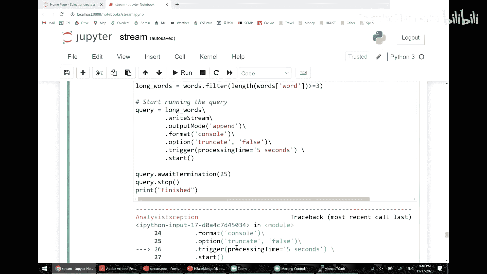
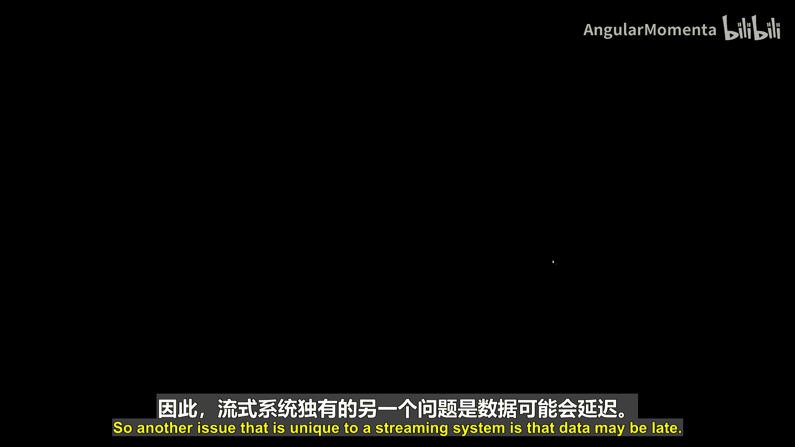
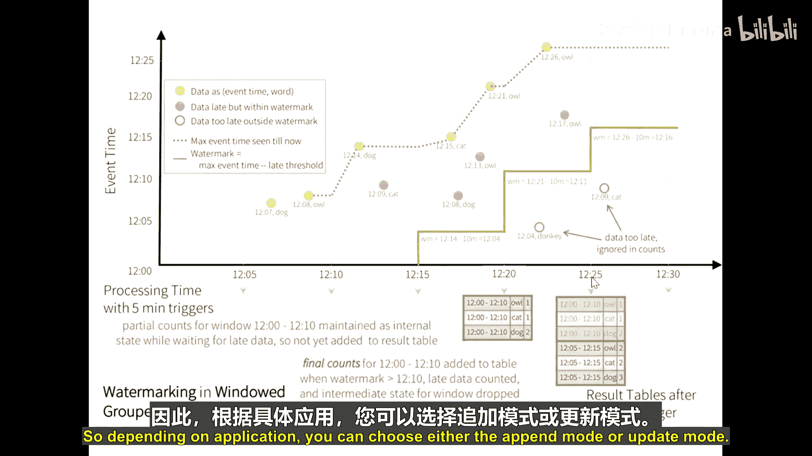

# 【香港科技大学】基于Spark的大数据计算--Big-Data-Computing-with-Spark-p22-09-03-02-结构化流处理--BV1V8FmzuEHf_p22-

So I mentioned that， you know， more， all the components are migrating from RD based APIs to sparkql based。

 But spark streaming， as we mentioned， described so far， is only based on RD。 But also。

 the new component called structure streaming。 This based on sparkql。 Okay based on data frames。

 So you it the idea is to。Model a stream as a unbounded table。 Okay。

 so that you can write SQL statements directly over streams。Okay， and。

When you write a sequel over a stream， the sequel will be executed after every batch。 Okay。

 every batch。 Okay， and there are different modes that can director that you can use to control how the how the query result is updated。

 The easiest one is complete mode。 So namely after every batch， we simply execute spark Sequel。

 simply not structure structure streaming， simply execute query on all the data that has been received so far。

 That's the complete mode。😊，And so here is one example。

 suppose you know let's still use word count as one example， so at this point。

 time point you have you know。1 can three dogs。 So the output is one can three dogs。

 And then at this point， in the second batch， you have two new words coming in。 our and cat。 Now。

 the new the results have been updated。 and it includes everything up to this point。

 So this is complete mode。 So now that complete mode is really the same as stateful word count involving the whole history。

 okay。嗯。So啊。Yeah， so I mean where I， I also have a。I have example， code。嗯。Which is here， Okay， so。So。

 so so there are some technical。There， there some technicality in setting up the query。 But anyway。

 if you ignore these things， the core statement is really。The same as a spark。

 right So we can use can use can you can still use select， you know， Exp。

 This is essentially essentially turning splitting multiple splitting a list into many rows。

 So converting a column converting a row into many converting one row into many rows。 Okay。

 many rows， because the lines is lines after split iss a list of list of words。 But anyway。

 this is the same as spark。 So if if you only look at this line。😊，This is identical to pro。 however。

 here， words is no longer data frame。 Word is actually words is actually， no， a line。 is actually。

Ls is read by stream。 So lines is actually a stream。However， it's， it is a。

it's a data frame like stream in the sense that it it is。 it can。

 you can use this stream as if it were a data stream， a data frame， a data frame。

 So you can use select。 It was Alias。 you can use， you know， group by can't。

 They are all they are all the same。 Okay， so actually very very convenient。 So as long as you know。

 sparkq。 You can， you can run anything。😊，Any sequel on the stream， as well。 of course。

 you need to specify the output mode。 So here I'm just using complete mode okay。嗯啲 f。complete mode。

 of course， is not really nice because the output size keeps growing。

 And you keep printing the same results again， again。 so the other mode， which is a pen mode。

 can be can be better suited in this scenario。 Okay， a pen mode the system will only print。

 will print new results。 Okay， so here have one example。嗯。Yeah， okay。

 So so a panel can only be used for SQL statements that do not change old results。 So， for example。

 word count doesn't apply。 However， if you simply use a filter。Then， this will。

Apply this You can use that pen mode because the filter。You can you， you， you， so essentially。

 you just， they just ask you this query on every batch and print out the new results。嗯。Okay。

 and the other mode is。The other mode is a。Yeah， okay。However， you cannot use。

Can you cannot not use a pen mode。You cannot use complete mode。

You cannot use a pen mode if you have a navigationgation， okay。Yeah， so country mode。

 not supported if。No aggregation。 So yeah， Okay。 So exactly the， they designed this this way。

 because if its no， no aggregation， you use complete mode， then you keep will， you will keep。

Printing the same results all went over。 So complete mode is only available when aggregation is used。

O。

So another issue that is unique to a streaming system is that data may。

Be late。 Okay， so there are actually two concepts， two time， two concepts。

 One is called one is called the event time， and the other one is called processing time。

 So event time is really when this event happens。 So this and。

The process time is processinging time is。When this event is actually processed。

 okay and the lateness can due to a variety of reasons。

 it may be delayed even from the source and the source maybe you may read data from Kafka or you may read the data from Soet and the Kafka server may be having some issue and they will delay some events may be delayed。

 and internally when you get the data internally， you know。

 some if some of your your workers has died， then you know。

 they will this events also maybe delayed because it takes some time for the system to realize that some work have died and they have to start a new server and take the job over。

 So there can be some delays here as well。 So you have to handle this delays in in in in a wellde fashion。

 Okay so so here is one example， suppose this you know， this dog 1204。This is the event time。

 So this is supposed this。Okay， this， this is， this is supposed to arrive here at 1204。 However。

 it's these two do out。 They only arrive in this batch。 So they are late by， you know。

 maybe 7 minutes。 Okay， so in this case， in this case， when we report results here on this。

This late event is not included。 Okay， for example， here， dog is still three。 only these three dogs。

 Okay， now this one， but this will eventually include here。So so。

 so here this this is actually a group by window。 So in this window from 12 to 1210。

 So now this count has been updated to 4。 okay so namely spark streaming is able to handle late events nicely So know that although this arrives in this window。

 this is is added to this to this window from 12 to 1210， not not this window。 Okay。

 So only the event time， namely is actual time when the time the time when this event was generated this was taken into consideration。

 Okay however， you can see that you cannot the system is not possible for the system to allow an arbitrary delay。

 because if an event can be delayed arbitrarily， then the system will have remember everything because。

Because maybe if you throw away yesterday' data， or maybe if some event is one day late。

 then you'll be run。 Okay， so to model this behavior more precisely。

 spark streaming uses this concept called water marking。 So name。

 so namely it it defines a late threshold。 Okay， so namely， I can tolerate。

 I can tolerate for example， a delay of 10 minutes。 Okay， and the guarantee is the following。 Okay。

 so the， the engine will never drop any data that is less than 10 minutes delay。 However。

 data delay by more than 10 minutes。Its not guaranteed to be job。 right。

 It may or may not be computed。And so essentially， this is a one sided guarantee。 right。

 We guarantee that anything within 10 minutes late will be accounted for how any event more than 10 minutes late may or may not be counted。

 So we do our best effort to， to to， to， to monitor this events。Okay， so here is a。

A picture of how to illustrate this is using a one example。 Okay。

 so here the why access is event time。And the X access is a processing time。 Okay。

 so we we assume we use five minute batch size。 So every five minute for five minutes is one is is one batch。

Okay， and so。So， so ideally， right， So ideally， the event time should be equal to the person time。

 That's when no delay is possible。 However， as you can see in in in many cases。

 it is above this Y equal to X line。 So that means theres some delay。 So， for example。

 this one is delayed。 right， So the the the event time is。😊，Oh， no， okay。 So this。

 the red ones are delayed。 So the yellow ones actually， they may even arrive early。

 So this is also possible。 Maybe， you know， clocks are out of sync。 So this is also allowed。 Okay。

 and the， the， the blue ones， they are， they are， they are delayed。 for example， this guy。

The event time is 1，120，8。But processing time is 12，16。However， it it defines this line。 So this is。

 okay， so first， let's define this， this， this maximum event time line。

 this maximum event time seen till now。 Okay， so namely， this is the latest time that we have arrive。

 we have seen。 So far， for example， at 1220， the latest event time we have seen is 1221。

 so namely by tracking the latest。😊，The maximum event time， we can， we can plot this blue curve。Okay。

 and。We move this blue curve down by 10 minutes。 That defines what is known as the watermark。 Okay。

 watermark。 So know that this watermark is only defined。 It's only computed at each time interval。

 Okay， so this is not strictly following the blue line， blue curve。

 but it is computed only at each triggering time。 Okay， by， by just subtracting this by 10 minutes。

 Okay， subtracting this by 10 minutes。And the guarantee is anything that is below this watermark line。

Will not be counted。 will not be counted。 Okay， so， for example， this one， this donkey， right。

 this event time is 1204， but it arrives at 1222， right， So this will be ignored in the count， okay。

However， if something is， suppose some event here， right， and in this case， it's。

 is actually more than 10 minutes late。 However， it can still be counted because it is above the water mark line。

So anything。 so， so the guarantee is anything below the watermark line will be dropped will be at least 10 minutes late。

 But some events above the water line watermark line may still be more than 10 minutes late。

 in that case， can they can still be counted because essentially。

 the reason that they compute the watermark line only at fixed intervals。 Okay and of course。

 this makes sense right， because we only do the computation at each at the at the batch level。 Okay。

 so within they batch， we actually the system actually。Return all return all data。Okay。

 so this is another example。 So actually， I took this example from， from the website of Sp streaming。

 but they actually made a mistake here。 So these two results should be should be by I fixed the error。

 So this is the difference between the two figures is this one is the update mode right in the update mode you the system is allowed to update previous results。

 Okay， for example， here at at 1215 at 1215， the group count。

 the group counts for the time interval between 10 and between 12 and 2010， they have been printed。

However， at 1220， another dog has arrived at 120，8。 That's the event time。 And this is actually late。

 Okay， so this dog was not included in the previous reported result。But still， it is， it is included。

That means in the in the update mode， the system is allowed to update the results。 Okay well。

 this can be both the good and bad thing depending on on on application。 It's a good thing because。

 you know， you can get some results as soon as as soon as possible。 So namely as 2，1215。

 you get the results for both this window and this and this window，12 Oh5 to 1215。😊。

That's the latest result。 However， these results are not guaranteed to be correct。

Because potentially， some late events may change the results。 Okay。

 so the update mode is good when you are eager to get some results。😊。

Although you cannot fully trust the results， they may be updated later。So they。

 they also they also provide aend mode， the append mode。The results never change。

 So that means everything reported must be correct。 Okay， you know。

 subject to the watermark guarantee。 Okay， so， but that this also means that you have to wait until no later events will happen anymore。

 So， for example， in a pen mode， then at 12 at 1220， only the results for this window。

12 to 22 to 1210 will be printed。Okay， although actually you already you。

 you already have some data at， for example，1215。Okay， and at， and at 1225。

 then you print a new results。For for the window from  from 12 Oh5 to 1215。 Okay， so namely。

 in the append mode， all the results are correct。 However， they， you have to wait。

 You have to wait until the threshold in this case。

10 minutes have have passed before you get the result。 Okay。

 so depending on application you can choose either the append mode or the update mode。

