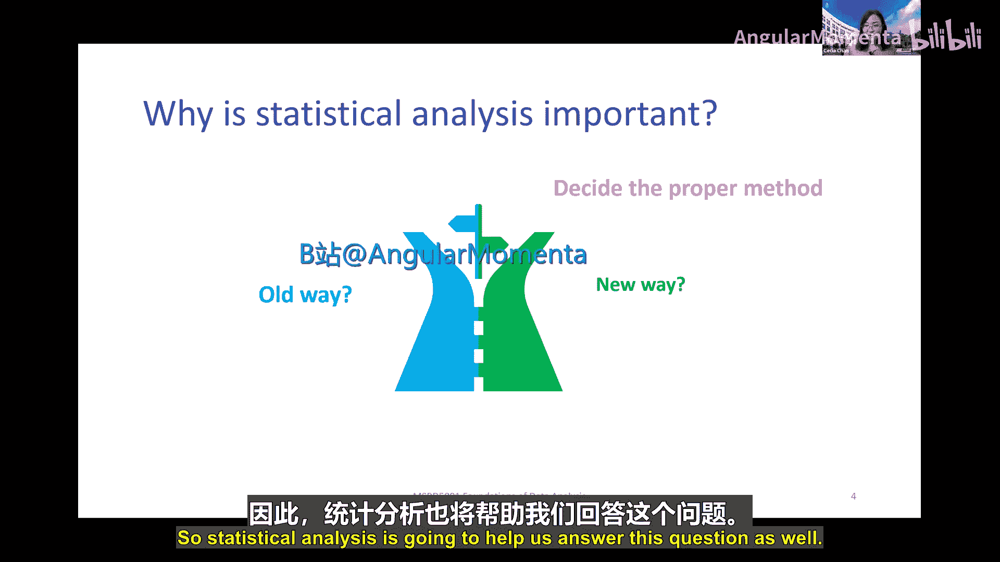

# 【香港科技大学】数据分析基础-｜-Foundations-of-Data-Analytics-p01-03-01-03-引言--BV1oKFDznE6L_p1-

。In this section we are going to have a review on some basic statistical analysis The reason we are doing so is because now we are going to do data analytics which means that we are going to do probably descriptive analytics predictive analytics and also descriptive analytics and then in order to do those analytics we'll need to use many different mathematical tools now probably you have already learned all these like mathematical tools but then you know we are not using it every day we are not using them every day so that's why well need to recall our memory on those like concepts so that is why we are going to have a revision on some basic statistical analysis。

😊，So first let's like discuss about statistical analysis so what is statistical analysis so like formally speaking statistical analysis is the science of collecting exploring and presenting large amounts of data。

😊，Which we usually call them data sets to discover the underlying patterns and trends。 Now。

 like we collect data in like nearly every discipline。 And then just collecting data is not enough。

 right， So with the collected data， they could be values about a certain like events。

 a certain situation about something And then now just having the data， the values means nothing。

 So well need to know how to like know and better。 So how to like explore what is the hidden meaning behind that。

 what is the like a data is like a giving us as information。 And then like besides that。

 even the collection of data is requiring some like。

Understanding of the domain as well so that is why while like in order to do statistical analysis。

 well need to know what kind of approaches are there。

 what things do we need to be careful of and then of course。

 how are we going to do analysis how are we going to understand our data and then to discover the patterns and trends now statistical analysis is actually used everywhere like it's used extensively in science and then from physics to social science now and then it's like a something that we heard every day right so when there are like surveys done by different organizations they will be reporting their findings and those findings are actually done by statistical analysis now in the following time we are going to discuss some major task in like a statistical analysis for example。

 first， the describing and summarizing the data and then secondly we are going to identify。😊。

F the relationship between verbals。 And then third。

 we are going to talk about how do we forecast the outcomes。

So why statistical analysis is so important as we have just mentioned now actually like well we have a lot of data around us and then we have a lot of questions in our everyday life as well。

 so then we'll need answers and then statistical analysis is actually helping us to answer our questions for example。

 like one typical question that we' be asking is all right so if I'm graduate if I graduate so what will be my salary and then people will be just using some historical data or some statistical analysis and then to give you the answer to the question for example。

 like based on the salary data that we collect from the graduates from the past graduates or this year's graduates then we'll get all the numbers and then we can take an average of them and then we'll get the idea of what is the average salary of the graduates。

😊，Example， say that it's 80000 then Ga will be using that to answer the question so then you will have an expectation of like what is the average salary。

 what is the like usual value for that Another reason for like why statistical analysis is so important is now once we know our data then it's actually going to give us some answers to like about how we make decisions as well Now if we are looking at multiple possibilities。

 different paths So which one should be the good one。

 which one should be the proper one So statistical analysis is going to help us answer this question as well。

