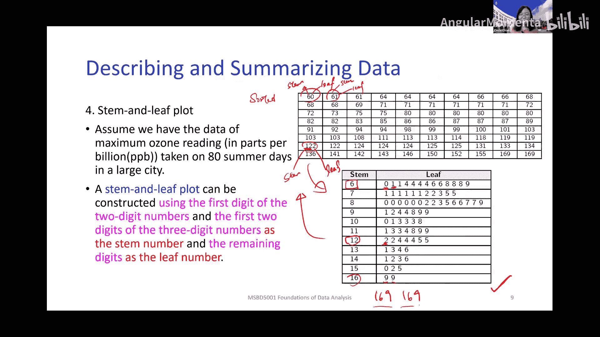
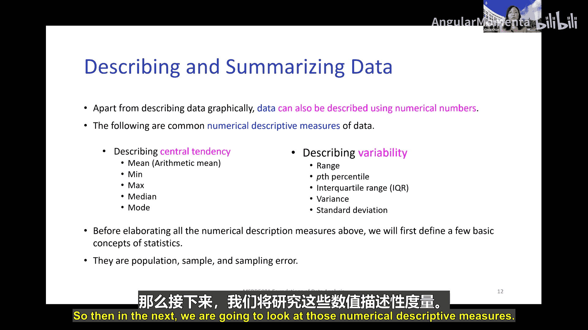
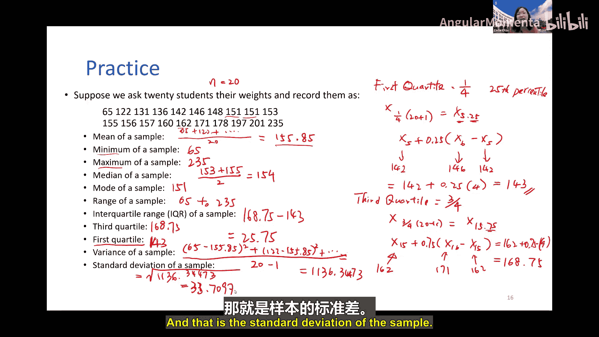

# 【香港科技大学】数据分析基础-｜-Foundations-of-Data-Analytics-p02-03-02-02-数据描述与汇总--BV1oKFDznE6L_p2-

So in the first part we are going to talk about how to describe and summarize the data and we keep on using the term data so what exactly is data or like the term data set what exactly are data sets now we can think of data sets as like a lot of numbers while they may not be necessary numbers they can also be a set of items now here we have two examples now suppose that we are asking 20 students about their weights and then we record them as the numbers before so we can see that we have 20 numbers here 20 different values or some of them may be the same but then this is 20 values so this is a set of 20 values and then we say that this is a data set of 20 observations。

And then what we have here is actually a sample okay。

 because we are only asking 20 students so then it's a sample and then the number of values that we have the number of values that we collected we say that it's the sample size and then we usually denote that by the character n。

 so then in here we have a sample of we have a sample of sample size 20。😊。

Another example of dataset could be like here in the second part here Now in this here how do we collect these data we are asking the students their hair color so then these 20 color names here are the response are the data that we have for each of the students so then again our sample size is 20 but then this time we are not having numbers we are having the color names so they can be strings they can be items right and then based on these two examples here you can see that these two examples are two are two different kinds or two different types of data so the first one here when we are talking about numbers then they are actually numbers right and then while they are what we call continuous values because now it's possible that one student。

It is 122 weight， is 122。5。And then it could be 146。1。 So that means we have all the numbers there。

 So then it's continuous。 So that means this data set here。

 we usually say that it's a continuous type of data well for the second set of data here we are having different values we don't have something in between like red and bro。

 there is no like oh so well when we are talking about the whole spectrum of color。

 So then probably is but then we are just talking about color names right So what is exactly in between red and black Okay so it's hard to say right。

 we are just having like a color names。 of course we can like order them in different ways。

 but then it's not exactly like the numbers which we have every value right So then we have discrete values So that is why this set of data is a discrete type of data。

So after we have collected data， we have collected the numbers or values based on questions that we want to answer。

 then well we need to do something right just looking at 20 different numbers。

20 different colorings it's not very， very helpful right it doesn't really like half a minute so we need to be able to like interpret them we need to be able to understand a bit better So that is why we use a lot of different ways to describe and summarize data So we are going to take a look at a few of them So when we have data very often we're just like organize the data in a table format。

 So for example， right now in this table here， we have three columns where each column is describing something the first column is about in group the second column is about the number and then the third coupler we have the corresponding percentage and then you can see in each row we are having a specific type of like。

Have information here， data here。😊，So for example， if the industry group is agriculture。

 then the number of disabling injuries is 130 and then the percent of total is 3。

4 so it's a very nice way to organize data in a like a manageable way in like a easy to interpret way now but then if we are looking at this table here you'll find that okay all right so then we have the numbers okay so we know that all right trade services has the highest number and then the percentage is larger as well now it's good that we know the numbers we know like which are larger。

 which are smaller and what are there like a values but then we don't really have like more information beyond that so that is why sometimes we'll be preferring to arrange our data to present our data in different charts。

Now charts is very good and then you can see that charts are something that like we like to use because it's actually like giving out a very easy like interpretation。

 not exactly easy interpretation but then it's like a eye catchting and then also like it's giving us like a more information than just the raw numbers for example。

 for the bar chart so then if we are presenting the same set of information in a bar chart。

 then we actually can compare the differences between different categories in a easier way so we can easily see that okay services is the one that is highest and agriculture is the one lowest while if we are exploring these numbers。

 we need to scan through the numbers one by one and then say that okay so this is probably the smallest number So then it's the smallest and then this is the largest number then probably is the highest So it will like it will require some time for us to interpret。

😊，RightBut then while for the bar chart， you can see that while chart pictures。

 it's easier for us to like get the important information there。😊，So that's the pie chart。

 How about pie chart So pie chart again we are presenting it by the like a percentage like you can see that because like a whole circle usually we use it to represent everything right so that's 100% So then like each slice represent the portion of that category out of 100% So that's why like we are having like for example agriculture is 3。

4% so it's a smaller slice while the services which is like with the largest portion than it's with the largest slice there So then again like it's giving us like like a easier way to interpret the important information there for example we see that okay so this is the biggest slice。

So then and then we know that this is like the services right and then now it's also giving us an idea on the relative size。

 for example， like we can see that okay so this is smaller this is larger so then again it's giving us more information and then bar chart and pie chart very commonly user and then they are very popular for presenting or describing data so we can see now table is it doesn't mean that it's not good it's good okay and then especially when we have very complex information a lot of data then it's good to present it in table right of course much better than just a sequence of numbers or a sequence of values but then sometimes if we want to emphasize certain like aspects of our data then we can consider using different kind of charts for example bar chart pie chart。

Besides bar chart and pie chart， there are also many other charts。

 so we are going to talk about some of them in the remaining time as well。

So another one that we are going to talk about is the stem and leaf plot so the name is very interesting right stem and leaf and in fact the idea is really like stem and leaf so we have the stem stem and then we have leaves okay so how are we going to use like stem and leaf in representing the data now say right now we have 18 values so these values are referring to the maximum oone reading taken on 8 summer days in a large city So right now we have those8 numbers there and then we have them sortded so you can see that we have them soded okay。

😊，Now， these 18 like 18 numbers， if we are going to store them。

 so then that means we need to store them individually as 18 numbers right So then it's going to take up some space Now think about how we store values right So then what if you have like 1000 numbers So then you need more space to store the numbers as well。

 So then like in order to like a compress the storage of storing the values。

 then we can make use of stem and leaf plot， which is something like this one in the bottom here。

 Okay， so this is a stem and leaf plot So then how do we get this one。

 How do we like convert this one into this one， the idea is that when we take a number for example 60。

If it's a two digit number， then we use the first digit。As the stem。

And then the remaining one as the leaf。So which means that now the stem of the number 60 is 6。

 while the leave is0。 So then we。Have the 60 stored in here。

According to its stem six and then we add the number0 here。

 so then doing it the same way with the remaining numbers so how about 61 so then6 is the stem and then one is the leave so we add the next number here。

Okay， so then we keep on doing that for all the numbers。 Let's pick another one as an example。

 So how about let's do it as the 1，2，2。 So it's a free digit numbers。

 So we pick the first two digits as the stem。 So that means1，2 is the stem。While2 is the leaf。

So then we have this number here put into the ST 12 and then the leaf2 here。Okay。😊。

So then we are doing it for all the numbers。 So then this is what we have as the stem and leaf。

 Now we can see that here instead of storing them as 18 separate numbers。

 we are kind of compressing the like storage So because now each stem here Okay。

 for each different value of stem， we are going to store the single digits of the leaves right。

 So then okay， we are going to compress the storage we are we are compressing the storage of the。

Okay numbers。 and then another thing is that now the good thing about stem and leaf plot is that what we can convert the numbers back anytime we want。

 So say we have this stem and leaf plot， then we can just like convert back and get and all these numbers by combining the stem and leaf。

 for example， let's take the stem 16。 so then we can combine 9 and then we know that there is a 16。

9 and thens another nine we know that there is another 16。

9 so therefore we'll be able to also convert this back to the numbers so then that's also the advantage of stem and leaf plot。

 It allows us to convert the numbers into another representation。

 but then we are also able to convert this representation back to the numbers。

So as we were mentioned， so what is the characteristic。

 what are the characteristics of the stem and leaf plot would that be the following advantages。

 The plot can be constructed very quickly using pencil and pen so then you can see that while we can just scan through the numbers and then we'll be able to construct this stem and leaf plot it's not complex and then the values of each individual data points can be recovered from the plot right so we can do it we can get back these numbers so nothing is lost and then the data is arranged compact since the stem is not repeated Okay so only the leaves are repeated but not the stems so again the numbers are arranged compact and then you can see that it's easy to interpret as well。

So that these are the advantages of the stem and leaf plot。

The fifth one that we are going to talk about in representing the data is the scatter plot scatterpro is actually very useful for like presenting the relationship between two like a variables of a data set so do we mean by two variables that means two different data so like within a data set so say for example we are looking at the heights and weights of 57 baseball plays so heights is one variable and then okay weight is also a variable because the values are different for each different people so then if we want to like learn about the relationship between the heights and weights then we can use scatter plot so how do we get the scatter plot then we use the two values of the two variables for each player。

And then use them as the Caraceian coordinates and then plot the points on the chart so then you can see that here。

 so we have like 74 and then 21 280 then we'll be putting it on the point， for example here。Okay。

 so this will be that point。And then we have 75 and 185。 So then it will be this point。Around。Here。

So sorry， that should be this point。So it should be disappointing instead。Yeah。

So should be this point so this will be the 75 and 185 and then we also have the 74 and then 218 and so on。

 so we put like every pair of numbers on the chart here。

 so then we have the scatter plot scatter plot。Now when we are looking at the scatter plot it's actually like giving us a lot of information besides just a point now we can think of like we can observe。

 we can try to observe like out of the scatter plot What is the shape of the data So any special pattern around it Okay and then like does the data have a direction and then are the points close together or scatter so like for example。

 first let's look at direction do we have a direction for the data so direction means that okay is it like this in this direction I it here。

Or any direction so we can say that well right now its it looks like that it's kind of like this direction And then okay。

 so what kind of shape it is right so then well we can see that it's kind of like aligned it's kind of scattered like it's kind of like close towards a line so we can say that it's actually having a shape of a line but then it could happen that like it could be like some data it could be a shape of like any lift or any other kinds of shapes right so then it's telling us like a bit about what is the shape。

 what is the direction and how about the string other points close together or scattered so we can say that okay most of the points are actually close together but sometimes we may see a scattered plot with all the points scattered around and then that will again tell us something。

😊，So you can see the previous five ways are either presenting the data in the numbers in a summarized way or like in a grouping way or like it's it's presenting describing the data graphically so based on like what we want to like present or what it's like applications then we may use different ways of like describing or like presenting the data now besides using the graphs or like tables very often we'll also use like some other numerical numbers to describe the data so then in the next we are going to look at those numerical descriptive meshes。

So for like a numerical descriptive measures like there are two categories of like measures。

 one is for describing the central tendency， another one is for describing the variability of the data Now I think like most of you are very familiar with these like a numerical descriptive measures for example。

 for like describing the central tendency we wants to know like the middle points of the data right or like what is the like most frequent data in the data set and then things like that or like maximum minimum so then that's all these measures about the central tendency like me or we call it arithmetic mean the minimum maximum median mode all these measures are giving us information about the central tendency of the data。

And then sometimes we also wants to know like the variability of the data。

 so for example like what is the changes of the data like what is the differences between like different data points。

 so then we'll be talking about the variability， then we'll be talking about we'll be using these like a numerical descriptive measure such as range。

And then like the percentile， the intercota range variances or standard deviations to know like the variability of the data。

 but then before we are going to like briefly talk about each of these numerical descriptive measures will need to first define a few basic concepts of statistics first and those concepts are population sample and sampling error。

So for these three terms， population is regarding the collection of all individuals or items under consideration in a statistical study。

 so for example， let's say that we know we want to know like the heights of the all the people in the university like for example in HUST so what is the average height of all the people in HUST so then every people all the people of HUST will be the population but then we know that like for like all the people in the like HUST is going to be a few thousand now it may not be possible for us to collect data from everyone。

So that's why very often when we are doing study， we are going to like just collect information from part。

😊，Of the population， not everyone， just some people。 So， for example。

 we are going to like select 100 people and then who is like in Hong Kong USD and then asked about their heights。

 So then this 100 people will be the sample。 so we can see that here sample is the part of population from which the information is collected。

So then because we are just collecting part of the we are just collecting data from part of the population。

 then it may not be able to represent exactly for the whole population so that means there might be sampling error so sampling error is reflecting the fact that the result we get from our sample is not going to be exactly equal to the result that we get。

放。Measuring the whole population。 So if we are able to collect all the seven， for example。

 it's around 7000。 So if we are able to collect all 7000 people's heights of H USD。

 then the value that we get will not be like all the statistics that we are we get will not be the same as might not be the same as the data that we get from 100 people。

Okay， so that's like a population sample and sampling error。

 So you can see in here like in the diagram。 So say the whole population now we originally we want to like collect data from the whole population that means 12 people。

 But then we just select， for example， like。4 of them。 So that means we just pack every every foot。

 Okay of them out。 So then we are collecting the second one， the fifth one and 8 and 11 so on。

 So then that means we are selecting the people out of the samples out of the population in a particular way。

 And that particular method is called sampling method。

 That means it is the procedure for selecting sample elements from a population。

So let's take a look at another example， So say for example like a school is going to have a poll to find out what students like I eat at lunch。

 so then like 70 students are randomly chosen to answer the poll questions so then what are the population and the sample of this study so then the population is of course all the students at a school so it could be a few hundred or it could be a few thousand depending on the school so then what is the sample the sample is the 70 students that were asked the poll questions so that means the sample size is 70 so then what is the sampling method random Okay so random sampling。

😊，So let's describe the like a numerical descriptive measuresss in detail。 So in this slide here。

 you can see the formal definitions of all the descriptive measuress including the central tendency andtro including the ones for the central tendency and also the ones for the variability So then let's look at them one by one so I know youll have already know them。

 but then let's treat it as a revision。😊，So then now say that we have a sample of some of size n。

 So that means we have n values collected and then we can represent them by x1 x2 x up to X X N。

 Okay， so then say that we have these n values。 So then how can we calculate the mean of the sample。

 Then it's adding all the values together。X1 plus x2 plus x3 and so on until we have added up to xN。

 And then because there are n values， so we divided it by n。

 and that's the mean So how about the minimum then we go through the whole list we go through all the values and then find the smallest one and that is the minimum of the sample for maximum is just similar we go through all the n values and then find the largest one that is the maximum How about the medium medium of a sample we are talking about the middle number but then it's not just the middle number in the like a set of values is the middle number of the softed list of all those values So what are we talking about here is saying that So we have three values so say that like we have x1 is 10 for example。

 x2 is 5 and then x3 is 15， for example so then。Okay， to find the medium， we first sought them。

 So that means we have the5 first and then 10 and then 15。 So we have sorted list。

 So then what is the middle one。 This one is the middle one。 So this is the medium。

 Now we are having an odd number of like a values。 So then we have the medium。

 But then what if we have an even number of values。 So that means we have x1。

 And then say that it's 10。 and then x 2 is 5 x3 is 15。

 But then say that now this time we have four values， we have 10。

So then that means now if we again sort them together get sort them and then have them sort it。

 then that will be5， 10， 12 and 15。So then now what are the values in the middle。

 two values 10 and 12。 So then what is the medium， Then we just add them together and then divide by2。

 So this is what we mean by a simple average of the two numbers。 So then that will be 11。

 So 11 will be our mediumn。Okay， of this sample。Right， so then that's median， so how about mode。

 so mode of the sample is simply the number that appears the most of a in the set of sample in all the values among the sample。

And then for range， then we have already calculated， we get the minimum。

 we get the maximum and then from minimum to maximum。 that's the range of the sample。

 So the next one that we are going to talk about is the percentile。

 So we are talking about P percentile of a sample。 So what is P percentile of a sample means it means that that value。

 the P percentile is a value。 And that value is roughly having P percent among the samples with values smaller than that P percentile。

 And then while 100 minus p percent of the sample are larger than that value。 So say， for example。

 we have， say，10 values。Same Michael， for example， we have that menu values，11 values。

 So then that means like if this is the。😊，30%， 30 percentile。Okay，30 percentile。

 that means there are 40% of the data points say that this is solided。

So then there are 30% of the points which are smaller with the value smaller than that 30 percent of。

 and then there are 70% of them being larger。 Okay， so then that's like the P percentile。Now。

 with P percentile we'll be able to calculate the In quota range IQR IQR of a sample。

 Now Intel Qta range means the like a range from the third quota for from the first quotta to the third quota So we calculated by first finding the first quota。

 and then the third quota and then we will be able to calculate the inter quoile range。

 So then how do we find the first quota， So the first quotta is the median of the first half of the data。

 So which means that it's actually 25th。Percentile。Well for the third quarile。

 then it's the it's the median of the second half。 So that means it's going to be the 75th。Pcentile。

Okay， so then once we have find those two percentile。

 then the first quatile and the third quatile will be able to calculate the intel quatile range right so then using the same like a using percentile So you can also see that now if we are talking about the zero percentile。

 So what is it。So which means that there is 0% of values that are smaller than that。

 So that means it's the minimum value of the sample， right， So how about the 100 percentile。

So that means all the numbers are smaller than。Okay， it's smaller than it。 right。

 So then that's the maximum value。 So then how about。50%ile。

So 50 percentile means that 50% of the values are smaller than that， so which means median right。

 so then 15 percentile is the median。Right so then that's the percentile now besides percentile and inter quariles。

 then another like a descriptive measure will be the variance So we are talking about the difference between the like a value and the mean so then if we have already calculated the mean then we simply just take a value take each of the value and then calculates the difference between that value and the mean value the mean of the sample and then square it and then sum all of them and then divide by n minus one and that will be the variance so standard deviation is the square root of the variance okay。

So then these are the definitions of the descriptive measures。 So like next。

 let's look at some examples。 So then on this slide here， we have 20 numbers right。

 So then just the like a previous example。 So we have the 20 numbers。

 So that means our sample size N is 20。 Okay So then let's find the mean minimum maximum or the descriptive measures。

 So then first， what is the mean So mean is just adding all the values up right。

 So then that's 65 plus 12，2 plus all the numbers so on and then we divide it by 20。

 So that means the number here。Is 155。85。 And that's the mean。 So how about the minimum。

 So we go through the whole list， and then you can find the minimum value is 65。 The smallest one。

 And then what is the largest value among all these 20 numbers and 2，3，5 is the largest number。

 So that's the maximum。How about the median。 So for the median value。

 So that means we are trying to find the middle。 So then we are having even numbers。

 So the middle would be the average of the 10 number and also the 11th number So that means Now we are having the least softest。

 So that's why it's easier for us to find the values。 So then it's one15，3 plus 1，5。

5 divided by two So then it's 1，5，4 So that's the median How about the mode So then we scan through every numbers and then'm trying to find the one that is appeared most frequent So then you can see 1。

51 appeared twice so that's the mode of the number of the sample well for other values they just appeared once So 1。

5，1 is the most frequent one。How about the range， We already have the minimum。

 We already have the maximum。 So the range is simply from the minimum to，2，3，5， the maximum。😊。

Alright， so then the next one。 So then let's look at the in quota range of like the sample。

 So then how do we find the in quota range， So first， we want to find the first quatile。

 So how do we find the first quata。 So there are actually many methods in finding the percentile。

 So we are going to use one of it。 Okay， so but then if you are looking at different。

 like a references or different toolss， then you will find that they are going to use like a probably different ways of calculating it。

 So let's use one way。 Okay， so then if we want to find the first quatile。

If we are finding the first quat out， that means we are finding the 25th， so one fourth okay。On four。

 so then came a quarter a quarter。 So then that's actually also referring to like the 20th。

Percentile。Right， so then to do it。 So first we try to find like the value of the data of the sample。

 which is like around the first quartile。 So that means it's going to be  one，4。Multiply by 20 plus1。

So that will actually give us like a floating point number of 5。

25 so then okay well we don't exactly have the five the 5。2。

25 number right so then well we first okay so just take the integer part and then which we find the x5 so the x5s value is 142 so which is 142。

And then we find also。6 value。 So that means we take the next one and then find the difference between the next number and the x 5。

 So x 6 and x 5。 So x 6 is 1，4，6， while we have already get the x 5， which is 1，4，2。

 and then we take the。Like a floating point part， the 0。25 out and then have the 2。5 have the 02。

25 multiplying by the difference and that will give us 142 plus 0。25 times4。So that means it's one4。

 free。 So this will be the first qua out。 So then  one，4，3 is the first quatile。Right。

 so then we do that similarly for the third quatile。 So for the third quatile， it's just similar。

 It's about the。34 of the numbers， right， So then again。

 we are trying to find the free4 out of 20 plus  one。 So which means that we are looking at 15。75。

 Okay， so then again， we just find the。X 15 first， so x 15 is here。This number。 So then it's 1，6，2。

 and then okay， again， we text the next number x 16。 So that means it's 1，7，1。And then x 15 is 1，6，2。

So then we deduct the difference and then take the。0。75 here and then do this。

 so then that will be 162 plus 0。75 times 9。So that would give us 168。75。

 so that would be the third quata。So once we have calculated the third quarter。

 so then we'll be able to calculate the in quorile range。

So the intel quaar range is we take the third quatau。Which is 168。75 minus-143。

 So that will give us 25。75 and that will be the in qua power range right So then for the variance。

 then we just like a we have already calculated the mean， which the mean is 155。85。

 So then the variance is that we take each of the number Dduct。The meat。And then okay。

 square it and then plus the next number and then again， doing the same thing。

 calculates the difference with the mean and then continue to do it for all the numbers and then divided by 20 minus-1 because our sample size is 20。

 and the value is。Okay， one。It's going to be let's write here， 1136。34734473 okay。

So for the last one， the standard deviation since we have already calculated the variance。

 so then we just need to like have this variance and then take the square root of it。

 so which means that we are going to take square root of1136。34473 and that will give us one 33。

7097 and that is the standard deviation of the sample。

