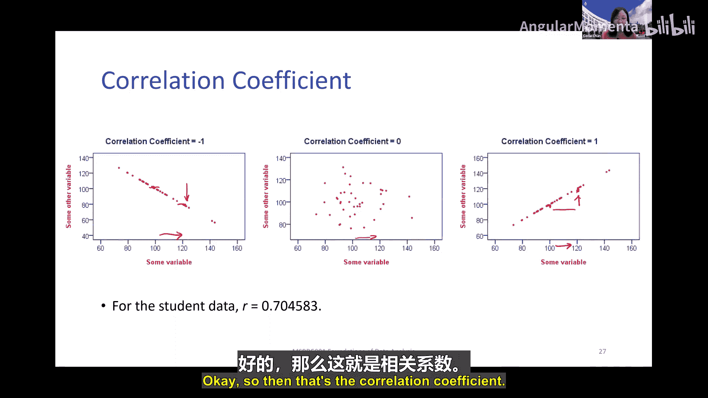

# 【香港科技大学】数据分析基础-｜-Foundations-of-Data-Analytics-p03-03-03-02-线性模型--BV1oKFDznE6L_p3-

So in the next part let's discuss about the relationship between variables so let's try to identify the relationship between variables but first let's talk about variables now we collect data about a particular subject like previously we have been collecting the ways from baseball players so then the ways is variable so then when we collect data we are collecting data from a group of people but then we normally collect more than one kind of like subjects for example like well we could be collecting data through a form or a survey which like there are many questions or many items that we are asking like a group of people to fill in so then each item or each question on the form or survey is corresponding to a variable so because we have many questions or many items so then we have many variables let's say for example we。

Having a form and then we are asking students of a university to fill it out so then the items that we are asking the students to fill in could be like their heights。

 their weights their gender their major department their GPA etc so then each of them is available so that means we have the weights as a available heights is available gender like it's available major is available GPA is also available。

Now when we have a variable then we can use the descriptive statistics like the mean max。

 standard deviation， like an interquta range， etc to describe the variable so let's say for example we can like a look at the mean of the weights and then we can look at its maximum minimum and then we can look at the standard deviation of the weights and so on we can also like a look at the weight at the mean of like the GPA we can look at the median of GPA and then the entire quota range of GPA and so on as well so we can of course like look at the descriptive statistics of each variable individually separately but then sometimes we may also want to look at the relationship between the variables like for example we may want to look at okay so two variables weights and height of students and then we want to see whether there is a relationship between those two variables。

Weights and height now very often we'll be using like a x Y to describe to represent those variables。

 let's say that we use the variable x。To represent heights and then the variable y to represent weights。

 so then we are looking at the relationship between the variabless x and y。

So then now how do we investigate the relationship between brows recall that previously we have discussed about different ways to like describe data we have been talking about tables charts n also scatter plots the fifth way is the scatter plot so then we say that okay so we've scatter plots we can plot the values of heights and weights of each student or each player on the scatter plot so then we have a point so let's say that now we are having the heights as the x variable weights as the y variable so that means for each like a student or baseball player then we have a pair of values the heights and weights then we use the heights as the x coordinate y as the y coordinate and then we can put a point on this graph here。

So then for each of the。Subject which of the person So then which of the people then we have a point of X and Y。

 So then we put all the points there， then we have a scatter plot right So then okay we are looking at this scatter plot and then record that we' will do observations we'll try to observe whether there is a specific form that means the shape。

 I it a linear shape， I it like a es or other kind of shapes or and then we may also wants to observe。

 what is the direction of the points and then also like other points scattered or other points close together So then let's look at this scatter plot here So by looking at it okay。

 so probably align align so then。For example， it could be something like this。

 So of course it's not a very strict lines， but it could be something like this。

 So that is why like okay so it might be worth to try the linear model Line model a line So then what is a linear model So a linear model is a way for us to like represent try to represent all the points on this scatter plot so how can we represent it So then we are using this Y is the sum of a plus bx plus E So what is a a is the y intercept the intersection between the line and the y axis B is the slope the steep how steep is the line and then E is the random error So why do we need a E So we know that y like as a plus Bx is a line a strict line But then why do we need a E So let's go back to this scatter plot here you can see。

Now， while we won't be able to have just a straight line representing all the points。

 you can see all the points are a little bit far away slightly away from the line。

Most of points are slightly away from the line。 So that means they are not exactly on the line。

 So then we'll need a way to say， like， how far is that point from the line。

 So then the E is to represent the like a represent that。 So how far away is that point。

 So you can see like if we are just estimating the。Y。

 based on the x coordinate and the a y interscept and this slope B。

 then the like a estimated y will not be exactly the same as the y value that we have for each point so then we'll need to add the E a slight difference to make that as the like an actual value。

 so then that is why we have the E added。So then with the Y added。

 that means we are having a different error for each point。

 so then we'll be able to use this model to represent all the points in a scatter plot okay and then of course if there is no error。

 so then y would be a deterministic linear function of x so that means y is just a plus Bx。

And then now let's also like mention another thing is that now we have the two variables x and Y。

 you can see that y is calculated from X， so that's why we called Y a dependent variable while X。

 well it's not dependent on y so then it's independent is's an independent rub。So now。Okay。

 so let's go back to here。 So then how can we like find a line So how can we like represent it by a line then Kate。

 well you can see what we have just done here， we are kind of okay。

 so oh is there a line that is going to fit right and then well we kind of like a estimate that right but then of course we have ways to do it in about like a more public So then the first way is like an eyeball fit。

 which is actually like quite similar to what I have done Okay estimating it and then draw a line but then we are doing it in this like a steps So first we pick two points on the plot on the scatter plot so that we are going to have a line passing through that and then that two points should be a good like a fairly good line Okay should give us a fairly good line。

Okay so then we take the pull points， for example， we say that we have the first point x1 y1 values and then we have the second point with x2 y2 values。

 then we'll be able to calculate a slope so this is the slope so y2 minus y1 divided by x2 minus x1 then that's the slope so say for example we are picking the two points 68 69160 and 78225 then we can calculate it as like you know x1 is 69 and then y1 is 160 and then we have x278 and then y2225 so then we can calculate the slope as 7。

2 so now we have the slope then we need to calculate that y intercept so then we just take one points out of the two points that we have already selected say the first point for example。

So then we use the first point plus the with together with the slope。

 then we'll be able to calculate the y intercept。 So that so then like this， right。

 So we have the y intercept。 we have the slope already。 So then we know the slope is 7。

2 in our example。 and then the x1 value is。So this is B and then this is X and then we have the y1 as 160 and we'll be able to calculate the y interscept as minus 336。

8 so then we have a we have B then we have the line Okay so this will be the line so then you can see the line is like this so we are picking two points and then that line pass through the two points right oh so sorry this point。

And the 69 right this point， so we have the line parsing through it， okay。

Now this is one way but then you can see if we pick two different points it's going to give us probably a slightly different line。

 so then this line may not be the best So then we might need a better way to find a better line right so then that's why we have the second way to do it the second way is called the least square feet the idea is that we are trying to find a line such that it's going to minimize the error。

 So that means what is a So that means the like a distance or like the discrepancy between that point and the line So how far away so then the total like a discrepancy of those points from the line。

😊，So then that's the error right so each of the points is not exactly on the line。

 So we say that there is an error so we want to find a line so that all the points are not that far away from the line and then to be like exact then each point is given is having an error towards the point the line So then we want to find a line that the total error So that means the total discrepancy from the points to the line is going to be the smallest。

 So we minimize the error S。 So what is the total error So we know that now each point say。

 for example， we are looking at point。One， x1， so let's say that we pick a random point， X， I， Y， I。

So we know that if we are using the X I and then to predict to like estimate the y。

 So then y will be。A。Plus B X， I。Okay。😊，Now that value will be different from Y I。

 so that means we are going to use the predicted Y and then to like calculate the difference between the Y I。

 so that means this will be the same as a plus B X I minus Y I。

So then this will be the error okay for each point， but then this could be a negative number。

 so we want the positive number， so then we take the square。And then we have end points。

 So then we just add all the points together。 So that is why we are going to do that with I S1 to N。

 So that will be the。Total error。 Okay， so then we want to minimize this error。 So then， okay。

 how do we like do this， We want to find A and B。 So here we want to find A and B。

 So we want to find the A and B values such that the total error is going to be the minimum。

 So then to do it。 we take the derivative of S respect to a。 Okay， and then we set it to 0。Okay。

 so then。We have this equation。Okay so then similarly we do that with respect to B。

 so then we take the derivative of S with respect to B and then again set to0。

 so then we have this formula。So now we have two formulas right and then we want to find out A and B Okay so then we will be able to do so right two formulas to variables so then we have this and this A and B okay so then with A and B you can see that they depends on the x1 to x n values and y1 to y n values so that means we'll be able to calculate A and B okay so then say for example using the previous data then we'll be able to calculate that B is this value A is this value and then this will be our line okay so this will be the line。

Okay which will be like this， the green one， so you can see the green line is not the same as the orange line which we have obtained based on pickinging two points so then this green line is the line that is minimizing the total errors right so then you can see this square fit is going to give us like a more accurate line or a better line。

Now let's go back to looking at the like the list square fits。

 so you can see that now with B and A like this we can actually like represent B and A in this form as well。

 so if we look at this then youll find that what is this。Deenominator。

 denominator here is actually the covariance。The covariance of between x and y。

 and then this one here， if you still recall the6 variance。Offer， browbble。Of x。

 so that means B actually is measuring the variability can be like a calculator from the variability。

 And then we have B， then we can also calculate a from the mean value of y and also mean value of x right。

 So then that's alternative representations for A and B。

 so you can see also it confirms with the concepts of like the line and the errors。

 Okay So then this is the least square feet And then like why do we want to find lines。

 So think about this if we are able to find a line to represent these like a points。

 We are able to find the linear model to represent lines。

 So let's say that well you have the value x of another points so then you can use it to estimate the。

Responding value in the y variable Okay， so that's like a why do we want to investigate the relationship between the two variables。

Another measure that we use to like investigate the relationship between two variabless is the correlation coefficient now correlation coefficient usually we denote it as R it measures the degree to which two variabless movements are associated now。

If we take a look at the definitions of the correlation coefficient。

 you will find that it's actually dividing the covariance。Of tolerance between x and Y。

And then divide it by， you can see this is the variance。Of x。 And then this is the variance of y。

And then we are actually taking square roots， so which means that this is actually the covariance divided by the standard deviation。

Standendard deviation of x and the standard deviation of。Why？Okay。Now。

 when we calculate after we have calculated the our value according to the like covariance and then standard deviations。

 and then like we get the value， so then you will find that the value is between minus1 to one。

So then okay， when r is equal to1， it means that there is a perfect positive relationship between x and y。

 so what does what is the meaning of this is that when there is a positive increase of one in one variable。

 say x， then there is also a positive increase of one in the other variable， say y。Okay。

 so then they increase together。 So then how about when R is -1。

 So it means that there is a perfect negative relationship。

So it means the two variables are going in the opposite direction。

 so it means that for every positive increase of one in one variable。

 then there is a negative decrease， so that means there is a decrease of one in the other variable so then okay increase of x correspondingly a decrease in y。

😊，So then how about in between。 So that means r is close to0。

 So it means that there is little relationship between the two variabless。 Okay。

 little relationship or no linear relationship between the two variabless at all。

 So then for every increase in one variable， there is no positive or negative increase in the other variable。

 So then that's correlation coefficient。 So by based on the R value well know how the two variabless are changing together。

So this is a measure that we use very often for measuring the correlation。

 the relationship between two rubs。So now let's take a look at the corresponding like a graphs of like different our values。

 so like on the left hand side you can see that it's the graph of having two rows with minus one of the correlation coefficient so you can see like for every increase in the。

😊，variableable， then you will see that there is a decrease。 So say， for example。

 originally it' here then now is here。 So that means it's going to be a decrease in the other variable So what if we are looking at correlation if coefficient zero So then when there is an increase in like the one variable。

 then it is hard to say what is the increase or decrease in the other variable So that means like there is no relationship between the two variables Now how about correlation coefficient with one。

 then you can see that here now we have this increase of the one variable then it will be corresponding to an increase in the other variable so you can see that here。

 So then that means every increase in one variable is like a corresponding to a corresponding increase in the other variable then we are having the correlation。

ff one now if we are doing the like you're using the students data， the heights and weights。

 and then we use this formula to find the R coefficient。

 the correlation coefficient then the correlation coefficient is 0。

7 so that means well there is like kind of not a perfect relationship but then there is a strong relation between the two levelss right By the way。

 so right now when we are doing correlation coefficient we are observing the like a graph in the middle that there is no relationship。

But then you know that for data analysis， so sometimes well we may be able to find a hidden relationship through the other methods okay。

 so then like by like that's why very often we'll be using different measures to look at our data because say。

 for example， we are using correlation coefficient。

 we cannot find a relationship between the two variables。

 but then we might be able to discover a relationship by using other methods okay so then that's the correlation coefficient。

