# 【香港科技大学】数据分析基础-｜-Foundations-of-Data-Analytics-p04-03-04-02-概率--BV1oKFDznE6L_p4-

So in the next part part three we are going to look at forecasting outcomes。

 so when we are talking about forecasting outcomes we want to know how likely something is going to happen so that's why we are going to look at probabilities so then before we look at the probabilities then we have to look at these terms experiment。

 sample space and event。Now what is an experiment So experiment is an action where the result is uncertain。

 So then okay， well， so say for example， an experiment could be flipping a coin Okay。

 so then well we are not going to be certain on when we flip a point what's going to happen Okay。

 we don't know for sure so then that's an experiment And then now what is a sample space。

 then sample space is all the possible outcomes of the experiment。

 we usually denote it as S so for the example of flipping a coin then okay， well。

The sample space that the means it's involving two possibilities， two possible outcomes。

 either a head or a tail。 So then the sample space of flipping a to。

 flipping a coin is going to be like head。我跳。Okay， so then it's with like say that we use H represent hat and then T represent tail。

 then the sample space of flipping a coin is going to be H or T okay H T。

 So then let's look at some other experiments， for example， the second one row a six sided die。

 So that means well if we load a rowa die。 Okay， so then that means。

That means there are six sides right so then the six sides are the six like numbers1，23，4，5，6。

 so therefore for this experiment here there are six possible outcomes either the upsided is like one or like the two or three or four or five or six okay so then how about now we are not not only rolling one die but then we are rolling a pair of dis a pair of dis so then okay what is the what are the possible outcomes then that would be a combination of the two like numbers it could be like both dies have like the number one and then one of the dies is number one one of the dies is number two one of the dies is number one and three and so on so then that means we have all these possible outcomes then there are actually。

36 pairs of ingers，36 pairs of like numbers。 So then that means there are 36 outcomes right so then the sample phase of rolling a pair of six sided dies is going to have 36 outcomes right。

 so then we have discussed what is experiment， what is the sample space。

 how about a event now a event is a subset of S So say， for example。

 if we are talking about flipping a coin then just having a head is a event because it's just one of the outcomes。

 one of the two outcomes， So it's a subset。So say let's look at the second example of the experiment rolling a six sided die。

 then like when the like a rolling result is either one or two。

 then one and two together is the event of the having the a rolling of a die giving the outcome of either one number one or number two then this is a particular events so again the outcomes are just a subset of the total outcomes so then for the third experiment rolling a pair of six sided dies。

 then a possible event could be like we are looking at the sum of the two upphas should be giving us either seven or 11 so then again it would be like giving us a subset of S Why is that is like what combinations what。

Of values is going to give us the sum of 7。 Then it could be like one。6。

 and then it could be the first die is6。 Second one is one。

 And then besides these two pairs of values， we can be looking at。For example， the first I is free。

 while the second one is4 or 43 or like 5，2， or 2，5， right。

 So then these are the possible outcomes of having the sum S 7。 So how about 11。

 So then we are having five plus 6， and then6 plus5 right。

 So then there are no other like a pairs of values that is going to give us within  one2。

6 giving us the sum of 11。 So then these are the。Posible outcomes for the events of having some of up phases as as  seven or 11 right so then again you can see that we are just having one。

2， three， four， five， six，7， eight eight outcomes while all the outcomes involve 36。

So now after like discussing what is experiment， what is sample phase and what is an event。

 then we are ready to discuss the probability Now， probability is the measure of how likely an event is to occur and then。

😊，Is to occurred out of what out of the number of possible outcomes。

 So that is why we need to discuss about the outcomes and then experiment， sample space and event。

 So because we need all those things So then in another representation in another words。

 it is probability is the ratio where we compare how many times an outcomes can occur compared to all possible outcomes right So that means like if we have a particular events there will be representing the want outcomes while we can have all the outcomes in the sample space right。

 So then the probability is the number of want outcomes divided by the number of possible outcomes。

Now， when we are talking about probabilities， there are some facts about probabilities。 Now。

 the probability of a particular events is a number between0 to one， Okay， between 0 to one。

 and the probability of the sample space， sample space， that means。Okay， for all the events。

 for all the possible outcomes will be one， because the number of wanted outcomes will be just the number of possible outcomes。

 right， If we divide the number of possible outcomes by the number of possible outcomes， Of course。

 it's one。So then another facts about probability is that if two events cannot occur at the same time。

That means the probability that one or the other occurs is the sum of the probabilities of the individual events。

So this means that if we are looking at the probability of A or B， so say A is an event。

 B is another event， then if those two events cannot occur at the same time then P or A or B will be just P probability of a plus probability of B so you can see it' the sum of the event。

 the probability of each event and then you can see we are actually representing the probability of event by P okay so then you can see that here PA is the probability of one event。

 PB is the probability of B event and then if we are talking about the probability that one or the other events is occurring and then they are not occurring at the same time they cannot occur at the same time then it will be like this so then let's look at some examples so then let's look at the experiment。

This is the experiment。 recall that。 This is the experiment and then okay， what is the sample space。

😊，So we know that the sample space is 1，2，3，4，5，6 right so all possible outcomes And then let's take a look at the event。

 So the event is we roll a six sided die and the outcome is the value that we have is either one or two K one or two So then what is the probability of that event。

 Now well need to know what is the probability of each possible outcome。

 So right now we have six outcomes and we that we say that the probability of the sample space is one。

 So that means this here probability of the sample space S is going to be one and then we have six outcomes。

 So then。Assuming all outcomes are equal likely to happen。 Okay。

 So then that means each of the events is going to be one divided by 6。

 So the reason is the probability of the samples space is actually probability of。1， and then。Okay。

 plus probability of two and then probability of three and so on。Okay， and then equal to one。

 and then assuming that all of them are the same。 So that means each of its probability P1。

Is going to be one divided by6 and that is why all of them are the same so then we have this one here。

So given the probability of the six events so sorry， the six outcomes the same。

 so then we'll be able to calculate the probability of a。

 So that means it's either event one or two so two out of the total six outcomes。

 So these are the two events， so then we divide it by the total number of events。

 the total number of outcomes6 so then the probability of a is one over three。Now。

 we are rolling a fair diece， right， So that a fair die。

 So that means like each number is having the same probability of a appearing。

 How about we are rolling an unfair die。 So that means like the probability of each。

Side is not the same。 let's say that we are looking at something like this。😊。

So the probability of having the outcome one and outcome 2 or outcome 2 is either is 0。

25 a little bit higher right and then probability of the outcome3 of four is 0。

15 a little bit lower and then probability of5 or6 is going to be even lower 0。

1 then what is the probability of8 okay so then its the probability of one plus probability of2 the outcome one and outcome 2 so then which each of them is 0。

25 so that is why we have 0。5 okay。Now we can calculate probabilities like this。

 but then you can see it's not that easy to do so in certain situations like calculating probabilities can be difficult can be hard because we have different outcomes and then when the event is becoming more complex and sometimes we have to add the probabilities of different outcomes and then sometimes we have to multiply them so then it's a bit hard to figure out what to do so then in order to help us like in order to like help with this then we usually construct a tree diagram so a tree diagram is to like put down the probabilities of different outcomes and then like the probability of like the outcomes we are usually writing the outcomes as the branches so say we know that if we are flipping a talk we are flipping a coin so you can see we are we are tosing a coin flip a coin。

And there are two outcomes recorded for this experiment， we have two outcome either than head。

Or tell。Okay so that means we have two possible outcomes head or tail so we put down each of the outcome and then we add a branch okay and then we put also the corresponding probability of the outcome so say that we have like a flipping a fair coin so that means there is an equal probability of having a head or having a tail So that means then flipping a flipping a coin and then we have the hat as the outcome the probability is 0。

5 so we put 0。5 for the arrow pointing towards the head and then for the other outcome tail then again we have a branch pointing to the tail and then the probability is 0。

5 So then this show us what are the outcomes and then what is the probability of having that outcome。

So next， let's look at an example of。Frippping。Twice， okay， so we flip a con twice。

 So then that means we have two tosses of a coin。 So then let's first look at the outcomes of the first toss。

 the first flip。 So then it's either head or tail。 So then after having a tail hat for the first time。

 if we flip the coin again， then again， we'll be either having hat or tail。

 So that means after this first toss。 we are going again to have two different outcomes。

 either hat or tail。 Okay， So then because well every time we flip a coin。

 then the probability of either having hat or tail is just the same Okay so then it's 0。5 for hat 0。

5 for tail。 So then again， we put the 0。5 for head and then 0。5 tail。

So then we do it similarly for the first toss of having the tail and then again we add the hat and tail so which means that after flipping a coin and then we have the outcome of tail and then we flip the coin again we are going to have either the hat or tail Okay so then again0。

5 probability for each of them so that means in total if we are talking about four two tosses of a coin then we have four outcomes so you can see that here we have four possible outcomes in total。

Okay so either the first tos is a head second tos is again having the outcome of a head or the first tos is the head second tos is the tail and so on。

 so we have all of these， so then how do we calculate the probability of each outcome。

So then if we are talking about the。Okay， outcome across along along the branches。

 that means we are having a particular path， for example， like this， so then we have the first 0。

5 second arrow 0。5 we do multiply。Okay， so that's why you have the hat hat。Outcome， then it's 0。

5 times 0。5。 And then say that we are looking at another branch。

 Let's say that this time we are looking at the tail。 So then it could be。Like this。

 So that means we have the first 0。5 having the tail and then 0。

5 probability of having the second pose as had。 So then we have the tail head combination and then again multiply multiply So then that means we have 0。

5 times 0。5。Okay， so now each of these like a combination。

 each of these possible outcome will be able to have the corresponding values corresponding probability calculated。

 so each possible outcome is of the probability 0。5 times 0。50。25。And then now recall that the。

Total probability of all the outcomes is one right So that means if we go down towards all the probability possible outcomes。

 So we have four possible outcomes，12，34。 And then if we are adding all the probability of the outcomes that will give us one。

 So we can verify that right， So then 0。50。50。50。5。

 and then we add them together that will give us the total probability of one。 because four outcomes。

 these four outcomes are all the outcomes of our sample space of the experiment flipping the coin twice。

 Okay so then you can see it confirms with the facts that adding up all the probabilitybabilities of all possible outcomes。

 give us one。Okay， now what if we are talking about getting the probability of getting at least one hat from two horses so they will need to look at well。

 which of the outcomes are we talking about。So then we are talking about。Now。

 the having at least one hat。 So which one is giving us at least one hat。The first one， right。

 Ha hat， more than one hat。 And then second one， we have one hat。 And then the third one。

 we have the second tos with the hat。 So again， one hat from two tosses。

 while the last one tell tell， This is not the one that we want。 So then we just pick these three。

 and then we get the probability of each outcome and then we just again add them together。Okay。

 so then that's 2。5 plus 2。5 plus 2。5。 So then the outcomes。

 the probability of having at least one hat from two tos is 0。75。

So let's have an example on illustrating how we can use the three diagrams to like deduce the probabilities。

 So let's say that like let's look at the problem setting here。

 So we are having like 30 blue balls and 50 red barss in a containers and then like the 30 blue balls are identical So then the 50 red barss are also identical and then the like a sizes of the ball all the bos are exactly the same except the color Okay So then we mix the bos So then we have 80 boards right。

30 of them are blue 50 of them are red and then we draw three balls without replacement。

 So what do we mean by without replacement。 So it means that we take out say for example。

 we have many， many bos。In it， so then we take one out。😊，So then we have here one ball。

 So then that ball is gone from the container。 So then if we pick another one out， So then that is。

 again， gone from the container。 So that is what we refers as like a we felt replacement。

So then what we want to do is to determine like the probability that the boards。

 the free boards are all of the same color， So how are we going to like a work on it。

 so we try to build the three diagrams So first we know that we have a branch for proof Okay。

 so which means that。So we have the branch。And then it's going to give us the blue balls。 Okay。

 so this is one outcome。 And then okay， we know that because 30 out of 80 will be blue。

 So that means the possible outcomes are the free40 blue balls。

 While the wanted outcomes are the 30 blue balls while we have 80 possible， right。

 So then the probability of having the blue ball is 30 out of 80。Now， to represent it in short。

 do we just use speed to represent blue？So then we have another branch。

 which is to give us the red ball。 So we use our to represent that。

 and then we have 50 balls are red。 So then that means the probability is 50 out of 80 okay。

So then now the second ball could be either blue or red。 So that means again。After the。

 this is the first。😊，嗯。哦。RightSo that means after the first ball。

 then we may again have either blue or red。😊，Now， this time。

 we will need to determine the probability now， because we have taken one ballre out。

 So how many balls are remaining remaining。 So the number of balls。In the container。After。

Drawing the first one。I's going to be 79 right， So we have one last ball。

 So then let's think about this。 Now we know that we have 79 balls remaining。

And then because the first four is blue， the first four is blue。

 So which means we have one last ball。One less blue ball。嘿。😊，After the first draw。In this situation。

Right， if the first four is blue， so then we have one last approval ball。 So then in that case。

 then that means we only have 29。Out of 79 will be blue balls for the second ball。 right。

 So then that means the poverty is going to be 29 divided by 79。

 So how about for the second ball to be drawn is of red color。 So then we know。Still one last four。

 but then Kate。The red balls are the same because the first ball drone is blue， not red。

 So then we have 50 out of 7，9，2 B rap balls， right， So then okay。

 we continue to do it for the second ball on the red branch。 So that means these two。Blue and red。

 And then we can work on the third brow white right。 So then for the third ball again。

 it could be blue or red。 So then you can see we have this here。

 and then we can fill out all the probability。Like this。Okay。

 so we can fill out all the probabilities。 then we'll be having all the free balls as the outcomes right。

 so then we can take a look at the diagram here。😊，So this is the three diagram we have built right so you can see that here if the first bore is blue okay so then the probability is 30 divided by 80 for the second ball to be blue as well then because we have one less blue ball so then that's 29 out of 79 after drawing the ballre for the second time we have even one less ball so that means two balls out we have 78 balls remaining and then because the first two balls are blue so then we have two less blue balls so that's why it's 28 divided by 78。

😊，So then that means for this outcome here， this is blue， blue， blue。Free balls are blue， right。

 And then we have the second outcome as the blue blue R。 So then the next one S B R B。

And then the next one as B， R， R， right， And then similarly， R， B， B， And then we have R， B R。

 and then also R， R， B， and then also R， R， R。 So then what are we trying to find。

 we are determining the probability that the boards are all of the same color。

 So that means is either B， B， B or R， R， R。Right， so that means these two outcomes are the wanted outcomes。

 right， So then what is the probability of each of this outcome。

So the probability of having the free b bowls is multiplying the probability on the branches right so that means this one this one and this one so that means we are multiplying this with this and this so that means 30 out of 80 times 29 out of 79 times 28 out of 78 so that's 205 203 divided by 4108 so then the probability of having three b bowls is 0。

0494 so then how about having the probability of free rep balls so then we are going along this branch so then this branch and then this branch so we are multiplying this number。

50 out of 80 by 49 out of 79 and also 48。Out of 78。

 So that means it's going to give us this number 0。2386。

 So now we are talking about the probability of all。Bows with the same color。

 So it's either this outcome and this outcome。 So then we are adding them with some。

We sum the two probability。 So then we just add this one plus this one。 So that's 0。0494 plus 0。2386。

 Now why are we adding them up because it's not possible to be having free wrap balls and free red free blue balls at the same time。

 right， So it's either free blue balls or free rap balls。

 So then those events cannot happen at the same time。 So we do addition。 So then the。

Prob of having the same color of free balls is 0。2880。

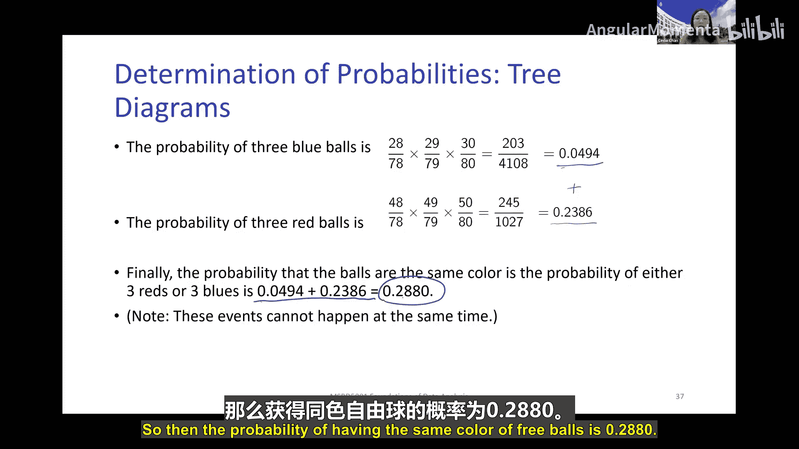

So you can see now with the three diagrams， it's going to help us to deduce the possible outcomes because sometimes it's hard to deduce all the possible outcomes so we can do it with the three diagrams。

So next， let's look at the term independence。 So very often when we are like talking about probabilities。

 very often we'll be mentioning the term independent is variable independent of another variable。

Or whether two events are independent of each other。

 So then what are we talking about here is that let's go back to the previous final tree diagram。

 So this is the tree diagram。 So when we are looking at the events of。The嗯。

Probabilities on the branches。 So then we call that。Conditional probability。

 So what do we mean here is that now let's look at the probability of this here。 Okay。

 so then the probability of B， the second ball to be B。

 like it's depending on the probability of the first ball。 So given the first ball is B。

 So that means we have the first ball drawn， it's B。

 and then we go to look at what is the probability of having the first ball blue。

 and then the second ball is also blue。 So that means like based on the condition of the first ball。

 then we'll look at the second ball's probability。 So then it's a conditional probability。

 Okay So that means like for the previous example here， if we use B2 to represent。

Sense that the second ball is blue and then B1 to represents that the first ball is blue。

 then the probability of the first step upward branch is the probability that B2 occurs。

 given that B1。So that means this probability here。Okay。😊，Is the probability。

 given the first ball is strong， then we have the second ball as blue。

 because if the second balls previous ball， the first ball is not blue。

 then we'll be having the red ball。 And the second ball as blue， you can see that here。

 it's another probability。 So then depending on what is the first ball。

 We have different probability for the second ball as blue。

So then we represent this as the conditional probability。

 which we represent as the probability of B2 given B1。 We usually use the term given。

 and then when we write it， we write it as B2 bar B1。 So that means the probability of B2 given B1。

 Okay， so that means the probability of B2 events given the event B1。 Okay， so then now if。

For two events， if the conditional probability of the event given another event is just equal to the probability of the event itself。

 so that means we are looking at this if probability of B given a is the same as probability a B。

 that means the knowledge of a what a happens or what A happened。Is not going to affect B。

So that means the knowledge of a will not change the prediction of B。

 then A and B are independent events okay because B does not depends on A A is not changing B so then let's take a look at an example。

So now let's look at the second ball is being blue。In the final three diagram。 So then okay。

 for the second ball to be blue， Then we are looking at this and this， right。 So then okay。

 we look at each of those outcomes， probability， right along the branch。 So we know that。

For the second ball to be blue， given the first ball is blue that its probability is 30 divided by 80 times 29 well it's 29 divided by 79 but then we all need to calculate the probability of this outcome is going to be multiplying these two numbers right and then to have this one here again we are multiplying the two numbers so that is why we have this。

Probability， okay， so we take 30。Multiply by 29。Divided by 79。

 and then plus because we are taking these， right， So then we add them up。 we add them up。 Okay。

 so then we add 50 divided by 80 times 30 divided by 79。

 That would be the total probability of the second ball being blue。 Okay。

 so then we have this and which is 30 divided by 80。

 But then we mentioned that the conditional probability of having the。诶。Blue ball as the second ball。

 given the first ball is blue ball is actually 29 divided by 79。

 So then the two probabilities are not the same。 So that means B1 and B2 are not independent events So they are dependent because of course。

 right， So we are talking about without replacement。

 So that means the like after the first ball being drawn。

 it will definitely change the probability of having the second ball drawn。 Okay。

 so that's why it's not independent events， they are dependent events。

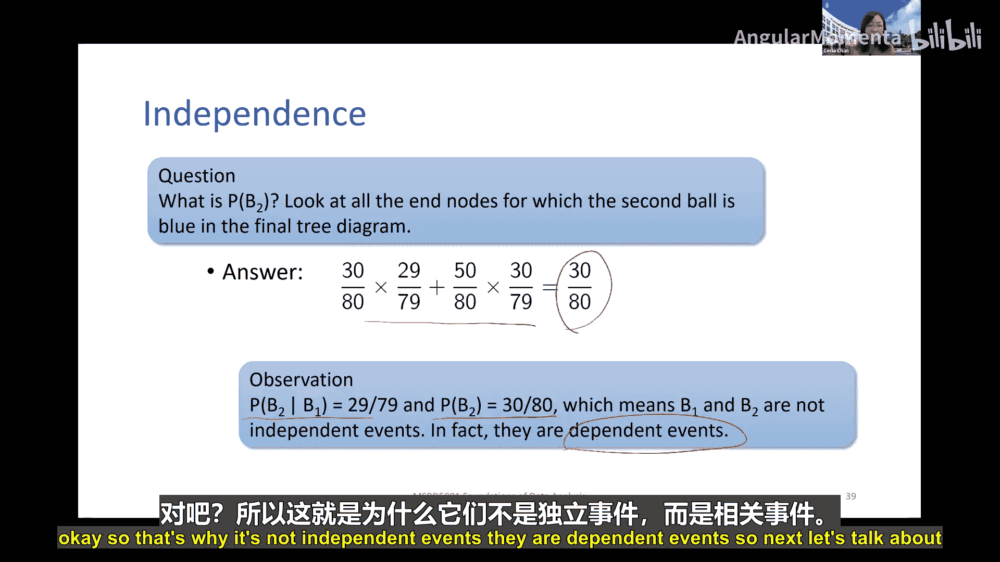

So next let's talk about conditional probability a little bit more so then let's say that we have two events A and B and then we want to determine the probability of B given a right so then like a the conditional the like to calculate the conditional probability we can actually like a find out the probability of。

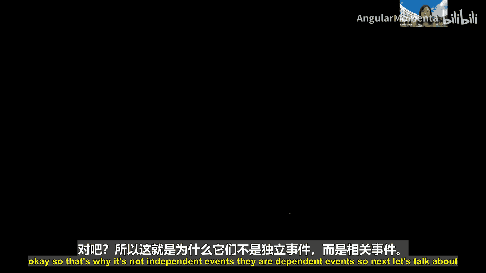

A and B， these two events2 cos and then divided by the probability of the given events。

 which means the a events。 Okay and then like so assume that like So how can we find these probabilities。

 So then assume that we can repeat them experiment many， many times。

 So that means we can do counting。 So we can count how many times the events A occurs and then count how many times among the events A occurs。

 B also occur。Okay， so then we have the P A and B， So which means when a events happened。

 how many out of them， how many of them are also having the be event B happening。

 So then well be able to have P A and B。 So then we can all like because we have already counted the PA events as well。

 So then we' will be able to calculate the P B divided by a。

Now we can actually make use of these to check whether A and B are independent events Now。

 if A and B are independent events， you will find that the PA and B divided by PA is actually just PB。

 So because you will find that PA and B is just the same as the probability of the events A and the probability of events B Okay。

 so if A and B are independent events， then we'll be able to find this。Okay， right。

 so then these are the this is the conditional probability and then let's take a look at an example。

😊，Now the problem here is that say that we have an airplane and there are three engines and then each of the engine is functioning independently of the others。

 so then the probability of an engine fails in flight is 0。

0001 luckily is that small right so then furthermore。

 a plane can fly with at least one engine functioning so then we want to determine the probability that the plane has a successful flight。

So the problem here is that we want to determine the like probability that the airplane has a successful flight。

 So which means that because at least one engine is functioning。

 then the plane can fly successfully right So then that means while at least there is one engine operating。

 then well have a safe flights。 So that means like it could be with just one engine functioning。

 it could be having two engines functioning two out of three and then having all engines functioning。

 So then the one that we wants to exclude。 So that means that we don't want to happen is all three engines fails right So then the events of having all free engines fail。

 is not the one that we want to consider So which is the like a remaining like outcomes in the sample space。

 if we think about the sample space。 it could be the first engine like。

All three engines are not failing and then the first engine is failing。

 the two other engines as are functioning。 it could be the first engine functioning。

 second engine fails engine functioning it could be like two engines out of three are failing。

 for example， engine one engine free failing while the engine two is working and so on so we have many。

 many outcomes， So then if we are going to have the successful flights。

 that means the only outcome that we don't want to like be considering is all engines fails。

And then because it's the only remaining outcome。If we are comparing that with having a successful flight。

 so then we say that it's the complement of eight。So A， the complement of a。

 which is the remaining events in the sample space that are not covered by a。

So then we are considering the events of all the free engines fail。

 The reason we are finding this is because if we need to like find the probability of at least one engines operates。

 we need to elaborate a lot of outcomes。 But while if we are going to find a complement。

 there is only one outcome。 So it's actually easier to calculate。

 So then let's say that we are looking at the probability of this outcome。

 So then we know that we have free engines。 and then let's represent it as B1， B2 and B3。

 So then B1 means that the first engine fail B2 means the second engine fail。

 and B3 means the third engine fail。So then the probability of having all engine fails is the probability of a complement。

 and which means all three engines are failing。 So then we it means that all three events are occurring。

 Okay， So that means we are looking at n。 So while B1 is happening， B2 is open also happening。

 B3 is also happening。 once we find the probability of the a complements。

 So then we'll just need to deduct it from one because the sum of all possible outcomes is one。

And then we want to take this out。 So then the remaining probability is the probability that at least one engine is successful is not failing。

 Okay， so then how do we calculate the probability of all three engines are failing。

 Now we know that from the description from the question there。

 like all three engines are independent of each other。

 So that means if the probability of one engine is failing as 0。001。

 this engines failing will not be affecting the other engines failing probability So then while we can just multiply the probability of each of the engines failing situation separately So then we have Pb1 PB2 Pb3 and then we just multiply them So then that would be the probability of having the pre engines。

Fils failed independently。 So then the probability of all fan engines fails。

 you can see that it's a very， very small number。 So then we just have one deduct P B1。

And P2 and then MP3 right So then that means we just take one out take 0000 one out of one。

 So then the probability of having a successful fight is this one It's a very good number right so then that's how we can like。

Okay， use the like independence like this idea with the probability calculation。

So let's talk about random variables Now in many problems。

 there are usually only a few events of interest and they are usually characterized by like a variable So then like what is a random variable so in statistics we usually like write the random variable as the variable x and then it is a variable whose possible values are numerical outcomes of an experiment or we can say it like this that we can like for random variable it means that the outcomes can be associated with a numerical value so that's to look at some examples。

 let's say that we are looking at rolling a pair of dies， So then when we are rolling a pair of dies。

 then the sum of the phases is going to be either two or three or four or up to like a。

And so on up to 12， so therefore there are only if 11 possible outcomes and then there are only 11 events of interest。

So then like if we say that the x， we use the variable x to represent the sum of the upphas。

 so then that means the events of interest can be expressed as of x this variable equal to2 or this variable x equal to3 or this variable equal to4 and so on or x equal to 12 so that means x is characterizing the events of interest and then we call this x a random variable okay now you can see because we are having numerical values so then random variable comes in two types。

The numerical values with the types。Decte or continuous。

 So then that means we have discrete random variabless or continuous random rebels for discrete random rebels。

 we know that that means the values of interest will be whole numbers。

 So there are a limited possible values while continuous。

 it means that there is an infinite possible values， or we are talking about every point on a line。

 So then that's continuous random rebels。

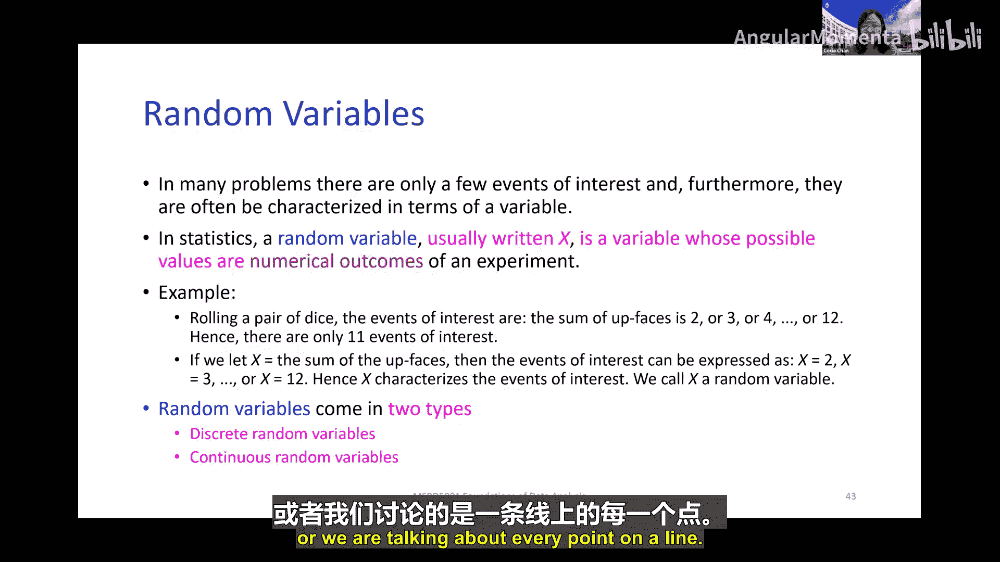

So let's first take a look at the discrete random rubs。

 So we are going to look at the discrete probability models。

 So then now the example on the previous page is rolling a pair of dies and then assuming that the dyes are fair。

Okay so that means the probability of having like any of the one to six numbers is the same。

 So then if we are talking about the random variable x of three Okay so that means we are looking at the sum of up phases as3。

 So then that means we are looking at the probability of the outcome with the two dies either having the first one with the up phase value of one。

 the second one with the up face value of two or the opposite two value two for the first dies up phase and the value one for the second die of face so then for each of these outcome we know that the probability of having the first number one is16。

 while having a second dies with the number two is also one6 So that means it's one over 70。

6 so then we have the two events， so then the total is two out of 36。

If we use a similar way of finding the probability of all other values for the random rubber X。

So that means the random variable x to be 2，3，4 and so on up to 12。

 then we'll have all the probabilities like this。 So for the x of2。

 so which means the sum of up phases is 2 So then there is only one outcome right so it's just the outcome 11 So then one out of 36 outcomes is just one divided by 36 So then we can do this similarly for all the things So then you can see we list out all the probabilitybabilities for all possible values of x。

 So then we call this the probability mass function or probability mass distribution。

The reason is like it's a function because given the value of x， so say we are looking at x is7。Okay。

 so then we can look up the value x with7 in the table， and then which will give us this value。

6 divided by 46。 That's the probability of x equal to。S。So which is6 divided by 36 Okay。

 and then usually we also write it in an alternative way。

 So you can see this one here with a lowercase P。 So then p of7。 So is6 divided by 36。

 So that is the probability of the random variable to be the value 7。 So then okay。

 now this like we have the probability mass function willll be able to find the probability x assumes the value x。

All right， so then that's the discreteet probability model。Yeah。

So now let's think of the problem in this way now say that we have a probability model。

 so we can also think of it as having samples generated by a probability model。

 and then we are having some parameters to characterize the model。So then let's use an example。

 right， so let's say that we have a spinner and the spinner is going to give us like either one。

 two or three。 So then a spinner like this。😊，So print spinner is something like this right so then okay let's say that we have three numbers of the spinner so you can see that here we have three like a slices of the circle with the free numbers and then if we spin it so then it's going to give us one of the number so the first one is free if we keep on doing this okay so then the second number and then the first number and so on so then if we keep on doing this then we'll have a set of numbers。

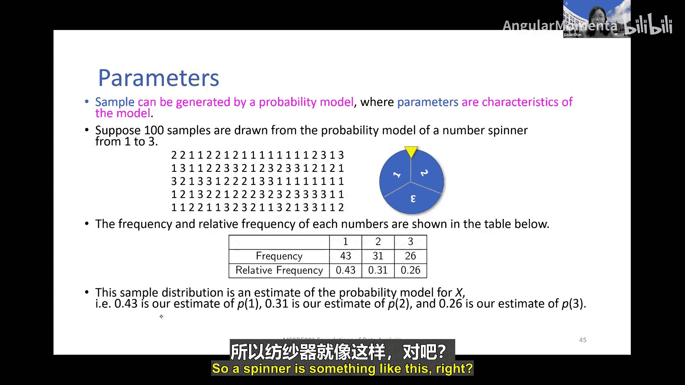

So let's say that we use the spinner and then okay to generate 100 samples。

 so that spinner can be characterized by a probability model。

 So then okay we have these 100 values so then we can like a calculates the frequency and relative frequency of each number as this so we count how many times the number one has appeared in a 100 sample。

 then there are 43 times that one is a period。So then。

Because the frequency is 40 43 and then we have 100 samples。

 So that means the relative frequency is 0。4 free， so we can do it similarly for the number two and number3。

 So there are 312 appearing in the 100 samples。 So then frequency is 31 relative frequency is 0。

31 similarly for free。 there are 26 of them。 and then the relative frequency is 2。026。

 So then we can use the x， this random rub to represent the。Samples。

 the numbers being like a a one and then two or three as the values。

 So then that means the probability of x equal to one。Which means the small P of one。Is  zero point。

Ffe。Al， so then we have the estimates of the probabilities right。

 so then we have the probability model here and theyre estimated by the sample distribution right。

So if we have the random variabless with their values and also the probability of those like random variable values。

 then we'll be able to find the expected value or the mean of that random variable So we usually write the mean of the random variable as E X or by mu okay so then if like we do a simple thing as before we observe n random values of x So that means we have like a n sample So then x1 to x n and then the so sorry so we have like n random value So that means the different outcomes the different events of the random variabless So then like for this previous example then we have the one。

2 or three right So then we have x1 x to n x3 being one，23 So then。The mean of those three values。

 though the mean of those n random values will be approximately equal to the expected value of x。

 okay。As defined below okay， so then that would be the sum of the event values of the random values from one to n and then okay we sum the random value Xi by the probability of that random variable value。

So then that will give us the estimated expected value。 So of course。

 if we are just picking 100 samples posts now it's not a lot。

 so then it may good may it may not give us a very good estimates of the probabilities Okay it may not be a good estimates of the probability model of the spinner。

But then if we are having a large enough number of samples。 So say that we have 10000 or more。

 So then that will give us a good estimate of the probability model。 Okay， and then in here the。

Px X will also represent it as ethicx， so that ethicx is the probability of the variable x。

 so that means Fx is the probability function of x given the random value then we'll have the corresponding probability so it's a probability function。

Now， using the previous example， the spinner example， so we have 100 like。Samples。

 and then we have the values  one or two or three。 so then we can calculate the sample means。

 So if we sum all those 100 events and then that will be 183 divided by 100。 So that will be 1。83。

 So the mean of the 100 samples is 1。83。And then okay。😊，Okay。

And then like we can also calculate it in the following ways as well or like I recall we have this expected value there。

 so we can also make use of this so we have one to n so n is free because we have the random value1 x being1 x being2 and then x being3 so that means n is3 in this situation so then okay we just have the x S1 times the number of events and then like the count of that event and then two which is the value the random value of x S2 times is corresponding frequency plus3 times the corresponding frequency and divided by total number of samples or we can use the previous formula so this is X。

X1 divided by the probability of x。Being X I。 So then that means the probability of x。Equal to1。

 and then this is x2 times probability of x equal to 2。

And then probability of free x3 times sorry x3 times the probability of x equal to3。

 So then we have already calculated the frequencies right 43，31，26。

 So then that's 43 out of 100 will be the probability of the event of the random variable x having the value1 and so on。

 So then we'll be able to again calculate that as。1。83。 Okay。

 so you see that it's actually the same as this， right， Okay， so then K mu。😊，Is the expected value。

 The mean of the probability model。 So then mean is also the parameter of the probability model。

 So parameters are used to characterize the probability model。

 and then mean mu is one of the parameters。It's not it mean another parameter is the variance。

 So variance is another parameter of the probability model。 So then variance of a random variable。

 we are writing it as V are x or by sigma Sigma square。

 So then it is a measure of how spread out the values are right so then the recall that it's about the variability。

 So how like how different are the values。 So then it's answering the questions of are the values of x cluster together around their mean or there are far away from the mean Okay So then the variance measures how far the values of x are from their mean on average。

 So then how do we calculate the variance。Then it's the expected value of calculating the variance right so then it's the x。

 the random value minus the mu and then square okay so then to calculate that then it actually can be calculated by this formula。

😊，So then we pick the random value one by one and then deduct the mu， the mean out of it。

 and then take the square and then times the probability of that random value。

 and then sum all them up， then that would be the variance。

So let's again use the previous spinus example as like an example and then we know that by previous calculation mu is 1。

83 so we have already calculated in here 1。 x3 so then okay we know the free values is x11 x1。Is one。

 And then okay。So x1 is one and then x2 is 2 and then x3 is free right so then we have the one minus x1 minus mu and then x2 minus mu and then x3 minus mu and then take the square and then this is the probability of x。

S x1， so which is probability of one right and then similarly for the probability of x x2 and then which is probability of2 and then similarly here this is the probability of x S x3。

 which is probability of3 Okay so then we already know how to calculate the probability by the counting right sample counting So then we have the 43 divided by 100 and so on So then calculating all these then the variance is 0。

6611。So you can see that now we have the mean and variance。

 these two like parameters is going to characterize the probability model of the spinner。

 so it' is telling us the central tendency and also the variability of the probability model of the spinner。

So now let's look at a probability model called binomial probability model。

 so a binomial model is characterized by trials and then those trials either having an outcome of success or failures then we can apply the binomial probability model so then what do we mean by trials here so it means that we are like a having an experiment and the experiment is containing n trials consists of n trials and then each row as we have mentioned is either giving us an outcome of success or failure and then the probability of success。

Is the same from trial to trial。 So every trial， like the probability of having a success for each trial is just the same。

 Okay， it's remaining constant from like a trial to trial。

 and then all the trials are independent of one another。

 which means the knowledge of one trial is not going to affect the probability of another trial。

 So then these are the beonial trials beonial trials of the binomial model。

 So if we are looking at problems like this。And trialsus。

And then each trial is either success or failure， and then all the trials are independent of each other。

 and then okay the probability of all the trials of success are the same， then it's a binial。

 it can be applied with the binomial probability model。So that in the binommial probability model。

 the binomial random variable that we are having here X is the number of successes in the n trials Okay so which means that over the n trials well we can have one of it success the others failure we can have two out of the n being success。

 it could be like the first one， it could be the second one。

 it could be the first one and the last one so on and then we can also have like n successes all the trials are successes right so that means the range of the random variable x values will be from zero。

To n。 so we can also so even have no success， right， So then from0 to n。

 So then that means the probability of having like a X success out of n trials X could be one。

 it could be0， it could be2， It could be n right， So then of like the probability of having X success trials。

Then is given by this right so the C the N x times the probability of each row to the power x and then times1 minus the probability of success to the power n minus x so then where x can be 01 up to n so then this is the probability of the random variable x in the binomial probability model and sometimes we'll write it in this way。

So x is the binomial wave the N and P because N and P here characterize this binomial model。

 so n is the number of trials we call that this is the number of trials while p is the probability of success。

Success。Right， so then if you look at this probability like here。

 so you can see that it's actually calculated from the number of combinations。😊。

So the number of combinations so NCR here is the number of combinations of having two having a particular number of successes okay and then times the probability of number of successes right and then okay of that particular because we have n trials right so it means that like x out of the n are successes and then the remaining one failure so this is actually the probability of failure。

Okay。In a trial。And because X success。Tals， right， so that means n minus x are the failure trials。

Right so that means with n successes， each of the if we want to have a particular combination of successes okay and failures。

 so then it can be calculated like this， for example， if we are talking about X。Being one。

 so then that means it could be the first trial Okay being success and then failure for the remaining n one。

 it could be the first one success first one fail second one success and then all the remaining one fails and so on so we have many。

 many combinations right so then NR represents the number of combinations the number of combinations and then。

Combinations， and then each of it， say， for example， like this one here。

 then the first one is success， right， So then the remaining one is failure。For n -1。

 So then this is the probability of one particular combination。 So then we have N C combination。

 right， So we multiply this。 So that means we add this probability for N C times。

 So that would be the probability of having x successes。Out of the en。

 So that's the binomial probability model。

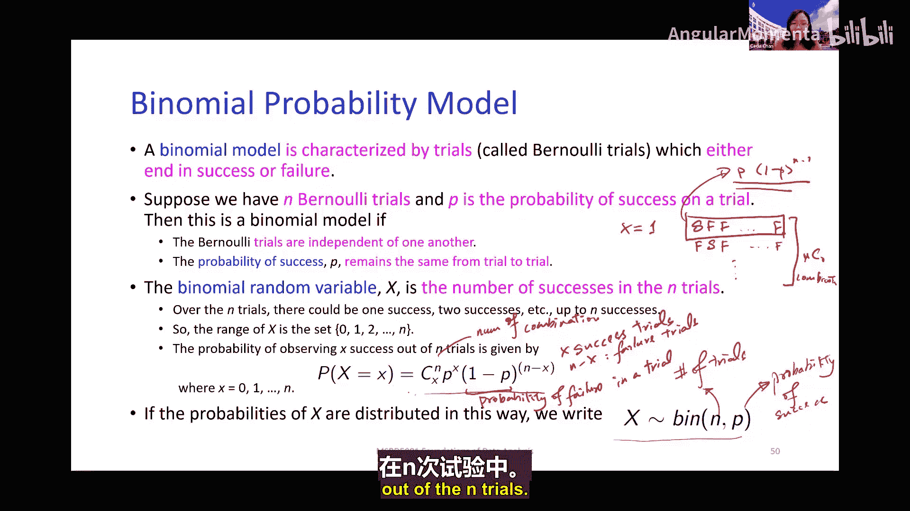

So let's take a look at an example。 So say that we are having。

 we are looking at the flipping of an unfair coin。 So then you can see the。

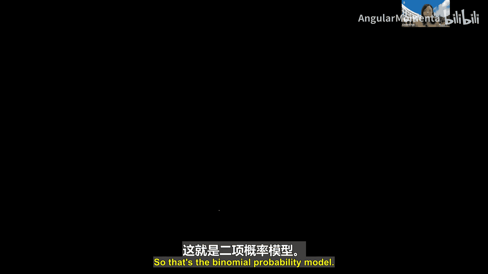

。So what is a tro， So the troo。Sorry about this。 So what is the trial， So trial is。下。

So what is a trial is？To flip a coin。嗯。Friip a coin。 And then you can see like flip a coin。

 So flipping a coin is actually independent events。 So then you can see that like flip a coin。 Okay。

 independent events。 So if we flip the coin。For the first time and then fit the coin for the second time。

Pip a coin for the second time。 So then it's not going to be affected。

 So then the probability of having either the head or the tail will remain the same for all the flips。

Okay so then it will be remaining the same。 so that's why all the flipping of the coins are independent of each other。

 So it fits with the binomial model right， so independent trials and then the probability remains the same and then we have the success as the hat and then the failure as the tail。

So then okay， now the probability that we are interested in is getting seven hats out of 10 flips。

 So which means we are looking at n S 10 and then x S 7。

 So then what we want to find is that this is a binomial like for the x of like a particular number of hats is a binomial model with n of 10。

 and then say that the probability of having a hat Okay， so that means success。 So the success is。

Hat。Okay， wow failure。Ease。Detail。Okay， so then this is the success rate。

 so this is the success rate and then meaning that we are looking at the hat。Right， so n and hat。

 So then okay， we wants to compute the probability of x being 7。

 So then let's first compute that if we want to have seven hats out of the 10 flips。

 Then what is the probability。 So assuming that let's look at just the first seven flips are going to give us a hat while the remaining three is going to give us a1。

 So then like the probability of this to happens is multiplying all the events because they are independent。

 Remember that they are independent。Okay， so then for all of these two happens。

 then we just multiplied up so then you can see these 7，1 are the seven hats， right， hat hat。

 hat hat。😊，And then this is the giving us the tail tail tail， so then we have this probability。

 So then it's done by this and then we have the number0。

00216769 right so then we need to calculate N right so we have 10 C so how do we calculate the N so recall that N is actually n factorial。

Divided by n minus r factorial and then divided by the R factorial。 So if we are looking at 10 C R。

So then that means we are looking at 10 c 7。 So then we have 10 factorial divided by free factorctorial and then7 factorial。

 So recall what is factorial It's 10 times9 times 8 and so on up to one。

And then we have three times two times one here。And then we have the seven times6 times 5 times one。

 So which means this and this part can be canceled out。 So we have this divided by this。

 So then this is free。 and then we have four。 So then we have。

So 120 okay so that means now then we can calculate the px 7 by recall that it's the number of combination times the probability of success to the power 7 and the failure to the power like n minus3 I minus like 7 so that's free so then we have 120 times well the one patterns probability and then that means the probability of having seven hats is 0。

26 right so we can see we can make use of the like binomial like more probability model in finding out the probability of a particular like。

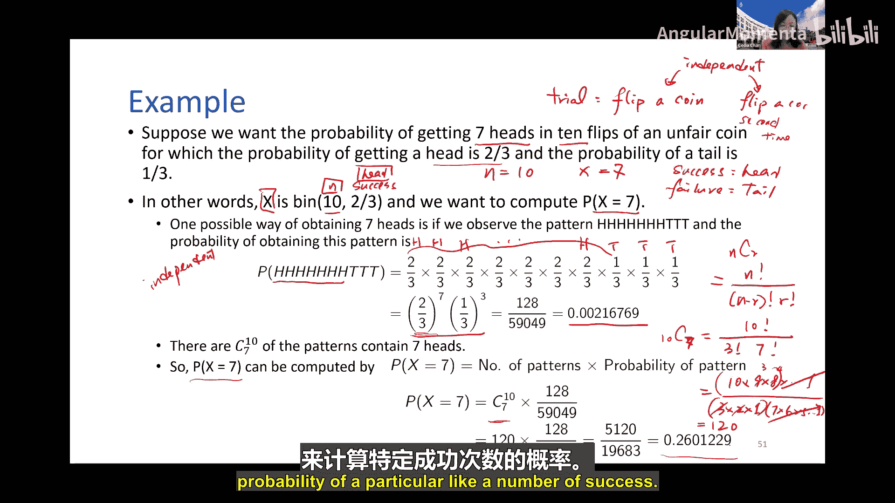

Number of success。

So in general， there is like a formula for the mean of the binomial distribution。

 the mu and also there is a formula for the standard deviation signalma of the binomial probability model as well So then mu is actually just n times p so you can actually calculate it from the expected like a value formula here So recall that we have this right so then if you like used the binommial like probability model。

 then you will be able to like calculator this and then you will find that it's actually justmp and then for sigma So then it's similar So then we have the square root ofmp times1 minus p and we call that n is the number of trials while p is the success probability So then that means if we are using the previous example with like the success probability of2 out of three and say that this time the number of trials is5 then the mean and standard deviation can be calculated by mu。

Is NP so which means it's five times2 out of three so it's 3。

3 feet so this means that the expected number of success out of five trials with the success rate with the success probability of two out of three it will be 3。

3 free trialss and then how about the standard deviation so then it's the square root of MP times1 minus p so then it's 5 times two out of three and then times one minus2 out of three so that will be the square root of 1。

111。So then if we look at the like distribution， the binomial like a probability model distribution so then we can actually observe something out of the shapes of the binommial distributions so let's say that we have different values of nmp so n is the number of trials P is the success probability then you see that we are going to have different distributions with different shapes the blood hand side we have the n of 10 the number of trials is 10 while the probability is 0。

5 the success probability and the failure probability is the same and then in the middle one we have the same number of trials but the probability of success is smaller on the right hand side same number of trials but the probability of success is much higher so then you can see that now no matter which one here there is a similar like a trend which is the probability of the binommial will increase untilmp and then decrease。

Okay so you can see like a NP is 10 times 0。5 so it will increase up to here right and then like this one here again it's going to be increasing up to here okay and then it will be increasing up to here which is 10 times 0。

7 around 7 so then it's increasing and then decreasing right so then this point here is themp right so that's what we are talking about here and then you can also see that if the probability is just one over two so that means probability of success and failure is the same then you can see this is symmetric。

😊，So which is the one on the left hand side。 It's symmetric。

 While if we are having the probability less than one divided by two， So it's lower。

 the probabil of success is lower。 then you can see the shape of the。

Bomial distribution is actually skilled right， skill right。 So this one here， skill right。

 while this one is symmetric。 And then cave， if the probability of success is actually larger than one point over2。

 then it's actually skilled left。 So you can see that here this is skilled left。😊，Okay。

 so then you can see it's towards the like the maximum point is skilled Okay。

 it's like a so then it's it like the maximum point is towards the right hand side so the curve is actually skilled left Okay so then you can see with different like poverty of success then we'll have different shapes。

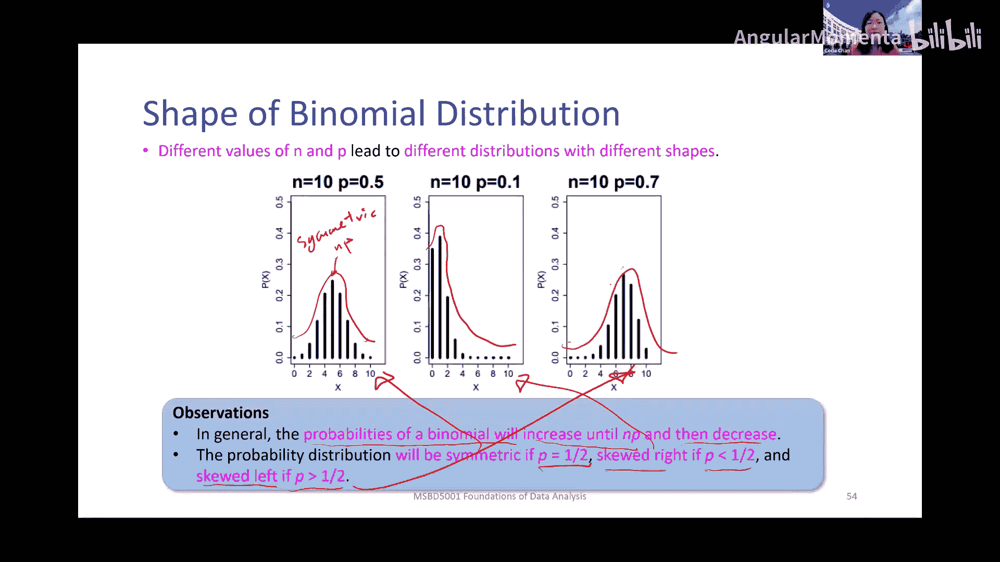

So we had look at the binomial distribution the my binommial distribution is actually a discrete probability distribution。

 recall call what is discrete， So that means we are looking at a finite number a finite nine like a numbers and then there are whole numbers right so then now let's look at another discrete probability distribution which is the poisson distribution now we are looking at the poisson probability model so then when is this model going to be used then when there is like a this situation so when we are looking at the counts of the events that occur randomly in a given interval of time or space So if we are talking about a particular interval of time so then we are looking at the number of events so then we will be like using the poisson probability model so then let's look at like the situation here so we have x as the number of events in a given。

erSo if the mean number of events per interval is lambda。

 So then the probability of observing x events in a given time interval is given by the probability of x equal to the small x。

 and then which is E to the power of minus lambda times lambda to the part lambda to the power x divided by x factorial。

So that's to put on distribution。And then like that's how like we can calculate the probability of x。

😊，So then now because it's discrete so you can see that x is 0123 for the number of times right the number of counts and e is the number 2。

718 so then if like so if we are having the probabilitybabilities x distributed in this way according to this so then we can write this okay so x is a probability peron distribution with the lambda so you can see lambda here is actually the parameter characterizing the Poison distribution。

 the probability the Poison probability model。😊，Now let's look at an example。

 So let's say that births in a hospital occurs randomly Okay， at an average rate of 1。

8 births per hour。 So what is the probability of observing four births in a given hour at the hospital。

 So then because of this average rates。So because of this average raise of 1。8 births per hour。

 so then we know that lambda is actually 1。8 1。8 and then now we are looking at four births so that means the small x is4 so then we are looking at the probability of x being4 so then fillinging in the proisson distribution by the numbers x as 4 and then lambda as 1。

8 then we have this and then if we calculate it you will find that the probability of having four births in a given hour at that hospital is going to be 0。

0723 okay。Now， let's say that we are trying to find the probability of having more than or equal to two births in a given hour。

 So that means we are looking at more than or equal to two births。

 That means the probability that we are looking。Is P， X。Larger than or equal to 2。

 So which means we are looking at the probability of。2 births， probability of free births and so on。

 Okay， and then up to like we don't know okay all the numbers。 So then okay。

 now it's not going to be easy to calculate this， right， if we are just like calculating okay。

 the probability of two births probability of three births and so on it's going to be like time consuming And then we won't be able to calculate the like a later numbers。

 well need to calculate a lot。 we don't know when to some。

 So then well need to cal it in a different way。 So then what are we not having。

 So what we are now not having is the probability of births less than two。

 And then record that no matter like for the whole sum of probabilities。

 So that means for all the events， right， So if we sum up all the events。

 then that will be the probability of one。 So record that。 So which means that。

Now we are having the probability of x as0 plus probability of x as1 and then plus the probability of x as 2 and so on。

 then it's going to be one。 So that is why if we want to calculate z s。

 So then we just have one minus c2。 So that's why we have this one。

 Okay so we are having one minus the probability of x being0 that means zero births and also the probability of having one birth。

 So then what is the probability of having zero births right So we just put the x as 0。

 So you find that it's this。 So it's not a0 value right So then okay we also put the x replace the x substitute x by one。

 So then we have this probability。 so then。We didduct them out of one。

 So then the probability of having more than or equal to two births in a given hour is 0。537。

So similar to the binomial distribution， so again for the Poisson probability model。

 we again have the mean of a Poisson distribution mu as equal to lambda and then the like formula for the standard deviation sigma of the Poisson distribution is square root of the signaligma。

So it's obvious here because like recall call that lambda is the average rates。

 so that's just the mean right so that's why the mu the mean the mu is actually lambda and then sigma is the square root of lambda。

So again let's take a look at the shape of Poisson distributions with now we have the parameter lambda so let's have different values of lambda and then look at the shape of the personisson distribution so we can see that now this is the lambda1 and then we have lambda9 here so you can see that now with the lambda as1 the maximum point is here while with the lambda 9 the maximum point is here so you can see as we increase the lambda so the variance is increasing as well so that means it's more spread off it's more spread out。

And then now， if lambda increase， you will see that。The the like a。

Pisson distribution is actually going to sd left so you can see that the peak is here now the peak is here so it slowly is towards the the peak is towards the right hand side。

 but then the cuff is actually screwed left Okay and then now for like all these graphs you can see the center is roughly on the lambda because lambda you know it's the mu right so then it's like the personisson Poisson like a distribution shapes okay。

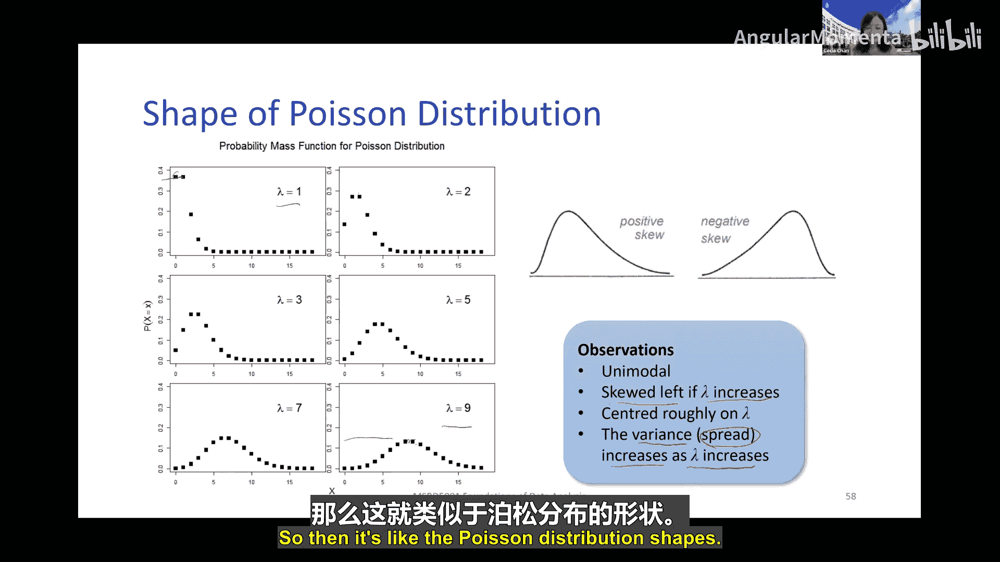

All right， so then。😊，So previously we have been just looking at mainly the discrete data and discrete probability distributions。

 but in practice many data that we are collecting are actually continuous measurements so like heights like weights then there are continuous data values right so then will need to study the probability models for continuous data now for continuous data we do not have equally spaced with discrete values so then unlike the like。

Pyommial distributions， we don't have those bars right instead we have like a curve or a function that describes the probability density over the range of the distribution and then now the curve that we use to represent it the curve is chosen so that it so that the area under the curve is equal to one now just similar to the discrete probability model so if we look at the like a binommial distribution here so the sum of all the bars is actually going to give us the probability of one okay so then because we are considering all the events right。

So then just the same here， the curve that the area under the curve is equal to one because the area under the curve is the total probability of all the events。

 so then we have one okay now if we observe like a sample of data from such continuous like a distribution continuous probability distribution。

 then we should be able to see that the values occurs in regions where the density is highest。是。

So recall what is a random variable So random variable is like a row taking on like different values right taking on values representing the events So then for a continuous random row than the x which is the random row is going to take up like continuous values So then we don't have a probability mass function in here we have a probability density function and the expectation is defined differently for the continuous random rows and not the discrete random variabless now the expected value of the continuous random row x here is of course mu but then you can see that here this fx here is the probability density function which is giving us the probability of a given value of the x but then when we are calculating the expected value So we are finding the area cover。

By under the x times fx。 So then we do the integral group。 Okay now for the variance， again。

 it's different Then it's like how you can see that it's the x minus view square times fx。

 And then again， we need to find the area。 So that's the integral group。So that's the sum。

 So then okay now let's first take a look at the one of the continuouss like a probability model。

 which is called the normal probability model for this model we are looking at the normal distribution So what is a normal distribution Now normal distribution is describing a class of distributions that are being symmetric and also can be described by two parameters the mean and the standard deviation Now changing the values and then altering like a changing the values of the mu and sigma were actually alters the positions and the shapes of the distribution Now here you can see like a different curves with different like a mu and also sigma So then assuming that we have the same like a mean so then with。

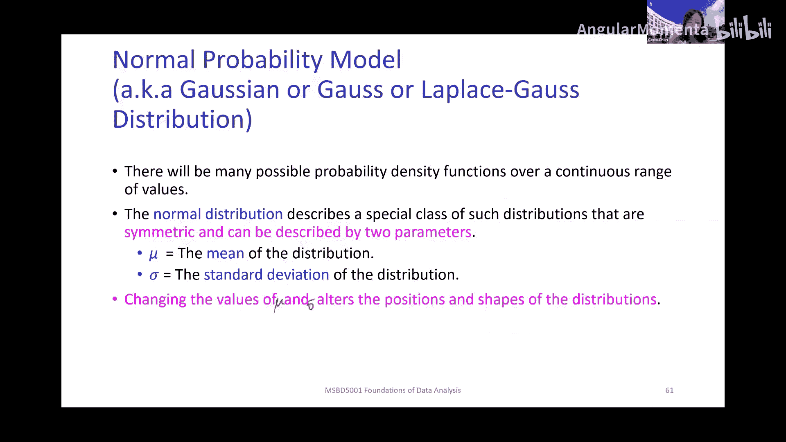

A higher like a sigmmer that means the higher standard deviation then you will see that the like a curve is going to be more flattened and also more spread out okay。

 so it's going to be spread out more than this one。

Okay and then it's going to be frightened a bit as well。 Now。

 how about if we are looking at the same， So there is one more here。

 So you can see this segment here is even larger。 So then you can see it's even like a more spread out Okay now how about if we like have。

higher mean， so if the mean is higher， so then you can see that it's going to be scale the maximum point is going to be at a different point and then it's sd left is skilledd left。

 So then you can see by having different like a meal and sigma we are going to have different shapes of the normal probability model。

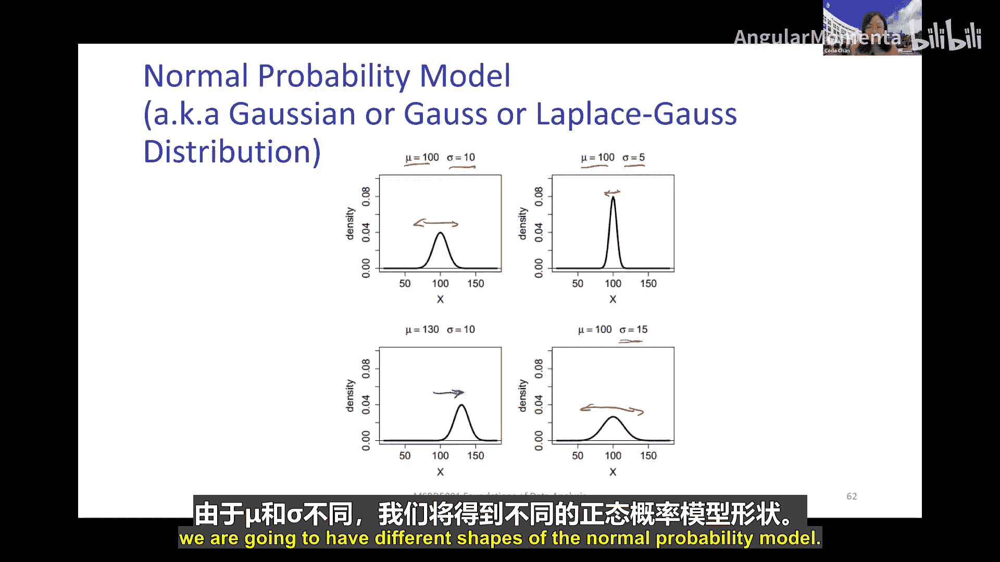

So then if like the random， the continuous random variable can be like characterized by the mean mute and the standard deviation sigma so then we can write it as this right so x is a normal distribution with the sigma and variance like a sig square the variance so then the probability density function of this normal distribution is something like this Okay so we can see that here is going to be with the shape like this。

😊。

And then you can see that the like a maximum here， the maximum y is happening with the mue。

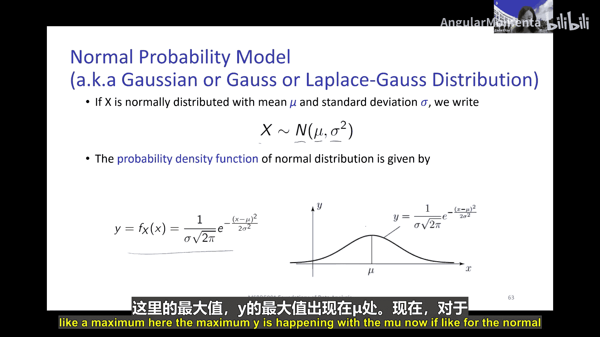

Now， if like for the normal distribution， then if the mu is0 and the sigma is one。

 then it's a standard normal distribution so sorry like a yeah so the variance is one then it's a standard normal distribution So like what is so special about like the standard normal distribution you will see that it's with the mean as0 so then it's right at the zero point and then it's symmetric right So then like for the standard normal distribution here then we substitute。

We substitute the。Mu with0 and then the sigma with one then and also the variances with one as well then you can see that then the like probability density function of a standard normal distribution is this one okay so then its shape is with this so then you can see the maximum is at the x of0 okay。

So then like if we are talking about a random bra with mean0 and variance of one， then it's a normal。

 it's a standardlendid normal distribution。 And then we represent it by this。 Okay。

 and with mute and then sig andvaris。So I should be saying that like if we are talking about random bra x。

 okay， and then it's a normal distribution， so it's by the normal distribution。

Of having mu and sigma square。 So with the variance。

 and then we can actually like convert that x into a random variable set。 Okay。

 by this conversion here。 So you can see we subtract the mean out of the x and divide by the standard deviation。

 And then this random variable set is going to be of the standard normal distribution。And 01。

 So you can see0 is the mu， right， And then one is the variance。

 So then when mu is 0 variance is one， then we are having a standard normal distribution。

 And for this random rub set， we call it the standardized normal rubble。

So now let's take a look at some examples on how do we like convert the random rub x into the standardized random rub So let's say that we have the random variable x。

 which is for of the normal distribution with mu 45 and variance 0。00625。 So then okay。

 if we want to transform the set， Okay， we transform x into set。

 then we'll need to take 45 out of x and divide by the。

Standard deviation that means the square root of variance， so that means the sigma here is 0。

025 right so sorry this is the key and then we should be having like the which is the square root of 0。

000625 Okay， so that's 0。025。Now say that now we have the random variable x。

 which is going to be a value between 44。95 and 45。05。

 So then what will be the corresponding random variable set lies right so then we convert like a first for 44。

95 into a set so then 44。95 subtract 45 out of it divide by the signal right so then we have minus2。

And we do that similarly for the 45。05， so then we do that similarly， then we get the number two。

 then that means the set bra lies between minus2 to 2。

So why do we want to convert a random brow x into the standardized random brow set The reason is now we frequently do this so that it will help us to calculate the probabilities so then let's take a look at this page here so then like because standard normal normal distribution is actually used very。

 very frequently then usually a table will be produced to help like a different tables actually it's going to be produced and then are used to help us calculate probabilities for example a table like this now what is this table is giving us for that particular table we have in the next page here is actually going to give us the area so of the value set okay the area covered by the standard normal distribution。

And then okay， the area covered by the zero。The mu0 okay to the set one。

 So it's actually this area here Okay， so it's giving us this area。

 so then that shaded area is the probability that set takes the values between0 to set one。

 So that means the set is lying between the0 to。K。St one Okay， so that is the like our area。

So in order to like find the area that means the probability that takes the values between0 to set one。

 we can look it up in the table so then we will have the value for that area and that means the probability that set takes the values between0 to segment11 okay。

So then some other things about these like a curve is that like just the same as before。

 the area covered by the cold curve is actually one okay。

 and then if we are looking at the left hand side and the right hand side of this curve。

 so which means the area here covered by this part here is going to be 0。5。 so similarly there。

 if we are talking about the area。Smaller than K， D0 than it's again。Going to be equal to 0。5。

So then okay so we can look up the table like this， so say for example。

 if we are taking a look at step one being for example 1。

90 okay so then we can go to this table here find 1。

9 and then0 here so then this will be the area covered by the is the area between 0 to 1。

90 but then you can see it's 4713 so it's actually with the 0。 omitted so that means the area。Is 0。

4713， which is the probability like a offset， larger than 0 and then smaller than 1。90。

So you can see in this example here so what is the probability that set takes the values between 0 to 1。

9 so then just as what we have mentioned so we find this in 1。9 here。

 so 0 is in the second column and that would be the value and then we add 0。

 in front so then the set takes values between 0 to 1。9 the probability of it is 0。4713。Now。

 let's take a look at what if we want to find the probability of different range。 So say。

 for example， we want to find the probability of set lies between set one and set two so then how do we calculate it so we can find the area covered by like。

We have set smaller than set two okay and then now we know that we can find it between0 to set two。

 So then assuming that we are looking at both possible values then we'll just need to deduct the probability of0 less than set less than set one out okay because for this we'll be able to find it through this and then for this we'll be able to find it through this So that means we are just cutting that side out and then this is the remaining one that we want to have so then we'll be able to find probability of set takes the values between set one and set two by finding the area between0 to set one and then the area between0 and set one and set two and then you find the difference。

So again， let's take a look at an example， so let's say that we want to find the probability that set takes the values between one and two so then first we try to find the probability of set between zero to two so then let's go back to this chart here where is two。

And then here。 So it's 4772。 So that's why we have the 0。4772。 And then how about P with set is one。

 So then it's here。3，4，1，7。So then we have the 3417 here， so then we just did out 3417 out of 0。4772。

 so then this will be the area of this particular region。Okay。

 so then that's how we can make use of like the standard number distribution and the tables to find the area of set lies between two values。

So when we take a random sample from the population and then we compute statistics。

 we are calculating the mean and then the variance。

 and then we are to approximate the mean of the population we say that we are trying to estimate the mean and variance of the like actual population。

 But the problem is， it's a sample。 And then it's not the population。

 So then it's not going to really represent the actual， like a populations mean and variance。

 So then the next question is， how well is the sample estimating the mean and variance of the population。

 the parameters of the population。 So then in order to like handle this。

 then we have the confidence interval。 So confidence interval is to address this issue。

It provides a range of values that is likely to attain the population parameter of interest。

So that means like a confident intervals are actually constructed at a confidence level。

 So say that well， we say that like for example， we select a confidence level。

 say that we wants the confidence level to be 95% Okay。

 so then what does that means it means that if like we are having the。Population sampled。

And then the the。And we are estimating based on the samples， then K the。The true population Okay。

 so say that we are like doing the sampling and then numerous occasion。

 and then we have the like estimates done， then the range of those estimates would actually bracket the true population parameters。

 So in an approximately 95% of the cases or we can rephrase it like those So that means like the population mean well be lying between a level。

 So if we are like doing the。Estimates of the like us we are using a sample mean to estimate the underlying population then okay the underlying populations mean will be like a 90% of the confidence lying between the like an estimated mean values so then let's again take a look at an example。

Now， the shaded area under the standard normal distribution is 95%。

 So we can actually take a look at the set。 So the set value at 1。

96 is going to give us the probability of0。4750， which is the area under here， right。

 So if we are taking a look at this， then this will be the area under this。

 So then we know this is symmetric。 So which means that this one here is again，0。750。

 but then it's negative 1。96。 So that means the area between。The set。

 the standard normal variable to be between like a minus 1。96 to 1。96 is 95% of the whole area， okay。

 because the whole area is one。So then we can say that the confidence interval for SA is minus 1。

96 to 1。96， so that means there is a 5% chance that the set is going to lies outside this interval。

So then that means if we are given a random verbal X。

We can also convert it to the corresponding standard normal standardized normal variable。

 and then we can make use of the standardized normal variable in like finding the confidence interval。

 So let's take a look at another example。So let's say that we measure the height of 40 randomly chosen men and then we get the mean to be 175 and the standard deviation of 20 Now with the previous side we know that for a 95% of confidence level the confidence interval is between minus 1。

96 to 1。96 so which we use the mean and the standard deviation to calculate the。

's to like find the confidence interval。So that means now we knows that right so then we can calculate the confidence interval in this way。

 so then we take the mu so this is the mu and then we have the mu plus and minus the standardized intervals and then times the variance which the standard deviation which is 20 and then divided by the square root of the 40 numbers of heights so which is the sample size and then that means it will be this one so。

Like by finding the like by finding the confidence in the form of the variable x， it means that。

The true mean。 So we are using the 14 40 samples to estimate the mean。

 and then we are 95% confidence that the actual mean of the population that means all men all men is going to be between 168。

8 to 181。2。 Okay， so that's the confidence level。 So it's an estimates of the sample。

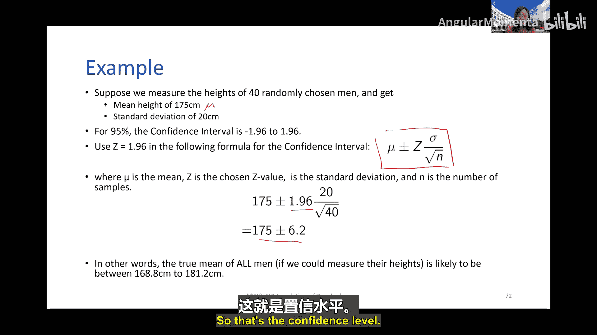

Is the estimate of the sample me？

So let's take a look at another continuous probability distribution。

 so which is the uniform distribution， so uniform so which means that the like a probability of the probability density function is constant over an interval a finite interval between a to B so then we have like the uniform distribution is characterized by the intervals A and B so you can see that here so which means that the random variable is a uniform distribution of interval A and B so then the probability density function of the uniform distribution is given by this so why is that because think about what our previous distributions are so we always say that the area under the probability density function is one so that means the area here。

This one。Okay。😊，So then now we have this。Okay， S， the B minus8。 And then we know that the。其啲啊。

Area is one， right？ So then what is the heights。 So then the heights is actually one divided by b minus a。

 Okay， so then we know that because this is the heights， and then we times B minus a width。

 then it's going to give us one， right， So then that means the like a Y value。

 the F X value of like the different values of x， it's going to be one divided by b minus a。

 So that's for this one here。 But then for all the values outside。 So you can see outside there。

 then they are of the probability0。 So then that's the uniform distribution。

Now what is the mean of a uniform distribution so we are doing the expected value just like what we have mentioned about the expected value of the continuous distribution continuouss like variables distribution so then it's going to be like finding the area covered by x times fx the probability density function so then we know the probability density function so then we take because we know the interval this time is not infinity it's just between a to B so then we take the integration with the limit a to B so then we'll be able to find that it's actually just。

Dividing B plus a， the two intervals by two。 Okay， nice， right， And then what about the variance。

 We can do it in a similar way。 Then you'll find that we are having this B minus a square divided by two as the variance。

Okay。😊，Alright， so then let's take a look at an example。 Let's say that we have a random variable x。

 which is distributed uniformly。 and then whose probability density function is like this。

 So that means the a and B is0 and 2。 and the probability of it is one divided by  two for any other x values outside 0 and outside 2。

 they are going to be0。 So then what is the like expected value of this random variable。

 So then we call that it's just B plus a divided by 2。

 So then we have a as0 B as 2 So then it's just B plus a divided by2。

 So then that's02 plus0 divided by2 which is one。 So then how about the variance。

 the variance is B minus a square。Divided by 12。 So then 2 minus-0 square divided by 12。

 So that's one over three。 So that's the the mean and also the variance of the random variable with the uniform distribution。

Another continuous probability distribution that we are going to look at is the exponential distribution。

 The exponential distribution is written like this so you can see it depends on one parameter lambda so the probability distribution the probability density function of the exponential distribution is given like this so you can see when x is larger than0。

 then the probability of the event is the probability of the random variable is lambda e to the power minus lambda E well if like the x is a negative value or equal to0 than the probability of the random variable is going to be0 so then what is lambda so lambda is a positive value and then it is called the rate of distribution so let's take a look at the mean of the exponential distribution so then again。

We are making use of the。Okay， probability density function。

 and then in finding the expected value the mean， so then you will see that it's actually one divided by lambda while for the variance。

 then it's going to be one divided by lambda squared。

So then let's take a look at an example here now what if we have a random variable x which is following the exponential distribution with the rates of distribution 5 which means that lambda is5 so then by substitution lambda with5 then we have this probability density function so then we find the mean and variance so then mean is just one divided by lambda while variance is just one divided by lambda squared so we have mean one divided by5 and then variance one divided by 25。

嗯。So next let's take a look at the cumulative distribution function briefly。

 so the cumulative distribution function of a random variableble x is defined as fxx。

 which is actually like fx x is actually finding the probability of x less than or equal to small x so then if it's a discrete random brable we just sum orudi fx okay so we just like if it's discrete。

Then we just sum okay， all the K values that are less than x and then sum the F X。

 So that will be the cumulative， like a probability。 So then for the continuous distribution。

 So then for the continuous distribution， then we are again taking a look at the area。

 So the area under the probability density function。

 So we are taking a look at the sum of the like a area under the probability density function。

 So then now if like。So like if this is the probability density functions。

 then we know that if we are looking at the cumulative probability。

 So then ultimately it will reach one Okay， because the sum of all the possible event。

 possible outcomes will be one。So we are now looking at the join probability mass function Now we are talking about probability mass function。

 So obviously we are talking about discrete variables。

 Now we are looking at two discrete random variables X and y where x are having the values X1 up to X M and then y could be of the values Y1 to y n。

 so you can see we have M values for x and values for y。

 and then we define the join probability mass function of x and y by this。 So F X Y。

 the two different values of X and y， and then we are looking at the probability of x as x small x Y as small y So then notice that the。

Probability is larger than equal to0。 and if we sum all the possibilities of all joint like values。

 then it will be one。 Okay， so all the probability added together always one。

 So then the probability of a particular events that x is with the value X I。

 and then y with the value Y， J is given as F X， I， Y J。

 and then which is the probability of x as Y I and Y is Y J。

So then the join probability mass function for those two variables similar to how we discuss it as the probability mass function of a random variable x with the discrete random variable x now the joint probabilitybabilities mass function of x and y can be like represented like this so you can see that here now this here means that we are looking at the y with the value y1 and then x with the value x1。

 so then this is the join probability of x being x1 and then y being y1 so then if we sum the values along a column so then you can see that it's about the probabilities of like a different x values but then with the same y1 value for the variable y。

So if we sum all of them together， that will give us the probability of the Y S Y  one events。

 So then which means that we are looking at this。 So the the probability of Y S Y J is calculatedal by adding all the entries in the columns corresponding to Y J。

 So in this here， you can see that we are actually like calculating the F。Why， why one。Why one， my。

Adding the F X 1， Y 1 plus F X 2， Y 2， and so on。So then similarly。

 if we are talking about probability of Y S Y J， so then we are looking at。

Probability of x1 Y J plus probability of x2， Y J， and then so on。

So then if we are looking at a row instead of a column， So that means we are looking at this。

So if we are focusing on these， then you can see that we are all talking about the X1 events。

 so then okay we if we sum all these values together we have the X F X X1。

 so it's actually the sum of F X1 Y1。Plus， F， X，1， Y 2， plus F， X，1， Y，3， and so on。Okay。

 so that will be the probability of X S X I so then you can see that here now if we are calculating the probability that x is X I。

 then we just add all the entries in the row according to X J X I so then you can see that here this means that we are actually having the X I and then different y so then plus the F X I Y1 y2 and then。

So on so that would be the probability of X being X I so then let's take a look at an example say that we have the joint probability function of two discrete brows x and y which is given by this。

 so we have this here。And then now X and Y will be the in between this and this。

 So what does it means is that what is the possible values of x。 So then x 1。

Is the first like a value of x could be？0， and then x 21， and then x。Free。😊，Is two。 Okay。

 so then we have three values because we are talking about integer。

 So you can see that here we are actually putting the probability mass function here as x 1， x 2。

 x 3。 The rows。 right， So then how about y。 So y is between 0，2，3。

 So then that means the first one is 0。 Second possible value is1。 And then y 3 is 2。

 And then y 4 is3。 So then we have that y 1， y 2， y 3， Y 4 here。Okay。

 so then we'll be able to calculate all the join probability。 So for example， like this one here。

 this one， this one is the F okay x2 Y2 which is actually F11 so then we know that it's represented by C times2 x plus y so which is C times2 times1 plus1 so which gives us3 c Okay so we can calculate everything alldi like join probability like that way and then now so you can see that here when we are talking about the join probability function in this example here there is an unknown value so what is C okay。

So then how do we calculate C now we use that to find out the probability the joint probability or the joint probabilities。

 and then we actually know that from the definition。So if we just sum everything。

 just sum all the joint probability， it's going to be one。

 so which means if we sum all these together。So that will give us one。

 and then something all these together。 we have already calculated。 It's 42 C。

 so which means 42 C is equal to1。 So then C is one divided by 42。

 So we have calculated the C So now once we have calculated the C then we'll be able to calculate the join probability。

 So let's say that we are having x S 2 Y S1。 So if we look at this x as 2 Y S 1。

 then it's going to give us 5 c。 So then we know C is one divided by 42。

 So that's why probability of x S 2 Y S1 is5 divided by 42。 So now let's do like another thing。

So let's try to find the join probability of x and y being x larger than equal to1 and then y larger than y actually smaller than so sorry about this。

 This is smaller than or equal to two So then okay。

 well we'll need to like enumerate all the like values， which means that it's going to be like F。

1 one F1。F11， and then F。1，2。And then it's also with like the。Okay。

 it's also with the F1 to F 11 F1 we also have the0， so recall that the x and y also lies between0。

 so then we also have the F。1，0 as well。 Okay， so then we also have the the x larger than2 like x larger than one。

 because x is between 0 to 2。 So that means we are having the F to 0， F to 1。 and then also the F to。

2， right， So then we just add all of them together。Okay。

 so then that means it's actually just this place here。😊，These， oh， sorry。 One more。

It's actually theses。Okay， so that means it's 2 c plus 3 c plus 4 c plus 4 c plus 5 c plus 6 c so you can see that here right。

 so then that's in total 24 c。 so and then again we know C is one divided by 42 so then it's 24 divided by 42 so then4 over 7 so we'll be able to calculates the join probability by this way。

😊。

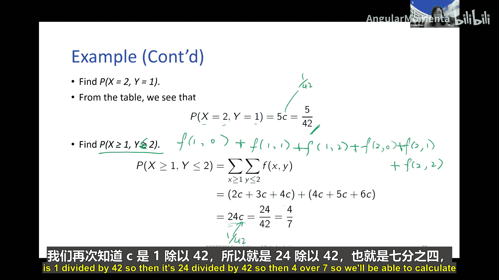

So how about for continuous random variabless then we don't have the joint probability mass function。

 but we have the joint probability density function right so then the probability density function so sorry for the typo here so for the joint probability density function it's the defined as so we cannot do some because it's like continuous values so then we have to find the area So then it's the taking the integration right so then we have the two variabless X and Y so you can see that we are doing this so this will be the。

Joined probability density functions of the two continuous random robots X and Y。

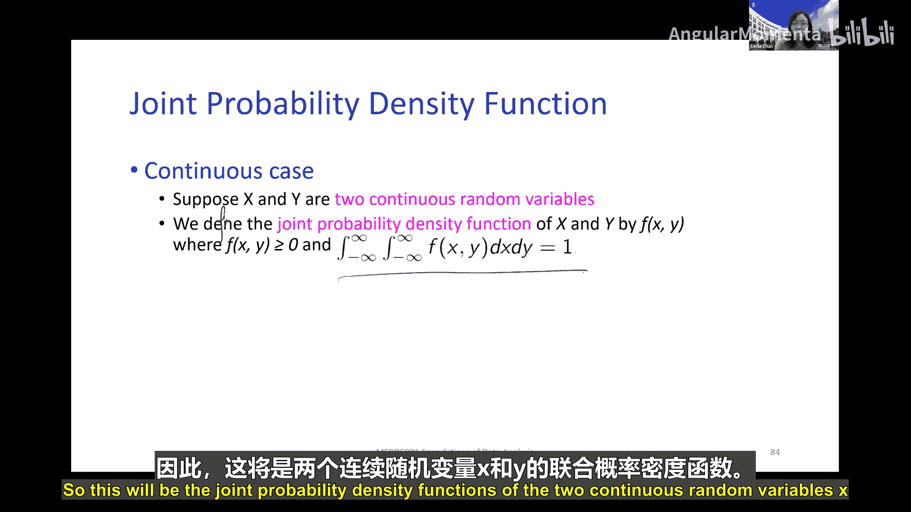

So let's take a look at an example now say that we have the join probability density function of two continuous variables x and Y as this one。

 so F X Y。

So fxy is c times x times y when x is below is between0 to4 and then when y is between1 to5 and for other place other values then it's0 so then we want to again because we have the unknown C here we wants to find the constant C and then how we're going to do that so we know that the total probability should be equal to1 okay so then now very similar to the previous like example on the discrete the discrete case now in the continuous case we are doing the integration so then we have the Dx d Y so then first we take one we like we take the integral of like either dx or dy so let's say that we do the dY so then the range of y is between one to5 so then。

We put it here。So we do the like an integration inside first。 So then integrating X Y。

 So we are integrating with respect to y。 So then we treat X as a constant。

 So which means that it's going to be X， Y square。 So like a integrating y with respect to y。

 which will give us。Y square over2， right So then that's why we have the x as the constant added。

 So that will be x y square divided by2。 And then the limit is one to5。 So we have this here。

 So that's why we substitute y with five。 So then we have this Okay so now after having this then we do the indi with respect to x。

 So then okay， that means we do it similarly。 So then okay we have。

The we let's first calculate what is the 25 x divided by  two minus x divided by  two means then that's 24 x divided by 2。

 So that means it's 12 x。 So then we take the like a integral of it。

 then again we call that if we take the integration of x we is back to x。

 then it's going to give us x square over 2 right So then that means we are looking at。Okay。

12 x squared over 2。 So then if we are looking at 12 x squared over 2， then it's just6 x squared。

 So then again， we have the limit from 0 to4。 So then we substitute by those values。

 Then it's6 times 4 to the square2 to the power to thats square。 So then that would be 96。

 So we have 96 C。 And then remember that it has to be one， right， So the total value should be one。

 So which means 96 C is equal to one。 So then C is one divided by 96。 So again。

 we have the C calculated。So then with C calculated， let's say that we find。

 let's try to find the joint probability of having x between one to 2 and then y between  two to three。

 So then okay the area under this probability the area so we need to find the area so then it's just the same idea。

 so we are having the。Cx Y， so which this time Cx Y。Recall that because C is one over 96。

 So that means our。Fx， so F X， Y。Is now。With。91 over 96 times x， Y， Okay。

 so you can see that here X Y， which is between 0 to4。And then one，2。5 and other things0， right。

 so then。So then let's calculate this。 So then that means we have the limit， which is for x 1 to 2。

 Y 2 to3。 and then we are having this， right， so as the。Pity like density function。

 so then again we do that similarly， So then we have this we do the integration of like the。X， Y。

 okay， so because we have one over 96 is just the constant。

 So then we just take the X Y and then take do the integration。

 So then that means it's like a well x treated as constant Y we like can take the integration then it X Y square divided by two。

 we apply the limits。 So that would be this one here is actually just。

9 x over2 minus4 x divided by 2 so that's5 x divided by 2。

 so that's why we have5 x divided by 2 here。 So then again we do the integration with respect to x then okay we have this so x square divided by2 and then we take the five out here so you can see that here。

So then well with' doing that。 So that means we are looking at like a。

We are looking at like a four divider by two minus one dividedr by two so that's。3 divided by two。

 So then okay calculating FV。 So then we have5 divided by one28。

So we are talking about the join probability， so supposedosly we are looking at two discrete random variables X and Y。

 so then if we are looking at P with x as X small X and and y as small Y， then if the two events。

 X and Y， the two variables X and Y and the two events X S X N and y S A y， are independent events。

So then that means like a well for all X and Y。 So then that means X and Y are independent variables。

 So in that case， then the join probability can be represented as multiplying the probability of x with the probability of y。

 So then that means F X， Y， the join probability is just the probability of x。

 and then times the probability of y。So that's the independent variabless in the joint poverty okay？

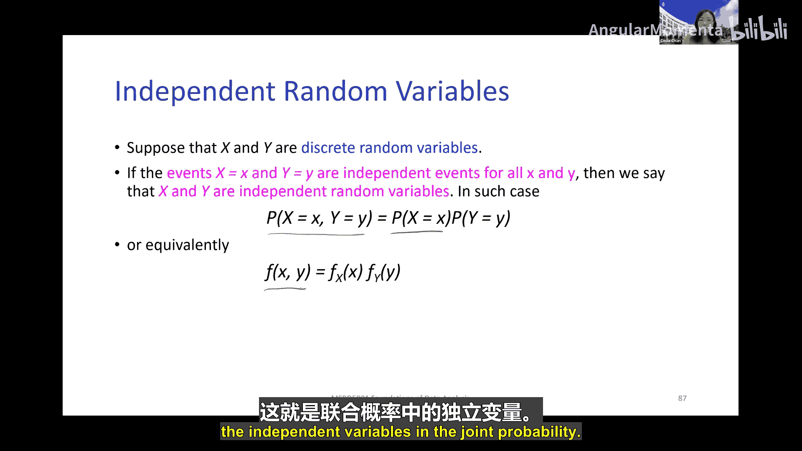

So let's talk about the base theorem， so base theorem is actually very useful。

 so then recall that we have mentioned about the conditional probability。

So recall that the condition probability， for example。

 Pb given A is actually the probability of A and B divided by PA。嗯。No。

In many situations we already know one conditional distribution。

 for example px given y and then also px， but then we are actually more interested in the other conditional probability that means p Y given X so then what should we do so then based on the like previous like a discussion of the conditional conditional distribution we know that now p Y X。

P， Y X is actually going to be the joint probability of X and Y divided by p X， right。

 So then what is P X， Y， So now we already know P X given y， So P X given y， which is again。

 equals to P X， Y divided by P， Y。So which means that we have Px Y。

Can also be represented by Px given y times Py。So then we do this， so then we have the py given x。

 which is can be calculated by P the other conditional probability。

 px given y times py divided by px。So then let's look at， like I say that。

 we have n mutually exclusive events。😊，And then that together form the sample space S。

 so that means like we have a 1， a2 up to A N and events。

 So then let's say that we are trying to find the AK events。

 given the B given the like a given the event B， okay。

And then now we know that PAK given B is actually。Even B is actually like P。AKP， B。Given a key。

Times P A K。 So according to the formula above and then divided by P。B， so then what is P B， right？

 So then P B。PB recall that P B is actually the sum of the joint probability。 Okay， so that means。

So which means that we are looking at the probability of PBE is actually the probability of。P。

X1 B plus P X2 B。And so on。 Okay， so while each here can be represented by。

PB A P given PB given AI times P AI， because we have done that before， right。

 so then we know that we can do that。 So then that's why we have this here as the denominator。

So then we have this right， so by the way， so mutually exclusive events means that those events will not be happening at the same time okay。

 so it's either all。😊，So then let's take a look at an example。

 so in this example here we are looking at a magazine the probability that the reader is male。

 given that the reader is at least 35 years old is 0。

3 the probability that a reader is male given that the reader is under 35 is 0。

6565 and then if 75% of the male are under 35， then what is the probability that a randomly chosen reader is a male or a randomly chosen reader is a female or randomly chosen reader is under 35 and it is given that the reader is a female okay now let's first like define some bs right so define some symbols now we know that there is an event so which is at least 35 years old so then we have the a1 we have it as the a1。

So it's at least。35 years old。So then， okay， the mutually exclusive event， which is a2 is under。

Because this is larger right， so then we have the under 35 years old。😊。

So these two are mutually exclusive events， A1 and E2。

 And then now another event is that we have the meal， so then okay。Another thing is male。

 so we will present M as male， and then that means the corresponding mutually exclusive event is female because a reader cannot be both male and female and a reader cannot be both like over 35 years old and younger than 35 years old。

So then we have male and female。Okay， now what we already know here is that we already know that like the probability of at least 35 years old is given as 0。

3。 So that means we already know that P1。So a reader is male。

 so you can see that here a reader is male given that the reader is at least 35 years old。

 so which means we are looking at male given a1， so we already know this conditional probability。

 which is 0。3。Okay。😊，And then now we also know another thing is。

 we know that the probability of that。 a reader is。Male。

 given that the reader is under 35 years old is 0。65。

 So which means that we know that the probability of male， given a2 is 0。65。Right， so then okay。

 now another thing is that we know75% of the reader are under 35。 So which means a2， right。

 So then the probability of a2 is。0。75。 Okay， so then we have these numbers obtained from the question。

So then we know FMM mutually exclusive A1 and A2 are mutually exclusive now then next like we can calculate the other conditional probability right。

 so then let's say that we want to calculates the probability of F given a1 now we know that the sum of these two events should be one Okay。

 so sum of them should be one。So that means the probability of having of a female。

 given that the reader is 35， at least 35 years old is  one minus 0。3， which is 0。7。Okay。😊。

And then now similarly， we can calculate the probability of F given a2， so which is 1 minus0。6365。

 so similarly， so that's 0。35。Allright， so then now how about the probability of a1 so then the same here。

 the sum of probability a1 plus probability a1 here now if we are adding to these two up which should be giving us one so that's why the probability of a1。

Should be 1 minus 0。75， which is 0。25。Right， because a1 and A2， again， they are mutually exclusive。

 So it's the like a it can be calculated in this way。 So that now we want to calculate。😊，A okay。

 probability of milk。 So then to calculate the probability of milk。

 we know that it's actually just finding the joint probability of like the having mail and then with different a1 and a2。

 So that means we are looking at the probability of a1。M M plus probability of A2 and M。Okay。

 so how can we calculate this join probability， We can do it with the conditional probability。

 So that means is M。We have。 we already know this。 So then M given a1 times probability of a1 plus probability of M given a2。

Times probability of a cube Okay， so then for all of these。

 we already know their values right it's 0。3。Times。0 point。2，5。Plus，0。65。😮。

This one and then this one right， so then it's times 0。75， so that will give us 0。5625 okay。

So then we already have now we have calculated the probability of meal， so then next B。😊。

Probability of female。Now we can of course do the whole calculation like this。

 but then now we know that the male and female， they are mutually exclusive。

 which means that the probability of male plus female。😊，It should be one， right。

 So that means we can just have one minus probability of milk， So which will give us one did do by 0。

5625。Okay。Minus。0。5625 that will give us 0。4375。Right。

 so then we have finished calculating the part A and part B。 So then finally， how about part C。

 So for part C， we are calculating the probability of。😊，K under 35。

 so that means it's a2 given female right So then again， K based on this right。

 so then we can calculated by expanding this formula。

 which means that it's going to be probability of F given a2 and then divided by the sum of probability of F given a1 times probability of a1。

Plus， probability of F given a2 times probability of a 2。And then for all of them， we know， right。

 So we have the this one， this one， this one and this one， So we'll be able to calculate it。

 which like by calculation。😊，It's going to be 0。6 Okay so that will be the that Okay so then you can see that here now with the condition probabilities given so then we want to calculate the other conditional probability so then we can make use of the base theorem right so to do the whole thing here so then this is how we make use of the base theorem you will find that it's going to be very。

 very useful in like a lot of different problems。So then we have finished the review on the like a basics statistical analysis。

😊。

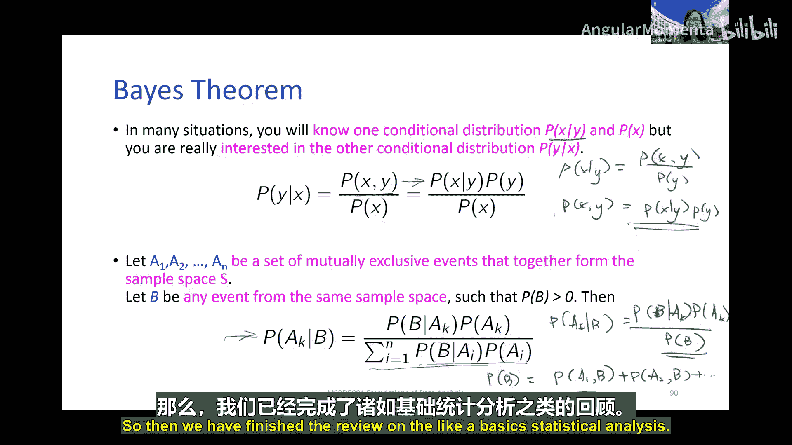