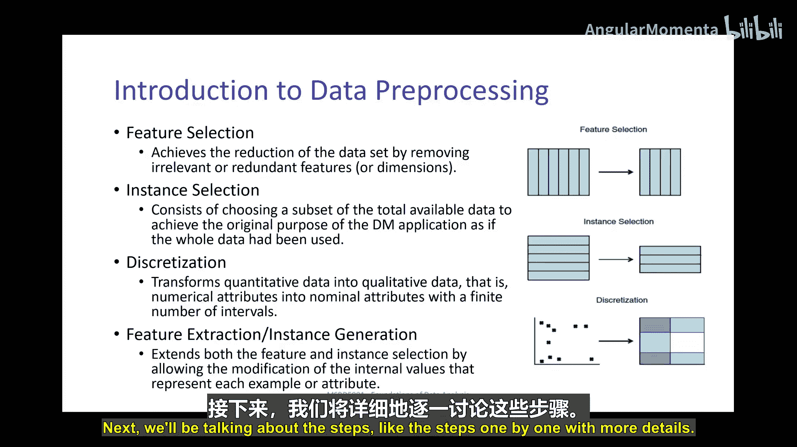
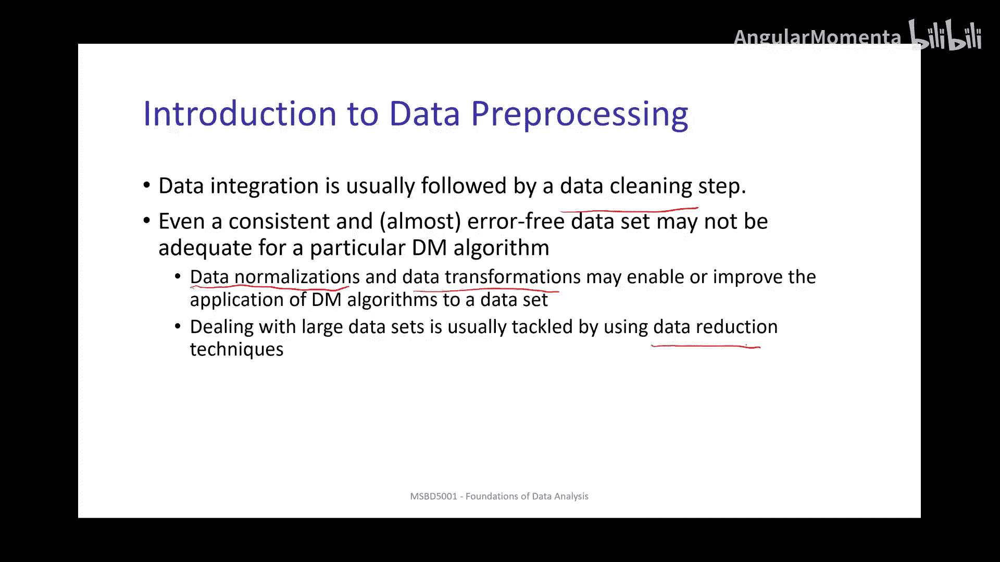

# 【香港科技大学】数据分析基础-｜-Foundations-of-Data-Analytics-p05-06-01-03-数据预处理--BV1oKFDznE6L_p5-

In this section we are going to talk about data prepocessing data prepocessing is a very important step for data analysis such as data mining。

 so only when we have like preposses the data and then we have good data then we'll be able to have good performance and data prepossessing is important in helping us with that so in this section we are going to talk about some challenges that we are facing with data prepossessing。

 especially with big data and then we'll look at like an overview of what exactly is data prepossessing and then we'll go through like the common steps or the common steps of data prepossessing and then we'll look at like a wide range of techniques that we can use to prepocess the data we'll be mentioning a lot of different terms and techniques some will be introducing them but then some might be like to advance and then we don't really have time to go。

Into it， but then like still we would like that you would know like more about data preprocessing so that in the future when you need to prepocess the data。

 you need you know like what are the basic steps and then what like more you can look into。😊。

So then okay let's start with talking about challenges Now whenever we are talking about back data。

 one of the major challenges， of course， about the scalability right so we are always talking about the large volume of data the like a variety of data So therefore we need ways to like handle those large amount of data and then those large variation of data so just similar to other data processing techniques we are still having like we are still like exploring the technologies to like apply to the big data so usually the current approaches may not be enough So this means that like with the preprocessing on back data it's also creating possibilities that means we are looking for new technologies and then。

New ways to handle the preprocessing with big data Now for new technologies。

 so I think some like some has been exploring for the recent years。

 like the use of distributed computing on data processing like the use of Hadoop Sp and then like with the feature selection in balance learning etca and then the most important thing here is while how can we like handle the data preprocessing so that it can fit in together with the other data mining challenges and then also the data and analytics problems。

All right， so then Kate， that's the challenge and possibilities now。😊。

Data preprocessing is a very important step in the knowledge discovery process。

 which is the KDD process， for example， you can see that say that we have data， we have database。

 so then in order to know discover knowledge the most important like the major steps would be like problem specification problem understanding data preprocessing。

 data mining evaluation， restart exploration so then first of course we'll need to solve a problem right so we'll need to know like what are the constraint。

 what should we have what we need to like obtain as the result etc and that means we'll also need to understand the problem like understand our data。

And then we'll need to do data prepocessing after data prepossessing。

 then the data will be ready for like the data mining and then after data mining then we'll still need to do the evaluation and then we'll need to explore the result to see like whether there is any problem can we further improve it and then it's very likely that we'll need to go back and then start the process again and then for like many iterations until we are satisfied with the results then we'll be able to like have our results and then be able to extract knowledge from it now for data prepocessing it's a very important step which will affect the final performance final knowledge。

So then why do we need data preprocessing The reason is most of the time our data can be in different format。

 especially now we're talking about big data， the variety right so then we'll be looking at many different kinds of data in different format for example。

 we may be looking at structured data such as tables right so which is like representing the relations between like values and attributes or it could be unstructured data like tags which is a sequence of characters and words and then while we may be looking at audio video data so these unstructured data will also need to be preprocesed in order for us to continue to the next stage of the data analysis or data processing。

So then okay， now data preprocessing， we can say that it's to transform the raw data。

 so that means what we have as the first step and then into a wellformed data which means that it's suitable for the data mining analysis because like you can see that in many of the data mining models or any many of the data analysis like stas。

 they will require the data to be in a certain format。And then if the data are in those format。

 then we can expect a better result if the data is already not suitable， So then， of course。

 we won't be having a good result。 So that is why we'll need data。

Because like before we can do data preprocessing one of the step is to like understand the problems。

 so then let's also discuss a little bit on what exactly is data now usually when we are talking about data we are talking about a collection of data objects and their attributes for example we can be talking about a collection of like personal information and then or like a collection of information about people。

 so then the attributes could be the characteristics of or properties of those people like for example。

 if we are talking about people then we may be describing a person with his or her eye color or now if we are talking about medical data of like people then body temperature might be included and then you can see different characteristics we be having different types of values and then that means。

These like are different properties， we usually refer them as attributes。

 these attributes will also be having different values and then sometimes we'll use like some other terms instead of attributes like variable field characteristic features。

 they are all about the attributes they are all like attributes about objects。

Now once we have set a collection of attributes， then that will be the information describing particular objects。

 so then sometimes we'll be referring them as records or points or samples， entities instances。

 and then we have a collection of objects。Or collection of records then that's data Now we are talking about attributes and then you can obviously see that it will be of many different kinds of values so then let's talk about the types of attributes so like well the types of attributes can be categorized like this diagram here you can see attributes can be having two like subcategory the categorical attributes or the numerical attributes let's first talk about categorical attributes while categorical attributes means that we it's qualitative。

Qualitative， we are talking about a specific set of values。 It's a predefined set of values。

 and then it can further be like a divided into nominal type or ornal type So for nominal type it means that the values cannot be quantified。

 there is no specific order of the values， for example。

 the gender now we may have the gender male female。 Okay there is no order between male and female。

 we just have two different values。 So then it cannot be quantified。 There is no order。

 another example will be the eye color。 So for example， eye colors can be like the blue color。

 the green color， the brown color again， there is no order between those values right。

 so then there are just different different values， and then it's a particular like set。

Now besides nominal values then the other like category is that ordiino values ordiino values like a different from the nominal then it's having an order it has an order so then but then the distances between the values are not known so for example like letter grades we know that a is better than it's like in a higher order than B and then B is better than C but then do we know the exact difference or the distance between like a and B so we don't right we cannot quantifyified it so that's why ordiino attributes is a categorical attributes it's cannot be counterified but then it's not exactly nominal because there is an order so that is why we have the ordiino type of values besides letter grades another one could be the education level so for example elementary school education level。

Well usually we order it like this the highest education level could be the college graduate or above and then like a high school usually in the middle and then elementary like before that so then you can see again there is an order with the educational level so another one could be the liker scale so very often when we are feeling questionnaires feeling in questionnaires then we we need to pe between like like neutral dislike we know that neutral is the middle point it has to be between like and dislike it will not be before like right and then dislike will be more negative than the neutral more negative than the like and so on。

So that's nominal and audio so let's next talk about numerical and then you can see that under numerical we also have two subcategories that is and continuous。

 so let's discuss it next。😊，For neo numericalmer attributes， well different from the。😊。

Categorical attributes， then numerical attributes are quantitative。 We can。😊。

We can be it can be quantified and then well which means that well numerical values are numbers right and then within numbers we can like further this categorize them into discrete and continuous time for discrete values then it's countable countable so winning like for example like the number of people so we will say one people one person two people。

 three people well we won't say like there is 1。2 people right。

 well if we are doing certain variations it might be but now most of the time like we will have one to free so that's discre and then that's countable。

So then besides this script then we have continuous right so then that means the data can be measured Okay so that means the numerical numbers can be measured and we refer to like a certain level and then like for example heights scores right those numbers can be measured and then like even within like a exist like heights or scores that。

With values that can be measuredd， we can also further categorize them into interval data or racial data for interval data it means that well those numerical values we can do the like a calculations。

 we can do addition， we can do subtraction。Well， like temperatures in Celsius degree。

 so like for example， 10 degree a 10 Celsius degree and 20 Celsius degree。

 then the like the distance， the difference is 10 Celsius degree。But then for Celsius' degree。

 there is no zero point。😊，Okay。😊，So then that is why like temperature in Celsiuss is an inter data then。

What example do we have which is non interval which is ratio data temperature in kvin so there is a zero point so then ratio data is actually interval data okay which the numerical values we can do calculations。

 but then there is a zero point okay。So these are the common like types that we use to describe attributes and then like we have to know our attributes type in order to decide what should we do with the attributes in the data prepocessing steps so that's why we have to mention about the data types now why do we need data prepossessing besides we are looking at the different variations of data another reason is that w like this is like probably the problem that we have to handle all the time is that well it would be perfect if we have perfect data so that means there are no mistakes or everything is as we want then we can use the data perfectly with the models and then give good results but unfortunately in like our real life you know errors are everywhere right so errors and then a lot of like。

😊，Different situations can happen。 So that is why we need to handle those。

Okay so like what are the desirable situations like with data it could be there could be some missing values something some values is missing some records they are just not complete a few attributes for that particular record is having missing so think about like questionnaires then some people might like a miss out certain like a few or certain questions and then will ends up having missing values and sometimes there will be noise so for example someone make mistakes into like entering a wrong number and like the wrong number will not fit into the normal range of values then it's like a noise right and then it could be like we are having data in different places but then like the data like the different copies of data or like the data that comes from different sources could be okay having some conflict conflicting。

Vals So how can we handle it。 So we need to like find out like what to do right And then like well sometimes we may be looking at very very large data set so then how can we reduce them to make them like again。

 be able to process under the certain situation So that is why now you can see all of these that we are talking about is's actually related to the quality of data So then if we have low quality data then well have low quality performance。

 So of course we wants to have high quality data。 but then well even if we are looking at low quality data。

 we can do something to see like whether we can make improvements right So then now we are talking about data quality So then how do we like a data quality。

 it could be many， many things right So then these are the like a。

Expects that we can look at when we are talking about data quality， for example， completeness。

Like for example， well we can be answering the question of are they missing values in the dataset set so for example。

 for some records for some attributes what will there be no values provided so then that's one thing if we have values not provided then that means the data is not complete so then the completeness is low another like aspects that we can look is look into is the validity。

 so which means well the data whether it is valid so for example。

 if we wants the data to have for example the dates data if we want the dates to have the date the month and year。

 so then are the data having these free values represented in a specific way because sometimes you know that we just ask people to fill in the month and year so we sometimes we may not have the day data but then if we want to like we want。

To handle a problem， we want to solve a problem which we need today day， then the data is not valid。

Another issue is the uniqueness now whether there are some like a duplicated like objects duplicated data or duplicated like a recordsus in our data。

 if there are duplicated records so then that means our data has redundancies right or sometimes there may be duplicated attributes。

 so then again these kind of redundancy will affect the further processing of the data。

So then another thing is the consistency so like for example。

 say well we may have multiple copies of a particular data set or particular table so then okay you know like people updates and then store different versions and then like when we wants to obtain like the data the table so like we may need to like see whether it's consistent so will there be any inconsistency across different like stores like different data stores so another issue is the timelines timeliness refers to like well if we want to have the data for a particular point of time can we get it right so if we can get the data from a particular point of the time when we want it then that means like we can have the data is timing otherwise then like there is a problem。

Another one is the accuracy so like for example the data that we have is it accurate is it really the like a real actual data so then you can see that there are like because when we have data it could be like obtained in a right range of like a ways and then like theyre involved a lot of parties people so then again there might be problems which leads to inaccurate data so these are the measures or these are the aspects we usually look at when we are talking about data quality。

Next， let's look at the major steps of data prepocessing。 Now here are three of them。

 One of the step is data cleaning So as we have mentioned our data usually have errors So that means well need to do cleaning to correct those like errors and then if there are some incorrect data and then we may need to filter them out and then if there are redundant data。

 we may also need to reduce them right so that's data cleaning another one is the data transformation now。

Sometimes for some like data processing steps or like some models。

 so they will need the data to be in a particular format or a particular representation。

 so then if our original representation is different from it so then we may need to transform it to the needed representation so that the data processing step or the like for example。

 the data mining or the data analysis step could be like a more efficient or it could give us a better performance。

So that's data transformation changing into another shape and then another one is another step of data prepocessing is the data integration Now it's just emergingrg of data from multiple data sources you can see like the explanation we put here is very。

 very simple now but then the actual steps are not that simple well later on we'll talk about it in more detail but then data integration means that we may be looking at data from different sources they may be in different format and then like well need to see whether we can merge them together okay so if we are looking at two different datas or data sets about people okay and then we'll need to identify whether there are like common people across the two data sets and then like when we are we can identify them as common so then how do we like integrates the different attributes together。

All right， so that would be the data integration so after that then we will have merge data sets and then which again we can use it for the data processing step。

So another free data process preprocessing stas would be data normalization missing data imutation and noise identification Now data normalization is to like express data in the same measurement units scale or range because like for data usually like a different data set might use different like measurement units or like to measure things for example for heights like we can put on the value in meter we can have the value with like a centimeterter so then if theyre in different scales different units if we just like treat them as the same and then process it and we'll have like a problem with the like processing so that's why we'll need to like convert them into the same measurement units then we can further process them the next one is the missing data imputation like if we have missing values so then what should we do so well talk about the。

But like there are two major possibilities， one is that if we have missing values and then if we can afford it。

 then we just ignore those records or if we cannot afford to ignore those records。

 then we need to think about like is it possible for us to make an estimate to fill in the missing values right so that to make the record or the objects still useful。

Another one is the noise identifications now for example。

 if we have menu error with the data entry then like for example a very strange value could be entered and could be there in the data set so then they are not normal values with normal behaviors then well we need to detect them right if we treat it as like correct value and then use it then of course it will have negative impact to our final results so we wants to detect those random errors and then also variances so that we can like decide what to do。

So besides the previous six steps， we have more steps， for example， the feature selection。

 the instance selection discretization and feature like an extraction or instance generation they are about the dimension like handling the dimension issues of our data for example like the feature selection instance with selection it's about how we can like reduce the data set for example for feature selection we want to select the relevant features and then remove the irrelevant one or redundant one so we can see like will be picking we'll be selecting some of the features assuming that each column is like an attribute a feature so then we'll have fewer like a columns fewer features so then our data might be more manageable so similarly for instance selections we may have many。

 many records so we can see the rows are records so then we may want to like select some records。

objectsject， some samples， some entities instead of using the whole data set。

 there are different reasons for that， but then again after selection we'll be looking at less rows and then again it might be more manageable。

Another way to reduce the dimension could be discretization。

 meaning that we are doing a transformation， so for example。

 if we are looking at numerical attributes， so then there are many。

 many values right so then we may want to convert into nominal attributes which we have less number of values。

 less number of intervals so then that's discretization and then for feature extraction and instance generation it's actually extending the feature and instance selection by like having like a representation a new representation。

All right so then okay， so that's a brief overview of the data prepocessing next well be talking about the steps like the steps one by one with more details。

But before we look at the steps one by one so let's also like discuss about the flow or the relation between the previous steps now the previous steps that we have mentioned they are not separate steps like meaning that well we are not going to say we just do data cleaning and then we won't be doing the other steps very often will have a combination of those steps based on our needs so for example like we may first need to like do data integration which we have data gathered from different data sets in different data formats and then different sources so well need to like integrate them because there are a lot of inconsistency it could be the table design we have different attributes and then the attributes is with different needs and then like we'll need to figure out how to put them together and then like the attribute values。

Also be different， for example， like come。So in one table or in one database we could be having like people's names in like a phoing with the first name and middle name and also the last name together in one attribute value in one attribute or we can have another table with like the first name and last name in two attribute so then again we'll need to how to like integrate them right and then also the attribute names can be very like a different across different databases and then also like even the same name。

 the same attribute name might be representing different like idea different concept so we'll talk about the reason why we'll need to do data integration and what issues will be like encountering with data integration later on while in another section so then okay for data integration we can say that it's to。

Produce a uniform data set so obviously data integration is not the final step。

 it's just the first step right so after we have integrated the data while there could be still the errors there。

 so like the missing values， the noise its still there and then the representation well we may need to do like a transformation as well So that is why well usually it is followed by a data cleaning step and then if and after data cleaning step when we have handled the missing values。

 the errors or we may still need to like I see whether the data set。

 the cleaned data set is actually suitable for some of the algorithmths so then if they are not suitable so then we may need to do data normalization or data transformations or if while the clean data is very very large so then we may want to reduce it by using some data reduction techniques right so the next we'll start by looking at。

Data integration in more details and then also data cleaning and so on。

