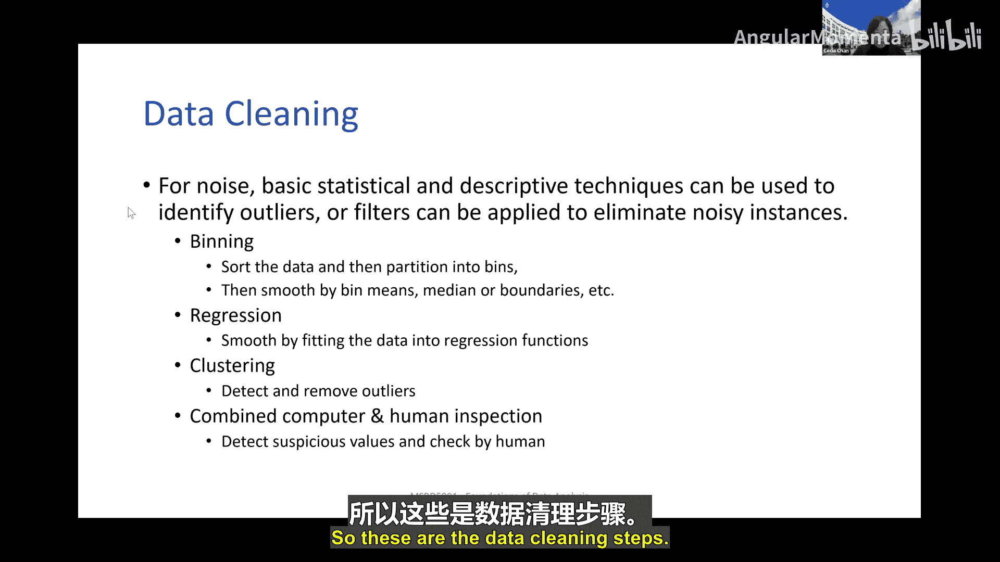

# 【香港科技大学】数据分析基础-｜-Foundations-of-Data-Analytics-p06-06-02-02-数据集成导论--BV1oKFDznE6L_p6-

So let's first look at data integration the goal of data integration is straightforward to collect a single data set with information coming from very than different sources。

 however the process is not that straightforward it's actually involve a lot of like a stabs a lot of processing now for example it will typically involves the matching of the schemmers because if we are looking at different sources of data they have different design so then we'll need to be able to like look at the differences of the design and then be able to like like indicates like the attributes relation。

😊，And then also well need to look at the relation between records we might be we might need to like match the records from one source to the records in another source and then to see whether we can merge the records together so say for example if we are looking at data from relational databases only then it's like having the data from the relational databases being threatened that means we are gathering the records and then creating like related records into one single record Now after we have done data integration then redundancy and like inconsistency may appears。

Like because we are merging things together so then okay we may need to identify redundant attributes an attribute is redundant when it can be derived from another or derived from a combination of attributes and then when we have to avoid redundancy because obviously it will increase the data size right so that means we need time more time to handle things and then another thing is the redundant attribute will be like inducing overfitting because with the attributes redundant。

 that means like our like a model is not going to like perform their jobs correctly because they will be affected by the duplicated or redundant attributes so then we can use correlation analysis to like detect the redundancies for example。

 for nominal attributes we can use chi square correlation test for example to measure the。

H like I find the chi square correlation value so then we can like a look at the frequencies of the attributes value and also the expected value of the attributes as well。

So then when we are looking at the chi square value， if it's larger。

 then it's more likely that the attributes or we refer to variabless here alternatively are related。

 So let's look at an example。 So say that we are looking at two attributes and then each of the attribute is having different two different values。

 for example， one attribute attribute A is having like the two values prechs and not prechs。

 and then for the attribute B， we are having the like science fiction and not like science fiction these two values。

 So then we check on the acuracies of these values and then we'll be able to calculate the expected value of these attributes and then you can see that here the。

Total values， the total frequencies of play chairairs is 300。

 and then the total frequency of life science fiction is this one where like the。

Total frequency is of all like attributes value is 100 10500 so then the expected value is 90。

 so then we like follow the chi square formula we use the frequencies of each each type each attribute type and then okay with the expected value so then we'll do the calculation like this and then the。

Okay chi square value is 507， so then it shows that the like science fiction and play chartairs are correlated。

 so that means we may need to remove one of them。All right so then High Square is phenomenal attributes but for numerical attributes then we'll need another way。

 so which is the pearsons correlation pearsons coefficient sorry and then like if the pearsons coefficient is close to like one or minus one。

 then it means that there is a high correlation between the two attributes A and B and then you can see like it can be calculated with this formula。

😊，Okay now besides correlation， then covariance is also widely used。 So again。

 the relation between like the cos and correlation is given here so then we can use correlation covariance to measure the redundancy of attributes Now besides like detecting redundant attributes。

 there might be also redundant records Now when we have redundant records。

 there will be they might appears inconsistency。 So for example。

 like if we have identified different couples。 okay like for example， the records are the same。

 So like with the use of other attributes， then we may have inconsistent values on another attributes across different like records。

 So then like we need to think about will need to handle the inconsistency and sometimes it may not be that obvious to detect the duplicated records for example。

 like。So the recordss coming from different like a databases or data sets， data sources。

 they could be in different systems of measurements。

 but then if we convert them to like a particular measurements。

 then actually those like recordsus or instances could be the same， for example。

 we may have values that is using the matrix system like for example the meters。

Or like we can have values using represented using the impmerial system， for example， the feed。

So then like both of them are for me like heights or length。

 but then if the two like data sets are using different measurements right so then okay that means the values might appear the same but then they could be actually like in the same value across the same across a particular entity or particular object in different tables so then sometimes it appears that they are different but they could be the same so that's why we say that sometimes the duplicate the duplicated topples are not that easy to identify。

Okay。😊，So now like the finding the duplicated records or duplicated attribute especially for the nominal attributes is not that easy so because like I think about nominal attributes they are values right so if we want to compare like those for example text attributes values or like other kinds of non numerical attributes values so we need some specific like distance measures so very often we may need to use certain like a well character base or we refer it to sequence based distance or similarity measures for example some of those like sequence base or character based similarity or distance measures could be the other distance everything gap and then Gerald algorithm and so on so later on again well discuss like in section we discuss like these。

😊，qu phase， distance measures， in detailed health。All right so then okay now after identifying the duplicated like values so then okay well we may need to identify the duplicated reus so previously these measures will be useful in measuring the similarity between two attributes values but then we'll need to detect the duplicated reus so then we'll need like approaches like probabilistic approaches supervised approaches。

 distance based approaches or cluster clustering algorithms so again later on in another section we'll talk about that。

So then after data integration then okay we'll probably need to do data cleaning so data cleaning means that we are looking at dirty data with like missing errors wrong data non standard representation like so then okay we need data cleaning to like。

Improve the like a performance because if we are looking at dirty data and there is a high proportion of the data is dirty then of course。

 like we won't be having a desirable results。Now， the sources of dirty data。

 the sources of the like the problematic data could be like a pure data entry errors。 So you know。

 we like a。So we make mistakes like a very frequently， especially with like typing or data entry。

 So I think like you may have already observed that like in my notes or in my slides。

 very often there are typing errors there aretypo spelling problems So then these are like data entry errors。

 So then when you have like spelling mistakes So how can you like how can you handle it So or like some numbers are entered Ronnie So then again it may be entered Ronnie in a way that it's not normal。

 So then how should you handle it another source of of data dirty data could be the update errors。

 for example， when you update the data then like sometimes it may be update to a round number or there may be inconsistency between the update So that means like if you're looking at it。

 is it the most updated data or like is it updated incorrectly。

And that could be transmission errors Okay all right， so then okay。

 usually when we are talking about data cleaning and like when we are looking at dirty data。

 we are talking about mainly missing data， missing values or wrong data。

 noisy data so then to handle these two forms of data to handle these two forms of dirty data while we'll need different approaches。

😊，For missing values then we'll need to decide whether those like records or instances containing the missing values can be ignored。

 simply like remove them from the data or if we cannot afford to remove those like records with missing values then we'll need to like think about how to like how to handle the missing values。

 can we like replace it， can we fill it with another values so then like for example we may need to like pick a particular constant values and then it fill in with the instead fill in manually instead of having the missing value there in the record or we may want to like estimate the data and then using some estimated values and then to replace those missing values。

So for example， typical like estimations could be like the mean of the attributes or the most propable value or like a global constant a certain fixed value。

😊，It。So then for noise then we'll need like statistical or descriptive techniques to identify wrong values。

 which means that it's not normal， so then it's outliers or sometimes we may apply filters to eliminate those like a noisy instances those like instances with like wrong values Now here are some ways for us to handle the noisy data so one of it is binning so which means that we swap the data and then partition them into bins and then we'll do well smooth that by other means mediums or boundaries so let's take a look at an example So let's say that we are doing binning and then we could be doing for example equal with。

Partitioning， so that means while we are looking we are trying to divide like the range of values。

 that means like the difference between the minimum and the highest the maximum value into like n intervals of equal size。

 for example， if a and B， these two values are the lowest and highest values of the attributes。

 then the width of the intervals will be like that。

 So then okay we divideise the data according to the range of values， the intervals of values。

 another partitioning could be the equal de partitioning。 that means we look at the frequency。

 So then okay now we divide again the range into n intervals。

 and then each interval should be having approximately same number of data points。

 So let's take a look at an example of equal de bins。

 So then you can see we have 12 sort values here。 and then。With equal width， it means equal de。

 it means that we should have the same number of points。

 So that means we'll have the first four point in the first bin。

And then we have the next four points in the next bin and then the last four points in the last bin bin three。

 So then you can see we have three bins。 and then K， as we mentioned before。

 So then after like having the bins， then well need to do smoothing。 So for example。

 we can smooth it by means。 So then9 is the mean of the。

Be one so then we replace all the values with the mean value and so on with bin two and been3 So say if we are using another method to smooth then say。

 for example， we are using the boundaries So then within each bin we take the boundaries minimum and the maximum1 minimum1 and the maximum1 and then try to convert them into the closest boundary value so you can see that here now8 and9 is closer to4 than 15 so all of them are changed to4 replace as4 and then we have the boundary and then similarly for 2121 we keep them as the boundary value while 24 is closer to 25 so then we have that value。

So that's the pinning examples besides spinning so how can we like handle the outliers the noise while we can use regression so by fitting the data into regression functions okay or are doing clustering so that means we are going to like cluster the points to they the instances or points together so which like there will be outliers detected or wow human inspections so then we can detect like a suspicious values and then we can like manually and check them manually so these are the data cleaning steps。

