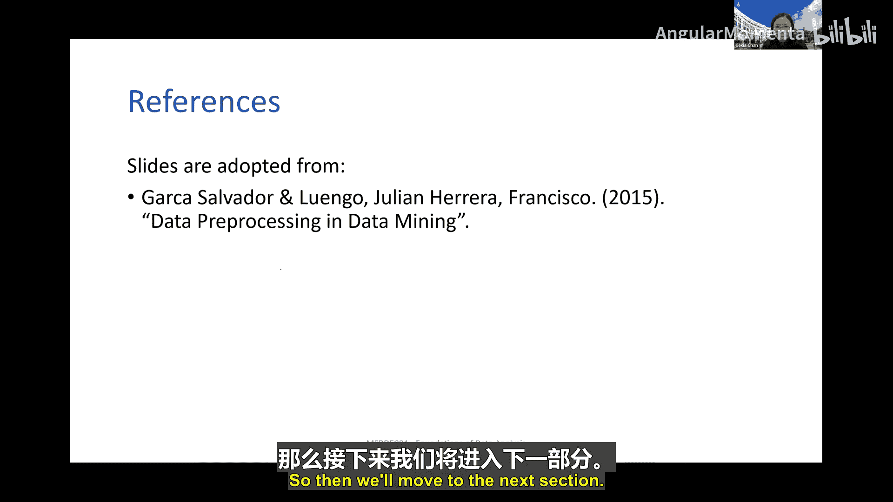

# 【香港科技大学】数据分析基础-｜-Foundations-of-Data-Analytics-p07-06-03-02-视频_数据归一化与数据变换--BV1oKFDznE6L_p7-

So next let's look at data normalization Now sometimes the attributes are in raw attribute values so meaning that like they may not be adequate for our models so then we may need like some steps to transform the original attributes values to new ones so which will like show better properties and then will help the like our performance with the model so then okay like these new attributes where we usually like name them as modeling variables or analytic variables。

Now one of the normalization we can use to like change the original values to new ones will be the mean normalization。

 so for particular attributes， the original maximum and minimum values may be too large or two small so which the difference the range of the values are too large so which will affect the performance of our models。

 so then we can change the original values into a new one with a specific range so for example say that we are looking at the income range which we know that the values are very large so then the minimum value say for example for that attribute is 12000 while the maximum value is 98000 for the original attributes values and then we want to like scale it wants to scale the values to a new range which the minimum one is0。

0 and then while the maximum。ueOf this new range is 1。0。

 meaning that we want to have the new values between 0 to 1。

 So then if the value that we want to convert is 73000， then well convert it like this。

 We did the minimum values out of it divided by the range。

 the original range and then multiply it by the new range and then also shift it by the minimum value。

 So this will be our new value， which is 0。0716。Des mean max normalization。

 so if we don't know the minimum value or the maximum value of that attributes。

 then we can use set score normalization then like it's to like a normalize the attributes to a new distribution with mean0 and standard deviation of one so then we'll need the mean of the original values of the attributes and also the standard deviation and then we'll be able to convert it to a new value so which is 1。

2 to5 here。And then another simple like normalization method is the decimal scaling normalization。

 so you can see that we are dividing a number which is the 10 to the power of shape。

 so then okay we'll be able to shift the zeros of a large number into a smaller one。😊。

Besides normalization， which is converting transforming some old values original raw values to new values。

 then we may also need to create new attributes so with the data transformation now data transformation usually combines some original raw attributes and then using like different formulas and then to create new ones a very typical like transformation will be the linear transformation so you can see that this is a like say that we have a subset of attributes and then we can have a linear combination of the attributes and then which will be giving us the new attribute set。

So then if the linear distribution linear kind of transformation is not good enough。

 then probably we can try a quadratic transformation so you can see that here。

Or like if polynomial transformation is still not good enough。

 then we can look at the problem Okay and then see how we can combine the values together so say for example if we are looking at triangles so then okay we may have a new like attribute which is combining the the verttices coordinates together so you can see that original value attributes are the x coordinate y coordinates so then we have the vertticexes with the y x and y coordinates and then we combine them into a new attribute called a。

So then like so when we want to select a transformation， well need some like background information。

 some expert knowledge， but then if that kind of knowledge is not available。

 then we can explore transformation using a bru search so that means we are looking through like many。

 many transformations and then see which one is the appropriate one。Now。

 besides the previous transformations， So sometimes we may want to do the rank transformation。

 So we are changing transforming the numerical values to the。

Normal scores by first like sorting the new attributes values and then giving them ranks and then okay if we have M attributes values so then we'll have M ranks and then with the ranks obtained then we can like find we can find their normal scores by this formula here so where RI is the rank of that attribute and then okay that attribute value and then the phi is the cumulative cumulative normal function。

Now besides the rank transformation， so another like transformation is the box cos transformation the box co transformation is like if we don't know which transformation is the best then we can use box cos transformation to search for the appropriate one so then you can see that here so we'll be like mapping the values using the following set of transformation and then we are actually like testing the lambdas from like for example minus3 to free so based on the like lambda values then we'll transform the original value x into a new one so then we'll be searching through this like a range of values for lambmbda and then find the one that is the closest find the one that is like with the resulting attributes as close as to the normal distribution。

表ion。Now。The previous like distribution is suitable when we have positive values。

But then when we have negative values， then we'll need to add a parameter C to offset that negative values。

 so you can see that here okay， and then also we have a parameter G to scale the resulting values。

Now， okay so。When we are having the box of transformation。

 so you can see actually it's like changing the data。

 transforming the data into a normal distribution， so it's actually like spreading the histogram like this so then okay。

So say if we are not interested in normal distribution。

 but then we are just like interested in spreading the histogram。

 then okay we can use these two special cases of boxshop transformation so meaning that if we are interested in spreading the right hand side of the histogram then we can use the lock transformation while if we are interested to spread the left hand side of the histogram then we can use the power transformation so these are the boxco transformation。

Now another transformation that is very commonly used is the nominal to binary transformation。

 Now you can see that well with nominal attributes。

 so usually like it's going to give us some like a issues so because many of the math models or algorithms may not be able to handle that So then okay one option is to transform the nominal attributes to numeric one but then you know nominal attributes we have mentioned that there is no order so then if we change them into a numeric one we are assuming orders and then again。

Okay so the well like a well the nominal attributes well it's not equivalent to numbers。

 so therefore like instead of changing them into like numerical values then we may want to generate a set of new attributes okay so say for example。

 so say that we have like instance with n possible we have an attributes sorry so have an attributes and then we have n like possible values so then we'll convert it into n attributes。

And set of new and attributes in each of these new attributes for a particular instance。

 like if that instance has that attribute value， then it will be marked as one while the new value will be one for that new attribute while if the like instances doesn't have like for example。

 if an instance have a particular value，And then that value。

 that attributes corresponding to that value will be one， while the other ones will be0。

So then so you can see that we have like an N new attributes created and then with either one or zero。

😊，So then this transformation is also referred as one to n transformation because originally it's one attributes and then we now have n attributes。

But then of course we are adding so many attributes right。

 so then a problem with it is it's going to be giving us more attributes and then we have mentioned that it's going to give us like a higher complexity。

😊，Now the previous like transformations we are talking about transforming like either the original attributes into a new one or combining new attributes。

 but sometimes the transformation is needed to handle the dimension issues so that means our dataset is very。

 very large we want to reduce the size of our data well of course we don't want the reduction to affect the like a result right so therefore at the same time when we are reducing the size of the data we wants to maintain its original in wants to maintain the in of the original data as possible as much as possible so therefore we are go so in this transformations here like there are dimensionality reductions techniques being used for example。

 the frequent the popular ones will be the wavelelet transformations or the principal component analysis。

So they are trying to find to reduce the number of attributes or instances。

Now the other like techniques could be the other techniques that can be used in reducing the number of instances would be like for example。

 clustering techniques as well and then as we have mentioned previously the binning and discretization techniques may also be useful。

Okay。😊，Alright， so then that's about the like a data reduction So then we have finished talking about the data prepossessing so it's just a very brief overview so we won't be we are not able to go like to discuss each of the steps very very detailed but then like I hope that you have a rough like understanding of the data prepossessing so that later on when you need to start like working on the data doing data analysis then youll be aware of like the needs of data prepossescessing and what would be the steps we need to consider right so then we'll move to the next section。

😊。

