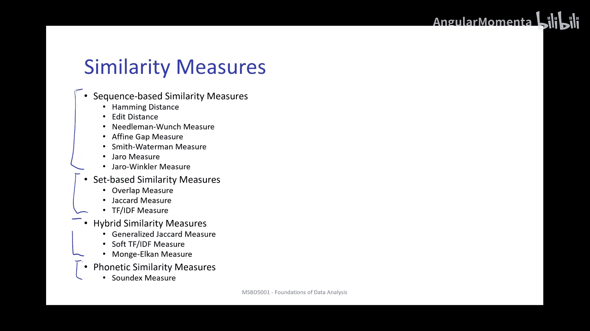

# 【香港科技大学】数据分析基础-｜-Foundations-of-Data-Analytics-p08-09-01-03-相似性是什么--BV1oKFDznE6L_p8-

In this section we are going to talk about string similarity so first we'll look at what is similarity and then we'll look at the problem that we are going to talk about in this section the string similarity in particular so what is this problem so therefore we are going to talk about the problem definition of it and then we'll look at many similarity measures in particular string similarity measures and then afterwards we'll look at the challenges that we may face or well need to handle when we are working with string similarity so let's first take a look at what is similarity similarity is the numerical measure on how alike two data objects are so then it's very very important similarity is very important in data processing it's one of the basic component of many data processing techniques such as data integration and data mining so data integration we have mentioned that we' need to handle like for example。

呃。Finding duplicated attributes， we may want to find like we want to find redundant attributes。

 we may want to find whether there are duplicated records so and then we may also want to find outliers so all of these requires us to look at well are there similar objects are there similar attributes are there similar records and then also are there something that are not similar so that's why we need similarity measures and then another thing about data integration is that we are the objective of data integration is to merge data from two data sources how do we do mergerg it so we need to identify whether there are records that we can merge together so how do we identify those records very often will make use of similarity so we try to see whether okay these two records are similar if they are similar then they。

Probably are retaated then we should be like putting them together so that's like a why similarity is being important in data integration for data mining。

 a lot of processing techniques like classification clustering recommendation anomaly detection will also need to use similarity So for example for classification we are talking about like what is a category of a particular data objects so then very often will make use of the known categories of some data objects if this new object that we are talking about is similar to those that already had the category then we can like say that okay they are similar so we should be like giving that the same category as well for clustering very often we want to group a like objects similar objects together so then again we need to measure whether an object is similar to the cluster whether they whether the object is similar to the other。

Objects。And for recommendation， while we want to like find whether there are similar uses。

 whether there are similar items， similar products so that we can make recommendation of them to the uses of of the systems and for anomaly detection it's like identify theers。

 we want to identify those not normal things， not the usual behaviors。

 so then again how do we identify the abnormal things then we need to do similarity measures okay。😊。

Now very often besides talking about similarity we're also talk about dissimilarity so this similararity is the numerical measure of how two objects are so you can see it's actually the how different so sorry how different two objects are so you can see that it's just the opposite of similarity so then we want to see like okay so what is the extent of difference between two things and then like besides the term similarity so the term distance is actually more often used for referring to the difference between two objects right so then very often when we' are talking about data processing you like be handling you need to work on like how similar things are how different things are so then you need to like calculate the similarity and dissimilarity now for us we actually like a do similarity measure。

the similarity measures all the time right so think about like what you do every day so for example we need like typically read news or we read like post on the internet all the time right so when you read a news or you read something then very often you tried to see okay so have I read that before is there anything that I had seen that is similar so then you are already doing similar similarity measure right and then when you look at a picture when you meet someone then again youll be finding okay so that picture looks familiar right that person looks familiar right so then you are again doing similarity so we are doing that all the time so it becomes so natural to us but then think about if we are talking about data right so how should we handle that so then that's something that we need to discuss。

So first let's look at this problem， so let's say that we are looking at two objects and then for example they are the two objects from a particular attributes type or a particular attributes so for example say that we are looking at an attributes A and then we are talking about two objects belong to that attributes X and Y and then we are measuring the similarity or distance of those two objects。

Now regard that for attributes we may have many different attributes type， for example。

 it can be nominal which means categorical， it can be ordinal。

 it can be interval or racial so with different attributes type the way that we find their similarity is and dissimilarity or distance can be different so first let's look at nominal attributes what is nominal attributes。

Which means that they have categories right so for example。

 like the one that we have mentioned before it's gender。😊，So gender for example。

 the possible values could be male or female or nowadays there are also the neutral options so first let's just focus on having two values right and then like if we have these two values and then we have two objects x and y so say for example we are looking at。

X having the attribute value of male while while while y is also having the attributes value of male。

 So then we can see that， okay， so they are the same， they are the same。

 So then of course their similarity should be one perfect right。

 So then that means when the two the two objects are having the same value。

 same nominal attributes value， then the similarities should be one。Okay， so then in another case。

 so say that we are looking at， for example， why being female。😊。

So then we know that now they are not the same。If they are not the same。

 that means x is different from y， then they are。Not similar at all。 They are different right。

 so then their similarities should be0 inside Okay so then for dissimarity is just the opposite when the two objects X and y are having the same value then they are the same right so then their similarity should be one while the dissarity should be0 so no disimarity at all so that's why it's0 for the distance or dissarity and then since the two well in the opposite case when the objects are not the same So then they are totally different right so then the distance is one。

 so that's nominal attributes。😊，Next let's look at ordinal attributes so what is ordinal attributes ordi attributes means that while they are like values that we can have an order we can have a rank。

 so for example。Like the liker scale。不。For example， that we can choose between like dislike。neutral。

Or like， so then we have two values for this attributes type right and then dislike neutral like well we can rank them。

 we can have like a degree。 So for example， like this like well can be considered as like smaller than neutral and a neutral can be considered smaller than like。

 for example， like this。 So then we have an order there。 So that's ordinal attributes。

 So then how do we measure to like the similarity or distance between two like a ordinal attributes value。

 So for example， x is。😊，Neutual。W， why is like。 So then how do we measure the similarity。

 So what we can do first， and then is first， we have。A rank number， we give them some rank numbers。

 for example， this is one， this is two， this is three。

 so then we convert the ranks into a number between zero to one。So meaning that say for example。

 x is neutral， so then we know that x is actually with the value2 the rank two。

 so then we convert it by calculating to minus1 and then also the number of ranks so which is three minus one so which means neutral is 0。

5 and then how about for like like is free so then again we do a similar calculation here and then it will give us one so then next we can calculate the distance right so the distance between。

The X and Y will be just 0。5 minus1， so that means it's 0。5 in distance。So then for the formula here。

 you can actually see that we are putting these things together， Okay， so then we'll have this。😊。

So then we have the distance， so then to calculate the similarity。

 we just like deduct the distance out of one， so that's how we calculate the similarity and dis similarity for ordinal attributes values。

So then for interval or racial values， then we'll just need to use like the common the very popular distance measures right so for example we calculate like the the normalized。

Difference， so we can calculate the normalized difference between those two like a interval values or racial values。

 right and then。We'll use it as the distance so then if it's normalized that means it's between zero to one。

 so then again we can just like calculate the corresponding similarity by deducting it from one。

So after looking at how do we find the similarity and the similarity of two values right so then very often we are not only looking at two values。

 we may be looking at two data vectors which each vector is having many values for many attributes so like this here we have two vectors V1 and V2 so V1 represents represents the values for the attributes for the attributes。

 So for example we have x1 to x n so we have n attributes。

 So then the first data vectors is like V1 and the second data vector is V2 with values y1 to y n for the attributes so then with two vectors how do we calculates the similarity measures right so then like if they are numerical values they are continuous data so then we can use the like the common the frequent the popular distance like。

Measures， for example， like the Milkonsski family of distance measures。

 like we can do it with the Manhattan distance。 so then it's just the sum of the difference。

The absolute absolute difference， absolute difference in values between the pair of values for the corresponding attributes right so then we may also use that Euculeidean distance measure。

 which is like a the。Taking the sum of the square of the distance between like values of a particular attributes and then just take the square root right and then also we have the cosine similarity and the Ps and correlations they are also very frequently used for calculating the similarity or the distance between two vectors right。

😊，So the problem that we are looking at right now is string matching so we are trying to match two set of strings so say that we have like the set x which consider many strings and then we have another set y which again consider many strings so then we' want to identify pairs of string one from the set x and one from set y and then those that are referring to the same world entity and then we'll call those pairs as a match so say for example we are looking at set x we have three strings here x1 x2 and x3 and then we have another set set y which we have two strings y1 and y2 so then we' want to match all pairs one from x and one from y so that means we'll be looking at x1 and y1。

X1 and y2。 so these are two pairs and then we'll be looking at also y2 and then comparing it with y1 x2 and y would1 and then also x2 with y2 and then also x3 with y1 and then x3 with y2 so you can see that here we are looking at six pairs of strings from set X and set y So then among these six pairs we was to identify those pairs that are referring to the same world entity objects which。

The matches the pairs that are referring to the same and world entity objects will be x1 and y1 x3 and y2 so now let's look at the cases of x1 and y1 here so that x1 is David Smith and then y1 is David the Smith so based on our knowledge right so we know that Dave and David usually the same name right so Dave is an alternative name an alternative for David。

And then sometimes we may omit the middle initial， so that's why David D。

 Smith is very likely to be referring to the same person as Dave Smith so then based on certain similarity measures we identify that as a match and then similarly with Dan Smith and the new Smith again similar to the x1 andY1 case then then is an name for alternative name for Dan right an alternative form of so then again the middle initial can be omitted so then x3 and x andY2 is also very also very likely to be referring to the same word entity so then while the problem that is to identify these two matches so then very often when we are looking at the string matching problems we are trying to match strings and then matching a lot of pairs of strings then we'll be looking at two challenges。

Cy and scalability。So first what do we mean by accuracy so now we call that previously so if we are talking about nominal attributes so strings are like nominal attributes right so then it would be perfect if we can have like the exact matching so say that the two strings are the same we say that their similarity is one but then okay very often we may not be able to like have finding the exact string the same string。

To identify two strings as the same， while they are actually the same because there are many。

 many like problems and errors that could be happening when we collect the data。

 when we are processing the data because you know。Life is not perfect。

 so very often we are looking at data quality problems right so then well have the problem with like。

Accurately matching the strings so like let's look at what are the possible problems that we may encounter so then for example。

 there could be typing and OCR error the automatic recognition errors now when we collect data very often will be like collecting data by what people type in forms or right like few inform so then when we are typing when we are writing well very often there will be mistakes and then similarly for automatic recognitions right so I think you had the experience if you try to like automatically recognize the characters in a picture then you find that well it's not always like a perfect right it's not always correct。

So like an example here we may be looking at two strings one is the David Smith while the other one is David Smith now we know that what David is not a very like a very common name right while David is actually like a more common so then we may think we may well it may be caused by a typing error so then okay David Smith may actually be a typing error which originally it should be David Smith which is a match to another string okay。

And then besides typing errors then well it could be like a different format， for example。

 like dates right so like like different people in different regions may be like writing down days in different format for example。

 some people may write down like 10 slash8 which is actually referring to the eighth of October but then some people will prefer to write down the month in like a short form or in the word as well。

 so then that's October 8 and then also you know that we have the year dates a month right so then for example。

 like we may be referring to like the October 8， for example 2021 right so then well we can put these fee pieces of information in this order or some people will put it in this way。

😊，So then there are different ways that we put down the。

OkayDa month and year so then how do we like compare them right how do we match them in order to say that okay they are referring to the same dates and then another possible situation is that we may be looking at abbreviations or omissions like the middle initials right for abbreviation for example like well we know that for the Hong Kong University of Science and technology then we can write it as HK UST or very often we'll just write down like a UST So then these are the abbreviations so then how can we match them and then also how can we match them against the fulling like for example Hong Kong University of science and technology right that's every time I'm writing this name I find it it's very long right Hong Kong University of Science。

And technology so then how do we match against this like string against those abbreviations or how can we match against the abbreviations between the abbreviations as well right so this is one of the problem and another problem could be like very often we know that there are variations and names like even with the same English name there could be different variations and then for like many people there are nickname right so again how do we match them right so like William Smith and then Bill Smith so are they the same person right。

😊，Are they referring to the same person？Another thing is that for a string with many words like phrases。

 we can actually shuffing the words， we can shuffle the words。 for example。

 like well this refers to the Department of computer science UST but then you know that while some people may also write it as computer science department UST right so then you can see that they could be like different order of the words and then you can see that we know that they are the same。

 but then you can see well if we are talking about like measuring the similarity or the difference so then if we are just doing the matching as we have mentioned before then they will be different but then we know that they are the same So how can we handle that Okay so that's about the accuracy challenge So then that means well we cannot just have either zero or one we cannot have like like the the nominal attributes like the similarity measure while while they are the same It's one。

And different then it's zero well we cannot have that right so then we'll need to have a similarity measure which is giving us a number between0 to one and then which it has the following behavior so the higher is the similarity score。

 the more likely that x and Y are a match okay so then or like if we are looking at the similarity measures value and then if it is larger than a threshold T。

 then we say that okay， so they are we are confident enough to say that they are a match they are referring to the same entity okay for distance it's going to be similar。

Okay， so it's the same concept just at this time， so the smaller the distance。

 the higher the similarity and the larger the value， the smaller the similarity。😊。

Or the larger the difference， right， So then K。That's the accuracy challenge and then let's move on to looking at the scalability challenge Now you can see that here when we are talking about the problem definition。

 we are talking about like matching all pairs right now we are just looking at free strings from one set two strings from another set what if we are looking at thousands of strings from each of the data set so then you can imagine that we are going to match a lot of pairs so then that's why well have these scalability challenges so very often nowadays we have a huge amount of data so then matching all pairs trying to like find a similarity between every pair among the data maybe imprac because the number of pairs are too large too many pairs so then we once a way to solve it so then one of the solution is well let's find the most promising pair。

す。Okay and then say that we are using a method to find those promising paths。Okay。

 and then we identified as candidates， so then we are doing the similarity calculation。😊。

Between those candidate pairs only。 So then we want to reduce the number of pairs that we need to calculate their similarity score。

So which means a possible like method could be， so for each string in set X。

 we try to find a candidate subset。Of y。 So then because this is already smaller。

 it's already smaller than the original set， then we'll find the similarity score between the string X and the string the string y coming from the success set。

 and then we'll just follow the normal similarity measure。

 So we'll try to find it and then if it's larger than a threshold。

 then we say that that pair X from the set X， and then y from a subset of y will be a match pair。

 So then we are reducing the number of candidate。Then next will be like after having discussed about the challenges。

 then next well look at the like a string similarities measures。

 what kind of measures or what are the like a ways that we can calculate similarity measures。

So now we are looking at similarity measures so first let's look at what exactly is a similarity measure so like a similarity measure here means that we are trying to calculate a similarity score of two objects they can be two strings two numbers to top two objects two images but of course as we have mentioned in the start we are looking at two strings now the similarity score like most of the time we want it to be a normalized similarity score meaning that the score should be between0 to one so then when it's one then we know that it's except match the two strings for example are exactly the same。

Well if the two strings similarity score is0 then we know that they are completely different and then for any value that in between0 and one。

 that means the like a similarity between those two strings at a certain level so we can say that it's an approximate similarity。

So then like well sometimes besides a similarity measure。

 so we may want to use a distance measure or to be more a specific distance matrix now if we are talking about a distance matrix。

 then it has to like have the following properties， the refrive property。

 positive propertysymmetric and triangular equation property okay now and then just as what we have briefly mentioned before。

 like very often we may want to convert like for example。

 the distance score that we get from a distance matrix or distance measure and then convert it into a similarity score so then the usual conversions could be like deducting the score from one or dividing one by the distance score。

No。When we are looking at our problems so then we need to look at well is it possible for us to have exact match So assuming that our data are perfect there are no typing errors there are no such kind of like differences in the data everything is standardized they are perfect。

 we have the perfect data quality there then when we can just use exact match very very simple right So that means like assuming everything are correct and we'll be looking at X with David and then why with David then of course now because the two strings are exactly the same right so then theres similarity is one。

Now whenever we see， for example assuming that we are looking at perfect data right so then we know that okay。

 so there won't be any typing earth， so that means okay。

 so it's going to be like these two strings are different， so therefore their similarity is zerorup。

But then obviously like well we may not have a perfect data so we may be like looking at variations and also like errors so then exc matching will not be enough so that is why well need to do a plot some matching and then in the remaining time we'll be looking at like the similarity measures that we can used on strings so we'll be looking at all these similarity measures so first we'll talk about like some sequencebased similarity measures and then next we'll be looking at set based similarity measures and then while sometimes we want to merge different kinds of similarity measures together so that is why we have the hybrid ones and then finally sometimes all these like sequence based set based measures are not good enough we may be handling something。

Definitely so we may need to work on the fanatic similarity measures as well。

 so then we'll look at all the similarity measures next。

