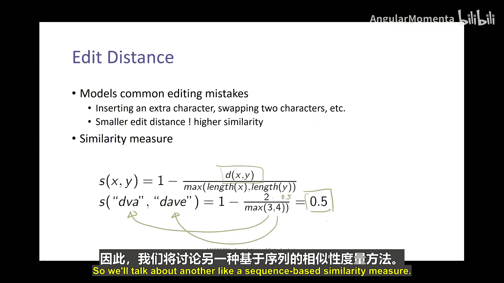
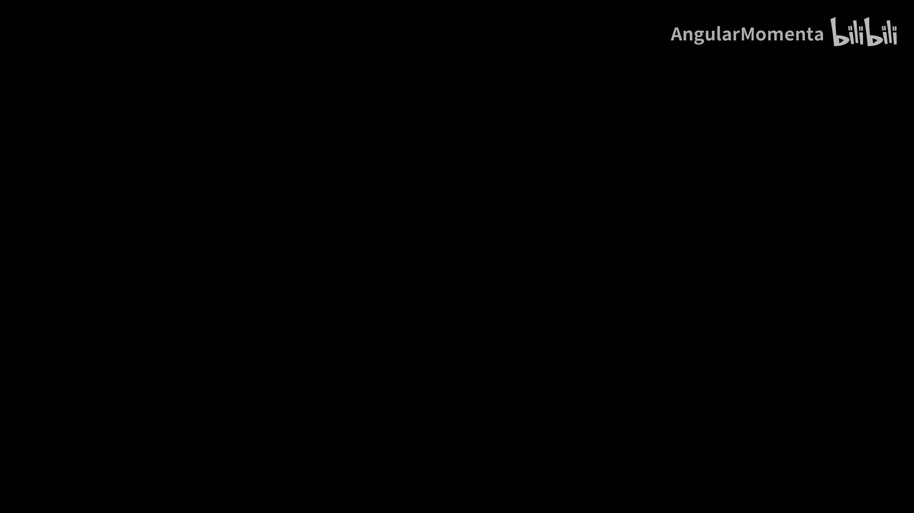
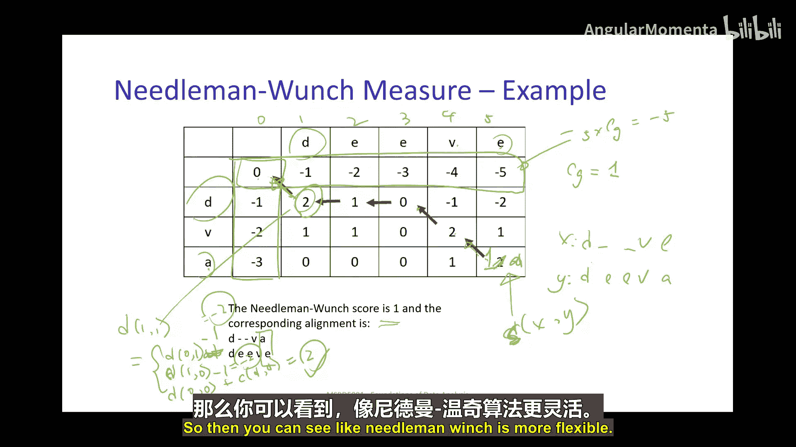
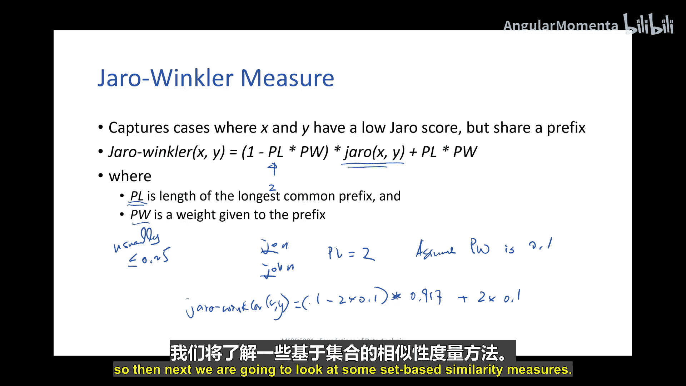
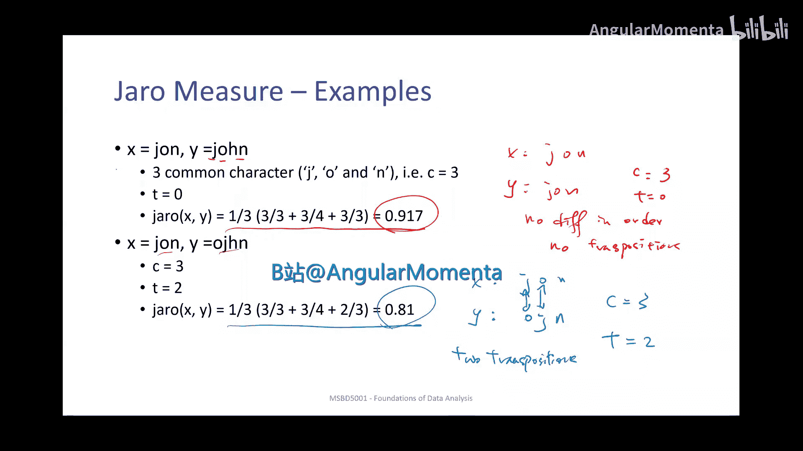

# 【香港科技大学】数据分析基础-｜-Foundations-of-Data-Analytics-p09-09-02-02-基于序列的相似性度量--BV1oKFDznE6L_p9-

The first set of similarity measures that we are going to look at is the sequencebased similarities measures now we are talking about sequence base right so that means we are actually looking at a string as a sequence of characters so then when we are measuring the similarity between two strings we are looking at two sequence of characters and then based on the two sequence we are trying to measure how alike they are so then sequencebased similarity measures are usually used to handle those like typing errors or spelling errors because we are looking at the characters in sequence right so then well look at the different sequencebased similarity measures and then you see why they works well with like typing errors or spelling errors so then the first one that we are going to talk about is the hemm distance hum distance is very very simple so assuming that。

😊，There are two strings with equal length。So then we are trying to identify the number of positions that the two strains are different。

 so very often it's used to handle binary numbers to measure communication errors because of communication errors there might be wrong digits right so for binary numbers because they have the same number of digits so then we can use having distance so because remember that havingm distance have to handle like strings of equals length and then for binary numbers you can see that we are again treating them as a sequence of characters。

Now let's take a look at an example， the two strings that we are having is both with five characters both。

Our five characters。😊，So then the first string is Peter and the second one is P and then we can see that the first two characters are exactly the same while the remaining three characters are different so that means the remaining three positions are having different characters so then three pairs different so the distance is free。

 so then you can also see that how distance is measuring how different two strings are。

So the hemm distance is too simple right And then it also has the assumption of like having equal length for the two strings。

 So then most of the time we are looking at strings with different length。

 So that means hem distance will not be suitable。 So that's why we'll need other kinds or other distance measures or similarity measures。

 So the next one that we are going to look at is the added distance。

 at the distance is also known as the la9 distance。

 It's trying to find the minimum number of transformations needed in transforming the string X to string Y。

So then what are we talking about here is let's look at an example。

 So we have the string X and then we also have the string Y by looking at these two strings quickly manually so then we can identify the differences right so there are the difference between like the x and y there is an extra D right in the string Y comparing to string X and then in string X。

 the character after s is M while in here it's I and then the next one in x is I while in y is M and then also there is an extra S in string X so we can identify four differences in this pair of strings and that's the。

😊，Lastein distance score for differences right so then we have done this manually right but then okay at the distance is actually defining the problem more formally as the number of transformations so then the differences are regarded as transformations and then each transformation is going to have a course of one and then if there is no transformation needed then it's not having a course there is no extra cost。

So that the transformations like define here is either deleting a character。😊。

Inserting a character or substitute a character。 So these kind of transformations。

 So then if we are considering it with the transformations， that means the string。X。

 which is Davis Smith。嗯。So we'll need to have first an insertion， inserting a D after David。Right。

 and then okay， we know that originally in x it's M。

 but in y this position here should be an I so then we are substituting replacing M by I and then in a position here originally it's I we want it to be M。

 So that means we are substituting I by M replacing I by M。 and then finally we know that in y。

There is no S at the end。 So that means we'll need to delete the last character S。

 So after doing these four transformations， then the resulting string is David Lee Ss safe， right。

 so which is the string Y。So then we have transformed x into y and the number of operations is one inserting a character two replacing a character free replacing another character and then also deleting a character。

 so again four transformations。For transformations。

 so then the added distance is4 between the string x and y right so then we know the idea of or how the added distance is considering all these but then like how do we calculate it right so then we have an algorithm to do that which is this one which is using the dynamic programming to compute the added distance now in here in this algorithm we are defining the string x as a sequence of characters so you can see that here there are n characters Okay。

 so which is the length of x。And then we have another string y， which is of length M。Okay。

And then both of them are considered as a sequence of characters and then K for at every pair of possible positions。

 so that means like a well for example we can be at the last character of string x and the last character of M that would be the distance the at a distance at that particular positions that mean between a pair of like sequence right so DIJ so it's actually I here and J here okay。

Alright， so then what we want to do is we want to find the active distance between these two strains。

 So which means that we are looking at the last positions， the N and M。

 So which means that we are looking at at the end。So after going through all the characters of string X and y。

 while at the final position， so then what will be the number of transformation， so that's D and M。

Alright， so then how do we calculate the DMMM So then okay。

 we'll look at the transformation at that pair of positions between， for example， character and。

X M and character and M。 So what is the。Operation needed or transformation needed。

 assuming that a certain transformation is needed， so then on top of this transformation and also the previous transformations needed in the previous like a sequence。

In the previous operations then together well have the final number of operations at a distance so that means to calculate the at a distance at this position and M we'll need to know how many transformations are needed in previous positions so that's the idea of the dynamic programming Okay it depends on the previous positions all right so then how do we do that how do we do the whole calculations so first well need to create a matrix and that matrix is with this size so you can see that here。

N is the number of characters in string N， and M is the number of characters in string M。

In string y with M characters， So which means that like this here。

 So we know that x this string is of length free。 So then n is free while Dave the y string here is with four characters so the length is4 m is4 so then we'll need to create a matrix of one plus three rows and then one plus four columns So then okay we have this matrix here So then after we have like created the matrix So then what we need to do is do the initialization well need to initialize the matrix for example。

 like for each row。The cell of the first column will be initialized according to its row number so we can see that here among this first column all the cells are initialized by the row number0123 and then within the first row all the columns are initialized again by the column numbers so we have this here okay so then we have the matrix initialized then well be able to start calculating the distance at the subsequent cells okay for example in D11 so D11 means that we are looking at the operation needed the transformation needed。

By aligning the character D with D。 Okay， so what is the operation needed。

And then well also need to consider what will be the previous like operations if we assumed a previous operation。

 so then we'll be looking at what should be this positions operation and then we calculate the total cost so that's why we'll be looking at the four operations right we call that for that at the distance we have the four operations delete。

Insceptt。Substitute。😮，And then no operation at all So what do we mean by no operation it means that we simply just retain the character or we say that we copy the character right so then we are considering these for operations now if we are adding if we are deleting a character so which means that there is one course。

Okay， and then which also means that like the we need to add an extra characters。

 so that means while there is one last character。In the。Why strange？Okay。

 so that's why you can see that here。 So that means we'll need to delete one。

 So that means we'll be advancing。 Okay， so we are still in the like current column。

 but then okay from the row， it's one last。 So that means we have to delete a character in order to have the DIJ because you can see that we are in here。

 So which means that。Okay， so right now， if we are looking at the cells， the matrix。

 so that means we have we are looking at the four positions like this。And then this is T11。

 and then this is T。1，0。Right so that means we are actually okay having the extra character here so we have an extra character in the string y so we call this is y this is x okay so therefore here this is an delete so well need to remove a character from x in order to have it into y okay and then now next。

Okay， so how about from here to here， that means we are actually doing an insert。

So we have to insert a character from X。Okay， into x in order to have it into y。

 so that means we are going to add another character so then we are moving to the next column of the y。

And then well， if， okay， both of the previous positions is zero， that means well。

 we are either copying a character。Copy。Or substitute。

That means either we are replacing a character or we just retain the characters so you can see the operations here So then well with the previous like operations considered with the previous like a distance calculated and also on top we consider one of the possible operation so then we'll try to find one that is minimum because for at the distance we are considering the minimum number of operations right so then going back to this example here it means that now we want to calculate the one1 so if we are transforming the characters with a delete of the character so that means we'll need to add one So that's why the courses is。

Okay， two， so you can see that here。😊，And then， okay， if we have to insert a character。

 So that means we'll need to like have an insert and an extra cost。 So that means from here to here。

 then this is again too。 Now， if we are okay， looking at the pair of characters D。And D here。Okay。

 so x1 is T。And then y1 is also d。 so that means x1 and y1， they are the same。

 so then you can see that there is no course， no course here。

 so therefore we don't need to increase any values so then it's just the at the distance of the previous positions so then that means while they are of the same number of characters so that's d00 which d00 is just0。

Okay， so then among these three numbers， we pick the largest one， the smallest one。

 which is this one， of course， right， so then that's the distance at D11。

Now as at the distance is finding the minimum positions， a minimum number of transformations。

 so then because the minimum one is actually the00 comes from the00。

 so that means we are picking this and then the distance at this point is0 okay so that's why we have it here。

So then， okay， we continue to fill in the rest of the cells by this pattern here。 So that means。

 sorry about this。 So that means， for example， if we are considering this position here， this is D12。

 So then again， we are considering the three possibilities。 So we are looking at minimum between。

So D。0，2， B，0，2。And then， okay， that means it's a delete。 So it's plus one。

 and then which means that it's。D 02 is2， so that means it's3 or we need to consider the D20。 Okay。

 so D so sorry， D1，0。Okay， so then B10 means that it's0 right。

 so then0 plus one is one and then we'll also need to consider from D okay。0，1。 So from D 0，1。

 the course is one。 And then if we go from this here。Just just a moment。Now。

 if we look at this conversion here， this is a。A and D。 So that means x1。Is D， Y 2 is8。

 So x1 is not the same as y2。 So that means we'll have to add a course。

 So then that means it's becoming2 okay。So then we are looking at the value。

We are looking at the free values。3e，1 and two。 And then we pick the minimum。

 So that means is this one。 So then that means the at distance at this point should be one。

And then it's coming from this， right， because it's D 1020。 So we have one here。

 So then we can continue to fill in the rest of the cells accordingly， right， So then what we have。

Finally， will be like a a fielding matrix like this。 Okay。

 so then we have calculated up to this point。 So then we know the at distance of the X and Y， So the。

Okay， free4。D 3，4， so this is D3，4。 So it's2。 So then this is the at the distance。

Of the string X and Y， it is2。Now， besides knowing the distance。

 very often we want to know what are the transformations needed so then we can actually follow the arrows that we have marked in how we get the minimum score at each cell。

 So then if we follow the arrow。 So you can see that here we marked the arrows right， So then okay。

 this one is not there。 Okay it shouldn't be have there。 But then we have all these arrows。

 So then if we follow the arrows。 So then you can see that here。 Now A and E， they are not the same。

 So that means there is。A replacement。Substitute。Right and then okay。

 we have the previous characters matched， so we rematched and then it's just copy。Okay。

 and then next we have。😊，第。Substitution， Okay， we have sorry。

 So we have the characters A corresponding to the like a character D in string X。

 So that means well it's not Excel emerging。 so the number of characters are not the same。

 so there is an insert。And then finally， if we are looking at this。

 so it's just a substitute right because the two characters are the same and then it's actually not a substitute but a copy。

So that means those operations that requires a course is just insert and substitute so that's why the edit distance is two okay and then you can see actually we have the characters alignment like this so you can see the first pair of characters aligned we have to insert one。

Into x to make it y and then aligning the pair of V characters and also aligning the A and V characters so that's at the distance。

So after looking at at a distance with dynamic programming so then let's look at a little bit more information about at a distance so you can see at a distance is like used in modeling like common at for example an extra characters swapping of two characters in wrong positions and then you can see that the smaller at distance the higher similarities so that means there are less transformations so with less transformations that means the two strings are more similar so with more。

😊，Transforms a higher other distance refers to less similar the two strings are so because it's a distance。

 So what if we need the similarity so then you can see that here we may need to convert。

The distance into a similarity by， for example having this the distance and then we need to normalize it right so then we mayize normalize it by the longer length so that means the length of x and length of y we pick the larger one and then use it to normalize the distance and then subtract it from the one okay so then we'll have the similarity measure so for example we know that from Dva to the AVE the added distance is two and then。

This is the length of B V， and then this is the length of B A V。 So then we divide 2 by 4。 It's 0。5。

 and then。The resulting similarity score is 0。5。And this is there at the distance。

 so we will talk about another like a sequence based similarity measure。😊。

So another distance measure another similarity measure that we are going to talk about which is sequence a is the needle man winch measure Now it's actually like a modification with the edit distance it's generalizing the Lastein the added distance by considering a few things now with the added distance you can see that the course of all the operations are the same So when you insert a character。

 the course is one when you delete a character， the course is one when you replace another a character by another character it's also one so then okay now the courses are the same so well it may not be the best representation so sometimes we may want to have different like scores for different operations so then well need the needle man winch like a measure。

Yeah。So you can see that like for the needle man woundch measure。

 it's like it's calculating the similarity instead of the distance。

 So what is trying to do is to align the two strings to give an alignment between the string X and string Y and then based on the alignment so we have a score So then is's trying to find the best alignment so that means the alignment with the highest score and then it's measuring the similarity So what what do we mean by an alignment here is that we are trying to correspond the characters from x the string x and string y and then okay we also allow some gaps So for example。

 say that x is D V and then y is D E E V so then we can align these two pair of strings these two strings in different way。

But then one of it would be like having two gaps。 So these are the gaps。

Okay so after like aligning D with D then because like the best alignment next is we have a pair of same characters V so in between so we are allowing gaps so then B E E VA is like having the first D aligned and then we have two gaps and then the pair of character V aligned and then aligning a with E and then we'll find a score representing this pair of alignment。

So then needle man win is generalizing the at distance by also having a gap penalty so because it it's considering adding gaps。

 so then there is a penalty of course for having a gap and then it's called the gap penalty and then for the other operations like aligning D with D or aligning EA with E。

 so there is a score right so very likely okay the aligning of D and E mean that it's a higher score while aligning A and E are not that desirable it's having a smaller score。

So then this is represented by the score matrix so you can see that here if we are aligning D and D it's positive2 which is a score while if we align a with E so you'll see that because the two characters are different then it's having a negative score so it's like a cost right so a penalty so then with the score matrix and the gap matrix of the gap penalty so we'll be calculating the differences the number again the number of differences and then based on the differences we'll be having the scores so for the previous alignment so you can see that here now D and D are aligned so according to the score matrix it's2。

And then for having a gap， so we have two gaps。 So that's why there is a minus-2 for two gaps。

 So you can see that here the gap penalty is one for each gap。

 So that means we have to deduct2 from the total score and then we have the align of V to v。

 So you can see B to v is2。 So that's why we have two here。

 And then finally we have a with E which a with E is actually it's yeah it's minus1。

 So then we have the minus1 here。 So2 plus 2 minus-1 that's already free。

 and then minus-2 for the gap。 So then the。A needleman winch score for this pair of string strings is one Okay all right。

 so you can see that here needleman winch is generalizing the leverage line distance in threeways now it's calculating a score based on the alignment so it's not finding the differences it's finding the similarity so it's actually calculating a similarity score。

And then besides just having the same course for any operations so then needleman winch is having a score matrix。

 so it's allowing us for a more finegrained score model okay so it's allowing us to specify like what pairs of characters should be corresponding to what what value so you can see that we actually can make use of needleman winch to say that okay so for some pair of characters which there it's very likely to be like a very frequent mistakes。

 for example， pairs of characters that are right next to each other in our keyboard so then there could be like typing mistakes or like two pairs of characters with very similar sound then we can actually have it with less penalty while if like those two those two characters a pair of characters it's very unlikely to make mistake with them then we can assign。

Larger penalty and more negative score。 So it's allowing us to have a more detailed control on the。

Scoll needed okay for making the alignment。Another like a another thing that needleman winch general is the insertion and deletion right we call that in the at a distance we have the insertion operation and the deletion operation so then both of them is just having gaps either in the like string x putting a gap in the string x or putting a gap in the string y so that's actually a gap so then in needleman winch we're generalizing it into a gap cost and then that course by just being one into two。

😊，A course that we can specify。So then similar to at distance。

 we can also like have this like calculated by the dynamics programming so the dynamic programming algorithm for the needle man win score is actually like this it's kind of similar to the at distance So again we are having the string x and y defining them as the sequence of characters and then now again well need to have the matrix like that and then the initialization is slightly different we are looking at the gap course and then depending on which column and which row we are talking about then we multiplied by the row number with the row index or column index with the gap course so the initialized like the initialization you can see that here for the first row is starting from0 minus-1 minus2 minus-3 minus-4 here because the Cg the gap course is actually one and then this is。

The role here is。5， right， so then it's five times the negative5 times Cg， so that's why it's minus5。

And then similarly for the first column here， so we are doing the initialization similarly according to this。

 and then now we are also having the recurrence calculation so then at the position SJ S IJ。

 then again we consider whether it's a gap。😊，Okay， it's aligning like either X or y to the gap。

And a particular character， so both of these are gap， okay。Or we are doing an alignment。

 So this means that we are aligning。Xi with。Why J， so then we'll look at the score matrix。

Okay so that's why it's the C X I Y J。 So then we'll look at the score corresponding to the score matrix。

 So then again doing the calculation like this right。

 so and then we are not calculating the minimum we are finding the max because we are calculating the similarity so we want to pick the best alignment so that's maxima so which means that you can see that here is very similar。

 So if we are at this particular position here we are looking at d11 so then we are looking at。

The three possibilities， D 01。With a gap， okay， so that means it's minus1 or D。1，0。 So again。

 a gap has to be added。 So minus1 or d 0，0。So which means that we'll have to align D with D so aligning D with D according to the previous score matrix here is2。

 so that's why we have the value2 here C D and D so that means we have two so we are looking at the score。

嗯。-1， minus-1， which is。-2 or here also-2。 So then we are looking at -2 minus-2 and 2。 So of course。

 we pick this right， So that's why we have the value to。 and then it's coming from。

The D00 position so then again we calculates the values the li man winch score for all the remaining cells and then just the same before this is the needle man winch score so this is the。

ASimilarity between x and y。 So then cake the needle when win score is。So sorry here。

 so it's actually wrong， this one should be minus1。That's so sorry。 it should be one。

 so sorry about this。 Now the needle man win score here because like from 2 to here， it's E and a。

 So therefore it's not a match。 So therefore there it should there should be a negative one like for the score from the score matrix。

 So it should be one So then okay so that means this is the needle man win score And if we look at we want to look at the alignment。

 So again， we just do this right for the arrows So then this means that it's just aligning So we have the E align with a。

And then we align with me。And then here so we know that there are two gaps right so therefore there are two gaps here and then E is aligning to gap E is also aligning to step and then finally we have the D to D so then this is the x string wow this is the y string so then this is the alignment Okay so that's the needle man win scope。

So if we want to have a more detailed control detailed specification on like how we want to match the characters like what kind of like a score should we be considering like do we want gaps or we don't want gaps。

 then we can control the mapping， the matching to pick the best or the preferred alignment by having different CG value and also different values in the score matrix so then you can see it like middleman win is more flexible。

The next measure that we are going to look at is the Allfine gapap measure now Aline gapap measure is actually an extension of the needleman winch score so recall that needleman winch score is having a gap penalty so then the needleman when we are handle when when you're using needleman winch like a measure on the following case for example the string X being David Smith and then while string Y being the David Richardson Smith。

😊，So then there is if we align them by the needleman winch， we are looking at a very large gap。

 so you can see that here because there is the middle name so there is a very large gap the gap is actually 11 characters long so then if we are considering the same gap course for all these 11 characters then well have a very large gap course and then the needleman winch score on this pair of string is going to be small okay。

And then this is actually a very frequent a very common case right so like for example in one dataset we have the names with just like a first name and last name and then from another set of data all the names are having the full name with the first name middle name and last large last name So that means in one data set there is no middle name。

😊，So if we compare all the names from that data set to another one。

 so all of them will be having a very large very high difference and a very low similarity。

 so then if we are considering situation like this then obviously the needle man winch pressure is not suitable because gaps usually tends to be longer than one character。

So then for the Al gap measure is trying to like a split the gap course into two kinds one is the opening of the gaps if we align the characters and then we're starting to add a gap for the first time it's an opening of the gap so we have a course for the opening the gap which is represented by C。

And then after having the first gap after opening a gap。

 so if we are having more gap more spaces then we are just continuing the gap extending a gap。

 so then we say that that is continuing of the gap and then we represented by a course C okay so then the relation between these two scores is well it's more expensive to open a gap so then once we open a gap。

 then well because it's more likely to continuing the gap so then the continuing gap course should be smaller than the opening of the gap so that's why the relation is C smaller than C so then the course of a gap with K spaces then that means it should be having the opening of the gap。

😊，But then for the for the rest of the positions， then they are just continuing Okay， so that's why。

Then the rest of the characters K minus one characters will be the continuing of the gap。

 so we are calculating the course like this， so going back to the previous example David Smith with David David Richardson Smith。

 so we know that the gap is 11 characters long， so which means that the first character。

Is an opening of the gap。 So the gap course is we have the C， O plus 11-1 times C R。

 So assuming that the C， O is one。 C R is 0。5， then it's 1 plus 11 minus。1 times 0。

5 Okay so then for the rest of the characters they are alignment right so assuming that all of them are aligned and then with a score of111 so for the other alignment so originally without a gap。

Without gap。So the score is。Supposingly 11， so then that means we'll be deducting the penalty。Okay。

 we'll be deducting the penalty out of the score， so that's why now the score is 11 minus the the opening of the gap and the continuing of the gap so then。

The updated score， so which means using Aline gapap。

 the score will be5 Well previously if we are using middleman winch because while we deduct 11 for the gap penalty because all of the gaps are of the same course right so that means the resulting score is just zero so you can see that this is much higher and then while this is actually preferred because we know that it's very common to have the middle name omitted in situations right so comparing with we have to match the middle name so again this depends on the problem setting so like for example you have to understand your data set。

 you have to understand your problems well you need to know well do we want to consider gap or it's like the middle name is very。

 very important then you cannot use the e gap but then you know that middle names can be omitted。

Instead of using the needle one winch， which give you a very low similarity。

 then everything gap will be the better one。Now because now we ask like having the opening of the gap and then the continuing the gap so comparing to the needleman winch we need to consider more cases and that's why the Aline gap measures algorithm is becoming more complex now the dynamic programming algorithm for the calculating the Aline gapap score is like us so first we are going to consider free scores for every pair of positions now we are looking at like for example a position I and J what is the score of aligning X I to Y Yj okay so that means we have a pair of characters matching。

😊，Or we are aligning a character to a gap， so which is considered by the IX and IY score so IX score means that we have the character in the string X matching to a gap while we have IY means that we have a character in the Y string matching to a gap so then we have three scores and then。

Now this is talking about the positions at IJ right so then the dynamic programming algorithm means that we have to consider the best score at the previous positions so that's why there will be a lot of combinations so let's take a look at this。

哦。So let's take a look at the like a algorithm right so say that we are considering of course the Alvinine gap right so then for the Alvin gap Al gap we are considering the pair of positions。

I J。So then when we are considering at the positions of Ij， then there are three situations。

 three cases， the case one is that。😊，We are looking at。The case one。

So we are looking at aligning X I， the character at the I position with the。

Jave characters in the string Y。 so then okay， this is an alignment okay。

 and then which will be represented by the score。MI J。Okay。

 so this is the alignment score and then besides aligning the pair of characters。

 we could be looking at another situation here， which is having the。Case two。

Which is having the character。Of string x at position I， aligning to a gap。Okay， gap here。All。

 so then this is represented by the IX score。😊，And then for the fruitcase。Well the front case。

 we are looking at。😊，He D， Y J， aligning with a gap。Okay。So then this is represented by the IY score。

😊，Al right， so then we have these three possibilities either having the XI matching with Yj or XI matching with a gap or Yj matching with a gap so we have these three possibilities and then among each three cases well because we have to like consider the previous like a score at the previous positions so that means again they could be like an alignment they could be again a gap so therefore we have more combinations of cases。

😊，So let's first look at。Case1。So which means that we are having the X I aligning with Yj。

 but then we are considering the previous position。

 So then that means the first case here is we can be having the X。

I minus-1 aligning with Y I-1 right， and then this is actually the M I minus-1 J minus1 score right because M represents the alignment score and then okay。

We are also having the X I aligning Y J， right， So then this alignment will be。

With the score from the score matrix， which is。The score of C X I with Yj。

So that's from the score matrix。好。Okay。By matching the character at I position with the character at J position right。

 so then that's one of the possible combinations， another combination could be that。😊。

We are looking at。Okay， X I。-1 align alignning with a gap。嗯。Like this right。

 so then this score here is actually the IX score。Find does， right， So then okay， again。

 we are having the score C。😊，I X IY J on top。Right， and then now， okay。

 another possibility is very similar to this one， which is now having the。😊。

Why J why I J minus1 matching with a gap。And then X I and Yj。Mtching right。

 so that means this is represented by the IY score。And then again。

We are considering the to with the aligning of X I and Y j。So that means like for the MIIJ here。

 we are considering these free。Possbilities， and then we are calculating the similarity。

 So that means we have to pick the maximum one。Among these free， the maximum what。SoSo about that。

 so I pressed the subtitle。Okay so we are picking the maximum。Out of here， right， So then okay。

 you can see this is the。😊，Formula that we have here。For the MI I J。

So we are talking about the three cases right so then well pick the maximum score for like having X I J X I matching with Yj aligning with Yj。

 so then we look at the case two， which is having X I matching with a gap so then we are again looking at the similar situations here。

😊，So for the previous pair of positions， we could be having the X I minus1 aligning with Yj minus1。

 So then this is the max the M score right so the M。Okay。E m。

We'So about that so we are actually looking at like because right now we are having X I aligning with the gap so what it means that is that like we are now having X I matching with the gap so then what's happening with the Yj characters right so that means well it could be that the Yj characters is aligning with like the previous character in the string X so then we have X I minus1 aligning with Yj so then this is the M。

😊，I-1 J score。 And then this is a gap。 So then this is an opening of the gap。 So that's C O。

 And then cake， another possibility is that we are having the。Exite， matching with a gap。

And then the previous characters X I minus1 again is aligning with a gap， Okay。

 so which means that this is the gap score。😊，Okay， IX and then between I minus1 and j。Okay。

 because the Yj characters have to be aligned in a previous point so then okay， this is continuing。

After gap， it's not。Continuing gap， it's not an opening of the gap， so that means it's CR okay。

So then kick with the gap course。😊，So sorry for one more it's not plus because it's a cost so then it's minus right so then okay now you may be asking so what about a third possibility which means that it's like a having the X I aligning with the gap。

And then the X。😊，Another gap here， aligning with why。诶。J， okay， so yes， you're right。

 So another possibility is like this。 but then。😊，But then if we are looking at this case。

 you see that that's actually too opening right， so it's opening a gap。😊。

Open a gap and then open a gap again。 now recall that because。C O is actually larger than C。

 so that means this is not going to happen because we have the course like this。

 so then this will not be a situation that we are considering so that's why。

It's not included in the dynamic programming algorithm。

 so then we just have this right so these two possible cases and then again we pack the maximum one so again we pack the maximum out of these two right。

And the next we look at the case free， so case free isn't it very similar。

 So then we could be looking at like the gap aligning with the。😊，Why Jay？😮。

And then also with the previous characters， that means Xi aligning with Yj minus1。

So that means this is that MI with J minus1。And then we have the gap of the opening of the gap。

 minus CO。Or we can be looking at。😮，So having the。Why J？Mtching them with forget gap。

 aligning with a gap。😊，And then also the previous character， Y J minus1 aligning with a gap as well。

 so then this is the。Iy Scott， so sorry。I Y score。Okay， and then it's the score of I aligning with。

Ja Mo。Okay， so like this。 So then again， we have the continuing of gaps。

 So that means it's the C score。So then again we have to find the maximum out of these two so then you can see the possible cases here and this give us the recurring case the recurrence situation。

 the recurrence formula of the Aling gap dynamic programming algorithm so then we have the MIJ I X IJ IY IJ for the every IJ position so then okay we have three fee scores so which one should we be using right so then it's again picking the back maximum so we have to pick the maximum out of these two。

The maximum one， so then that will be the score representing the a F gap score at the position I chain。

😊，Right so then okay we'll be calculating everything So then what is the final score The final score is the position at Mmmm and then okay if we want to find the alignment so then okay we start at that mm position and then trace back so very similar to the previous like a measures So then we start at either m00 i x00 or IY 00 so then let's take a look at the whole alpha gap dynamic programming algorithm So then just like before so we are having the matrix but then we every like a cell well need to have these scores and then we initialize m00 by the0 and then I x0 by the opening of the gap and then IY 00 as the opening of the gap course as well and then for the others columns and the other。

😊，Because they are just continuing gaps。 So then we just like add the continuing gap course。

So then you can see that here this is the Aline gap matrix so you can see well each cells we are having three scores like this right and then we initialize according to what we have said minus00 and then now we are having the opening of the cap4 so that's why it's minus-4 and minus4 and then for the other cells you can see that here for the other cells we are doing the infinity so you can see that here。

😊，The initialization here is that other sounds。😊，It's actually sorry about this， it's actually minus。

Infinity， sorry about that， it's minus infinity。For the other cells， minus infinity。

So now we have the minus infinity initialized for all of these okay。

 so then we do the recurrence right so then that means for example， at this particular position here。

😊，So at this particular position here， we are looking at the combination of 11 right， so then okay。

 say that we are looking at the M。😊，I well M11， so which means that we are actually okay aligning a with a so assuming that we are having a uniform like a alignment score so then it's just one when the two characters are the same or when the two characters are different then it's minus one so which means that the C11 here is actually just one and then we'll need to consider the three possibilities right so that means we are trying to pick the max。

Out of M0，0。Plus one or IX。0ero， zero plus。The gap score。

 so which is minus4 or IY00 again minus4 so we picked the maximum1 now this is0 this is minus4 this is minus4s of course we pick this one right so that's why it's one and then it's from the m0 okay。

So then similarly， for this position here， we are doing the similar thing for this position here。

 we are talking about the IX。😊，1，1 score。 So I X 1。

1 score means that we are considering the maximum out of M。嗯诶。1，0。So sorry， it should be M01。

 so sorry the opposite01。😊，And then， okay， we add the opening of the gap。 So that's the。-4。

 or we consider a continuing case。 So it's I x 01 and then continuing gap。 Okay， so then the M 0，1。

 Okay， M01 here is the infinity。 So that means it's still minus infinity， right， and then for I X 0。

1， it's minus。Ix01 is still infinity， this is also infinity， so therefore it's also infinity Okay。

 so then it's infinity okay， but then like so we just keep it as the minus infinity there。😊。

So then we continue to do all the calculations and then this is the resulting scores that we have then as we have mentioned。

 we try to like if we want to identify the alignment or the score。

 we are actually looking at this position here， okay。😊，And then pick the maximum1。

 So this is maximum1， which is actually the M。Like the M M score。

 so which is actually the Evin gap score right， so this is the one and then we just follow the arrows again and then we'll have the alignment。

 So then the E gap score here so the。Score between like Cardi。X and Y is minus4。

 the maximum out of this three。 Okay， and then if we look at the alignment。

 so you can see there are many arrows here。 So one possibility is we have the T aligned with T。😊。

And then， okay， we are looking at here。Which we have C aligning with8， because this is the M X。

 So that means it's an alignment。 And then we can also align it with。Here A and A。

 So we have A and A aligned。 And then now in here， this is a IY score。

 So which means that we are having the gap here。 Okay。

 and then we are having C aligning with the gap。 and then finally we are going to here and then the character A is again aligning with the。

The啊。Aligning with the。Aligning with a gap。So that means it's here so sorry about this so it's actually AAT so sorry for writing it wrong so it's see here okay。

 sorry about this。Alright， so then cake we have the alignment there right so following these arrows。

 so it's a gap for the。😊，Why okay for the character white this is x string and then this is the white string this is x this is white okay so then we have this alignment here。

 but then you can see there are other arrows right so leading to different like a cells here So that means we may have other alignments with the same score so these are the free possible alignments So this is the Aline gap similarity。

😊，So you can see that everything gap similarity is considering more right so it's actually considering a very fine grain of like a matching with spaces matching with gaps or like aligning with characters so you can see that here it's all preferring a continuing of the gap right so you can see that here here so then we are having the gaps like this so we don't have the two spaces of gaps the gap of links split into two right to opening of the gaps that would be too expensive。

😊，So E gapap measure is able to handle those like string matching with long gaps and then like when you have long gaps so then okay you may want to like use the e gapap measure so then like that's everything gapap and then we'll continue to look at the other sequence based similarity measures。

😊，Another sequencebased similarity measure is the Smith waterman measure。

 It's also very similar to the previous measures， the needleman winch measure and a thin gap measure that we had mentioned。

 but of course there is a difference。 Now it's actually an extension to the needleman winch measure。

 Now when we look at the previous two measures， needleman winch and also the a thin gap measure。

 you can see that we are trying to have a global alignment。

 So that means we are trying to align consider the whole string like of x and the whole string of white。

 So we trying to match all the characters。 But then sometimes while we don't want the whole string to be matched。

 we just want to find the like a longest common substr。

 So then that will be go enough that is what we want to do then we should be using the Smith waterman instead。

 the previous like a measures we not be suitable。 So say for example like this one here。

 Now if we are talking about two strings。One is Professor John R Smith University of Wisconsin's with all the information there。

 while the other one， we just have the title and also the name。Without the like affiliations。

 So then okay， well， if we are using the a gap or the needleman winch because like there are a huge difference between those two strings。

 one is much longer， one is shorter the score is definitely going to be low。

 Okay is's going to be low。 The similarity score is going to be very low。

 So then for string matchings like birth， then we are trying to focus on the。

Similarity right the John Al Smith and then also the professor here so then will need another like us measure。

 so then it's the Smith Waterman measure it's trying to identify a local alignment。

 which means its trying to find two subs of X and Y that are most similar instead of considering the whole sequence of characters。

Well how can we do that so the Smith Waterman measure is having two changes comparing to the needleman win measure it's allowing the match to restart and any position so that means if the matching the alignment is not good enough it's becoming the score is becoming so low then it's better restart right so then we allows restart of the matching and then again we ignores suffixes so that means well。

At a particular point， it's already good enough any subsequent matching。

 any subsequent alignment will actually give us a lower score than what we don't need to consider that So that's why we say that we ignore suffixes if the match they produce is not good enough right so then let's look at a dynamic programming algorithm here so you can see it's very very similar to the needleman winch measure except that you can see there is one more case here which is zero so now if the score sees ones are becoming negative right so becoming so low So then they need not to be considered so we should be like we startinging and zero so as zero then we consider the remaining like alignment so that's the major difference here every other thing it's nearly the same Now what is the score for the Smith waterman similarity then among the matrix we pick the highest score。

😊，Unlike previously， we always like a look at the score at the last pair of positions。

 were not for the Smith Waterman measure， we are considering the maximum score among the whole matrix。

For the other things， well you can see that it's nearly similar。

 another difference is with the initialization because previously we consider like aligning gap and then we are having increasing like a penalty for the first row and first column but then now we are considering restart right so then for the first row and first column you can see that they are all initialized to0。

 So then the calculations are actually just the same for example， for this one here the D11。

 So then we are either like calculating the D to a。 So it's D to a。

 So which means D to a is's negative one So either we are looking at。😊，The max between0。

Or0 minus one。Or be a0 minus a gap， So which again is 0 minus1 or 0 minus1， right。

 So then the maximum1 is this。 So that means it's like a0 starting the gap。

 So then okay for this one here。 Okay， for this one here， This is the D21。D12 for D12 here again。

 we are looking at the maximum between0。Or we are aligning a with a。

 So which means that aligning a with a is the score of two。 So that means it's 0 plus 2。

 or it's aligning with a gap。 So then it's 0-1 or 0 -1。 So， of course， this one is better。

 So that's why it's coming from the this position here。 Okay， so then that's 2。

 Now after calculating all these things。 then we pack the maximum out of the whole matrix。

 the maximum 1 is this one，4。 So then we follow the arrows。

 So then you can see that here we are having the。B matching with B and then a matching with a。

 so then that's the longest substr that we have the longest substr between the AVD and the ABE so that's the Smith waterman pressure。

And the final sequencebased similarity score similarity measure that we are going to look at is a general wrinkleler measure so you can see that here is actually like building on top of general score but then it's considering like a prefix as well so like when x and Y if they have low general score but then we want to like value the common prefix more so then we can like generalize it or like have the improvement like this using this general Winler measure now we can see the general wrinkler measure is a formula like this so then it's taking the general score between those two strings and then with like a two more values okay the involved in the calculation P is the length of the longest common prefix while PW is the weight given to the prefix now say that we are looking。

😊，At x is J N， and then y is J X N。 Okay， So then okay， the longest common prefix is two characters。

 right， So then the P is2。 So then okay， we know， based on the previous。

 like a calculation of the general。Of the general similarities measure here。

 we have that score so then okay， we can use it here right so that means。😊，Okay。

 the resulting score is that like a。😊，So its PR is2。Okay， so that means we have one。Mus two。

 so like a Pw is actually a weight， it's usually。😮，Less than okay，0。25 okay。

 depending on how like how much well， you want to like consider how important the common prefix is。

 So let's say that we are just assume。PW is 0。1。 So that means we have the。Okay。

 similarity score the like this where Gerald X Y is。The 0。917 here。嗯。And then pass 2 times 0。1。

 so that would be the Gerald Rrinkler XM Y。X MY here。

Al right so that's Ger in clear measure so we have looked at like many。

 many like a sequencebased similarative measures now we can see different similarity sequencebased similarity measure have different like characteristics they are suitable for each of them is suitable for like different situations so as we always mentioned you have to know your problem well and then know your data set well to see what is the characteristic of the data that you are handling what kind of strings are you looking at for example it's very far frequent to have like long gaps but and still those should be referring like by ignoring the long gaps ignoring those like gap part then while they are still like referring to the same entity then we should be considering for example the a F gap measure。

😊，And then if you just want to identify substrates very often there are a lot of prefixes like extra information then you should use the the Smith waterman so you can see different measures works with different situations right so then that's the sequence based similarities measures so you can see from the previous examples that while very often we'll be using these to match like for example names。

 it could be people's names， organization names and then it's very often these kind of sequencebased similarity measures will be applied to like matching biomedical like informations like the gene sequence。

 the protein sequence etc okay so then next we are going to look at some set based similarity measures。

😊。

So after looking at like many measures that is using the dynamic programming to do the calculations。

 let's look at a different one， which is the generalro measure Now general measure is mainly used for comparing short strings for example like the first name and then the last names so the general measure like for two strings is calculated like this so first iss trying to find the common characters but those common characters has to be like a close to each other so we are trying to find pairs of characters that are close to each other so that's why we have a constraint here so we are looking at the difference between the positions I and J and then they should be smaller than。

Sorry， this should be the divided。 So meaning that this is the minimum。X and Y。企。

Divided by two so sorry for the typo and then like we are trying to identify the pairs of common characters right so we have that number。

 how many pairs of common characters， how many common characters are there between the two strings and then also we between the common characters we try to see whether the order of them are the same so say that if the first characters。

First common character in x is not the same as the first first common character in y then it is a transposition so then the general measure is considering how many common characters C the number of common characters and then how many transformations are there among the common characters and then altogether calculates the score so you consider see it's normalized by the length of x and also normalized by the length of y and then also considering the transpositions all right so then let's look at an example。

The example that we have is that we have the two strings JN。😊，And then J O Xn。

 so we know that the two common the two strings have three common characters J O and N right so then K for x。

 the three common characters is in this order while y is also in this order right J O then n。

 so J O N， so there are no transpositions， no differences in the order。All right。

 so then no transpositions。So then get that means。So C is free while t is 0。

 so then base of c is3 and t is 0 using the previous formula。

 So then we have the general score between string x and y 0。

917 so how about we are having a different slightly different two strings X and y so you can see that this one here So now in this case we are looking at。

Okay， X， the three common characters is in the order J O N while y is in the order like O J N， Okay。

 so then C is still free， but then you can see these two are different。

So then there are two transpositions。Two transpositions。So T is2。

So then with C is 3 t is2 then the calculated general score is 0。

81 so you can see that now if the orders of the common characters are different so then we'll have a lower smaller generalro similarity score comparing to like the two strings。

 the first case here x and Y the the three common characters are in the same order。

 then we have a highest similarity right。So that's the general measure， right？

