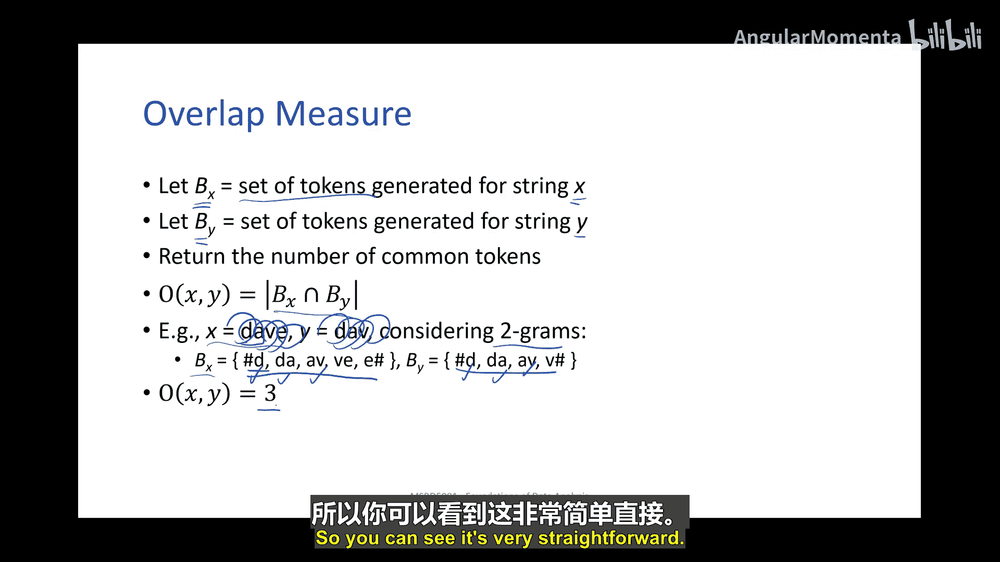
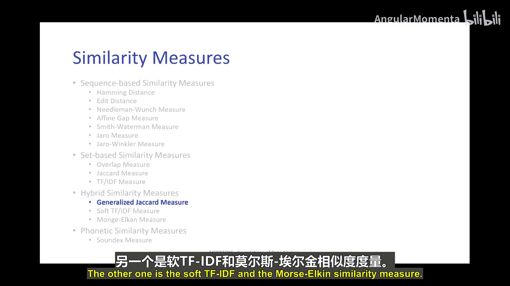
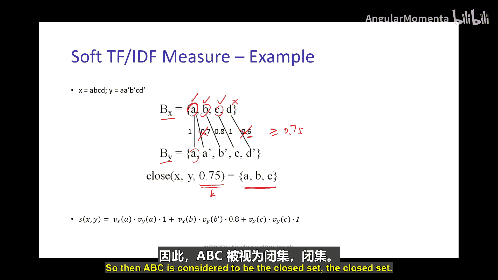
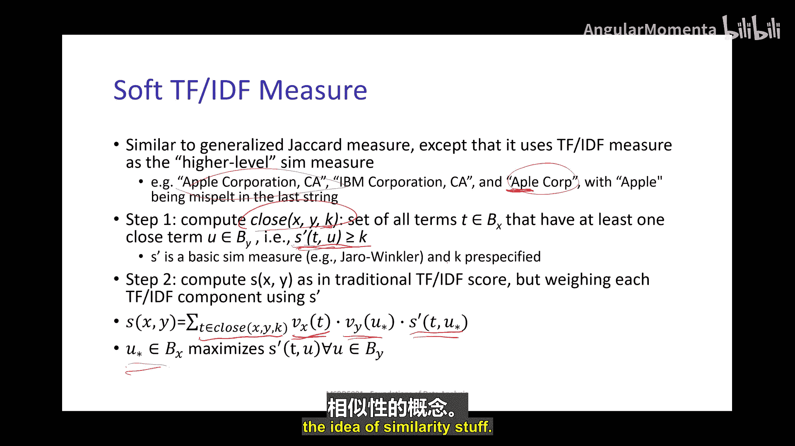
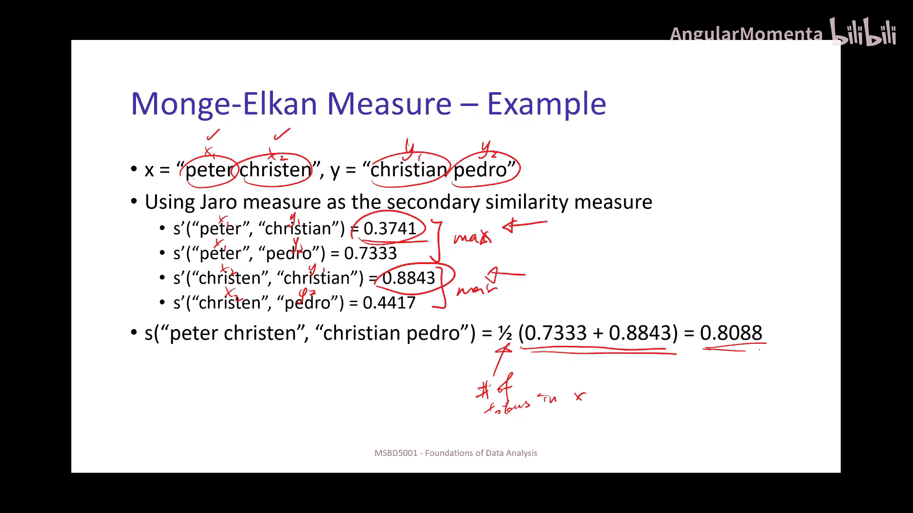

# 【香港科技大学】数据分析基础-｜-Foundations-of-Data-Analytics-p10-09-03-02-基于集合的相似性度量--BV1oKFDznE6L_p10-

So next we are going to look at some set based similarity measures Now previous similarity measures we are looking at the strings as the sequence of characters Now sometimes we may not want to just look at the characters one by one we may want to like split the string into tokens for example say that we are matching the sentence two sentences sentence one with a sentence X with sentence y then assuming that there is no spelling mistakes or typepos then we may want to like a split the sentences into words and then trying to like calculate the similarity between those set of words or sometimes we may be looking at combinations of characters right and then each combination of the characters is considered to be tokens So that's going to be the use of set based similarity measures So then let's look at like。

So set based similarities measures so as we have mentioned so we's looking at strings as stats or multiss of tokens it's very often like used for like phrases sentences and then the common methods to generate tokens so how do we get tokens how do we like have tokens out of those strings it could be like the ones that we try to do with words right so split the worse by spaces then every word is a token but then we know that a lot of variations in words so then okay in order to reduce the variations we may want to stem the worse if necessary into their base form and then like we know that swap stop worse like propositions articles they happened very very frequently in text and then in strings and they may not be that meaningful they may not be that useful so then we can also consider removing the stop worse and then another way is that。

look at the instead of words， we may consider the combinations of characters。

 which we calledq grams or kgramms， then it substrs of length Q。 So for example。

 if we are looking at three grams then this string。

 David Smith can be like with these three grams like a generated。

 So of course we know that it could be like having the first three characters。

 the AV and then A V VD and so on so you can see that here。

 and then sometimes we may want to like include the information like the start of the string and of the string。

 So then like here we are using some characters special characters to help us to represent that So that means for example。

 we are considering the start of the string and the first characters。

 then we use the two symbols and the D and then or we are considering the first two characters as the start of the string。

 then we have the position the symbol and the two characters。So then once we have generated。

 well we have like a split the string into kilograms。

 then we have a set of kilograms and that's the tokens that we are going to use in a sub based similarity measure。

The first subbased similarities measure that we are looking at is the overlap measure so overlap measure is very。

 very simple again， just to count the number of common tokens so then we have the x string with set of tokens generated we say that it's BX and then we have another strings y which again we have a set of tokens generated the B Y so then we just count the number of common tokens and that's this and that's the overlapla measure so say we have the Bx which is D V E so then we know that we are considering the two gras say for example。

 then D as the start and then the A V V E and then E here so that's the set of tokens that we have similarly for the string Y so then we can do that as well so then the start and the D and then the AV and then V at the end so we have four tokens generated and then we count the number of。

Common tokens， right， so then that means this one the same and then D A the same and then A B the same。

 and then that's the free common tokens。 So the overlap measure has the value free。

So you can see it's very straightforward， we count't the number of common tokens。😊。

Now you can see that for the overlap similarity measure is not taking the length of the strings into consideration。

 What if we have a very， very long string， So then of course it's very likely to have a higher like overlap score but then comparing to a shorter string so that is why we have the drug core measure so for the drug core measure besides finding the common tokens of course we have the common tokens here we are also considering how many unique tokens are there in total between Bx and By So then with the same examples here So then the number of unique tokens is six while we have three common So then the drag similarity is free divided by 6 which is 0。

5。J similarra similarity measure you can see that it's straightforward it's simple。

 so that's why it's very， very frequently used so that's the second。😊。

Sub based similarity measure and the third one that we are going to look at is the TF IDF similarity measure now for the TF IDF similarity here now in the previous examples。

 previous two sub based similarity measure you can see that we are considering all tokens equally okay but then we know that sometimes like we may want to like focus more on certain words。

 for example， like the string X and Y here and set if we are measuring the similarities。

 you can see that here if we are looking at x and Y now because。For X and Y， there are two tokens。

 the same If we are looking at work based tokens。 So that means the similarity score of S X M Y by looking at and then comparing it with the。

Okay。Yhy and Z， which we just have only one or X M set。 sorry， X and set， which we only have like。

Two characters there。 Okay so you see that it's going to give us like a a different。

 So the similarity score between x and sad and then like x and y is going to be different if we are using at the distance or jack class similarity for at the distance because like the set string is's much shorter So therefore of course。

 there are a lot of insert operations right， So then the score is going to be low and then for the jack similarity measure as well Okay。

 because the。The number of unique tokens is going to affect the similarity measures here。

 so that's why we'll have the S X Y being larger than S x Z。😊。

So then that means is we are saying that Apple Corporation is actually like matching with IBM Corporation not matching with Apple Co well it is this doesn't make sense right it's incorrect so therefore now the problem here is that well when we are doing just matching with edit distance or jasities so these are considered the same right the cooperation these word which are very very common well it's not actually distinguishing word it's actually considered equally。

😊，With those like company names right inside of the common words so then the idea here is that we want to identify some distinguishing terms like Apple this word is considered to be a distinguishing word while distinguishing like token while corporation CA they are more common so then they are not considered as distinguishing terms so then when we are doing the calculating the similarity we should be like focusing on the distinguishing terms。

So then the idea here is that， well， given the strings and then the tokens will first calculate two things。

One is the term frequency， so that means like the number of times that terms or that tokens appears in a document。

 so TftTD the term T in document D and then we also want to calculate some other values the inverse document frequency okay so with the inverse document frequency。

 it means that we are trying to find the number total number of documents。

 total number of documents and the ND which is the number of documents containing T okay so that's IDFT。

And then， okay， with the TF IF， we calculates a score。 Okay。

 we calculate a score called TF IDF score。 So for example， here， you can see that。Now， the。啲啊。

So say that we have two strings， x and Y， A B， and then you can see that the character A is common term。

Come on。In X， Y Z。So then， okay， if we are looking at the idea of this term A。

 so it appears in all the free documents， right， so therefore。And D。

So you can see that here the N D of T is free。And then the total number of documents is also free。

 so then the IDF value is one。So then for the term B， it's only appearing in one documents， B and C。

Lasts common。So then the idea of B is just is higher， so you can see it's higher。系い。

And then similarly here as well higher。Okay， so then for the Tf。

 we are looking at each token in each document。 so then the time frequency of the token A in x。

 it's appearing twice。 So that's why it's2。 And then similarly for the token B in X only once token C in x also0。

 It isn't it's not depth。 So we have all the scores calculated like this。

 And then we multiply Tf with IF。 So then for example， in this here。

 we are looking at Tf A in x multiply by IF。8， so therefore it's two times one。

 So then we have the values here。 So then we have all the values calculated here。 That means the。

Document X， we have a vector like this with the values2，30。

 and then for the document Y we have the values one，0 free as the vector and then set as well。Okay。

 so now once we have the feature vector calculated， then we can do the cosine similarity。

 so we are calculating the similarity between the two vectors。

 the two vectors and then a higher score。Means that the two strings share many frequent tokens。

 frequent terms， so that means terms with high Tf scores okay and also that it's not appearing in every documents right so then。

Of course， if the term appears very frequently in a document and then it also appears in nearly all the documents。

 then it will have like a low IF score。 So then the resulting like Tf IF score is again going to be small so then we will be able to pick the distinguishing terms and then to like calculate their similarity accordingly now there are other variations of the Tf IF scores for example。

 So like we don't want the increase of the Tf to affect the final similarity scores too much or the If as well so then we may dampening it by taking the lock on them or sometimes we were wants to normalize the features as well。

 So there are other variations of the。TF IDDF score。

So we had to discuss some subbased similarity measures and also some sequencebased similarity measures and then obviously these two categories of measures work well with different situations。

 for example the sequencebased similarities measures is going is able to handle like spelling errors typing errors those small like character level differences while for subbased similarity measures we are looking at phrases。

 sentences which are with more characters much longer and then we are working we are looking at the word looking at the tokens because otherwise if we are treating phrases and also sentences as sequence of characters then just one words difference we result in a low sequencebased similarity score so which is not desirable right so then that's why we want some scent based similarity。

です。But then you can see that sometimes we want to consider both right so then say that well there could be some spelling mistakes and then we are looking at phrases sentences so we do want to consider and tokens but then we want to also take the spelling errors into account into consideration then we want to take the advantages of both categories of like a similarity measures advantages and then characteristics that's why we have the hybrid approach putting them together。

So we are going to look at three of them， one is the generalized drugwise measure。

 the other one is the softF IDF and the moresh Elcon similarity measure。

So the first one that we are going to look at， which is a hyper similarity measure is the generalized JQu mission。

Generalized jacker measure。 obviously， it's a generalized version of the jacker similarity measure。

 Now， for the jacker similarity measure， it might be too restrictive for certain situation。

 For example， like the token from X and token from Y they have to be exactly the same identical in order to be considered to be a common token an overlapping token。

 But then well， for example， well in in reality， there might be spelling problems。 Now。

 let's consider this example here。 Now， if we have these two。Stngs。

 so then if we do the sub based similarity measure， the jackcro measure。

 so it's going to work well right so then the energy the same as energy transportation。

 the same as transportation， we are going to have a relativelyly higher jack jack similarities score but then if there is any spelling problems。

 for example。Now， say that。The spelling is like good， So then that means these two words。

 So say this one is becoming an。😊，Okay， so then obviously then this word is no longer considered to be the common words in the original Jera measure。

 so then the score will become much lower so it's just one common token so but then we know that it's just a spelling so it's like a well we know that well energy and mean and probably it's because of a spelling error and then they are actually the same strain。

Yeah the same work， so therefore we'll need a generalized version of it to consider the spelling problems as well。

As well okay。So then that's why we have the generalize trackrame。But general Ja Ma。

 so again we are looking at like two s of tokens but then okay。

 now when we are trying to like a match deep tokens。

 we are trying to find the softened overlapla set。Which means that first。

 we try to find the similarities score between all pairs of tokens。

Okay so that means we are looking at x1 with x y1， x1 with y2 so on。

 so again we are looking at the similarity scopes and that similarity score is one that is like for example。

 it could be a sequence based one。For example， a sequence based similarity measure。

 so then okay we use those sequence， we use the sequence based similarity measure on those pairs of tokens。

And then while we have like all the pairs， so then we'll be able to have the matches。

So say for example， like Bx， we have the set of tokens ABC。Well for B Y。

 we have the two tokens P and Q。 So then we try to find the similarity between。

A and P and the similar between A and Q。And so on， so then say that similarity of A and P is 0。

7 while similarity of A and Q is 0。9 0。8。So then we have all the similarities scores for all like pairs of tokens calculated。

So then we have a given threshold and then we only keep those that are higher than a threshold Okay so for example。

 if we have the threshold as 0。5 then we remove all those that are below so that means this one more than 0。

5 remove it This one also less than 0。5 remove it so then this will be the remaining。

Edges okay remaining edges between the tokens pairs of tokens and then now this becomes like a bipart graph problem。

 so that means we take the best combination， so then that's the。Yeah。

 we find the maximum weight matching like a set of like similarities。

 So that means this here together with this is had the best combination。

 so then that's what we are having at again。 So then the jack similarity score is。

For those edges that we have finally， then we take their similarity score and then divide by the number of tokens in the sub X number of tokens in sub Y and the number of edges in the matching in the retained mapping so then okay the calculation of this will be like 0。

7 plus 0。9。And then divide by the number of tokens。Inb x。And then the number of tokens。电啲话。

And then now this is the match here， which is the AP。And beQ。你 so that means啲。

Number of edges is two okay so we have two mapping here so then that's it okay so that's this one so then the resulting generalized track risk score is zero。

53。Another hybrid similarity measure that we are going to talk about is the soft TFIF measure so you can see from the term here so we are talking about TFIDF measure。

 but a soften one， So it's very similar to the generalizeder measure So then similar to the generalizeder measure then we are using the TFIF measure as the highlel similarity measure。

 So like for the original TF IDDF measure so you can see that here if we are looking at the same example Apple corporation IM Corporation and Apple corporation then because there is a spelling error here。

 Apple So Apple is felt wrong。 So then you can see that here then well even with TFIF we won't be able to match this with this So therefore we want to be able to consider the like spelling problem as well so that's why we'll need another similarity measure together with the TFIF。

So the first step of the soft TF IF measure is that we'll try to first set a particular function Okay so then we are trying to identify like the。

Set of like terms that are from the set of tokens BX that at least have another token in BY that is having a high similarity scope。

 so that's what we called it a closed set。And that second similarity score here could be like term。😊。

Sequenceface similarity measure， for example， Geraldinecl or other kind of sequence phase similarity measure so let's look at an example here。

 we have the Bx and By two set of tokens and then like for each pair of tokens we find their similarities so a again A A again a dash B again B dash and so on and then we calculate the similarity between those tokens with for example the Geraldinecl similarity score and then now for those of that larger so this is the K for those that are larger than。

0 larger than or equal to 0。735 will keep that。 So that means this one gone this one gone。

 So what we have here is that the。The tokens that have at least another token in BY that are with higher score than 0。

75 is the A so it has B， it also has B also has but then for C also has but for D the only like a similarity score is0。

6 right so therefore we are only going to have we are not having it so then ABC is considered to be the close set the close set。

So by the way in this example here we are just retaining the highest ones， the highest ones。

 the higher ones， so for like of course like you may also consider matching D with C and so on but then like a assuming that they are very very slow score so we have the like a higher ones key here and then we are trying to identify those that are like above a particular threshold that's the close set so then we have the ABC as the close set so then the soft TF IDDF is that well we text the terms from the close X Y K and then okay use the TFIDF score so then you can see that we have the vector here。

Of T and then times the weapon y of u， which the you here is actually the another term okay and then from y and then。

Okay， we waived it by the second similarity score， waived it by the second similarity score like this here。

 so you can see。We take the vector of A in document X and then vector of y from the document A and then multiplies by this score here is one。

Okay， so which is the similarity score between a and a Okay。

 and then this is the similarity score between B and B dash and then this is the similarity score between。

试人时就机。So then we do this， so this is because it's weighted by the second similarity score so then it's a soft TF IDF。

So then okay， now which one we are picking， the term here is according to our previous calculation。

 the maximum of1。Al right， so the maximum among a Okay so a is the term then according to its comparison with the all the terms in B Y we pick the maximum So that's the。

 So then it's calculated like this， then it is the soften。The soft idea adds similar to stuff。

The last hybrid similarity measure that we are going to talk about is the most outcome similarity score now the most outcome similarity score is again first having the string x and y into breaking into tokens or sub strings then we consider the best match for tokens of x in y so what we are talking about here is well again we are considering the matching between like the pairs and then we are trying to find the maximum among that so you can see that here and then after calculating the maximum like match between x and y the tokens then we'll be like a suming the score。

So then what we are talking about here is let's use an example。😊，Now we have the X and Y here。

 so then that means we are spliting them into tokens so we have the two tokens in x and then two tokens in y。

 so then we find the similarity scores between all tokens now starting with x。

X1 and then against y1 and y2， so then we have the x1 and y1 as this similarity score say for example。

 we are using the general measure as that secondary similarity measure and then we have the x1 against y2。

And then next we have the x2。With y1 and then x two with y2 right so then we calculate the similarous course between the two four pairs of tokens and then okay for each。

X1 and x2， we pick the maximum1。So which is this one， maximum one？

The Peter against Christian and then also between this pair again find the maximum one。

 which is this one so then it's Christian against Christian so then okay。

Then we take those secondary similarities scores and then divide by E okay and here。

 so that means the number of tokens in x。So then this is the number of tokens。Oh。In X。

 so then what we have here is this as the more outcomecon similarity measure。

 so then we have finished talking about the hybrid similarity measures。

 So you can see all these hybrid similarity measures is having two similarity measures combined together。

 one from the sequence base， one from the sub base。

 So then we are having the two characteristic two categories of measures。

Their characteristics were integrated together。So then next。

 we are going to look at a different kinds of similarity measure。😊。

