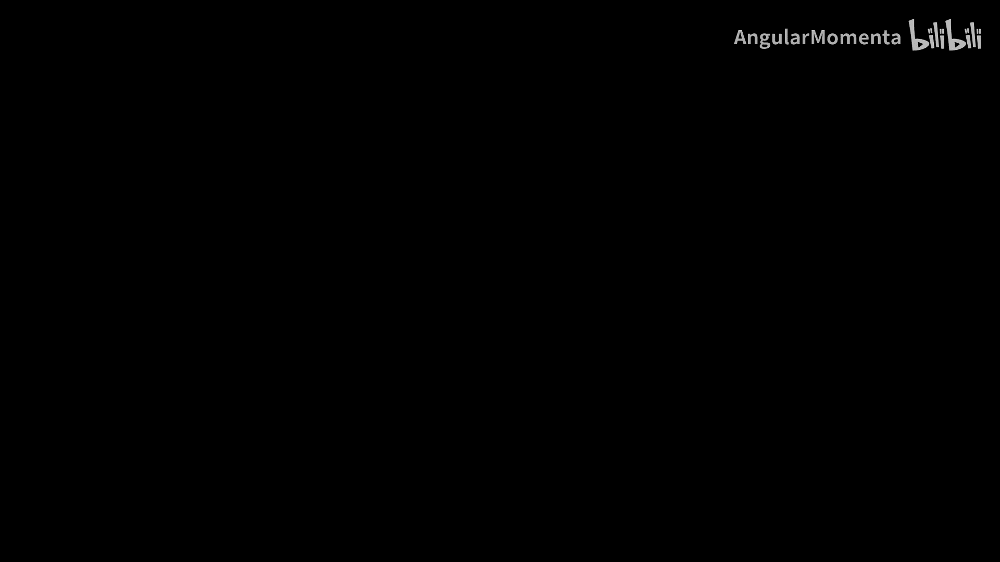
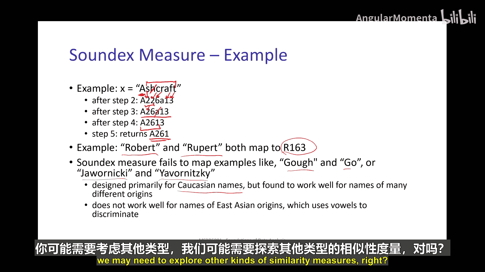

# 【香港科技大学】数据分析基础-｜-Foundations-of-Data-Analytics-p11-09-04-02-语音相似度度量--BV1oKFDznE6L_p11-

So the last category like of similarity measures that we are going to look at is the phoneatictic similarity measures now phoneatictic right so then it's about the sounds about the pronunciations now think about how data being entered how data are being collected so sometimes it's like speaking out of those like a words for example when you are like when someone calls you and then like asking for like a help to fill in the questionnaires then he will ask you he or she will be will be asking you your details for example you will give them your like full names and then like your addresses or like it could be you go to your receptions and then telling them your names or you have a conversation and interview with another person and then you are like telling them your like an information so then they will like from what they hear and then they write down so sometimes like some words like have very very similar sounds。

Or some like spellings having similar sounds， similar pronunciations so that means like someone we here when he or she hear a term he may write down in a different words or write down with wrong like a spellings but then the sounds are actually very similar so that is what we are trying to handle here so then it's not because of typing earth it's because of what they hear so then it's related to the pronunciations so that's why we are looking at this category of similarity measures or similarity measures so which means that we are trying to match strings based on the sound instead of like the spellings or the appearances。

For example， these terms， these words all sound very similar me me so but then there is a difference in a spelling and then my as well and then Smith and mice so they again very very similar but then they are of different spelling so if we just use the sub base directly they not they are not going to match if we are using like at the distance or sequence phase of similarity measures again now there are a lot of characters there are some characters different so therefore again it will impact it will affect the scores so that's why we want a phonetic similarity measure so one of it is the soundax。

So the sum measure is used mainly to match surnames so it's trying to map a surname into like a four letter code so then based on say that we have two surnames both of them convert to four letter code then we compare the two four letter code if they are exactly the same then they are similar here's that's the idea here idea here so how do we convert how do we map a surname into a four letter code so this is the algorithm first we keep the first letter of the x and then。

Okay we do the subsequent steps on the remaining characters， so for example， like Ashcraft here。

 so we keep the character a and then we'll do the conversion on the remaining characters。

Now then we replace， we remove the occurrences of W and H。So then let's check it。

 we have an h so remove move it and then okay we replace the following characters following group of characters with a number。

 so for example BFPV replacing by one so you know that well they sound similar right so the pronounciations of them sound similar So then okay we have that So that's why we have the F converted into one。

And then see S， so on with two。 So that is why this one is2。 This one is2 Okay， and then。Also。

 we are looking at others， for example， R with E sex。And then also T with free。

 So then this one is changed to three。 So then what we have is a2，2，6 a13。

 So then we replace the sequence of identical digits with the digit itself。

 So that means these two where we come two。 So that's what we have next。 and then afterwards。

 so then we drop all the non digit characters。 This is not a digit。 we remove it。

 and then finally we have a26，1 free。 but then we only need four letter code。

 So then we just retain the first four characters So that means we just keep this and that is the。

That is the full code for the term acraft。 Okay now you see that if we do something similar with these two。

T robot and robot。 So then both of them will be converted to the four letter term4 letter code R 1，6。

3。 So they are the same。 So then that means they are a match。 So robott and robot， they are similar。

But then like you can see like a soundducts work well。

 very well with like those like a worst that has have similar sound。

 but then they could be having like a different spelling。

And then it doesn't apply to normal like a words or contents because we know that spelling is very important well for names and then spelling for some common words they are known so very very unlikely that will have wrong pronunciation problem but then for surnames for names well there are variations and then like because if they are equally like a common then it's very likely for us when we hear the term and then enter it we may enter it with the wrong variation so that's why sounddags work well with names but then of course you can see that here like other possibilities like something like the golf and go gey and then with thevo Z so then they don't work well so then soundds is mainly design for Caucasian names but it will fail to work with other origins because the pronounciations are different。

And then especially for East Asian Ors as well， it's not going to work well。

 so then you may need to consider other kinds， you may need to explore other kinds of similarity measures。

