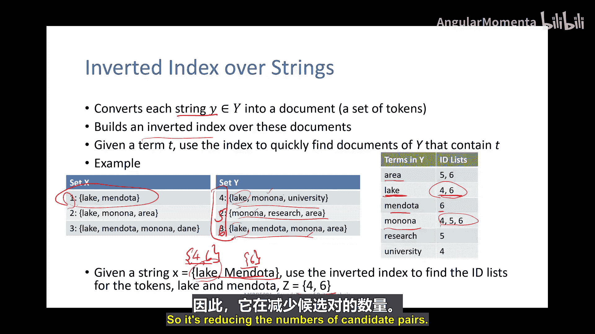
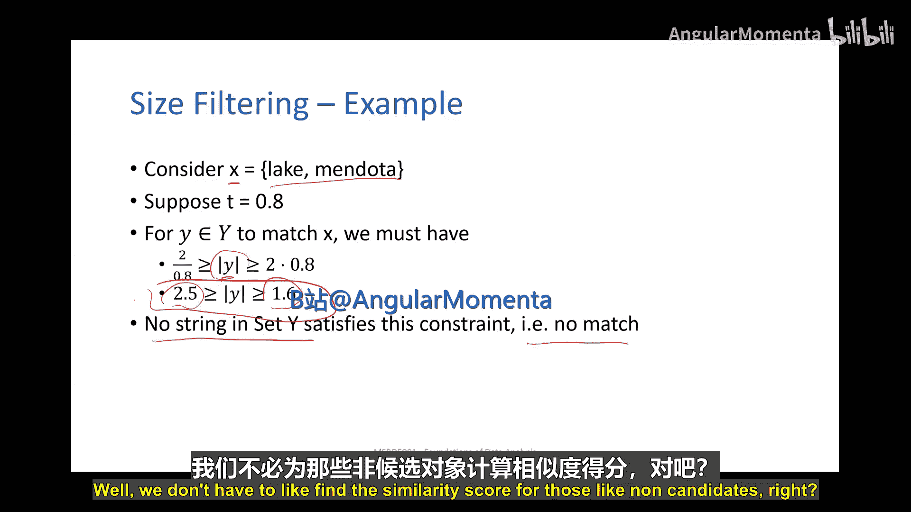
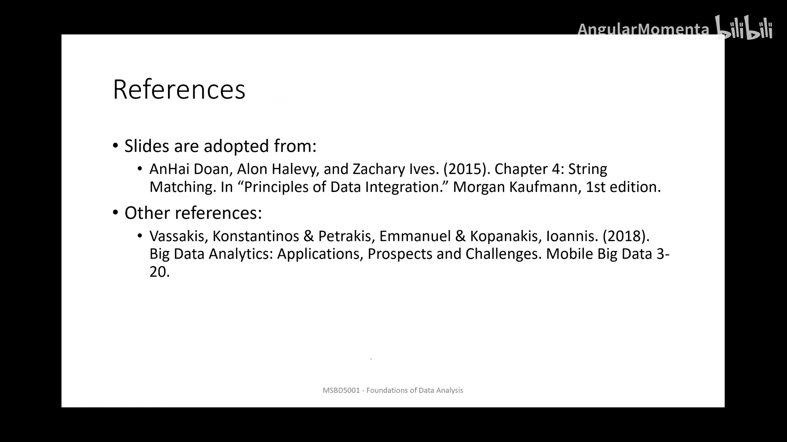

# 【香港科技大学】数据分析基础-｜-Foundations-of-Data-Analytics-p12-09-05-02-可扩展性与倒排索引筛选--BV1oKFDznE6L_p12-

Be in the start when we discuss about the string similarity measures。

 we say that we will be looking at two major challenges， one is the accuracy。

 one is the scalability so for accuracy we have been looking at the possible solutions we are looking at all those approximate approximate matching similarity measures like the sequencebased similarity measure。

 the subbased similarity measure and also the hybrid similarity measures and also the phoneatictic similarity measures they are to handle the accuracy but then there is another challenge which is the scalability issues。

 which means that we are looking at a large number of like pairs of tokens or pairs of matching pairs of strings then while it's not going to be feasible for us to like just consider and then carefully calculate the。

that you score between all pairs of candidates。😊，So that means we'll need some way to like reduce the number of candidates and then as we mentioned we may want to like find the candidate set。

 so for example， the idea here is that we try to find we try to have a method to find candidates so that means say for example for a particular string in the set eggs。

 we try to find the candidate set。Which is a subset of the original y set。Sept one。

 so that means the number of candidates are already smaller， smaller。

 so then we are considering fewer pairs of tokens so then fewer pairs of strings then of course it will cause us small less time。

So then for each pair of x and then y from the subset。

 then we'll calculate that similarity score if that similarity score is larger than a threshold then it's considered to be a match pair so the focus here is we are trying to filter。

And then reduce。The number of testss。And then we are trying to focus on more promising candidate pairs。

え。And then we are also calling this the blocking so that means we are trying to identify the most promising pest。

 so there are many different ways of doing the blocking so for example。

 you can have a very simple simple algorithm or simple calculations for like。

The reducing the number of pairs。 Now， we are going to talk about a few possible approaches。

 but then there are many ways for us to filter out or to identify the most promising pair。

 Now one of it is like us。 we are having an inted index over strings。

 So what we are doing here is we convert we consider the string Y。

 And then we convert it into a set of tokens。 And then we build an inverted index over these tokens。

 So， for example， like here， we have the set Y with the。These terms right。

 so then based on the terms we。Put down the documents having those tos。 so sorry about this。

 this should be five and6。 So that means link is appearing in document 4 and6。

 So that's why for like this time here the ID list the document ID list is4 and6 and then say。

 for example， the monoona Monona is here here and here So then for document 4 Do5 document 6 or has that all have that to So then it's like us so then say we now looking at for example a string from the set X。

And then it has two tokens like a Mendota， So then using Lake。

 we find that the documents that we need we the documents in set Y that is having the token lake is4。

6。Okay， and then based on the term anddota。 So then the documents that is having the term in set y is just six。

 then we put them together and then。Document four and six will be the ones that we need to consider only for document five because it's not having any of the terms from the tokens X so then we don't need to consider it so you can see that originally we need to find we with the document one we'll need to consider free passs right now we only consider two pairs so it's reducing the numbers of candidate passs。

Its。The limitations of this inverted index over strains is that well theverted the inverted list of sometimes can still be very long。

 so meaning that the term appears very very frequently nearly exists in every document so then the list okay so like here so the term boonna is a common term right so it's a common term is set Y so it appears in every document so saying that if we are considering set X a document two then it's still considering the full set of set X so that's one of the limitations。

And then also it's very time consuming and costly to build such kind of inverted list so then again this is like a limitation and then and then well we are still enumerating all pairs right so then again we need to do like the pair tokenem one by one so like what is the list Mendota what is the list so again it's going to be like a requiring some time and then the resulting the process of it is still very very large so you need still need to consider a lot of things so that's the problem with the inverted index on trains。

Okay。Another method to like handle the scalability by filtering out the candidates is the size filtering so that means like we are only like considering strings that their sizes will make them the candidates what do we mean by here is think about like a string X and then if the number of tokens are very different in these two strings one from the set x one from the set y so then well it's very unlikely that they will have our desired like similarity score their similarity score will very likely be low because say for the Jome we are talking about the offer lab tokens divided by the combination the set of like old tokens right so then if the set of tokens are very very large then the score the jack similarity score will be very low very small。

As the idea here。So that means like given a string X， we only retain those like a string y。

 we only consider matching with those string y's that their sizes are within a certain like limit。

So then we'll goes on to calculate that to Dr with so say for example like that。Okay。

 so say that like well we are considering jara similarity so then you can see that here if we are considering ja similarity。

 so then okay it's。😊，Okay， it can be proof that now the。你啊。Number of tokens in y。

 So that means the length of y and the length of x should be like a between like the the desired ja similarity Okay。

 between this range Okay， so then say that we want to only have the。Tokens。

 the pair of tokens that are larger than a threshold like this。

 then we'll be able to have this while t is a predefined threshold Okay so then you can see that here the size of the token Y has to be between this range depending on the threshold and number of tokens。

 the size of the token the size of the string x， so for example。

 let's say that we are looking at string x。Okay， so that means。For us。

 like for if we want a string to have a similarity above or equal to 0。8 with the string x。

 then this string has to be between 2。5 and 1。6 so therefore that means y has to have。

Just to tokens right so then if we go back and taking at a look at the number of tokens in set Y so you can see that all of them are with free tokens。

So none of them is having two tokens only so then no string in set why satisfy the size filtering constraint so then there is no match right so then just by finding this constraint here we don't really have we can use it to filter out candidates well we don't have to like find the similarities score for those like a non candidatesdates right so then of course this is reducing the number of pairs。

So another filtering method is the prefix filtering。

 so that means like if we want the similarity between two strings to be again of a certain value okay so saying for example the overlap measure we're considering the overlap measure。

If we want the overlap score to be larger than a pre specified value。Hey。Right。

 so that means now the subset of the tokens。 So that means like excluding like the last few words。

 we are just considering the first few words between x。 Okay， then okay， there should be at least。

The number of tokens in x minus k minus y tokens overlap lab with， the same width。The y okay。

 so then we are considering the prefix。Oh thanks。so then if the prevex of eggs already matches for a certain number of tokens。

 then it's very likely that it's possible to like have a final overlap score larger than a flush。

Otherwise， if the prefix similarity score is already below， okay， our expectation。

 then it's very unlikely that it will finally give us a score about what we want。😊。

So then example is like this， suppose we want the K to be of2 okay so then the token in x1 is like m and delta。

 so which means that。we'll need to look at the pre size of this， so which means that it's one。

 so that means we'll take a subset of the original string concept， so the subset is like okay。

And then he， we try to find lake。 So that number of tokens。 So it's one， right。

 So then we use this subset and then trying to find。So this here。

 we are trying to identify documents in sub that will continue will contains the lake if it doesn't contain the link。

 then it won't be。Having a similarity with score over two larger than two， so that's the idea here。

So then in order for the two string x1 and x Y the strings in Yat to have the overlap score larger than two so then while we'll need the candidates to at least have the token click right so then that's why we' only need to look at y4 andY6 for others that are not having the word link they are not going to give us an overlap score larger than or equal to2 so you can see we are using different ways to like filter all the candidates so there are many。

 many other approaches which will be achieving the same like objective to reduce the number of candidates so that we don't have to match all pair so that's how we are handling the scalability issue。

So later on， we'll talk about some other like algorithms。

 which are also like looking at the scalability challenge of finding the similarity score。All right。

 so then that's all for the string similarity measures。😊。

