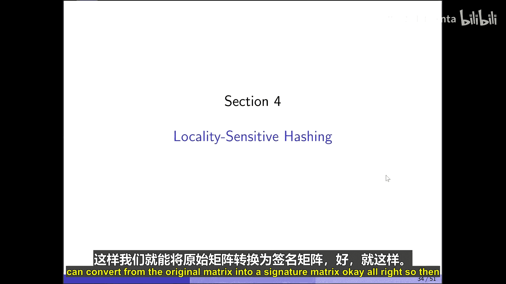
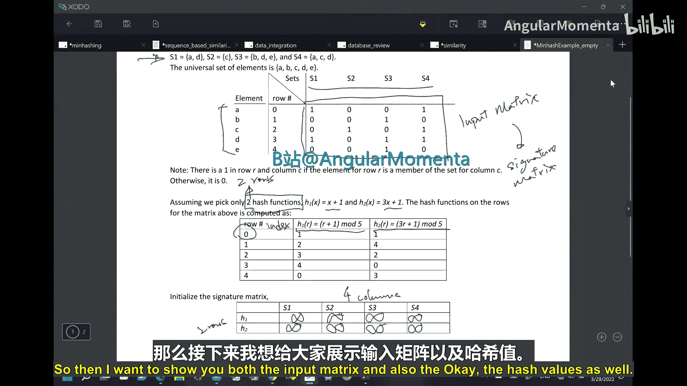
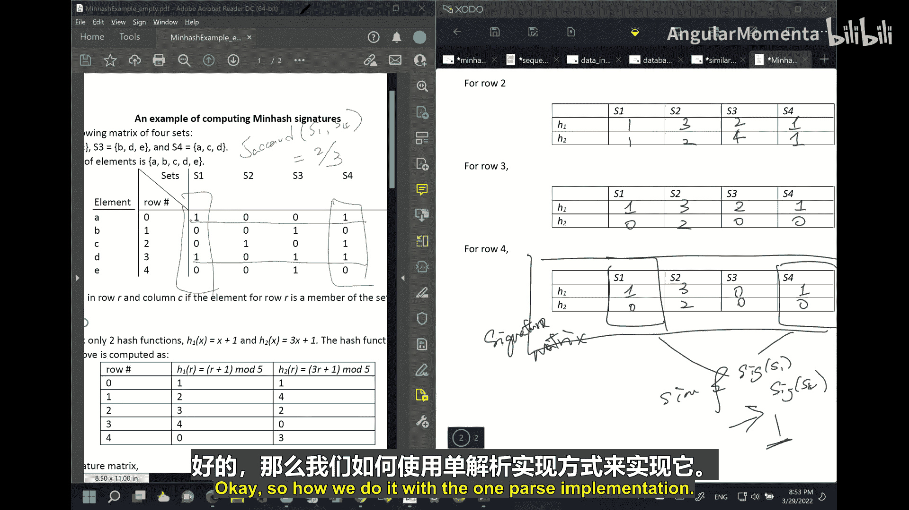
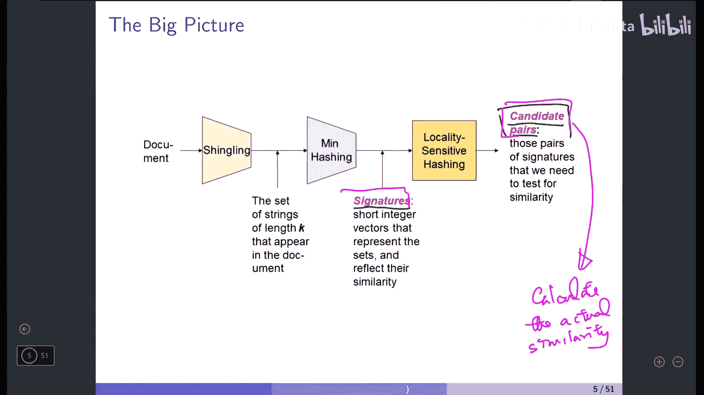

# 【香港科技大学】数据分析基础-｜-Foundations-of-Data-Analytics-p13-09-06-03-导论--BV1oKFDznE6L_p13-

About two approach actually one approach， two steps mean hashing and locality sensitive hashing。

 Okay， so it's again trying to measure similar documents。😊。

Now then like just again some like background on why do we want to do this。

 so we all know that like if we have end documents。

While we' need to do a lot of comparison it could be like taking like days， weeks or months。

 so then we don't want to do that， we don't want to wait that long so we'll need to like reduce the size and then what are the applications are finding similar documents so like the example that we I said like a dedplication who wants to remove the duplicates so for example like besides removing the duplicates in a particular like database or like in a particular source there are also other applications for example now very often we want to do like because nowadays we have so many data out there so very often we know that data could be coming from the same source right so we can see like when we read news articles that are shared by many people you find that okay so like sometimes people share documents which appears from different sources like say that they are appearing from different like news。

Organization。😊，ButTheir contents look very， very similar。 just like yesterday， right， You know。

 the incidents and then the incidents that is being reported by many。

 many like a news agencies or like many sources。 But then you will see that theyre like。

Their descriptions or the text descriptions are very very similar so you like probably were all suspected okay so is it written by one person and then just people copied it and then copied and then copied it and then share it as their own right so then like when we are handling data so sometimes we may want to find out whether there is copying between different sources of data like whether that piece of like documents is copied from another one what is the source and then like how do we resolve it so that will requires us finding similar documents and then again like we may have many many websites and then again the websites may be just mirror okay so then again we may want to find those ones we so you can see very often we want to find out like how are there any similar documents and then we'll decide whether to remove it or how to make use of them。

Okay。Alright， so then okay that is why we want to do something to handle this right so then the algorithm suggested here is with three steps So again。

 like the first step is what we have mentioned previously when we want to like compare documents with the set based similarity measures the first thing is of course we need to have the set of tokens So then the first step is how do we get the tokens So then if we are looking at a string sequence then the step of converting to tokens will be the stringangling So that means we may want to like split the words one one probable approach or we may want to have the kgramms right So then after we have converted into like for example set So then we know that we can use some set based similarity measure to measure the similarity between document。

 for example， the ja similarity measure so then the next problem is that okay so if we have the。😊。

Tokens。So how do we represent the documents？Now within like a data set there could be many。

 many tokens so think about news articles or think about names while we can just work on like a database of names right a data set of names and then like even if we just split them into words so there could be a lot of words。

 a lot of different names， surnames etc So that means the number of tokens can also be very。

 very large and then if we have to represent the existence of a certain token in a particular documents。

 then that a representation is again going to be very， very large。😊。

Okay so then you know when we have a large amount of data when the representation is very large then usually we have the computational problem right so either it's too time consuming or either it's not possible to fit into the memory we won't be able to do the calculation etc so we wants to do something so the next step is to reduce the size of the representation so what we are suggesting what this algorithm is suggesting the mean hashing algorithm is suggesting that we convert the large representation into a smaller one but then of course when we change the representation we don't want to be the data or the characteristic of the data to be changed at all right so we want to preserve its characteristic so that's why like we need some specific approach So this one will try to preserve that。

So after that now even if we have make the representation smaller。

 so we still have a large amount of documents to compare so then the next one is how do we reduce the candidate pairs so then this approach is called the locality sensitive hashing we are trying to find the most similar potential documents pass。

So then we'll talk about that next so then you can see this is the f right so we start with having the raw documents。

 of course we still need to probably do some prepossessing for example if we are handling textual documents so you know the standard NLP like approaches can be used like a stemming stop removal etc or like using dictionary to help us to like add or to remove some like instances and then now we have the tokens right so then we have like a done the shingling and then we have the set okay so then we want to change it into a smaller representation which we call it signatures。

😊，So then using the signatures we want to find out the potential candidate pairs， so then afterwards。

 once we have identified the potential candidate pairs。

 then we can use the actual like similarity measure the we wants to use， for example。

 like the Drer similarity measure to calculate the actual。Similarity between the pairs of documents。

 Okay， so that's the role。 So then let's start with talking about a little bit about the shingling。

 Okay， so we convert the documents into sub。 So we have measured about it。

 So to convert documents into sets。 So then okay， now we need to think about。

 do we want to consider the order of the words。 if we don't want to consider the ordering of the words。

 then we can just split it by words。 and then we have a back of words。 Okay。

 or if we want to like consider the like order。 So then usually we use the K gra approach or the K shingle approach。

 which means that。Okay we are retaining the sequence， the order by having multiple。

 for example characters， a specific number of characters or specific number of words in its order。

 So say for example， we are looking at characters right now So for the example here we are looking at characters and then we are talking about K shingles So that means K is two So then say that we are looking at this string okay so ABC AB。

 So then for picking two characters in order， So we have the A B B C C A and AB。

 but then AB appear twice right so there is two ways to handle it one is we remove the duplicates So then that means we have the set of shingles like this or another option is we keep the duplicates it depends on how like how do you want to do it。

Okay。😊，Now shingles can also be worse or like other things， okay？😊，All right。

 so then I think in the last lecture in like two weeks ago we also mentioned about if you want to consider also the start of the document。

 you can also use some like as symbols to take the start or the end of the documents into consideration as well okay now the next thing is that now even we've we have obtained a set of like tokens。

😊，The amount of cold tokens， the number of tokens can be very large。Okay。

 so then if we represent the tokens as they are。 Okay， so that means we'll be using a lot。

 a large amount of like memory to store them。 Okay so then another approach is to like instead of representing the shingles directly。

 we hash the singles into numbers into other values。 So then for example。

 like originally we are representing the set of shingles by A B， B，CC right。

 So there will be like right now we just have two， and then if you imagine we are talking about like seven shingles。

5 shingles， then the possible combination will be a lot Okay so then instead like we hash the singles into numbers。

Okay， so then these numbers， these values are used in the representation。

 so then okay we can compress okay the representation a little bit。😊，Alright。

 so then now for the rest， we are focusing on the jaar similarity。 Okay， the jaar similarity。

 So that means we are looking at the overlap。Of the tokens Okay。

 the reason is when we discuss the second step， the mean hashing。

 it has to be like when we are trying to like proof whether that method works it's also like a base on the comparison between the geo similarity so that is why we are focusing on the jack similarity。

😊，Okay。😊，So then like。So so a little bit more about the shingling so then like so you know like for the shingling so we have to determine the number so usually we are asking the question。

 okay so what is the best number so then of course it depends on the like domain So for example。

 if we are talking about short documents like for example the tweets or the emails usually it's going to be shot。

 it's not going to have too many words So then like a short shingle will be enough a small number will be enough and then say that we are looking at news articles then there could be more variations So variations if we are looking at small number of k So that means there will be a lot of like a similar shingles appearing in many documents So think about if we are just having k as1。

Okay， K S1。 So then you will will be finding like nearly all the tweets。 Okay。

 so all the like emails will have very， very high similarity score if we are using the K S1。

 So which means each character as a shingle because like。😊。

like the 26 characters that we use right the English characters that we use well it usually appears in nearly every documents right so most of the time they will have very。

 very high similarity they will have the common shingles appearing so then most of them are having high ja similarity score but then you know they are not the same right so like even though we are using that set of characters when we are having many different words case so words are consisted of like a different arrangement of characters so that means if k is too small it's not going to be good if K is too large then we won't be able to find the common like a shingles so then again it's not good for evaluating the similarity so then we'll need an appropriate numbers so typically for short documents K as5 will be enough for long ones like news articles or papers then10 will be better okay。

Alright so then okay so even after like having the shingles or even compressing the shingles as we have mentioned。

 we still need to compare a large amount of documents so say we have one million documents now if we are processing them with just one machine it could take more than a year right so were definitely not going to wait for that long right so therefore like we need a way to reduce the comparisons okay so that's why we need the second step mean hashing and the locality sensitive like approach。

😊，So then let's first talk about mean hashing so what we want to do with mean hashing is it's an algorithm to it's a method to convert large representation of the documents into smaller one and then we call them signatures okay and the most important thing is of course preserving the similarity which means that if we have converted into the signatures。

 so the evaluation between the signatures will give us an approximate。

Of the original or the actual similarity between the original documents。So then like this here。

 So like right now， this is just like talking about the vector and also talking about the checkquest similarity。

 So I think we all know how to do that So then let me skip it Allright。

 so then let's say that right now we are looking at a representation of a set of documents。

So then what we have is already we have do the we have done the shingling， so we have the list。

Of shingles Okay， the set of tokens。 And then now for each of the document。

 we can represent it by a vector， which one represent the existence of the shingle while0 represent the nonexistence of the shingle right。

 So then I think like you all know that very familiarly you all know that very very well。

So then we have say for example we have four documents so we are now looking at four documents。

 so then right now we have four columns so say we are looking at well in this example here we are trying to have each column a document okay and then each row is about the shingle。

 the existence of the shingle in a document。So then we have this matrix here right so then now this matrix like is typically very sparse Okay。

 so think about like if we have 1000 shingles Okay so and then like our documents are just em Okay so that most of the time we don't have those shingles in every documents so we have a lot of zeros so typically the matrix is going to be very sparse okay we are still using this representation because we want to show you like what are there in each of the documents so I think you all know that if we really have to handle a very sparse matrix。

😊，There are ways that we can like a safe up space and then storing the sparse matrix， okay？Alright。

 so then now the problem right now is like so if we want to do the similarity measure right。

 so we are like doing， for example， the jackqua similarity， okay， for example。

 between document S1 and S2。So then we are checking on the common shingles， right。

 So that means if there is in the both column of a particular row， both of them are one then。

It's with the same shingle right otherwise it's not So then for S1 and S2 you can see that none of the rows are 11 right so we don't have any rows with the one1 so that's why it's no with0 and then the similarity score is actually0 so then the distance is once they are totally different。

So how about S2？😮，S1 and S3。If we are looking at S1 and S3， so that means we are looking at。

These two， Okay， so and then we are trying to find one and one in S 1 and S 3。

 so that and here one and then two and then three， right， So that is why we have three common ones。

 And then how many shingles are there in these two documents。 So we have one，2。34。

 So then three out of four。 So the jackar similarity is 0。75 and the K distance is 0。25。 Okay。

 so then we all know that， right， so then okay， so。

We have like revised the concept of the jack similarity。

 so then now we are ready to goes on to talking about the generation of the signatures。Alright。

 so then what we want to like do next is we want to like change the representation right。

 but then there is a very， very important constraint we need to consider is the similarity of the columns should be close to the similarity of it should be the similarity of the signatures and then it should be similar to the actual similarity okay so that means right now we have the S1 and S3 with the jack similarity 0。

71 while S1 and S2 is with similarity0 so we once the converted signature to have this property。

 meaning that the S1 and S2 signatures they should give us a low similarity。

While we are talking about the similarity between the signature of S1 and S3。

 it should be high relatively to the S1 and S2 pair Okay。

 so then that means we want the similar behavior of the tracker similarity in our converted representation。

Alright， so then so that's what we want to have right， So similar columns， smaller signatures。

 that means less rows， right， And then okay， so the similarities of the signatures and the vectors。

 the original document vectors should be related Okay， so then。

What we want to have is like we want the methods to have as few false negatives as possible。Okay。😊。

And then of course， we want to also have like low number of false positives as well。Now then， okay。

So but then of course this method because we are changing its representation。

 we may still have false negatives and false positives okay。

 but then we want to keep them low okay small all right。

 so then the idea of this algorithm is that okay so we want to do a hashing okay we want to do a hashing which that hashing is going to give us each column into a smaller signature and that signature is small enough that we can fit it into the memory okay。

And then the signature similarities should be almost the same as the original or the actual similarity。

 for example， for example， the jackco similarity that we had。That the example of。Okay。😊。

So what we want to do is something like this right so that means we'll need a hash function such that if the similarity score the ja similarity。

 say for example， between the documents is high， then the signature should be very very similar as well。

 and then if the similarity of two documents say the ja similarity between two documents is very very low。

 then their signatures should be different。K or less similar。 Okay So that's what we want to do。

 And then after that， then we'll try to find the most similar pairs。

 Take the near duplicates or the candidate pairs。 So we'll talk about that next。

 So that means what we want to do is something we call it mean hashing。

 So what is the mean hashing is that。Okay， so we are trying to think of the algorithm as like right now we have this vector here。

 right， so we have。The shingles sorted like this。 So we have a specific order of the shingles。

 We are trying to think of a particular permutation。 So if they say， for example。

 it can be like be a。第。DAD and then C， G F E， so then you can see it's like a not the same as the original order。

 okay？We are looking at an order of the shing goes like this then based on this permutation。

 we are going to scan through the documents and then we try to find the first one。

The first row that has a one in it Okay， so that's what we are trying to say here。

 We are looking at a particular permutent。And then for each of the column。

 we try to find the one that has a value1。 Okay， so that is the first。Roode with the value one。

 so that's the minimum one， it's like the minimum one， so it's mean hashing。

So then let's use an example to explain this， so say that we have this permutation so originally we have the a in the first right so1。

2，3，4，5，6， seven like this right and then now we want a to be in the second position so that means we arrange it into here okay and then for B originally it's in the two right now we want it to be the third row so you can see that it's here。

Okay， and then similarly for the for example， E， so row E right now is with the new order of one。

 so we'll put it in the first place in the index one instead。So then we do it for every free rope。

 so this is what we have。After the rearranging Okay。

 so after rearranging according to the permutation， we have this vector here， Okay。

 so this matrix here， so then we scan through each column each column and then find the first one so you can see the first one is here with the row index two so we put the number two here。

😊，Okay， so you can see the two here and then now we look at the second column and then we do it in the same way。

 So then the first one is appearing in the number one， the first row， so we put down that index here。

 which is one。And then similarly， we look at the third column， so then the first one is again in two。

 so we put down two here。And then for the fourth one， it's one。

 so we put down one here so then based on this particular permutation。

 the first permutation we have this rope created。So based on the permutation one。

 so then we have the S1 with the number two， S2 with the number one， S3 with the number two。

 and then S4 with the number one， is this fine？So that just one permutation is not enough。

 we'll need more permutation， so say we do it with the another permutation， the permutation2。

So then you can see originally a is here。 So then now it's four。

 So we put it in the fourth row Okay and then for example， C。

 this time it's having the new index one。 So then it should be the first row。

 So we do the rearrangement of the rows again accordingly and then again we scanned through each column find the first one。

 So this is in the column in the row two。 So row two， So we put it here。

 and then this is the row one。 So we have one here。 and then this one is in the row four。

 we have this four here。 Okay so you can see we put the numbers。In here， okay， accordingly。

So then we have the second。Values， second set of values for the second permutation。

 If we goes on to do that， say we want another one permutation free。

 So then you can see that it's the same row F now is the first one。 And then D now is the second one。

 Okay， so then again， find the first ones here。 So then it's 1，2，1，2。 Okay。

 so then we have three rows， right， based on the three from your free permutations。

 and we put them together。 Okay， so the permutation run。 This is the。

This is achieved by the permutation one。And then this is by the permutation2。😊。

And then the permutation free。Okay。So we have the free permutations and then we have the free growths。

So say we just need we just do three permutations， so then this is the resulting signature matrix that we get okay。

 so you can see originally we have eight rows。😊，A7 rows。 So originally， we have seven rows。

 right now， we are trying to make it with just。Fris。So we are reducing the number of rows。 Okay。

 so we are changing the representation。 It's now smaller。In dimension， Okay， so then。😊。

Once we know how to convert it。 So then the next question is。

 do we still have the original characteristic， So we want the similarity score if between the two documents。

 we call that S similarity score between S1 and S 2。Is zero。

And then recall call that the similarity score。😊，Between the S1 and。As free。A high， it's 0。75。喂。😊。

So then we want the signatureature matrix to preserve this characteristic as well。

 so then let's check it。So then if we look at the S1 column in a signature matrix and the S2。

 so you see that。The pair of values in the first row， not the same。 Second one， not the same one。

 not the same。 So which means the similarity between the S1 and S2 is 0。 Okay。

 so then if we look at the similarity score between the S1。And as free of the signature matrix。

 so then two two the same。And then one， one， the same。 So that means it's two out of three。Okay。

 so then comparing with the S1 and S2， which is just0。

 So you can see it's kind of giving us the same pattern， S1 S2。Very low similarity score S1 S3。

 relatively higher similarity score Okay， so then that's the basic idea of the mean hashing， okay。

But then of course， if we have to do it with a very large number of rows。

 it's going to be impossible。 So how can we like get all these permutations。

 It's going to be very troublesome。 It's very time consuming。 So that's why we'll need a method。😊。

To like assimilate the reordering， the permutations。The way to do it is to make use of the hatchhing。

そう。The algorithm is that instead of having the permutation。

 we are looking at ahing a hashing formula， so which we are going to use that hashing formula and then to calculate the values and then to simulate this random permutation here。

Now， then let's look at these few slide first。 So then going back to talking about whether this way of having like random permutations and counting the first one in the permutation and then having the index and then like a recorded as signatures will this actually works。

 Okay， so that's like something that we want to prove。

 And then this is how we are trying to verify here。 So we know that the。

Based on the Jeque similarity， we know that the Jaequar similarity scores is actually this one right this is like the intercept with the the two set of tokens divided by the union of the two set of tokens that would be the Jeequque similarity scores right？

Okay。So now that is why in the start， we mentioned that we are focusing on the Jqua similarity measures。

 so based on the comparison with the Jeeququa similarity measures we are trying to see whether this mean hashing method works okay。

So then what we are trying to see is now if the two documents shares like a high score similarity。

 okay， a high similarity score， does it also means that there is a higher probability that while they are having the same like a hesing results that means。

The signature values are the same。 Okay， so then okay。

 now think about the probability that we are looking at the first row with a one in the signature matrix Okay so the situation is like us So then when we like a have the two like a columns when we have the two documents represented by the existence or an existence of the tokens。

 so then we are having we are looking at like a free categories of。Rose。

 the first one is both of the two documents has that token。

And the second category is that either one of the documents has the token okay， and of course。

 the third category is both of the documents don't have that token Okay。

 so there are mainly free like there are just three kinds of rows that we are looking at between a pair of documents okay。

So then we know that the similarity score is just the number of。

Category one rows divide by the total number of rows， right， with either 0 or one。 So excluding this。

 So that means this is actually the like S1 S2。And then divide by the S1 and union。S2。

Okay all right okay so then we know the similarity scores here So then the next question is what is the probability of us looking at the same signature so that means we are looking at so how do we pick this one this is the first row。

😊，Having。Value 1。Under the permutation run， right， under a particular permutation。So sorry。

 my editor here is actually having the characters disappearing today， having value one。😊。

On a particular permutation。嗯。A particular permutation right so that means we are trying to look at row a type A row we are looking at a type A row so then okay if it's a type A row okay so if we have the same hashing that means they will give us the same type A row in the same row index。

 then of course their signatureature are the same right but then okay if we are not looking at the type A rows we scan downwards and then we are looking at the other types for example。

 the type D rows then of course their signatureatures won't be the same okay so that fits into the properties of the jackque similarity so that is why this mean hashing here is working。

Okay， so then， okay， this meanhating is going to preserve the similarity between the two documents with their signatures。

Allright so then okay this is what we have calculated so then just based on the S1 S2 and then S1 S3 so now we are like having this calculations on the actual similarity so that means we are doing the ja similarity。

😊，On the original input matrix。 Okay， so that's the true， the actual similarity score。

 So then you can see we calculate all the scores here。 So now we are doing the similarity。

 So that means we are doing the jackar similarity on the signatures。 Okay， so say， for example。

 S 1 and S 2， we are looking at which rows are with the same value。 Okay。

 so then we do the calculations accordingly。 and then you can see that here right now， we have the。

Sorry about this。We have the。S 2。And S4 exactly the same。

 so that's why S2 and S4 similarity score based on the signature matrix is at one and then while it's corresponding similarity in the original matrix is also high so you can see that。

High in second matrix。 very likely is' also high in the actual similarity score。 Now。

 the ones that which are low。It's very likely to be low in the actual similarities here as well okay。

So then we are preserving the similar behavior。 So then this will be enough for us to identify D。

Potential candidates because as what we have mentioned for the scalability like approaches to work。

 we are applying them on the with the problems that we are trying to find the new duplicates the most similar ones we don't care those that are not similar so then the low the low similarity ones that the unlike ones need not to be considered okay so we are focusing on those high similarities score ones okay。

So that's the similarity， the mean hashing。😊，So then in the previous like example。

 we are looking at random permutations， so then it's impossible to really like have all the random permutations。

 so then what we are trying to do is instead of doing the random permutation we are doing a row hashing so let's say that we pick 100 hash functions okay。

😊，And then we try to like work on this。 So that means we at a particular， like。

 we know that because there are K hash function。 So that means the final signatures will have。

The signature here。The final signature will have K rows。Okay。

 K rows and then the number of columns correspond to the number of documents that we are having。

 Okay， so then we have a matrix with K rows。 and then， for example， if we have J documents。

 then we have J columns Okay， and then now we'll do this。Okay。

 so that means well initialize all the things， all the cells by infinity。

 then we are going through each。😊，Row in the original matrix。 So this row here。

 we are talking about the original matrix， the actual。Matrix。It。

So then there is a one and then we'll check on the hash value on that particular row if it's smaller than the current value。

 So then we'll update it to this new smaller value。 Okay。

 so then this will allow us to scan through the actual matrix just once。

We don't need to go back and then scan again and then scan again it's just one scan of the whole matrix then we'll be able to obtain the signature matrix Okay so then how do we pick these 100 has functions then the recommendations is here。

Okay so we pick A and B two random numbers and P a prime number and that p should be larger than the number of ropes Okay so then that's the basic idea here。

 it's a one pass implementation so that we can convert from the original matrix into a signatureature matrix。

Alright， so then so like what we have mentioned with the mean hassian algorithm here so first we' have the like the foures so you can see that here we have the fouress and then we have the shingles so the unique set of shingles is just one so we saw them in the alphabetical order say for example like this and then now this is the input matrix here so this is the input matrix。

😊，This is the original document matrix， so then what we want to do is we want to convert it into a signature matrix。

Okay， so it's any pure matrix now。😊，So recall that first we have to determine how many hash functions that we are picking。

 So for the demonstration of the purpose and for this simple example。

 we are only picking the two hash functions so we can also see that like with many。

 many tokens with many， many shingles or with many more rows。

 then we need to think about how many hash functions should we be having So the more hash functions that we have the more accurate are we going to have the signatureature matrix which is similar to the similarity of the actual input matrix。

 but then again if we are having more hash functions。

 more rows that means it's going to be larger right so then what we originally want is to have a smaller representation So then that's the trade of that we will need to consider。

Alright， so then now say that we are picking two hash functions and then also for like a simplicity in calculations。

 we are not exactly following the recommended like pattern of the hash functions so you can see we are using two very simple one the x plus one and also the free x plus one so that means our hash functions will be like this Okay so then like for again for the like a demonstration purpose then we have calculated the hash values on each row index so these are the row index。

😊，So we calculate the hash value on the each row index first。 Okay。

 so then that's what we have with the hash values on a particular row index so then。

The next part is well need to initialize the signatureature matrix。

 we know that we have two hash functions right so that means there are two rows in our signatureature matrix so we have the row H1 and H2 where H1 and H2 represent the simulation of the two random permutation right so then we have four documents。

 four documents so four columns so the same here so we have four columns and two rows。Right。

 so then that's our signature matrix size， so then how do we do the initialization we call the algorithm set that we initialize all the cells。

😊，Which is this one， we initialize all the south to infinity。

 so we can see the initialization is with the infinity。

 so that means in here of Z I infinity infinity oh。😊，Oh， so very strange infinity symbol here。 Okay。

 so all of them are infinity。 Okay， so then we'll continue with the steps。

 So then I want to show you both the input matrix and also the。😊。

Okay， the hash values as well， so then let's try to show them like this side by side okay。Alright。

 so then you can see the original input matrix on the left hand side and also the hash values calculated according to the row indexes as well in here。

 so then let's try to like find the signature matrix。

So then what we do is we are going to scan the row one by one， just by one pass。

So which means that we are first looking at row zero， so we are looking at row zero。

 so we are looking at this here。Okay。m sorry。😔，So we are looking at the row seal， so then okay。

So for the row0， we are trying to look at the ones with。A one in there。 So where is the one。

 So S1 and S 4， we have a one。 So therefore， we try to compare this， okay。

Haash value one here with the infinity。So we are comparing this。 So then one is， of course。

 smaller than the infinity， right， So then we put down the one here。Okay。😊，And then， similarly。

 for the。Second one in the S 4 column。 So then it's a one。 So again， we look at the。

Hadge one's value。 So again， it's one and then we compare it with these。So sorry。

 the similarity the the original score。 Okay， original value in the H1 row S  for column。 Okay。

 so then， of course， again， it's one is smaller， right， So then we put down one here as well。

And then we do that similarly 4D。😊，H2， the second hash function。 so then again。

 we are comparing the one here with the infinity here。Okay， so of course， again， one is smaller。

 so then we put down the one here。Okay， and then similarly， we do the one for S4。 So again。

 we compare this one with the。S4 of that particular row and then of course， one is smaller。

 So then again we put down one here Okay， for the rest of the south， we retain the original value。

 So that means the other four cells are with infinity okay。So then we have the first row processed。

 So then next we move on to process the row 1， the row one。 So then we are looking at row  one here。

So which cell do we have， which column do we have a one S3。

 so then we are looking at the two with the S3 here okay， so then two is smaller。

 so then we put down the number two here。Okay， and then similarly， so we do that for the four。

Against this。Okay， for the second hash function， so again four is smaller。

 so we put down four here for the other ones because they are not zero。

 so we just use the old values from the previous calculation。Allright。

 so then at this point we are having the se matrix like this。

 but then we just scan through the first two rows， So we still have three or more rows to。Scan。

 pay to process。Can you also sorry about。So then let's continue with the row two， the row two。

 So then similarly， we are looking at the row two here。And then S 2 is with a one。

 So then we compare the three with。That value here in the previous calculation。

 which is actually infinity。So sorry， Sha I should put the tables in the same page。

 but I've forgotten to do that so sorry about this so you can see that here right now it's infinity。

Okay， so S 3 again， the cells in S 2 and then H1 row。 So it's the infinity。

 So we should be picking this。 And then if we compare this with this again， it's2， right。

 so therefore。In the next。Updates of the signatureature matrix， it should be。In here。

 we are having the free。And2。Well previously we have the S1 with11。And then also the S 3 with 2，4。

 But then now we need to process one more column。 So this is also one as well。 So therefore。

 we'll need to compare that。 So what we have is。Okay。We need to compare this value。With。This one。

And then also this value with this one。 Okay， so then you can see both of these are smaller。

 Okay the original values are smaller so then we don't change them。 We don't change them。

 and that's why。In the next。Updates， we just have one， one here， the original values Okay。

 so then we have the like you can see the right now the signature matrix is with h1 that row1，3，2。

1 and h 2，1，2，41。So then we goes on to process the row free。Okay， so row three here then。This one。

 So we have the one in these three cells， right， So we'll do the same comparison。

 So we are looking at row free。 So we compared this one with this one。 So then it's the same。

 So there is no change and then we compare this one with this one。 So it's becoming smaller， right。

 So then we have the one。And also silver。And then next。We have the value one in S3。

 so then we are comparing four with the S3 Okay， and then0 with the。S3 in a second row。

 So then again， we pick the smaller one。 So that means2 and0。

Then for the another one that is with one is this one。 Okay， so then again， we do the same thing。

 this one comparing with this and then this one comparing with this。 So that means。1，0。So， then。

 for the。For this one with0， then we just。Use their previous value， so it's one free tube。

So then from this update， it's like this。 Then finally， we process the， we process the fourth。

The fifth row with the row number four row index4， so then again we are comparing0 with the ones with a with a one。

 only the S3 is with a one so we compare this one and then also this one with this one。

So then that means we are having the zero free， okay， zero free help。Yeah sorry， zero， zero。

Both of them are zero， so the other ones just the same。Okay， so then that's our final。😊。

Syicature matrix， so this is our signatureature matrix。Okay。

 so this is our final signatureature matrix so we can see that we just have like a one scan through of the rows so we don't need to go back as scan again it's just one parts and then we have the signatureature matrix generated and then the next one let's compare like the actual similarity between the like a similarity between the signatures so we can see that here S1 and S4 they are having the same values in both rows so then the similarity between the signatures。

So we are comparing signature S1 and signatures S4， it's going to be having like a high similarity。

 right？It's going to be like hi， so it's the one， the similarity。

it's going to be one so then if we look at this sign here， if we are looking at S1 and S4。

 so what is the jackqua similarity？S1 and S4。 So then we can see that both of these。

Okay are the same while we are looking at three tokens so it's going to be two divided by three so you can see like for a high score of the similarity between the signatureatures so then it's also relatively higher in the original jaar similarity while for the others so we can see that here S2 and S3 they are completely different then their actual similarity is0 and also their similarity on the signature matrix is also0 so you can see like it's a good approximation of the actual similarity Okay right so then that's the generation of the signature matrix Okay so how we do it with the one par implementation。

Alright， so then that's the mean hashing algorithm so then we have completed the the second step right so we have done the shingling and then well if necessary do the compressing and then hashing and then like we have the mean hashing we have a smaller matrix So we have a signature matrix but then the next question is now even with a less number of rows we are still looking at many。

 many columns we are looking at many columns So right now in our examples the column numbers is unchanged right remains the same So if we have like 1000 documents originally we still have 1000 column in our signature matrix then again。

😊，Calculating dear。All pairs of document similarity is going to take time as well。

 so we want to reduce that as well， so then what we are trying to do is say that we have a particular threshold in our mind so we that very often when we want to make use of those similarity measures or distance measures we usually have a threshold and if the similarity score is above the threshold we say that they are similar or they are the same if it's less than a threshold then we say that okay so they are not the same okay or they are not similar enough。

So say that we already have a certain threshold， so because later we'll need that threshold for again verifying whether this will again enables us to find the most probable candidates。

😊，Right so then the idea is we want to have the documents that are candidates that are potential candidates documents that are very very similar they will be like distributed or they will be hashed into the same bucket okay so we are again using the hashing idea here so then that means within a bucket。

If documents are hashed into that buckets then within that buckets。

 all those documents will be potential pairs Okay， if two documents are hashed into two different buckets。

 so then we like I will not consider them as candidate pairs Okay so that means we are just looking at the documents within a particular buckets or within many buckets。

 so that will again reduce the number of candidate pairs that we really need to do the similarity measures okay。

So that's the idea of the locality sensitive hashing So then now we have the seature matrix right so then like if we just hash it once based on all the roles then like it's very likely that we'll miss some of the potential candidates so that means also we also have a lot of like not potential candidates being hashed into the same buckets it's possible So that means we may have like the false negatives and the false positive side so we don't want to do that so then how do we reduce the probability of having a large number of false positives and false negatives that means like the candidates the true candidates are missing or the wrong candidates are included so we want to reduce those numbers then we are trying to do those hashing multiple times。

😊，Okay， and then we base on a portion of the signature matrix。

 so if we take a portion of the signature matrix and then out of each documents and then do the hashing ones。

 then if they are hashing into the same bucket， we'll consider them candidates。

So then if they are being hashed into another bucket。

 so then we are again considering their them the candidates。

 so that means it will be like when we hash them multiple times it would be less possible for us to miss a potential pair okay so then that's the idea of locality sensitive hashing so what we are trying to do is if we have a signature matrix。

😊，Okay， so then we split it into B bands of arrows， so then say that we have 100 rows。

So then we are talking about 20 bands。 So then each band。Will be of five rows。Okay。

 so that's the idea here， so then we are splitting it into B bands of our rows and then for each pen。

 so that means for the combination of five rows， we hash that values of a particular column。Okay。

 do a hash table with K buckets。And then of course we want to make the K as large as possible So that means while we won't be hashing too many documents into the same bucket because if we are hashing too many documents in a bucket。

 we are still considering a lot of candidate pairs we are not reducing that number All right so then if we do that for the B bands so that means say for example we are doing that for 20 times and then each with a different five rows then it's very likely we'll be able to catch most of the similar pairs and then we'll only miss a very few number a very like just a few number of non-similar pairs or sorry we'll miss only a very few similar pairs and then we'll only include a few non-simil pairs as candidate Okay so that's the objective。

So then here is an example right so here is a like an illustration of that so then this is the syn matrix so we split it into B bands and then say that this is one particular column so that means this is one particular document。

😊，One column， one documents。Okay， so then what we are trying to do is， well for each of the column。

 we take out that columns portion of a particular band。 So this is a particular band。This is A Ben。

And then of。Arrows。OkayAnd then we hash that into a particular bucket， so saying， for example。

 it's hashed into this bucket。😊，Okay， and then okay， we just do that for every column。

 And then you can see that here there is another one， which is hashed into the same bucket。

 So then within these two with this bucket， these two documents is considered to be a candidate pair。

 Okay， so similarly， so say this。Document2。So saying we have the column 2。 So this one here。

 the column 2 and also the column。6ix。These two， they are hashed into the same bucket。

 So then we are treating them as the candidate pair。 So another example is like this one here。

 So this one and this one， they are hashed into two buckets。

 So therefore they are considered to be different。 Okay。

 so we don't want to consider them as candidate pairs。 Okay， right， so we do that for every band。

 we do that similarly for every band。 So then that means if we missed a pair of documents in one band。

 So then it's very likely we'll still be able to catch them in the other bands。 right。

 so that's the idea here。Okay so then okay， the assumption for this algorithm or this approach to works is that while there are enough buckets that the columns are unlikely to hash in the same bucket unless they are identical in a particular blend okay so then we don't we don't want there are too many crashes and then okay。

 and then okay so if we are looking at the documents in the same bucket。

 we are like treating them as identical okay and then we'll be like going on to calculate the similarity。

 the actual similarity。Okay so then you can see that here。

 let's look at an example so say that we have that many columns and then now we have a signatures of 100 rows and then okay if we choose like 20 bends and then five rows per bends so then we have 20 bends and then okay what we want to do is we want to like find the documents pairs that are going to be at least similarity score of 0。

8 so this 0。8 here we are talking about the threshold on the jackqua similarity。

The jackal similarity。on啲。Input matrix， not the signature matrix。Alright。

 so then okay now will this approach works So let's look at the case that now if we are talking about finding documents that are like 0。

8 similar， so that means we are looking at a few cases it's like the two documents， for example。

 document one and document two， so it's the similarity score。It's above 0。8， or they are below。

Less than 0。8。Okay， so we are talking about。嗯。You see when negative keep on missing。

So sorryrry about that on appearing so then we are looking at these two cases right so then let's first look at like if the actual documents are really like very。

 very similar， we will be able to catch it okay so then the idea is that like dis similarity score is like this so then assuming that their actual similarity is 0。

5 then the probability that they are identical in a particular band so that means the five rows right。

😊，Okay， so then because there are 0。8 similar probability that they are the same。

 So then if they have to be the same on all the five rows values， then it will be 0。

5 to the power five Okay， so that's the probability that those two documents are similar with five rows Okay the same with five rows。

 So then the probability that the two documents are not similar in all of the two the 20 bands means that they have to be。

Not identical in all the 20 bands， right， So then the probability that the two documents are not identical is just the one minus the probability that are they are identical。

 So and then we have the 20 bands， right， So then it's like to the power 20。

So then this is the probability。 Okay， that means a very。

 very small probability that are two documents that are very。

 very similar is going to be not hashed into at least one same bucket。Okay。

 so that means we will be able to find most of the truly similar pairs willll only be able well only be missing a very。

 very small number Okay， so that's a good one right， so we want to minimize the false negatives Okay。

 so that means they are the match ones， but then we fail to find them。So then how about the opposite。

 so that means two documents are not similar。😊，Will they be hash into the same bucket， right。

 So then this is the situation here。 So that means their similarity is 0。5。

 So that means these two documents are identical in the five rows。

 one particular band for all five rows。Is this one right0。002 for3。

 So then okay the probability that they are going to be identical in at least one band。

 So that means they are not identical in all the 20 buttons right so then that means this is the probability that well they will be at least be hashed into the same bucket。

 So it's only 4。74%。 it's only 4。74% that for two documents not very similar for example。

 like just 30% similar being hashed into one of the same bucket and then we are considering them as a candidate pairs So you can see the number is not too many。

 So then because we are still going to find the actual similar So then we are actually like fine to include a small portion of a small number of like these four positives because we still have to examine them。

 So there is another chance that we'll be able to filter out these。Not similar ones。 Okay。

 so then this achieved our original goal， right， Our original goal is we want to reduce the number of candidate pairs so that we are not considering we are we don't need to calculate too many uns。

Pairs， and then we won't be missing those truly similar pairs right。

 so then you can see the probability that we are going to miss a truly similar pair is just 0。00055。

 While we are going to include a nonsim pair is just 0。0474。 Okay。

 so both of the numbers are not high relatively low。 So then the locality sensitive hashing。

 will be able to help us reduce the candidate okay。

Now of course like well you can see there are a lot of numbers right so when we are doing locality sensitive hashing。

 we will need to determine the B number of fences and also the number of ropes so then how do we determine it。

So then that means that's something that we need to trade off right so then like if we have less pens so then you see that the false positives will be smaller but then well have more force negatives okay。

So then for the locality sensitive hashing， if we are investigating the probability of like the documents hashing into the bucket and the relation between their actual similarity。

 you'll find that it's actually like a shape like this， a curve like this。

 which is a very good one because we do onces like for example， two documents that are very。

 very similar to have a high probability in sharing the same bucket well if two documents are not similar。

 for example， less than a particular threshold then it should be having a very low probability of being hashed into a bucket so this is what we want okay and then the locality sensitive hashing with like for example。

 a certain number of bands and certain of number of rows is actually very， very close to this。Now。

 if we are taking the 0。8 as we are taking the 20 bands and five rows。

 so you can see that if we are talking about different fossils， different values。

 so then you can see that here， this is a very steep。Increase。So you can see that between 0。4 to 0。6。

 it increased by 0。6。While these the before and the after is actually less steep Okay。

 so then that fits into the shape here and then it's close to what we want here Okay， right。

 so that means the locality sensitive hing is going to give us the。The original goal that we want。

 So then going back to the start of this topic， so。What we want to do is。

C steps right so after we have convert we have obtained the document matrix so then we generate a signature once we have a signature we use locality sensitive hashing to find the candidate pair and then we actually have another step here we do calculates。

The actual similarity。We do calculate the actual similarity on the original documents Okay so then you can see the mean hashing the locality sensitive hashing is just to help us to find the potential candidate pairs okay well when we have to calculate the actual similarities we'll have to calculate it of course with the original like vector okay right so then that's the mean hashing algorithm so you can see it's like a flow of steps to help us to like make the whole like a similarity like a measure more like a manageable okay。

Now there are other similar approaches， for example。

 for the meanhahing and locality sensitive hashing right now we are talking about its relation between the with the jaimity measure like with some variations it could match with other similarity measures but then of course based on certain assumptions and then like right now the locality sensitive hashing is doing a similar step as something we call blocking so that means we are trying to put them into a blocks we are trying to put them group them together and then based on the groups we find the candidates so they are also other like approaches usually we are looking at a simpler one which is easier to calculate method in order to find candidate pair so then that would save us time and then once we find the candidates we use the more detailed method to calculate the actual similarity so youll see some similar approaches later on because we are going to talk about like the use of the similarity measures on other problems or other steps in the data processing。

As well， so then we'll talk about like the scalability challenges again。😊，All right。

 so then that's the me。IMe mean hesing， okay， is it fine？😊。

So I'm going through it a little bit slower so probably it's not too boring oh okay I do think it's boring because it's like with the calculation and things so I hope that you haven't yet fallen a sip like I do think this is a very interesting like this approach is a very interesting illustrations on how we can like do it step by step to try to reduce the dimension。

😊，Now of course， like I think all of you know that like when we are handling large amount of data。

 we always like we also have some new technologies which we can employ like the map reduce so that we can do parallel processing so then like this is not like either or method we can still like say after the de hashing the signature is still very large if after locality sensitive hashing the number of document pairs is still very large we can still apply the mapre algorithm we can still have a mapre implementation on the on this like nausey steps so that to make them like again manageable okay。

😊，So many of the different like scalability like algorithms， they can actually be used together。😊。

