# 【香港科技大学】数据分析基础-｜-Foundations-of-Data-Analytics-p14-11-01-03-引言--BV1oKFDznE6L_p14-

Now so previously very often when we are talking about like a data integration in the preprocessing。

 we are looking at， for example， within a data or within a database we have multiple tables and the tables are already having the ss so that means like the column names already very similar so what we are trying to do is trying to compare the data there so that means it's going to require certain similarity analysis as well。

But then like it's just comparing the like， for example， the attributes values。😊。

But then you can see we have assumptions right we assume that we know what is that column and that column is potentially matching with that one so then we compare the values in those two columns in the tables but then very often if we are going back a little bit so how do we know those columns are actually like related right so then that means the whole integration process can be more complex than that and then just like well I think in this course most of our courses are like emphasizing we are handling big data right especially when we are looking at a large amount of data then the problem is becoming more complex so then we are going to like investigated so we are going to talk about some like traditional approaches so approaches that have been like suggested and then used in certain systems for like I think for quite a time so for example in the in this decade and in the last decade。

And then because right now we are looking at big data right so then there are also some new proposed algorithms or proposed techniques or some proposed like a views on how we should attempt to handle that as well so we will also like a look at it Okay so then let's first have another like an introduction of the data integration。

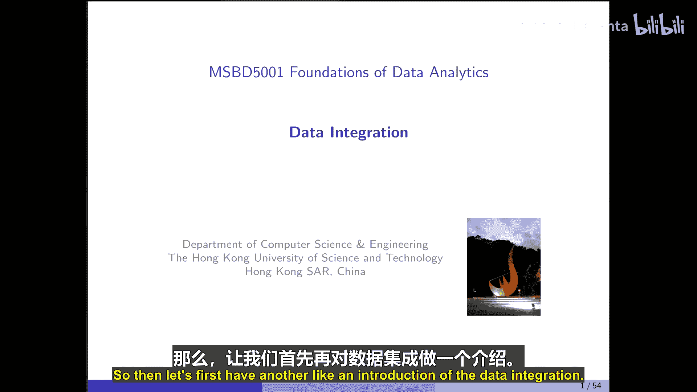

Now， then Kate， so by the way， so in these few lectures。

 we are using two like we are mainly using tax to textbooks and then we are also adopting some materials online。

 So one of the textbook that we used most of the time is this one the principles of data integration。

 Okay， so then like。So this textbook has been published for some time。

 but then this is the like one of the textbook that is like having the most like complete coverage of the the techniques or the topics that are related to the data integration。

😊，So we are using that and then there is another book which is called page big data integration。

 so I think we are going to see that book， the use the discussion of some of the topics from that book in the next topic。

So I will mention that again next time。Alright， so then for data integration so then well think about what we how we have been storing data so like in the traditionally or like very often we are storing data in databases。

 it's nice it's structured it's relational but then think about like what actually most of our data are being stored okay still up to you nowadays。

😊，So our data are not all of them are not like most of them are not stored very nicely in databases they are everywhere right。

 so then we have like a lot of even with the like most of the documents digitalized but then still they could be in different formats。

 we have a lot of text show documents， we have videos we have like images。

 and then even with like documents， text show documents we have a lot of different like a format。

 they can be unstructured like news articles unstructured。

 they can be semistructured like those that are advertisement or like product catalogs。

 so then they are like semistructured。So therefore we have a lot of different formats of data and then they are being stored everywhere。

 some of them are in the databases， some of them are just like online documents like well web tables out there。

 some of those data are hidden behind the web so then there are a lot of different formats different systems different like a sources inconsistency everything so that what makes like those all those things makes data integration actually challenging now we have been discussing data integration。

 I think like some of the papers like for example some of the papers are 20 years or 30 years ago。

 but then still we are like talking about data integration still in the recent years because well data integration in order to do like the whole complete process and then if we want to do it totally automatically so it's still I would say that is not still achievable right now so what we have nowadays。

Actually。Some tools to help us handling some of the steps with the data integration。

 so we'll talk about that。Alright so then okay for data integration the simple definition is just tied together different sources Okay and then you can see we are already trying to say that okay。

 what is the problem here right why data integration is difficult because data is usually under different people and then when we are talking about different people all so you know when people so when we are talking about people so there would definitely be some challenges okay。

😊。

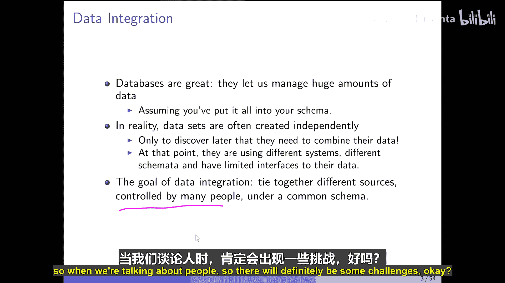

Now so very often we'll be looking at data from different sources。

 it could be like what we have mentioned structured database like SCO and then we can be looking at other structured documents like JSO and then XL and then we can look at like unstructured documents like text and then or like some other kinds of structured like documents like a CSV files or Excel files etc so there could be many。

 many different sources and then what we want to do is to integrate them together to have a common view okay。

Alright， so then K here is another definition of the data integration。

 so the combining of data like from multiple sources into a unified view。

 so that means after we have the unified views， then we can make queries Okay so we can make queries like we don't have to make cur on a particular source we can make cur on the integrated view and then K we will be able to find the data that we need from the sources okay。

😊，Alright， so then okay， if we wants to do this， that means now we'll be able we'll need to be able to make the query right。

 so that means we'll need to be well well at least need to have a particular skimma that we can make the query on and then it has to be an integrated one right so that means this skimma is going to allows us to get the data of what we want based on what we have Okay from different sources and that we call it a mediated skimma Okay。

 a mediated skimmer is。

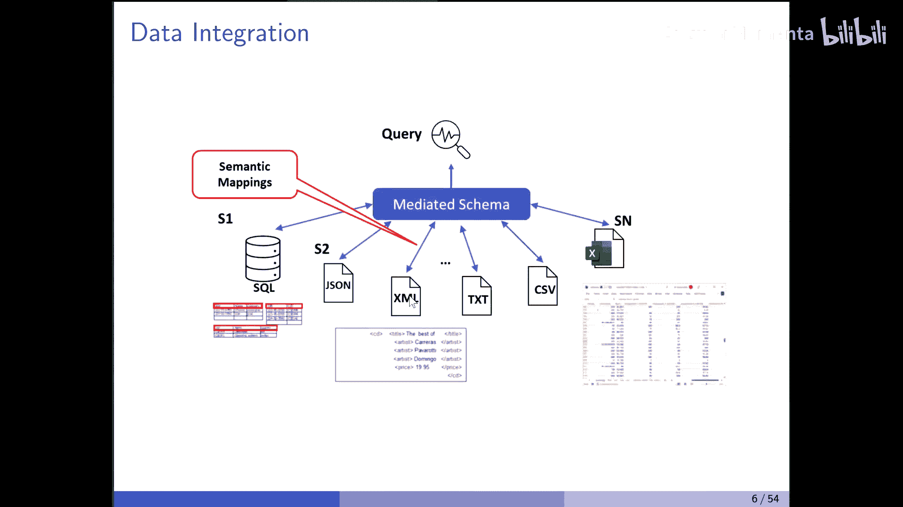

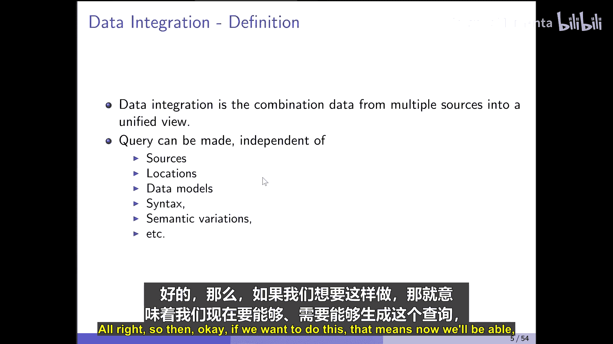

Like specifying the relation between the query that we want to have and the data sources now it doesn't have to include everything in the data sources so we'll see an example very soon okay but then you can see if we want to have the query okay on the mediated schema and then to get them from the sources then we'll need a certain kind of mapping okay so usually we say that it's a semantic mapping between the mediated schema and the sources okay。

So data integration one of the step is talking about how do we do the mapping？

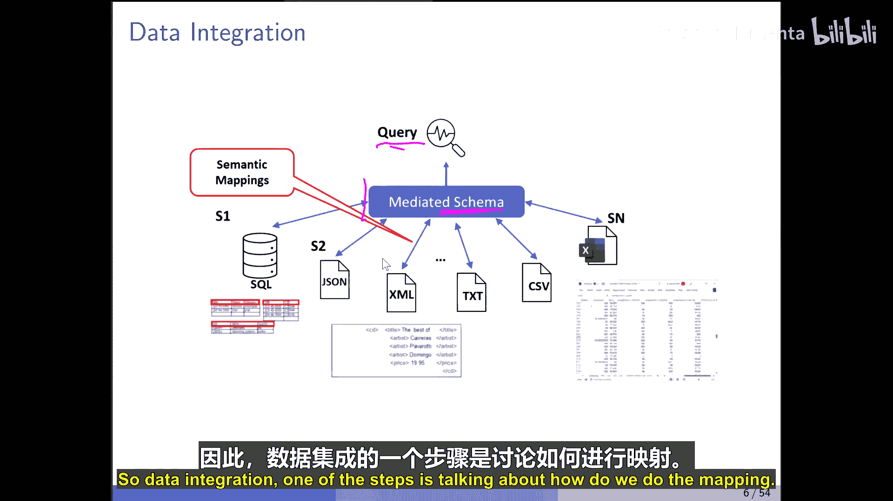

Now then data integration has a lot of applications right so of course besides doing the data preprossescessing right so then like for example like a very typical like a case will be like we are looking at two companies so you then know each company will be having a lot of data a lot of databases if the two companies merge so then that means they will want to put together all the databases and then to like find out whether there is information or there is value that we can gain from it so that means it will requires us to integrate to do the data integration on the databases okay。

😊。

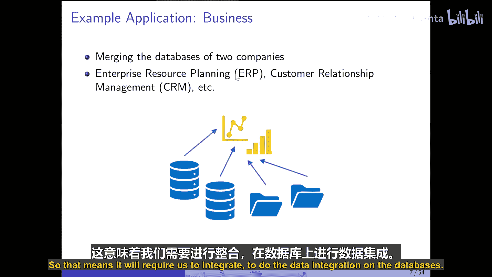

All right， so another like example will be on with the science domain right so you know that like for example。

 if we are just looking at the bioinformatics information。

 they had a lot of bioinformatics repository。😊，If you try to find like the data sets or the repositories that are out there like for having the biomedical or bioinformatic information there is many。

 many of them I'm just listing a few of them here so for example there is the gene ontology there is the geo and then the gene bank and then ens there is many。

 many different repositories okay some existed for quite a long time so are newly added newly created so then we have many。

 many data sources so then if we want to like be able to have an integrated view so then again because they are different repositories they could be designed in different ways to like handle different problems then the integration will requires a lot of the steps or like effort。

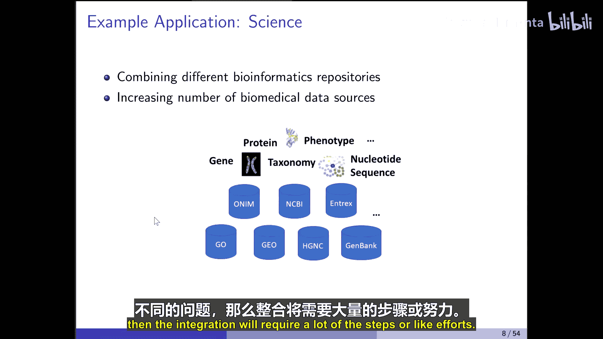

Another one probably will be able to understand it。

 Most of us will be able to understand it is how do we find a book so like right now if you want to search a book so again there will be like many。

 many different like online bookstores were just talking about online bookstores right so then there will be already a lot of them so then also different from the traditional bookshops which we like normally the publishers won't be selling the books directly so nowadays with the internet webstores then it's very likely that the publishers will be also be able to like sell the books either physically or the electronics so that means we are looking at a lot of places that we can see whether we can buy a book or a lot of places that will be like we be able to purchase a book so then again like how do we if we cannot find a book in one place that we definitely needs to go to another site and into。

So then the process its becoming more and moretime consuming right so like I think I had the feeling nowadays right so in the old days。

 if you want to buy， for example， like a device or an appliance and a home appliance say that it's just like the refrigerator so then usually in the old days or in my old days not your old days in my old days I will just go to electronic shop right and then usually just one or two so we check on the price and then the decision is made but then nowadays because we can purchase it in so many website right so each electronic store has their own websites and then there are also some online web stores that we can purchase it so then you need to do a lot of comparisons right so then you find the whole process very very time consuming。

And actually， like I think in like this decade and the last decade。

 we are also like having the need of some meta search engines。

 but then you can see it's also like meta search engines are out there。

 but then it's not possible for every domain because there are a lot of other like restrictions。😊。

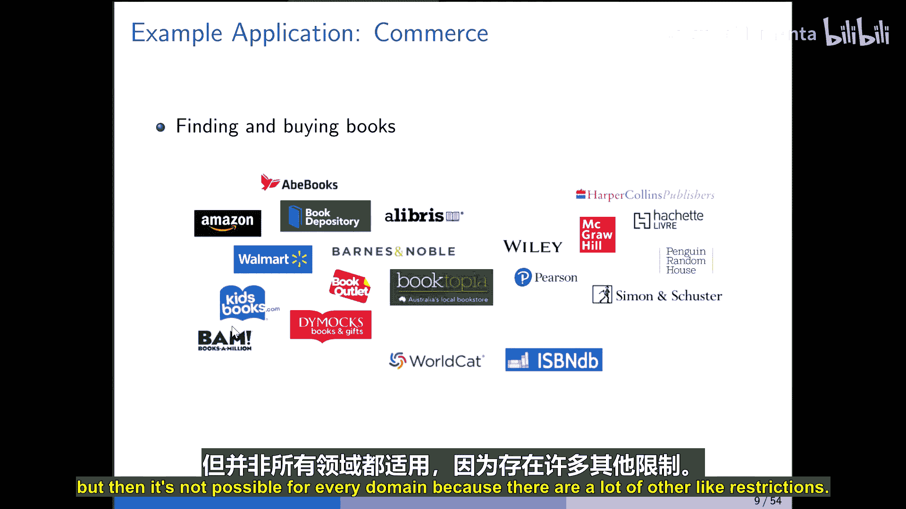

So another one will be like on the web， there are millions of。Tables。So like different organizations。

 different people could be because of the organizations like objectives or what they are responsible for or like for person for each individual then individual people will have their own interests。

 they will be creating these kind of like a web pages which are rich in information okay so then there are a lot of useful or rich information out there so then like we may want to integrate them together to gain like information。

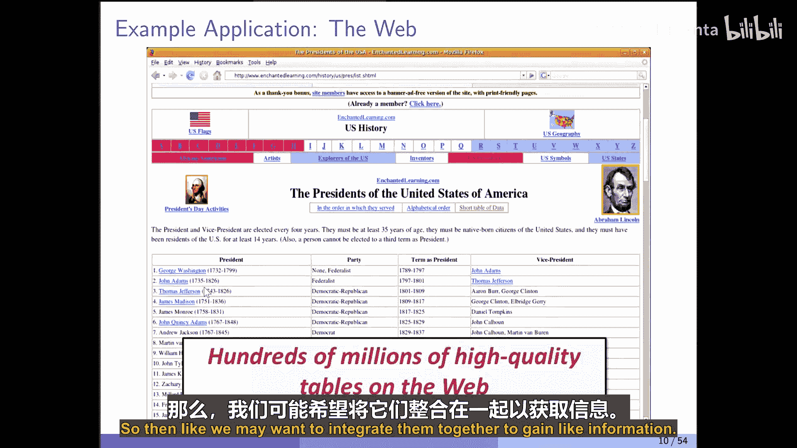

So like another one would be like a what I have said before， just like we are searching both books。

 how about searching for jobs so again you need to find it。

And then like search it from different sites and then you know for the jobs like searching like a websites。

 they usually have a form and then you need to fill in a lot of details right unlike searching for the products you just give a name but then for searching of jobs you need to enter a lot of things right your own personal information the job nature like what area what other details that you are looking at like if you need to fill in the forms again and again and again in another a lot of pages it's going to be troublesome as well right so that means if we are able to do the data integration we are able to put them together。

😊。

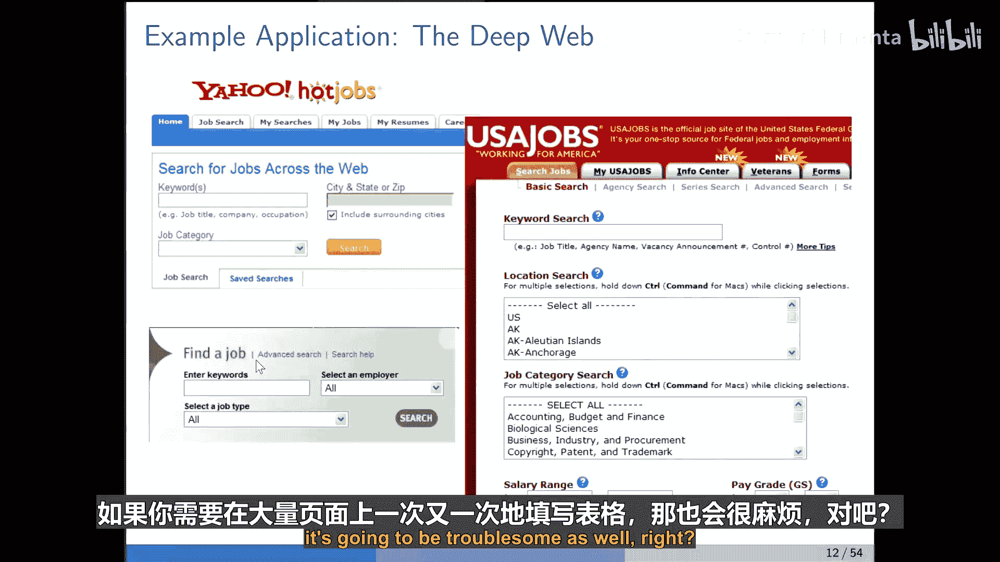

And then like either like physically in one place or like virtually so we are just like putting it together with an integrated interface and then we are going to look for them so both of these versions is going to be hard okay so that's why like data integration is actually difficult it's not that easy reasons。

😊，One， it is obvious， which is the systems level reasons。

 Now you can see like we have like a databases like from oh let's just say that we are looking at databases and then which very typically they are using SQL right and then even with that actually up like with the through all these years。

 there are many different like variations in SQL and then also how systems are supporting the queries as well。

 So then you can see like just looking at the systems levels where are those data being stored and then for that platform are we able to assess it how can we assess it that's already like hard enough right So if we kind of ignore those like a technical or system level reasons then let's look at another two categories of reasons。

😊，One is with the logical reasons now we are talking about smma and data heterogeneity here Okay so what do you think like the differences are so why are we saying that okay。

 the skimmer and the data are different。😊，So just like what we have mentioned previously。

 why do we need to use similarity measures we have mentioned a lot of different reasons for the need of having similarities measures right because there are data heterogeneity so what kind of data heterogeneity can you think of。

So probably we can also think of our daily lives right。

 so then what kind of like a data or what kind of information that you see。😊，Nearly every day。

And then when you look at it， you still need to think about it for a few seconds。

Before you can actually understand what that is or what exactly is it talking about。

 do you have any kind of those examples？😊，嗯。Thank you very much Yes time right so like for example like we have two representations right the AM PMm thing so thank you very much otherwise I think that okay so I'm having a like my lecture is just too boring and then everyone has fallen asleep so thank you for responding giving me some response Yes time right so we have the like AM PMm one we also have the 24 hours one and then also。

😊，Different places right so well also need to think about the time soon as well so when we look at the time so it's already like hot enough to actually like different representations of the time so for example like let's say that we are doing meetings online nowadays right so if you are overseas and then you are having a meeting with another person in another place then you two have to be make sure that you are talking about the same time soon right otherwise okay so what is the time so that will be misunderstanding any other kinds of examples。

😊，Yes， wow， a very good one。 So the currency right so how about like when we are buying things right so very often it just put the amount there Okay300 what is it is it US dollars is it Hong Kong dollar so like you need to think about that right so then if you put together like if you are looking at two product description one saying 3001 saying 2000 which one So are they actually matching right so then we need to do some conversion very good So any other kind of examples I think we have millions right we have like a lot。

😊，Okay so actually， I think every day， so like for example。

 when you like buy those things like food or like drinks， the dates， okay。

 I'm having that problem every day every morning because for example。

 if I grab a package of like a pack of like a drinks cake。

 it could be like anything or like a prepack like a cake or like bread， then there is the dates。

 right？😊，So is it？Year month day or is it day month year or like any combination Yeah。

 and then there are also different units So then for example。

 like the measurements like we have the meter centimeter and then we have inch we have like that is the distance and then the length。

😊，There is the weights and then there is the like the volume etc。

 so they can be all in different units so all these things it's going to make our like a integration very very difficult so we need to think about the conversion as well and then how about the skimmer so for the skimmer is also very difficult now what we are talking about skimmer here is we are talking about the attributes type。

😊，So you know that when we have a database we have many。

 many relations right so then okay for each relations there are many attributes so then very often for a particular relation we'll have a schema the schema will describe what that attribute is and then what kind of data are being stored there are represented in that so then if we just look at two databases or two like two tables from two databases and they could be just about similar data for example。

 one company having a table about its employers。😊，It's employees， okay？

And then another company is having a table of like for example。

 the customers So we are talking about people right and then when we describe people typically we have names we have like age other a kind of personal information as well and then how people put down the caption so or not we are not like looking even at the databases let's say that we create those Excel tables simple tables for presenting like the。

😊，For storing for example， like a particular class classmates information。

 then you'll find that okay， so one instructor will put down student ID and then another instructor in that table is going to be just ID and then one will put down like first name last name another one will just put down the name okay。

And then you can see， like a。The captions， the attributes like name is already different。

 so then scheme are the same。Because skimmers， databases， tables。

 relations are designed by different people。They definitely will be different， so that's like a well。

Most people will say that it's a nature of the human it's a human nature。

 so if we are different we are different individuals we' definitely have different thinking different thoughts。

 different design okay so it's unavoidable and then that's why we'll find it hard to integrate things together okay。

So I think we have problems with doing data integration every day。

 so I try to think of some problems in our daily life where we have the problem with like really integrating things。

 organizing things but just find out that all of these examples are old ones right so for example。

 I usually have a complaint on arranging the books you know all our textbooks in the old days when we still buy physical textbooks they are all different sizes it's very difficult to put in like well in a nice way and then another example is in the old days like again we don't buy like C or DVDs nowadays but in the old days we have them and then they are all of different sizes I got like one packing of the C that large and then one of it that small okay so it's always a headache right so that's also why we have a lot of differences in the design in the data so then we always say that okay it would be nice to have。

😊，Standized format， but then it's not possible。 It's not always possible to have a standardized format in everything。

 So if you think about like throughout all the years， we have tried to。

 for many different application。 We have tried to reach a particular standard。

 It's not always possible。 So probably like a， for example， nowadays。

 We are still looking at like a multiple formats of the DVDs。 We could be looking at DVDds。

 We could be looking at bes and then like a high definition of Ds， etc cetera。

 So we are still looking at multiple formats。 Okay。All right。

 so then that's what the major logical reasons that we are going to discuss in this course。

 so then for the subsequent topics or steps that we describe with the data integration very often we are talking about handling those logical reasons。

Now then another category of like difficulties we had with the data integration is actually social ones okay which is like a again related to people okay so then you can see the social reasons that real listing here is like a locating capturing relevant data in the enterprise now you know when things are managed by people it's not always possible to find everything okay well you think that it's supposed to be there。

 but then you just can't find it okay so it's possiblebable like it's possible as possible like this and then another thing is the data field them。

😊，Okay， so。When we have people and then we have people in different like a levels of different management level。

 so then you will find that people may not be willing to share the data all the time。

Because you know data is also the property right so it's also in another term reflecting the power that you have so like if someone has control over a particular like a data source or particular set of data he may he or she may not be willing to share because he or she will thought that if he shared he or she shared that data with others。

 he may lost the control of it okay so that is one reason。

Another thing is that well people may be afraid that if they share the data with others。

 then okay it's hard to control so that means like some people may have an authorized access and then how can you prevent others from like wrongly assessing the data or disclosure to others so that will be related to security privacy things okay and then privacy is again a very important like topic when we are talking about data okay so because now we are assessing more and more data so then okay so like before we can assess some data so then the privacy issue has to be solved even if we can get hold of the data so when we are doing data integration will it cause extra like privacy or security issues these are something we also have to be aware of when we are like doing the data。

Alysis during the data integration all right， so then we have an overview of why it is being hard Okay。

 so then the next few pages are examples of why it's being hard now for example in this page here we are trying to have a case like say that we are looking at two companies the fruit self company and the euro card companies so these two company is doing emerging。

😊，So you can see that these two companies started in different scale covering different like areas。

 The euro card is actually like a credit card company， a credit card service company。

 And then while Fov is actually doing like other things like the sales， it has the。

Solf services etca。 So then they are originally two different companies so they have their databases differently as well so you can see like with the full serve we have the employees information here we also have the resumes information here and then while like the Euro card also have that but then you can see the things that are being covered are different as well Okay so therefore like the relations。

 the design are actually different so how you can put them together it's going to be hard。

And then if we are looking at a particular smaller application say that we want to like get to integrate these two like databases and in that we get a full picture of the customer related information then you see that we actually need to work with multiple data databases with different relations for example。

 like we want to integrate credit cards we look at the customer details and then we are looking at our past customers and then the sales related information so we will need to integrate all these in order to have a full picture and the potential benefit will be like adding more value to the customers and then for the logical reasons we can see that here like right now we have again two data sets two databases one database has the patient table and the other one has two tables。

 the admitted patient and address if you look at the names well we have already mentioned that right so this is the name while we have the。

Sname and give a name。 And then you can see the date of birth， right。

 So then they are in the different representation。 Okay， and then even agenda， right。

 So and then also the addresses， how do we present story addresses。 So it's going to be very。

 very different。 And then also like even though we have the patient I， the P ID， Well， then the PD。

 the patient I only works with a particular organization， right。

 So that means they won't help us to integrate across two database， So then we cannot rely on the Is。

 So what we need to handle is really the attribute names。

 the schema attribute names and also the contents。 Okay。

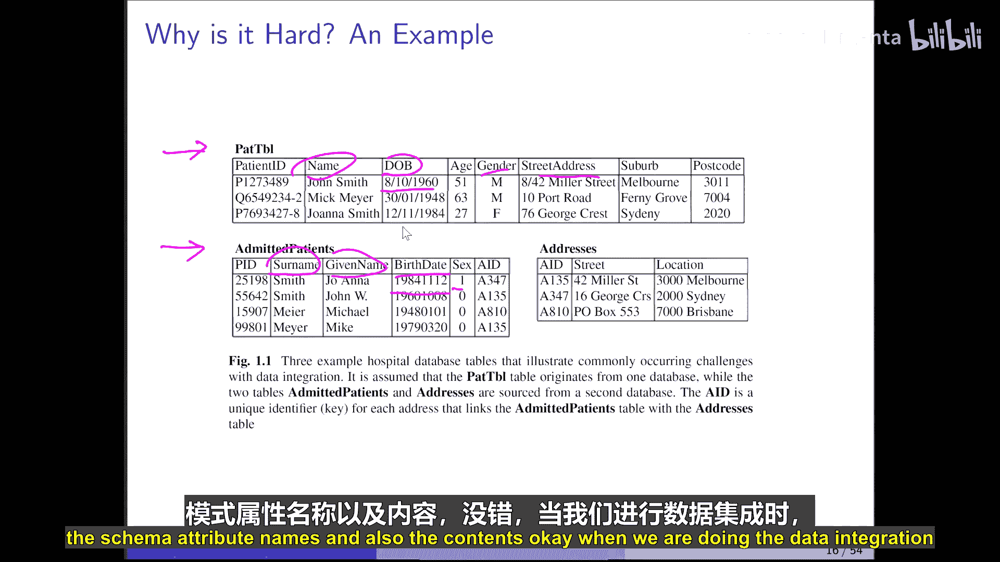

When we are doing that data integration right so then as we have mentioned， well。

 data integration is really hard Okay， there are many， many steps we need to consider。😊。

And then while right now there is no like complete solvable ways， Okay。

 so everyone is trying to think of what is the possible like techniques or possible steps that can help。

Do the whole thing。So then we'll be talking about auto steps。

 the possible like techniques or possible steps that can help。Do the whole thing。

So then we'll be talking about auto steps。Now， another thing that we have to mention before we go on talking about the steps is that now if we are talking about data integration。

 usually we are talking about two scenarios， one of it is we are talking about data warehousing another one is virtual data integration。

 So when you look at like a when you look up the term data integration very often you find that it's related to data warehousing So for the data warehousing it's actually like putting the data into a physically in the same place Okay so then usually we are talking about very complex processing of the data and then a lot of transformation。

 a lot of processing and then finally they are integrated together with a well。

With a well defined schema。 so then you make query on the integrated warehouse。

 you make carry of that Now then in this course in the coming lectures。

 we are going to focus on the virtual data integration that means we are not talking about having all the data extracted and then like put together into a particular place physically we are talking about okay。

 so all the data are still at their sources Okay， so then everything are still in their original place。

 it's just that when we want to make a query Okay， well need to be able to know which。

Source well need to be able to get the particular information that we need Okay。

 so that means we are going to need some additional processes， so we'll talk about that。

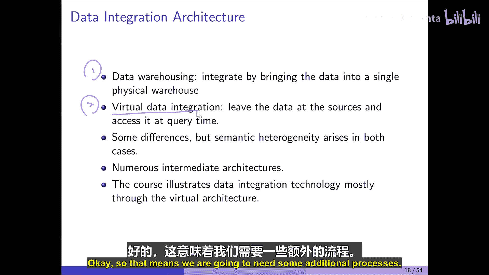

Okay。😊，So then you can see that here if we are talking about the virtual data integration。

 so we are having different data sources in different format in different places then say that we want to do the query so we want to make the query so then we'll be making the query on a schema and then we call that a mediated schema and then that query will be reformted over the source describing its relation between the sources so then we'll know where to get it so then through the reper so which is actually like a reformulating the query。

 making it like with a logical and then also physical query plan and then we'll be like getting the needed data from each of the source okay so you can see that here there will be many。

 many different steps for example we'll need to do the query reformation or we'll need to do the transformation as well。

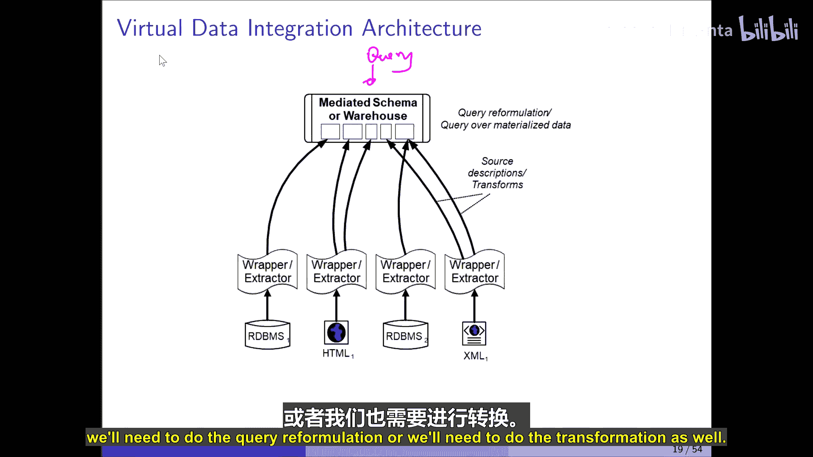

So then here is another example， so say that this is the mediator schema。😊。

So this mediator schemma describes what we want to have。

So then if we were making query on this mediator skima。

 we'll be able we'll need to know where we can get from the sources so you can see that here now the mediator skimmer is talking about a movie relation okay a relation。

 but then you can see it's not there in one particular source it's actually everywhere So for the source one it's giving us the movies relation。

 but then you can see。😊，Like are the names of the attributes。 while it's not the same set。

 So in here in the source  one， the movie relation is talking about the name。 Okay。

 while in the movie here in the mediator skimer， we wants the title of the movie。Alright。

 so then how are you going to say that， Okay， so name is this name in the S1 source。

 Is it the movie name。Or is it the actor name or is it the director name Okay。

 so we can see that here name this word along。😊，Can be a lot of different things right。

 so then if we want to be able to describe the relation between the title and name。

 so then okay we'll need to have a few processing okay。

So and then sometimes you can see now not a particular source will be covering everything so you can see the sourcefr here is only talking about the cinema information in the New York and then this S4 here is talking about the cinema information in San Francisco so then it's not the complete one right so then it's helping like like a coverage right so then again we need to know like how do we get it okay and there could be some duplications between the sources as well。

😊。

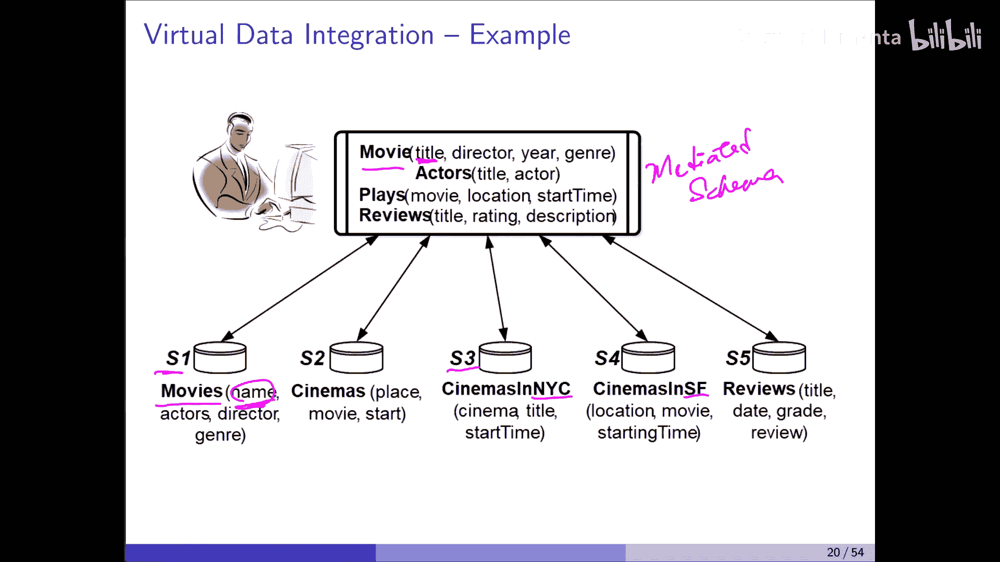

So then for the data integration， then like there are many， many detail tabs， for example。

 one of it is what is the relation between the sources and mediator schema。

 so we definitely needs a mapping。

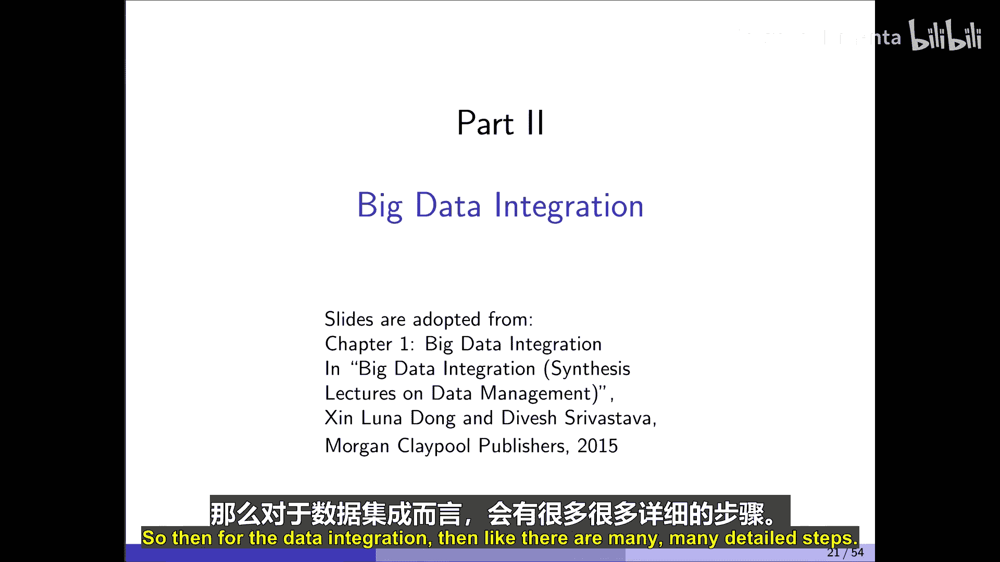

Okay， so we need to know what is the mapping between the mediator skimma and the source skichemmers now if we are able to have a skichemma mapping right。

 so then we'll be able to merge or to compare the attributes。

 the skimmers okay across sources and then we'll be able to look at the records like the topples and then we'll be able to compare the topples with topples and then to discover whether they are talking about a similar entity or the same entity or the same thing the same individual individual so then that will require another step。

Which is called the record linkage。So you'll find that like very often there are a few terms that are closely related to data integration so one of the term is schema mapping and another one is record linkage okay so these two are usually the most important steps of the total data integration process but in the recent years there are more steps for example there is another one which is called data fusion actually the term data fusion has several meaning but then this is usually referred as the truth discovery。

Yeah。Now you know that right now we have many inconsistencies in the data it could be because like there could be errors there could be like different updates of the data there could be memory reason in resulting the inconsistency between like a data from different sources so then even if we are able to say that okay this record in this database is like is probably referring to the same person as another one in another database if they have inconsistent values so then which one should we like use it as the truth so then like there is an additional step which is like proposing the recent years which is called the data fu truth discovery so actually I think truth discovery or false detection or fake detections things like that are also gaining more important in the recent years。

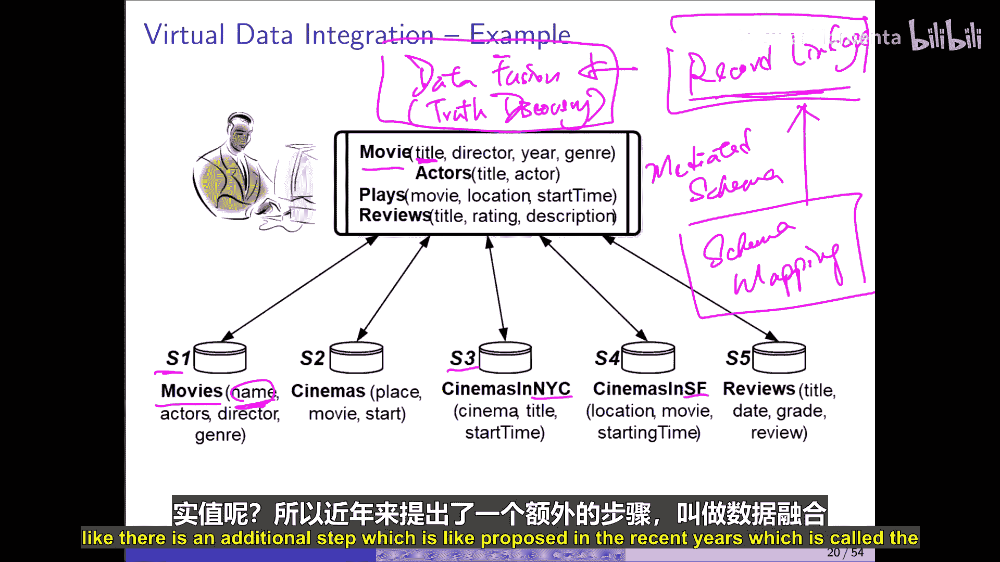

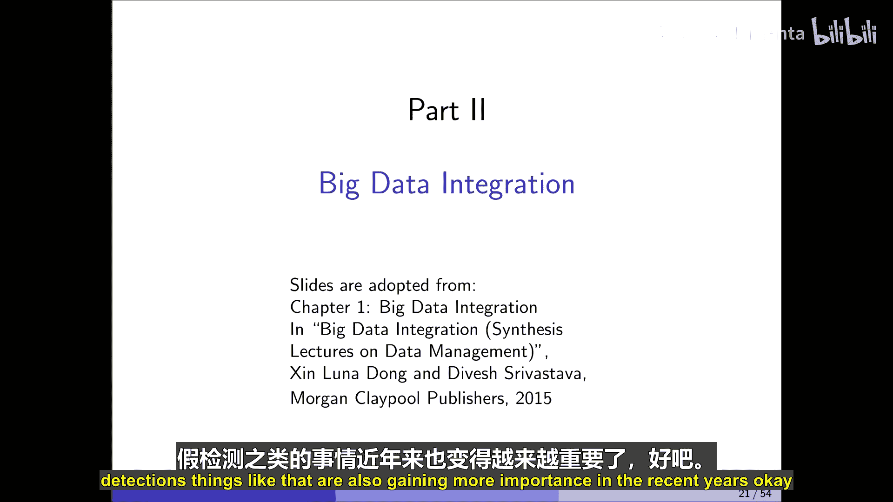