# 【香港科技大学】数据分析基础-｜-Foundations-of-Data-Analytics-p15-11-02-02-大数据集成--BV1oKFDznE6L_p15-

Now then like the next part， we are going to look at the data integration like the challenges。

 the difficulties from the big data point of view so what do we mean by big data point of view the four V's right now high volume。

 high velocity high variety and then like high verac right so the four Vs。Now there are many。

 many reads right so I think that people are adding more Vs I once saw that there is a list of 42 reads people keep on adding more Vs and I think most of the time we're still talking about these foremost important things。

 volume， velocity， veracity and variety。😊。

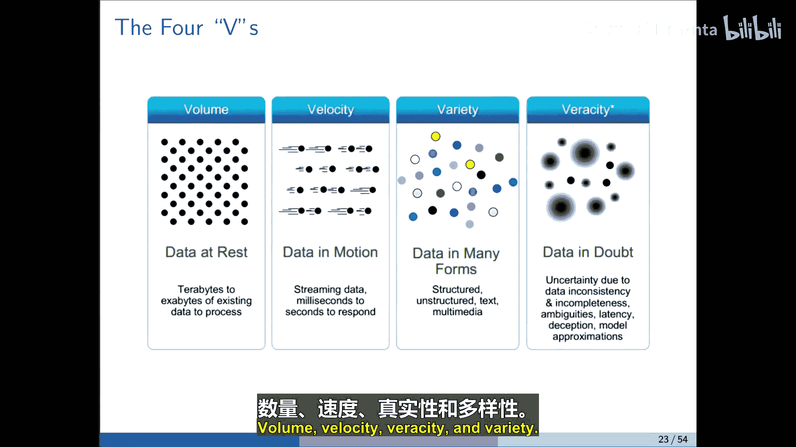

So I think you know these terms right so probably other courses have mentioned that before and also probably in the start of this course so I'm not going to repeat that。

 but then like later on we'll be talking about like what things we need to consider like especially about the V okay。

😊。

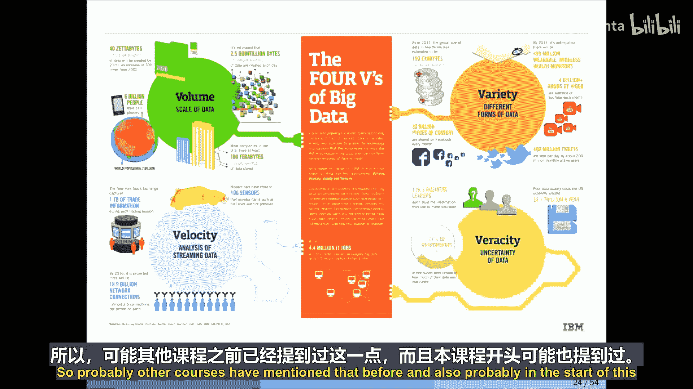

Right so then big data in data integration so against large volume right so large volume of data large volume number of sources is definitely going to give us some challenges right so then how do we handle it and then when we are talking about big data we are always talking about the variety right so we are looking at unstructured data structures data semistructured data and then if we are talking about the formats it could be like textual data it could be numerical data it could be video images a lot of different formats of data so then how can we handle this larger variety of data。

And then。Uuttilality right so then it will even if we are looking at a lot of different data sources right so then are they all being useful so that is also one like a question that we need to answer is it worth it is it worth it to integrate efficacyA right so then so in the subsequent lines we are going to like discuss some of the researchers that some researchers have made in order to like verify these aspects okay。

😊，So then like well。Based on the previous applications。

 we know that data integration is going to create us values。

 It could be like business related and then it could be like our personal related things now in the big data point of view so we may once like people like do one a web scale knowledge base so you can see Google is trying to do that Google is actually like having the knowledge graph so when we are trying to search things so then Google will be giving us like those entity So for example。

 if we search like the term data integration， you see related information appearing if it's in the knowledge graph so then in order to build such knowledge graph then you need to know all the things about a particular entity so that entity is it mentioned in this data is it mentioned in this place and then what actually being mentioned will be able we need to be able to。

Rush them cake。So then like the other kind of web scale like La basis could be DPD Wikidi and Yogo so they are all about having the web scale knowledge basiss so in that will be like another reason that we want to have like the web based web scale knowledge basiss is we want to be able to have the linked data now if we have the linked data will be able to do the reasoning okay and then it's actually helping us to handle a lot of different applications as well and another things like handling the data analysis analysis just like what we've mentioned with all the different data sets of the biological bioinformatics databases right so then if we can put them together it would be nice。

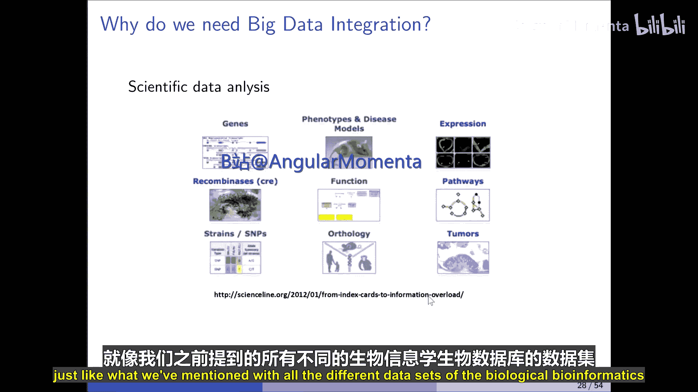

So then just like what we have mentioned now we will need three major steps now schema alignment is usually like an alternative term for the schema mapping schema mapping。

 so were trying to map the different tables according to their like design relations and attributes。

😊，And after that then we are looking at like records topples right so then can we link them together so we are doing the record linkage to identify the individuals or the entities and then after that okay so we want to be able to find out the truth okay so that means what if we are having inconsistent values mismatching contents so we we wants to do the like integration so that's the truth discovery or data fusion。

😊。

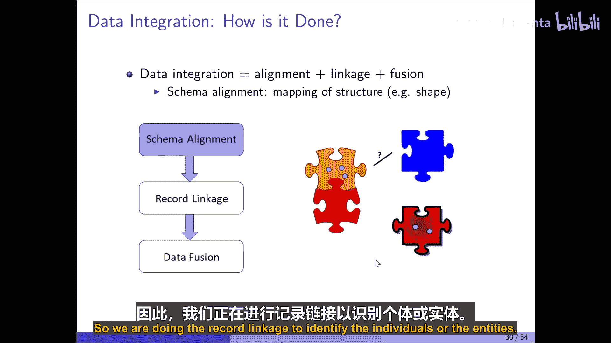

Okay。Now， so in the previous slide here， we are talking about the。The utility， right。

 So is it worth it to like really consider that amount of resources sources。 So then。

There is some research researchers that is like trying to study that。

 trying to see like is it possible to like integrate the data together to have a complete picture？

And then how spread， how widespread the data are， how difficult is that。

 So then like the few pages here is not about the methods。

 It's about some like a background research right。 So， for example。

 in like this group of researchers， they are looking at。

How many sources do we need in order to build a complete database for a particular domain so that's interesting right so they focus on a few like domains for example the books or phone numbers for restaurants so then like we know like for example the books information everywhere right it could be like in library pages it could be like in the library database it could be in the bookstores it could be like listed in some web tables like people like usually like recommend like a books for others to read then information will be included there as well so then we have like a different places having different like information of the books so we will be able to cover everything okay so then that's like a very interesting study here。

So then of course whenever we are doing the like research or analysis we wants to know the ground truth right what is the truth so then in this here you can imagine how difficult it is like we are having so such a large coverage so then what the group is using is using the webcache of the Yahoo search engine so then it's using that as a reference and then it's trying to see like for example。

 if we are talking about a particular number of sources we will be able to cover like most of them so you can see that here now if we are talking about restaurant phones so if we are just looking at five coverage the top five1 so then we can easily like。

😊，Okay covered 80% of the entities Okay so that's quite nice so you can see that here the slope is going to be less deep so that means we don't need to cover too many sources in order to cover everything Okay but then of course like different information will have different like a pattern right so phones typically most of the pages provide the phones but not all restaurants have web pages so that's the difference step okay。

And then another thing that started is like how well the。😊，Data are being connected。

 Are you able to find a。An entity or a particular piece of information here and then it will lead you to the other entities and then like things will be connected so then they also study this。

So then again they find that like almost all entities are connected to each other。

 so you'll be able to see that the number of entities in the largest connected component iss covering over 99% of the entities so that means again we don't need to go too far in order to get everything so therefore like it's possible to put together everything without covering too many sources Okay so that's a good news right so that means if we really aim at having the a web scale knowledge graph that means we don't need to dip like into like a。

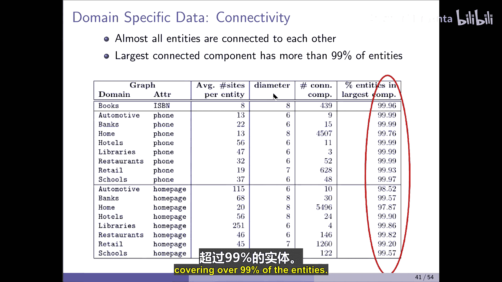

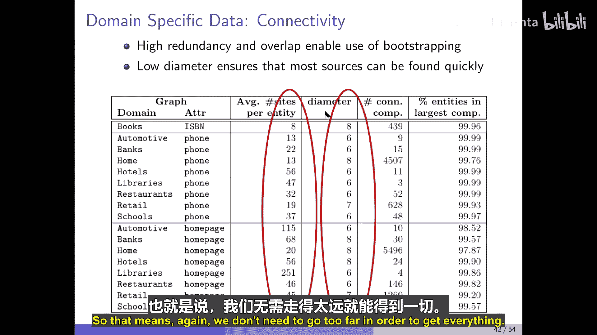

All the sources， okay， we'll need to like cover a certain amount。

 but then we'll probably be able to cover most of them。😊，All right。

 so then a another like a research is looking at， okay， so we say that。😊。

Data heterogeneity is going to be a problem。 So then they are trying to study the that side of the data out there。

 So then what they are studying is the data quality， data quality。 So data quality is again。

 something that we are discussing over the recent years。

 Now in the old days when we have a smaller set of data， It's not difficult to have a clean data set。

 But then when you are looking at more and more data。 So then it's not easy to have a clean data set。

 So I think recently， I think a group of my students is working on。D啊。

Emotion recognition and they are trying to use some data sources out there and then they can't get a very good like a performance and it turns out that the data set they get are not very good so the like a categories are not very well labeled and there are a lot of errorss and then that means we'll need to do additional cleaning and things like that so data quality has always been a problem with like the audio like data application data analysis。

Okay， so then so this group is trying to investigate two domains the stock and the flights domain。

 So for the stock domains they are looking at all these like items objects and then flights as well。

 and then they are trying to like look at how many how how inconsistent the values are so you can see that for the stock Okay so then the inconsistency is like a well relatively higher than the flights domain so for flights domain we don't really have that many。

Number of different values， so I think it's typically because freight data is usually very concise right it's the flights ID and then flight number and then the time and things like that there is less chance to make errors but if you are talking about stock then there are a lot of different sources of errors so they also studied that like for example。

 for stocks， there could be semantic disambiquity So for example。

 when we are talking about like days range or 52 weeks range is it covering two days or like yesterday or how they do define it different pages might have different a different like definitions and then it could be unit errors right so you can see these two pages are having different units。

Okay or it's pure entry errors Okay so then it appears in the flight domain and also the stock domain as well。

 So then there are a lot of errors and then you the research also look at like what is the distribution of the errors what kind of errors are we looking at now this is quite interesting so like you can see in the stock domain another major source of data is actually out of dates Okay out of date so this will be an inspiring like aspect for us to think about later on if we are talking about truth discovery。

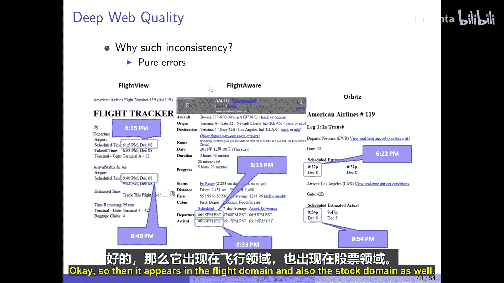

Okay。If we are looking at inconsistent values， which one is the true which is one is the truth so then it's not only one truth it could be related to time right at a particular time that is the truth。

 but at a later moment it's updated it's changed then there is another truth okay。

And then the other source of errors。 Well， in a flight system like pure errors。

 So pure error means the entry errors， right， So it's very normal。

 Okay for that to happens in a flight domain or even in the start domain Okay and then semantic disbiguities right So that's quite interesting So that means when we are looking at data integration well also need to consider the errors right and then this next page here。

 So it's another one that well， very often we' think about it's like why do we have errors。

 Why are there errors， Why some errors is appearing。

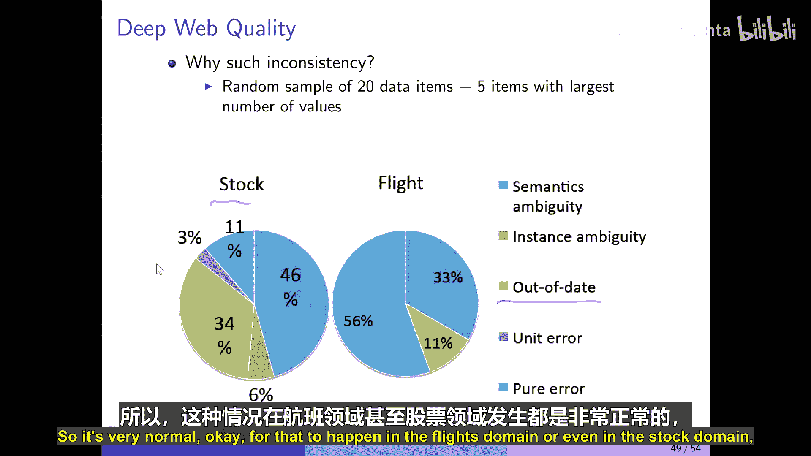

Repeatedly okay， so it's probably because of copying。

 So like what we have mentioned right previously。 so like yesterday we see the same news appearing everywhere。

 So is it copying or is it really everyone is reporting it just that it's very。

 very similar and then sometimes we like look at incident that one error made by a particular person is going to propagates right affected the other ones I think in the。

😊，In the past periods， like in some old days， there are different like incident of wrongly reporting a particular status of a certain like organization or a certain person。

 and then it adds up everywhere， right， people are saying the same thing。

 but then that's a wrong news。 that's something。 So because of copying。😊，Right。

 so then that's like a more investigation on that right So then you can see like well。

 if we are looking at different data sources， we definitely have to handle the data inconsistency。

 the errors， the copying so all these needs to be handled and then these are actually going to be like focused and then studied and investigated under the step of data fusion Okay。

 right， so then okay， so that's all we would like to talk I would like to talk about on data integration now next lecture we are going to talk about。

😊。

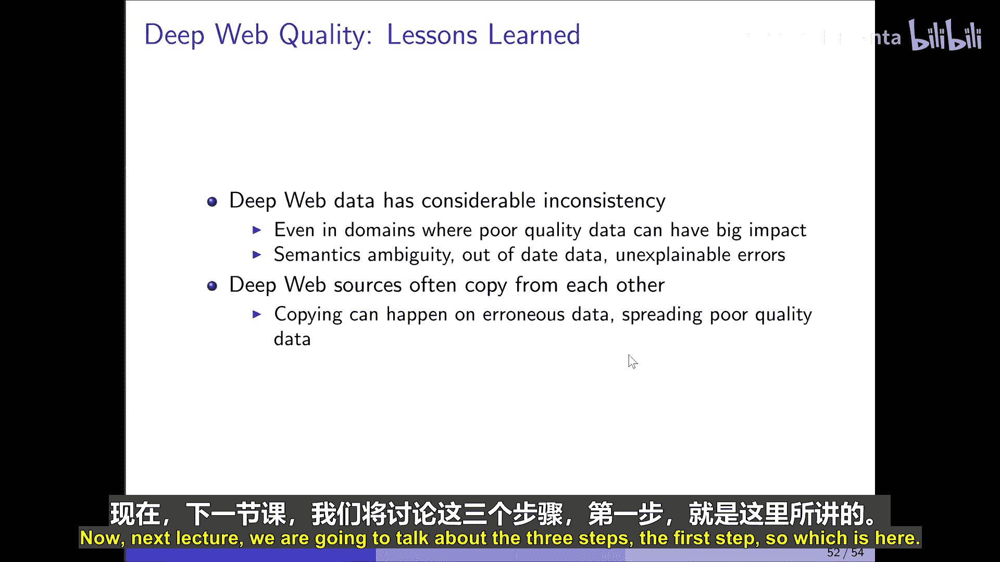

The three steps。The first step so which is here we have the three stepss so next lecture we are going to talk about schema alignment。

 schema alignment， which means that we have two data sets。

 two data sources and then well how do we like say that this column is going to match with this column how should they be mapped together because like what we have discussed well we can be looking at like if we know that the two tables are talking about prices they could be of different skills right so what we want to what we need is dollar but then in one source it's showing in the Hong Kong so how can we do the mapping so then that will be investigated in the schema alignment and then afterwards we will talk about record and data fusion。

😊。

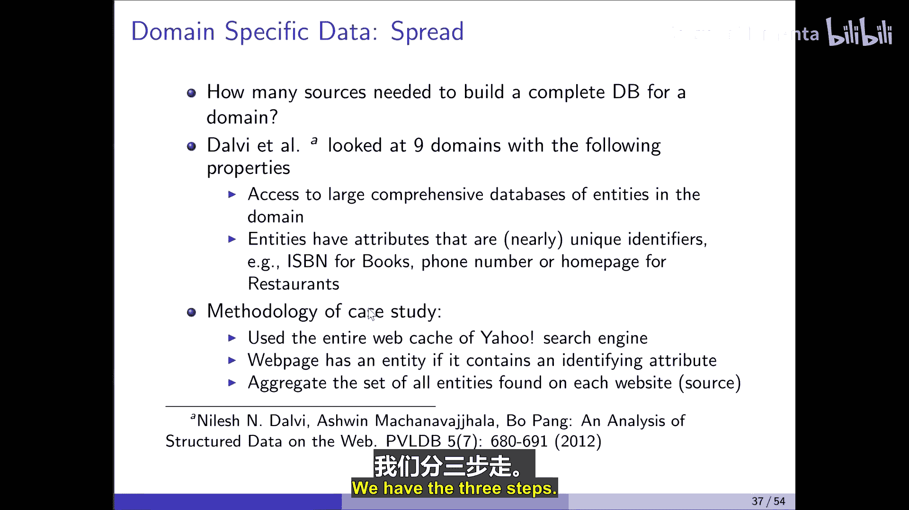

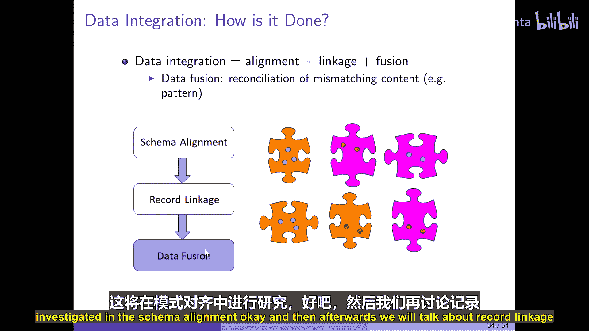