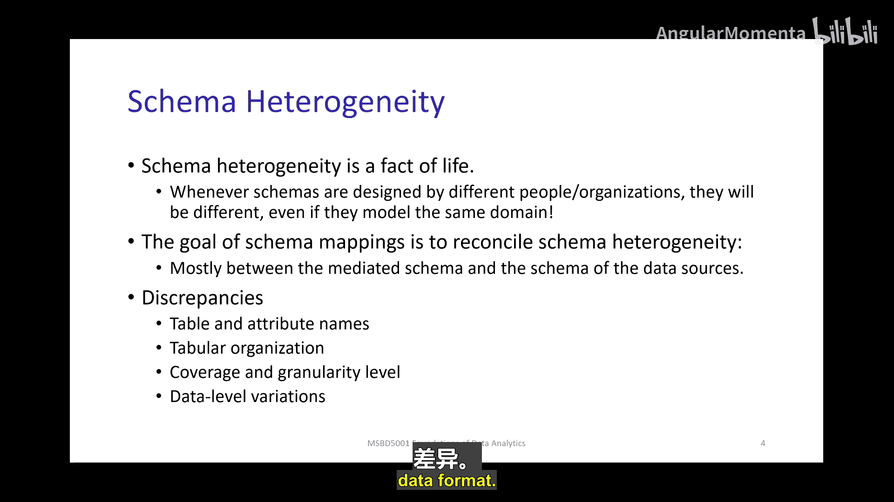
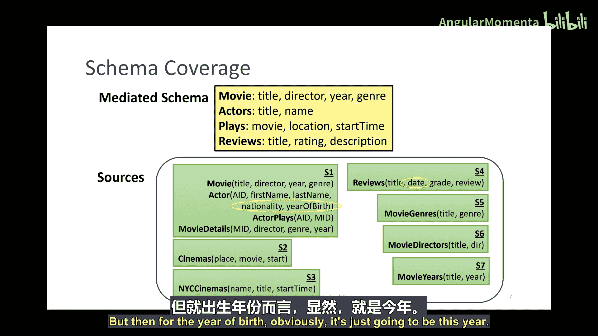
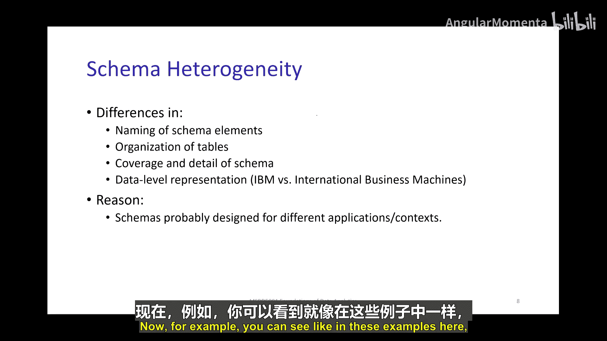
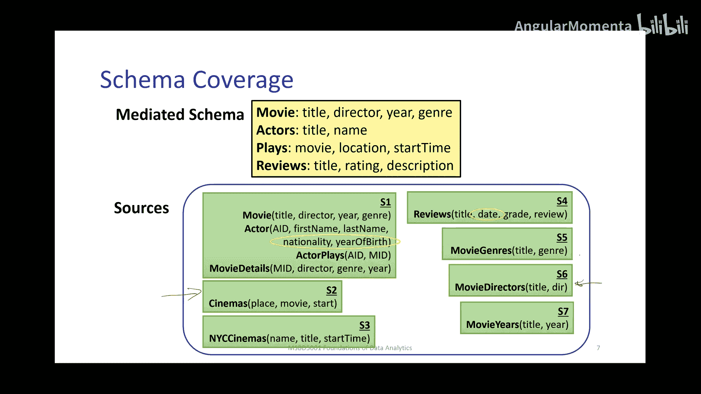
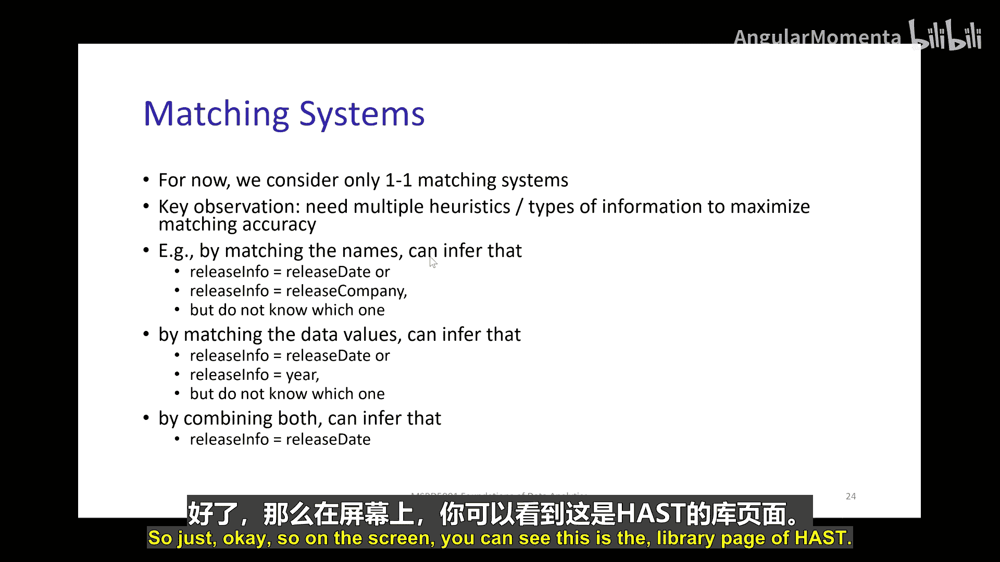
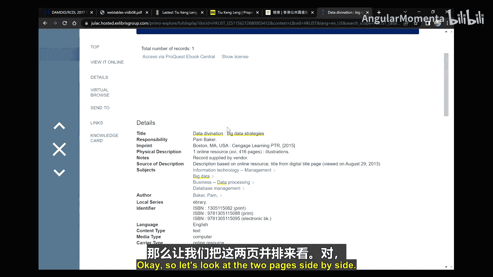
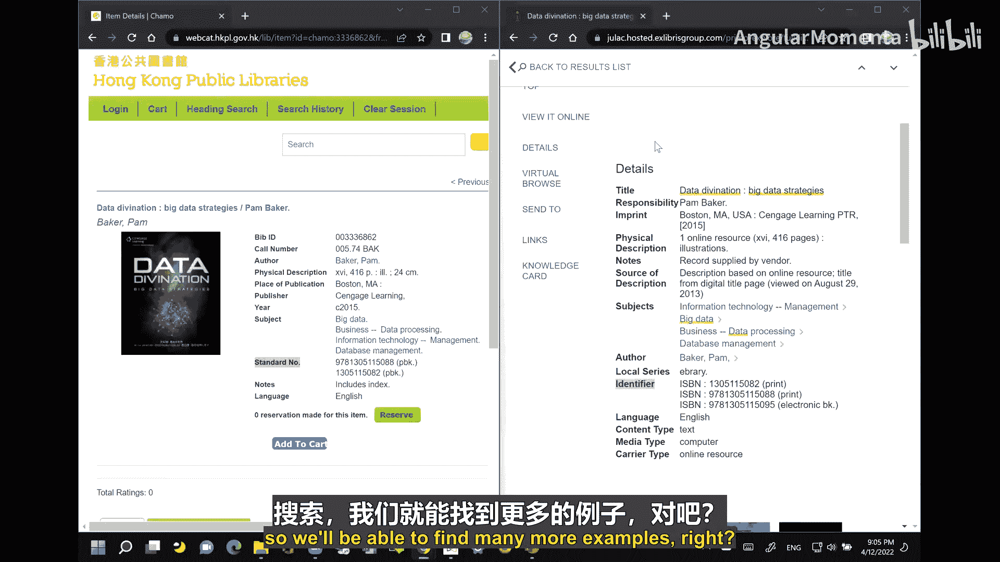
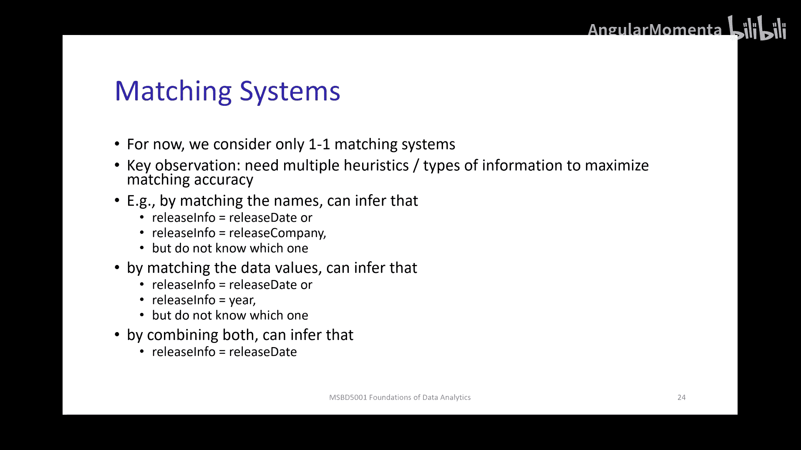

# 【香港科技大学】数据分析基础-｜-Foundations-of-Data-Analytics-p16-13-01-03-导论--BV1oKFDznE6L_p16-

All right， so then let's start talking about schema alignment。

 so schema alignment is actually like a diverse first component of the whole data integration。😊。

Okay so then first again， let's discuss why do we need to do schema alignment so then of course schema heterogeneity so of course because smmers are different and that's why well need to do alignment we need to align them and then matching them and then create mapping and that will be the first step of doing data integration right so then reason is that now when we are doing data integration we are looking at different data sets and then different data sets could be like representing the data in different ways so that means they have different schemmas and then the first thing that we are looking at different data sets we'll be looking at different schemas so then if we want to be able to put the data together then we'll need to be able to know what are the schema right what are the attributes and then how can we do the mapping together so then。

😊，We will be able to map the data to put the data together。

 Okay so that's why sma alignment is the first step。 And then schemma are different most of the time。

 because。😊，It's a matter like it's a fact of life like last time。

 like when we were discussing the data integration， we said that。😊，Okay， now。

Differences variations are actually like a the human nature of life right and then it's part of the human nature if two people design like。

😊，If two people are designing things well even if they are like designing for the same like a domain or same topic it's going to be different that's human nature so that's why like a your skimer heterogeneity is a fact of life so like skimmers of course are designed by people they are designed by different organizations for different usage so that's why。

😊，It's going to be different and then okay， even if we are talking about a same domain。

 the same topic okay？😊，And then now the goal of schema mapping Okay so now we are talking about schema mapping。

 So what is the goal So of course is to handle those schema heterogeneity So based on the differences how are we going to like map between。

 for example， a source skimmer like the skimmer for one data source and the smmer from another source we probably would call that target schema so then now we are talking about data integration So then for data integration So recall call that we are going to like we would like to do it in this way that there are many。

 many sources。😊，And then we'll have a mediator skimmer that will do carry on。

And then those cur will be reformulated into queries on each of the data source。

 and then the results returned will again be integrated and then as the answer for our query on the mediator schemma right。

 so then okay。When we are talking about schemma alignments， so then like it could be the mapping。😊。

To between like her two sources skimmers。Or we will be talking about the mapping between this mediated skimmer and the skimmer of one or multiple data sources right so then that's the goal of skimma alignment。

And then now when we are talking about smmer heterogeneity。

 so of course we are talking about the differences， what can be different in the skimmers。

 actually everything okay the discrepancy could be happening in the table names we are just looking at like a relations tables in different databases the like a relations could be using different names。

 even if they are talking about like a similar like a concept or similar relations and then within tables we have attributes names and then attribute names can vary a lot across different tables and then also different sources。

 different databases。So say for example， like in one data source。

 we are talking about the location names， then some people will be like probably the designer of that data source is going to call the location name with the attribute name location。

And then okay another data source， then probably it's also including like the location information。

 but in this time they may use the attribute name like place or place name okay so then what we all know they are actually referring to the same concept right so they are about locations they are about places。

 but then the attribute names are different right so therefore like even if we are talking about similar concepts because the smmers are created by different people so then the attribute names。

 the table names is going to be different so then how are we going to integrate them together okay even though we know that the two databases is about places。

But then if we look at the attribute names， the table names。

 they are going to be different then well we won't be able to be sure that they are going to be mapped so that's why well we'll need to handle those kind of differences okay another thing is the tablet organization so of course how we like design the columns that attributes right so we'll talk about that a bit more with examples and then the coverage and granularity level so for example。

 a particular like database with a particular relation at a particular table is's about for example a city。

Okay the information of a city while like another data source。

 then its table about locations is just about the locations within a district。

So then you can see the coverage is already different。😊。

Okay so that's like a one kind of discrepancies and then of course the data level variations。

 so like in when we discuss about data integration we already mentioned like the differences in the presentations in the representations in the data format。

 so again we are going to briefly talk about that。😊。

Al， so then let's look at some examples on those discrepancies now。

 for example the table attributes names right so I had used a place and location examples here then in this slide here we have more examples of discreminpancy between the table names or the attributes names for example let's say that we have already like created the mediator schemma so then the mediator skimmer is having these four relations movie actors plays and reviews and then we have seven sources of data so then each different sources have different set of relations for example for S1 we have the movie actor actor plays movie details relations so you can see already then it's different some of the table names are already different from the mediated skimma。

😊，For example， we may already know that like based on our like a background knowledge expert knowledge we already know that okay so then actor plays is probably like related to plays right but then you can see that their tables are different right so then for actor plays we have the AID MID while for plays we have the movie location start time so then the design is's already different the table names are already different。

😊，And then for the other sources we have， for example cinemas and then reviews and then movie directors movie years and so on and then like let's look at the attributes names so for example in the movie we got title Okay and then for actors again we got title and name and then let's look at the actor in the source one you can see that Okay so there is no name but then we have first name last name right so the differences and then how about。

What else we have rating here right there is the rating here and then what else we may have like the grade or like the review so then they could be like about the review they could be about the scores。

 but then right now we are seeing different names。😊。

OkayAllright so then there are like other things right so for example。

 like for the cinemas here we have places right and then we have movie so then you can see there are a lot of different like attributes names in the sources and then like well right now the mediator skimmer's names may not be like a completely mapping within like a sources names and then the mediator skimmer doesn't need to cover all the attributes right so then mediator skimmer could be like containing the relations and also the attributes that we need and then the sources is actually covering more okay so then the table and the attributes naming differences well need to consider that when we are doing skimma alignment。

😊，All right so then the second like category of discrepancy is the Tular organization or Skimmer so then again you can see like the different sources are having different kinds of relations for example like like what we have already mentioned the actor place here so the actor place here is actually just linking the AID and the MID while the actor informations are in the actor relation and the movie details is in a movie details relation while in here。

😊，So then the actor's relation is actually kind of linking the movie title together with the actor names so then you can see the design of the skimmer。

 the design of the relations and then are different across different like a data sources and also the mediated skimmer okay probably because all of these like skimmers are designed by different people。

Yeah。Alright so then you can see also here as well so now for the movie in the mediator schema we kind of putting things together we have the title director year and the category but then for the sources you can see that here it's actually split the information in three different sources right so then you can see the design the organization is different and then another like variations could be on the coverage so for example in like the same example here with the mediator skichema and the sources and the schema coverage are different for example in the source for。

😊，Okay it's representing the dates in one attributes while for the source one is actually just putting the year of birth。

 so then the coverage is different right so then the date here probably involve both month day year。

 but then for the year of birth obviously is just going to happy this year。

系い。😊，And then， now a。So we have mentioned about the。

OkaySchema heterogeneity like with the differences in the schema attributes， the table names。

 the organization of the tables， the coverage and the detail of the schema and also for data level representation then that means like how we put like what are the attributes values now for example you can see like in these examples here we are having a lot of those titles names and then we know that very often for title names like location names。

 organization names most of the time they can be represented in different ways especially with organizations organizations can be usually represented by like the short form so just like Hong Kong UST right well I don't think we would write the whole name。

😊。

Unless we are asked to do so right otherwise I think most of us for like most of the time we'll just write it as the short form。

 just H UST and then like so then that means like if we are looking at two data sources and then one relation is having the full name while one table is having the one another data source is with the relation having the like organization name as attribute as abbreviations right so then okay comparing abbreviations with like the full name it's going to be difficult and that is why like and then not to mention the data level representations that we have mentioned when we are we're discussing similarity measures right so there could be like many reasons for the differences in the data level representation and then like if we need to be able to like consider。

😊，Those data level representations， and you will notice that we'll need like probably the help from those similarity measures。

Right so then okay so the reason for all these differences obviously they are designed for different by different people and another reason for the differences in the data sources。

 their representations is because or they may be designed for different purposes Okay so for example in the previous example here we can see that okay。

 so for example， this one here is designed for like focusing on the similarma information while you can see that here。

😊，Okay so this data source is only focusing on like the directors。

 so therefore like they are designed for different purposes when things are designed for different purposes。

 that means there will be a pre definedfined domain and then because there is a predefined domain here。

 then people will tends to like assume that a certain like a a pattern or certain like a names or habits will be used。

 for example， if we already know that we are talking about location information location data。

 then when we are designing our tables， we might just put the attriing name。

Instead of putting the location or location name， okay because well we have already been like a when we are designing that and then to be used within an organization we already know what's the purpose and that is why that's going to like increase the difficulty of like a having a schema alignment between the different schemmas of between different data sources。

Okay now let's focus on what we need to do with schema alignment for schema alignment。

 we can again consider it as three steps right so data integration。

 free major components and then for the first component schema alignment we can again consider it as having three steps now we can see that in the previous examples here。

 we are trying to have an alignment or a mappinging or matching comparison between the mediator skimmer and the source skimmers right so therefore when we want to do skimma alignment for the first thing。

 of course we need to have the mediator skimmer so once we have the mediator skimmer then we'll be doing the matching between the mediator skimmer and the different data sources so that means we may be doing the first step as the like the second step actually the attributes matching we are trying to see which。

😊，Attributes in the mediator smma is going to match with which attributes from which data sources。

 Okay， now， once we have identified those matching。

 So that means the correspondence between schema attributes。

 then we'll be able to start creating mapping。So that means how do we transform between。

Relations or between like the data sources， for example。

 say that we want to have the name for our mediator skimmer。

 but then we know that in our source skimmers we don't have one single name attributes we may be having the last name and first name attributes So that means for the schemma mapping here well need to be able to combine the first name and last name attributes from the data source in order to create the attributes for the the attributes name for the mediator skimma。

So that means for schema alignment， we'll need to like an establish linkage between。

The mediator skimmer and the source skimmer， and then we'll be able to transform the well be able to map。

The attributes in the mediator skimmers to the source skimmers right because with that then we'll be able to query on the mediator skimmer and then be able to get the queries and answers on the source skimmers right so then that's three steps of smma alignment so then let's first look at the first step mediator skimma。

All right， so then mediator skimmer like a well is depending on like the the data integration process。

 so then there will be like a lot of possible like mediator skimmers so for example， like say that。

We may want to have the mediator skimmer which is just like some of the attributes we are looking at the title and year while we are having the source skimmer with like three attributes for each to so then for the source skimmer source one we have these topples in that table okay so you can see the director is Alan and the title here is Manhattan and Year is 1979 another one is Kaala and then got further in 1972 okay and then say that the mediator skimmer that we are having is with just the title and year。

So that means like we'll be projecting the mediator skimmer on the source skimmer。 So then okay。

 now when we are projecting that， so it could be giving us many different instances。

 One possible one is having the Manhattan given as the title1979 as the year and then got further as the title and 197 to as the year。

 So that means the mediator skimmers is for us to like。Make carry on and then to like a。诶。

Transform into queries on like the saw schemmers。All right。

 so then okay so say assume that we have the mediator skimmer now you can see also that now the constructions or the creation of the mediated skimmers may not be an automated process because now if we want to like have the mediator skimmer。

Then very likely we'll need to know the domain that we are working very well。

 okay we'll need to know the data sources well， and then we'll need to know our domain well in order to create an appropriate mediator schemma。

So that means it's not a process that can be easily automated。

 So that is why okay in the like remaining in the like subsequent sections willll be assuming that we have already the mediator skimmer created and then we are working on the mapping between the mediator skimmer and the source skimmers and then after that we'll also be looking at is there a way for us to like a kind of automating the process a little bit Okay。

 so then we'll talk about that later on。😊，So then now we have look at well。

 an example of mediator skimer。 So then we'll need to look at the second and the first step。

 Now in the first second step here， we are calling this attributes matching。

 but then you can see sometimes we are using different terms。 So for example。

 we are also referring this as the。好き吗？Matching， okay so。

So you see that we are like also using this term， so we like a schema matching。

 then it's actually referring to the attributes matching。

So then like so we were talking about the mediator skimmer so now we have the mediator skimmer so then let's move on to talking about what should we do next so then like we have the mediator skimmer we have the sources then the next thing we are going to match against the like mediator skimmer and the saw skimmers so we will be looking at attributes。

😊，Okay，Now besides looking at attributes， then we might be also looking neat to handle like the data level heterogeneity。

Now the reason is now when we are talking about schema matching and schema mapping。

 so then schema matching here is referring to the matching of pairs of attributes。

 so it means that for example， we may want to say that okay so this title here is a match with the title in the source one but then it doesn't necessarily means a mapping okay now the reason is right now we are looking at title then it's just the same as the mapping。

 but then if we are talking about for example other kinds of values for example。

 like the currencies right so then like if two tables they are representing currencies in different way or they are representing like degrees in different ways。

 then we won't be able to do the direct matching。So that is why we are talking about data level heterogeneity。

 So that means we are talking about how things are represented in different ways。

 It could be because of cultural like differences， it could be because of individuals like a preferences now。

 for example， like there could be differences in skills now when we are talking about degrees so then some people will prefer to like present degrees in Celsius degree so people will be preferring to have it as the Frenheit degree and then when we are talking about。

 for example performances， So then okay it may be shown in numerical values or it may be already converted to letter all right so like just like。

When you are looking at your performances or when we are like recording your performances。

 then we might be storing just the raw values or we might be storing letter grades So then how do we compare them Okay or you also know that like with the letter grades we can convert them as correspondingly to the grade points So then okay some tables might be storing the grades as grade points and then some tables will be like storing the grades as letter grades Okay so then there are differences in the presentation of their skills and then as we have always used as examples names right so how do we like stored the names So then very often it could be just full name everything。

Or it could be split into first name last name okay and then how about other kinds of things so in some of the countries we know that well not Hong Kong but then in some other countries so we know that prices may be shown with or without taxes。

😊，but then probably when they are being presented in the table it just states that the attribute name is price all right so then price is it with tax or without taxes and then now another table is again having the prices of products so then that price is it with taxes or without taxes and then if one is without taxes one is with taxes and that means you need to do a mapping right so that means you need to do a calculation to transform the prices without taxes into with taxes or the opposite okay。

So that means now with smma matching and skichemma mapping。

 what we want to do is to have a mapping with transformation， so like this here。

 so which for example the temperature here is transformed okay from the temperature here is calculated from the temperature from another table another relation for example。

 like the one that we mentioned about taxes right so then you can see that here。

Okay so then now this here we are trying to calculate the price with taxes so then how are we going to do that so then this one here is corresponding to this one so then that means with or without taxes and how are we going to transform this then we'll need another piece of information the tax rates okay。

Right， so then because of the data， the differences， the way that they are stored。

 there are ways they are represented， then well need to be able to like a match them and then have a mapping Okay so then like in。

Okay， so like。Besides the data level heterogeneity。

 so then again we know that when we have handled the similar like similarity measures。

 we also discussed about like the variations of like names now the reason that we want to have string similarity measures is that we know that like even the strings。

 like how the values appears different。It doesn't necessarily means that they are different。

 It could be that they are actually referring to the same like a entity， same objects So for example。

 names， organization names， places， names then very often they will be represented in different ways。

 but then we are all talking about the same organization the same person or the same like a place right so you can see these examples here like John Smith versus John J R。

 Smith IBM versus with the international business machines and so on。😊，So then。😊。

How do we do that so then we may need to like have a mapping or have a matching between that。

 for example like we may want to like correspond the values like by pair by special by specifying them in different ways。

6。All right， so then okay。😊，So like a well so schema mappings and schema matching can be in two scenarios so we have actually briefly mentioned about that now it could be like the schema mapping is about the mapping between two data sources from one data source to another data source and then we call one of them target so that means it's just one to one mapping like this or we may be talking about the relation between the mapping between the mediator Kim skimmer and a set of data sources so this will be the two like a scenarios that we are looking at most of the time okay when we are talking about schema matching and schema mapping。

All right， so then okay， now we know because of all the differences in the data representations in the organization。

 etca， that will well it's going to be challenging for us to do schema matching or schema mapping。😊。

So then。😊，Okay， so then how are we going to like describe the describe the relations， for example。

 between the source and target skimmer or between the mediator skimmers and sources。

So now that means we able we'll need to be able to describe， okay， the relations between them。😊。

And then we often like a start with like a first identifying possible matches。

 So then like we begin by creating semantic matches。 So what do we mean by semantic matches here。

 We are trying to identify pairs of attributes that are going to be a potential map， Okay。

 a potential match like pairs。 So， for example， like name and titles。

 they could be like the two attributes could be actually mentioning the same thing， right。

 They could be mapped from one to another。 And then， for example。

 like the location could be mapped from a combination of attributes like city states and zip code。

 So then。We first needs to have these semantic matches once we have that then we'll need to elaborate them into mappings So that means mapping means how exactly is like a how exactly are we going to get。

The for example， one attributes from the another based on what constraints， etc。 So， for example。

 like if we need to calculate the tax rates right， it's not any random tax rates right。

 so well need to make sure that it's a particular tax rates。 So then with the appropriate tax rate。

 then we'll be able to calculate the price accordingly if the like a prices that we are talking about is of different places。

 then the tax rate could be different。 So it's not simply just multiplying or adding any tax rates。

 it has to be specific tax rates based on certain matching。Or certain constraint。

 So that's what we are trying to say here Now if we have identified the combinations either one to one matching or one to many matching so then the next question is how are we going to elaborate the matches just saying that okay these two like attributes potential matches so then how are we going to elaborate into the mapping so that we can deduce one from another so that's the second step here。

Now we can see schema matching and schema mapping and actually quite different。

 Now schema matching is kind of comparing pairs of attributes。

 So therefore we'll be able to like make use of different like measure or different techniques in trying to like measure or to estimates like are they going to be potential matches while for mapping it's another thing right So mapping means that we' need to like be able to deduce one from another。

 So that means like it's not that straightforward。 it will need to it will requires like searching of possible matches and then most of the time it will requires domain knowledge expert knowledge as well。

 And that is why because like schema matching and schema mapping are often very， very difficult。

 that means schema alignment as the whole process it's not that straightforward。😊。

It's not easy to have a fully automated system or fully automated process in doing the whole thing。

 the three steps of schema alignment， so then what we are right now like we need are like to that can reduce the time。

The developers need for creating matches and mapping Okay。

 so you can see it now to really create a mappings like these it's not going to be that straightforward。

 So then we are going to do it step by step starting from some like a things that we can do or we can like employ tools to like a optimizeize some。

Steps of that and then based on the optimized steps。

 we are reducing the possibilities and then like I will be able to create mappings and matches on top of that。

Alright， so then let's look at like some examples right or let's look at what exactly how do we like formulate or define the schema matching and schema mapping these two things right so then let's say that we are looking at the source and target to relational skimmers and then say that like for example。

 like the target here， you can see。😊，Okay， the target is the aggregator。

 it's like like it could be a relation for the an aggregator websites right so that we means is trying to like。

😊，Otain the information of the products from sources right so then well aggregator is like a mediator skimmer and then while the DVD vendor is the source smma so then the source skimmer has like free relations movies products and relation and locations and then you can see it like the aggregator is only having the is only including the attributes some of the attributes so it's not covering everything from the source smmas like what we have said before Okay all right so then we have the two relational skimmers here then the semantic mapping so what we want to do is to have like a semantic mapping which will be able to like。

Identify that like where we get， for example， either an attributes from the saw skimmer or an attributes from the target skimmer so for example this is one of the mapping it's showing how we can get the movie start title attributes the movie start title attributes okay can be like mapped with the name attributes okay in the items relationship。

😊，Of the aggregator smma。 Okay， so that means the name attributes from the items relationship can be used to obtain the title of the movie relation in the source skima。

 So that is one mapping。 Another mapping is to like at this one here is to show how to obtains the item price。

 So this time we are talking about the price from the。Meditor skimma， okay。

 so' from the target skimma。😊，And then the price here can be obtained from。The base price， Okay。

 and then multiplying by the tax rates。And then from the products and locations。

 those two relations with this constraint， okay， meaning that the tax ID has to be retrieved has to be pegged when the sales location ID is the same as the location R ID so that means when this match with this。

 then we'll pick the tax rates for multiplying on the rating and then to obtain this price so you can see it's kind of representing how we can obtain a particular attributes from the source gi up。

Okay， and then another one is like the。😊，So then now in the previous two examples we are talking about each attributes one by one。

 so for example， the price attributes of the items relation and also the items attributes of the movies relations so the third one here we are showing like how to obtain the entire topples right for the aggregator。

 the target source relation so you can see we obtain the。

O the title from the target skimer to be the name in the aggregator skimer and then the。

Release date in the saw skimmer as the relation info release info in the target skimer and then which is the mediated skimma and then so on and then also it consists of also the price right so you can see the base price the transformation of the price base price base price into price okay and then with like the constraints as well。

So then this is schema mapping okay so what we want to do is to be able to have the schema matching and then the schema mapping okay so like the semantic mapping here we are also talking about the schema mapping。

Yeah。All right， so then now so。In order to do that we'll need to first identify the attributes pairs right so then that can be done with skimma matching so skimma mapping is about how we get the mapping in here so then for skimma matching is to identify attributes so it's to relate set of attributes in the source skimmer to the set of attributes in the target skimmer okay and then well it's not yet talking about like the details on how to like have the like a somantic mapping we are just trying to identify pairs of attributes that are potentially matched matching candidates so for example the movie title and then matching with the items do name or the progress rating matching with the items like a classification。

Now in this here it could be like a one to one matching so which means one attribute from the skimmer is matching with another attributes in another skimmer while it could be one too many so which means one is corresponding to more than one attributes in the other skimmers so you can see the item price here is like matching with the product stop base price and also location stop tax rate and then with those two combining them together and then we have the item stop price and then like it could be many to one or many too many so for like the discussion of the skima matching so in the like subsequent techniques or like algorithms then we are first focusing on one to one matching so that we have a rough idea on like how smma matching can be done what kind of algorithms what kind of approaches can be used for like doing skima matching。

😊，So then now so you can see like we are trying to spend a lot of time like talking about like the smma alignments breaking into like skima matching skimma mapping so like and then we keep on emphasizing like why we have the two steps because you think about the situation here if you are just given the mediator skimmer and a set of sources and then we say that okay so let's do like the query and then you need to get the queries from the sources on the like you have a query and then you are going to have it on the mediator skimmer and then well you need to get it from the source skimmers。

😊，How are we going to do that， So just like the previous example of the movie here that we have seen。

 for example。😊，Okay， so for example， like this。 So how are we going to do that right。

 So then like for us well be needing we'll need to look at the like relations one by one to study the like attributes to explore more to kind of like color any information that we can and then trying to see okay。

 so is it possible that name is related to title or is it the name in the location right。

 So there are a lot of possibilities。 So that is why we want to be able to do it step by step So having like some suggestions like for example。

 what are the suggested possible matches between the attributes now once we have those potential matches。

 then it will already like a kind of like making the。😊，The pool， okay。

 making the possibilities a bit smaller。 So then based on the smaller set of candidates or smaller set of pool right。

 So then like we are trying to see， okay， so with the given like potential matches。

 how are we going to elaborate。So will we be able to match like the attributes with just one or matching it with multiple ones and then with the matching so how are we going to generate the mapping so how are we going to further elaborate them into mapping so we are trying to split the task into simpler ones easier ones and then we are kind of reducing the task so that's why we are like talking about schema matching schema mapping。

And then now we start with somatic matchings or like skichemma matching and then we have the like pairs or like a one to one or one too many or many to one like matching between like the attributes and then usually it's easier to like obtain okay they are relatively easier to have and then once we have the matchings so then we'll be able to like further elaborate them into like a mappings。

😊，Okay so for example， like with the matching， so with this matching here then well the remaining task will be to specify where we obtain those information filling in the from and then also where Okay so you can see that here with the like a matching so it's going to like a help us and then reduce the effort for coming up the whole mapping from scratch right so then。

😊，The reason is to break the long process in the middle so then okay we are having these different subts and then some of the subts can be handled easier in the start and then with the intermediate results then we'll be able to verify and then even to correct them because well you can see that for the schema alignment while it's going to require a lot of like expert knowledge。

 background knowledge and then like well in order to have the correct mapping well we have to be very familiar with like the whole the whole thing right the whole process and then all the details。

And then once we will be able to verify and correct the matches， then okay。

 well we'll be able to further like process them， and that is why it's going to reduce the complexity of the overall process comparing this with。

Just starting everything someone from scratch， Okay， all right， so then。😊，King。Yeah。No。

In the like the next two slides， we are kind of summarizing everything again so then now matching and mapping are supposed to like handle the heterogeneity So the next steps we are trying to like we based on the previous things we know that we want to have the schema matching step and also the schema mapping step So that means like we want to develop。

 for example， a schema matching system in helping to identify the possible matches and then after that we kind of verify the and then correct the matches and then we'll have a sma mapping system in helping to generate the possible mapping and then again we'll be validating and then correcting the mapping and then finally well have the like a finalized mapping so that means while we may have matching system and mapping system so then。

😊，As we have mentioned like again and again， there are a lot of heterogeneity and then when we are like designing the matching system and mapping system。

 we have to think about all those like different semantic heterogeneity for example。

 like the different names for attributes and tables and then like for example。

 the mapping the matching between like multiple attributes to like just one attributes and then the organizations of the tables。

 like one relation in the like target source target data target data while the target schemer。

 while multiple relations in the source schema。😊，And then also the coverage and then the level of details。

 etca， the release days， the year， etctera， and then the locations coverage and the level of details。

😊，Yeah。And then as we always like a， well， mentioned， like the。

Reason that we have the semantic heterogeneity is simply because like it's human nature right so then like the differences are unavoidable and then like。

😊，Besides the like created by different people so then you can see like we said that like they are going to be like for different purposes okay and then now actually there is like we have the challenges here this one this one and this one okay now we know where we are we know why do we have the differences right so the different like heterogeneity the discrepancy and then like why handling those differences are going to be difficult is because like we know there are differences but then now we know that because we kind of base off our experience but then if we are just looking at what we have in hand so it's usually the smmer。

The attribute names and what type of data？Sometimes we may have discussions about the attributes。😊。

But then think about what are those descriptions， usually they are natural language text。

 so that means now to be able to make those descriptions useful。They requires preprocesing。

 you need to be able to like extract the information the data there okay so that means now very often we don't have those kind of descriptions。

 even if we have those descriptions it's going to be not exactly very helpful or we still need a lot of tasks in making them helpful。

😊，And then even for those like a descriptions， they may not be like very useful or they may not be like very reliable just like the terms as well now very often we rely on the attribute names or table names to kind of like a guessing or kind of like a matching them。

😊，But then you know names are not reliable right because names can be like a representing different thing Okay just like I keep on mentioning names and then we know names can be used in many different places right movie names title like people's names。

 location names anything right names could be referring to anything。😊。

So like a but a name is probably one of the most frequently appearing like attributes in many of those different like relations。

 data databases， right？😊，So that's my like to be able to do like a skichemma alignment is actually a very difficult task and then for like okay so。

😊，I think I've mentioned that before right so when we were talking about similarity measures well very often we wish that oh there is a standardization well everything is standardized that's going to be perfect so I think I always used the I think you have probably have heard about that example before like it's for example。

 like when I'm aligning books or like the disc。😊，On the bookshelf and then I always wish that everything is standardized so then they can be aligned perfectly it's not going to have like a one book that is larger one book that is like a smaller and then like a okay we end up having like a tued lines。

 things like that but then we know that standardization is not like a solution。😊，Okay， now。

Why standardization is not going to be possible Now， think about like the。

Things that we try to include in like a well what kind of data are we having and then what domains are we will be probably covered you will like see that it's going to cover too many like too white and then too broad in a way that it's going not it's not going to be possible so say let's say that we are talking about human we are talking about people so if we are trying to standardize the attribute name for encoding or for storing the information or the data about people so then what do we need Okay all right so names then should we standardize them into full name or should we standardize them into like a first name middle name last name。

And then we know that some like for us names may not be like a really possible to split it in that way and then now before besides names okay so some of those are standardized like the age。

 gender etc and then how about our occupations now based on our occupations our roles we may have additional data to be stored okay for every one of us we have different roles right so for example like if we are talking about roles in universities then we have students I means stars。

 teaching stars， etca supporting stars so then we will have like additional different asset of attributes to describe for example our job duty and then our job related data etc so therefore like it's going to be like too complicated and then now because there could be new。

Two roses coming up。And then it's not going to。Have a steady stable version right it's going to keep on changing and then now。

😊，Because the domain and the use cases are becoming like that large。

 it won't be possible okay and then also like well， you know。

If we have to standardize things then we will have to be making acceptable by different people different organizations and then different people different organizations。

 different locations people will have people may not be agreeing on like a what should we use or how should they be standardized right so then that's why standardization is not going to be possible especially about like a。

D啊。Especially when we are talking about something that their designs could vary such a lot right so then that's why well we keep on emphasizing that there are a lot of challenges in data integration it's not an easy task okay。

😊，Yeah by the way， so let's take a look at an example because like one day I was searching for a book and then I kind of look it up from like the H UST like the library。

 so then I like I say for example， this is the book that I。😊，Have searched for。 So just keep。

 So on the screen， you can see this is the library page of A KSD。

 And then there is a book called like a data definition。 and then back data strategy。

 So then it's like a like this。 And then I find that this book is also available in the Hong Kong public Library。

 So you can see the details in the page includes like， for example， like the imprint。

 And then the language identifiers， of course， the most like a common like a attributes like the title and then the physical description and the offer。

 right。 So then let's also take a look at the record in the。

A in啲。Hong Kong Public Library page。 So just a moment。Hey， so let's look at the two。😔。

Pages side by side right， so on the left hand side。

 this is the record from the public library right and then on the right hand side。

 this is the record from the H UST library。 And then now okay so well theyre just about books So what are the features about books not too many right And then before I search that I suppose like they should be kind of standardized right。

 so they should be relatively like nearly the same or it's they are really they are nearly the same。

 but then still there are some differences for example， like in the public libraries。 So the。😊。

The place of publication is actually like one attributes。 Well for the record in the H UST。

 So the the location， the place of publication is together in the inprint。 Okay。

 so you can see like the design is already the organization is going to be different And then for example。

 like the identifiers like we call the attribute names right， on the right hand side。

 IBn numbers are referring into the like by the identifier attributes。 while on the left hand side。

 it's called standard number， right， okay， so different attributes names， right， and then now okay。

 so they are two very different attribute names。 So how we are supposed to match them。 Okay。

 if we have to do it automatically Okay， So that's going to be challenging。

 And then now what else like。😊，诶。So physical code description that's actually the same offer the same by the way so there are other things like additional like details right and then that's it right so then you can see like with just like a small domain like books right so you can see it like the design of different like databases could be very different so then that's why like it's not going to be an easy task in doing the whole data integration thing Okay now of course like the most challenging task could be the data the schema alignment because if we are looking at those two set of attributes okay all right allright so that's already troublesome enough。

😊，Yeah。Okay， so then so actually I think we are going to search like online so we'll be able to find many more examples right so if you just like casually search for like two different sites which is about like a similar products or similar things then you'll find that okay so most of the time you'll be able to identify differences now let's see whether we have time later on we probably will see some more examples it's kind of interesting to explore those differences as well。

😊。

