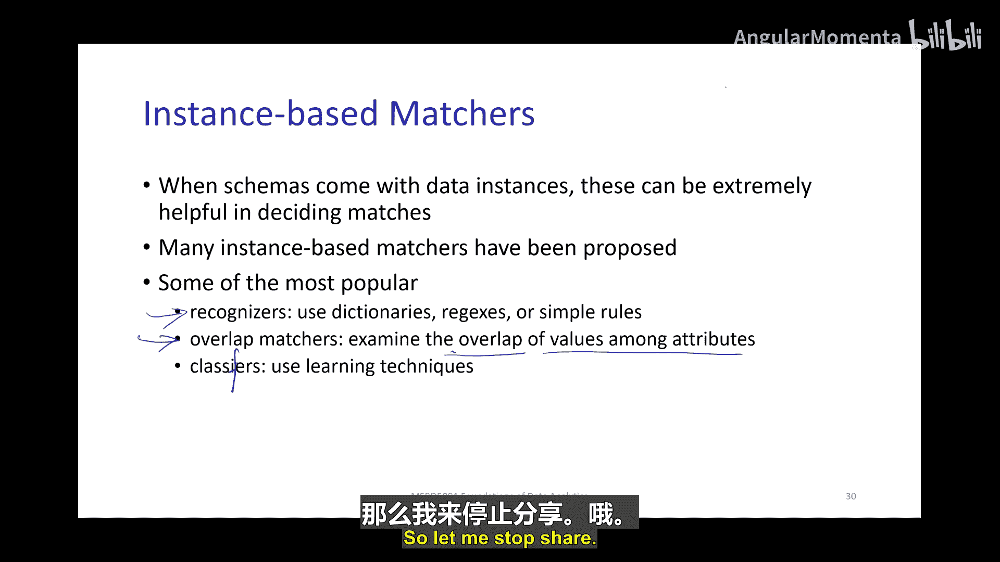
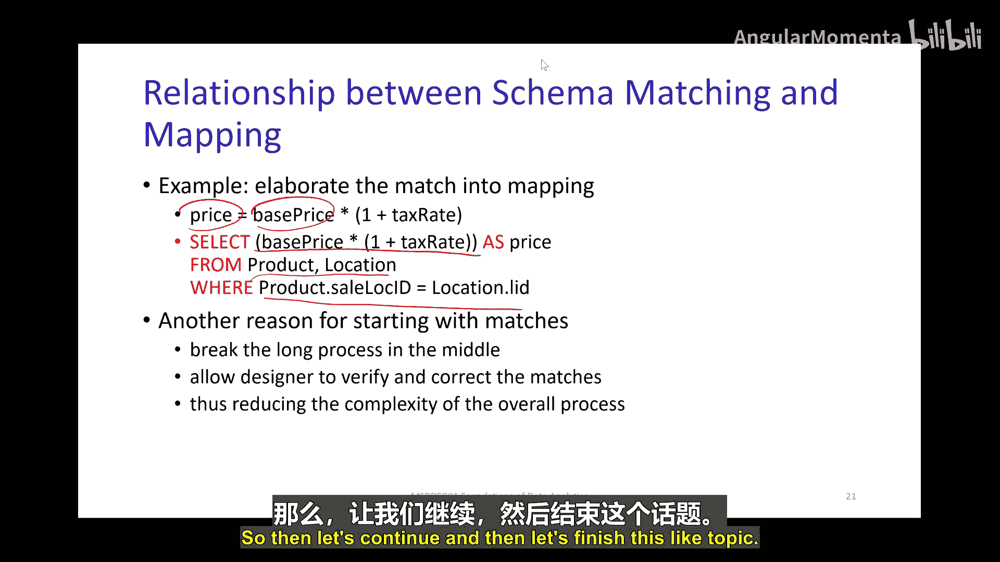

# 【香港科技大学】数据分析基础-｜-Foundations-of-Data-Analytics-p17-13-02-02-匹配系统--BV1oKFDznE6L_p17-

Right right， so then now after having mentioned like so many things about like the okay。

 so we keep on emphasizing the difficulties， the differences now let's try to like see how we can like work on the two systems。

 matching systems and also the mapping systems。😊，Okay。

 now let's just focusing on one to one matching first right so let's not like go into those complex situations let's just like make it a bit simple just one to one matching so we are trying to identify pairs of attributes that are going to be potentially like a candidates of matching so then。

😊，Okay， so what we need to do， what we need to consider for the system is that。Okay。

 we need to be able to like handle like a different differences， okay。

 and then like in order to maximize the matching。😊。

So what can we do is we can like a match in different ways， for example。

 we can be just looking at the attribute names and then we are trying to match。The attribute names。

 for example， we are like a looking between all pairs of attribute names。😊。

And then like I will be able very likely based on， for example， the matching of the names。

 the comparison of the names， the similarity between the names to identify that okay。

 so very likely release info is going to be related to release date， probably probably a match。😊。

And there is another pair that， who， it looks possible like release info with release company。

But then if we are just looking at。😊，Well， these two pairs okay， so can we be sure which one。

 which pair is better so probably we can't right so because well I think all of us。

 when we are looking at these two matching we'll be thinking can I look at the data right can I look at the attribute values well we definitely needs like more information in order to determine them right So that's why we say that we don't know which one is the one right so then that means we'll need some more information。

 some other like matching information in order to evaluate that so then probably we'll be looking at the attributes values Okay now if we are looking at the attribute values。

 it may turns out that okay， so release the info is probably a better match with the release date and year so you can see that well based on the data based on the attribute values So actually it's not matching with the release company。

Release company is actually identified by just matching the names。 Al right。

 so that means we cannot just rely on one single crew in order to identify the matching。

 We probably need to consider more。Okay now by combining both。

 then this is what we have here okay so then by combining both because both the situation by just matching the names or by just matching the data then release date are both appearing there okay both like the release date are the candidates for both situation then we may say that it's more likely that the release info is matching with the release date instead of the year or release company okay so that's what we wants the matching system to be able to do or what we can like have our matching system like be implemented being implemented to do。

Okay。😊，Alright， so then okay， now after we have identified pairs of like attributes。

 pairs of like a or even like a combinations of attributes， then we'll need to explore like a。

So sorry， so based on the previous like a slide here what we need to do is to consider like different types of information okay now here is another example it's just another example because previously we were talking about the movie example and then let's use another example here。

Okay so we have two databases， so two tables you can see like in one of the table we have the listed price and then we have the contact name contact phone offers and comments another one we have the sold ad contact agent extra info now just like before。

If we are just focusing on the attributes name so then by just a quick look at them。

 so then we may be thinking okay so contact name contact phone contact agent they all have the name they all have the word contact so that means these free attributes name are very。

 very like a probably like a related or probably similar so then we'll be saying that okay contact agent probably either matches with the contact name or the contact form okay。

And then if we are just looking at the data。😊，So meaning that we are just looking at。

The attributes values。😊，ButSo sorry， if we are just looking at the attributes values。

 so then we know that okay these the contact agent are probably phone numbers。

 so then the two attributes that have phone numbers or like a values that are similar to phone numbers would be the contact phone or offers matching with contact agent Okay so you can see it like the two side like the two matching ways are actually giving us two conclusions。

But then if we combine them both together。😊，If we combine them both together we'll see that there is one so sorry not this one there is one the contact phone number being like identified in both situations then we may conclude that contact agent is matching with that contact form right so you see that now most in many of the cases we cannot just consider one thing one aspect we need to consider multiple aspects and that is why if we are going to build a matching system。

It's going to be something like that well need many matches。

 so you can see that here we have match one match two and then probably end match Okay each of the match is going to take。

😊，The saw skimmers and the target skimmers and then giving a similarity matrix on the attributes pairs Okay。

 so that means well each measure is going to give us。😊，A matrix。 And then next。

 we'll need to combine the n matrixes together to have one merged matrix。😊。

And then based on the matrix plus some constraints。 So which is built by on top of expert knowledge。

 background knowledge， then we can kind of prune。Some of the possibilities。

 some of the like matching matches， and then which we have like a pruned matrix。

 and then once we have the pruned matrix， then we can start to elaborate matches Okay so we have matrix so then we can further like select the more toppable or like the best matches and then finally we can elaborate them to matches。

 So that is why for the whole hierarchy here will be having many matches。

 Okay which we'll look at that next， each of these matches maybe be either using the attribute names or using the data the attribute values or using some additional like data。

And then in like generating the similarity matrix， and then we have all these similarity matrix then we'll have a combiner in combining them together and then for like pruning for like adding constraints。

 then it will be the constraint and force based on the constraintss trying to see what are the the matches that are suitable appropriate based on those constraints fulfilling those constraints and then with the match selector so then we are selecting the most proable matches and then finally we'll be able to elaborate them into matches。

Alright， so then okay， now for matches。 So then。Meaning that these matches so for each individual matches。

 the problem is like having the two skimmer， the source and target skimmer while we may be incorporating some other information like what we said here data and instances。

 other textual descriptions， well anything that can be helpful and then what we are going to have as the output for the matches will be the similarity matrix that is representing like the similarity between every attribute pair。

😊，Okay， between the S， the source smma and the target smma。

 and then each of the value will be in the matrix will be a number between0 two to1。So then recall。😊。

Like previously when we are working on similarity measures where we are discussing similarity measures。

 we also mentioned that like a similarity measures or those distance measures will usually want to have a score between 0 to1 okay and then that means between every pair of attributes we are going to calculate the similarity score between them okay and that will represent the matching score for the a particular pair of like attributes and then we'll have all those scores in the similarity matrix okay。

😊，So now for matches， usually there are two kinds of matches。

 either just focusing on naming the attribute names。

Or a metric could be focusing on the attributes values。 So here we say that it's data matches。

 Now for name matches， it's going to employ string similarity measures because it's going to match on the attributes names right So that attribute names are usually strings。

 So that's why we are going to use string similarity measures in order to measure how to attributes names are like are similar。

 So some that we can use are like add distance， Drer similarities， sounds。

 do you still record those terms And then now we like before we can really match the strings will probably need to do some pre processinging because very often the attribute names are kind of like merge form or kind of short form So that means well have to split them。

For example， like the cell log ID so we'll need to split them as free words right so then it's well because it's using ca case again we can split them into words and then like cell location ID right so then that means that。

Attributing is actually can be like split into free words and then each of the word we may want to expand it because we know that there could be variations on those terms。

 for example， like look LC can be actually expand into location and then cost well probably referring to customers so that means well or other kinds of abbreviations。

 we may need to expand them first。And then now， well， because there are variations on terms。

 then we may want to expand the terms that we have with synonyms or hyponyms， for example。

 course is's a synonym to the price so then we can add them so that means we have a group of terms。

 So then when we are doing matching we are not considering just the original terms in the original attribute I attribute name。

 we are actually going to match against a group of terms。And then now， for example。

 like the product can be expandedended with the hyp namess like the bulk， DVD， CDs， etc。

And then of course sometimes there might be stop worse so then because stop worse might not be very helpful so then we can consider like removing them and then like other kind of processing may apply so usually those the lecture language processing steps can be applied for example stem etc so then all of these are kind of to preprocessed the names to make them like including the variations and then to make them more standardized so then it's going to be fine for us to compare to preprocessed set of attribute name instead of just looking at the raw names because even with these names like you will well we will be expecting that it's going to be very very different so then after standardizing or preprocessing them then we may be able to like redefine the similarity between them through not only the worse original the war but also with other like added。

ます。Now let's take a look at an example here， the same example with the DVD ave vendornor and the aggregator now say that we are employing a name based measure so we can be using like those kind of set based similarity measures or even the hybrid similarity measure now we may be using like the ja similarity the TF IDF or even the soft TF IDF right we call that soft TF IDF is one that is considering TF IDF and then when we are meing against the tokens we are looking at another secondary like a similarity score which is probably like a sequence based similarity measure。

😊，Now assuming that there is a similarity measure picked and then by comparing all pairs for example。

 like name against name against ID name against title name against year and then so on and then like others and then release info and then release date for example like matching all pairs of attributes then we have come up with this so we are like for this example here we are just retaining those non zero similarity score so for the other ones that the scores are too low we just ignore them like for discussion okay so that means what remaining as the like a higher similarity pairs will be like name with name。

😊，Name in the aggregator against the name in the locations， for example。

 And then the name with title。 So title in the movies。 So you can see if we just use the name， then。

 of course， name and name they are perfect， except match， right。

 So that's why the similarity score is one。 If we look at name and title probably because of the synonyms。

 well be able to match that like a title is one of the synony of names。 And that is why well。

 normalizing the score and then normalizing the number of matches。 Then we will be having like。

 for example，0。2。And then others like release info release date。

 probably because right we have standardized them。 Now。

 this is probably split into release and company。 So that means it's becoming like。Two tokens。

 so then this is split into like for example， release dates。Okay so then if we compare it with。

 for example， release info。So then we know that if we are using jara similarity。

 those sub similarities， so then it's very likely that they are just half match right so then that's why the scores are zero upon。

😊，Okay， and then base files as well， so probably because of like how we expand the word and then also split the words so then assuming that the similarity is 0。

8 Okay， so then that's probably what the similarity score that we can have for the name base matches now as we have mentioned like in our previous like。

Slide here we say that it's going to generate similarity matrix。

 but then if we are going to show it here it's going to be a very large matrix with just a few values right non zero values so that is why we just pick the non zero values and present it here okay。

😊，Now how about instead of using the names， attribute names， we are using the instances。

 it attributes values， so then what will be the like resulted similarities。

 so then let's take a look at that。😊，Okay。😊，Now。There may be different ways for us to do the to make use of those attributes values。

 so what we are referring as the instances to like a match the attributes now one possibility is to make use of recognizes what do we mean by recognizes now say that we can be like a using dictionaries。

for example， like a dictionaries or rules to recognize like the data values of a certain attributes to be whether like what kind of attributes it is now say for example like we can build a dictionary of country names and then like we can compare the a particular attributes with all its values against that dictionary。

And then if like most of the attributes values are country names match with the dictionary。

 then well， it's very likely that that attributes is country names， okay， so then。

It will match with another attributes which are also matching with country names right so then those two will be a match so we can like make use of like a dictionaries like this Now besides country names other things that we can build dictionary could be like people's names right and then for example。

 colors now there is usually like a list of color names so then we can build it and then use it for matching other kind of things like ratings like phone numbers or fax numbers social security numbers。

 then we can use rules we can write rules in saying that if the attributes value most of the attribute values for example。

 if we are talking about Hong Kong then if like that attributes are usually consists of digit numbers。

 then it's very likely to be phone numbers for example， so then we can also have those kind of rules。

In recognizing what kind of attributes are there is it and then if we have another attributes matching with like the dictionaries as well。

 and then the same kind of dictionary， then they could be like matches。

They could be matches right so other kind of things like genes。

 proteins sickcos right usually we already have like a lot of information we already have a lot of like a instances ready。

😊，Alright， so then another the second approach will be like what we call overlap matches。

 so that means we are trying to look at like the values among attributes and then well what is the like an overlap okay like if the overlap is huge then it's very likely those two attributes are actually like related or actually like can be matched。

Okay so the way to do it is like say we have like for example， like some different attributes。

 for example， we are looking at the DVD vendor and the aggregator again and then now say that we are looking at the。

The names， right， And then also looking at the DVD vendors titles， right， and then。K。

Now if we are looking at the names and im with the VBD vendors titles。

 we may find that there are certain overlap of names right so then it's probably relatively higher than looking at the name attributes and the locations。

Because like the location names， well， probably there is no overlap lab。

While no like a movie names will be the same。Probably very well will be the same as the location names so that means the overlap is going to be small for between the name attributes and the location attributes while the overlap score probably is going to be higher between the names and titles so then measuring the overlap values could be helping us to see whether the two attributes are match and then while besides overlap we can also like measuring the similarity between attributes and then okay well be able to have an agregator score over all the attributes attributes values similarity okay so in this example here well if we are like measuring the similarity and then the like we're actually using the jackar measure。

切。Allright so then if we are using like those kind of like data right in order to like match between the attributes。

 then probably we'll have a different similarity matrix now recall that when we were using the name based match name against name is actually with the highest matching score。

And their name against title is actually with a lower matching score。

 but then if we are looking at the attribute values matching。😊，We may have the opposite conclusion。

So name matching against names of the locations is less。

Like a similar then matching the names with the DVD titles Okay so you see that here with the looking at the attributes values so then we may have the conclusion that name against title is actually more similar than name against name okay so similarly with other things right so for example previously the release info the release info is equally match with release date and release company but then if we are looking at attributes value so then release info is more likely to be matching with release date instead of released company。

Okay so then similarly for the other attributes as well。

 so then now the third like we have been talking about the like the recognizes the like overlap of values and the third one could be well we know machine learning right so we can be using learning techniques building classifiers okay spelling here classifiers。

😊，Okay， so we can building we can be building classifiers to like classify whether the two attributes are match right so then okay。

😊，Let's describe like herdie。Pcepts of how we can do the。K matching using the classifiers。

So sorry again， just a moment。对。So let me stop share again。

 so I actually need to share again in order for the slides to be working properly so sorry about it so let me stop share。

Sorry about that Okay， so then we were talking about the。

Yes。The classifier， so let's use the classifier to like a lets like use the classifier。

 let's build the classifier as one of the matches or like a matches。Okay。Yeah。

So like how can we like learn classifiers or make use of classifiers in identifying dimensions is that while we can build classifiers with one skimmer。

And then we use the classifiers to classify the elements of the other skimmer。

So then what we can be using any of thoseifying classification algorithms like nabaase。

 decisionion tree， rules， likea， and then SVM， etca。

So then the like a way to do it is like first for each elements of。😊，One of the skimmer， okay。

 so then okay， we want to train a classifier。To recognize like her instances， Okay of the。Attributes。

 okay， and then we'll be using the like instances， the attributes value of that particular attributes。

 say， for example， we are using the name attributes of， for example。

 like the name attributes of the DVD vendor。We still recall。

 so that's actually the location I name right， so it's like the location name。

So then we use the name attributes of the DVD vendor skimmer and then we use the like attributes values as the positive examples for our。

Classifier on this attributes。 And then for the other attributes。 Okay。

 we also take their attributes values， but then we use them as negative examples。 So meaning that。

For the DVD and the vendor example。So what we have is the。

We have the other attributes right so like for example name tax raise and so on then we use like name is the attributes we use for the positive examples。

 while the other ones like RID tax rates and other things then we use those attributes value as the negative examples。

So then with positive example and negative example。

 we'll be able to build the model right to train the classifier and then okay， we use the classifier。

To find the similarity score between like the instance S I and then of the。

Between the attribute SI and also every attributes。In the skimmer T。

 So that means we are using the name the classifier builds for classifying the name attributes of the DVD vendor。

To see which attributes in the saw in the target schema that is the aggregator is going to be matching with this name attributes Okay。

 so then。To do that， we apply the classifier to every instance。

Of the attributes of the target schema okay and then that means like for each instance we'll have a number between 0 to one right because for this is what we train the classifier to do so then okay so that is the confidence the confidence value of that instance is an instance can be classified as the in instance of the attributes name of DVD。

So then that means if we have， for example， n instances in the target skimmer。

 then well have n score。and between zero to one scores and then we'll need to aggregate them okay and then we like for example。

 it's simply just to average the scores over all the instances。

 then we have the score of the like an attributes in the target skimmer。

For a particular source skimma， a particular attributes for the source skimma。

So then we do that for a free attributes in the source skimmer。

 so then well have all pairs of attributes average score， so then that's the similarity matrix。😊。

With using classifiers。So then we can use the classifier like then to give the similarity score。

 the similarity matrix， and then it can be combined with other matches scores and to do the next step。

So then let's look at an example here so say for example。

 like SI is the address and NTJ is the location， so that means we are looking at address and also the location。

😊，So then supposingly we are like a building the classifier using this so using the addresses okay and then using the other like attributes values as the negative examples so we train a classifier which say that we call it C okay so then we apply C on like for example T1 and then so on and then on TJ and then so on and then for TJ we use each of the instances and then we use the C to classify each of the instance so say for example。

We have 0。9。And then 0。7 and then 0。5。 Then we just take average。 So then the average is 0。7。 Then 0。

7 is the similarity score between。SI。Okay。😊，And then TJ。Okay。

 so then the similarity score between S and TJ is the average score of the three instances。

Right okay so then that's an example of using the classifiers so you can see that here now we have like the in the previous example。

 we are building the classifier for a particular attributes in a saw smmer and then use it to classify the attributes on the target skimmer but then we can do it in the opposite direction Okay so we can also build classifier on target skimmers and then like apply it on the saw skimmers or we do it both ways Okay so then like we build classifiers on S and then classify T and then we do the opposite。

😊，And then classify instances and then merge the results together that is also possible Okay so then we have mentioned the three like a different categories of algorithms for building the mattress then the next step is now we have all the different similarity matrixes。

😊，Produced by S the output of different matches。 So then the next question， combine， right。

 so we need to combine them。So that's the job of the combiner so the combiner is simply merging the similarity matrixes right and then to create one single matrix it can be done by taking averages minimum maximum of the scores right so then okay。

 for example， if we take average then it's just that taking each measure Okay so we are having different matches。

😊，So then K say that we have K matches。So then we just take each matches score for a pair of attributes。

 S I and TJ and then just sum them and then take average right。

 So then that will be the score for S I and SJ in the output matrix。Now we can use average。

 we can do maximum， we can do minimum so then like all of these are some simple like a way to combine them you can also apply more complex ways now say that we are just focusing on these three simple ways to combine them so when to use which then average is that well。

All the matters to us。Are just equal right so we don't have any preference on any matches then just average them right so that means we are not trusting anyone over the other or if we are picking the maximum value among all the like matching scores all the matches scores MIIJ。

Then we are actually trying to find a strong signal。

If there is at least one match which is giving a very。

 very high like similarity score or relative higher similarity score， we'll use that。

 we'll trust that so then that's what we are trying to do with the maximum combine so then how about minimum then just the opposite right so then we are not looking for a strong signal we are looking at like the lowest signal should be at least large enough in order to say that oh it should be combined in that way。

Now again using a previous example so assuming that we have two matches so m1 and m2 so to two matches so then we have the similarity scores so assuming that we have the similarities matrix as we have said the similarities matrix is going to be too large so that's why we just keep the non zero scores here so then okay we just have like name and name and then that we just average it so then that's one plus。

😊，2 one plus0。2 divided by2。 so that's why it's 0。6。 We do that for all pairs。 Okay。

 so then that's what we have。 Now another example could be like a， for example， like the rating。

So we don't have rating and classification matching on the name base metric， but we have it here。

 but we still do the average just as the thing， so then it's 0。6。Because 0 plus 0。6 divided by 2。

 Okay， because in M1， it's 0 in M2， it's 0。6。 So the average of it is 0。3。

 So then this is the combined matrix。 right， So then that's the matching。

Okay now in here we are just say talking about average combiner maximum combiner minimum combiner。

 we mentioned that while it can be more complex， for example。

 we can use like a rules so like for example if we again have domain knowledge we can use rules to do that so let's say that we have a set of hand encrypted crafted scripts so say if S is an address so then instead of taking average right so then。

We return the score of the database match so it could be like that right so if we are talking about addresses well we do not trust the name。

 we trust the data more so then we just return the results of the database match instead of taking the averages but if there are if the attribute is other kinds of attributes then we just average the score of all matches as usual or it could be a weight for sum okay and then now to like a well that means we'll be giving different weights to different matches according to how important we think they are now because we have weights now you know that for machine learning approaches they can be used for learning the weights right so then again we can learn the weights from the training data。

And then now the compiler itself again can be a learner right so it can learn how to combine the scores as well。

 so that means while we can be using like decision three algorithm in order to like learn how the matches should be combined。

😊，No。With the hierarchy， so after we have the matches。😊。

So after we have the matches and then after we have done the combiners。

 the next one is the constraint enforcer， so then let's briefly talk about what is constraint enforcer and then constrain enforcer is that now say that we have some domain knowledge Okay so say that we have domain knowledge so then we can build some like a domain integrity constraint to help reduce the matching combinations。

Now you can see that here in the previous like a output here。😊。

It's still a lot of possibilities we can have name matching to name name matching to title release info matching to release date so there are still a lot of different combinations so that's why we may want to reduce the combinations for example let's say that based on the previous example here we have the average combiner and then we have these m1 to m4 combinations right so then okay。

We can like try to first calculate the aggregategregator score of each combination it could be done by just like multiplying the score so say that we have name name then according this it's 0。

6 right and then we have release info against release date which is again 0。

6 so then we multiply them together and then classification against rating 0。3。

And then the price with the base price，0。5。So then we multiply them together and that's the aggregated scope for each。

Combination okay， but then still we have four combinations。

 We wants to reduce the combinations right， so then what we can do is probably we can apply some like constraint。

 for example， one possible constraint will be like this。 So if an attribute a matches name。

 then assuming that。😊，Okay we know that so for like movie names they are usually having more than four wordss while for location names。

 we know that they are more likely to be less than four words then we can add a constraint like this so that means we are trying to look at how many attributes values are actually having more than four words so then if it's satisfying this constraint。

 then that match should be that combination should be a preferred match Okay so after we have the aggregator score we'll be seeing that like the M1 and M2 they are having the higher scores while the other two they have much lower scores so let's look between M1 and M2 now we cannot decide because their scores are still close so then we can have this constraint。

 if we are combining with this constraint。Then it may happen that M1 is not satisfying the constraint because the name here we are talking about location name。

I locationing because it's location name it's less likely that the constraint will be fulfilled so then like a while m2 is going to fulfill that constraint so that's why m2 is selected so this is how we can have like constraints in like pruning the combinations so then originally we have like four combinations and then two out of them are relatively higher and then now we are only having one left Okay so that's why constraint and for is going to help。

So then after the constraint and for， so then the next step is。😊，K。😊，Match selecta。Okay。

 so we have reduced the combinations， so still we may need to select the matches to decide whether they are good matches。

Yeah。Now a match selector can be very simple。 It can be just using like thresholdholding。

 for example now it's just retain the combinations that have like within the combinations like the M1 the M2 that we have selected name against title release info against release say and so on and then we have each of them the similarity score right the average similarity score and then we just like for example。

 retain those larger than a threshold so which means this one here which is lower than the threshold will be like ignored so then the remaining matches will be just name against title release info again release date and then price with the base price so then these are the potential matches okay so then after that then we can elaborate the matches okay for example like price again base price how are we going to。

OkayErate into a transformation from price to base price or from base price to price。

 and then we have the combinations， we have the like a schema mapping schema matching so then we can further elaborate them into schema mapping。

So how are we going to obtain the schema mapping so then it will be very likely that well need to do some advanced or complex searching because if you think about what is somatic mapping so what kind of schema mapping we wants to like have will be。

The example， this one。So we want this mapping。But right now。

 what we have is just identifying that okay， price and base rise， they are a match。

 okay so then we are still long way to having this mapping。😊，So then， you know。

 in order to have this mapping。 So that means there are still a lot of possibilities。 For example。

 even if we have this transformation， we still have to decide， Okay。

 where do we get those things from where and then how are we going to get them。 Okay。

 so then there are still additional things that we need to explore and search。 Okay。

 so that is why like right now we are just like a focusing on the schema matching， which is the。

Easest subtask and then start from it。So then for the like a remaining time。

So like right now it's 952 so I guess let's continue is it okay。

 so then let's continue and then let's finish this like a topic and then hopefully we can finish it earlier on right？

😊。

