# 【香港科技大学】数据分析基础-｜-Foundations-of-Data-Analytics-p18-13-03-02-大数据模式对齐--BV1oKFDznE6L_p18-

So then let's move on to talking about like we had look at like how we can do schema alignment with the help of some like subgo like the schema matching and then like we have the schema mapping and so on So then let's look at now we are handling back data So then what。

😊，More challenges Mac data is bringing to schema alignment。

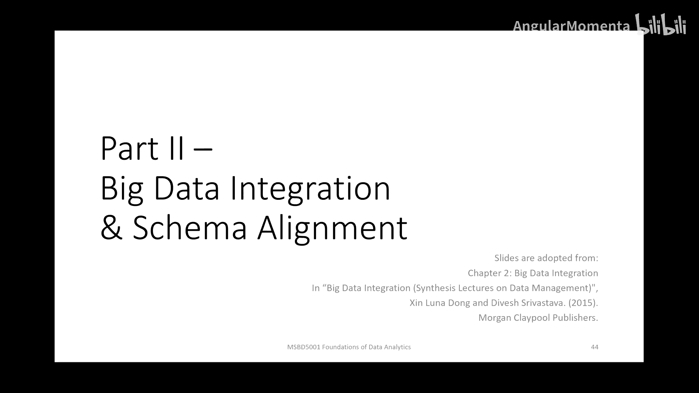

So again， thes right so like if we are talking about schema alignment so then like volume issues so which means that we probably need to handle a large number of data sources and then each data sources could be having a large volume of data a large volume of instances。

 tops so then merging like not merging doing schema alignment on small number of sources。

 even just a pair of data sources it is already hot enough so how are we going to handle a large number of data sources and then velocity so we know that nowadays like skimma can be changing smmas can be dynamic like they can be changed according to like the needs and then according to the situation and then the data sources can keep on increasing because there could be new sources。

 new data。😊，Coming up。 So that means we might be looking at the velocity issues。

 changing data sources， increasing number of data sources。 How about variety。

 So this is what we have been emphasizing right， So there are a lot of diversity and heterogeneity in data sources Smmers。

 And then again， skimmers can be changing as well。So then now。

Skimma alignment is already like something that we don't really have like a complete system right so then now with these challenges again like we are going to look at some approaches。

 some ideas， some like suggestions that have been like investigated by different researchers。

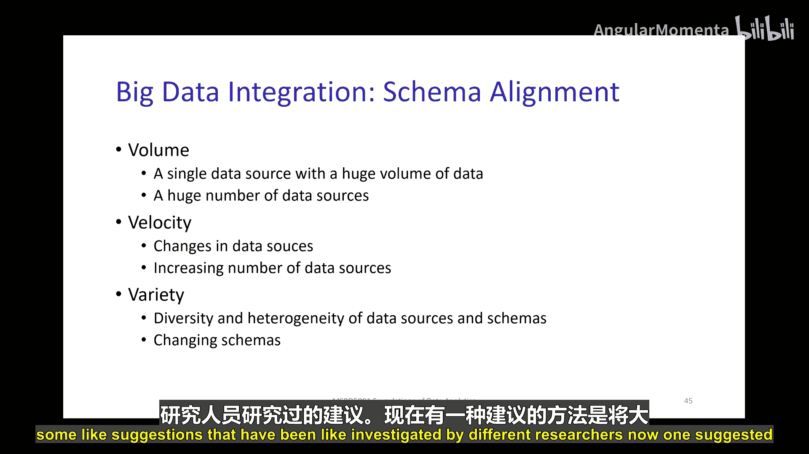

Now one。Suggested approach is to handle the data integration or S alignment with big data as a data space approach。

So which means like？😊，Because the traditional data integration is not going to be feasible for big data the traditional like a data integration means that we are kind of having everything integrated into like for example a mediator skimmer and then like if we are talking about data warehouse then we are even having the data from different data sources integrated into one physical place so then if we are talking about large volume of data then that's not going to be possible and then if we are going to be talking about a large number of data sources a large number of skimmers then again coming up with mediator skimmer is also going to be very hard challenging so that is why spend the integration approaches is not feasible。

So then， well， what we can think of is probably like start with simple。

Useful services and then we kind of iteratively adding more okay and then making it more complex so then we say that this is a pay as you go approach。

So then like it has like a， I think like a the payS you go approach has worked for like a different platforms。

So then the like data space approach or the pay as yougo approach is like having is considering the problem in two components。

 one is bootstrapping the system with user surfaces， for example。

 like what we have suggested in the previous section。We start with automatic skichema matching。Okay。

 so that means we are trying to identify pairs of attributes as matches。

 so this is what we can do right we start with something simple。And then okay， after that。

 we like kind of allow the users to improve thesemantic through like for example。

 the users can validate the schema mapping or validate the schema matching。

 and then which we improve the matching and mapping iteratively。

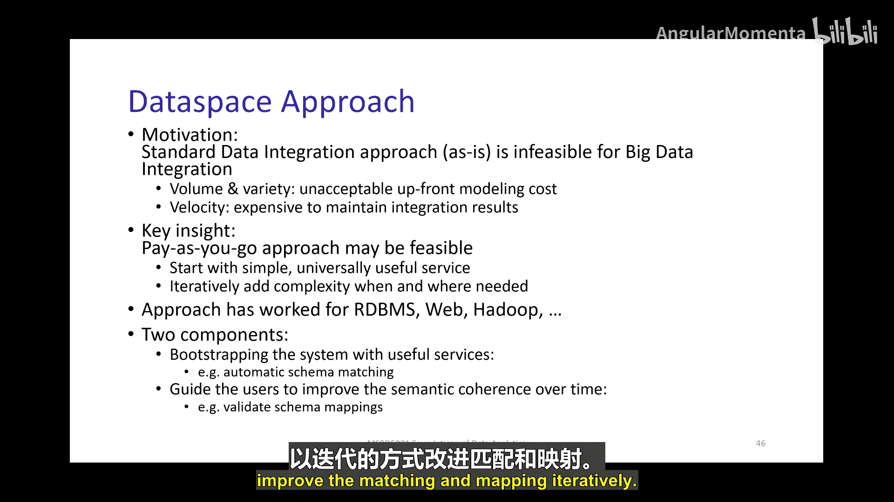

So then for bootsrapping， okay， so then。

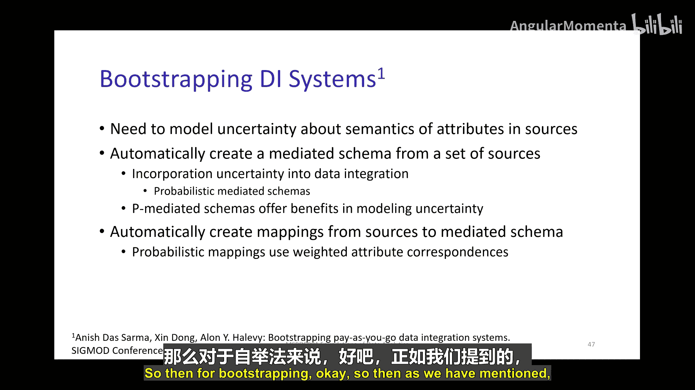

As we have mentioned， we need to like start with something small and then like we mentioned that it's not feasible。

 the standard approach is not feasible because we cannot build like it's not easy to create even the mediator skimma。

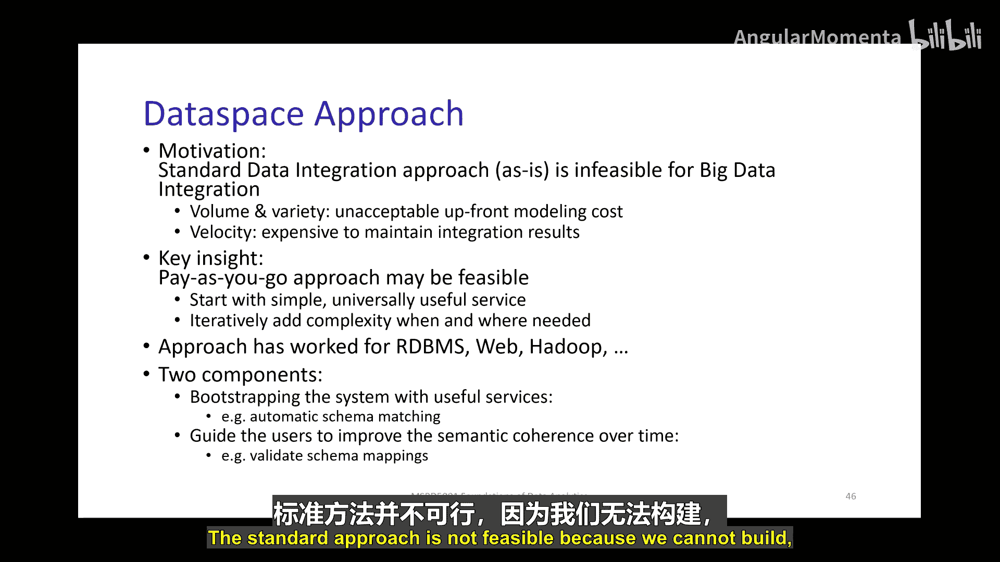

So then like even with creating the mediator skimmers， there could be a lot of possibilities。

 so that's why we may want to incorporate uncertainty。😊，Okay。

 we may want to incorporate uncertainty into， for example。

 the mediator skimmer and then to do the skimma mapping skima matching as well。

 So that's why like we may need to like use popbabilistic mediator skimmers so previously the mediator skimmers we don't have probabilities right but then now with the bootstrapping system then we may need the popbaistic mediator skimmers And then the benefits of it of course is to model uncertainty because in。

This setting is not going to be certain we are not going to be certain on everything。

 so it's more likely that we are going to be uncertain for most of the thing。So then， okay。😊。

Once we have the probabilistic mediator skimmers， then we'll try to create mappings from sources to mediator skimmers and then。

We'll be like looking at the attributes mapping。

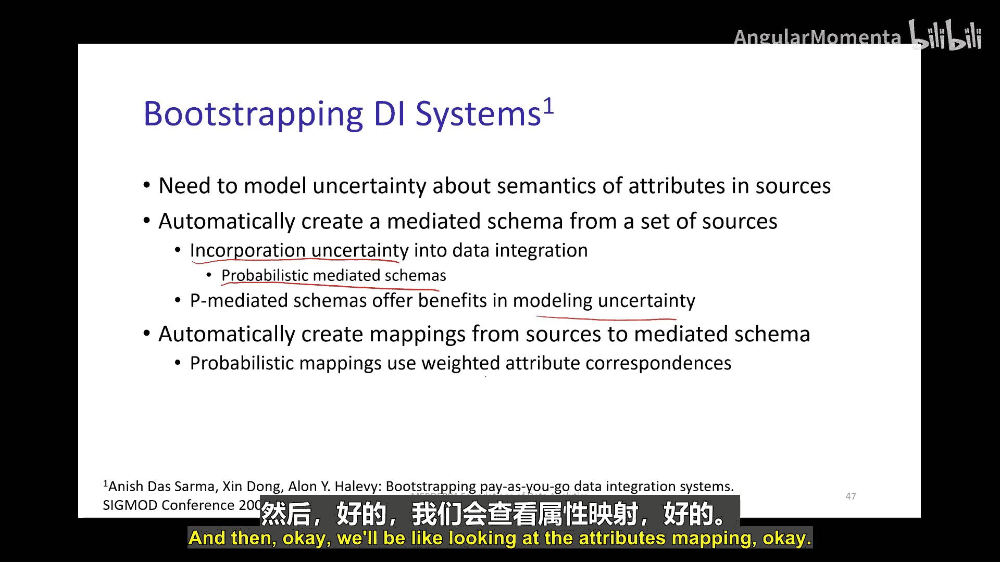

So then let's take a look at an example now say that we have these two sources S1 and S4 and then let's say that we assume one of it is the source like a skimmer and the other one is the target skimmer so sorry no so what I'm talking about is sorry about that so we are talking about having two sources S1 and S4 and then we want to create the mediator skimmer automatically okay so that means what we want to do first is well instead of like having a specific attributes matching with the source one and soft4 okay we are trying to cluster the source attributes it could be done based on for example similarity。

Okay， similarity all based on like a co occurrence。😊。

So those like a kind of approaches or measure that we usually like measure do the clustering so then we cluster the approach source the attributes and then what we are creating could be something like this so then we may be like saying that okay name attribute is on its own as a cluster and then for the H form from S1 is a cluster with the P form from S4 and then like O phone is on its own a cluster and then H address is again a cluster with the O address the P address from S4 so you can see we have different clusters the cluster could be based on the similarity between the attribute names the similarity between attribute values or like the cocurrence of attributes and then the overlap or those kind of algorithms。

So then say that we have M1 to M4， these four different clusterings so then。Okay。

 so say that we just identify the most possible mediator skimmers， so for example。

 like the first two M1 and M2 they are having the like highest probabilities so that means we just pick the ones that are like most probable and then it will be creating the possible mediator skimmer okay so then。

Yes。Then， okay， we use the P mediator skimmer。And then we try to like match against the source schema。

So for example， we have the saw skimmer this one and then we have the mediator skimmer like we are focusing on the M1 mediator skimmers and then while we are mapping between the skimmers okay the P mediator skimmer and the saw skimmer and then this is the。

😊，P mapping。 So then again， the mapping。I's with the probability okay because the mediator skimmer is already having a probability okay。

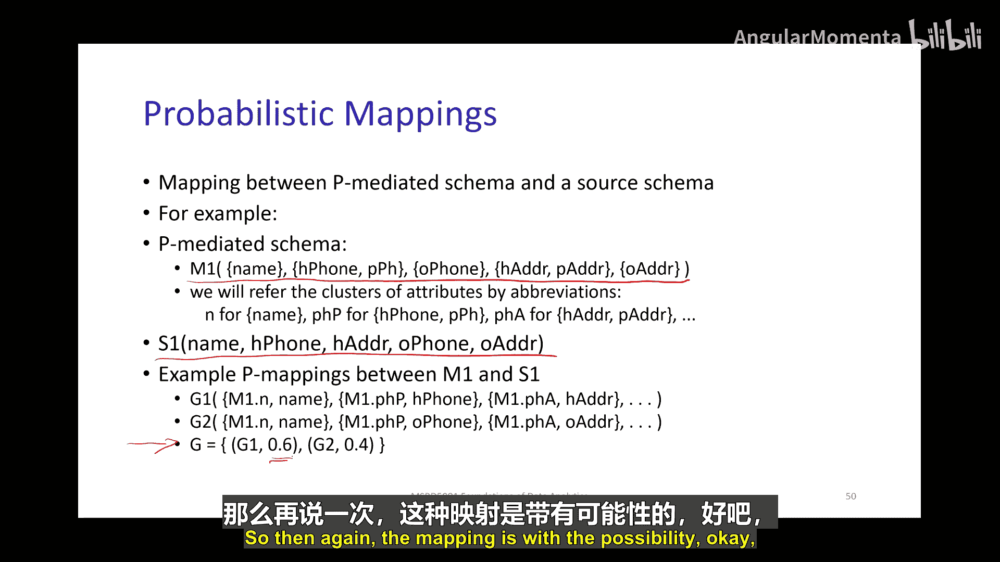

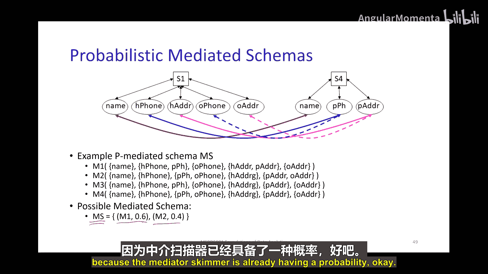

So then the P mapping is again having a probability， so then next we try to apply the mapping。

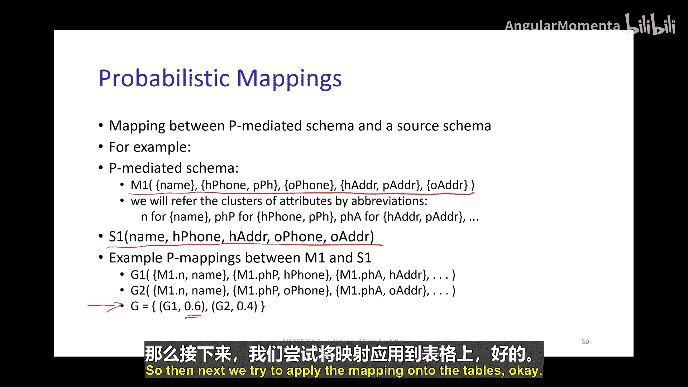

Onto the。Tables， okay？So then this is like a。😊，Answering the queries right so because we have built the mediator skimmers and also the mapping between the mediator skimmers and the saw skimmer so then that's what we are trying to do in the skimma alignment part right so then with the mediator skimmer and the mapping then we should be able to do like query answering so then how do we do queryansing so then there are two ways to do it either it is the by topple semantics that means we for example apply the like a mapping。

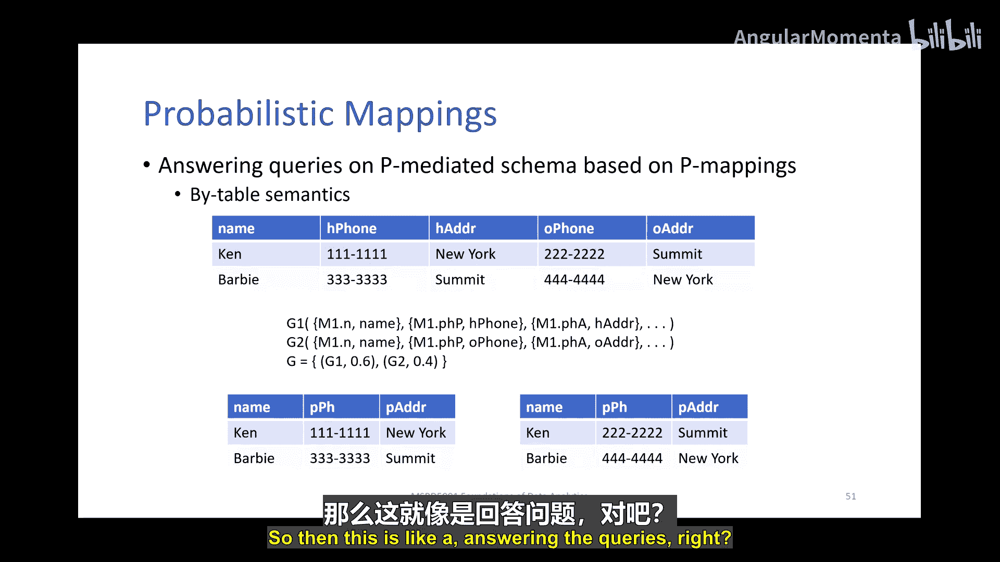

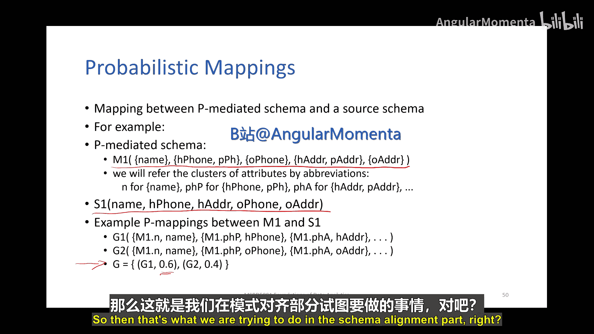

On the whole table。 So， for example， say that we apply G1。Okay， we apply GA。And then， G1。

By applying the G1 mapping onto this table。Okay， so that means we are having the。ok。M1 name。

 So M1 name is actually the mediator skimmer。 Okay， and then the name is the。

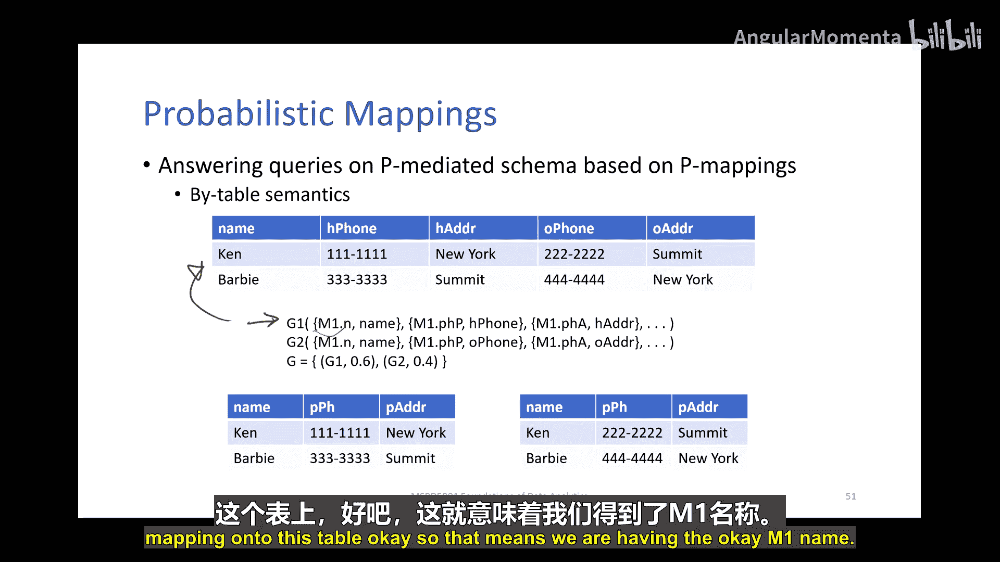

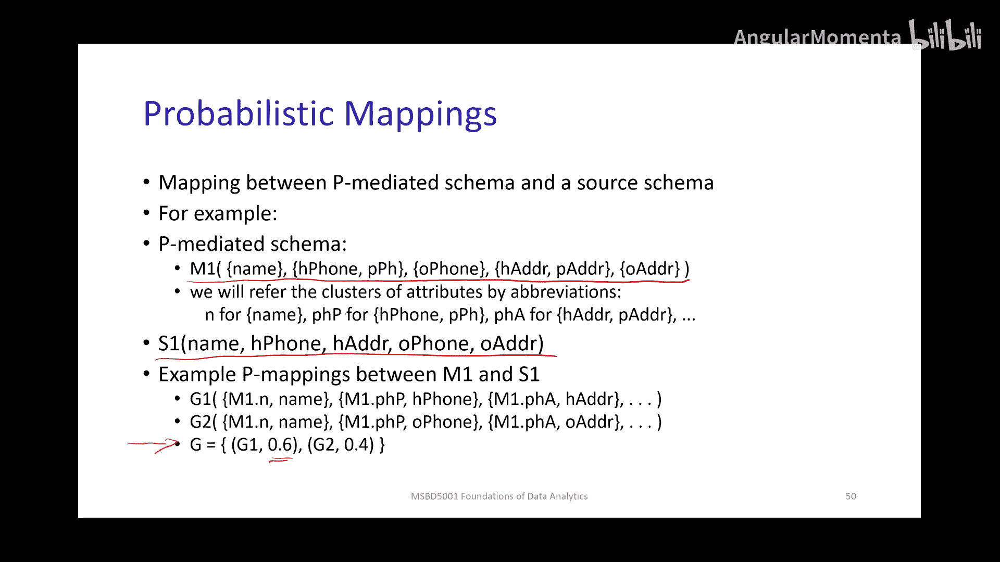

Okay， the saw skima。 So then it will be like the。So sorry， I should be writing M1 dot N。Anyway。

 so it's just and。So you can treat it as the N， which is the M1 dot n。

So then by having the M1 dot M mapping with the name and then M1 dot PhP mapping with H form。

 so then we have this。Table， right， So then that means like we are having the name from the。

Saw skimmer as the name。Of the S the N of the mediator skimmer。

 And then we are having the edge phone。Okay， as the pH of the mediator skimmer。

 so then this is the like answers that we have okay and then next we do it similarly with the second mapping。

So then we have this one。Applying on this。 and then which give us this table。

 So you can see that we are having different results here。 So then because the mapping of。He2 is 0。4。

 So then this mapping here is with the probability of 0。4。 while for the G1 mapping。

The probability is 0。6， so then for the answers to be the left hand side one again。

 the probability is 0。6。So then this is applying a mapping on the whole table。

But then while it doesn't necessarily have to be like that because we have two mappings。

 we can actually apply the mappings to the tables to the different tuples separately。

 so then we call that by tupo sematics。 So then in this example here we are having G1。

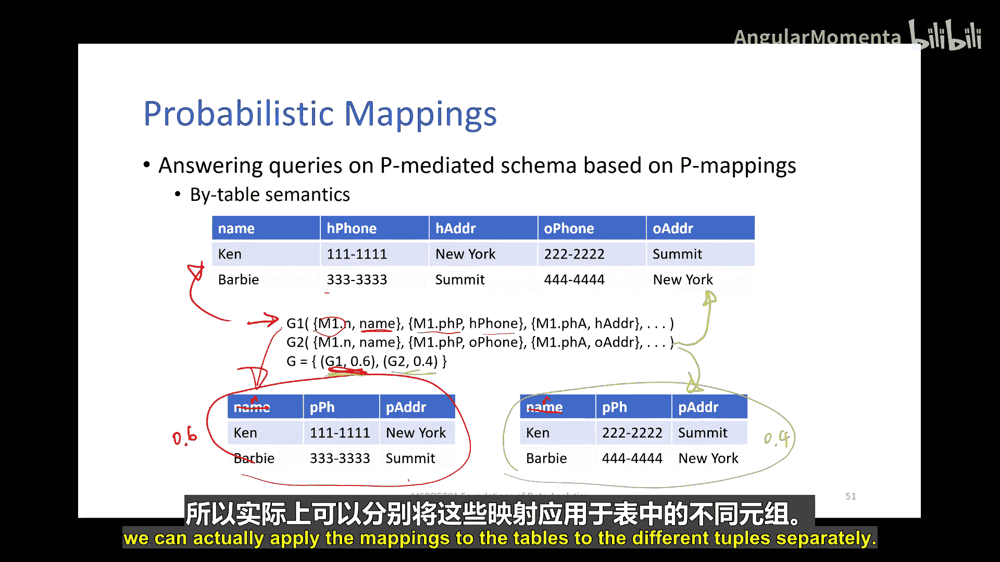

Applies to Ken and then G2 applies to the second couple and then we have。This one。

 so this is applied by the G1 and G1 mapping。 and then now。Another one is we can apply G2。

 and so sorry， this one。G1 and。G1 on both two tables and then another possibility is that we are applying the G2。

On the two topples， so that's smart here。Or we can like separately apply different mapping for different couples。

 for example， like。Can we use the G1 mapping while for Barbie。

 we are using the G2 mapping and this one this is the opposite。Okay。

 so you can see now we have four different possibilities right and then each tables possible probability is like for example。

 like G1 is0。6。So then it's 0。6 times 0。6 because G1 is 0。6。And then， for example， like the。

This table here then for the G1 mapping it's 0。6 well for the G2 mapping it's 0。

4 so then this possibility is going to be 0。6 times 0。

4 and then similarly for the other two tables as well so then for each possibility we have like a probability score right and then we can like summarize the possibilities together and then for each value we will be able to have a probability score。

Of whether it's the answer to our query so then that's how we can do query answering with the probabilistic mediator skimmer and the probability mediated mapping the probability mapping。

So then this is the idea of like incorporating uncertainties in the schema alignment and then having the mediator skimmers and then also like with the mapping。

 so then we do the question answering with uncertainties as well。

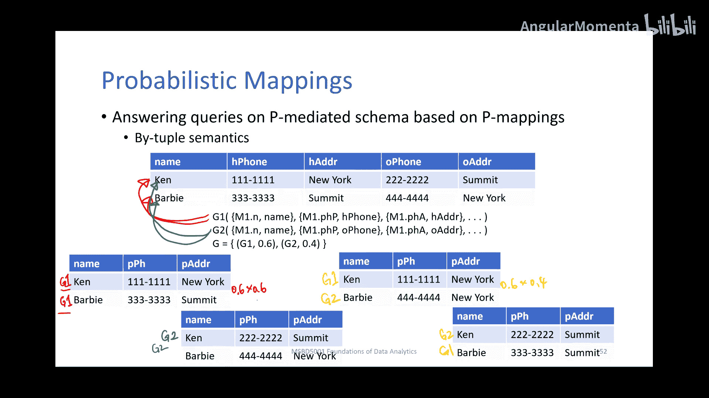

Now， then like。So this is just like some steps or some suggested approaches for the database space approach now there are more to discuss but then probably we won't do it like now and then we'll look at the big data like a schema alignment in another like aspects which is like the diversity of data sources now right now with the traditional like a schema alignment we are looking at relational databases we are looking at relational smmers but then as we have mentioned in data integration we will be looking at different data sources it could be unstructured data sources like web tables。

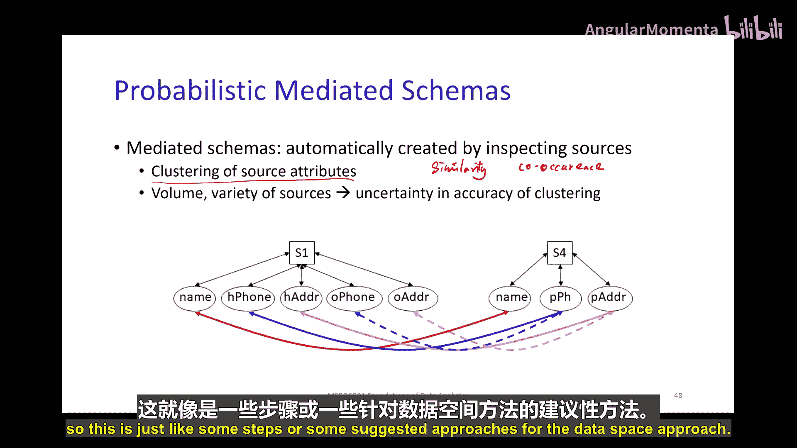

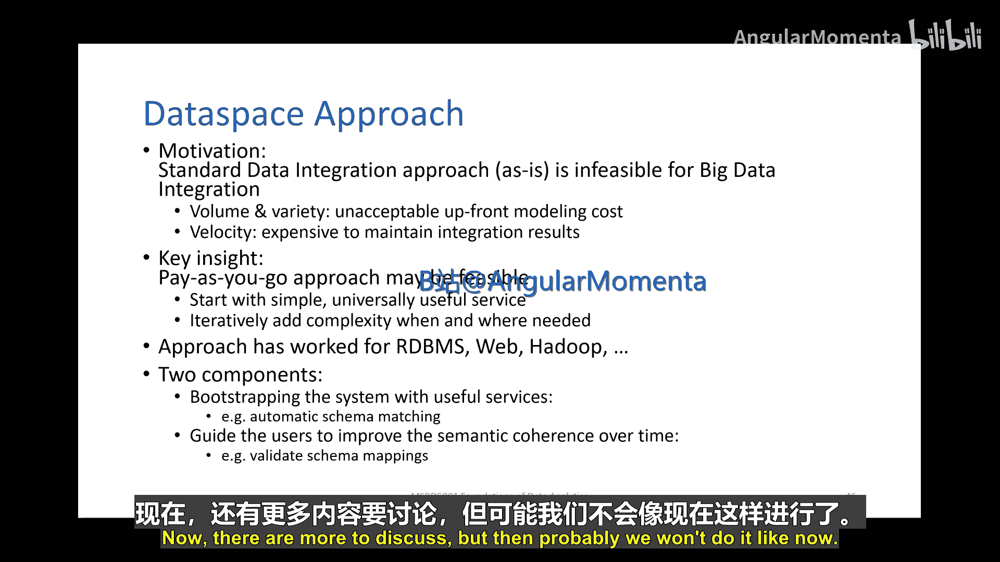

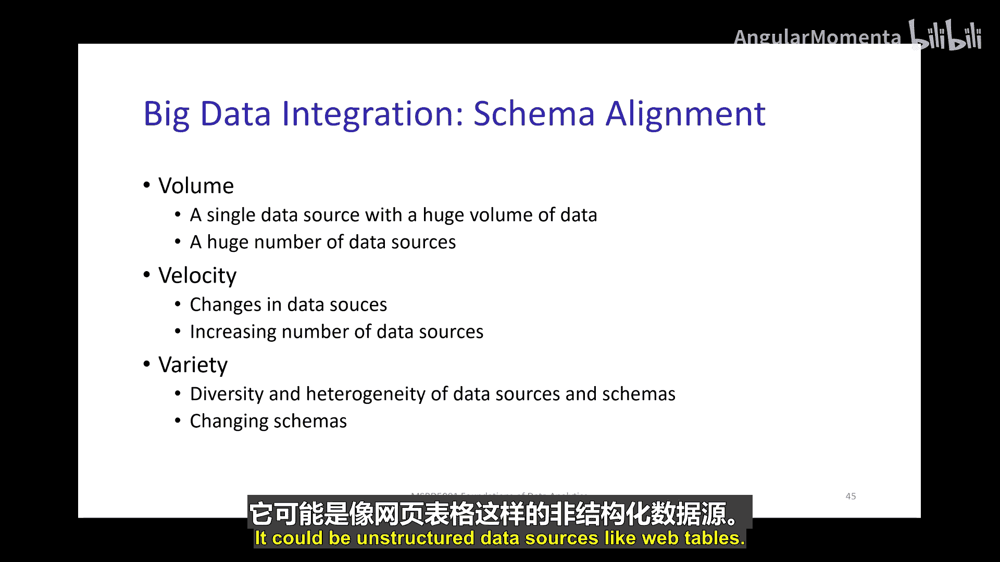

So then like。So we may need to think about we may need to encounter a situation that we will need to integrate web tables so then think about what web tables are they are like usually small in size but then they don't have clear skimmers and then usually there is no descriptions about what are the attributes so we just have a table with attribute names and also attributes values and then they could be in different format so then how are we going into like integrate those tables together。

So then like again， there are studies， there are researchers about like the possibility of integrating web tables and then how should we like think about it？

So for example， like a group of researchers has studied the。😊。

How likely that we are going to identify like similar skimmers for different tables？

So then they have studied like a large amount of tables and then look at the。

Correlations and also co occurrenceres of the attributes in tables。

 And then they find that a relative like。Small number of skimmers are appearing very。

 very frequently， so you can see that here， so a very small number of like a a very small like a small number of skimmers which are very。

 very common in like most of the tables， while some of the large number of skimmers appears like a less frequently like in the tables so which means that。

There is a potential for us to integrate。To align smmers across different tables because the same skimmer could be appearing in a lot of tables。

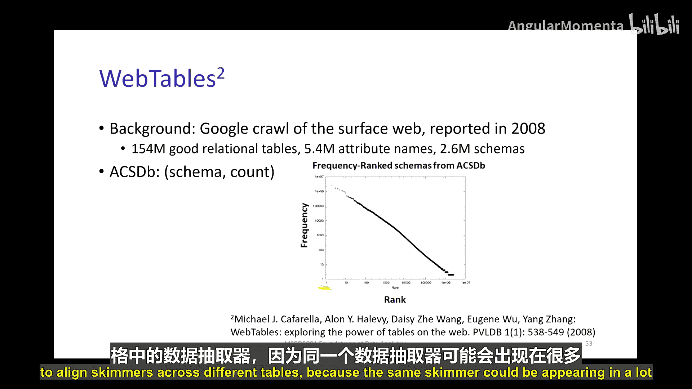

So then now how do we find the tables to integrate right so then that means we'll need to find relevant tables So then like a suggested approach is to perform a cureword search for to like a retrieve the relevant tables and then the research suggests to rank tables。

Based on the cures， okay。And then the researchers is talking about individual tables。

 not about the pages。 So that means there are many， many tables and then now。Okay。

So they find out that like web tables usually have specific features。

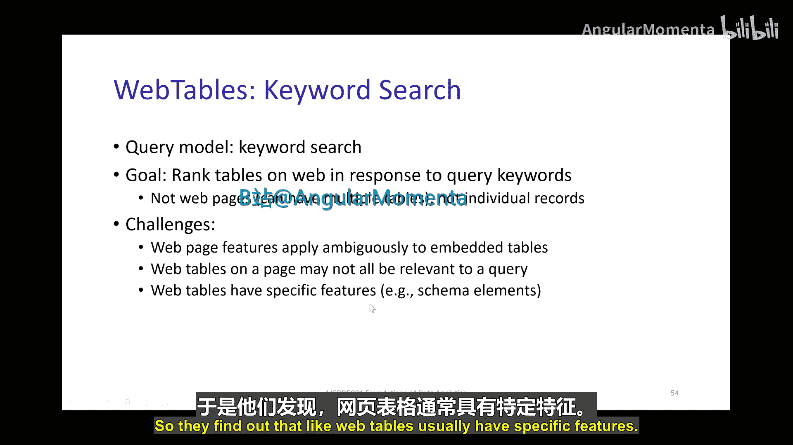

Now。Let's look at like what they observed， for example。

 they observed that the keywords are more likely to appear in titles right so if the keywords are appeared in the titles then it's very likely that it's going to be the relevant table if like the keywords are appearing in the in text so for example like this one。

On the lower bottom right hand side， then it's very likely that this is not a relevant table。

 while the other ones with the keywords appearing in the titles， they are more related。

 they are all about like， for example， the presidents while the lower bottom right hand corner So the yeah。

 the lower right hand corner is the one that is about like a places Okay。

 but then there is the term like a because one of the places is related to a certain precede。

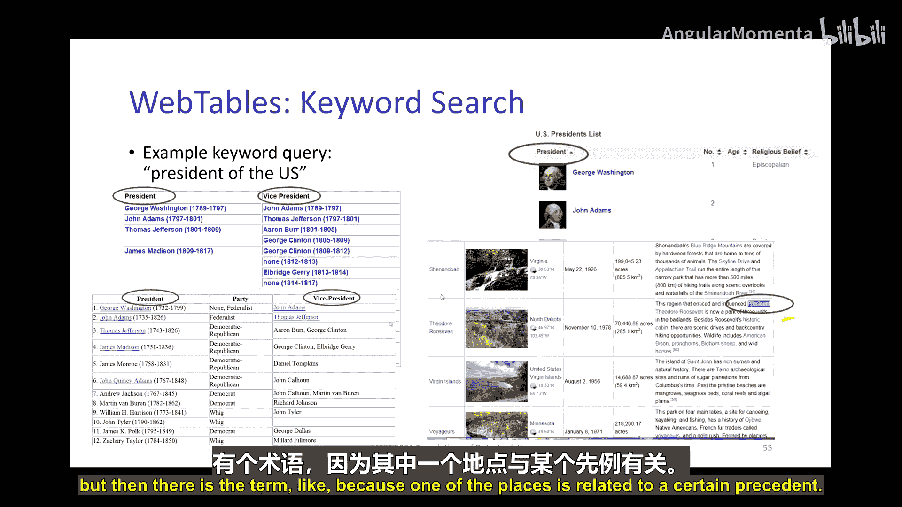

To one of person so because of their observations then when we did when they are doing the Qword search of relevant tables。

 they are kind of applying different features， they are kind of applying table specific features。

 for example like feature Act。So feature rank is considering like okay where is the keyword。

 is it in the header， is it in the leftmost column。

 then obviously if the keywords is appearing in the header or the leftmost column very likely is the attribute name right or the table name so then it's going to be like a more important or it's going to show whether it's relevant。

And then another feature that they are considering will be how coherent is the schema so then they are like trying to measure the mutual information for the skimmers let's look at an example if they are searching for the keyword okay searching for the keyword query and then there is the table one which has the two words president and vice president and then T2 has like these words and T3 and T4 and so on so then the approach is to measure the mutual information based on the for example the frequencies of the terms now if we are looking at this pair of keywords。

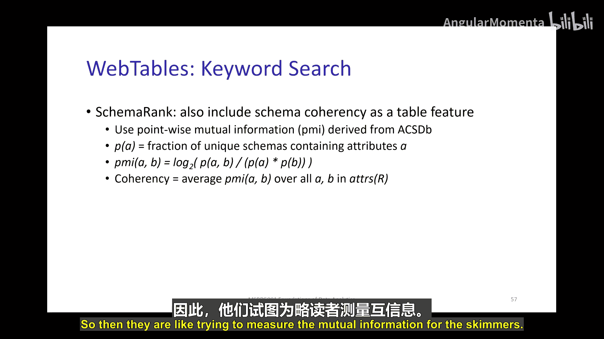

So then now president and vice president， these two attributes， which are like the skimmers right。

 the two attribute names are appearing together in two tables okay。

So then with each individual keyword with each individual。Attributes。For example。

 president appearing in two and then also vice president appearing in two。 So that means it's。

The mutual information is calculated like this。Yeah， so sorry。

 so it's not actually like that it's so sorry for that number。So the P A and P B Co so sorry。

 yeah I forgotten then that there are five tables right。

 So that means it's two like the two words co in two tables out of five so sorry about that So that's why the PA BE is actually two out of five。

 so that's why it's 0。2 0。4 and then if we are looking at only so this is the P。AB。

 and then for the P， which means that we are looking at the P of， for example， the。Attributes。

 precedent。So then president appears again in two out of five tables， so that's why it's again 0。4。

 so then the PMI is 1。32 okay。And then how about precede and term。 So then it's kind of similar。

 And then for。President we already have it calculated for term。

 you can see that it's actually appearing in one times two times three times four times。

 so that means it's four out of five Okay so then the PMI between president and term is like a negative 0。

65368 so you can see that president and vice president cooccurs more frequently so it has a higher coherence。

So then because it has high coherence， so then it's very likely that that table is going to be relevant。

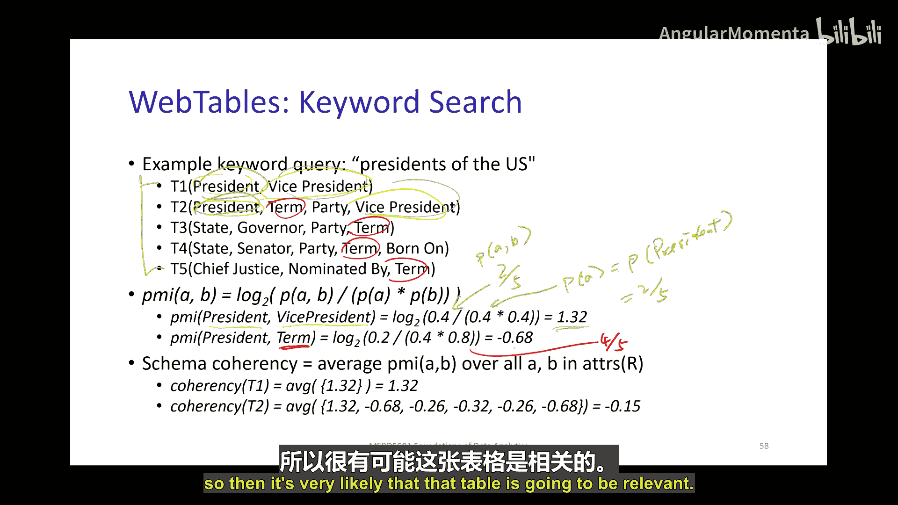

She。Alright so then once we have identified the relevant tables then the next question is well。

 how are we going to like identify the attributes right so we say that we said that like the skimmers of those web tables might not be very clear we may not have the skimmer information at all so then the next question is are we able to annotate the tables so then。

Which entities like is actually like occurring in which one right so then how can we do that like we can actually make use of like a dictionaries for example。

 like we can employ an autotology or those kind of catalogs which will is going to give us like entities information and then also binary like a relationships between the entities then we'll be able to match against the tables for example。

 like we can see that George Washington is matchped with the like George Washington under the entity P401 in the like。

😊。

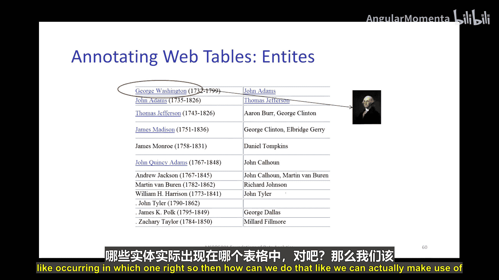

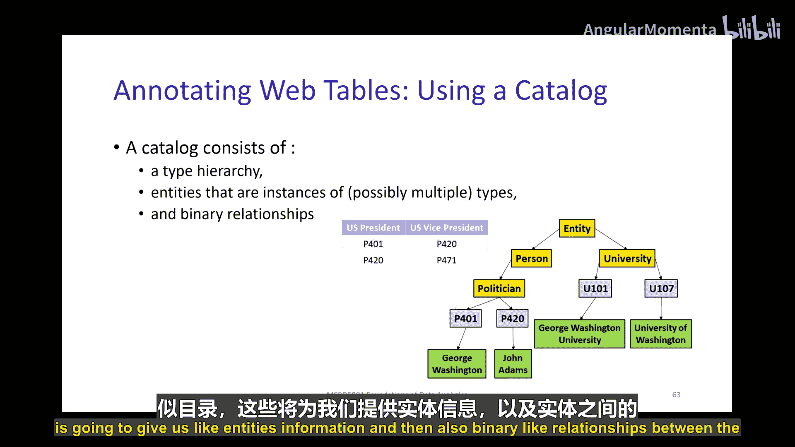

Catalog and then okay， that means like we can identify it here and then the George Washington is again like a being similar to the George Washington University in the entity U101 so then now。

😊。

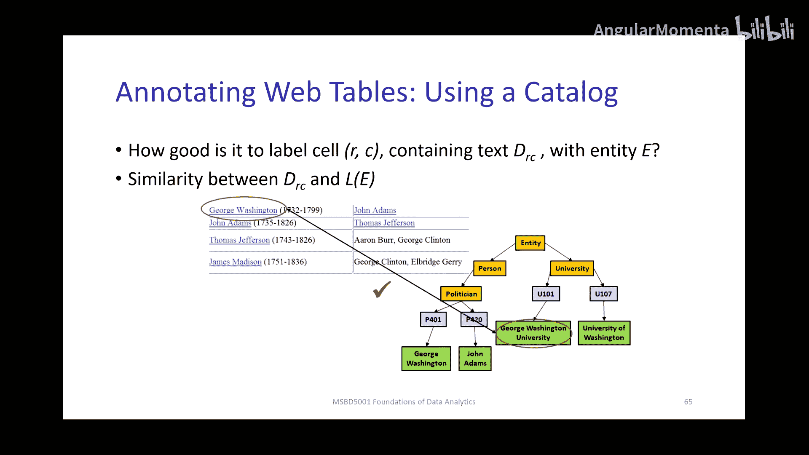

Like but then it's not like a similar to the U107 entity， so then based on this。

 then we'll be able again to know like what kind of attributes is that like based on the like attributes values。

So then we can even like obtain the relations between the like terms between the entities as well。

 if we are able to identify all of these as politicians so then we may be able to deduce that this column is actually the attributes politicians right so then that's how well like one idea or one possible approach into trying to annotate those web tables okay so you can see more examples here and then even identifying the relations as well。

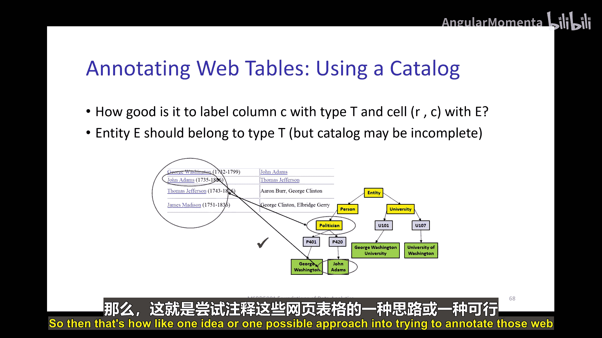

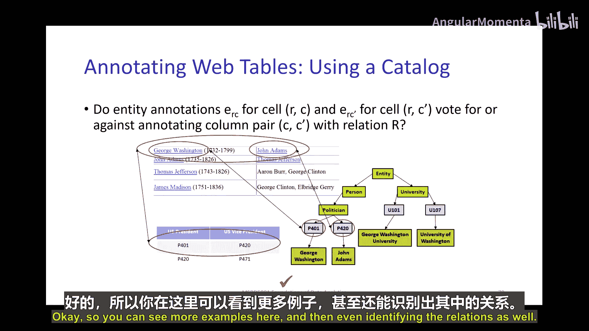

And then now。Again， going back to like a relevant tables， right。

 So then now even with identifying relevant tables。

 well we need to know like how are the relevant tables is adding information。To the another table。

 So for example， in here， like these two are relevant tables。

 So then are they adding more to the columns to more attributes or they are adding more topples right。

 So then that's like something that we need to study as well or to investigate investigate。

 So which means that like we may need to like explore the consistency across tables Now are these two attributes are these two columns。

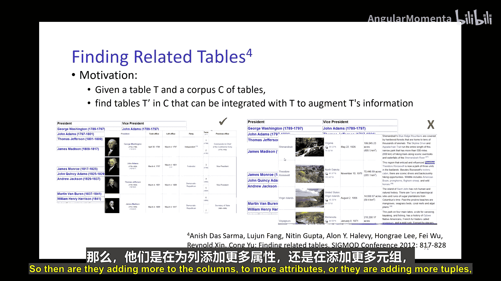

Like being consistent are they talking about the same types of things are they the same attributes and then now another one is will that be expanding the particular entity or particular attributes so for example is this table complementary to this one。

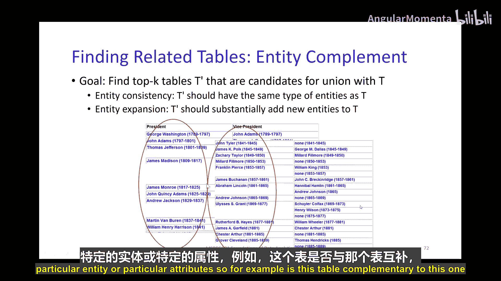

OkayAnd then now how about the schema consistency， so are the two tables consistently talking about the president attributes and vicepartisan attributes？

And then like so all these are like approaches or like a concept that have been discussed by different researchers now you will be able to see that like when we are searching for like information about like big data schema alignment or back data integration you will see that there are a lot of interesting approaches and then like a different like a different approaches is trying to like。

Tackle different aspects in the back data so for example like these few approaches are talking about the semistructured data or those that are not having good skimmers and then those that we don't have the strong relations not exactly not strong relations we don't have a clear like discussions and relations and then they are out there being useful and then how can we integrate them and then like previous approach like a data approach is to like a look at the volume issue so if we are not going to be able to handle everything at the same time so then probably let's start small and then well like iteratively like slowly work on the results make something like more useful something more complex okay。

So like。Okay， so that's I that's all I would like to discuss with you about the schema alignment so you can see like it's kind of like at this point you will find that okay。

 it's confusing right so okay， so that many approaches so do we we suppose we need to know everything to memorize everything So as I always mentioned and you don't need to memorize everything just like if we have to like。

😊，Know every possible like a machine learning or data mining approaches that will also be impossible。

 So when we are like talking about different like topics so we'll need to know what are the like traditional or what are the basic ideas and then depending on the problems that we are facing the problems that we need to handle then we'll need to explore the possible approaches so that's like what we are doing with like these few lectures investigating and then discussing the like a data integration in different like components and then within components we are trying to like talk about the traditional approaches those simpler approaches and then we'll try to explore the possibility of like the scalability you the the big data challenges。

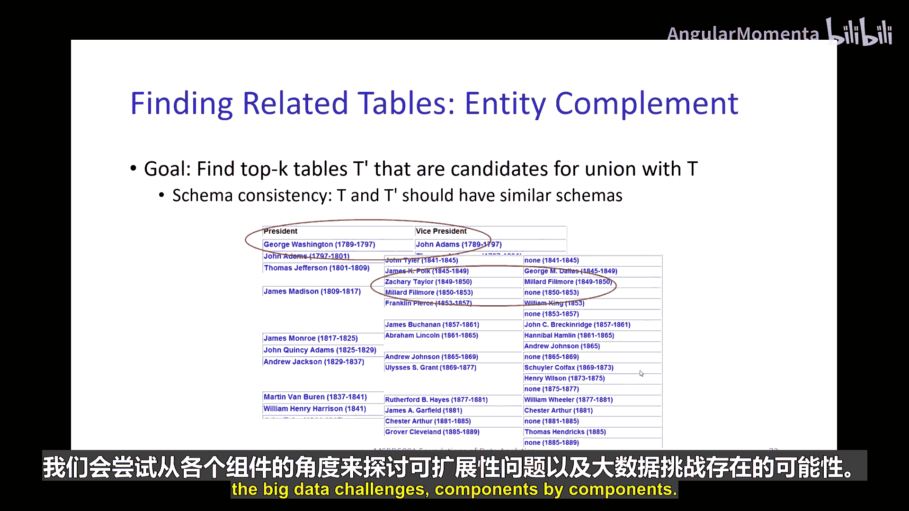

Components by components。Right。😊。