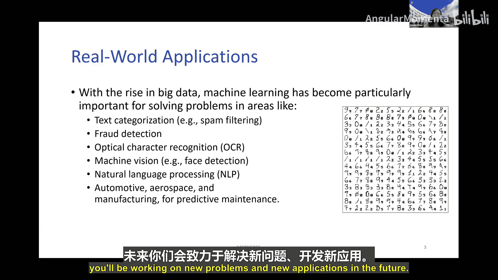
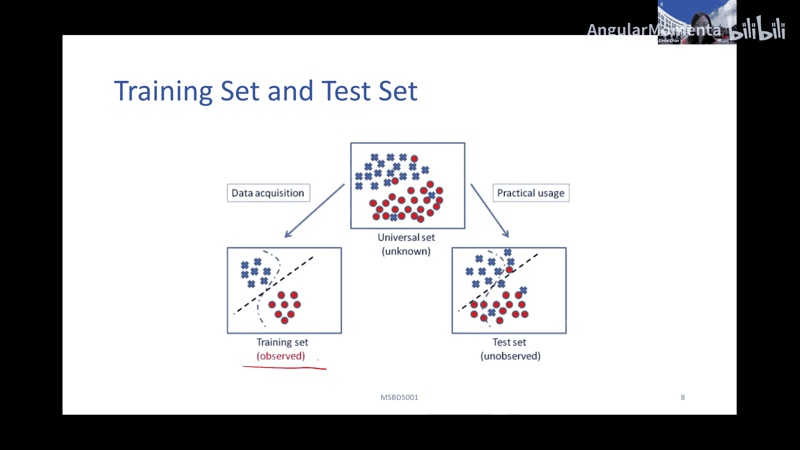

# 【香港科技大学】数据分析基础-｜-Foundations-of-Data-Analytics-p19-14-01-03-绪论--BV1oKFDznE6L_p19-

So in this section， we are going to talk about an introduction to machine learning so why we are saying that we are giving an introduction to machine learning only the reason is if we really need to talk about machine learning it's going to need。

😊，Like an innefferent amount of time because there are just too many things to talk about so you know machine learning is mentioned like every like like nearly everywhere and then like if we have to talk about machine learning then that means we'll start to need to talk about the applications what are the like things that we should be considering and then how machine learning is done and then like well just based on the applications it will be like a lot to discuss and then all those machine learning algorithms and things like that it's going to take a long long long time。

😊，So then it's itself a big data， so that's why like we are going to only have a very short introduction to give you some basic idea on what is machine learning and then like one or two simple examples on how machine learning is done and also some related like features or some related issues that we need to consider okay。

😊，All right， so then。😊，And then once you have like a rough idea on what is machine learning。

 then you'll be able to like encounter when you are encountering certain problems。

 then you might be able to think about okay can I use machine learning to help and then like will it be helping or like if you are encountering like some problems during learning what should you do right and then you will be able to explore and then try to see whether there are appropriate like approaches and then like I'm sure that you are going to learn a lot more about machine learning in other courses in like the other courses of this program as well。

 so then that's why we' are not going to talk about machine learning in like details we are just going to have like a basic introduction So now are you ready so then let's start。

Now machine learning this term we have been hearing it nearly every day everywhere。

 but then what exactly it is so that's like discuss about what exactly is machine learning so machine learning is about of course as the word is like representing。

😊，Machine learn so we are talking about how machine can learn now we know learning is very。

 very important for us like every one of us are learning every day since like we were abroad So that means like we learn new things and then try to do new things and then like with experience then we'll be able to like improve like how we understand things。

 how we do things and then like we keep on learning learning and learning and then like with good learning。

 we say that well if we learn well， we'll be able to perform well on different things。😊。

That's the same for machine learning as well， so machine learning is about how can we learn automatically with machines。

 how machines can learn to make accurate like things to like a make accurate actions。😊。

And then like it's actually the same as human as how we learn。 So then like， for example。

 if we want to make some like predictions。So then we'll based on what's happened before and then based on experience based on histories。

 then okay， well， we kind of know what。Situation will be giving us what results or what like outcomes。

And then now， if we see something new。Now it's not it's something that is like a haven't happened before。

 but then it's having some similar characteristics。

 so then we'll be able to base on our power experience， powers observations and also historiesies。

 then we'll be able to predict what's going to be the outcome。Right。

 so then for example now based on our experience， we know that if the sky is cloudy and then like then it's very likely to ring right so this is a very simple observation and then now outcome as well So then what if in a future day and then we see that the sky is very。

 very cloudy then we'll be predicting that it's going to ring。😊。

Okay so then this is how we learn and make predictions。

 so this is the same for like machine learning as well。😊，So like given all the experience。

 all the like observations， how can the machine be able to learn automatically from these past observations。

 these examples like a and then okay， machine will be able to like a given a new situation。😮。

What's the outcome？Right， so then there are many， many like application。

 so you can see that we are talking about predictions now among machine learning。

 a very important problem that we usually employ machine learning like to help us to handle those problems is classification Now what is classification problem So I think you might have heard that before now classification problem means that we want to classify samples。

😊，Things into categories。Okay。😊，Now we say that it's classifying examples into given set of categories。

 so which means that well we have some categories and then we have some examples or they could be like anything okay any items and then we wants to be able to say is this item belonging to this category or is it belonging to this category and then another item。

 which category is it belonging to and that's a classification problem and then why classification problem is always mentioned together with machine learning the reason is because it's very。

 very important and then it's nearly used again everywhere it's used in many。

 many applications now think about ourselves we are actually doing classifications again nearly all the time for example when you are seeing someone okay when like you are on the streets and then you。

someone you'll been thinking， oh， have I met him before or her before。

 So then you are already doing classification， right。

 you are classifying of whether you have seen that person before or whether you know that person before or you don't。

 So that's two categories， right， you know someone， you don't know someone。And then say for example。

 like when you are going shopping and then you are choosing some fruits。

 you want to buy some fruits and then you pick up for example。

 an apple and then you are thinking should I buy it and then is it a good one I it going to be tasty so then again you are doing classification as well and then think about how we organize things at home Okay so then like you have many。

 many books and then you want to put the books onto the bookshelf and then we like different like shelves right so then you'll be thinking okay should I put it here Okay so this is like a textbook so then I should be putting it here now this is a novel so I don't want to put it together with the textbooks then I'll put it in another place So then you are doing classification as well so you can see it like for us we are doing classification every day Now it will be really nice if we can have machines doing some。

Of those like classification like problems for us now think about if we can have a machine taking a picture of the apple and then telling us is it a good one wow that's nice right so then like in the future we can do like remote picking remote choosing of the like a fruit apples so then like we can take a picture and then the like a machine is going to able to tell us okay you should buy it good one。

😊，And then now again， like there are many， many like situations that we need classifications now think about。

😊，Okay so right now everything are stored like on like electronically on like our machines。

 our computers right so then like for example you are dropping notes right probably and then like you are like reading a lot of pages web pages documents to help you like learn new like topics and then it would be really nice if those things can be like automatically categorized when you are saving into your machines。

 something like that and then actually classification problem has been there like for many many years and then helping us with a lot of like issues in our lives for example like for example we all use like we all read news articles every day right so then now we have all the news articles in electronic format so then actually like classification like with machine learning has。

😊，Already been adopted in like classifying the documents for by it could be by a library。

 It could be by our like a university or any organizations to put like the documents the electronic documents into appropriate category so that we will be able to find them and then like we'll be able to like use them appropriate and there will be a lot of applications which we are going to talk about them。

 but then let's look at a diagram here。 So this diagram here is actually showing us a very like a good example on what exactly machine machine learning is used for。

 Now we know that machine learning is to learn from past experience and then it will help us to do like a handle a lot of different problems。

 for example， like classification now。Well， when we do classification。

 it means that we are looking at an example。Okay， an example。

 and then while based on certain like rules or certain patterns。

 then we'll be predicting its classification or category。😊，Okay。

 but then how are we going to like tell what is the category of an example We'll need a way to classify it That means we'll need to base on rules or patterns to do the classification So then how do we have these rules So of course we can construct them manually so by like a bunch of conditional statement right if this happen and then we'll do this。

 But then like well there will be a lot of rules and then writing those rules manually is going to be troublesome right So then well in order to build to construct those rules automatically here is where machine learning can help us machine learning can be like looking at what we said as the past observations。

And then we usually call them。Labeled training examples in the machine learning domain Okay so then based on the parse observations。

 the machine learning algorithm is going to construct those classification rules So then now with the construct classification rules then we'll be able to do prediction So that's how machine learning can help us right so then you will see that machine learning is going to be able to help us in like a learning different like a models and then like in order to like do the predictions to do different applications。

So previously we were just looking at classification problems now what exactly can machine learning help us what exactly are the real world applications that we are already making use of machine learning。

Now you can see like we already have。😊，Quite many items there。

 but actually that list is again very very， very， very， very long so we can list many， many， many。

 many， many applications， right and then now and the new applications is coming up。😊。

Every day as well now in the old days like probably we are just using machine learning to help us to do like document classification but in nowadays we are making use of machine learning for more applications and then in the future it's going to happen that machine learning is going to help us with even more applications it's going to help us in all the different aspects of our life Okay so that let's look at some specific examples Now one of it is text categorization it's actually categorization here is also a classification problem It means that we are looking at categorizing finding out the category of a particular text show documents So text here means text show documents Now what can it be used so we are using emails right we are like sending out emails receiving emails every day and then like we receive so many email。

was that？Well， if we are just looking at the list of all the emails it's going to be very difficult for us like to like it's going to be very time consuming for us to go through the whole list right so then okay。

 we are we can make use of machine learning for tax categorization in。

Finding out like or sorting the emails that we received into different categories。

 or we can say that while we can sort them into different folders or with different labels。

 So then while based on the folders based on the labels。

 then we can like a process a particular like a category or particular folder of emails first。

 Well then we process the others like later on。 So then it's allowing us to do this。 Now。

 a very good use will be the spam filtering。 So think about how many like a spam mills that those that are like advertisement that could be like a some。

Rand emails and then those kind of emails that we receive every day。

 but then like you may also observe that many of the mail services email services providers or the mail services that you are using every day like the Gmail or like the outlook etc。

 they are kind of like already trying to like put those spam mails into a spam folder right or a trash folder。

And then this is actually done with machine learning so like those mails providers mail services provider email services provider is actually like based on the text that of the email and then it's going to categorize is it a spam if it is a spam that you put it in the spam folder if it is not a spam email then it will be put into another folder so that like by default will mainly only see the inbox which is containing the relevant emails important emails while the spam mails is going to be in the like spam mailbox spam folder or the trash folder so it's already helping us a lot right otherwise well need to sort them ourselves and then like you can also see like you can actually add or like well based on a similar idea then we can actually like add more like a label。

So more like folders into sorting the emails， for example， like important emails。

 less important emails， emails from your colleagues。

 emails from your like family members etc so then we can do like make use of text categorization and then to make our emails more organized and then it will help us to manage them to read them more efficiently so that's one major use and then just like I have mentioned like besides like categorizing emails so think about like business applications like business organizations or like just like our other organizations like the university they may be receiving a lot of like forms a lot of like documents every day people send like forms to them and then now forms about different things right so then if we can use text categorization with machine learning and then we。

Be able to learn how to like sort those like application forms or like documents into different folders and then like we can have different departments different groups under an organization to work on those documents Okay so then no one is going to need to read all the forms or the emails right so then besides tax categorization another application could be fraud detection now so again。

 actually a little bit like the text categorization is spam emails there so like you know in some span emails they are actually fraud right so they are like providing false information and then it's like a it's not for good purpose or for good use so then fraud detection as well so like for example think about like the application forms。

We mentioned previously now think about the financial organizations financial organizations are usually looking at applications for like the finance related things。

 for example， credit card right so then financial those financial organizations may want to be able to see like is it like a。

A force one like it's not really a real person like making an application or like for themselves。

 you know like our data could be wrongly used by others in making like a force application so then like a machine learning will be able to help like recognizing those like a force applications those for okay and then like another one could be like optical character recognition right so now again we are like having documents like it could be in images it could be in those like document format like scanned like a documents or in other documents format and then especially when like we scan documents now nowadays we prepare documents like with the electronic formats but。

Think about the old days we have those paper documents and then now if we want toize digitalize them so that means we want to store them electronically then we'll need to scan them right so once we scan them then they will be probably saved in like a for example picture format。

And then if we have pictures now they have documents right so having them like just scan as pack pictures will means that we still need to manually read them right so then it's not going to be efficient So what if we can automatically recognize the characters the text。

😊，In those like images， then we'll be able to really convert those like scanned documents into really electronic format with words and characters so that will like save the menu efforts and then it will make the scanned documents more useful because we are really able to get the characters。

 get the sentences， get the details out then again it can be used together with other applications like text categorization again so you can see now we can also have different applications put together。

And then think about like a translation right so I think we use automatic translations nowadays as well it's actually also employing different aspects of machine learning one aspect is that what we can actually take a picture and then the like those automatic translator is going to recognize the characters in those pictures right so they recognize of the characters is actually making use of machine learning and then it's the area of auto optical character recognition or automatic character recognition。

Now another thing like besides just like recognizing the characters from the images。

 then we are mentioning about the translators automatic translations。

 now automatic translations is also making use of another large area of applications with machine learning。

 the natural language processing， so NLP is actually again like of very of like a huge importance in the recent years。

Now。If we are able to recognize the characters， they are just sequence of characters。

 they are not going to be meaningful to us unless we can get the meaning out of them and then in order to get meaning out of a sequence of characters。

 it's the area of natural language processing， it's to recognize natural language means the language that we human use and then we we want to be able to get from the characters which is stored in an electronic format into something meaningful。

OkayAnd then for the translation after recognizing the characters in the images。

 then it will need to be able to recognize the worse and then also the connection。

 the relationship between the words and then sentences and then what is the meaning of those sentences。

 what is the meaning of those phrases and words and then there is another use right there is another application there another subproblem which is to do translation so even recognizing the words。

 the characters， the sentences is not enough its it will need to be able to like translate for example。

 from English to Chinese right or English to Japanese or the other like a languages or from the other way Chinese to like a English so then if the original texts in English。

And then we recognize the sentences the words we need to like correspond it to the other language so what is this word in English corresponding to the word in Chinese and then well what is the relationship between these words together what is the corresponding meaning and then you know like a lecture language process is actually a very difficult task because now just by looking up dictionary word by word it's not going to work so I think we all have done before when we first learn a new language if we are reading a new language。

An article and then we try to like just look up word by word。

 we won't be able to get the meaning so we'll need to know the combination of the words。

 the relationship between the words and then also the cultural background of the texts in order to understand what exactly is being done and then that will be you can see that we are just talking about the automatic translator and then it's already handling multiple tasks with machine learning。

One for recognizing the characters next for processing the text and then next for translating the text right so then that's one example okay and then now natural language processing is also used in other places for example we will want to know more about what people post every day right you know that we are like a posting we are putting post on like social media like Twitter and Instagram。

 Facebook everywhere and then like people will put down like their feelings what they are doing。

 their communication with others so then very often we want to be able to get something out of those things for example like we may want to know what is the recent trend of discussions nowadays what is the like hottest topic like around the community okay and then because if。

We know what is the hottest topic then there are a lot of different like applications， for example。

 some organizations might wantt be able to make some based on the hottest topics and then do some like promotions and then like well based on what is being like a discussed most and they will do some corresponding actions events right so then that is one thing and then also some organizations might be might be like my wants to look at the comments that people have put under their products and then those comments are textual documents。

 textual like sentences so then they will be they will wants to analyze like for example people complaining or are people expressing that they like like the products then they will want to do something like that and then typical applications or like related areas we say that that's sentiment analysis so then that's again going to create。

A lot of values helping like a lot of different， like a potential like a usage。

So that's another thing and then now others like applications could be like for example。

 machine vision so machine version is again like talking about like a vision processing so then like one of the application is face detection so now we wants to be able to like based on the like images movies or videos we wants to like detect faces for example like where am I。

😊，Right so then okay now that will requires machine learning okay now because well a pictures a person's face in the picture could be like in different sizes like our faces are different and then now well in a picture there could be many objects so then how do we know like that thing here is a face。

Okay， so then that means we'll need to learn from a lot of some posts and be able to handle that and then you also know what is phase detection is going to be a lot applied to you。

A lot right， so we may once like， for example， just like we are using like those like a remote。

Communication software so then you know that if we can recognize phases that will help us into like for example。

 like applying future and then like for example， we say that it's beauifying the like an images and then like for example it will help us to like make the video like for example。

 when we are communication so some sometimes we just move and then if there is like a automatic like face detection then it will be able to help us to locate some person and then for example centralize that person it will help to like improve the video quality or the communication like a quality。

And then like surveillance right so we all know that surveillance will be able to make use of face detection to detect anyone that is like tpassing or anyone that is performing something that is not desirable or it can be recognizing people to say that okay is this the person that should be authorized to use something to assess something or not authorized to use or assess something so machine vision besides face detection So you can see also object detection is going to be very。

 very useful So for example， if we have an image So what are the objects appearing there right so then it will be able to help us to based on the object recognized then we'll be able to again categorize those photos or again creating some other values now other like applications could be for example。

 like automatic right so we have those automatic car right so well it's going to drive this up so you don't need to like the driver。

No longer needs to paid like to like a control everything so then again how do we do automatic those like a driving experience then it's based on parts experience right what kind of things would happen and then the machine is going to automatically going to make decisions or predict what's going to happen and that will applies to all the other related like on other like applications like for example。

 aerospace as well right？And then like that would be， for example。

 like to autopiloting or to recognize like a like defects like of those machines again in machine in manufacturing industry as well So then we wants to like detect whether like machines is functioning where whether there is certain problem with machines then that could also be handled by like a machine learning and then of course。

 predicting something right so we always wants to do some predictions by many of those industry。

 for example， the customer behavior， we wants to be able to predict the customer behavior and then also the like if it's the。

KD delivery， for example， like for example， nowadays while we the delivery service is very。

 very important then we want to be able to predict okay so which place at which particular hour will need the highest demand of like delivery service so then a company will be able to make arrangement ahead and then also like for example in the traffics so do we want to be able to predict well what is going to happen at a certain moment like if we know that at a certain moment a specific time in a specific day it's going to be like the traffic is going to be having a traffic con then again like the government or like the organizations could do arrangement ahead so we can see like we're just talking about a few so we can keep on talking and talking and talking and then there are just many。

 many real applications and publicly。You will be like having new applications。

 you will be working on new problems and new applications in the future。

Yeah。

After looking at the applications of like machine learning。

 so then let's discuss about the characteristics of modern machine learning now so the goal of machine learning is to like have highly accurate predictions on test data but not uncover the underlying truth now you can see that we have a term test data so test data means that they are unseen data now previously when we mentioned the example of the classification problem we say that we have labeled data so that means observations our pars experience now that means we know the outcomes right but then now like what we want to do is we will be able to like perform the predictions to do the clustering to do the classification on unseen data。

😊，If we can do like if we can like a work on predictions on classifications on unseen data。

 that means it will be able to help with the future data right so that means that is what we want so we want to be able to apply it on future data oneeneen data now with future data oneen data we don't know the truth so that is why this is the goal now we want to be able to perform well on unseen data。

Then。😊，Well what should be the methods be like so then like when we want to do well on the unseen data。

 we want the like a machine learning method to be of general purpose， fully automatic。

 so which means that it's going to be like requiring a minimum amount of human like efforts。

Now this is what we want， but then very often in like our real life when we are working on the machine learning。

 so when we are like having a machine learning algorithm farm and then helping with the previous like a observation previous applications now we need parRS experience we need scene samples。

 we need like a observations but then how do we have that。

It's going to require human efforts and then like because well we always mentioned that there might like it's not going to be possible to have perfect data。

 so that means in the best quality。Well， by best quality it means that there are no mistakes。

 there are no errorss and then like it's just usable， okay directly being usable。

 but in fact it's not going to be possible。Most of the time there will be errors in the data。

 there will be problems in the data or the data needs to be processed。

 pre processed like well extracted in order to use and then like very often we'll need to do menu like a processing on the data first So then once we have the data processed。

 then we'll be able to use them to build or to like do the machine learning。

And then like well the best scenario is that while we can just like give the observations and then the machine learning is going to like learn the model。

 select the model and do everything automatically but again in fact it's not going to be possible right now because we'll need to have an understanding of our problem first now understanding of the problem means we'll need to understand what is the thing that we are handling。

 what is the issue， the problem， the application that we want to do and then also we'll need to know our data we need to know like well what is our data。

 what are in there and then what is the behavior， the characteristic of data so that requires human knowledge well that requires prior knowledge。

 background knowledge and then with proper prior knowledge with background knowledge then we'll be able to like select the。

Mod， the best learning algorithm， and then also how we are going to use the data and then how it is going to help the applications so even though what we want will be fully automatic and then a general purpose machine learning algorithm but then in fact it's going to requires a lot of human efforts Okay and then now for modern machine learning very often it will be like involving a lot of theories and then a lot of practices like we are exploring theories to be applied with machine learning。

 but then we'll have to practice that we'll have to see whether like the models is going to work and then based on certain problems and then based on the characteristic of the data as well。

Okay， and then now the last thing is actually like why we are focusing on modern machine learning。😊。

Now， in the old days， machine learning actually like exists for certain like a period of time。

 but then you know， with the compute limited computation power before。

 then we won't be able to do machine learning on large dataset。But nowadays。

 we are having the computational power ready。 So then that's why we are always talking about big data。

 And then that means we want to be able to handle large dataset sets。

 and then that is also the characteristic of nowadays， the more than machine learning。

 It's becoming more and more important for the machine learning algorithms to be able to handle large data。

😊，Now why this is important is because when we are having large data sets that means the fourVs right there will be a lot of variation。

 the volume is large， there will be veracity velocity problem and that means variety problems so that means we are looking at very like a different data sets and then like there are going to be very large and then there could be a lot of like errors a lot of differences so then we'll need like machine learning algorithms to be able to handle all those things。

This is like a more important nowadays。So then we had to look at the characteristics of like more than machine learning。

 but then we haven't discussed on why we want to use machine learning so we said about the applications we briefly talk about what is the main idea of machine learning。

 the focus the characteristics what are the advantages well there must be advantages otherwise well it's not worth using right so then let's take a look at the advantages and then at the same time with this as advantages then of course there will be disadvantages as well Okay so then let's take a look at that for advantages now if we are using machine learning most of the time we'll be able to get more accurate like rules than human craft at once the reason is because machine learning is driven by the data so then that means machine learning is looking at a large amount of data and then trying to create。

The root so that means it's based on data because it's based on data then of course it's going to be more accurate well for human then like a it's well for human to create rules than we are not like able to look at as large amount of data as machines right because like for humans like to do things then of course it's like a less efficient。

So then for machines it's able to process more more data and that is why comparatively speaking it's going to be more accurate it's not saying that human drafted human crafted rules are not good so we are like able to human we are able to create good rules but then as the data or the problem is becoming more and more complex that means if we are doing it with human effort。

 it's going to require more time and then more human effort So then you know nowadays we are talking about efficiency right so we want to like be able to learn things in a very。

 very short amount of time and that is why well need to rely well need machines to have that Okay so that's one advantage and then another thing is。

No。Humans。Often like incapable of expressing what they know， okay？

Now it's not saying that like people are not clever， so humans are very， very clever。

 but then now we are able to do a lot of things okay， but then we may not be able to tell why okay。

 sometimes's hard to explain why so for example， like well we know it's going very often when you look at a situation you say that okay。

 it's not going to work， it's going to work。But then when we are asking like what is the reason why do you think it's not going to work or it's going to work sometimes it's very hard to express express it right it's very hard to explain it in detail and that's the situation right so like when problems are becoming more complex it's very often hard to like describe the details or explain why do we think so but then of course we may be having like memory memory reasons or like based on like a lot of like past experience and things like that we are kind of like a know that because for human infferencing it's actually very very good but then it's hard to explain why。

😊，But then with machines right， so they are going to work on data and then they are going to like。

Create like a system or they create models， they will be help learning models on expressing why。

Like a certain thing is being done in a particular way。

 so that is why machine learning is going to be better in here okay。All right。

 but then the next advantage is that now。Machine learning， okay。

 well will not need a human expert or programmer now this is like a well。

 given that we have the program like a boot。To do machine learning。

 then we won't need another programmer to like a fine tune the parameters or to test the things out one by one on different samples with an appropriate algorithm that means an appropriate program then we'll be able to learn things automatically we don't need another programmer and then similarly once we have the program or the algorithm built for example with prior knowledge as we mentioned before。

 then we don't need another human expert to work on like for example。

 predicting the results predicting the outcomes or like a classifying the samples right so we can let the machine learning algorithm do it So then that's the advantage and then the fourth advantage is to auto like it's allowing us to have automatic method to search for hypothesis of explaining the data so it's actually related to the previous advantage。

Previous advantage because like machine learning algorithm is going to like explore the data extensively so then it's like the way that it's doing the prediction。

 the way that it's doing classification it's trying to find like a way to explain the data so that means it's actually searching for hypothesis。

And then now this is the most important advantage right because machine learning is cheap and flexible。

 It can apply to any learning task Of course， like to develop an appropriate machine learning algorithm it requires a lot of like efforts。

 so which means like a like for example， research effort like a experiment So that would be like。😊。

Time consuming and then that would be like a not cheap right， but then once we have the algorithms。

 we runs were like a know that this algorithm is going to work。

Then we can actually apply to like a suitable learning task and then like it's going to be requiring a minimum amount of human like efforts and then we'll be able to apply the learning algorithm to different task and then like once we applied it then if there is any changes there are new data we don't need to do the whole process from the start from scratch we'll just need to like use the algorithm and then build things again and that will mean like well we don't need additional cost right so we'll need a very small we only need a very small amount of course so that's why it's going to be cheap and then it's easy to add more examples to the machine learning algorithm so that means it's going to be flexible and then like with different algorithms we may be able even to apply an algorithm in one task。

To another task so then again we don't need to do everything from scratch then we'll be able to like minimize the efforts or the course to have like a learn a new task。

So these are some advantages。😊，How about disadvantages now for the disadvantages now because we need to learn from past experience So then it's very important for us to have the past experience to have the observations but then getting the observation is not an easy task it needs like a typically most of the learning machine learning algorithms will need a lot of observations in order to learn a task with good performance So that means we need a lot of observations and then those observations are what we call labeled data So then we'll talk about what is label data and then you see that when we need a lot of label data that means it's not going to be that easy it's again going to need to take a lot of efforts in preparing the label data So the previous advantages is giving the assumption that we have label data we are going。

To be able to perform the machine learning tasks so then we'll have those advantages。

 but then if we don't have good labeled data， then we won't be able to have a good machine learning algorithm and then we won't be able to have good performance on the task so then that's the major advantage。

And then now now another disadvantages is that there's like there is going to be error pro meaning that it's it's not that it's not always possible to get perfect accuracy or we should say that it's usually impossible to get perfect accuracy Now the reason is now it's like a machine learning algorithm is actually going to be driven by the data to learn by the data but then we know that in real life in real applications there could be a lot of changes there could be a lot of variations in the data and then those variations those changes might not be able to be captured。

Generally by like the machine learning algorithms or by the models。

 so then if we are not able to capture all the aspects of the whole like the whole problem or all the data so then we won't be able to make prediction or to do classification accurately and then if the data is having errors so then we won't be able to learn things correctly as well now if we can't learn things correctly then we won't be able to do like to do the task correctly as well so that is why because of the data because we need data and that is also giving us like a potential problems as well so then these are the disadvantages。

Now comparing with advantages and disadvantages， of course advantages are more important right so then we need like a way that we need algorithms to be able to like a flexibly and then once built we can like a flexibly and then inexpensively applying to like a tasks and then with like a new unseen data or even different problems and that is why we need machine learning。

😊，So previously when we were discussing about what is machine learning and then we had an example of machine learning application which is for the classification problem and then we were talking about the advantages and a characteristics of machine learning we mentioned this term again and again labeled data so then let's discuss what is labeled dataset in detail and then because like labeled data this notation is very very important for machine learning now if we have labeled dataset then we also have unlabeled dataset so then let's discuss what is exactly labeled dataset and then what is unlabeled dataset so then this is like a related to the representation of data when we are working with machine learning so very often we represent data according to the following so first when we are when we are having labelbeled dataset it means that we are looking at ops。

OservationsAnd then like past experience with known outcome。 So we know that outcomes。

 So that is why for label data we have the observations。

 which is like denoted here X X is containing n samples。 So you can see that here N samples。

 and then each sample is a D dimensional vector， So which means that each sample， say， for example。

 X1 or x2 X I or X N is having D。Features， D values to represent that sample。

And then like besides having like a vector of D values for each of the sample。

 and then we have n samples， we also have another labeled set。

Which means that it's represented by the C here and then C we call it a labeled set。

 so if this contains the known outcomes， what are the outcomes of those samples and then the samples with features factors and then together with the labels。

 then we say that it's a labeled dataset set。So then the difference between labeled and unlabeled dataset is that for unlabeled dataset。

 we don't have the C， we only have the X， which means we only have the feature set of n samples with the feature vector。

 which each vector is a D dimensionsional vector。Containing the data about。A particular sample。

 but then we don't have the label set， we don't have the corresponding outcome for each of the sample。

So you can see that the difference is on whether we have the labels if we have the labels。

 we have the known outcomes， then it's labeled dataset set if we don't have the labels we don't have the outcomes we don't have the labeled set C then we are having an unlabeled data set so labeled and unlabeled data are important concept for machine learning now let's take a look at an example so say that we want to do classification as we have discussed before and then we want to classify like for example people's medical conditions and then like given the like for example the measures or checkups status checkup values and then like we'll classify on。

What kind of disease or what is the disease or the health condition that a person is in Okay。

 so then what is the feature set it will be each like we have end samples then end samples correspond to the end people where each people is represented by the medical checkup。

Values， for example， like for example， the heights weights and then the blood pressure all those things then like each of the blood pressure like temperature and then height weights these are the like a features and then assuming that we have d features then each person can be represented by those d different values okay and that means a vector of d values where each value representing a particular measure values right a particular like a value of measure。

And then now we have each person corresponding to a particular condition， health condition。

 and that health condition is the label。Okay so then for n people。

 so then we have n labels because each person will have its corresponding label the condition。

 so then okay the classification problem is going to learn with machine learning given the medical measures values for the N people and together with their like a labels of the health conditions。

 then we'll learn the a model and then be able to predict。

The health condition of an unseen person with the given medical or the health like a values。

So then that's label data set and the use of the label data set for unlabel data set。

 that means we don't have the label so that means we only have like the example that we have we are only having the like a。

Medical checkup values or the health like a values of the person like the height value。

 the weight value， the blood pressure， and the body temperature， etca。

 all the D features values of like each of the person。

 but then we don't have their actual medical condition。

Okay so then that's like an unlabeled dataset so another two terms that are very important in machine learning are training dataset and testing dataset now what are training data and testing dataset now we can assume that there is the universal data universal data means that it's having all the possible data pairs like all the like a possible observations possible like instances and then we also have their probability distributions of their appearances in the real world。

So that's the assumption but then we know that it's impossible to have the universal data set because it's impossible to have all the data possible like all the data in the world okay it's not possible so then in real applications we only be able to have a subset of the universal data well because of many reasons like because of like the the lack of memory we cannot store that many and then because of like the efforts that are required to collect the data and then also the other reasons like for example in certain situation we can't collect all the data we just have subset of the data collected。

So then， okay， so then the collected data set， the data set that we have。

Is called the training data the training dataset now the training data is used to learn the properties and the knowledge of the universal data。

 so that means we are looking at the collected data and then we are trying to learn about what will be the actual universal not the actual but the usually assumed universal data set to be like。

So you can see now because it's used to learn about the universal data set， right so that's actually。

😊，Machine learning， so then in machine learning。So we want to make use of those like that subset of data and then to learn the properties。

Not only properties that can explain the data， the training set the subset but can also be used to predict unseen samples of future events now because if we are able to learn about the universal data then we know that unseen samples is also coming from the universal data okay just that we don't know like we haven't seen that before so then that means like they will be having the same properties provided that we are learning those properties accurately then we should be able to predict unseen samples of future events okay。

So then here， you can see that here we are talking about training data。

 training data is used for learning。While testing data means that it's the data that we use。

 the learned model。To do prediction， to do classification， to have the outcomes right。

 to predict or to get the possible outcomes。So then you can see because like we are using like we are using the dataset set to train to learn the models。

 we cant just like well use the model to predict the same set of data if we do so then well most of the time the performance is going to be very good but then we know this is not we want right so we want to predict unseen samples and then now how do we know our model is good or not we want to examine the performance of the model the learned the result of the learning。

To verify whether we can really learn the properties of the universal data set well， right。

 so that we can apply on unseen data。 So then that means like we need to also know the truth outcomes。

 the true outcomes of。The data set that we are applying the learned model。Two。

 the learned properties，2。So that is why we usually have two set of data。1。It's reserve for training。

 and then we use it to learn the properties。Another data set。😊。

Is for testing that means to verify the performance。

 to verify our goal to like a measure the performance of the learning and then because it's for testing out the learning so then we say that it's the test data。

 the testing data set so we have。Training data set and then testing dataset。

 so very often when we are doing machine learning we need training data and testing data。

So the forward diagram is also showing like what is like is an example showing like what is training data set。

 what is testing data set now say that we have like the universal set right so we don't know the the properties okay so then we try to acquire like a subset of it and then use it as the training data now we have the training dataset set and then we make observations that means we are trying to learn from it so say that we learn that the training data set can be actually like categorized like this they have that properties so then we'll be able to learn how to。

Categorize the two different kinds of training they set。So then that's what。

We make use of the training data set and then learn about the properties Okay。

 so then we have another subset of the universal set data。

And then we'll like a have the learned the learning results and then apply on these testing data okay。

 and then well it may be giving us a very very good like a outcome or it may have certain like a problems like for example。

 it fails to like a。Correctly or accurately predict or classify certain like data Okay so then。Okay。

 so we'll be able to make use of the test data testing data set to verify while whether we have to make any mistakes。

 the learning is good or not。

