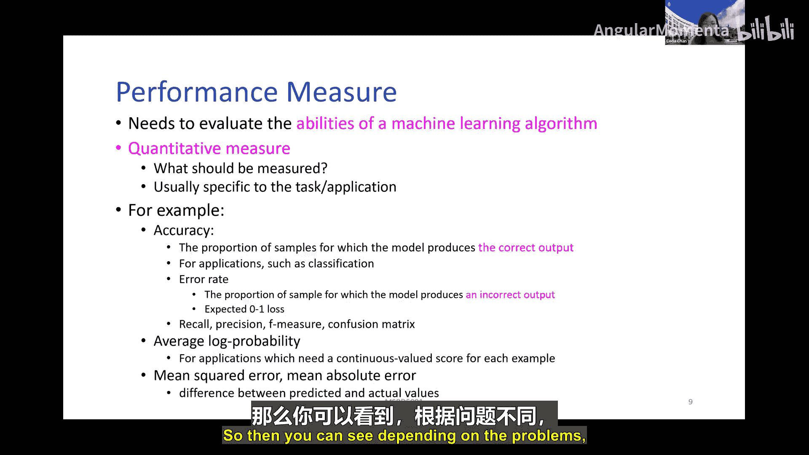
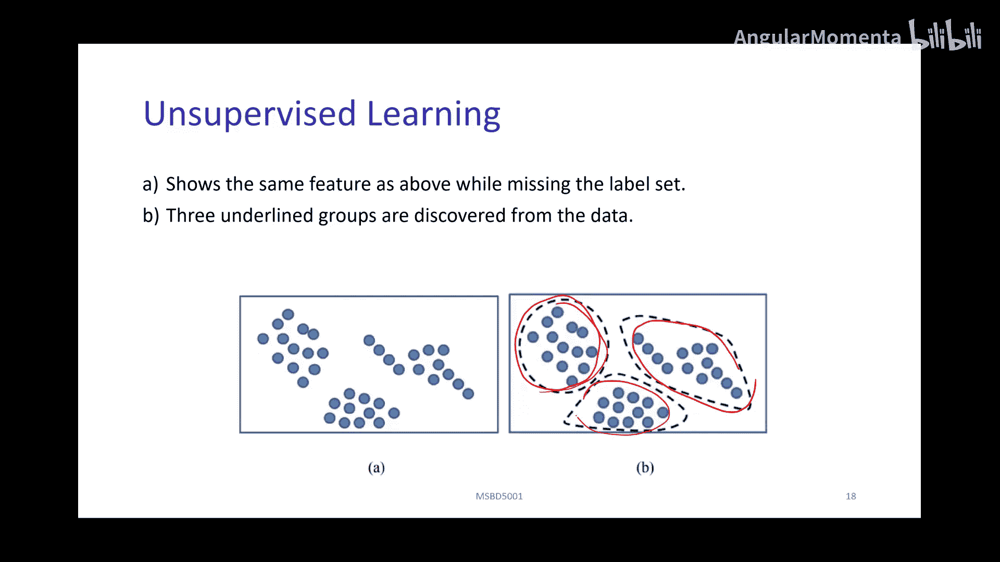

# 【香港科技大学】数据分析基础-｜-Foundations-of-Data-Analytics-p20-14-02-02-性能度量--BV1oKFDznE6L_p20-

So we mentioned that we need training data set to learn the like properties to do the learning and then we'll need testing data set to check on the performance of the learning so are we going to have like a good performance with the with the learning results so that means while if we want to like know the performance well need to be able to measure the performance of the like a machine learning algorithm。

 so that means well need a quantitative measure to evaluate the performance to evaluate the abilities of the machine learning algorithm so then okay when we want to like measure the performance then we'll need a measure and then when like a which measure。

Do we need to use depends on what should we be measuring okay so like it's usually specific to the tasks or application so for example if we are doing classification then we'll know that we wants to know are we like classify the testing data correctly so then like if we are working on a prediction problem so then we no wants to know are we predicting the values are we making a very very like close prediction to like the actual like to the we're making very very good prediction are we making like an accurate predictions now with different task or different applications we need different quantitative measures and then sometimes like the measures that we are using may not be the best describing the problem or may not be best。

Eu the like a machine learning algorithm will then again。

 we'll need to think of whether there is alternatives。Now for example。

 like we said that while the quantitative measures the like performance measure should be like specific to like the tasks or application that we are working on so say let's go back to the classification problem if we are looking at the classification problem then how should we measure the classification performance that means like given the learning can we be categorizing the data correctly so that means what we are doing is we have the correct the truth the truth labels or the categories of the。

Samples and then we are making use of the learning algorithm results to classify or categorize the data without the labels right so then we have the like predicted results or classified results from the algorithm and then we compare the predicted results or the classified results by the model with the actual correct。

Output so that means like it's the truth so we compare the predicted results the classified results with the truth so then like for accuracy then we are talking about the proportion of samples which the model produces the correct output that means the predicted outcomes the predicted results and the categorized result or classified results are the same as the truth Okay the same as the true label or true category so then。

Okay we'll be using like a accuracy right so then it's used for like most of the time applications like classification or matching。

😊，So then like we can there is another measure which is going to give us like a similar like kind of information how accurately the model is doing the classification which is called the error rates so the error rates is the proportion of samples which the model gives the incorrect output so for accuracy we measure the portion of correct output and then for error rates we measure the portion of incorrect output so sometimes it's also called as the expected0 one loss because if we are doing like a classification so then we are like either classified correctly or incorrectly okay。

So then other measures that we typically use for like classification problems like recall precision。

 F measure， confusion matrix， so again it's looking at like how for example。

 what is the ratio of like these model being correctly classifiedify something or like classify it as a or classified it as B things like that or like are we able to like correctly predict all the result or will miss something so then all of these are measuring those？

Now then like for applications that we are not actually having like discrete like labels or we are not having like those classes right so then like for applications that will need a continuous value score for each sample then we cannot use accuracy because it's not simple like just correct or incorrect so then very often well use other measures like for example。

 we look at the average lock probability or the average lock likelihood okay so then like if we are working on like for example predictions prediction problems then very often like the the like using well be using like other measures like the mean squared error。

 the mean absolute error which we are。Trying to like measure the difference between the predicted values and the actual values right so then you can see depending on the problems。

 then we'll be using different performance measures。

So usually we when we are talking about the performance measures or like measuring the performance of like machine learning algorithms。

 then we'll also mention like the terms like overfitting or underfitting so what do we mean by overfitting and underfitting so recall that what is the purpose of the machine learning or like how are we doing machine learning so then we are making use of training dataset to learn the properties and knowledge of like the problem and then we want to use it to predict unseen samples of future events so then of course we want the system to be able to perform well on unseen samples so which means that we once the learning or the algorithm or the model learned should be able to perform well on unseen samples that means it's able to be generalized on the unseen samples so it should have a good generalized。

Okay the model should have a good generalization， but then think about how we learn the model。

 how we do machine learning so we are actually driven by the training dataset。

 we make use of the training dataset to learn the model so that means when we are doing learning so we'll try to like reduce the training error。

 meaning that we' want our model to be able to have the minimum amount of error based on the training dataset。

 so that means when we are doing training we'll try to reduce the training error as much as possible so then usually we have low training error okay。

But then when we apply the problem or apply the model onto unseen samples。

 then we want the like a performance to be good。 That means the error that we use the trained model。

 the learned model to predict unseen values or to like a do classification on the unseen samples should be small as well。

 So this is what we want。 So the error on the testing dataset set。

With unseen samples should also be small。Okay。😊，And then that means the generalization error。

 so generalization error refers to the expected value of the error on a new input testing data on uneen testing dataset set。

So then。For a machine learning algorithm， a good machine learning algorithm should be able to reduce the training error。

 so make it small and then also reducing the gap between the training error and the testing error。

 so that means generalization error okay。Now Eve。😮。

Like a demo model is able to perform well on a particular set of data。

 So that means it's able to perform well on the training dataset。

So that means it's having a very low training error。But then， okay， it fails to feet。

 It fails to like predict accurately on the unseen。呃Data。That means future events。

 future observations that means it's having high testing error， high generalization error。

 so then that's overfitting so which means the model is only going to work well with the training data is not going to give us good results good predictions on unseen data so you can see that it's going to be a problem right so we want the model to be able to perform accurate predictions on the unseen data。

 but then we fail to do so so it's a problem and then this kind of problem having low training error high testing error we call it overfitting。

Now。Besides overfitting， underfitting may also happens with our learned model。

 So what do we mean by underfitting is that when the model。Does not fit on the。Data web。

 so that means it's going it's having a high training error and also a high testing error。

 So that means it's not performing well on the training data。

 it's also not performing well on the testing data。

 so then that's underfitting Now underfitting means that well it's not able to do the like prediction。

Well， right so then well when when usually like over underfitting is going to happen it's usually caused by a simpler model。

 So that means the model is too simple comparing with the data So that means it's not going to like represent the characteristics or the properties of the data well So that's why it's not going to perform well on both the training data and the testing data。

 Now in here we have two images which is describing like overfitting and underfitting so on the left hand side it's overfitting。

 So you can see that here now we have two lines and then we have the dots。

 So dots means the training data the training data and then the。Blue line there is the model。

 So the blue curve is the model。 So you can see the blue curve is actually like fitting。

 It's actually like a build very， very closely representing the training data very， very closely。

 So seen samples means training data。Okay。So you can see it's representing them very well。

 So it's actually most of the training samples are lying on the curve right。

 So that means we are able to like the train build。

 the build model is able to represent every like capture all the characteristics of the S samples。

 But then now if we are really talking about the underlying properties of the universal set。

 record the universal set。 So the true function means like the properties。😊。

Of the universal data set。So that means it's actually kept like the true functions representing both like a testing and training dataset。

 So then you will see that。 well it's not going like with the current training model So it's not going to perform well on the universal dataset That means the unseen samples because it's just fitting that particular set of scene samples。

 So it's not really like representing the underlying relationship Okay so that's overfitting because the model is representing is capturing the characteristic of the training samples so well So that of course is going to have good training performance but then it won't be giving us a good testing performance on the right hand side we have underfitting So you can see that here now this line is the。

Trained model。 So it's not really doing the task well， right。

 So it's not fitting on the training data。 If it's a classification task。

 it won't be able to differentiate， classify the scene samples， the training data。 And then。

 of course， it's not going to classify what wells with the unseen samples as well。

 So then that's underfitting。So overfitting and underfitting are something that are not desirable so we don't want them to happen So how should we like handle those kind of problems then we can make use of cross validation So what do we mean by cross validation So previously when were doing the like training we are using training data set we are learning the we are doing learning with the machine learning algorithms and then in order to measure the algorithms then we have the testing data set and then like what we want to do is to be able to reduce the training error and also we want to reduce the generalization error as well。

 So then now but then if we are like。Training the like learning the model with the training data and then like we are。

 of course trying to reduce the training error and then we apply it to the unseen data to the testing data。

 then we will then know what is the performance but then like we want to be able to like instead of doing that like which usually results in the like overfitting or underfitting problems then instead of doing that we want to be able when we are doing learning well be able to estimate de generalralization error and then when we are doing learning So with the estimated generalization error。

 then we pick the best like a model or we try to learn the model so that like later on if we are really using it on the unseen data it we be able to be generalized and then perform well Okay so then how are we going to do that we like having。

Another set of dataset， which is called validation dataset。😊。

Now we are not creating another data set， but instead we are making use of what we have。

 so we have the training data。And the testing data， right， So we have training data。

 and then we have testing data。 So then what we are doing here。Is trying to split。

The training data into two portions， two thisjoint subsets， for example， like this。And then。

 we are using。One subset for really doing the training。

So which means we are just like before using the part the subset for training and learning the models okay so we are using the training data for learning the algorithms for the learning algorithms。

And then now we are having another subset， okay， another subset of data。

As the validation dataset set。Validation。Now what is this purpose。

 it is used to estimate the generalization error during or after training。

 so which means we use this part for learning the model and then we apply the model with the validation data set so then that means we'll be able to measure the performance because validation data set comes from the training data we know their labels we know the outcomes so then we'll be able to estimate the generalization error so then okay well we'll be able to tell if we are doing the training in that way will it be giving us a low generalization error。

So then we'll be able to verify that during training and then because the validation data is actually a small set of the training data。

 so it may not give us the actual generalization error so that is why we are like and then because the validation data is actually used to find the good model Okay so that is why we still need another we still need the testing data set just as before for really measuring the performance right so you can see training data learning。

Validation data set for estimating the generalization error while for testing data set really having measuring the performance of the model okay。

So then now， how should we split the training data into the training part and also the validation part。

 a very typical way is to have 80%。Of the original training data set as for the training。

 while the remaining 20% will be used for validation okay。

Now with the training dataset validation and testing dataset set okay so we'll be able to estimate the parameters but then again like if we are just having like them fixed so that means we are always always having the same like portion the 80% for training 20% for validation and then we are doing the testing done actually it's similar as before well we are going to have either overfitting problem or underfitting problem so that means we need a way to like solve that problem right so then the way is we course validation that means we are not only having one fixed part of the data into training validation and testing we are actually doing it multiple times and then each time we are having different parts because we are having different petitions that means we are having different like a combinations of the data samples right so then it will。

It will not be fixed， will be able to make use of the different combinations。

 different petitions to try to like a measure to estimate the generalization error。

So then let's look at an example， saying we have a data set like this。

 then say that we divide the whole data。 So this is the whole training data。

 We divide the whole training data set into three portions。 So you can see we have three portions。😊。

And then we use one portion for the validation， and then we have the other two portions for the training Okay。

 so we put together the two portions and then we train the model。

 we learn the model we do the learning and then we you will like apply the model on the third portion。

 the validation data to estimate the generalization error， and then we are not stopping it here。

 we are doing the training and validation again， So that means now we pick a different portion as the validation。

 say for example the middle portion as for the validation and the other two portions。

 we put them together as the training。So you can see that here middle one for validation first portion and the portion for the training。

 so then we do it again we use the first and third portions together for learning the model and then we apply the model fit the model to the validation data so then we'll have the estimates on the performance k generalization error and then we'll do that again so say that we do it multiple times then well have like a different estimated will have multiple estimated generalization error so then we can average on the trials average the estimated generalization error on audit runs and then that error will represent the algorithm so that means it will represent the performance of the machine learning algorithm on the like testing data。

So then？Okay， so that's the major idea of the cross validation。Now。

 when were talking about cross validation。 You will hear very often。

 we are talking about K for cross validation。 Now， K for cross validation is about how many。

Partitions how how do we partition the data so K fold cross validation means that we equally split the training data into K folks。

And then each time we are only using one fold as validation data and the rest as training data and then we'll do that for the next run and then we'll pick another portion and then the others for the training data and then do that again until we have all the folds used as the validation for once so then K refers to the number of folds right so let's look at the previous example we are talking about having the data split into three portions right and then if we are taking one portion each time as the validation。

 the other twos as the training data， then we have three possible combinations right so it could be the last one as the validation。

 the middle one as the validation or the first portion as the validation so we are calling this free fold because we have three partitions。

 three portions， we use it in each run。And then we have three runs。

 So you can see a free full crossed validation meanss。 We split the data into three folds。

 and then we have three ones。 Each run， we pick one fold。

So then that's cross validation and then like well typically we usually use like fivefold cross validation or tenfold cross validation。

 so that means K typically is selected to be five or 10 okay now Kfold cross validation can be used for large data set so if we have large data set so then we can split the data into for example。

 fivefolds then it's the same as like every time everyone we have 20% as the validation 80% as the training okay but then if we have small data set then dividing it into Kfold may lead to small training data。

That means we don't have enough training data。So if we don't have enough training data again。

 it's like a not going to have like a enough data for like learning the model， then again。

 it will not have good performance。 So then in that case， when we are having small data set。

 then careful cross validation may not be the best。 So then instead， we can use the leaf one out。

 meaning that well well take one sample for validation and the rests for training。

 And then we do that again and again and again， And then again， at the end。

 we measure the performance base on all the trials， all the runs with the。Held out one sample。

 so we calculate the performance based on like the predicted correctness of the result on the held out sample。

Now then how do we like a learn with cross validation。

 so that means we use cross validation to evaluate the performance of different models and then we'll select the best okay across like a among the candidates Okay so that's how we make use of the cross validation。

So with cross validation， the goal is to like I learn and then like I learn with the data such that it's going to have low generalization error。

 not just low training error， but we are trying to learn the model with low generalization error。

So up till now when we are talking about machine learning and then the applications we are always talking about the label data and then we use training data for learning the model and then we applied it on like the testing dataset and then unseen dataset so then this like a scenario that we are talking about is actually one of the types of machine learning it's called supervised learning So supervised learning means that we are having a label data we know the true categories or classes of some observations some samples and then we make use of the samples。

 the feature vectors and the labels to learn the models and then okay it's trying to find the relationship between the features and the labels right so that's supervised learning so it's actually like like for example when we are。

Working on projects when we are working， then we typically have supervisors right and then like when we are doing things。

 then supervisors will be telling us oh is it good enough or you should do it or you should have modification it or it is not good enough so supervised learning is like that because we know the labels right so then we'll be able to tell is it good or we should be like doing something else and then or is it it is already good enough Okay so that's supervised learning so this is usually the。

The most frequently used like a machine learning categories so besides supervised learning then in certain situations。

 then well we don't really have the label so what we have is the unlabeled data set。

And then with unlabeled dataset set then we won't be able to do supervised learning because we can't observe the relationship between the features and the labels of the observations right of the like training data without the labels then we have to learn in different ways and that's unsupervised learning now typically unsupervised learning is trying to capture the like for example。

 the characteristics of the data is trying to group data together and then observe their like properties characteristics then very often it's like to do clustering so very often unsvis unsupervised like a learning is aiming at like a clustering the data Okay identifying groups of data the relationship between data and then also the poverty density estimation to estimate like the。

Probability of certain things happening。Or it's like an aims at finding associations among features that means the relationship between features now actually unsupervised learning is also very very important because like we keep on saying that we need labeled dataset but then well having labeled data is not that easy so very often like we are looking at unlabeled dataset because getting the labels usually means involving a huge like a amount of efforts human efforts so that means like preparing or like getting or like extracting the labeled dataset having the labeled dataset is not that easy。

But then like for unlabeled data set relative speaking。

 so while we have a lot of like a samples is simply that we don't have the correct answers then for。

The situation is actually quite frequent， so that means like very often will be looking at unlabeled dataset So if we are having unlabeled dataset。

 then of course we will need unsupervised learning Okay now besides supervised and unsupervised learning。

 there is different types of machine learning， which is called reinforcement learning now different from supervised learning like reinforcement learning is not going to use labeled dataset。

So it's like a used for solving problems of decision making Now a typical example will be that like for reinforcement learning。

 we have the policies of rewarding or punishing So that means space on certain like outcomes or certain like a situation happening。

Okay。😊，Then the model is like the situation is either like a punished or rewarded。 So then like the。

Learning is actually aiming to maximize the reward。Maximize the reward。

 So which means that if like a something is not desirable。Then there will be a punishment。

 there will be a penalty， but then if something is desirable and desirable like action。

 then it will be rewarded and reinforcement learning is aiming at maximizing the reward while minimizing of course the punishment。

 so then it will be able to like learn and make decision in maximizing the reward。

So that's the basic idea of reinforcement learning and then it's very often like I used with applications on like having to make a sequence of decisions。

😊，And then like a a。Based on the actions and the feedbacks。

 then it will like a learn and then like adjust its like a decisions or like a。Actions。

So then like well typical examples could be like automatic vehicle driving because automatic vehicle driving is depending on the like events or the actions and then the like a model will be able to decide what to do next and then based on like this what is the like a reaction and then like it will be like deciding the next step so then like automatic vehicle driving is typically an example of reinforcement learning and then another one will be the automatic chess play because again depending on like what is happening and then what would be the best action in maximizing the reward or like minimizing the punishment。

So these free supervised learning， unsupervised learning。

 reinforcement learning are the free types of machine learning。😊。

So next let's take a look at a typical scenario of supervised learning so then in here we have like a labeled dataset set and there are three classes so that means the data each of the sample is belonging to one of the three classes and then in here we are having different colors right so you can see that now these are of one particular。

This particular sample is of a direct color so it's of a particular class and then this one is with different colors and so on so they are of different classes okay and then well with the like a labeled dataset set then we'll be learning how to like a classify these three different labeled class to classify the samples according to the different like colors right so you can see that here a possible like a。

😊，wayay to like a differentiate them to classify them will be this separating like。Boundary， okay。

 so then we'll be able to like， okay， so in here， these are belonging to。If the points are there。

 then the samples are there， then they will be belonging to that color and then here they will be belonging to that color and then here will be belonging to the color。

 so that means we are looking at their actual labels and then we are trying to learn how we can classify them。

How about unsupervised learning So for unsupervised learning then we don't have the colors Okay。

 so just like before say that we have the same features。

 but now we don't have the colors so we can see the points are the same but then they don't have colors So that means we don't know theyre grouping okay we don't know that real actual grouping So then okay so what unsupervised learning is trying to do is trying to discover Al right so say that okay these points should be actually like a related they have a strong relationship they should be in a group and for these points they are having a strong relationship as well then they are again having a group and then here is as well So then this is a typical example of unsupervised learning which probably they may add like a clustering。

So then like we have seen like some typical scenarios of like a supervised and unsupervised learning。

 so then like when we were when we are discussing machine learning very often well again look at like a different algorithms and a different applications in these three types。

 for example， some like typical supervised learning algorithms will be like。😊。

The logisticistic regression model， the like a KNN。

 the nearest neighbor like a classification method。

 and then like the basin like a method that we are going to talk about later on and then for unsupervised learning。

 then that would be for example like a clustering and then like a k means clustering。

 those kind of method or like a learning the feature relationship like PCA。

 those kind of learning algorithms okay。Yeah。

