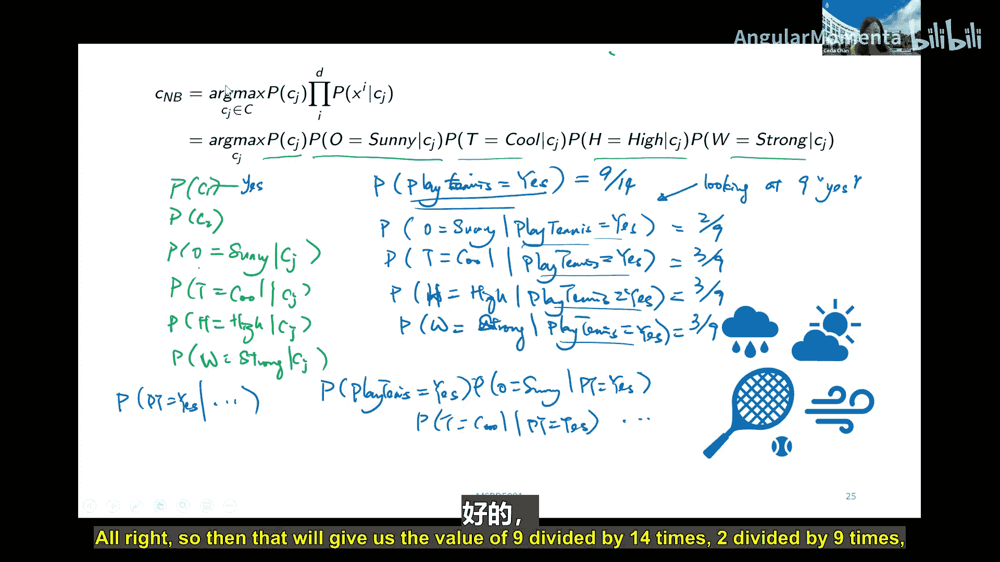
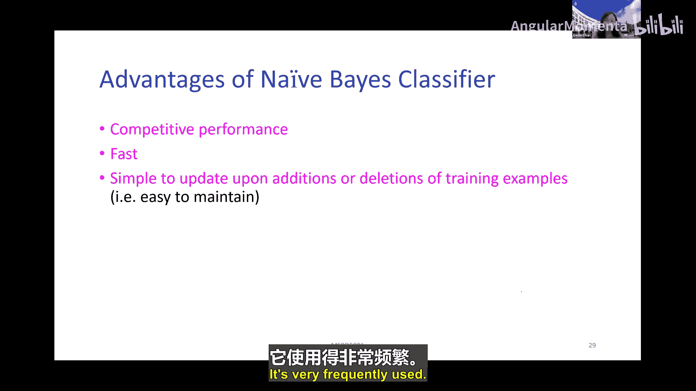

# 【香港科技大学】数据分析基础-｜-Foundations-of-Data-Analytics-p21-14-03-02-朴素分类--BV1oKFDznE6L_p21-

So after having discussed what is machine learning briefly。

 so now let's take a look at some machine learning methods。

 The first one that we are going to talk about is the naive classification method。

 so you can see that classification， so it's a method that we use for doing classification now。😊。

Naive classification method is actually a simple classification classification method and the idea is based on base rule so you see later on so then now it's called naive classification method so the naive here is not about like how simple the algorithm is it's actually about like an assumption so the naive here means the assumption that all the data are actually independent okay。

 so we'll talk about it a little bit later on now when we are doing like the naive classification methods in like we are going to look at the problem with training data and the problem that like the learning that we are looking is actually like making use of training dataset which has classes classes so then classes here we represented by CJ so CJ is the class is the label。

😊，Of a particular sample。 So then say that the problem that we are looking is having N sub N classes。

 Then with that means we are looking at。C1， C2， and then Laum。

CJ and so on and then say that we have CNN classes。Okay， so then each of the data。😊。

Is going to be belonging to one of these classes， it could be C1， it could be C2， it could be C and。

 it could be Cj okay。And then besides the class label， we have the training data， right。

 So training data is actually like a top of attributes values。

 So just like what we have mentioned before， then each sample。Is actually a vector。A D dimension。

Vcca。So which we have the x1。X 2， and then X T。Values， so it's a D dimensional vector。

 So then we have many， many samples。 So that means we have many， many these factors。

 So do you we still recall that now we have the vectors， we have the label set， so that's。

Labeled data。 So that means right now we are doing supervised learning。 Okay。

 so then what's the problem here is that given an unseen data。 So that's like a without the label。

 So given an unseen data， which we have the features。 So that means we are looking at a particular。

Factor， so then we want to find out the most probable class， the most probable class。

 one of the class among the label set。Okay， so then how are we going to find that。

 So we are going to calculates the probability of。A particular class label。

 So say that we are going to find out the probability of the label， the class C1 of that particular。

Data， so that means it's with the x1， x2， and then so on the x。Features， the features。

 so this is the feature vector。Okay， so we are going to find out the probability of C1 given the data。

 and then we are going to find out the probability of C2 given the data。And then so on。

 and then up to we find like the C。Given the data as well。 And then okay。

We pick the maximum one and say that maximum say， for example， if C2。

 given the data is having the like a largest probability so then it's the most propable class and then C2 will be the answer will be the outcome of this classification okay so which means that we can write like the algorithm as the。

Okay， trying to find。The class CM map。Which is going to be。Wheres he？K belongs to the。C， okay。

 and then we are going to find the maximum。Possterior probability。Like this。

 so we are going to find the maximum probability of a particular class label given the data okay。

So then now how are we going to find this， right， so then in here we are going to make use of the base theorem。

 So then let's take a look at this。Do you still recall the base Fuor？

So that means if like we know the conditional distribution。😊，So then okay。

 we'll be able to find the other conditional probability distribution。 Okay。

 the other conditional distribution， So you can see P Y given X will be equal to P X given y times P Y。

Divideed by px， so say that now。Y is Cj， right， and then x is our observation， our data。

 So that means x1， x2， and then so on。Okay， so then we will be able to represent this。😊。

According to this， right， so that means。We'll be able to okay， have this。ok。😊，Becoming。The X1。X 2。

 and then X D。The other conditional probability。😊，Times。CK。😊，And then divide that by。😊，Sorry。

 let's use Cg。And then by D。😊，Probability of。The data。OkayAnd then。This。Okay。

 so then we are looking at this。😊，Right now because we are actually calculating c1 c to up to CN right。

 so then if we represent this by this and then represent this by this。

 you'll find that that there is the denominator， which is actually the same。

This part here is going to be the same for this one， this one， this one， right。

 So since it's the same for all these probabilities， right。

 So then when we are trying to find the corresponding class label。

 which is giving us the maximum probability here， So we can simply ignore this one， Okay。

 ignore this one。 So then that means we can do comparison based on this only。😊，Right， so then okay。

 this will give us this。😊，Okay， calculation。So we'll be able to do this， right。

 so that means we want to find。The CJ， the probability， the maximum probability。Of CJ。

 given the data。 So we are looking at the class label， which is giving us the maximum probability。

 right， But then we can actually like do that with looking at the probability of the data given the class and also the probability of the class。

 Okay， So that means we can do it by finding this。 So then now how are we going to like find these right。

 So then we can actually use the frequencies of the data。

 which means that we are actually having a maximum likelihood estimation of the training data。

 So with the training data， we'll be able to estimate what is the probability of a class in the training examples。

 And then we'll also be able to estimate the probability of the data。

 the joint like a occurrence of the。Features， given the like class。

 but then even with the training examples， this in order to evaluate estimate that will need a very large number of training examples。

 so which may not be feasible， so that is why in here we make use of the naive assumption right。

 so we are looking at the independence assumption。So then okay， with the independence assumption。

 it means that all the attributes values are conditionally independent， given the target value。

 so that's naive base， so which means that the probability of the data given the CJ can be looked as because they are independent if they are independent we can treat it as the product of each。

Features， probability given the class label。So that means the previous equation here。

 the previous formula here can be rewrite， rewritten can be rewritten into this one。

 so then we'll be able to estimate this we'll be able to estimate this as well。

 then we'll be able to find out the probability okay the probability of like a class given the data and then this naive phase assumption is greatly reducing the number of parameters and the data balance problem。

😊，So which means that now theb classification we are going to like a classify an unseen instance by computing the class that maximize the posterior probability okay so that means we are looking at this right but then with the base theorem and also the condition independence conditional independence assumption satisfied then we'll be able to like have it corresponding to this right okay so then we'll be able to estimate the probability and then do like a declassification accordingly。

😊，So links let's take a look at an example so say that we have the play tennis data here so we have many observations right we have many instances。

 for example on one day then when the outlook is sunny the temperature is hot humidity is high wind is weak then while we're not going to play tennis while if there is overcasted and like temperature is hot and the humidity is high windk is like a weak then we'll play tennis so we have the feature actors so you can see these are the observations the feature actors and we have the class labels。

😊，We have the class labels here。 Okay， so then we wants to answer the question。 say， for example。

 if the day is sunny， cool， high and strong。 So that means the outlook is sunny。

 temperatureerature is cool。 humidity is high， Win is strong。 Should we be playing tennis。

 So then you can see the problem here is that we have two。Classes， right。

 so C1 means that it's play tennis。Is yes。Well C2 means that， cake， play tennis。It's a no。Okay。

 so then well need to find the probability of yes or no for play tennis， given these features。

 So that means this is the。Unseen data。So then well be we want to know like would the probability of yes。

 given these four like。Features。😮，And then be larger then。The probability of pay tenniss as no。

 given these。 Okay， so then that's the naive classification methods。

 And then let's see how we can do that。Okay。是。Recall that the problem that we are doing the classification problem that we are handling is say that we have a datatum instance with the D features then the like values for the D features and then we are going to like calculate this and then find the one the class label that is giving us this maximum probability and then because of the naive based assumption then we'll be able to estimate that food is right so then the like a question that we are asking is what if we are looking at these。

Right， so that means the data now is having like an outlook as sunny， temperature as cool。

 like a humidity as high and then wind as strong。 then should we be playing tennis or not So you can see that well we are already using some symbols to represent the problem。

 So then let's define the symbols first。 So now we have。😊，Okay。

 so now we know that we are looking at like the class labels， right， So that means J right now。

 sorry about this。 we are looking at J as 2。 So that means we are looking at C1 and C 2 while C 1 means that it's play tennis。

As yes， while this one here is playing tennis as。No。

Right so then we can also treat it as like a01 class as well right and then let's use this and then now what we have here is that now the x1 right now you can see that here this will be the first attributes outlook。

😊，And then x2 means that the second attributes。Temperature。And then we have the x3， which is。😊。

Humidity。And then we have the x4， which is the wind。Now， for simplicity。

 we are going to just put down the first character of each featuring Okay。

 so that means we are looking at outlook as So T S Q H S high and N W as strong。

 and then we want to like find out the probability of。😊，Play tennis。Being yes， given the O， S Sun。

TS co。HS high。And then W S strong。And then we'll also want to find like。

 what is the other class probability。 So play tennis as no， given or as sunny。TS co。X S， height。

 and then。W S， strong。Okay， and then we'll be comparing these two and then see which is the larger one and then the corresponding class will be our answer right so then okay。

 how are we going to do that So like recall that in order to find these two following the。

Then you face model， so which means that we'll need to estimate the probability of each of the class and then also the probability of each of the attribute value given the class。

So then we can do that with the estimation of the training data。

 So that means now we can elaborate this into finding the PC。

That means we'll need to find the probability of C1 and the probability of C2。

And then we want to be able to find these。Given different class labels， right。

 So then we'll be able to calculate that。 So that means we'll need to find the probability of all being sunny。

Given the CJ。Proity of T S cool， even C， J and then probability of high。Given C J and so on。

 and improability of W as strong given。CJ， right， So then let's first focus on the。C one。Okay。

 so that means we are now looking at。First， the probability of C1 s yes。

 so that means we are going to find out first the probability of play tennis。Yes， yes。

Okay so how are we going to find that we can do frequency count so that means going back to this table here。

 we count't how many yes are there， so there is one，2，3，4，5，6，7，8。

9 and then how many instances are there we have 14 so you can see we have 14 training data training data points there so then nine out of the 14 are having the play tennis as yes。

 so that would be an estimates of the probability of play tennis being yes。

 so then we have nine dividedr by 14 okay。So next， we want to know， like， for example。

 given those who are playing tennis。 Okay， given those who are playing tennis。 So then okay。

 given those days which we play tennis。 So then which one like how many of them are actually having the old。

 the outlook as sunny。So that means we are now calculating the O as sunny given play tennis。Yes， yes。

So that means we are looking at the now nine samples。

 so we actually like are looking at the nine samples。So we are looking at the nine yes。

 and then we do the counting。 So that means with yes， what is the outlook， is it sunny Okay。

 so then no sunny， no sunny and then one sunny， two sunny， So then we have two sunny Okay。

 so two sunny。😊，Out of those that are yes， Okay， so then that means the estimates of the probability of outlook being sunny。

 given play tennis is yes， will be two out of night。Okay。

 so then we do a similar calculations on the other attributes values as well， so like T as co。😊。

So then given play tennis as true， so then we do a similar frequency calculation。

 so then again we are doing looking at this and then how many of them is having the like TSco so no yes。

No。Yes， and then one more。 So we have three out of nine that are。Being cool。

 given play tennis is yes。 So then we do the other things。 So similarly with the W as high。😊。

So then again， counting the frequencies。😊，As yes。And then let's go back to here。

 so how many of them is having high1，2？😊，And then free。 So free again。 So that means free out of9。

 So then one more。 So well need to find out the like， this is actually high W S strong。😊，Given。

 play tennis。As yes， he， so then what is it？Frequency， so then again， let's find the strong。 So then。

1。😮，And then two and then three。 So again， three out of9。 So then okay。

 these are the probabilities of like a given tennis， play tennis as yes。

What is the like a probability of the attributes values， right， So that with this。

 like I will be able to calculate the probability of。😊，P。Play tennis。S， yes。

Given the probability of O S Sun。given。PTS， yes。And then given P T， S， cool。Given PTS， yes。

And then so on。 Okay， so then we'll be able to calculate the probability of。😊，Okay。

Play tennis as yes。Okay， given。The observations。All， so then that will give us the value。😊。

off。9 divided by 14 times2 divided by9 times3 divided by9 times3 divided by9 times3 divided by 9。

 and that would give us the value，0 point。0，0，5， one， Okay。

 so we do that similarly for the like a play tennis with no。

是。Red that the probability of like play tennis being yes， given the like a unseen data， then it's 0。

051 while。The probability of pay tennis is yet no， given the probability of the data， it's 200。0207。

 So that means this is larger。So this is the larger one， largest。Maximum， so then that means。

This class。This class label here， which is C 2， is the answer。 So the answer is C 2。

 So that means the answer to the question is play tennis is。No。Right。

 so then this is how we can like make the decision so we can compute the like a frequencies。

 we can like a account of frequency and then we'll be able to estimate probability the probabilities and then we'll be able to like answer the question of an unseen data。

😊，Now， when we are doing this like a classification。

 you can see that we are doing multiplication on all the probabilities。Yeah。

But multiplying a lot of probabilities， which are all between0 and one by definition。

 can result in a floating point on the flow。 So that means the problem is becoming so small。

 It's hard to compare。 So then like well， a better way to like do the computation is by doing the summ instead of multiplication。

 So how can we do the sum。 So we use the log。 So we take the log on the probability。

 So then that will give us instead of the multiplication。 then we now have the summation。Okay。

 so then now with this like a summation。😊，Version， then we'll still be able to find out the like most propable class。

 but then now we are finding the most propable class given the highest final anomized lock poverty scope。

The naive makes classification can be applied to a lot of different domains。

 One could be the document classification。 So a document here is like an instance of our data。

 So then a document has many features so it could be like represented by the words that are appearing in the document and then for like each document。

 it can be belonging to a particular class， for example， like the class C1， it could be like。

 for example， the。Science fiction and then like another class C2 could be the mystery stories like things like that。

 So then like we are going to classify whether a book or a document is belonging to a particular category so then what we have as the feature vector will be the words that are in the document but of course like we can represent the words in many。

 many different ways， but then like the feature vectorctors for simplicity could be allocate could be like could be regarded as like containing the words in the like books or document so then for the training data it means that we have already for example。

 M books or M documents which we already know their labels So how can we get the labels it could be hand labeled so like for example some people already read all those books and then they know which label they are which class each book are。

So each book is then we can make use of the naive based classification model and then like we are like estimating the probabilities and then we find out which is the most probable class CJ of an unseen book。

 so that's a typical application of the naive based model， the naive based classification。

So what are the advantages of the naive based classifier。

 So then you can see that it's going to be the competitive performance。 Now。

 even with the independence， like a independent assumptions。

 you'll find that the naive based classifier is actually working performing very well on a lot of different like domains and then like data sets applications。

 and then it's。Fast in computation。 So that means， well， it's not。

 it's going to take a very short amount of time and then you will be able to like estimate the like probabilities。

 and then we will given given us the class given the maximum。

 the most probable class Okay And then now if we have more training data。

 It's going to be easy to update the naiveface classifier as well。

 It's just updating the estimated probabilities。 Then with the probabilities estimated update。

 then again， we'll be able to do class to find out the probability of the classes given the documents as well。

 So that means with addition of deletion of training examples。

 we like be able to update everything and then we'll be able to still continue to do like the class very。

 very quickly。 So that means naiveface classifier is actually easy to maintain。😊。

So these are the advantages of naive based classifier and that is these are also the reasons that naive based classifier is actually quite popular。

 it's very frequently used。😊。

