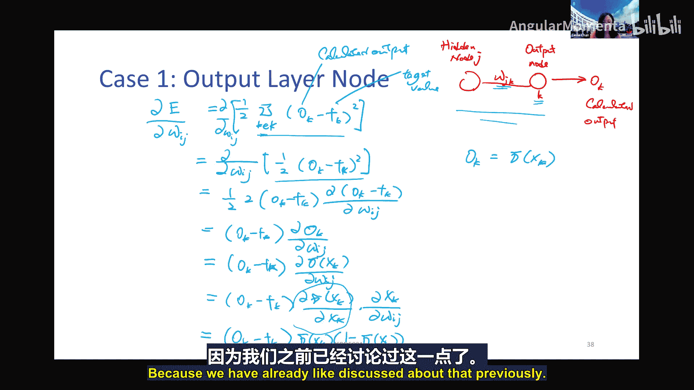
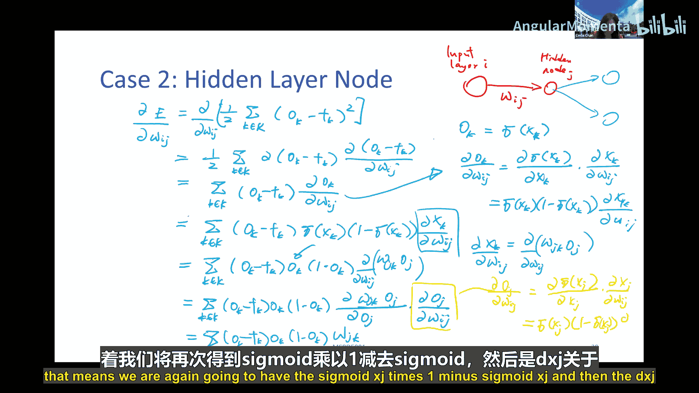
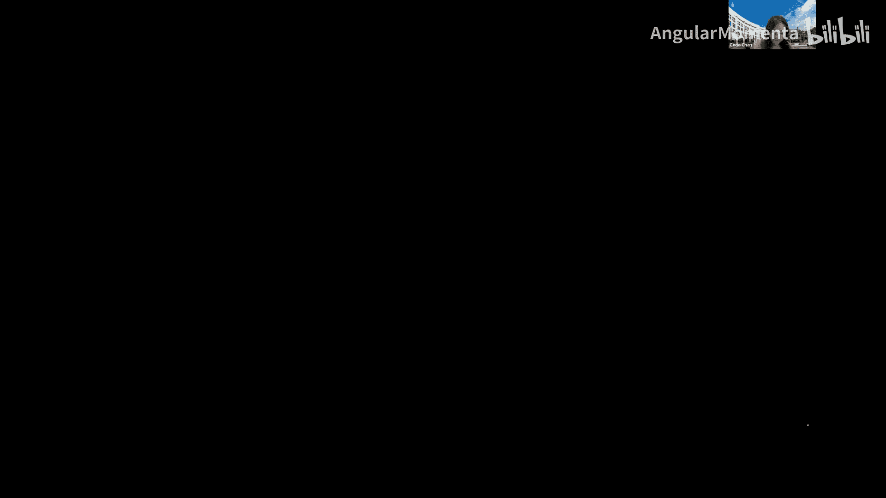
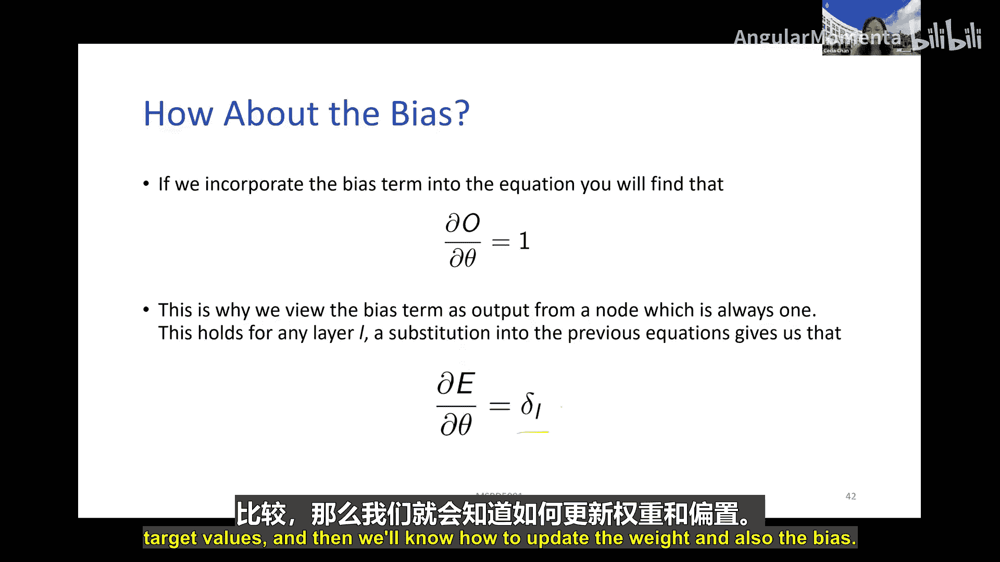
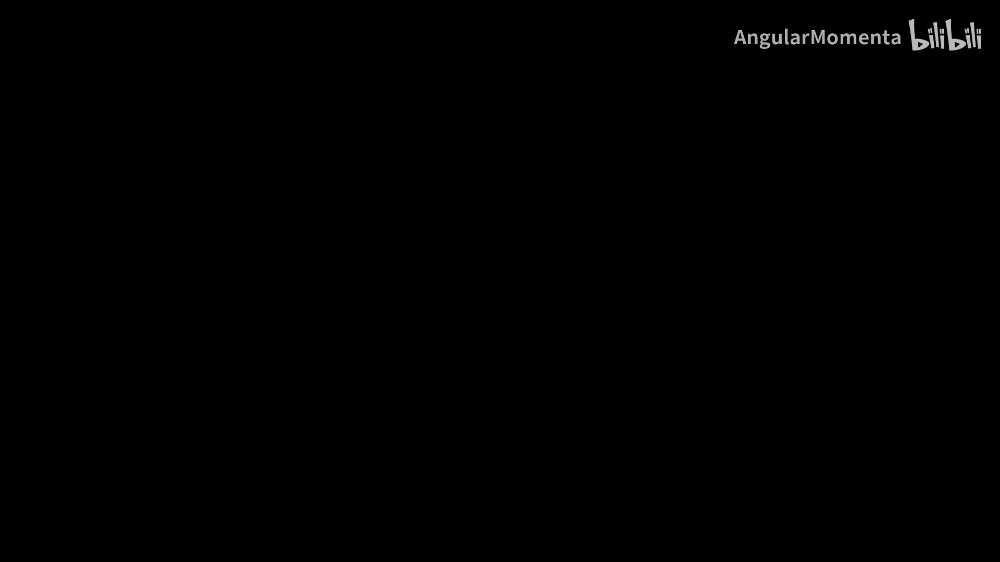
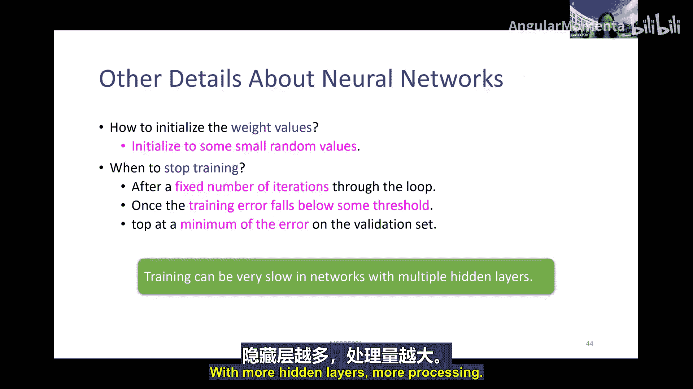
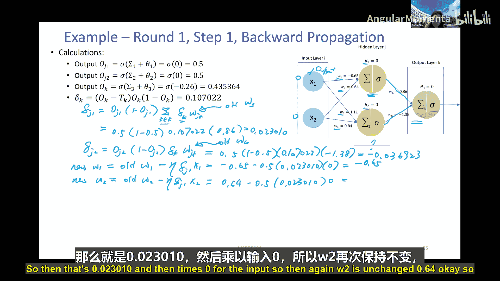
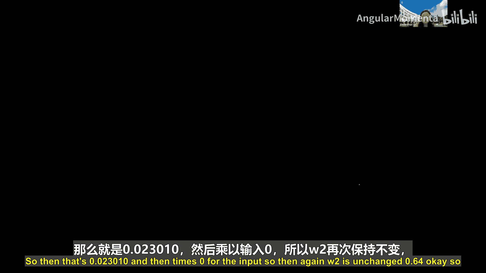
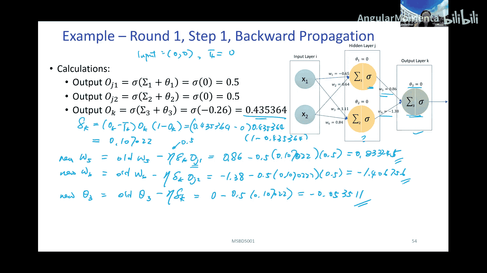
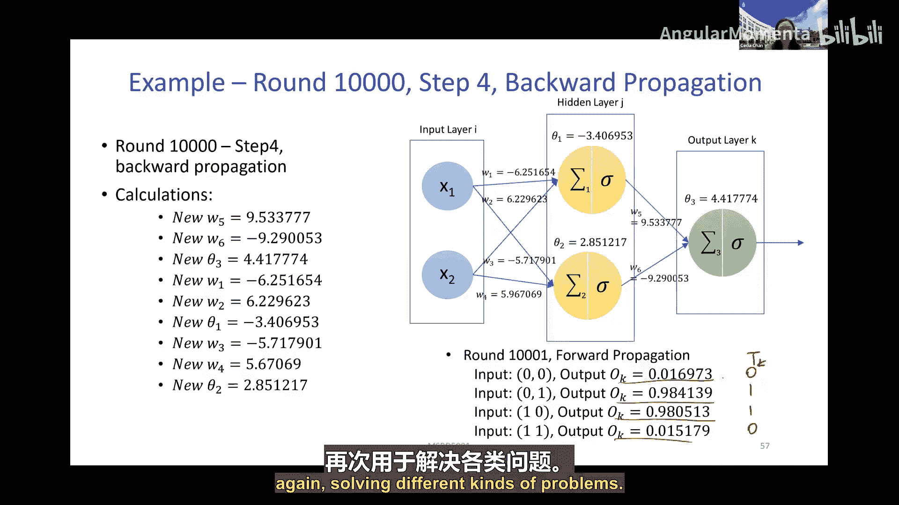

# 【香港科技大学】数据分析基础-｜-Foundations-of-Data-Analytics-p22-14-04-02-引言--BV1oKFDznE6L_p22-

So after looking at naive based classification， so then let's move on to look at another interesting like a method which is called artificial neural network so artificial neural liquid just like its name it's actually like inspired by like the neurons how our neural system works in humans now human is able like human's neural network the neural system is able to like a learn and then make us learn like a memorize things and then like generalize our learning。

😊，Like with the neurons right so then like this is inspiring the research of the algorithmmic modeling of the like a biological neural systems So that means again we are taking like humans as like examples and then to study how human learns and then we are trying to have the machine learns in a similar way so then our neurons like the biological neuralsyss is actually communicating through sending signals over neurons to neurons and then the signal is being sent and then like it will reach to like our senses and then also reach our brains and then like making us learn and then do a lot of different things so then in an artificial neural network it's artificial because we are simating that and now then the basic unit of the like computation in artificial neural network is called the neuron。

Or like it is often called as a not or a unit。 Now， what is a neuron。

 So neuron in neuro network is actually receiving inputs from one or many nodes。And then like， well。

 each of those input is going to be associated with a weight。 So we have an input。

 and then it will be associated with a weights。 And then like the weights is actually to control the relative importance of this input comparing to the others。

 And then with all the like inputs。 and then with their weights。

 So that means we have weighted inputs。 So then the note will actually have a transfer function or an activation function。

To the waveive the sum of the inputs。So that means with the waveth sum of inputs。

 then the waveth sum of inputs will be fed to a transfer function or an activation function and then which the activation function or transfer function will give an output okay so then inputs to output now besides the waveth sum of inputs while additionally there is a biasers associated with each neuro and then it could be also regarded as an input one with weight。

So then let's take a look at some diagrams to show us what exactly a neuron looks like in the artificial neural network now we are having some notes here on the left hand side it is a neuron with a single node so you can see that here it's taking one input only and then that input is a wave at one so that means we are looking at XW。

As a w the input， but then there is also the bias。Okay。😊，This is the input。

And then this is the weight here。So then we have the waveleed input。Aiding on top the buyers。

 that would be the value that we are going to give to a transfer function or to an activation function。

 So this is the activation function。So which means this activation function is going to take the value of wave the sum plus the bias and then it's going to give us an output。

 which is called oh， so we have the output here okay。So this is a single note。Okay。

 so what if we have multiple nodes。 So we have a neurons with more than one input。

 So like the one on the right hand side， you can see that here we have free inputs。😊。

And then each of them is associated with a weights。

 So then the weight sum of these three inputs will be W 1 x1 plus W 2 x 2 plus W 3。X3。

 so that would be the way for some。So which is this one， but then again， we have a biasers。😊。

So then we'll need to add this bias on top。So this bias here is allowing us to shift the input for the activation function。

 so then adding the bias， which is actually theta and that will be the value that we give to the activation function。

So then again， that activation function here is going to give us the output according to the value with the sum of inputs and bias and that will give us the output so you can see now like we can have like one input we can have many。

 many inputs。But then if you look at both of the pictures。

 you will notice that we only have one output because the activation function is going to take the waveed inputs into giving us one output value。

 So therefore for each of the neuro， we are only having the one output。

 but then we can have as many inputs as we like。So we are talking about a neural network right so there won't be just one neurons it will be many many neurons。

 many many nodes and then very often these node will be arranged in multiple layers so then like I will usually have an input layer which means the notess。

The input nos， it's giving us the information from the outside world to the network。 And then okay。

 they are referred as the input layer。 So the no that is giving us the inputs right So then no computation is performed in any of these input nos。

They are just passing on the information to the hidden layer。 So， for example， this note here。

 there will be an input value。 So it's going to give， for example。

 a particular input value input value， for example， to the。Like another note。

 Okay and then this one here might be giving like another value。 So， for example。

 like X2 and then giving it to like the same other node or other like a notes in the neural network。

 So there is no like a calculation， it just pass on the information。

 Now you can see that for the input node， it's going to passse the information to another node。

 and that another node is the hidden node。 The hidden node in the hidden layer。

 So which means it has no direct connection with the outside world。

 The reason is you can see the input node in the input layer is a direct connection with the outside world。

 So then it gets the data from the outside world and then pars to the hidden notes。

 So hidden notes get the value gets the inputs from the input notes。 So then with the input values。

The hidden node is performing computations。And then we'll transform the inputs。And then okay。

 the information from the input nos and then to get an output。

 and then it will give the output to the output no。

And then you can see that here hidden layer is about the processing， right。

 It's about processing the input data and then sending the data to the other nodes。

So then a collection of hidden notess is referred as the hidden layer and then there is another kinds of layer in a neural neural network。

 which is called the output layer so the output layer is having output notes so the output node are responsible for computation and then transfer the information from the network to the outside world so that means the hidden layer is doing a lot of processing and then it will be combining the like an input information from the outside world and then generate some like an information and then it will be pass them to the output notes where the output notes collectively take all the values from the hidden notes and then it's going to compute the output the final output and then it's going to send the output to us that means sending the output。

To our outside work， so then we'll use the output for making decisions。Now in a neural network。

 typically we have one input layer， one output layer。

 but then we may have more than one hidden layers， and then each of these layers can have like as many nodes as we need So for example in here we are only having two input notess but we can have more and then similarly we have only three hidden nodes and then we can also have more and then there is only one output node here。

 we can also have more right so depending on the applications depending on the problem then we may want our network to be of having different numbers of different hidden layers having different numbers of nodes So then like if we have more hidden layers then our neural network we become more complex or it's going to be described by another term which is deep So that means we are having a deep network So then how do we learn the。

Such a deep network through deep learning。 So then deep learning means that we are learning a very complex network。

 So then when we have learned complex network， then， of course。

 complex network can be used to help us to solve a lot of like a complex and then like a a useful problems or applications。

So we now know that a neural network is having many nos and the nos can be like in the input layer。

 which we take the inputs and there could be hidden layers with hidden notess and then we'll have like the input converted process by the hidden layer and then we'll have the output layer combining the values and then giving us the output and that output is going to help us make like decisions or predictions right So then like exactly how are we going to make use of neural network and then how we are going to learn with the learn for like the artificial neural network So then let's discuss that in more details Now the learning of the neural network is to find the ways that minimize the error and then this is done by using that。

Now， what are we talking about， so let's go back to。The diagram of the neural network。

 so we know that we have inputs。And then these inputs through the neural network。

 it's going to give fast the output。😊，So that means we have inputs。

 we have outputs and then the problem now is how are we going to do the processing。

 so then how does the processing is being done recall that what are the neurons the neurons will take the weightle inputs and then with the buyers and then there will be the activation function。

 so which means that we want to be the be able to determine what will be the weights。

Of this input node to the hidden note and what will be the weights？😮，Of the。

H the no output to the outputns as the input。 So we want to determine all the weights。

 So if we can like， find a set of ways that is going to give us good predictions。

 It's going to give us good results。 then that would be the best。 And then besides the weight。

 what do we have with the neurons， the bias， right。

 So then we also want to know what would be the bias for each of the node。Okay。😊。

Then okay with the like estimated or with the weights and the buyers that we are like a finding。

 then we'll be able to have a newer network that is going to give us good performance we on the inputs and then we'll be able to have accurate outputs。

 So that's the aim that's how the learning is being done， but what are the exact steps。

 What will be the steps in order to achieve that So first now we only have inputs right So then we don't know the weights。

 So then we wants to like calculate the weights， But then initially so how can we calculate the weights So then we can do that by initially like setting the values to random values So we pick some random connection weights So we pick some random values for the weights then。

We start with the training examples， so that's why we are doing learning。

 so we are learning with training examples training examples means that they are labeled data。

Labeled data， we have the classes。 We have the like a desired output。

 So we have the inputs and the desired output。 So then with the use of the given input and the desired output。

 then we fit the inputs into the like a input notes。And then based on the initial random weight。

 we find out the output。 We calculate the output based on the given input and also the random weight。

Okay， then we compare the outputs with the given。Input with the desired output。

 So we calculate the error because we know the desired output。Okay。

 and then we compare it with the calculated outputs。😊，Okay， so then we'll know the error。

 So then we have the error and then okay， starting back to with the output notes。

 So that means we start with this here。The output notes。We start with the output layer here。

 the output notes， and then we go backward Okay， so we try to。Okay。

 find the error and then we communicate with the hidden notes and then adjust the weights between the hidden notes and the upper notes。

And then after adjusting the weights， so then we go back again and then adjusting the weights。😊。

Of the the weights connecting the hidden node with the input nodes。 So we then we go backward， right。

 and then adjusting the weights。So then okay now we have the adjusted set of weights。

 so that means we are having a new set of weights， then we try to work on the original inputs again。

 we work with the training data again and then again finding the calculated outputs based on the adjusted weights and then we compare the calculated output with the target outputs and then we know the error。

And then if it's not good， so then we just go back again。We start with the output notes。

 go back again， adjusting the weights and then adjusting the weights between the input note and the hidden notes。

And then， while， we do the。Calculation of the outputs again and then keep on adjusting the weights until we have a desired performance。

So then that's the rough steps and then flow of how are we learning？And artfi show neural network。

Now you can see that here now when are we going to stop so then would the error like a well theoretically speaking。

 we should stop when the error is zero okay when the error is zero then it means that we are exactly getting what we desire。

 but then we know that in real life in our real applications。

 we are not going to have a and like an error as zero。

So then what we are trying to do is we are going to minimize the error。

 So or when the error is small enough。Then we stop and then say that， okay。

 so this is a good enough network and then it's going to like give us accurate results for most of the time。

😊，So this is how we learn。With the like we do learning with the artificial neural network。

So basically you can see that when we are learning with A and N we are trying to estimate the weights。

 so we are trying to estimate the parameters such that with the inputs we are going to get and outputs。

 so you can see like inputs。Input values to output values。 So then it's like having a function。

 right， So a function is actually having the text input。And then convert to outputs。 So then。

An A and N， a neural network is actually like a function。

 So then what we are doing here with learning an A and N is like having a function estimator。😊，Yeah。

So we are trying to find。The function for connecting the inputs to outputs right， and then okay。

 with learning， we are trying to estimate the parameters of that function。

So that means we are finding the function， right， so we are finding the function through learning with ANN。

So we are going to take a look at exactly how these can be done。

 how we are going to find the best set of ways that are going to minimize the error but then before that we are going to look at some notations first because these notation will help us to understand what are we going to do next now we call that in the neural network we have neurons right so we have inputs and then now we have different layers so that means we have inputs for the input node we have inputs for the hidden node and then we also have inputs for the output node so in order to represent them so then well say that like this now if we have XLJ it means that we are having an input to the notej of the layer now between the neural network we also have all the weights connecting between。

Like a two no， it could be an input node to a hidden note。

 hidden note to output node or a hidden note to a hidden note。

So that means we'll need to represent the weights between two nodes from two knit layers so then。

If we are talking about W L L dash L I L dash， then we are talking about the weight from layer L and then connecting to a note。

 J I of the layer L to a note of layer L dash。So then that means like if we are looking at the first note here。

 then we are talking about the weight from the input node。In the layer I。

And then connecting to the hidden no， the first hidden node in the layer check。

 so then we'll have the widths IJ from the hidden layer， from the input layer to the hidden layer。

Okay。😊，Alright， so then besides the inputs and the weights record that for each node there is a bias。

 so then what is a bias so the buyer is the value that we can apply on the wave the thumb to shift the value for the input of the activation function or the transfer function so then for each node there is a bias。

 so that means we can represent it like this so theta L J means the bias represents the bias of note J of l of layer L so you can see that in here for every node this note this note this note and this note will have a bias How about the input node because the input node is not doing any processing iss just passing the data to the hidden notes so therefore there is no bias。

Okay。😊，So then now while for neuron it' going to combine the wave inputs with the buyers and then with the activation function。

 it's going to give us an output so then to represent the output of a neuron of a particular node then we write it as OL J so it means the output of node J in layer L and then you know that with the learning we'll need to compare the desired output with the calculator output so that means we'll need to represent the desired output so we say that it's a target value So which means this is the desired output。

So then okay for a particular note we have a desired output， a target value。

 so then it's Tj so then typically the Tj is the like a well actually we only have the target output for the output layer right so for the hidden node because it's processing so we don't have the desired output for them so therefore we are only having the target output for the output notess in the output layer so that is why we're represented by TJ。

Alright， so then now we have all these like notations。

 but then like later on we'll talk about an example， we show you an example。

 so then for simplicity so we might simplify the notations a little bit。

 but you will see that later on。😊，Alright so then we have been mentioning the activation function for a few times right so what exactly is an activation function its for combining it's for taking the weight like a input and like a bias and then going to transform them as the output so then that's why it's called a transfer function it takes inputs from some new norms from some notes and then it will give an output okay。

😊，Now， one of the like activation， there are many activation functions that we can use for a neural network。

 but then one that is very frequently used is the sigmoid function。

 Now sigmoid function is very often used as a transfer function as an activation function for a neural network。

The reason is because it's continuous and differentiable。

 So for the sigmoid function is going to give us a value between 0 to 1。

So you can see that here this is a representation， this is a representation of the sigmoid function。

 so you will see that here it's going to give us a value between0 to1 okay like four different inputs for different values of x so this is the value of x and then it's going to be the s the sigmoid functions of you will see that it's between0 to1 and then it's continuous okay。

😊，And then， like。So why sigmoid function is so useful for like a neural network is because it's like a well。

 the derivative of it is very nice， The simplicity of finding its derivative make is a very。

 very useful like a activation function for learning the neural network Okay now you can see that here。

 if we take the derivative of the sigmoid function with respect to X。

 youll find that it's actually going to be composed of。😊，The sigmoid functions themselves。

So it's a very interesting like a property and which it's going to be very useful when we are doing learning。

So how about since we are talking about the derivative of the sigmoid function。

 how about let's spend a little bit time to look at now how exactly like we are taking the derivative of the sigm function and then how are we going to reach to this very interesting representation。

Alright， so then let's have a quick look at that。 Now， we know that well。

 the sigmoid function is like this， right， So if we take the derivative of this sigmoid function。

 then what we are doing is we are going to do the the。😊，The D soid K with to x。

 So that means we are doing a D okay of d x。On the one offer one plus E minus-6， right， so then。Okay。

 so we can also represent it as1 plus e minus x。To the power minus-1。

 So then if we take the derivative of this， then we'll be like able to get this。

 So that means we are having the minus1 times the1 plus E minus x and then minus2 right and then we。

😊，Take the derivative off。The one plus E minus x。So then okay， like a， you can see that here。😊。

If we are taking the derivative of1 plus e to the power like a minus x。

 so then this is just a constant， so then taking the derivative of it。

 meaning that it's going to be0。So then it remains that we are going to calculate the derivative of this part。

So that means it's going to be E minus6 to power2。 And then we are looking at。Y， E minus。

So that means we are going to do this part， so then what will this part be giving us。

 then it will be something like this。Okay so that means if we are doing the derivative of the D minus x。

 okay？So then we can treat it as。Okay， so then what we have is we are going to have the。

 this part here is going to give us E minus x， and then we have the D minus x。Respect to x like this。

 Okay， which this one here is going to give us minus-1， right， so that means。Continuing over here。

 then D sm Dx is going to give us minus-1 plus E minus x-2。 And then we have the E。-6 times minus1。

So that means it's going to be e to the。Mus6 over。😮，So the negative ones is canceling out。

 so then we have one plus e minus6。Minus power2。Ls， right， so then we can。

Tre it as one divided by one。And then E minus x。E plus1 plus divided by 1 plus e to the minus x。

So then okay， now this part here， you can see that this is already the sigmoid。😊，Es southlf， right。

 So this part here is already like this。 So then the remaining thing is how are we going to represent this。

 right， So then we can also treat this as。😊，Okay， this here， we can treat it as1 plus e minus x。-1。

 so then we are actually doing plus one minus1 so then k divided by1 plus e to the power x。

 so then that means this one here we are going to have one right so then it's one minus1 over one plus E minus x。

So then which means this is signaligm。 So then we have。S Mo x times1 minus se Mo X。

So then you can see the derivative of the sm function is going to give us this interesting results it's going to be very helpful in later on when we are doing the learning so we know the like a characteristic of the sm function so then we have everything ready so then the next question like we need to figure out is now when we are doing the learning well need to calculate the error so how do we calculate the error so that means we compare the like。

😊，Calculated output。 So this is the calculated output。And then we want to compare it。

With the target values， right， So we have the target output， the target values。

 So which is represented by Tk。 So， and then we have the calculated output。 Okay。

 So then that means we wants to compare these two values。

 So that means we are comparing okay with Tk。 So what is the difference between that。

 But then now it's go， it could be a positive value， it could be a negative value。

 But if we are going to but if we are having a negative value， it's going to be troublesome。

 So that is why we wants to look at the absolute value。Absolute difference。

 We don't want it to be like a negative or positive。 We don't want wants to worry about that。

 So we wants to look at the absolute value of the。Difference。

 but then now we are going to like I try to like in learning， we want to minimize this era。Okay。

 so we wants to minimize the error between the calculated output and the target output。

So then in order to minimize the error， so then we want to like take the derivative of the error and then okay find the minimum value corresponding to it so that means if we are like a defining the error as an absolute value it's going to be troublesome to find the minimum so that is why instead we take the square。

So then we have a positive difference， but then it's going to work with the later processes。

So that is why we have this and then now we may have K outputs， right。

 so that means we may have like many outputs。😊，So we may have many output notess。

So then that means we may have many outputs。So then if we have many outputs。

 so then well need to sum the total errors， so that is why we square square each like a error between the calculator output and the corresponding target output and then sum all the errorss and then we are dividing by two so the reason that we are dividing by two here is again because later on we'll need to find the minimum okay so then we'll need to find。

The set of weights that are going to minimize the error and then because of that well need to like find the derivative and then things like that。

 then okay if we take the like a divided by two then it will again makes our calculations later on better easier right so that's why we have this error defined like this Okay so now we have the error defined as the total error between the calculated output values and the target values。

 then。We can like take the derivative of the error with respect to the corresponding weights。

Because we want to find the set of ways that are going to minimize this error。

 so that is why we take the derivative of the error with respect to the weights。

So that we can minimize D up。So then okay now what weights do we have we have weights between hiddens and outputoc。

 we have weights between inputoc and the hiddenns and we may also have weight between hiddenns as well。

 so we have many many weights so that means we'll need to take the derivative respect to weights okay many weights。

So then now we have different ways connecting different notess right so we have different notess connecting so that means well need to consider two cases right so two cases of like the error calculation and the weights and the weights update and then to find out the outputs etc。

 so then we need to consider two cases one case is that we are having the output layer so we are looking at the weights connecting the hidden layer and the output layer and then well also need to look at another case which is like having the input node connecting to hidden notess that means we are looking at the weights between the input node at the hidden node or we may be looking at weights between hidden node okay so we'll need to look at these two cases and then we'll need to like calculates or well need to do the error calculations and then define。

Finding of the ways that are minimizing those areas slightly differently。

So let's look at the case one first， which we are talking about the output layer node so in this situation here say for example。

 we are looking at the output note note k， so then we are talking about the output note。

 the output layer and then the output note K。So then this output note here is going to give the output。

Value， okay， so then that's the calculated output。And then okay， we are looking at like awaits。😊。

Connecting this note to a hidden layer node。 So that means there is a hidden note。In the layer J。

 okay and then。😊，This note here is connected with the output node with the weights JK。

 so that means we are looking at the weights connecting the hidden node in the hidden layer and the output node in the output layer。

So then now。😊，Previously， we already know that while we are looking at the error， right。

 So when we are learning the neural network， we are actually trying to minimize the error。

 and then we want to find the ways that minimize the error。

 So that means we want to find the weights JK that is going to minimize the error。

 So that means we know that the error is this。Okay， minus Tk。 recall that this is the calculated。

Outputs。Wow， this is the target。That so then we are finding the error。

 the difference between these two values， and then we sum the like a errors between all the up and off。

And then now， if we want to find the corresponding minimum way。

 the corresponding ways that is going to give us the minimized error。

 So then we'll need to well need to take the derivative of the error with to the。Weight IJ okay。

 so that means we are taking derivative of this whole thing here with respect to WIJ。😊。

So then no so we are just like a generalizing it for the like a open node right so then there may be like many connections right so we may have like another way connecting with another the hidden node and then the open node so then we'll just focus on this case first and then you see how it can be applied。

😊，Alright， so then now if we take this， that means we are looking at。The derivative of this。

 But then when we are looking at this diagram here， you can see that while there is only one node。

 the output node K is concerned with the weights JK。 So that means like for this here。

 the other node the out output nodes is not related to the WJK。

 So that means when we are taking derivative we can actually ignores the other like earth right the otherer differences between the like a calculator output and the target values of the other output nodes。

 So which means we can drop the sumation。So which means that we are now looking at。This。

So we are looking at this， so then now to take derivative of this。

 meaning that we are having the one divided by2 pulling out and then times2 times okay minus Tk。

And then we take the derivative of okay minus Tk with respect to D W I J。 Allright。

 so then now we know that the taking off the derivative of the Tk because Tk is actually a constant value。

 right， So it's not calculated with respect to the。WIg。是。

So which means that the step is now becoming okay minus Tk times the derivative of OK。

With respect to WIJ。Okay。Right？So then now what is O， So O is actually。

The output by the some add activation function。 So which means okay is actually。Be。Likeum。

The sigmoid on the input of the like a output node， right， So which means that it's actually。Okay。

 the okay， okay is actually the sigmoid function with the input。Offf the。U。

 so therefore this here can be now like this。Right， so then we can again。😊，Write it like this。Right。

 so then what is the derivative of this then we know that right。

 so we know the derivative of the sigmoid function is going to give us the like a expressions of the sigmoid function itself。

 So which means it's going to be like okay minus。😊，t琪。😊，This part here。

 while this part is going to give us the sigmoid K Xk。Times1 minus sigmi X K。

Because we have already like discussed about that previously。😊。

So when we discussed the S function we said that there is the useful property of signal function right so then it's being used here right so then okay now what's remaining is。

😊，The D X K refer respect to。WI J。So the next， that means we are having this here。

 So well now what is this right， So then let's think about what is x K。

So what is the input of the output node， It's actually going to be。Wavd it。Output。

 so it's going to be the the weight times the output。Of this no， right。

 So the the output of the hidden note shape。 So which means that it's WJK times the output。Of no。

 Kate。Okay， I'll put off note J。So the output。Of hiddenuk。Okay。

 so that will be the input for the output note K。 So then there is also the。Bs， okay。

 but then because the bias is not。Related to the W WJK。So therefore， we can for simplicity。

 treat Dxk。Re respect to WIWJK as derivative of this。W JK。So then now this means that it's just。😊，Oh。

 J。Okay， so that means this is ocean here。 So then that means the。Results is okay minus Tk。

Which this one here， we know that it's actually okay， right， This is also okay。

So then we are having okay times1 minus okay and then Oj。All right？Now。

 since this part here are all about okay， so then we can represent it as the deelta k。

 so the deelta K。 So that means we are looking at the derivative of the error with respect to WRIJ S the delta K times Oj。

 so that means the output of the hidden node times the difference between the the changes with respect to the pre calculated output and the target output。

So then you can see that here based on the error so then we take the derivative so that we can minimize。

 we can find the WjK that minimize the error and then it will give us this right and then you can see like the sum can be ignored and then also like we can change the representation of certain terms and then if we represent this part here by the delta key so then。

The derivative is now being rewritten as this。 Okay， so that's。Fort of case one。

So you can see that this is going to be the same for other like open node。

 so then for other output notes then again we will be having ways connecting with the like hidden note and the output note and then well need to take the derivative and that will give us this general representation as well。

So next let's look let's take a look at the case two。

 so case two means that we are focusing on the hidden layer note。

 So what is our hidden layer note here， So we have the note J。So the hidden layer loop。Check。

 and then we are looking at like the。For example， it could be an input layer or it could be another hidden layer。

 so let's look at the like a the note between the input layer。I。😮，To the hidden note check。

 so that means we have the WIJ here， so we are looking at this case here。And then now。Okay。

 this hidden node can also be connected with so sorry so like because the hidden notes output is going to like a contribute to like it' going to be sent to different output notes so you see that when we are like taking the derivative of the error with is back to WIJ so then this time we won't be able to drop the summation。

Okay so then let's take a look at the derivative。So just the same before， we know that the error。Is。

1 divided by2 summation of K。Of all the openns and the O minus Tk， so just the same。The difference。

 the error between the calculated output and the target output。 And then that is the error。

 and then we want to。Take the derivative Re to WIJ。All， so now。

This time we cannot drop the like a summation because now WRIJ so then we know that it's going to connect to an output node another output node so that's why WIJ is going to impact on different output nodes so that is why we cannot drop the summation so then well need to handle that right so then we cannot get rid of the summation then what should we do so let's focus on like the calculations first so we know that with the K。

嗯。7。So we are like keeping the summation， but then we can still do the derivative on the like square term here。

 So which means that we are like a doing the derivative like this。 So then we have the。Okay。

 summation。But then okay， we are taking the derivative of the term， and then it's like this。T。Right。

 so then now with this here， we know that it's going to be just like a。

One divided by two and two canceled out， so then we have the summation。And then okay， minus Tk。

And then， cake。Because Tk is again like not related to like WIj。

 so then we are just having the derivative of okay。With respect to WIJ。All right。

 so then similar as before， then we know that for this one here， it's actually。😊。

The same as we can consider this as like the。嗯。The O as the sigmoid of the sigmoid function on the Xk。

 the input of note K， so then which means that we if we are taking derivative of OK with respect to WIJ。

 then we are taking derivative of sigmoid Xk with respect to Xk。And then okay。

 Xk refers back to the WI J， okay， so we can expand it like this。

 then we know that this is the sigmoid of xk times1 minus of sigmoid Xk。And then derivative of Xk。

Re this back to。W IJ。Okay。😊，So， that means。So which means that we can rewrite the。Part here。

 like those。So we have O minus Tk， and then this one will give us sigm Xk。

us1 minus sig mo xk and then。B。Next， Kate refers back to IJ。对。So then we can simplify it as。My does。

 okay， minus Tk， and this is again， okay。Right， and then one minus okay。

 And then now we'll need to handle this。 Alright， So then recall that X K is actually。

Like W JK minus multiply by Oj。 So recall that the input of the output node is the weight of the like a the weights connecting between the hidden node and the output node times the output of the hidden node。

 So that means Dx。With respect to Ij here is actually the same as D this one with respect to WIj right。

 so then okay， we write it like this。Like this， right， so then now with this。

 we can also like rewrite it a little bit。 So that means we are looking at this。SD， like a D W JK。

She。😊，You OG？And then times the。Oh J？D WI J so then we can rewrite it like this， right。

 so then now because。So now this part here is going to give us。Just W JK。And then， okay， we have the。

So which now we can do it again， right， so we can do it again with this。This part here。

 So what is this part So this， again， what is O J， right， So O J。

Is that game like a DOJ with respect to WIJ means that we are looking at。The singui of。Ex shape。He。

The input of the J note and then k taken by the like activation function。

 and then that would give us the OJ so then no。If we take the derivative of it。

 with this back to J and then the Xj like this。That means we are again going to have the sigm X。

Times1 minus sigmi Xg。And then the。Dxj refers back to DWI J。

Which means now it's like going to give us this part here as the。O， J。Oj times1 minus Oj。And then。

 the。Xj refers back to DWIJ。So up to now it is what we have right so then because these are not related so。

They are not related to the K， so that means we can take it out of the summation and then put it here。

So that means we have the Oj here， one minus Oj。And then derivative of x。J refer back to WIJ。

 and then we just keep the other things at the back so then it's easier for us to focus on the previous mark。

The first part here， so then it's K。😊，And then okay， minus Tk times okay。Mus。Okay， W JK。Right。

 so then now let's focus on。😊，This popped。Yes。So then what are we going to have this here is that now we call that。

This， again， can be。Represented as WwiI J times O I。

So that means the input of J is actually the weighted outputs of the。Connect it not。

 So that means we are looking at this。Okay。😊，So then what we have here is。😊，Yeah。Oh， Jane。

Times 1 minus Oj。Like this？So now given this here。😊，So you can see that it's just。Oh， I。Okay。

 so then we have O J times1 minus O J times O I。 and then like this， So then just the same before。

 if we are representing this， all these that are related to J and K。As the deelta J。

So then we can represent this as。O I， so which is putting it here and then for the rest。

 it's represented by deelta J。So then we'll be able to represent the derivative of the error with respect to the WIJ S Oi times the delta chip。

 the changes on the like。The note。Checkake。So which means now we are like having ded this part here right and then we continue to work on it then we'll be looking at this right So then if we represent this part here by the deelta J。

 So then what we have is like does right so you can see that now for case1。

 we are able to represent the like derivative of error with respect to Wj K as the Oj times the delta K and then similarly here we are go able to represent the derivative of the error with respect to W Ij by Oi times delta J so you can see that now it's very similar。

 So then now we'll need to think of one more thing here。

 Now we are looking at the derivative with respect to like W Ij and then like the。W J K， right。

 So then that means now based on the two cases， we'll be able to summarize like this， right。

 So for an output no。Okay， so then。The derivative will be。As the Oj times delta k。

 where deelta k is like the O minus Tk times ok times 1 minus okay。For a hidden note。 So then again。

 we'll be able to represent it as the derivative of the error as the Oi times delta J。

 So which deelta J is going to be a bit different It depends on the output of the note J and also the。

Delta K of the outputn and also the weights between note J， the hidden node and the openn。

Now don't forget about the bias right， so we previously have mentioned that for each of the like notes。

 the hidden notes and also the output notes， there are the biasers so we are going to add the biasers together with the weighted like inputs and then we'll use that value the activation function will take that value and then give us the corresponding outputs。

Now， if we do the like a process， just like the previous two cases with the buyers。

 you'll be able to find that like the derivative of the output with respect to the biasers is just one。

 Okay， it's just one。 And then like for the like a derivative of the error with respect to feeder。

 Then it's actually just the delta of the layer of the notes of layer I。

 So that means there is no dependence on the output。So it's just this delta here。

 if it's like the we are talking about an output layer node， then it's just delta K。

And then if it's like the hidden there， then the like a derivative of the ur with respect to its corresponding bias is going to be just the delta J okay so that's like this so then okay now we have like a look at the derivatives of the ur with respect to the weights and the bias so then we'll be able to know how to update the weights and bias like if we are like able to like a calculate the output and then compare the outputs with the target values and then we'll know how to update the weights and also the bias。

Now how are we going to do the updates how are we going to refine the weights now recall that the whole learning of the neural network is that we pick random weights and then we calculate the outputs we compare the outputs with the actual values and the target values and then we communicate back starting from the output node we communicate back and then trying to adjust the weights between the hidden node and the output node and then going back to adjust the weights for the hidden nodes right so then now we have calculated the delta so then we can make use of the delta and the outputs and then to update the weights and biases like this。

Now， based on the previous calculations， we know that we have calculated the delta K。

 which depends on the difference between the target outputs and the calculator outputs。

 and then we have calculated the delta I， which is again depending on the like outputs of the node J and then also the delta K that is calculated and the WjK of the output node。

So then with the delta K and delta J， then we'll be able to like update the weights and biases like this now x could be a hidden node and then y is the output node or x and y are both hidden node or x is the input node and y is the hidden node just like the case1 and K2 and then you know that based on the case1 and K2 like calculations well they can be generals like this so you can see that here now if we are talking about the hidden node j and the output node K。

 then it will depends on the output of the hidden node n times the delta of k if it's a hidden node and the input node then we are wgi J and then it depends on the output of I times the delta of j so you can see the pattern is the same。

So that's why we can generalize like this and then recall that for the like a delta for the bias。

 So then it's just deelta without the outputs right， And then now we are adding a learning rates。

 So we are adding。Okay， a learning rate here， we are adding the learning rate add to like control the change。

Control the amount of updates。 So then now after we have calculated the Delta X， Y。

 J or the deelta of the buyers， Delta of the feed。 So then that will be the changes that we need to like apply to updates the weights and biases。

 So then we take the old。Wes and then add the change and then have the new one。

So this will be the new weight， Similarlyly for the bias as well， we have the old one。

 and then we add a change， and then we have the new one。All right。

 so then youll see that we'll be able to like update the weights starting backward from the output node。

 we updates the we calculates the deelta K， update the bias and weights of the outputn。

 so then we are ready to calculates the delta J and then updates the like a the weights and the bias of the hidden node。

So then because we start with the output note and then going back to the hidden nos。

 we say that this is the back propagation。Now let's recall how do we do the learning right so we do the learning by first initialize the random weights and then we do the feeding of the training examples。

 that means we calculates the expected we calculate the outputs based on the random weights and then that means we are starting from the input notes and then calculates the output of the output node so we say that that is forward publication so this part here we are doing the forward。

Because we are doing from the。Input not。😮，Input knots。😮，To the hidden notes。And then to the openoffs。

So we are doing forward， Okay， forward propag and then now。After calculating the。Ara。

And then we'll need to update the weights， and then when we are doing updates the weights。

 we are doing it in the opposite direction。Backward direction。

Which means that we are starting with the output notes we update the weights there then going back okay so that's why it's backward so we are updating the weights in the backward weight so then okay after we have updates the weights then we'll do the forward propagation on the updated weights and then calculates the error again and then if needed we do the backward updates of the weights again so that means it's going to be a sequence of forward propagation and backward propagationright so that's how we make use of like the how do we update this is how we update the weights right with like the calculated like changes so then now so the remaining problem is if we look at the whole steps of how are we going to learn so then now there are。

Few questions that we may want to ask， for example。

 like how to initialize the weights values So then like typically it's initializing to some small random values。

 but there are also discussions on how to choose the like a weight values the initial values will affect like how the learning is being progressed right So then another question that we want to ask is when to stop right so we know that if there were like an error is not good enough。

 the error is still large， then we need to do it again and again but then what we know that it's not going to be like a no error So there will be a certain amount of error So then when should we stop。

So there are a few like a ways to stop to training。

 so one way is controlling the number of iteration so how many times that we are adjusting the weights so then we like like half having done a certain number of iterations we just stop okay and that will be our performance or that will be the learned results another possibilities is that when like the error when we the calculated error is within a small value it's below some threshold so then again we can stop so then that error can be the training error。

Or recall that we can have the validation set， right。

 so then we can again have a validation set to estimate de generalization error。

 So then that means we stop at a minimum of the error on the validation set。

But you can see because it's going to take iterations and iterations of forward propagation and backward propagation and then we are going to update the weight slightly。

 slightly and slightly and then we are going to work on this forward and backward propagations with all the training examples as well so then you can see the training can become very。

 very slow if our neural network is becoming more complex is more complex with more hidden layers with more hidden layers more processing so that it's going to be slow。

不。

Okay， so these are the like questions that we want to like know when we are working on the learning with ANN so then now recall that we said that neural networks is like function estimators。

 we are trying to like find out the function to convert the like inputs into the outputs。

Which are going to be accurately like accurate according to our target outputs so then now it means that well new networks well well be able to like represent like boolean functions different kinds of functions now here are some examples now every boolean functions can be represented by a network with just one single hidden layer okay but then in my needs exponential like a number of hidden units。

😊，And then for like a bounded continuous functions can be approximated by networks with like a small errors with network of just one hiddener as well。

 and then any function can be approximated so it's going to be approximate。

To an arbitrary accuracy by a network of two hidden layers right so this will give you some idea on like what is going to be a neural network look like when we are trying to use it like a function Okay。

 like like a boolean function or to represent like a continuous function or to represent any functions。

😊，Wow， how about let's take a look at an example。 So in this example here。

 we are trying to like represent the X function with a neural network。

 So then we are going to have the following inputs and outputs。 So for an Xor function。

 then if our inputs are0， then outputs will be0。 and then if one of the like inputs is0 then and the other is one。

 then we have the output as one。 But then if both of them are one， then it's the output is0。

 So that's why it's an X function。 So that means now we are like having four data here for training data with the inputs and the corresponding like a desired target values。

 the desired outputs。 So then we'll use this and then learn a neural network。

 and that neural record that neural network if we are like a。

Ging them giving the new network these inputs， it should give us a very close estimates。

 a very close like a output to the actual output to the target output。

 So then let's take a look at how are we going to do that。😊。

So we are going to use first so sorry not the last row， but the first row。

From the previous table here， that means this row here to start doing the learning so that means the inputs is 00 and the output is0 so that means we expect x1 to be0 x2 to be0 while the O is going to be0 as well and then for the new network that we are going to like learn the weights of we are actually having just one single hidden layer with two neurons So we are using this for this example So then based on this network here。

 we are going to learn the weights W1 w2 w3 w4 w5 w6 because like we are connecting the input layer nodes to the hidden layer nodes and hidden layer nodes to the upper layer nodes And then for each of those hidden layer nodes and the output layer nodes we have the biases as well so have。

Free biases and then six weights so then when we are doing four prop and backward propagation we'll need to like a handle these six weights and also the free biases。

Now recall that the first step is assigning weights so then let's say that we just randomly select some weight values because who we just start right so then we like randomly select some values for example like we select1 W1 to be 0。

65 W2 to be 0。64 W3 to be 1。11 W40。 x4 and then w50。 x6 and then w6 minus1。

3 x so it's just random values right and then now how about the biases40 biases。Okay， for the biases。

 feedter one feedter two feedter three， we just initialize them to0， okay， we initialize them to0。

So then okay to do the forward propagation， we sum the products of the inputs with their weights right so then we have the weight inputs and then also we add the buyers。

 then that will be the values for the hidden layer and those values will be like taken by the activation function and then well have the corresponding output for that particular note。

whichch say for example， for the first note here， this one。

 then the total input will be the total values for the activation function will be the sum the waveth sum of the inputs so you can see that here here we have the x1 input times w1 x2 inputs times the W2 because the hidden layer note the first note of the hidden layer J is actually having two inputs and then two weights so then we calculate the waveth sum and then at the bias on top so that will be the values of the activation function for the activation function and then similarly for the other node in the hidden layer as well。

Okay so now for the forward propagation we get those like a total values right so then we' apply the activation function to those like a sum and then the purpose of the activation function as we have mentioned is to do the transform so we call it it's the transfer function so it's transforming the input signal into an output signal that are needed for neural networks to model complex patterns and then like well we have been talking about just a signalmoid function。

 but then there are many types of activation functions like linear functions signaloid we are already using and there are the other ones like stepwise or hyperbolic tangent so again like well we may need to like try or see like which activation function is going to like a be suitable。

嗯。😊，So in this example here， we are going to use the sigm function for the activation function and then recall that sigmoid function is like this。

 right？So let's first work on the example with the forward publication so as mentioned。

 we are picking the first row， so the input is0 for x1 and then0 for x2 so then what is the expected output0 so that means we are expecting the Tk to be0 and then we are going to like a calculates the output of the like a inputs based on the current weight。

So as mentioned， while we'll need to pick the learning rates so say that we pick the 0。

5 and then record that we have randomly selected some values for the weights so then these are the randomly selected values and then while we initialize the biases to0 and then we use the sigmoid function for the activation function and then let's start doing the calculations now we'll start from the inputs and then we'll be calculating what are the outputs here。

And then after we have calculate these outputs， then we'll be able to calculate the output of the output layer note。

 And then like first， let's calculate the output， the O J1 of the first note in the hidden layer。

 So then now just like before， we'll need to calculate the sum of the values。 So which means someone。

😊，Plus the theta one。 So this will the value for the signal function to have as the input and then to convert it。

 transfer it as the output。So then some1 plus feedta 1。

 So someone means that we are having the wait sum。 So that means it's w 1 times x 1 plus w 2。

Times x 2。 So then that will be the waveth sum plus the theta 1。 Okay， the bias。

 So that means we have the0 times 0 minus0。65 times 0 plus0。64 times 0。 and then plus 0。

 So then everything 0。 So then the total like a value is 0。 So then that means O J 1。

 which is the sigmise like a result s noise output on the。Someone plus feedta  one， so that's。

Saign mode with the value 0。 so that means it's one divided by1 plus e to the minus0。

 so that's just one divided by2 and then it's 0。5。 Okay， so we have calculated the O J1。

 So then let's do that for the O J2。So then how about O J2 here， What is it now， So then again。

 let's calculate the sum2 plus feedta2。 So then sum2 is W。

3 times x 1 plus W 4 times x 2 plus theta 2， which is the。1。11 times 0 plus0。84 times。0 plus0。

 so then again zero， so then O J2 just the same。We are talking about sigm with sum2 plus theta2。

 and that will be 0 as well。 So then again， 0。5。 Now we have calculated the 0。5 for both of them。

 then we'll be ready to calculate the output here。 Okay。 Okay， so what is okay。

So then just as a as equal。😊，So。The input will be all free。Okay。

 plus the feedta3 for the signal function。 So then that means it's w 5 times O J 1 plus w6 times O J 2 and then plus the theta3。

 So then what is w 5 it's 0。 x x6 times 0。5 plus。- 1。38 times 0。5， which will give us minus0。26。

 So then we give it to the sigmoid functions， so some free。Plus， feedta free。

 And then that's sigmoid of-0。26。 And that's 0。435364。 And this is the O。

 the calculated output value。Now if we compare the calculated output value 0。

435364 with the expected value here， you can see that while it's very far away right it's not good enough。

 so that means well need to do weights adjustment。All right， so then。

Which means we cannot stop at that point right so we cannot just use that set of weights。

 It's not going to give us the correct accurate outputs so that means well need to do backward propagation to adjust the weights to improve the network so then to improve it we'll need to know how what is the amount of error so then based on the error。

 we adjust the weights so that we will be able to reduce the error so then similar to forward propagation forward propagation we start with the like hidden notess and then calculates the outputs and then like have the outputs and then like to the output note and then we calculate the output as well so we start with the input and then the hidden layer and the output layer for the backward propagation then we start at the backward so that means we start with the output layer and then have the output layers node。

And then adjusting the weights and also devices and then after that we go to the hidden layer and then adjust the weights and biases and then after we have adjust all the weights。

 then we have a new set of weights and then we'll do the forward propagation again。

And then we'll calculate the outputs and then estimate the errors and then again。😊。

If it's not good enough， then we'll need to adjust the weight with the backward propagation again。

So if the like a new set of ways is calculated， we do the forward propagation again if its performance is not good enough we do the backward propagation again。

 so you can see that we are going to do that like again and again the forward and backward propagation will be needed like a iteratively and then for many of the applications to learn a neural neural network it's very common that we'll need thousands of times for like doing the forward propagation and backward propagation and and again and again and again。

😊，Alright， so then now let's go back to our example。 So after having done the forward publication。

 then we have the expected outputs， right， So we have the O J 1， O， J 2， and also the O。

 So then we can start with the。😊，Output layers not and then adjust the weights in order to adjust the weights。

 the first thing we need to calculate is the delta， right， So based on the deelta。

 we'll know how much to change。 So then what is Delta Delta for the no K is okay。

Minus T K times O times1 minus okay。 So we call the case 2， the case。So record。

Case one right case one， we start with the output layer node and then now with this that means we are already having all these values right。

 so then minus-4，3，5，36，4 minus0 because the input recall call is00 and then the corresponding target value is0 as well。

 So then we have this so this is ticket。😊，So then times 0。435364 and then times 1 minus0。435364。

 so which will give us the deelta K S0。107022 Okay， so then we have deelta K。

 so then we can update the W 5 W 6 and theta free， so then for W 5。

So we calculate the new one with the old one and then okay。Make a change right。

 So then the change depends on the learning rate， which right now is 0。

5 and then deelta K and then it depends on the output here， right， So then it's O J1。

 and then which will be like the old value。0。 xx minus 0。5 the learning rates times the delta k。

 so which is 0。0。10022。And then， okay， we multiplied it by the O J1， which is 0。 5。

 so that will give us 0。833245。Okay， so then we have updated W5， so then do it similarly with W6。😊，O。

 w6 minus learning rates， Dta K。O J2。And then that will be the old W6 is minus。1。

3838 and then minus0。5 times the 0107022。And times the silicon5。😊。

And then which will give us minus-1。406756。 So you can see now the W 5 and w6 are different from the old ones。

 and then now we'll need to adjust the new feedta free， the new bias。 so then old bias。

Minus again learning rates Sk but recall that for the bias so we don't need the output we just need the learning rates and the delta K so that means it's going to be 0 minus0。

5 times 0107022 which is minus 0。053511 okay so then we have changed we have updated the feet of3。W6。

 W5， so we have done this note， so then we'll move on to like updating the weights and the feature the bias for the hidden layer。

So let's continue。 So then we have already have the output values calculated and also delta K right so then we can update the weights here so we can update weights we'll do the like first note first and then the second note So in order to update the theta1 and then W1 W2 will need deelta J1 so delta J1 So the delta for the hidden layer So recall that it's the second case it's different from the deelta K of the output node so which is。

Oj1 times1 minus Oj1。And then multiply by the summation of the。Dta K。W J K。

 now recall call that we only have one output no。 So there is no need of the summation。

 So then what is W JK here， It is the old。So we are talking about the O J K concerning the note1 of the hidden layer。

 So we are talking about this one。 So then it's the old W 5。 Okay， Alright。

 so then now let's calculate the value。 So O J 1 is 0。5 minus O J 11 minus0。5 deelta K。

 So which is 0。107022 and the old W 5， which is 0。86。 So then the new value sorry。

 the new not new The delta J。The delta J 1 is 0。023010。

 so then we calculate it similarly for the delta J2。

 so the delta J2 is taking the oldj2 of course1 minus Oj2 and then again the summation but then we that there is only one note so there is no need to consider the summation just delta K and then wjK so what is the Wjk here we' are talking about this one so then it's the old W6 so then the calculation is 0。

5 times 1 minus0。5 times the 0。107022 the delta K and then times the old W 6 minus1。38。Okay。

 so then that will give us。😊，- 0。036923。All right， so then we have calculated the delta J 1。

 delta J2， so then we can calculate the new W1， right， so we are ready to calculate all these。😊。

All right， so then new W1， O W1。With the。Learning rates？😮。

Delta J1 and also well need to have the output， the output so the output of the input node。

 which is actually just the input right so then x1 So then x1 and then okay the old W1 is minus0。

65 then minus0。5 the learning rate we call the learning rate is 0。

5 deelta J1 so we have calculated it which is 0。023010 times x1 which is just 0 right0。

So then it means that who it's not changed it's just minus0。

65 and then how about new W2 so then let's take the O W2 minus the learning rates and then。

W2 is with the again， S J1 because it's connecting to the first note in the hidden layer and then now we are talking about the second input output2 so input2 So then with this the old value is 0。

6 sorry it's the。不是。Is the 0。6。4， yes，0。64 and then time plus。Mus0。

5 times the oh so sorry for W2 we should be yeah it's the delta J 1， yes delta J1， so then that's 0。

023010 and then times。0 for the input。 So then again， W2 is unchanged，0。64。

Yes。

So we continue to update the。W3 so then W3 means that we are taking the O W3 and then minus the learning rates and then now W3 is concerned with the second note of the hidden layer so then delta J2 and then it's with the input first input node so then it's。

X1， so that means the original value of the W3 is 1。11 minus0。5 times the S the delta J2。

 which is the minus 0。036923 and then input is just 0 so then we have the again the original h just the original and then now new W4 so you can expect that it's going to be the same right because we are actually using the same input so that's why W4 minus the learning rate as J2 x2 so which means we are looking at 0。

 x4 minus0。5 times minus0。036923。0， and then just the old one。Alright。

 so then we have calculated the adjusted weights。 Then next well need to calculate the two biases。

 the new。Feder 1。 So what is the new feeder one， Of course。

 take the old one and then minus learning rate and just。The Delta J1。Again。

 no need to consider the input or outputs， so then the old one is 0 minus 0。5 times the delta J 1。

 which is 0。023010。Then okay， it's a negative value， so then it's negative 0。01。One five。0，5。

So then let's do that for the new feeder2， so then for the new feeder2。So then again。

 take the old one。And then minus learning rates this time deelta J 2。

 So then the old one is also 0 and then learning rate is 0。5 and then deelta J 2 is minus0。036923。

 So then the new bias here。Is 0。01846。2， now we have calculated everything right。

 so we have the new feedta2， feed1， W4， W3， W2 and W1。

And also previously we have already calculated a new W5 new W6 new W3。

 so that means we have the whole new weights， so all the new weights。

So because my writing is probably like a not good or right it's hard to read so then let's take a look at the ways that are like calculated so the new W5。

😊。

Old one plus the deelta K， O J。 So then this is the new weight 5， new weight 6 and the new feed3。

 And then similarly， while the new W1。The new W2， the new feedta1， new W3， new W4 and the new Theta2。

 so then that means we have a whole set of weights adjusted so then now if well we have these weights then the next step is to like do the forward propagation again so then we pick another data instance。

 so you can see that we still in round one but we are in step two because the step two means that we are working on the like forward and backward propagation with the second instance of the training data so then again we do the forward and backward propagation and then we have step three picking the third instance and then do that again pick the fourth instance and then do that again then we are ready to start the round two so then run two doing the forward and backward propagation on the forward instances again and then so on and on and on again and then now say that we have。

Down 10000 runs。 So then after the backward propagation of the 10000 run。

 then these are the weights that we have adjusted and then okay with these weights and then if we are doing forward propagation again with the four inputs then we'll be having the calculator outputs like this recall what are the。

Target outputs so then for the input 0，0 target 0 input 01， target one input 1。

0 target should be one。 and then input 11， the target should be0 so then you can see that well it's close it's close So that means well after 10000 rounds So then our neural network is going to give us like kind of accurate like outputs comparing to the target values All right。

 so then I hope that like with this example， it's kind of showing you like how we can do like a learning with A and N and then with both the naive basin network and the like a neural network naive basin classification problem and also the neural network here then you will have an idea on how machine learning is being done So machine learning means that we are making use。

Of like data to learn the weights to to estimate the parameters and then how do we do the like estimates of the parameters so then we can like do the probability or like the neural network here we can make use of a gradient decent method so that means like we set some initial weights like we have an initial parameter estimates and then we slowly adjust the weights and then gradually iteratively and then in order to reduce the errors to get accurate output to get what we want and then now we are not able to cover like too many like algorithms。

 the machine learning algorithms so because they are actually a lot of machine learning algorithms but because of limited time and then because for this course we are like talking about the foundations we are talking about the basics so then it's the most important thing that we are having an。

IOn like a concept on what exactly is machine learning。

 So how can machine learning be performed and then what kind of things that we need to be careful with or we need to be aware with。

 So I hope that with these two examples then you have a rough idea and then now for the new network if we are going to have like more training So that means more roundgs of like for and backward like propation and then also with like like a deeper network So that means we have more hidden layers then well be able to perform like more complex learning and that means we are well if we are going to learn the wayss of more a network with more hidden layers than we are doing deep learning So deep learning is to learn like a deeper So then that means we are going to learn something more complex and they're making use of like learning。

Right， so then now I hope that like for this section here。

 it's giving you like an idea on machine learning and then I'm sure that you are going to learn more about machine learning in other courses in our other courses you will probably learn and encounter like different machine learning algorithms in again solving different kinds of problems。

😊。

