# 【香港科技大学】数据分析基础-｜-Foundations-of-Data-Analytics-p23-16-01-03-问题定义--BV1oKFDznE6L_p23-

So then， the next step is that say that we have the schema aligned Okay so then we are looking at many。

 many records from different data sources， so then well need to think about whether there are duplications or whether records from different sources are actually related or actually referring to the same entity So that's record linkage for record linkage well there are many。

 many names actually referring to a similar thing。

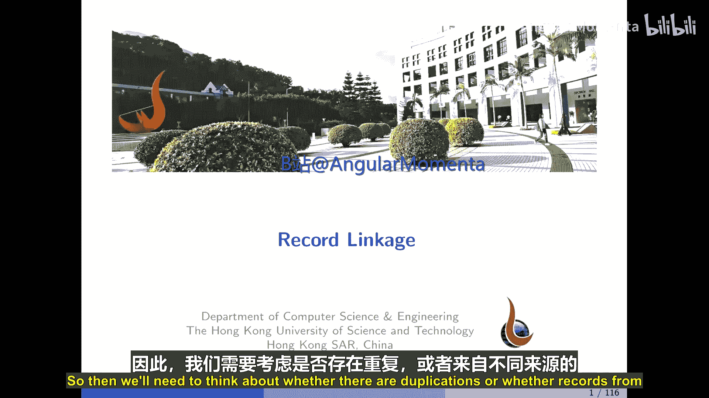

So the most frequently used term will be the data matching because data matching obviously means that we are trying to match data and then to see whether they are the same or whether they are different for data integration。

 The data matching means that we are looking at like a different records。

 Okay they could be from the same database。 They could be from the same data source or they could be from different databases or different data sources。

 So then data matching is to try to like。Identify those records that are actually referring to the same entity and then okay。

 well we'll decide what to handle next how should we handle that next right so then like some other terms that are like a meaning similar thing would be record linkage right So record linkage。

 we are looking at different records， whether they are linked right So record linkage well obviously data link and some other terms like entity resolutions or sometimes we like wants to see whether like this is actually referring to that entity So we say that we are resolving their like relation。

 So it's data entity resolution and then of course。

 if we are looking at whether two records are the same so that means we are also doing thisambiguation right because if they are different so then we don't need to like a merge them but if they are the same then we'll need to handle that right so then that's doing。

diembiation so we we could be doing like a name disambiation or for offer disambiguation is like on a particular domain of data typically we are looking at citations right so for citations we can also have citation matching as well so you can see that citation is like a record right a citation is like a record in a citation we have offer names the publication titles the like conference names or the general name and also dates。

 pages sections etc So then that means we have many。

 many features right or attributes within a record and if we are looking at two citation how do we say that like a whether we can say they are actually referring to the same citation and then while within citation we have offers right so then across different citations well the same offer we have many different publications right so then like sometimes there are like a。

When the office names are being put into the citations。

 so then the names will be put in a different way。 So then like we cannot directly match the names to say that whether they are referring to the same offer。

 So we will need to do some matching。Okay and then obviously there will be other like names like a de duplicationcation right so for de duplicationcation it means that we are just identifying the duplicated ones right so if two records are meaning the same thing then they are duplicated right so then also duplicate detection and also like identity uncertainty field matching so you see a list of related names right。

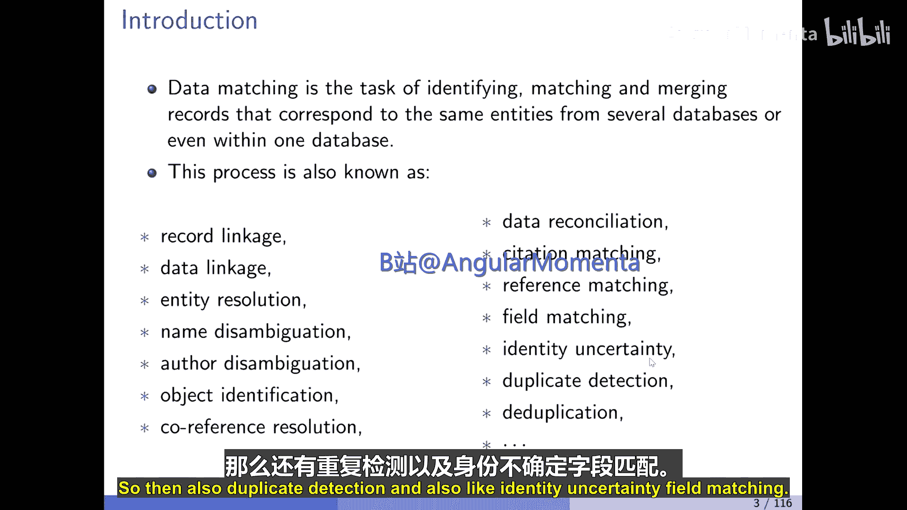

Okay。So then let's say that we are using the term data matching。 Okay first。

 actually the same as record linkage。 So then for data matching。

 say that we are looking at structured data。 So then for structured data。

 then we are looking at topples Okay， so each tuple means that there are many different like attributes。

 for example， like these examples here。 So this one is a tuple in this tuple we have the attribute name。

 we have the attribute of phone numbers and also the location， the area or the region。

So then take this is another tupo so then for data matching we are matching these two tuples and then to see whether they are referring to the same person Okay。

 for example， the identity the entity here is person so then we wants to decide whether these two records are referring to the same person they are records of the same person and then like the topples could be in different format。

 they could be like in a structured database it could be in like。ExL documents。

 it could be audio triples right， so meaning that it's like the subject pre object relation。

 so then it's not as simple as string matching， because previously。

 we have also discussed about string matching， right。

 So we are looking at two strings and then to see how different they are， how similar they are。

 right， So then okay for matching with topples， because it involve different attributes。

 and then each attribute will have its own characteristic or property。

 So that means we cannot treat it as simple as string matching。 We'll talk about that next。Right。

 so then data matching here is very， very useful。 It's actually very important for data integration because it can appears in many integration scenarios。

 for example， say that we are looking at。😊，Merging databases with same schema so that is the second stage of data integration right we have already aligned the schema so now we are looking at putting the databases together so then we'll need to merge them right so we'll need to pick up the records which are the same and then okay drop the duplications and then we'll need to put all those distinct records together right。

😊，And then while we could be joining rows from sources with different schema right so like last time we say that well if we are looking at the different data sources。

 one of the data sources could be the web tables right so then web tables is giving us very useful or very large amount of information data so then sometimes we wants to use it to expandend to add more okay to add more things into it so then like we can be looking at like whether we are adding columns or we are adding rows right。

Okay， so and then also like even for user queries right so we can also like we will also need to do some matching as well。

Okay， so then well， just like when we start talking about string matching。

 we usually start with a definition right problem definition。

 So then like we can define the data matching problem as looking at two tables say that they are already aligned with the skimmers and then that means they are having identical skimmers and then okay and then we are assuming that each couple each record in these tables describing an entity it could be a person it could be like a venue。

 it could be an organization。😊，So then we want to say we want to see whether like a tuple say its x from the table X will match with the Tuple Y in table Y and that they are referring to the same real entity they are referring to the same person for example then X and Y is a match right and then we want to identify all the matches all the topples that are identifying are referring to the same entity among those two tables right。

Okay， so let's take a look at an example。 So in this example here， we have two tables。

 table X and table Y。 So table X have three topples， X 1， x 2， x 3， right， So， and then for table Y。

 we have two topples。 Y 1， Y 2， right， So then what we want to do with data matching is look at all the topples。

 right， So we have X 1， Y 1。X1， Y 2。 And then we also have x 2， Y 1。Okay， X 2， Y 2。

 and then also x 3， Y 1， and also X 3， Y 2。 So we all have all these possible pairs， T pairs， right。

 So then we wants to see which of them are actually referring to the same entity。 So then again。

 just like string matching。 If we look at the data ourselves， will say that。 well， it's easy， right。

 So Dave Smith， David Smith， obviously， they are referring to the same person， right， So then X 1。

 Y 1， definitely。Well it's referring to the same entity because about their phone numbers are the same the city are the same states are the same right okay and then we probably we'll be also be able to say that like a x free and x and y2。

So one is Dan Smith， one is Daniel Smith so typically Dan is shop for Daniel and then also the phone numbers are the same like city states are the same right so for us it's easy but then like if we want to have like a model doing that automatically so then we'll need to apply what we have just said right so we are looking at names and then usually we'll have like we can be using an ontology which is of the names a database of names and then we could be matching the phone numbers but we'll do some normalization because there is the area code and then we'll probably need to match the city and then for the Xfr and Y2 you can see that the city is different right so then like because we say that well most of the things are the same then they should be the same right so we are also handling uncertainty so we'll need to consider a lot of things when we are trying to match the records right so then what we are going to what we are going to discuss next is like what are the possible ways of like。

Making all those considerations， right。

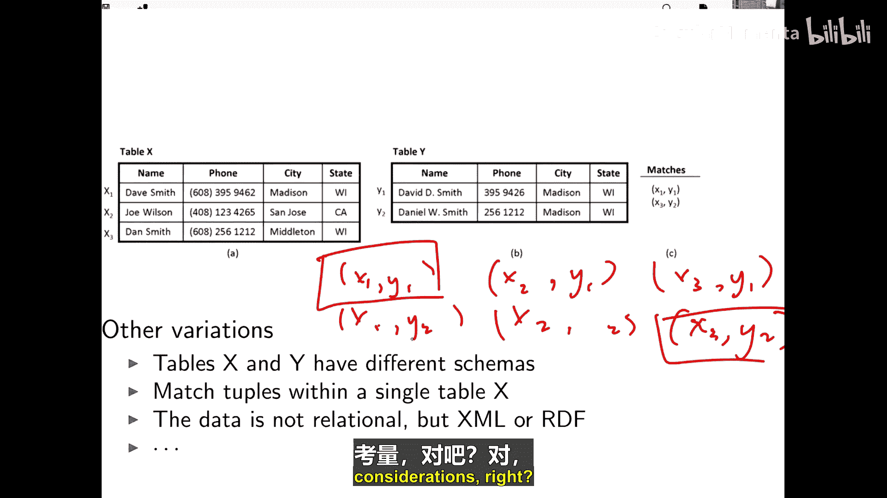

Yeah。Right so we are right now we are just looking at two tables with the same schema right so obviously there will be other variations like what if the two tables have different schemas right so that will be more difficult and then like right now we are looking at two tables what if we are matching records within the same table right it is possible and then what if the data is not relational databases but in other formats right so many。

 many different variation， many different scenarios All right so then previously we mentioned that well it's kind of similar to string matching but we cannot use string matching method directly well here like we are discussing why so theoretically we can just put off everything together as like one long string so we can say that with's like a X1 record is just the AVEmi SmiIT and then with the sequence of numbers the sequence of characters of city and then it's a long string and then we just compare like every other records by string matching theoretically。

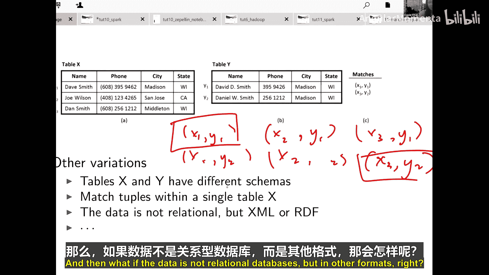

We can do that。But then if we are doing that， we are just counting how like many characters are different。

 How many like。Positions are different。 Okay， so then we are not actually making use of those like a domain specific knowledge。

 say that like if we are looking at names， then obviously last name should be the same， right。

 if last name is different， then obviously they should not be referring to the same person， right。

 while first name， probably is less important And then first name could have many different variations and then for phone numbers。

 we need to do normalization and then like for states。

 we might need to think about like whether they are in the same。States in different cities， right。

 So whether it's a typing error， things like that。 So that means different attributes should be using different ways of matching。

 right， So we cannot use just one single way of matching everything So therefore。

 we want to apply domain knowledge and also sophisticated， more sophisticated techniques。

 So therefore well need to compare the attributes。 Well need to keep the fields apart， right。

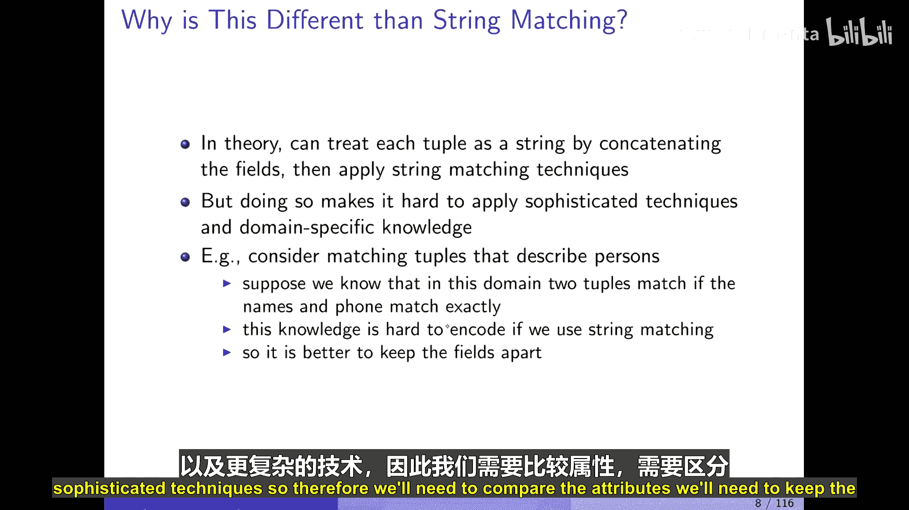

Okay， so then like the challenges here well it's actually similar to string matching So the problem is how can we do that accurately because we know like string matching。

 there are a lot of variations like names， different conversions like abbreviations and then there could be nicknames and then for all those data there could be errors and then also like typos and also like entry errors and also there could be like other like conversions right again short forms for organization names and then affiliations。

 etc right So then similar to string matching， we can again use different approaches to help us right So we are going to talk about like rub based different categories of approaches。

 rub based learning based clustering， probabilistic and collective right。Okay。

 so another problem will be again the same as string matching。

 so that is how to scale it up the scalability issue right。So let's start with rule based matching。

 So for rule based matching， obviously we are going to apply domain knowledge here。

 So we are writing rules right so if we know the data well。

 so we can write rules to specify how the topples are matched。 So for example。

 usually well need to go through a lot of the matching or not matching tuples and then use them for reference in developing the rules right and then the rules will be tested and then refined so we can be using different types of rules。

 for example， we can be linearly combining the weights assigning weights and then combining these similarity course individual similarity scores it's a little bit like。

When we describe string matching or the schema alignment， right， So we have kind of those models。

 right， So we have like a different matches， right， So and then each match is using different。

Algothm， right， or different approach in comparing the things in calculating the similarity。

 And finally， well assign ways and emerge them together。 So it could be like this。

 It could be a logistic regression。 It could be more complex。😊。

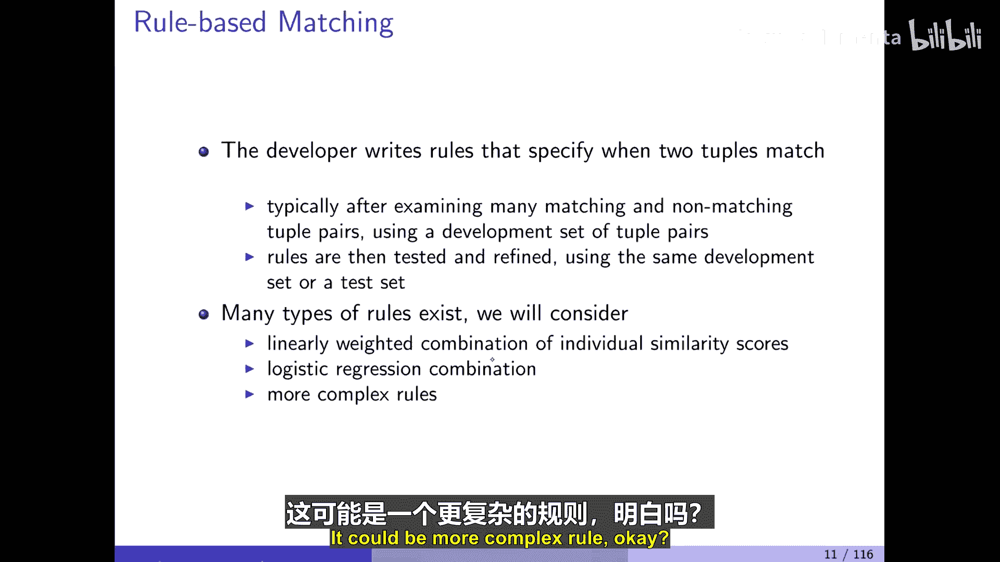

Okay so we can see that again in here we are going to use the similarity so for example we want to look at two topples what is their total similarity score and then whether it's larger than for sure to say whether they are referring to the same entity it could be a combination of individual similarity scores where like we are looking at each pair of attributes among those pair of topples that's similarity and then for each attributes okay so we can be applying different similarity measure okay and then we just like assign different ways and then combine them together right。

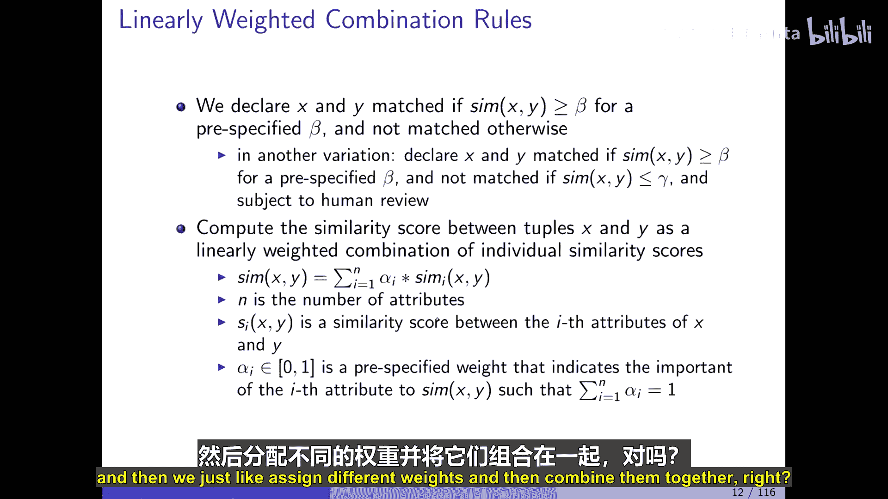

So then here is an example so just the example that we have mentioned right so we have like three records in table A two records in table Y so then like you can see that we have name phone city and states so then we can have like a similarity score on each attributes。

 a similarity score on name similarities score on phone and then similarity score on city and similarity score on states and then we can be using different similarity measure on each of the similarity score of attributes for example Gerd R for the name right and then at the distance between the phone because typically the phone numbers are with the same number of number of digits so then we just wants to identify how many digits are different so this one here we are handling the type of error typing errors。

So then similarly for the city so then again we are handling the typing errors and then while they should not have like usually they are not with that different kinds of errors right and then for the states because now it's that short right so then we are using only exact matching so you can see that we are using different similarity measures right and then finally were combined the results with different weights so you can see that like in here city is with lower weights while for the other features they are with high rates higher weights right。

So then we just calculate the similarity score， the total similarity score。

 the weighted total similarity score on each pair of topples， and then if the weighted。

 if the final score is larger than threshold， then we say that the two topples refers to the same entity。

So then for the like advantages and this advantages of rub based method。

 obviously like it's easy to understand， right， if you look at the the。😊。

Calculation the rule so it's easy to understand like what you are doing and then why it's that and then it's also relatively easy to implement right usually we use more straightforward ways to do it and then we can even learn the weight from training data right so if you are not certain about the ways like the schema alignment matching system you can have many different scores and then just let the learning algorithm to pick the weight。

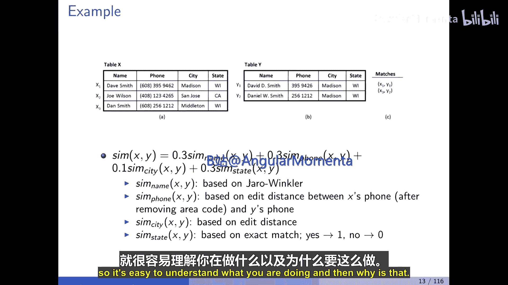

So the disadvantage is that， like。You can see that because now we are just having a combination of those weights。

 So that means any increase on one particular similarity score will lead to an increase in the final total score then sometimes it's not that desirable because when the score is already beyond a certain value then we want it to have a diminishing returns okay because if it's already important enough any increase in that cave score shouldn't be contribute more right。

 so we want to have more evidence from other attributes in order to give like a more affirmative result。

So then for example， like this here， if the name similarity is already 0。

95 so then that means the names is already very close enough。

 then any further increase on the name similarity should be contribute less so we want to see whether other attributes are matching in order to say that well this pair isn't much right so in that case then we wants to use the logistic regression rule right so therefore we are we are having a diminishing return effect。

So， then， okay。Alright， so with the logistical regression rules。

 So that means that we are looking at more signals in order of one strong signal， right， So we don't。

 And then also like a。So， and then for the。Logistic regression rule。

 it also has their benefit of like， you don't need all the signals to be there， right。

 So as long as there is a reasonable number of them。

 then we should be able to have like an affirmative decision， right。Yeah。Right， so then okay。

 of course we can have more complex rules right， so you can have different levels of rules so say that if names like a matched。

 okay so then we should look at the if names match， of course， it's going to be matched right。

 but if names are not reaching to a threshold， then we should say not match and then otherwise we will need more evidence so you can write more complex rules。

😊，So。So like what we have mentioned。 Okay， so obviously， rub based method is easy to understand。

 right， And then Ka， it could put complex domain knowledge in it。

 but domain knowledge is also may also be a disadvantage because you need to like look at a lot of sample data in order to know that。

 And then like meaning that you need spend time on looking at investigating the data。

 It's going to be a labor intensive work。 And then like sometimes while the data that we are looking at may not be that easy to write rules。

 So therefore we'll need another like a category of approaches， which is learning based approaches。

Okay， so learning batch approach， you can think of it as like a supervisor learning。

 It's quite similar to like the learning approach for schema alignment as well。 So say that okay。

 we have training data So we already know which pairs， which tuple pairs are matched。 So then okay。

 we start with the training data。 we like identify whether a tuple a pair of tuple is matched with yes and then no as well。

 Okay， and then okay we have the features list。And then， okay。Yeah。

So we'll pick a matching model and then we'll fit the training examples in it and then okay we'll be learning the algorithm okay and then once we have learned the algorithm。

 we can applied it to the new data so new tupo pairs and then to see to decide whether they are match or not right so that's learning based so that means well we can use those learning algorithms to help us so it's also like a classification problem as well here right to classify whether a pair of tus is matched or not。

So for example like here， so we have three records， a free tuples a1， a2 and a3。

 so you see that like actually three pairs right so then we have the micros this record and then a1 and B1 tupo and then a2 tupo and B2 tupo and then like both of those two pairs are matched right so and then the third one is no so then okay we can convert those attributes into features so for features well they could be the similarities score between attributes okay between an attributes or some attributes。

Or even some rules on the。Attributes， for example， like we may pick the similarity score between the names as the first feature and the similarity scores using another similarity measure on the names。

 So， for example， we may be using S1 using Gerald and Cla S 2 using the at distance。

 So between names， we have two similarity scores， right， And then we can match the phones， right。

And then say that we are using at a distance just like what we have mentioned with the rule based and then cities so it should be accept match right so and also states we wants to use accept match and then the last one is more like a houristic constraint so we want to。

😊，Like， for example， the say that we are checking the area code against the city so they should be a match right so they should not be contradicting So then okay。

 well with all those like a similarity schools or matching schools then each of them are treated as effective a feature and then we have a feature vector right and then also the decision right the label so then we can use these as the training data and then to build。

The classifier and then okay we can apply the classifier and then on the new topple pairs right so for example we can learn a linearated rules on that right so then well have different ways assigned and then we'll be able to pick the correct combination and then all we can use a decision tree model and then we are learning the decision tree the rules right。

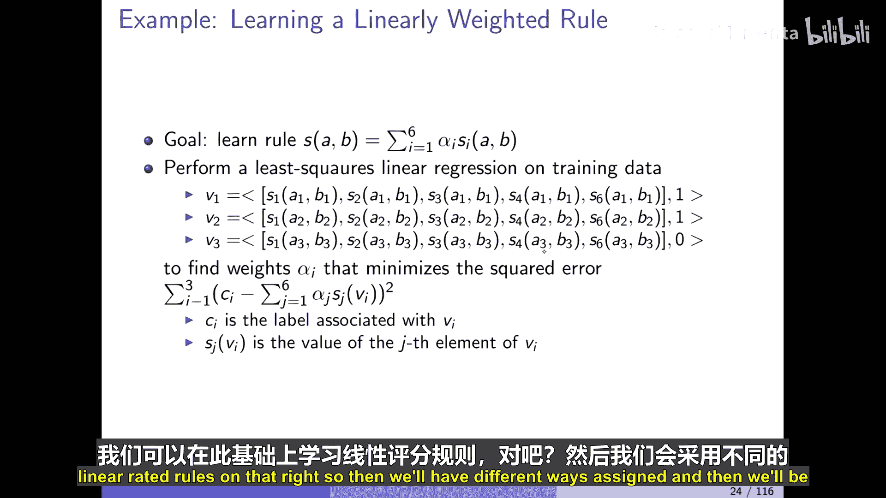

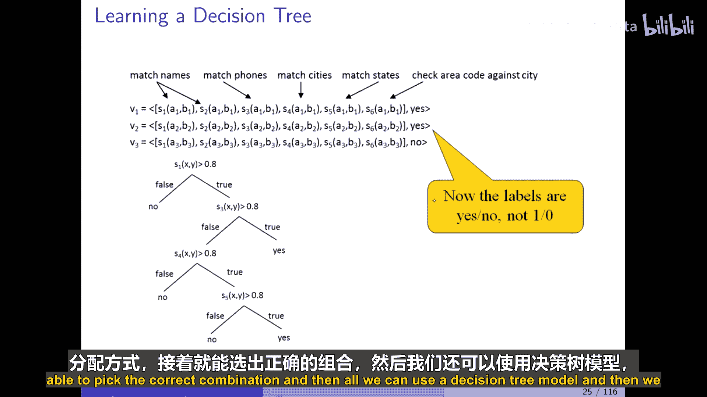

OkaySo then you can see that like comparing to rule based method。

 obviously like in rule based method， we need to manually do determining the thing。

 while for learning base， well， of course， it can handle a large number of features and then a large number of training examples as well。

 right And then it don't require too much domain knowledge。

 Because even if you are not too certain about like which is what is the best similarity score to be used。

 you can just put all of them there and then let the learning approach decide， right。

 So while for rule base， we have to be certain that those features， those matching。

 those similarity scores are work to be placed inside the rules。

And then for learning based approaches， obviously， because it's done the learning by different approaches。

 algorithms models， then we may be able to construct very， very complex rules like the decision tree。

 we may have many， many like complex， we cant have complex rules。

So the disadvantage is that like well the problem is learning model right so obviously we need a large amount and adequate amount of training examples so I think when we are talking about learning so or like doing data mining the amount of training examples is always like a problem right so whether we have enough training example to have like a good model learned right so if we have too little data then we know won't be able to build an accurate model。

Yeah。All right， so then in that case， if we don't really have enough training examples。

 we'll need another category of approach， which is clustering， right？

So then the next category of approachess is by clustering。

 So which means that we are trying to group okay， to create clusters where each cluster is referring to a certain entity right。

 So then okay。So many clustering techniques can be used， for example， a gramerative。

 hierarchical clustering came means graph theororetic， etc cetera。 So let's focus on Hs， right。

 So hierarchical clustering。 So then hierarchical clusterings is like partitioning the tuples into clusters。

 right， and then all the tuples in a cluster will be referring to the same entity。 Okay。

 while tus in different clusters， they are referring to different entities， right。

 So then hierarchical clustering is begun by having each tuple in a separate cluster， right。

 So like this graph here， Or， we have each。Tupple so we have six tuples here。

 Each of the tuple is on its own cluster right so then we try to calculate the distance or the similarity between tuples and then we are identified the closest pair and then put them together in a cluster and then we keep on merging comparing with the topples or merging with another cluster So say that okay within these so then we are saying that x4 and x5 are the closest so then it they forms another cluster and then finally we are looking at C1 comparing with a3 C1 comparing with C2 and then C1 comparing with x6 and then similarly x3 with C2 C2 with x6 and then we are identify the x merge So say that x3 should be closest to C3 and we merge with C3 and then we can start by certain criteria like we have enough clusters or the similarity is dropping。

Up to a certain point， then we stop merging， right？Okay， so we can see the further steps。

 so we iterative merged two most similar clusters and stopped。Based on certain criteria。

 like a design number is rich or like the similaritiesities dropping beyond a threshold。

And then how do we measure the distance while between two clusters so you can see that it's kind of similar to the rub base right so we are building a combination of the similarities a linear weight combinations of those similarities right so again within this you can use different similarity scores。

 for example for name you can be using like the general and clear that we have mentioned for form we can be using at the distance city and states we can be using except matching so again。

 a combination of different similarity matching。Alright。

 so then the next question usually is there for the clustering method is how do we compute the score between two clusters Because within each cluster。

 we have multiple topples right， So like multiple points。

 So how do we like represent the cluster by a certain points or by what value So then while there are multiple ways of of course。

 right， there is a single link， So that means we pick the minimum similarity among those points。

 all those topples across the clusters and then we can have complete link meaning that we pick the maximum contradicting in opposite to the minimum for the single link average link。

 we just we just calculates all the pairs of topple similarities and an average sum。

Or we can do it by a canonical tuple so which means that we are finding the most representative one so we are finding like we are creating a representative for that cluster and then the similarity will be between two clusters will be the similarity between those two representatives right so for example like say that we have a cluster of Mike Williams and MJ Williams so then we might be like saying that well we want to have the complete information so that means we'll put like Mike and then also the middle J middle name J and then also the middle initials and also the last name Williams so then we'll pick the Mike J Williams as the representative the canonical tuple of that cluster right or similarly for phone numbers like this one is more complete with the aerial code then we pick that right so then if we have another cluster of phone number。

Or another cluster of names， then we again need to create a can code tupo and then measuring the similarity between those representatives right。

So we can see that it's just the general clustering approach right。

 so the key ideas is that it's iterative right， so then K。😊。

So it's based on like what we have so far right and then we are kind of like building up the profile right so we are trying to merge and then adding more information hoping that helps right。

So then besides those like obvious data mining approaches。

 So we also can apply probabilistic approaches， right。

 So meaning that we are trying to match okay to build borders using probability distribution。

 right So then the benefits of that is that well， it's kind of naturally incorporating like domain knowledge。

 And then it can like a make use of the like a represent the。

Power of probabilistic representations and also listeninging techniques。

 but of course if we are using probabilistic approach typically it will be computationally expensive right and then also it's hard to debug right？

😊，Alright， so okay， so when we are talking about probabilistic approach。

 usually we are talking about generative model okay sometimes we'll be also talking about discriminative models as well。

 but then probably generative to start so it's trying to enc the full probabilistic distributions it's trying to describe how things are being generated okay and then in formulating andre the whole model and then like some new approaches use discriminative one right。

Okay， so the generative model typically we are talking about basin networks right。

 so it's trying to like a represent a food distribution。Okay。

 so I'm not going to talk about too much about the naive base model。

 So let's just like a briefly describe。 how do we do data matching with the naive base， right。

 So then the idea is that we want to compute， we want to calculate the probability of whether a pair of topples match given the topples。

 right， So then if the probability is the the。If we say that the topples。

 the probability of the topples being a match is larger than the probability of topples being not a match。

 and then we say that they are match right So then okay and then what with9 days we are making the independent assumptions right So we are like saying that the probability is depending on only a set of features right and then for example。

 whether like the attributes could be the whether the last names match whether like the at distance between the social security and then also the initial match etc and then like the independence rule we are using right because like the。

Probability of whether it's a match given the two tuples depends on the attributes and then the probability of whether the pairs are match。

 given the attributes is can be expanded that right so and then like the independentency the independent the independentdependency is also included here we are assuming the independentdependency and then once we have the probability table right probability distribution will be able to calculate the probability of that distribution right。

Okay， so then， for the naive phase model。 So you can see that it's making a lot of assumptions。

 for example， like the new phase assumption。 But then it's may not be like we are assuming that all of the features are independent of each other。

 But we know that in real life， it doesn't really hold， right。

 So sometimes like one features will affect another one。 And then。

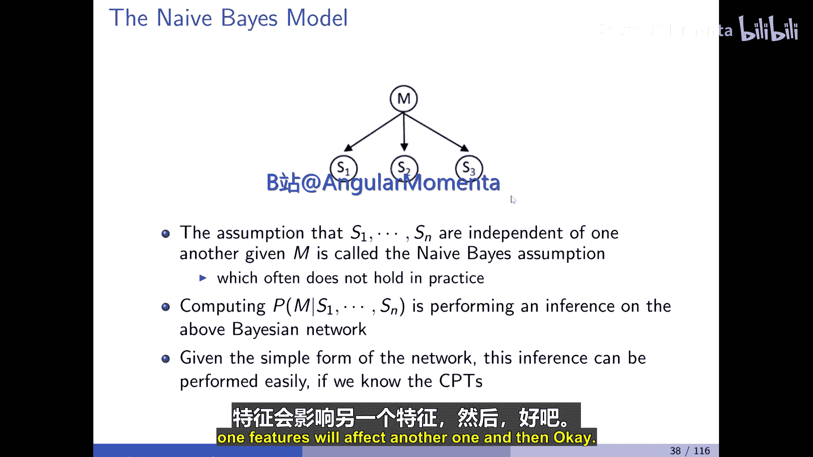

Okay嗯。Okay， all right， so then here is just an example on like， how do we learn the。

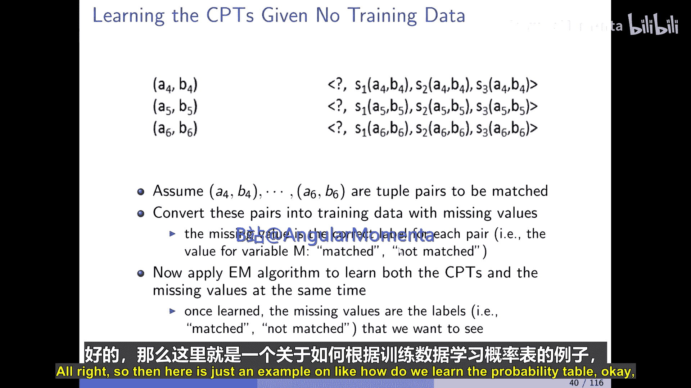

Probity table okay， given the training data， So it's just the typical like steps for the na phase model。

 So you see that like a well for the na phase model， we are looking at a graph like this。

 we are assuming the depend Inency between the attributes and then we have the training data Okay with the labels and the features and then okay that means we are learning the conditional probability tables and then well with that we'll be able to compute the conditional probability of the decision right。

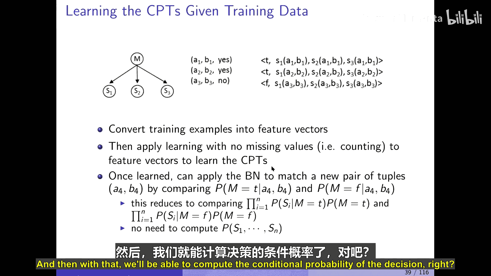

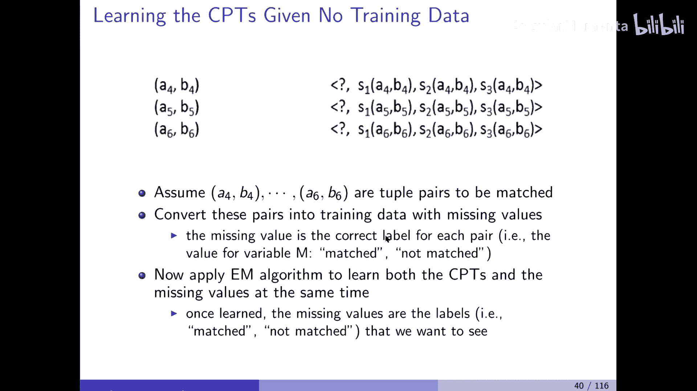

Okay so then well if there are like a training data then the whole calculation is like straightforward。

 if we don't have like a enough training data we don't have the labels。

 then we may need to apply the EML right to learn also the missing values as well right so that's about the learning base the publicbaistic model。

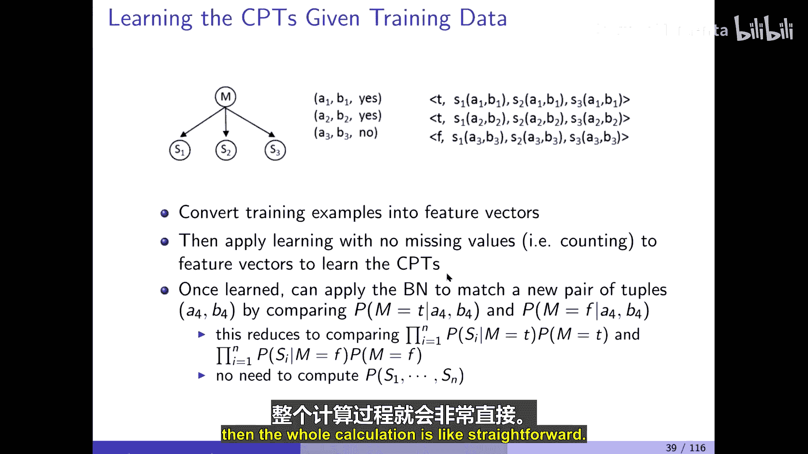

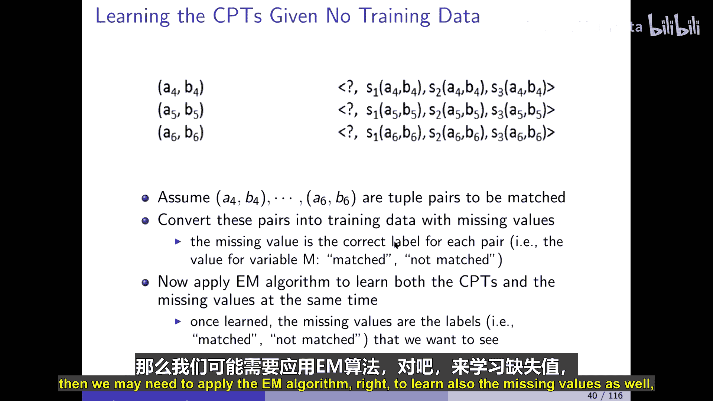

Okay， so then like。Okay， so for generative models。 So it's like describing the data matching in this certain way。

 right， So we are looking at， like， for example。Right now， we are looking at text， right。

 and then looking at two tuples and then to say like whether they are referring to the same entities。

 But with generative model， we are doing it in an opposite way。

 we are thinking about like how those topples are being generated。

 So it's like in opposite way we have a set of entities in the world。 right， So then okay。

 we have different， like， for example， basketball players。

 And then while we are selecting a certain entities。 Okay， for example， a subset of the。

Players say that we are picking one particular player and then also then okay。

 well for that particular entity we'll be having a lot of representations right。

 it can be having like names for a person it could be represented in names right and then names could have different variations so we are saying that we are like generating different mentions and then those mentions will be scattered in the text Okay or in the couple in the records。

So then you can see it's like a how the tuples are being generated starting from while we have a set of entities。

 and then we pick the entities。 and then those other。

For each of the entity we have a representation right a representative and then based on that representative willll generate different variations as mentions and the mentions will be there in the different like records。

 different like a text right so that is the idea of the generative model right。

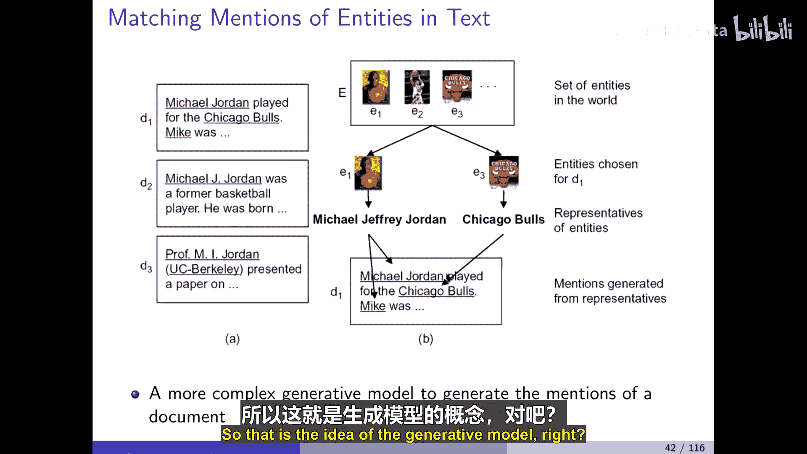

Like with the previous approaches， we are looking at pairs of records， pair by pair， right。

 So we are assuming that there is no relation with one pair of matching from another pair of matching。

 So previously， we are looking at tuple pairs independently。

 So let's say that the tuple pairs A and B， they are matched， right。

 But then they won't affect where the tu C and D will be matched， right， So usually that works well。

 But then if we look at like the matching in more details。 And then like in the real world。

 we'll find that well。There should be more consideredced， right， So actually。

 those matching decisions will be correlated。 So then we are talking about looking at those matches collectively。

 Okay， so not treating them as separate pairs， but looking at like。Okay， they're like a relations。

 right。He。Right， so then okay， all right， so here。😊，All right， so then Kate。

So let's look at this example here so then with this example we can see that we have some citations so recall in the start we say that like data matching is also typically related to citation matching so citation matching is like we have two records of citations each citation is a record and then we are trying to say whether the two citations actually referring to the same citation or whether like offers within a citations actually matching another offer in another citation okay so then in this particular example here we want to look at the offers right so you can see that we have different offers we have like a1 say that we have a1 up to a10 and then say that we have the records for each offer so we have the first initial we may have the middle initial and also we may have like last name。

So you can see that like this one here， we have the middle initial， while for the other ones。

 we may not have the middle initial， right？So then the goal of the matching is to find the offers right so to match the offers of the above four citations and then we wants to know whether like two names appearing in different citations actually referring to the same offer right so that's the goal。

So the solution here is to first of course extract names first into a table like this。

 so then we'll need to match against those topples right so if we match like a1 with a2 or A1 with a9 then we are considering all the offers individually right so we will not be considering the co offer relationship。

Right， so what do we mean by call offer relationship is that。Okay， usually。Some offers will work。

Co cooperatively， very often for certain research works， right， So that means if。Across different。

Citations。Too often names appears together。Okay， so then that will give us some additional information。

On like a deciding whether two offers across two citations are match。 right， So therefore。

 that is why we say the co offer relationship is going to help。 right。

 So let's say that we are trying to put the core offer relationship into consideration。

 So then you can see that。Like a1， A2 and A3， they are co offers， right， so this is a1。He a one。A2。

 A3， right， And then similarly， we have a 5。So all of the names are individual mentions， right。

 individual like a tus。 So that is why we consider all of them there， So if。And this is a 4。

 a5 and so on。 right， So then you can see a 1， A 2， A 3。 They are co offers。

 So that is why they are in a group， right， and then a 4， a 5， they are core offers and then so on。

 So we have the co offer relationship here as well。So then what we are talking about is that， so。

If we look at。A1。Okay， a  one。And A4， right， so say that we are comparing them。

Because they share the same co offer， right， A 1 is co offeringer with a and and sorry， right。

 And then we look at a 4。 So it's also co offer of the having the co offer relationship with the a 5 again。

 A and sorry。 So that means if a  free and a 5 match。Okay， so then that means the same call offer。

For a 1 and a 4。 So then a 1 and a 4 should be more likely to be matched。 right， So therefore。

 the co offer relationship is giving us help on making a decision， right。

 So you can see that we are not making an independent decision on just looking at entity sorry。

 Tle a 1 and T a 4 only。 we are also considering other pairs， right， like a 3 and a 5。

OkaySo that is what we meant by collective matching， collective matching。So then， okay。

 so some possible thinking on how we can do this， right。

 So how we can like consider the other other relationship in together。

 So then one solution is like we have the co offer attributes added。

 So that means we add some more attributes。 and then like。We say that like a Tle a1 has co offer。

 so therefore like these co offerss will be added as attributes and then Tle a4 with the co a and sorry and in that name will be also as an attributes So then we'll be also using similarity scores or matching against the co offers right so one way is to have the co offers relationship as an additional feature right okay。

But then the problem here is that。So we are only like using a single similarity measure or matching the co often names right。

 So we are not doing a sophisticated matching like we are matching against two topples right。

 which we may include several like similarities score different things right so therefore。Okay。

 so we may not be able to like take the matching score of the co offers and then like contributing that correctly to the final matching。

 right， So therefore， this may not be the most desirable solution。 So then we want to fix it。 right。

 So what we want to do is we want to match tas collectively。

Or at once or iteratively Okay so we are not treating the co offerss as only features we want to say that well。

 if it's more likely for two entities to match and they happens to be the co offer of another pairs of topples that will affect the decision on that pairs of topples and vice vera。

 so we wants to be able to say that。

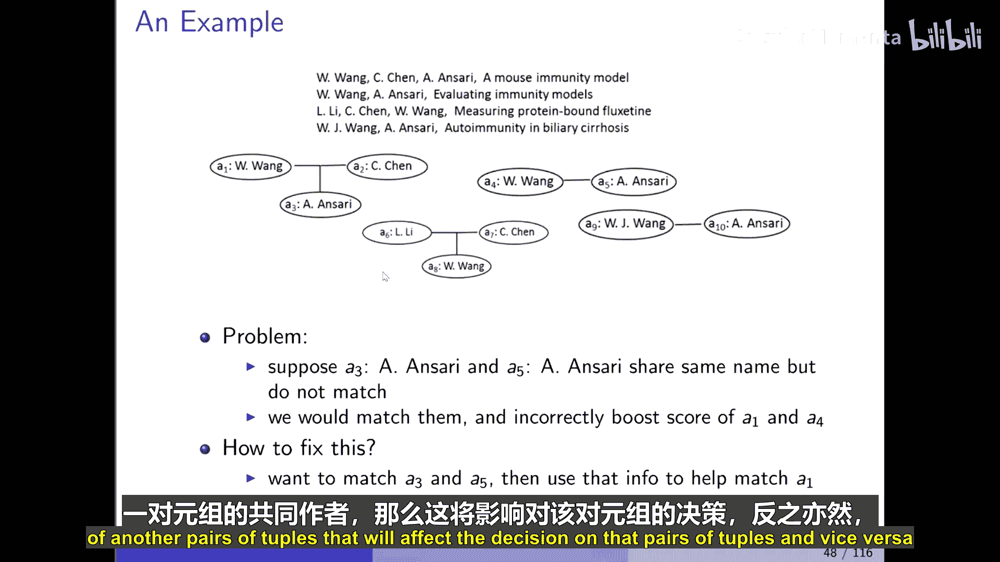

So then okay well another way could be using like collective matching approaches like using the ones that we have mentioned like clustering like probabilistic and then say that like we are considering the clusterbased method right so then we are assuming that we are looking at the graph with nos representing the topples edges representing the relationships and then if we are using clusterings and we are not only looking at the similarity between attributes。

 but we are also looking at the similarity of the neighbors of the attribute of the topples so you see that like say that。

We are looking at two cluster of nos。RightAnd then we'll， of course。

 measure the similarity between those two clusters， just like what we have done。

But then we'll be also looking at neighbors。 So how do we determine neighbors。

So we are using that neighbor similarities for considering correlations。

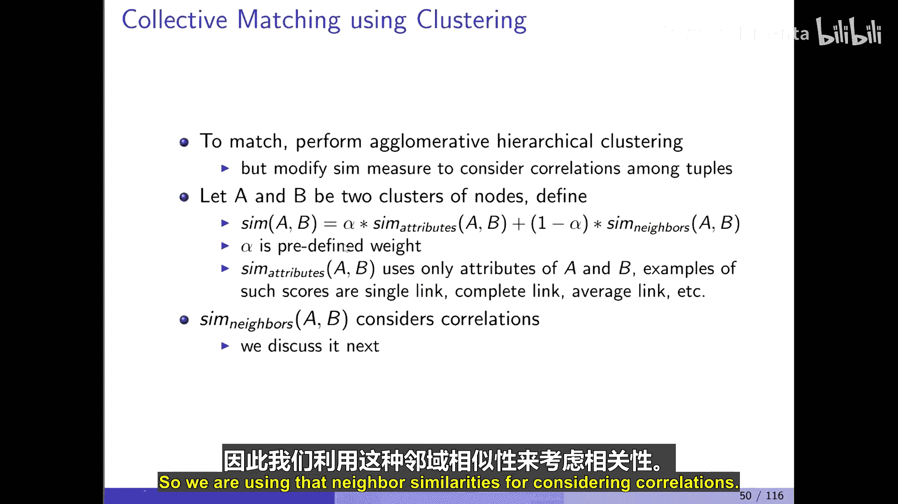

Okay， so here is how we can define the similarity scores on the neighbors， right。

 So let's say that we are looking at the graph， right。

 So then let's say that we have a bag of the cluster Is that are in the relations with a certain note in a。

So then let's say that cluster A has two notess A and a dash， right。

 So A is linked with the note B Okay， in the cluster I D free。

 So let's say that we have like a cluster with a A dash， right， So a dash here。

Because it's a graph right， so there is an edge between a sorry a。And B， okay， A and B。

And then a dash is having。An edge with the B dash。 So B dash is in a cluster free。 Okay， I D is free。

 and then B is also in the cluster I D of5。 So B is also here free。It's also here。And then， okay。

 we say that A dash is also having a relationship with another。Okay， note B， double dash。

 and then it's in the cluster I D5。Okay so we have all the relationships there。

 we have like a say that the edges are representing the core of the relationship。

So then we can have a group of Is， Okay， which are the neighbors。

 the cluster I of the neighbors of this cluster， right， so the neighbors。

 meaning having the relationships between those nos， right so。Free relationships。 So the cluster I，3。

3，5。 Okay， so this is the neighbors。 right， So then okay， we look at the set of neighbors。

 neighbor clusters。 and then also the neighbor clusters of the cluster B。

And then we measure the similarity， for example， it could be like the ja similarity。

 We look at the overlap lab of those like a Is group of Is。

 So how many of those cluster Is are overlap lab across those neighbors Okay that will give us a similarities score on the neighbors Okay so that will give us a consideration on the co offerss。

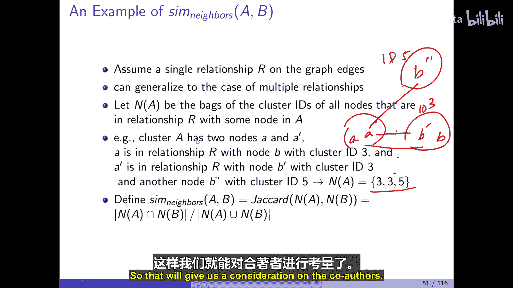

So that is why we are considering both right so then K。Right， so then okay， with that， right。

 So going back to the core offers example。 So that means we are matching the core offers of the two topples。

 right， And then how many of those co offers overlap across those different。Tops across those tuples。

 And then okay。We can also measure the co offerss right by different similarity scores and then k。

Sorry， so for the first approach with using the feature okay of having the co offer names as features。

 then we are only considering whether the co often names are string similar having high string similarity。

 but now with this approach， we are looking at like whether they have a similar patterns of co offers right。

Okay。So then this one here is to show that， right， So that means like in the start。

 while we are looking at these clusters。 So initially we have the gramative hierarchical clustering。

 So meaning that all the entities， all the couples， all the names are individual clusters。

 So then we identify closest ones。 So， for example， like。Okay， see free。 And okay， C 5。

They are like very， very similar。 So then we have them merge into a cluster。

 and then and then like later on， we see that like C free in five and C10 So again， they are same。

 So they are like having group together and then similarly。

 So and then we keep on grouping them based on looking at the entities themselves sorry。

 the couples themselves and also the neighbors。 So then we'll have this like a cluster rings。

 So that we can see that like these names are obviously the same。 and then these now the same。

 And then because they have similar co offer relationship。

 we can see the edges here right so and then they have similar co offer relationship。

 So they should be referring to like that co offers。

 meaning that with the similar co offer relationship。 that means they should be of the same。Entity。

 so well， that can be represented by looking at the2 W1， right， so you can see that。So the C1， C4。

 and if we are looking at C1， C4 and C9， you can see that they share the same offer while for C9。

Okay， C 9， it's having another。Okay oh sorry this way。

 So having another like another groups of core offers All right。

 so that actually tells us something right， So if we are able to look at both the tas themselves and also the the neighbors then we are we should be able to differentiate that right So this is okay this is only another entity while these mentioned should be referring to the same entity and then across C 1。

9，4 and also C， they should be representing different entities。😊。

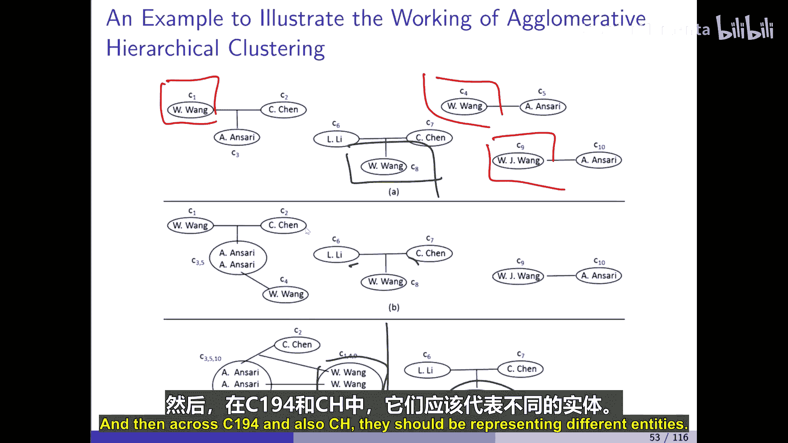