# 【香港科技大学】数据分析基础-｜-Foundations-of-Data-Analytics-p24-16-02-02-数据匹配的规模化扩展--BV1oKFDznE6L_p24-

So you can see that like we can consider record matching as some straightforward like pairs。

 independent matching， or like we are getting into a more complex like a consideration of more advanced consideration of like looking at at like the type of pairs collectively instead of having like independent decisions。

😊，Okay， allright， so then the next thing that we are going to talk about is scalability。

 So obviously just like strength matching， one of the biggest problem is that we just have too many candidate pairs right it may not be possible to match everything。

 So think about just citations All right， so I think when you are searching for like a references of publication。

 you'll find that it's going to give you a very long list right and then even if you are using a particular research's name。

 you still get a long list like not to mention that if you are searching you are searching for particular topics papers it's going to be a lot of publications and then if you are just searching for back data So there will be。

Typically， I don't exactly know how many papers are there。

 but that's going to be a lot right So therefore， like if we if we wants to compare all the offers there。

 it's going to be a large number， right， So it's going to be back data So we need to handle the scalability issue。

 So just like strings matching So we can use different ways to like scale things。 for example。

 we need to do filtering like we can use indexing， we can usehing and then to help us to filter the candidates right。

 So we the string matching scalability approaches And then like we can use hashing in a way that we hash tus into bucket and then we only match with tus in the bucket。

 that sounds familiar， right， you still record the mean hashing approach and the locality sensitive hashing。

 in the locality locality sensitive hashing。 So then we are trying to like。Hash the topples。

 hash the strings， right into like blocks。And then we are going to look at the block and then compare the candidates that are being hashed to the block right so then that is what we can that is how we can use hashing to do that but hashing can be as simple as just group by like a certain features so you can see that。

 for example， we hash on just the zip code right and then while we just using one just using one feature and then do the hashing we probably will be able to already like reduce the number of candidates。

 but still there could be some problem So we'll talk about that a bit later on。

So we may be using sorting Okay， so just like the string matching so say that we are building indexes and then we are looking at the length of these strings right so in here we can also do something like this so like we can do some sorting like for example sorting on the IDs names and then sundags and then also like。

Using first like the。Features and then to bring down the pairs， the candidate pairs。

 and then like a welcome more， right， So then we can also apply heuristic rules， for example。

 like we call the string matching thing。 So we may if we want to have a particular level threshold of similarity。

 that means the top should at least be in a certain way， similar， right。

 or like within a particular constraint， it could be like the number of characters， things like that。

 So then again， like we can apply certain like rules in order to help us。 Okay， So indexing。

 we have mentioned that， right， so we can build an inver inverted index on names and then just finding those like with the same names or most similar names。

 canopies right。So it's like representing the clusters by canopies。

 so then instead of matching all the pairs across the clusters。

 we are aware of calculating the distance between the canopies and then things like that。

Okay using round representatives and then we can even combine the techniques like for example， first。

 first hashing the houses into buckets using zip code and then swap the houses within bucket using street names and then like matching them with a sliding window things like that you can have a set of rules right so to do the matching。

Okay。😊，Alright， so then Ka well to minimize the time to match the pairs。

 So well it's we don't have a very well developed techniques yet。

 So like the idea is roughly similar to the mean hashing locality sensitive hashing。

 So if we can apply a simple rub based approach Okay to first identify the potential pairs and then can really carry out the。

Actual similarity scores， right？Okay， so then like。嗯。So other problems could be on like for example。

 the probabilistic approaches like you know that typically like those learning approaches will requires more time and then have more have a higher complexity because of all the things that need to be considered like well there are too many parameters。

 the number of training data is too large and then like it will be taking too much time so then of course those spec data platforms those PE data like frameworks will be able to help and then like with the probabil method we mentioned that what if we don't have the training examples。

Then we might need to use in algorithm Okay so then it's even more expensive because it's need to learn the missing values as well and then it's actually kind of like a trial and error thing it's going to take quite some time So then like。

So then we'll need other approach， like for example。

 like we'll need to have a better estimation on the starting value and then things like that to make the calculation as accurate and then using as minimum time as possible。

 so that will involve more advanced like learning techniques。And then of course。

 like we have learned about the reduce framework。 so it's to enable us to do distributor processing。

 to do things in parallel right so next we are looking at like a data matching or we call it record linkage from the big data perspective right So then okay well this is the the approaches that we have shown like for record linkage。

 we are trying to match the data and then like record linkage in the big data view can actually be like split it into multiple steps as well So you can think of it like the mean hashing and locality sensitive hashing approach as well So we call that when we talk about when we discussed about mean hasing and locality sensitive hashing we say that we first want to like reduce the dimension of the vector right the document vector So that is why we are using。

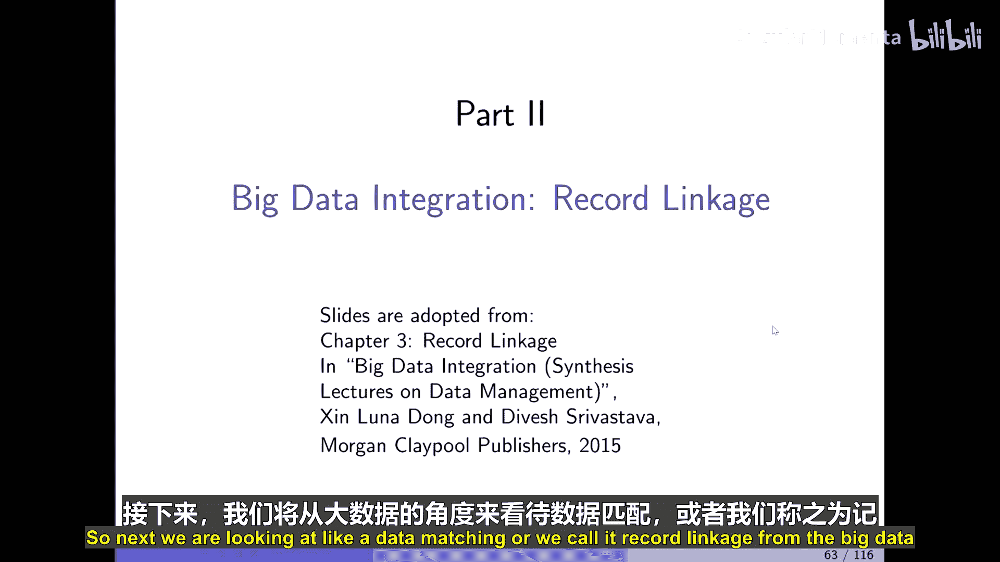

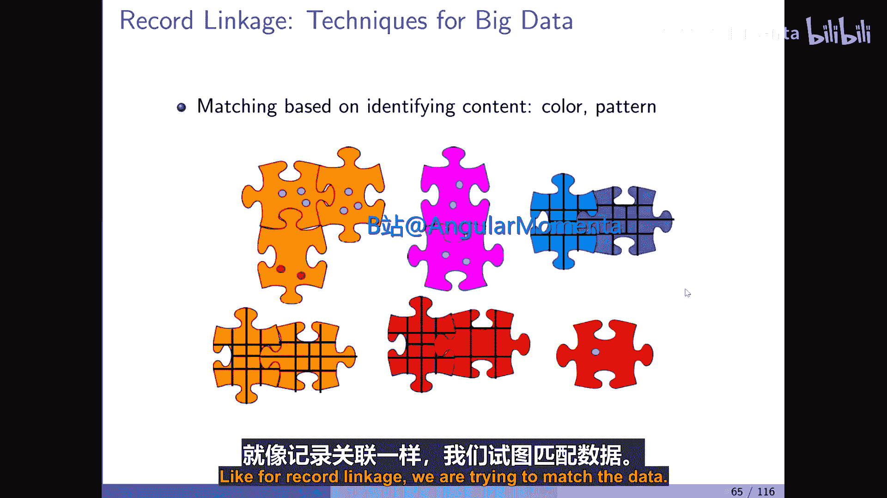

InHating to do that。So then next so we want to reduce the candidates and we are using locality sensitive hashing locality sensitive hashing is like a blocking approach right so for blocking approach we are trying it's also related to the hashing approach we are trying to hash we are trying to put the tuples into different blocks and then we are only matching pairs within blocks。

So then okay next we can do pair wise matching。 So which will give us the similarity score between pairs of tuples。

 right， But then okay， that similarity scores may not be enough to lead us to the decision on whether they are match which mentions are actually like a group。

 So then we may want to use clustering and then to do collective。Maching okay。

 so then you can see that we have multiple steps， right， So blocking。

 So reduce the possible candidate pairs。 And then now we are getting the similar scores。

 the scores between pairs。 And then finally， we group the mentions together。

 So we group the couples together to really refer to entities。

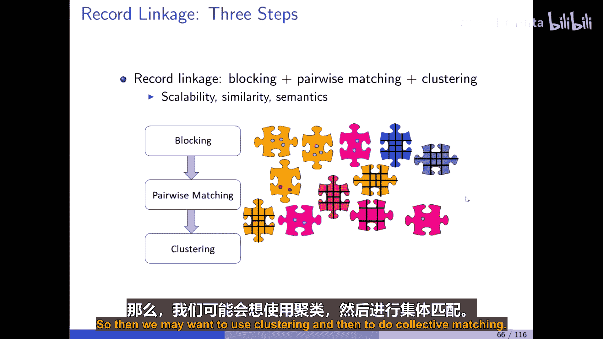

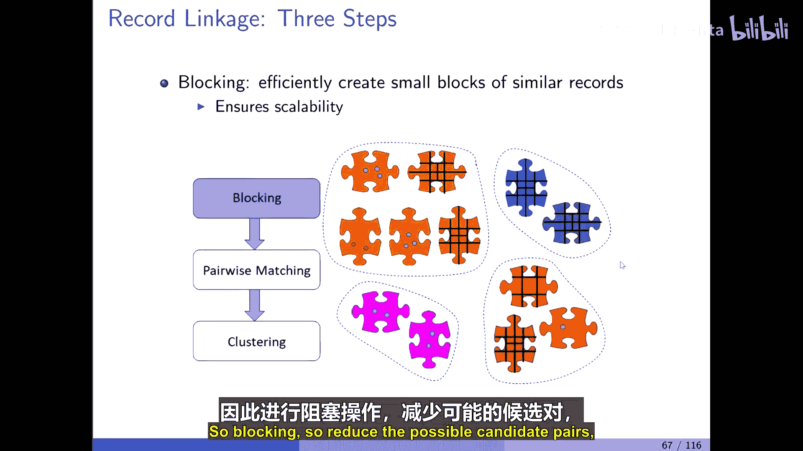

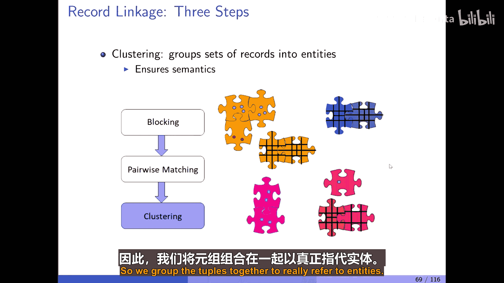

So back to the four Vs right so when we're talking about big data， obviously it's all about four Vs。

 So volume issue we have billions of records， so then we need to have distributed processing so that means reduced framework might help here and then obviously blocking because blocking is reducing the candidate pairs we may have velocity issues meaning that we are having like a lot of data coming up So then that means we may not be able to do all the matching at once right so then what we can do is we do incrementally So just based on what we have we do the matching if there are more data coming then well continue to match more and more and more right。

So then okay well the next we will be variety so of course we have variations on data right so what we have the previous discuss is to match structured data so what if we have unstructured data or even slightly like a simpler semistructured data。

And then like last time， when we were talking about schema alignments。

 we are talking about the tables， right web tables， how do we match those web tables？

And then finally about veracity， so which means that veracity is talking about the accuracy of the data。

So the uncertainty of the data。 So we'll talk about that later on。

 because you can see that when we are talking about data， data could change over time。

 So sometimes it's not that the data is not accurate。 It's just it's becoming out of date。

 So could we consider those like whether those those things like together whether the data are most up to date or whether they are out to date。

 which may affect the matching right So you can see that if we are talking about like a data matching with big data dimensions。

 all those like a V is considered。 So then that means just matching pairs of things will not be enough。

 well need to consider more。So that means our problem is getting more and more complex。 Allright。

 so then okay。😊，Oh sorry about that so this slide so I think you have seen that before I should be like removing them so sorry about them so this is just putting the map reduce framework DFS again in here all right so which means that the DFS and rat reduce will be one way to solve to help with that problem。

Okay， sorry about it。Okay。So let's just skip thiss whole thing here because it's actually duplicated。

 sorry about it。All right， so then Kate。😊，Okay， so with record linkage so we can， of course。

 use map reduce， right to like paralyzze the things。 But then there is also a problem here。Yeah。Okay。

 so when we are like okay， using map reduce。 So like we are trying to like。

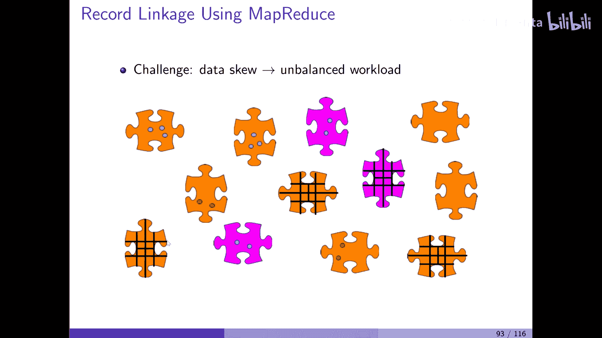

Paraly like a work on the topples， right， But then like it could happens that we have a very unbalanced work。

 Okay， so the data could be sked。 right， So， for example， when we are using blocking。

 so when we are like trying to。

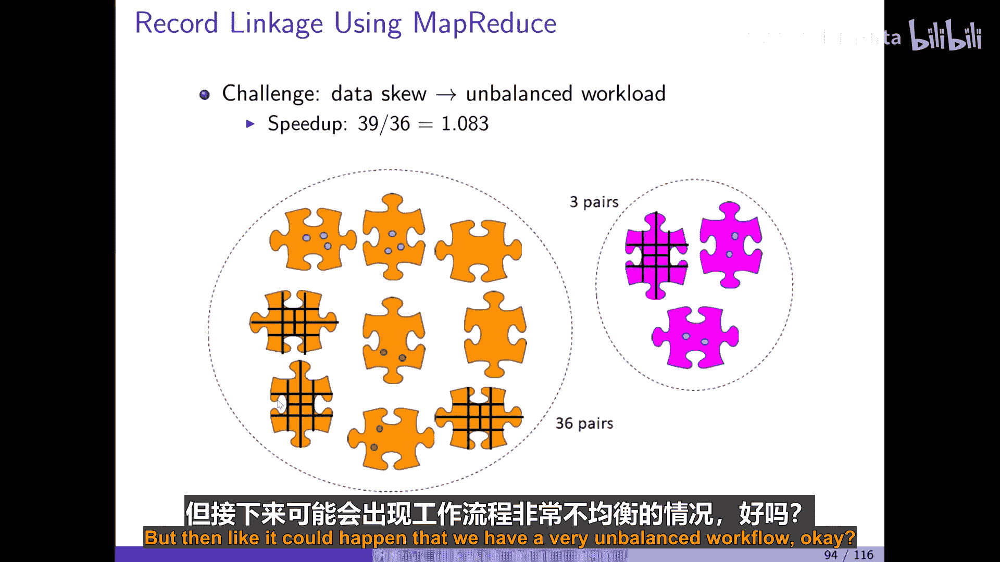

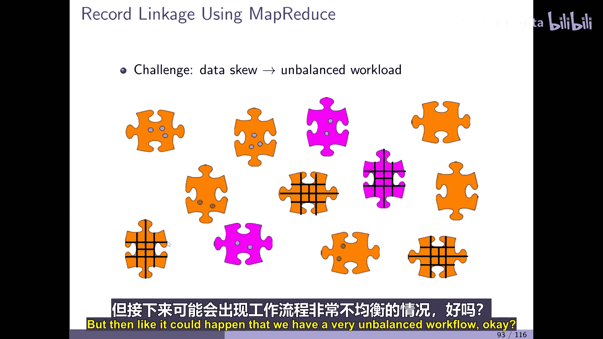

嗯。Trying to use map reduce in like doing the matching parallel So then before that well need to use blocking okay so that we can decide which matching can be done in parallel with which matching right so therefore we need to do blocking So for example。

 like with records we can like like what we have said we can base on zip code like a split the tops into different blocks and then we only needs to compare the candidates within a block So that means all the toppo within a block we can do it in one task one reduce task。

And then another block， we can do it in another map reduced task。 so we can do that to parallel。

 right。

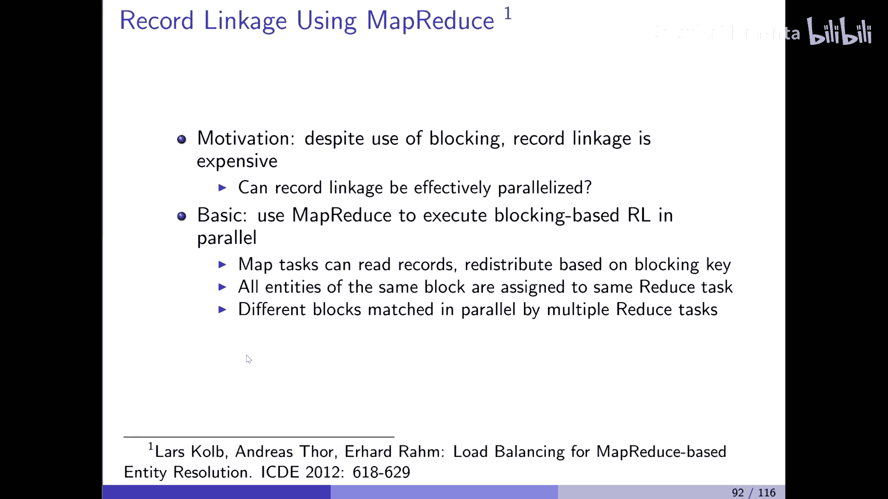

Okay so then we may end up with having a very unbalanced workload according across the workers right so one worker may be looking at and then comparing like9 topples So9 ps means you need to match 36 pairs right another worker will be looking at matching within a block of three pairs。

 a block of three tuples。 Then that means we are only looking at three pairs So you see that even we are paralyzing that we are not speeding up that much because this block here is going to take up most of the time。

 And then the time is not very much less than the original time with like processing all okay。

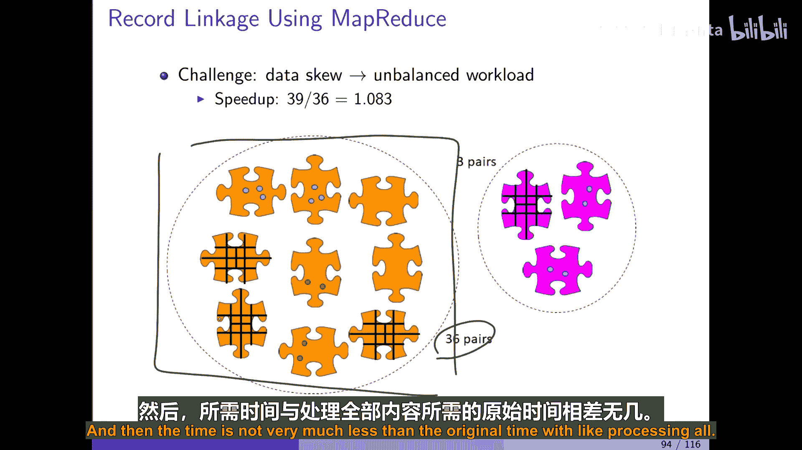

So then we might need to do low balancing Okay， so what we want to do is to balance the loads right So then well there are two different balancing strategies。

 One is the block split， So which means that like the first one is we are going to split large blocks into sub blockss。

 So if we have small blocks， we'll do it in the one task， but if we have a large block。

 what we can do is we can first randomly split that large block into smaller blocks Okay。

 say that we just slice it in the middle we have two sub blocks and then okay。

 that means we are looking at first subb。

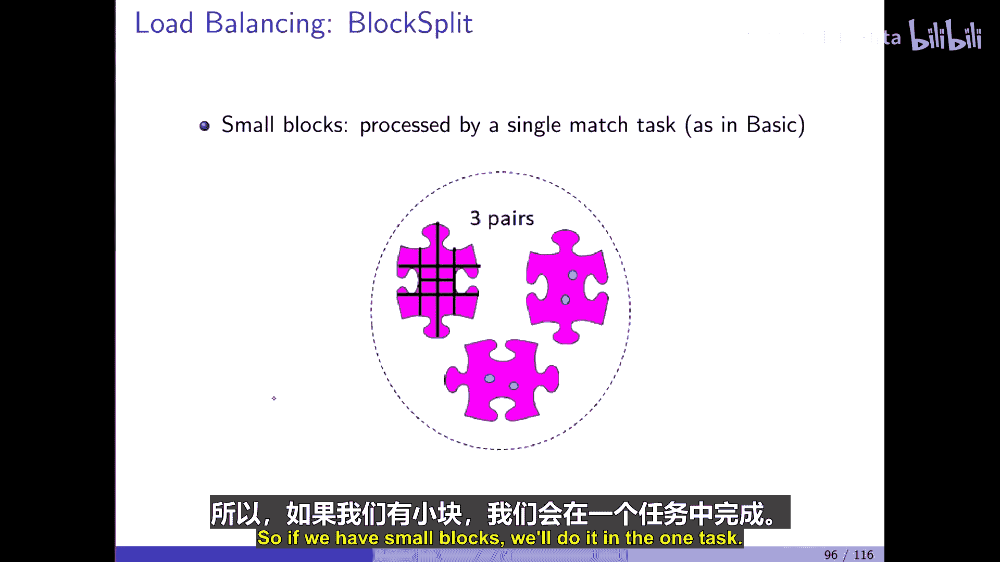

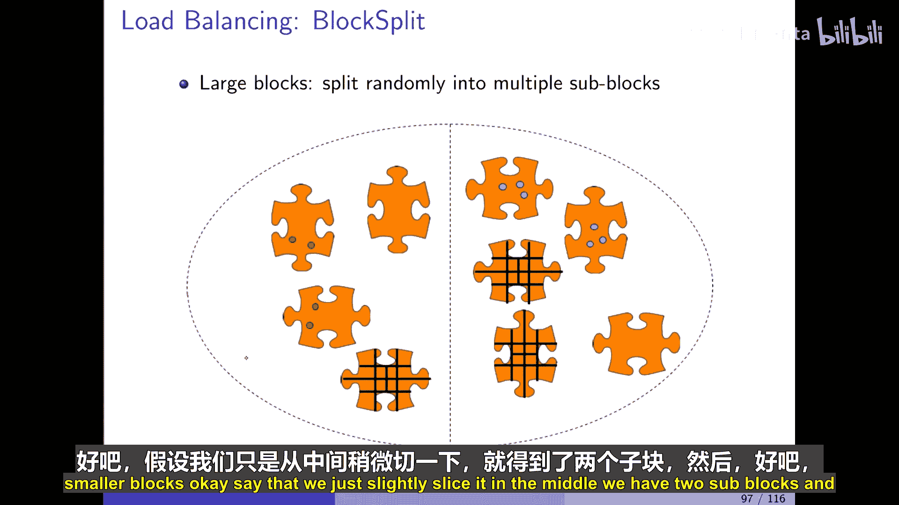

4 tas。 and then six pairs， another。Okay， block subb with five topples。 That means10 pairs。 Okay。

 so then we'll do each of sub blockss matching on a task。 Okay， on worker S O task。

 So then we still need to consider those pairs across two subbs right So that will be another task。

 which we are looking at the Cartesian product match task。

 So that means we are looking at this one comparing with this and then this and then this right and then all of that。

 So that will be 20 pairs。 Okay So then that means what we have here is looking at one task handling three pairs。

 another task with six pairs， another task with 10 pairs， another task with 20 pairs。

 So then that means the largest task will be processing 20 pairs。

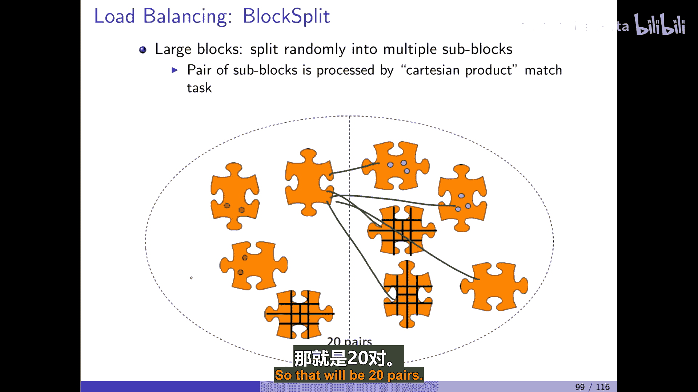

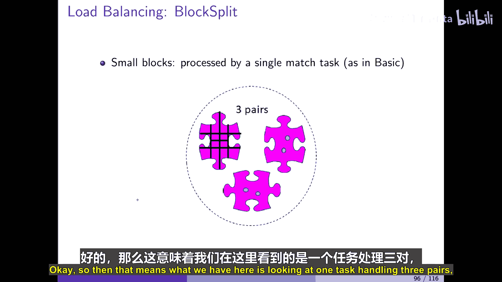

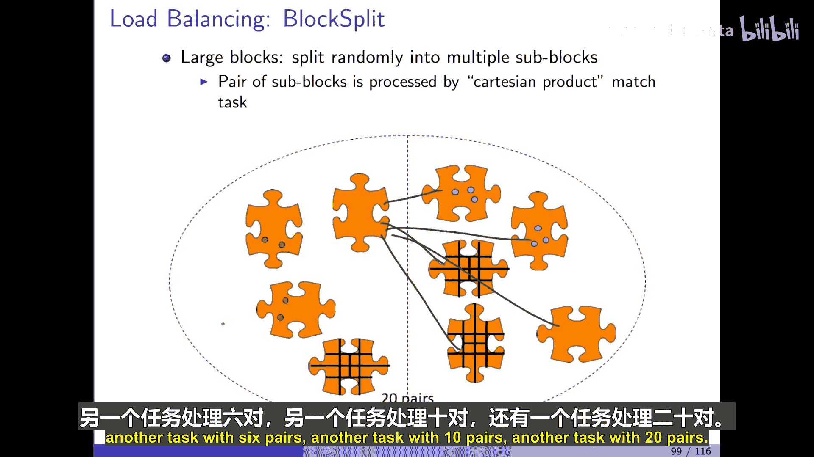

Okay，20 pairs。 So that means the task that will take ups the most time will be 20 pairs。 right。

 so then originally， we are considering 39 pairs。 If everything is in one block。 now。

 we are the longest one。Okay， spendingending longest time will be the 20 pairs。

 So then that means we are speeding up it by 1。95 factor。 So that's better。 right。

 so that's working with load balancing。 Okay， Allright so for the pair split here。

 the pair range here。 So the basic idea is just eliminate all the pairs。 Okay。

 and then just redistribute it。 right， so this one here requires prior knowledge on all the possible matching。

 and you have toerate it。 sorry about it。 enumerate it beforehand。 Okay。

 so it's going to have like a。

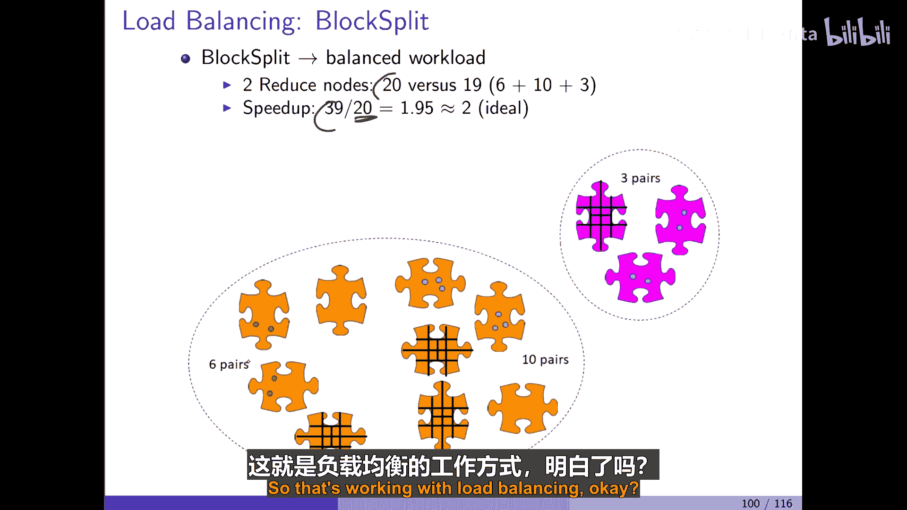

Also like a more effort， like it requires like an overhead on handling that elimination and redistribution。

 right？

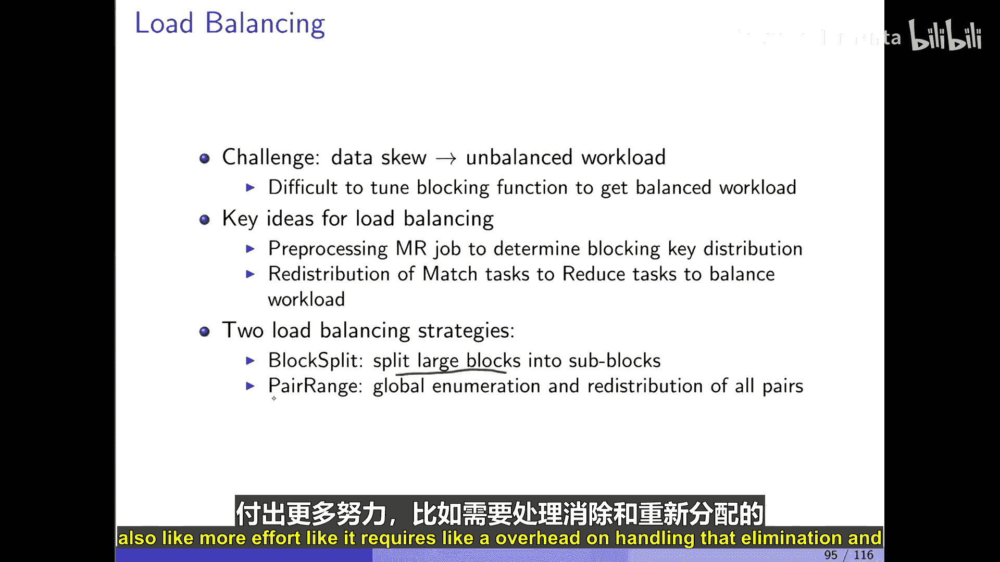

Okay， so then right。

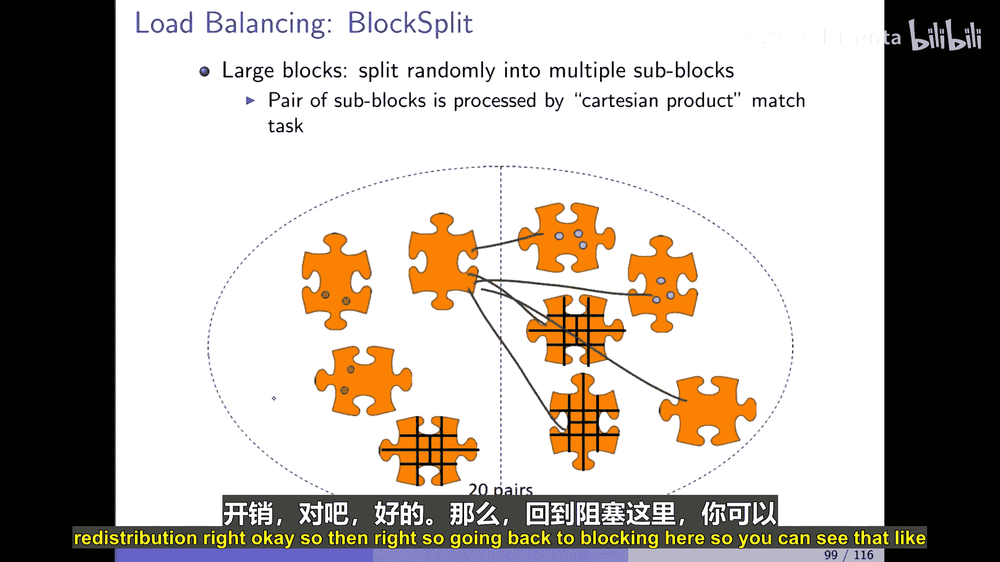

So going back to blocking here， so you can see that like blocking is definitely one of the most frequent use approach on reducing the scalability。

 helping with the scalability challenge， but then for blocking itself， there is a certain problem。😊。

So say that we are just using a single blocking like， for example。

 let's just look at the blocking by last name Okay， so that means if we look at the last name here。

Okay， if we are just matching the last thing。 So well have three blocks。 Okay， so like E1。

 E 4 and E 5， they are the same。 So they are in one block。 and then E 3 and E 6。

 they are in one block。 Okay， so and then for E 2， it's different。 So then we have three blocks。

 right， But if we are only doing matching with these three blocks。 Okay， we will be able to fill。😊。

Okay， considering E 2， together with E3 and E6， right， because we are only matching E1 with E 4。

 E 5 with E1， and then E or4 with E 5。 We won't compare across E2 with E 6 or E2 with E3。

 So then we may fail to like identify E2 as a match against E 3 or E 6。

 Okay so therefore you see that that is why we said that single pair wise destroy block will have poor recall。

 We may fail to identify some。Potential match pairs。

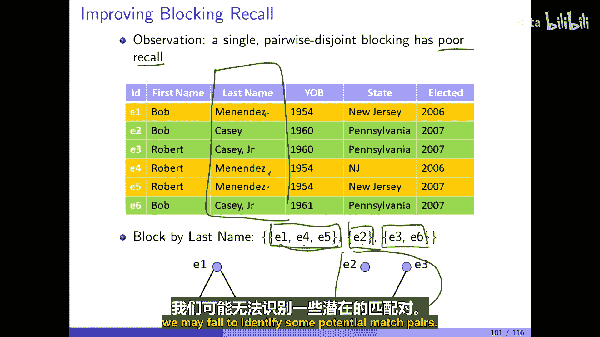

So then okay， the solution here could be just apply multiple blocking Okay， multiple blocking。

 So you can first apply blocking on first name and then last name and then year of birth states elected etc。

 So then， well， in that case， we won't have low record right we're definitely consider all the things。

 But then if you like a look at that， that means while we' are comparing them again and again， right。

 So if we are looking at like。You1 and E 4 by just matching the first name。

 They will be in the same block， right， If we are looking at like。Okay， the。E1 and E4。

 if we are looking at year of birth， they will be in the sorry about that。 So first name。

 probably not Okay， so if we are looking at last name for E1 and E4。

 they should be in the same block right if we look at year of birth So we are looking at this and this year of birth okay so they are the same so they will be matched again and then if we are looking at the elected So again the same So that means well。

The E1 and E4， these two tops are actually blocked three times right。

 So if we are considering all the blocks， So then we are going to match them three times。

 So then that means the number of comparisons is even worse because we have more pairs to compare compare。

 So that is obviously not good right， So meaning that we are improving the recall。

 But then we are making it like more time consuming like this is not desirable desirableable。

 So then what we want to do is well， probably we can do some block purging。

 So that means we are like cutting off some blocks。Okay。

 so that could be done by looking at like how many like within if we are using this particular block blocking approach is it a good one。

 So is it like sharing a lot of tas and then like are there like is it like not sharing too many couples and then using different kinds of information and then to assign ways and then to decide whether like the resulting block should be considered or not right so you can see that there is something more to be considered so we are solving one aspect of the problem but we may be encountering another problem。

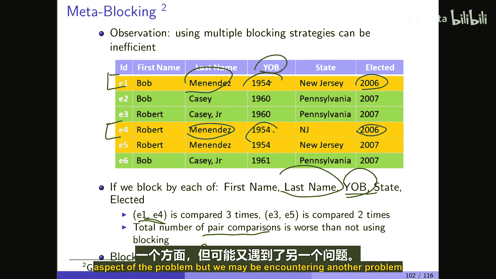

Right， so then okay， back to the temporal thing， right。

 So then like the idea of having like a temporal matching is that like we know that for certain entities。

 for certain records， while the information will change over time。

So typical example of these kind of like entities will be people， right， So for us， people。

 our information will change over time， right， So if we are looking at like our information like。

Five years ago。So our information might be like including our names and then our like educations right。

 or our affiliations。😊，Or the company that we are working with right So then obviously five years ago。

 it might not be the same like with now right because we may be working， we may be switching jobs。

 we may be like studying in different institutes and then those kind of information will change over time right so then okay。

 we may need to think about those information as well。And then also。

When we are looking at the data sources。The information or the data being stored in a database might not be the most updated one。

 right， So say that a database might be storing like one company。 Okay， is storing our information。

 our data， which we registered。 We have given a few years ago。

 and then another organization will have our most updated data。

 because we probably just like modified it and giving the information just now， right， So then， okay。

 if those two organizations are going to integrates。

 then we are looking at one that is five years ago。 We are looking at one that is now， right。

 So then okay， it's not that they are incorrect。It's just that like some of the data might not be updated。

 Okay， so that means the time difference。Across the differences in the data may also need to be consideredc。

Okay， so like this example here。 So say that we are still looking at like。People， okay。

 and then we are looking at their affiliations。 For example。

 the companies that someone is working for。 Okay， so for example， we are looking at a name。 Okay。

 so say that we search a name like Xinong。 And then we are looking at all of the different affiliations that that person had Okay。

 up to you now。 So then we may have all these possible coupleples here。 right。

 So the earliest one is in 1991。 So then like he or she is working with the Potechnic instutes。

And then okay， in 2004， we have a TO which is with the company or with the Institute University of IllinoisOS right and then Ka。

 a little bit later on， for example， like 2009 then Ka。

 the same name is working for Microsoft Research。Okay， so then you can see we have many。

 many different topples here。 Okay， so then can we decide which among these tuples are actually referring to the same person。

Okay。😊，Or whether there is some mention that some tapo therere。Is actually related。

 iss actually describing another person。So how can we consider that？Okay， so if we look at this。

 right， So if for us， when we are looking at this。We may already be able to tell， right。

 so look at the time here。Okay， the first one that we have is in year 1991。Okay。

 so you see that there is a large gap。 Okay， so there is a 13 years of gap。 Well for these。

 they are quite like a close to each other。 so then。

 the large gap between the first tuple with the other tuples might be a hint to us that this may not be the same entity with all the other。

Tuples， right， so you can see time is affecting our decision， right。

 So time may be a thing that to be considered。And then also for the other mentions。

 you can see that while they are appearing in a quite short time period， for example。

 like these here， it's just within four years and then you can see that there are different different like organizations like AT&T research lab and then also Microsoft research and then if we are looking at。

These here， if we are looking at this one， this one and this one。

 you can see that they are quite close to each other， sorry about this。

 so this one this one and this one they happen in the same year。Okay，They happen in the same year。

 So within a short period of time， it's less frequent Okay。

 that one person will be changing the affiliations that often right。

 So changing the companies that often。 So then this may also tells us that these three tops may not be referring to the same entity。

Right， okay， so you can see these kind of like a time windows and then k the differences or the。

Same datas might be giving us information on like whether those different topples are referring to the same entity。

 And then you can see things are considered over time。

 So that's the idea of linking temporal records。 right， So then okay。In the end， Okay。

 so the real answer could be like this。 The truth， Well we are saying the ground truth。

 So the ground truth may be that we have three person here， three people here。 So our one。

 this topple is one person。 And then our2 our 3 out4 our，5， our6。

 They are another person because you can see that like these。企。😊。

Organization names are remaining the same within a short period of time like three years and then these here are the same oh。

 sorry about this。Okay， so it's actually not including for these here。

 I actually remaining the same within like a2 to three years， right， So that's more like common。

 right， And then if we are looking at this one here， like you can see similar pattern here。Okay。

 so therefore like a this could be So this is the ground truth。 So then how do we capture this Okay。

 ground truth here。 So that's like a what this。What this approach is trying to suggest， right？

So then， okay， when we are looking at the mentions here。 So obviously， what we have discussed， right。

 we could be like considered like across。St period of time。 Okay。

 there should be a high value consistency。 So meaning that like within 2 to three years。

 things shouldn't be changing that much， right， because it fits with into our like habits。

And then also， we could be considering other things like the similar names right。

 So obviously we get all of these because of the names right and then like。😊。

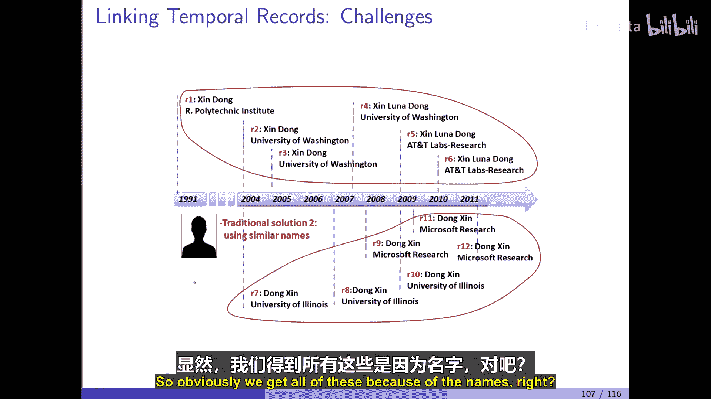

So what we are looking at that here is the pattern of things being happened。 right。

 So like when we have mentioned that， like across。A certain period of time it's very normal for someone to have changes like for example。

 from year 2004 to 2008 between those four years of gap it's normal for something to be changed right so then。

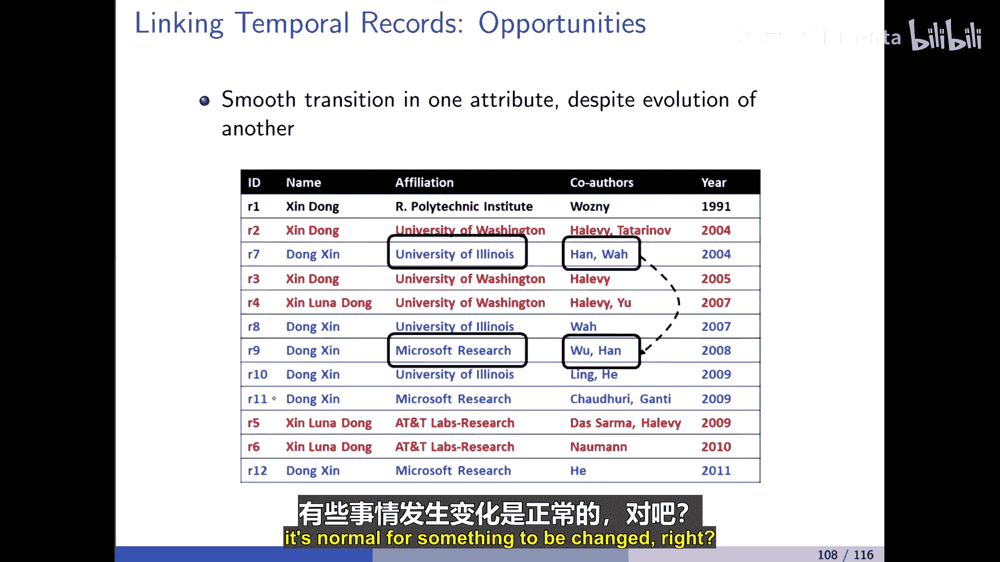

Within a short period of time in the opposite way， within a short period of time。

 it's less possible that someone is changing that much right so that is why we say that errctic changes well for particulars attribute value within a short time is more unlikely and then K。

And then usually like for a particular person， there shouldn't be a large gap in time across different records if there is a large gap like the first one top r one and r two so there is a large gap without anything appearing in between that maybe be suggesting that what they may not be referring to the same entity Okay and then also what we can do is like we changed those kind of considerations into like。

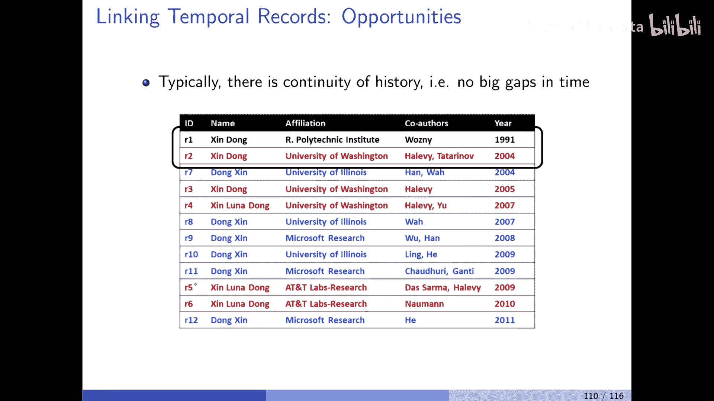

Quantitative evaluations， right， So， for example， like if there are high disagreement within a short period of time。

 then we give a high penalty to represent the less likely situation and then say that across time。

 when things changes， then it should have a lower penalty to express that it's more likely to be happening。

And then within a short period of time， it's more likely for things to remain the same right。

 so then we should give a higher reward， a higher score and then within a time if there is a large gap then again there should be a lower score so we can put these into considerations when we are doing the matching Okay right so then that will help with like a considering more considering the time as well。

Alright， so that's like for the second part here on the big data integration。

 So we are just discussing some ideas right so because we are talking about the different theses。

 different big data challenges。 So then what will be the possible ways to handle those things right just like what we have mentioned last lecture when we started to talk about data integration data integration。

 we don't have a complete solution yet。 So up to you now we don't have a complete integration table to do schema alignment automatically to match records automatically and then also to do data fusion automatically and then what we'll be able to integrate everything without menu efforts。

 So up till you now it still impossible So what we have mentioned by then is that we are only developing tools to help with each stage of data like an integration。

And then even within each stage， we are also trying to have tools to help us to do things right so then similarly with the record linkage here。

 so we can match records right， but if we need to consider more。

 then we don't yet have a complete solution， so based on the problem like if we are looking at data okay of people of organizations。

 then definitely things will be changing across time。

 then we might need to consider the time differences。

Okay and then we are looking at groups of related people like for example。

 the co offerss so then we might need to do collective matching okay so then based on the problems we might need to think of different approaches and then like the dimension issue here that we have just mentioned we may need to use blocking and then even if we are using blocking we may be looking at like a low balancing okay when we try to paralyze the work and then also like how do we do that Okay so to speed up everything to ensure that everything done will be in the most suitable way。

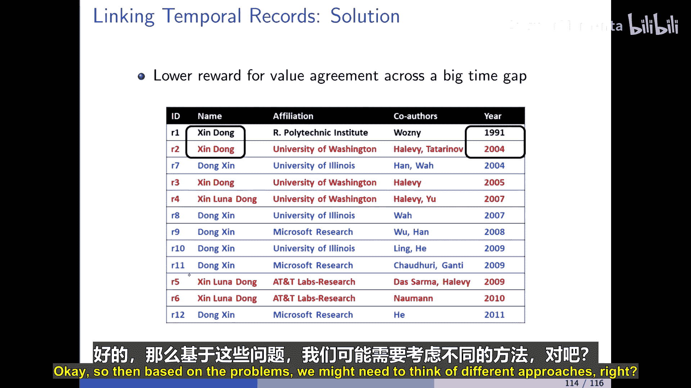

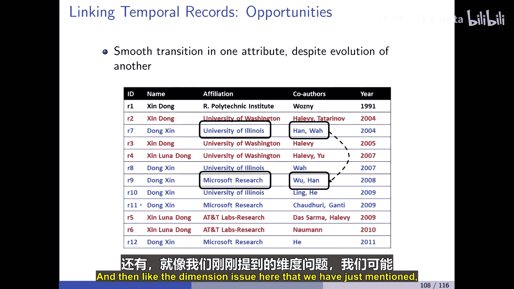

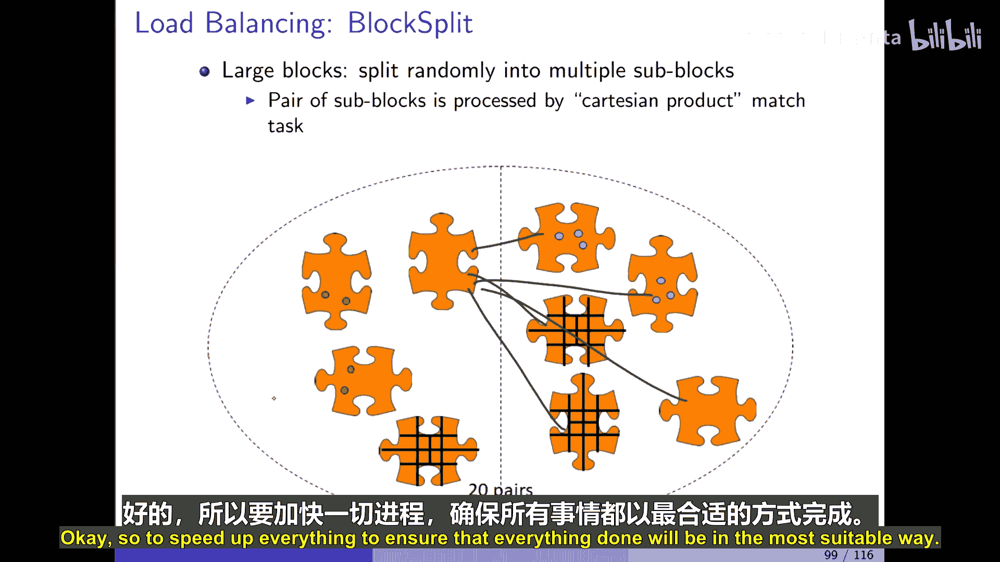