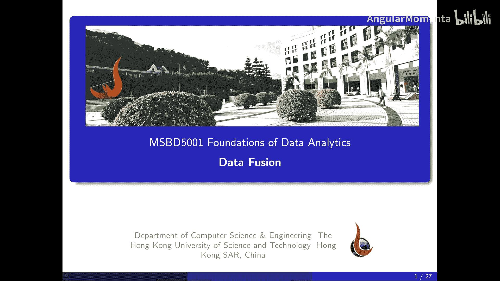
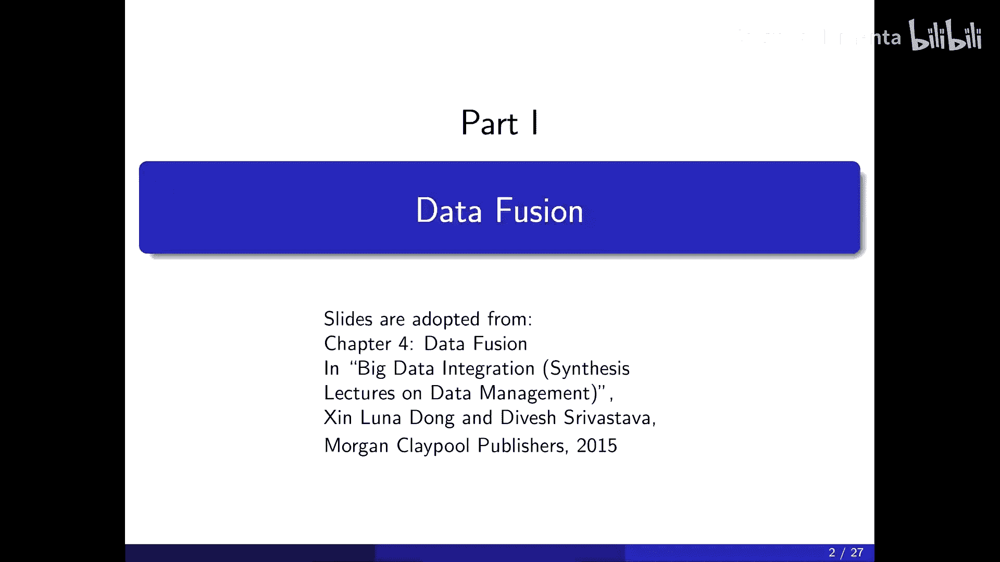
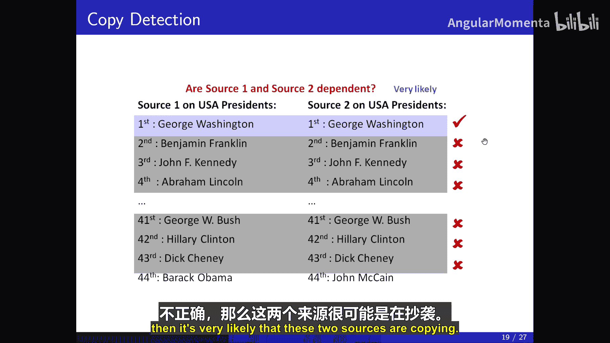
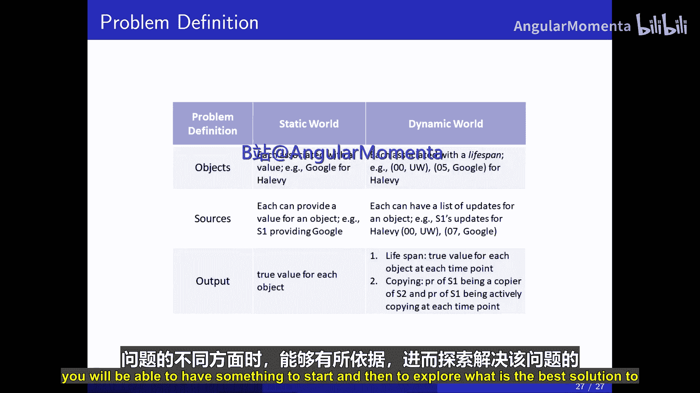

# 【香港科技大学】数据分析基础-｜-Foundations-of-Data-Analytics-p25-17-01-03-导论--BV1oKFDznE6L_p25-

The third component of data integration is data fusion。

When we are integrating different sources， comforting values can be provided by different sources on the same attribute of the same entity。

 The conflicts may come from U， like tapping errorss。

 or like incorrect calculations out of ded information or inconsistent interpretations of the semantics。

And then the problem may also be caused by sharing and patriarism between sources。

So because like in bank data， there are so much data， it may not be possible to have perfect data。

 so we need to do， we need to handle the conflicting data values。So therefore。

 the goal of data fusion is to resolve inconsistency and to decide which value truly reflects the real world。

 So data fusion is a very new area comparing with smmer alignment and record linkage。

To resolve inconsistency in data fusion， so given many like sources with different values of attributes。

 a simple method can be selecting the most updated values or taking the average or maximum or minimum of all the values if those are numerical values or simply apply voting。

Like this example here， so we have three sources and five people。

 so we have like some values provided by different sources so you can see that not all the values are the same like for theW。

 S1 S2 are providing the value as MSR while S3 is providing the value UW。So with majority voting。

 with voting， so we can count the most frequent values。And then to treat that as the truth。

 for example， for the weight， then we MSR has the majority voting。But with like。

 what if copying is involved across sources。 So then majority voting may not be the best。

 as it will wrong make the decision。So therefore， like when we are doing data fusion。

 we may need to further evaluate the source quality and also to detect any copying so that we will be able to truly identify the correct values。

So like this example， so like。For source quality， like the source one。

 you can see that based on majority voting， source one is giving the true values most of the time。

 so it may be considered as a source with higher source quality。And if we further look at the values。

 so you may see that like this example here with the five data sources。

 you can see that for source3 and for source 4 so they are sharing like very similar values and then for source 4 and source 5 like again they are very similar in the values provided so then with the copy detection we may be able to identify that source4 and source 5 are copying from each other so then we reduce the weights of those sources to make the voting more reliable。

Therefore， you can see that in data fusion， there are three major components。Which are voting。

 source quality variation， and also copy detection。For data fusion， again。

 we are facing the four weeks。 So let's briefly talk about that。 First， for ververity。

 So data fusion obviously is closely related to veracity。😊。

We will talk about some ideas briefly a little bit later on。And then for volume。

 similar to record linkage， we can use map reduce phase implementation。

But we may also need to handle online data fusions to get estimated results at query answering time。

For virosity， instead of as a static world， we need to consider how data evolves and changes over time。

And then that is to determine what value is correct and when it is correct。Finally。

 data fusion is not an independent process； it may affect skimmer alignment and record linkage and buys verter。

So let's start to talk about some ideas。Data fusion。So as mentioned before。

 voting is the most basic solution。It works well when sources are independent of each other and have similar accuracy。

But in the real world， we know that not all sources are with the same accuracy。

 Some sources may be less accurate than the other， so it may be good to give different weighting to them。

 in particular， more weights to more knowledgeable source。Similarly。

 we know that sometimes source copy from each other， so we may also reduce the weight of copiers。

Now that means we will need to be able to measure the accuracy of sources and hint the trustworthiness of sources and also copy detection。

 So let's see an example of defining the source accuracy So in here in this slide here you can see that source accuracy is defined as the probability of a value provided by the source is the true value。

So then the problem now is how to compute the probability of a value being true。First。

 assume sos are independent， Then baing analysis can be applied considering a beta item D。

And then values of thee。So you can see that VLD here represent the values of that data item。

 so where there is one true value and n force value。

 so we have n plus one values here and then for phi it is the observation of which value a source provide for the data item。

So now what we need to find is the probability of observations given a value is true。

So which is the source's accuracy here。If the source is not providing the true value。

 then the probability is 1 minus A S， the accuracy of S divided by n under the uniform force value distribution。

 so we may now have a framework like this。If we have if we now have the acacies of the sources。

 we can compute the vote count of each source and then the vote count of a value and then find the probability of a value being true so you can see the interdependencies between like the source accuracy and the vote counts and the probability。

So these few slides gives a rough idea on the source accuracy。 Next。

 let's discuss about copy detection between sources。

 so it is a challenge as sharing data does not imply copying sources can each independently provides correct data。

The intuition of copy detection is that。Copying is more likely to appears between to happen between sources sharing values。

 but then sharing true values are less likely to involve copying just like this example here like the two sources they are sharing true values they are the same they are sharing similar values but all the values are true。

 so then are the source one and source two copying from each other so probably not likely。

But then sharing uncommon values could be a hint for copying。

 because uncommon values is a low probability event when sources are independent。 So that means if。

 like sources are sharing a lot of false values， it indicates copying。So like this example here。

 so like both sources shares just one true value while all the remaining ones are incorrect。

 then it's very likely that these two sources are copying。

With that intuition， here is an example of baian model to confuse the probability of copying between a pair of data sources。

 so the goal of the model is to find the probability of the two sources as1 and S2 being independent of each other given the observations of data and also the probability of copying between the two sources as1 and S2 given the observations of data。

So similarly here， according to basehu， what we need here is the probability of the observed data condition on the independence or on or。

The copying between the sources。So after mentioning about source accuracy and some ideas on like copy detection so let's look at the relations between them so since evaluating source accuracy requires the knowledge of value correctness from truth discovery where the knowledge of source accuracy helps giving a better truth discovery results and also copy detection requires source accuracy and valueness and its results also benefits truth discovery so there is an interdependency between the free components。

 truth discovery accuracy computation and also copy detection so these components are often itatively concepted until reaching convergence。

So now let's talk about another challenge of like the data fusion or the need of data fusion recall that in record linkage we've mentioned about linking temporal records。

 so now we are considering something similar。The real world is not static where values remain unchanged。

 The real world is a dynamic world where truth change over time。

So then the goal here is to to do temporal data fusion so as to find all corrupt values and and their valid periods in the history。

 So like the example here so。This is the traditional later fusions where like values are considered to be static。

 but then the truth is that values are dynamic。So there is a time associated with it。

So then what we want to do is identify the true value for the corresponding period of time。

So for example， like you can see that over time， some sources are providing like wrong values at a certain moment and also like some of the values may be outdated。

So the reason you can see that the reason for like data to be wrong besides simply giving wrong values。

 well it can also be a failure to update the data at all or just not be able to update it update the data in time。

Okay so like these here， so you can see the free possibilities。

 so some values are actually just wrong， some values provided by some sources are out of date or some like sources are updating data like behind the accurate time。

So that means we'll need to like modify the definition of the problem。

 so now objects here are associated with value and then they are also associated with a lifespan in the dynamic world and then for sources。

 unlike static well where each value each source is providing a single value for the for an object now each source can provide a list of updates for an object for example。

 source 1 can give updates on with like 00 in the year with the affiliation of UW and then also in 0。

7 in the year 2007 then the value becomes Google and then for the output again is changed instead static well for each object there is only one true value So now for each object there could be true value according to the lifespan so be nice determining。

The true value， we want to determine also the lifespan of the true value of the value being true over the period of time。

嗯。SoThat's for data fusion right so then we have finished talking about three components of data integration。

 schema alignment， record link and data fusion， so we have mentioned a lot of different techniques and then for this area the data integration is still changing and a lot have been improved a lot of new techniques have been proposed so we hope that these slide give you a basic idea so that later on when you are encountering different aspects of the problem you will be able to like have something to start and then to explore how what is the best solution to solve that。

