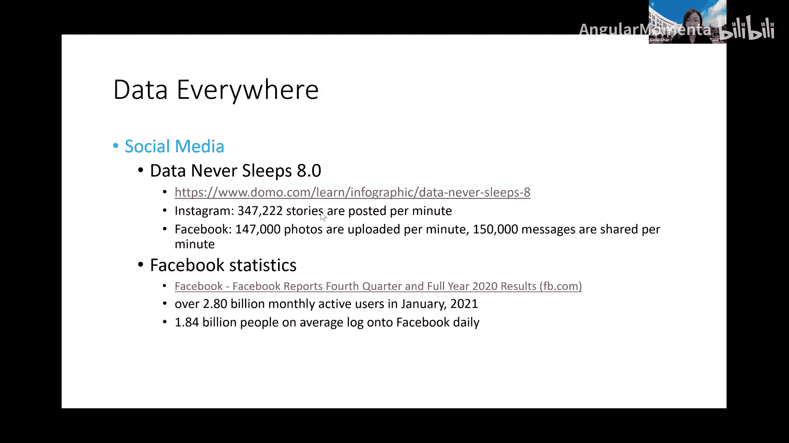
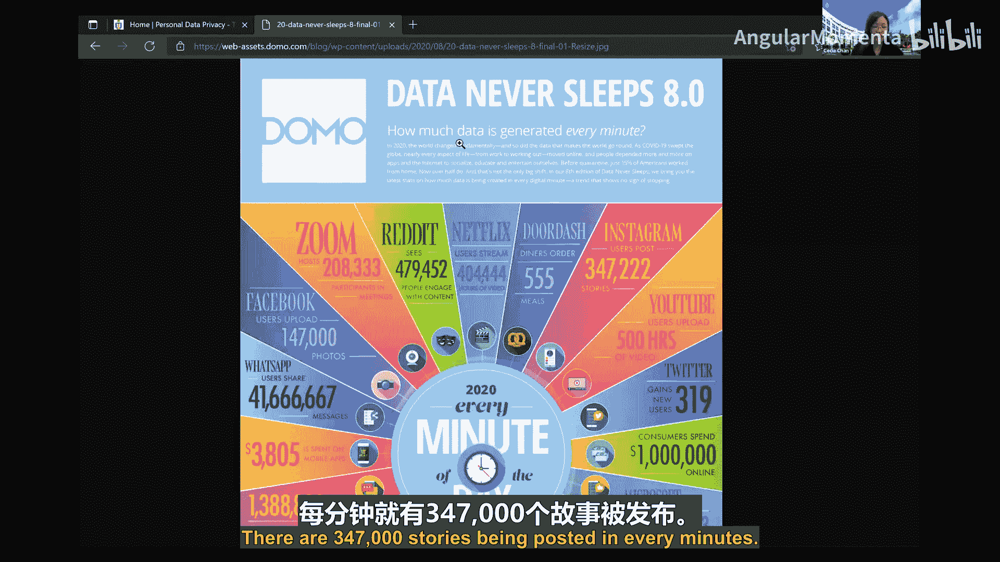
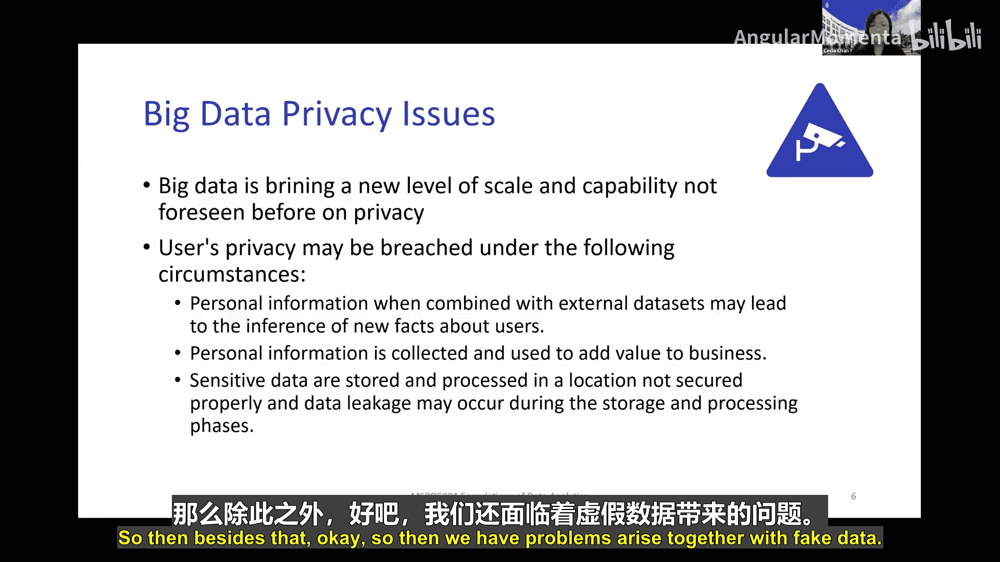
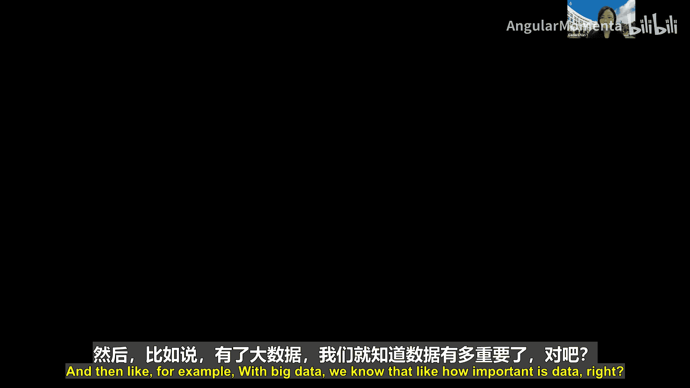
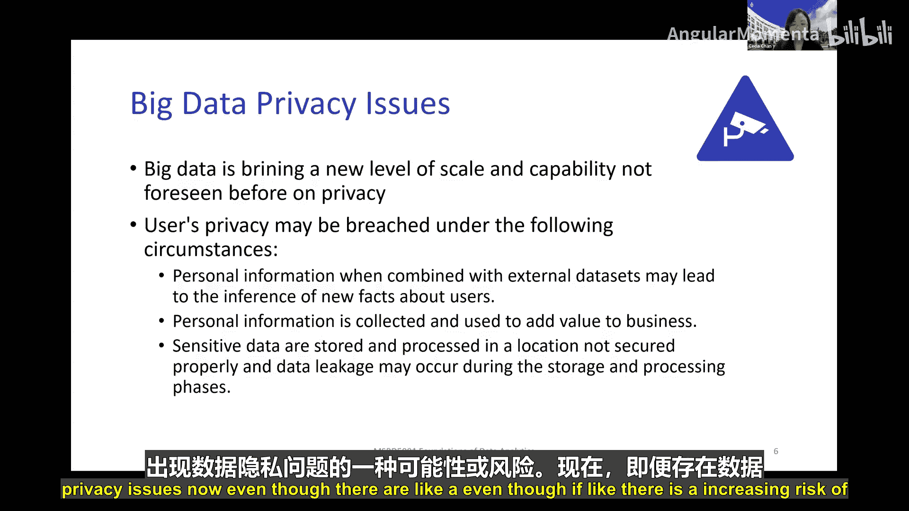
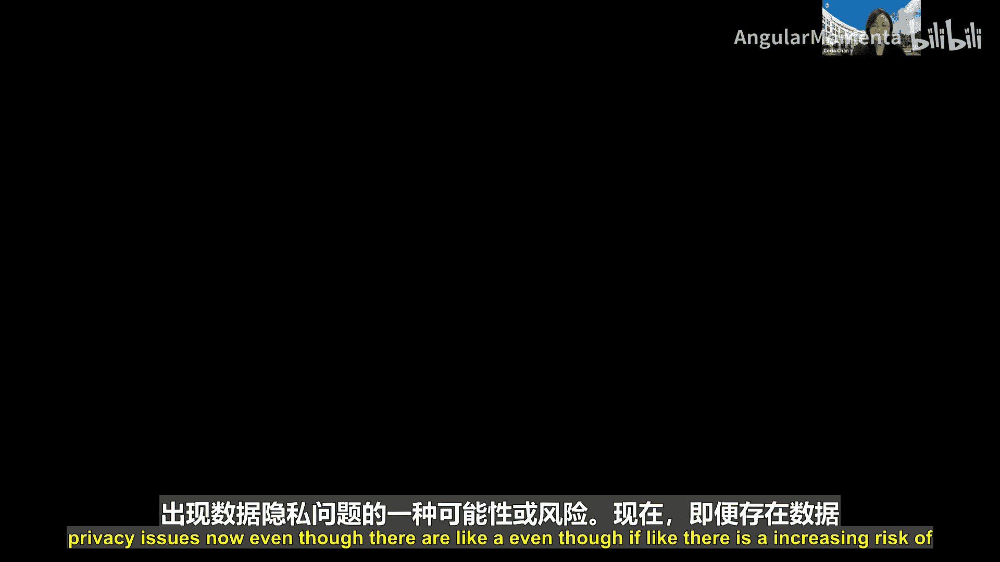
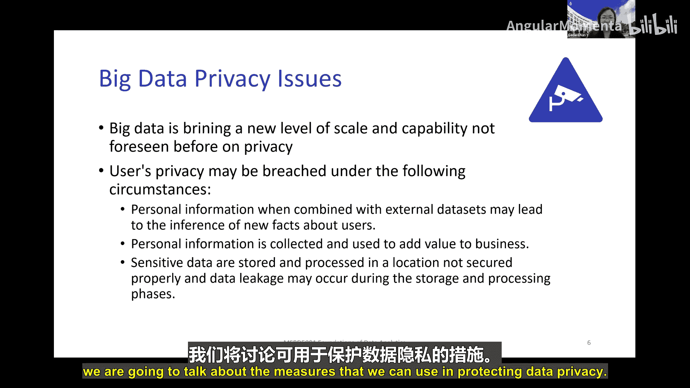
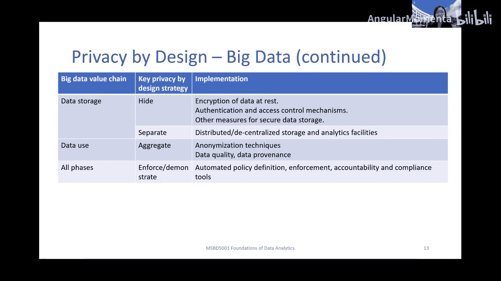

# 【香港科技大学】数据分析基础-｜-Foundations-of-Data-Analytics-p26-19-01-03-为何数据隐私至关重要--BV1oKFDznE6L_p26-

So data privacy is something that we are hearing more and more of the time in the recent years。

 we are hearing like data privacy from news， we are reading like data privacy from articles about like data privacy issues issues and then there are also more and more chances that we are seeing like data privacy related statements or guidelines when we are using different services for example like when we are using like online banking so usually we'll see like there are many updates of the data collection and then data usage those guidelines or statements and then even when we are we are like doing online shopping right so before you can like really complete the order and then have the product shipped to you so then you need to again agree on like data collection data usage and then even like with installing apps on our mobile phones on our computers so then very often we'll be like like need to。

😊，or take those like agreements on the data collection data usage and then even like organizations are posting like like an information about like data privacy for example。

 like Hong Kong USD is also having like this page here about how they values data privacy and then what are there like a protection measures guidelines and then they are like data privacy statements So we are seeing more and more of these now why is that so of course that is because well there is an advancement of technologies right now in the old days when we have limited computing powers and then like data are usually collected in a limited scale and then also analyzed in a small scale and then also being like managed or like analyzed and handled or collected by a small group of people。

Okay。So therefore like data privacy is not a serious problem that serious it's still a problem。

 but it's not that serious at that time， but then nowadays it's a different story right we are having like huge amount of data because we are in the big data error and then like data is just everywhere right so then you can see there are like data everywhere like we ourselves are generating data everywhere so let's take a quick review on like what is the scale what is the amount of data there are nowadays right so like for example there is analysis on the number of internet users in 2020 now we can see in 2014 is's just 2。

9 billion and then in 2020 it's becoming 4。5 million billion so then just in a few years it's kind of nearly doubled right and then。

😊，And how about what we are doing on the internet？Every minute or every day so very often we are doing searching right we are googling so we are like making searches on different kinds of like information or materials online and then you can see there are2 million searches per minute and then 70% of them are from mobile phones So of nowadays all of us are very comfortable with using like mobile phones computers and then connecting to the internet doing searching and then like of course what we are looking for are data and then in the same time we are producing data as well for example all of us are using social media and then like when we are using social media we are actually actively generating data because we are posting stories we are making tweets we are like sending messages we are posting photos videos all of those are actually。

😊，taining information or data about ourselves， right， and then we are generating that amount of data。

So then social media and then how about others like communications right so then even if we are not like using Facebook whatsapp Facebook Instagram to to those like social media applications we may be sending messages through like text messages or like Whatsapp messages and then we are communicating right communicating and then how about Zoom right so we are having zoom meetings like nearly every day right so for many many of us and then all of these will be meaning data and then how about multimedia right so everyone one of us now is either watching videos or we are even like producing videos like what we are doing right now right and then like for example we are using to YouTube then 500 hours of videos are uploaded every minute TikTook there are more than 1 billion。

😊，Videos are viewed right and then Spotify so 28 tracks are added to the music library and every minute。

 And then how about the number of hours of contents being watched on Netflix So then you can see all these meaning that there is a huge amount of data everywhere and then not to mention like what we have briefly mention about posting photos on those medias social medias So then you can see there are 1。

4 trillion photos taken and then like well how about internet of things。

 and then while you can see in like it is estimated that there will be 46 billion connected devices in 2021 and then31 billion of devices will be installed worldwide by the end of 2021 and then you can see the numbers is actually increasing very。

 very quickly。😊，And then internet of things is meaning that like a data are actually being collected because we have devices connected to either through like internet or through wi-fi or through Bluetooth and then again it's going to collect data so then data is just everywhere so then every second every minutes we are having data generated and data is being collected and then that's not the end of the story right while data is being collected they will be analyzed they will be shared and then okay data is also regarded as like money as the new few right so then that's why because data is just so important。

😊，And then that's why we are here right and then because data is being generated and collected and analyzed right and then what is the major kind or major source of data that we are collecting。

 generating and then analyzing individual data our own data about us and that's why big data privacy issue is very important Okay。

 I don't think anyone of us would like to have our own data being disclosed or known to everyone right so we want to be able to protect our own data and then that means we want to safeguard our data privacy。

😊，Okay。And like， what。😊，You can see that， because of back data。Like the。

The the data privacy problems is now onto a new level of skill。

And that was not foresee before and that's why data privacy is gaining more and more importance in the recent years and that's why we want to be able to discuss it now and then so that while when we are like doing data analysis as someone who is doing data collection data data analysis。

 data processing and then we'll need to be careful and then be aware of what we can do to help like protecting the data privacy and then not violating the data privacy of individuals。

So data privacy is like something that we hear more and more like in the recent years now we are hearing it often news and then reading like data privacy issues on in many articles。

 news articles or other kind of documents articles and then there are more and more chances that we are seeing those like data privacy statements or guidelines when we are using different kinds of like online services for example。

 when we are using online banking so we'll see those like data we'll be receiving like documents from the banks on data privacy and then on data collection or data usage and then like even when we are like shopping online right so before we complete our order。

 then usually well need to agree on the data usage data collection and then even with installing apps。

😊，Then we'll need to like agree with the data collection and also data like a usage as well。

 so then you can see where we're seeing that everywhere and then also like even many organizations nowadays become more and more common for organizations to be like issuing like statements about like protecting data privacy for example like Hong Kong USD also have a page which you can see on screen it's like a page about like a personal data privacy so then there is information or there is like data there is information about how like USD is like a protecting data privacy。

 what is like the organizations privacy statements etc so we see more and more organizations is doing this more and more organizations are doing this it illustrate how important data privacy has become nowadays。

😊，And then why are we seeing these kind of like situations。

 Why are we like seeing the term data privacy more and then why are we hearing it more and then why organization are also more concerned and then also government as well are more concerned about that than the older days than the previous days is because of the advancement of technologies right in the old days think about how data being collected it's usually collected in small scale and then again it's analyzed in a small scale and then by a small scale of people a small group of people and then because there is limited people handling the data analyzing the data and then usually the data analysis is done within a company well even within a department so then like it's very less the risk of data privacy okay the risk of。

Data privacy is actually smaller than nowadays， right because like nowadays。

 we have data everywhere and then data are being collected， analyzed。

 and then also like to create values。 And then because data are actually everywhere。

 Then it's affecting every one of us。 and that's why data privacy is becoming more and more important and something that we need to be aware of。

 Now we are saying that data is everywhere。 right， we are in the big data era。

 So big data is also creating more like challenges to data privacy。 So first。

 let's have a short review on like what what do we mean by data everywhere。

Now there are some analysis or there are some statistics about like the internet users nowadays now。

 for example， in 2020 then the number of internet users is already more than 4。

5 million it's kind of 4。5 billion It's kind of double in just a few years comparing to like just 2。

9 billion internet users in 2014 so then we have more users on internet and then now how about searching data over like the Internet So all of us are becoming more comfortable with like searching things online So for example like we are talking about data privacy。

 probably some of you are already trying to search what is data privacy what kind of additional information that you can get online and then like that's how we are like that's showing how comfortable are we with like using the internet and then also we are more and more like comfortable with using devices other than。

😊，Computers， for example， the searches that were done on Google and then like 70% of them were from mobile phones right so you can see again it's becoming more and more common for people to be connected to internet and then searching information。

 communicating through internet all of the like with the like a huge usage of internet。

Now because of more internet users that means more data are being generated and then being collected now when we are using internet。

 most of us will be using social media like applications now， for example。

 there is an infographic which is called data never sleeps which is giving some data about like how many data are being generated in like every minute it's already in version 8 and then in that infographic。

 which is actually like the infographic is like this。😊，So you can see it here。

So it's telling us like what is the amount of data being generated every minutes， for example。

 you can see Instagram there are 347000 stories being posted in every minutes and then like for example the use of Facebook so there are 147000 photos being uploaded every minute and then 150。

000 messages are shared per minutes actually I think like many people are sharing like where they are where they find what they find interesting and then sharing their like living their life a little bit by a little bit every minute every hour or every day so then these are the data that we actively generated right and then besides using the social media networks how about online communications if we are not posting things on Instagram。

😊。

Facebook to readers then we may be sending messages， it could be text messages。

 it could be Whatsapp messages or even other kind of communication ads and then like we are again generating data when we are sending messages and then how about like other forms of communications like the online conference and that we are using in the recent years now in Zoom like you're using Zoom so then you can see a huge like a amount of people are actually using those kind of communication like applications as well so that again when we are communicating over internet then we are generating data every minute every second。

And then besides like messages and then communications how about multimedia data so for example now all of us are either watching videos online or actually generated producing videos online for example YouTube is having 500 hours of videos uploaded per minutes by users right so then TikTook is having more than 1 billion videos viewed every day and then like besides videos that like people us generated or like watched how about videos or like content are generated by like companies or organizations like the Spotify is having 28 music tracks added every minute so that's again another forms of data and then when we have like being uploaded then of course。

😊，We have music being listened right so then again there is like data transmitted and then also contents on Netflix right so nowadays more and more users are using those kind of streaming services to watch reuse so all of these are data so you can see either we are generating data actively or we are having our data being generated in different forms。

And then not to mention photos right so like every one of us nowadays are taking electronic photos with like either our folks or by like electronic cameras。

 So then it's like in 2020 it is estimated there were 1。

4 trillion photos taken So then that's a huge amount of data anywhere we put those data。

 most likely they are being stored online and then how about devices other than computers or mobile phones。

 the internet of things now it's more like if we look around ourselves south。

 more and more of our devices are connected through the internet with like connected to the internet。

 either through wi-fi or through Bluetooth and then when we have devices connected they are connected for a reason they are collecting data So very often for example。

 we have devices that measure our like body situation like example。

ample body weights or like hides and then like a hot beads， etc cetera。

 those kind of like a body measurements and then what we wants to be able to like see those historical data or our body data。

😊，Over for example like devices like mobile phones。

 so then that means data are being collected and then stored and then on internet and then we'll be able to like look at those historical data so then again data are being collected and how about like the devices that are monitoring the monitoring us or monitoring the usage of like resources or like products and then also like a disturbance to devices as well all of those are actually collecting data collecting the information or data about us without or with our knowledge so we can see like well actually our whole life our whole living is actually being collected what we can like say something like that So with that huge amount of data being collected of course it's not for without reasons just being collected once the data are being collected。

We wants to do analysis， right， We wants to be able to generate value values， right。

 so that's the purpose of the big data value chain。So then when data are being analyzed。

 when data being collected and analyzed， then like there might be like larger possibility。

 larger risk of data being like the data privacy or data security being like violated or breachd and then that's why there is an increasing concern about data privacy because the data collected it's about us about individuals right it's about our own data so I don't think people will like us will like our data to be disclosed without our knowledge。

😊，So we want to be able to know like our data where they are what are being used and then who is using it and that's why there is an increasing concern about data privacy and that's why we are discussing this right and then you can see that well with all these discussions you can see that actually big data is the reason that we want to discuss data privacy and then like big data is actually bringing a new level of scale and that we're not foreseen before on privacy okay because big data means data everywhere and then it also means that we are having like better technology we are having better computing power on doing analysis doing data collection and then all of those things were increase the risk of data privacy。

Now the risk of like the risk of like having like data privacy issues means that data like or people's privacy can be bridgeed like because of like different data collection or before because of data processing okay so let's look at a few circumstances that individuals or a user's privacy can be bridgeed for example one of it is that now。

嗯。More and more likely that we are going to combine data with different sources or different external data to like infer more information okay for example if we are integrating or if we are combining individuals data with external data that means it will be adding more data or more information to our current set of data which actually is going to add new facts or new information about individuals of users okay and then like because it's actually not foreseen okay well it's because like we are adding data right we are adding new things so then it's very likely that while the user will think that it's without their consent without their knowledge that we know more about them so then。

That's like a possibility of like having one's data。

 one's privacy being bridge Okay and there another circumstances is that。

Data is collected and analyzed to add value to business right， when this is being done， for example。

 like companies may be analyzing the data in order to like send targeted like advertisement to users Okay and then that means without users knowledge。

 you may be like companies may be using the data for other purposes right So then that will be one possibility of violating the data privacy of a certain individual because again。

 this is an unforeseen and an unknown situation for the user。

Okay so then the user may feel like his or her own privacy is being bridged and then now because data are being collected and then being stored and then like well again because of the big data so then there is an increasing like rigs of data are not being stored securely and then that means data can be leaked and then can be hacked。

And then during the storage or processing phases。When data are being leaked or hacked。

 then that means there will be an appropriaterop use of data。 So then again。

 it's a breach of one's privacy。So you can see it like with big data。

 with data collection in a huge in larger volume and then with analysis being done in a complex in more complexity and then linking different data sources together so that it's adding risk to data privacy issues。

😊，Right， so then besides that， okay， so then we have problems arise together with fake data and then like for example。

With big data we know that like how important is data right so we know that data is actually bringing us value data is actually the important fuel towards like a data analysis towards generating values so then like there is an increasing like a likelihood or incentive for like organizations like to collect more and more data and then not only collecting more amount of data but then like a。

Organizations or like a companies or like a。More likely to collect deeper data as well and then like because we want to be able to do more comprehensive analysis。

 it's more likely for like our organizations or companies to keep the data for a longer period of time。

So then because of the longer period of time， the broader like amount of data and then the deeper collection of data。

 then that means it may again be reviewing more about individuals， okay。😊。

So because like when the current data is like combined together with the like an older data or the like more data。

 that again is going to reveal more about people and then that's again an increasing likelihood of like having the data privacy being bridged of like certain individuals。

And then now because besides like how we add values to business now the data collected are more likely to be used for predictive analysis。

 prescriptive analysis and then once we have those like a predictions then it's very likely to be used for decision making now if decision making is based on those algorithms then it may be like and then like a because data mining okay on the and then because of other kind of data processing。

 then it's very likely to like a course classification or to course like。

Um ethical issues about users， and that's also one possibility or one risk of having like a data privacy issues。

Now， even though they are like a。even though if like there is a increasing risk of having data privacy issues。

 if people are aware of that， okay， if people are aware of how much information about themselves is being collected。

 then like users with the users knowledge awareness of like the amount of data being collected。

 then it's probably still fine， but then because like actually now data are being collected。

 but then for most of the users， they are not aware of how much data are being collected。

Then like because they don't know how much data are being collected。

 then like people may feel their privacy are being bridged okay for example。

 like nowadays while all of us may have seen like advertisements on our social like network apps with like advertisements that we are kind of surprised to see like for example we have just like discuss something with friends yesterday and then we are starting to seeing like the advertisements on our social networks applications right and then like if we don't know how much data are being collected okay by those like applications then we are kind of feeling surprised right and then people will be feeling like okay our privacy being bridged our data being collected for example。

 our our like。Our like conversations are being actually recorded， things like that。

 but then for us like we know that our data is being collected in like a large scale okay for example like we have social networks our friends data might be collected the poll that they have on the social network are being of course analyzed and then our relation with our friends because we are connected on the social network so then like what our friends see or what our friends has posted will become the data that being analyzed and then that's why we are seeing some kind of advertisement advertisement advertisement but then if we don't know about that then we are kind of feeling that our data privacy is being bridged okay and then if people is like feeling that their privacy is being bridged then they will be kind of less willing to like share their data or。

willinging to provide their data and then they may even falsify their data Okay so then that's something that we don't want to see because if we want to do data analysis will need to have high data quality right so then if we have forced data in our data then that means we have low quality data then we won't be able to do accurate data processing。

 data prediction or data analysis so then that's something that we don't want to happen and that's why it is very important for us who we are doing like data collection。

 data generation data collection and data processing then we have to be aware of data privacy issues or data privacy risk and then what we can do to protect the data privacy of individuals Okay and that's why in the next we are going to talk about the measures。

That we can use in protecting data privacy。

Yeah。There have been many measures proposed and applied in protecting data privacy so we can like group the technical measures in four categories。

 the first category is intentional limitations so the techniques are like poles and aggregation so they are for intentionally limiting like the possible analysis on the data so they for example aggregation is going to aggregate the data and provide a report like format of presentation of data and then like which is going to limit the learning of the original data。

And then like the second category is perturbation or transformations。

 so which means like the techniques are transforming the data。

 so changing the original data to like either a new presentation or like adding or changing the data。

 but then usually these category of like techniques will be considering the trade off between the amount of transformations needed in order to protect the data privacy and also the accuracy of the transformed data regarding the analysis。

So the techniques that are belonging to this category are like suppression。

 which is kind of hiding certain like a data and then swapping which is like interchanging some of the values of data and then randomizations like again changing them and then synthesize which means like adding some like a noises or like changing adding and then distorting the data and then like k anonmity and differential privacy。

 which are both also transforming the data to like a certain representation that it's going to protect the data privacy but then again it's going to like a give a certain amount of accuracy to like a data analysis。

The third category of technical measures is the ownership guarantees。

 which like the measures like a multiparty， like secure computation or F consistency or enterprise like security Well these kind of measures are about the strict ownership and then also control by the consumersumance of the data and the fourth category is the process based like a safeguards is to guarantee the process and then it's like for example。

 the use of like audit logs or accountability systems。

 which are focusing on the process Okay now these are some examples of technical measures that can be used in protecting data privacy So we are going to explain some of them with in more details。

The technical commercials that we have mentioned they are for data privacy。

 but then they can be actually like used， like for example。

 those kind of techniques like besides those anonymization techniques。

 there could be like other kinds of techniques like cryographic techniques。

 and they are applied throughout the whole data processing value chain， for example。

 like techniques could be used in the data collection or data acquisition phase to handle those privacy suit with the active or like a data or the passive data generation。

And then like some of the measures could be like a use for the data storage phase， for example。

 to protect the data stored in data center。And then some of the measures could be like could be used in。

 for example， like we are talking about big data so then could be used to safeguard the data privacy in distributed environment okay and then like for example。

 the some of those measures could also be like a protecting the data privacy in the data processing phase for example。

 to protecting the sensitive data okay and then from unolicited disclosure and then like when we are doing data processing。

 we might be extracting extracting information from the data and then we said that when we are like extracting data or when we are merging the data combining the data with other data then there is a chance for of like a data privacy bridge so then some of those like measures will be helping to get。

data to safeguard data privacy without violate privacy and at the same time well be able to extract useful information so you can see like most of these like techniques we'll need to think about the tradeoff between the privacy and the utility so we want to protect the data privacy。

 but then once we have those measures the transform data or the protected while the privacy like protected data。

 the transform data will still be useful for like doing further data processing further data analysis so then you will see that later on when we are discussing different technical measures in doing the data privacy so then we'll again be discussing the advantages and disadvantages of those measures and then again we'll be mentioning about that tradeoff。

Now you can see that because like data privacy issues can happens in like different stage or different steps of data processing。

 so that means when we are working on the whole data processing or when we are developing systems in processing the data or even when we are assigning information systems or applications we also have to put like the data privacy issues in our mind and that is why like people are suggesting that what we need to have like the privacy measures。

 the privacy like technologies embedded in the designing of the information technologies。

 the data processing sta and then also the systems and that is why we are going to look at the privacy by design now it is first suggested presented by and cavoking so which is like listing the principles of。

privacy by design， there are seven principles， but then later on。

The European the European Union Agency of Cyberse has presented and then has like a。

Discussed the seven principles and then presented them as eight privacy by design strategies which we can incorporate into the design of the systems or technologies in protecting privacy and then let's take a look at those eight privacy strategies the eight privacy strategies are minimize hide。

 separate， aggregate， informed control enforce force and demonstrate okay now let's describe each of them a little bit now for minimize it means that to minimize the amount of data okay so that means well we don't collect more than we need so you know that we mentioned that the problem of big data is that we tend to collect a broader amount of data and then deeper amount of data and then retaining it retain them longer so then okay that's increasing the risk。

So that means one privacy by design strategies is that we should be just like having the appropriate amount of data so we minimize the amount of data now if we are minimizing the amount of data。

 then there will be lower risk of data privacy， of course。Another one。

 the second like a privacy by design strategies is high it means that personal data and their interrelations should be hidden from plainview so obvious right now we should not just disclose all the things right so we should be able to hide the personal data and then another strategy is the separate so which means personal data should be processed in a distributed fashion in separate compartment whenever possible then we will be able to limit the amount of data being assesseded so we'll be able to have a final control of the data and then who can access it and then where like or which compartment or which like a part of the data can be used should be used for certain analysis。

Another strategy is aggregate， which means that the data should be processed at the highest level of aggregation and with the least possible detail in which it is useful now regarding the certain applications or certain analysis or data extraction data processing so we should be providing the highest level of aggregation so that means we instead of always having the raw details okay if it's possible then we are trying to aggregate data together so that will give less details and therefore it's going to have like a higher protection of data privacy。

Another strategy is to inform， which means that okay。Yes。We should have transparency。

 so which means that。The individual should be able to be should be informed of like when their data or what their data are being used Okay。

 and then another strategy is control， so which means that。

Okay the individual should be having like control over like whether they want to opt in or opt out the processing of their own data and then for the seventh strategy is the enforce which means that the privacy policy compatible with legal requirements should be in place and enforced and of course right and then for the last strategy is demonstrated so which means that like the data controls should be like demonstrating that they are having compliance with the privacy policy okay and then they are able to like comply to any legal requirements。

So then these are the privacy design strategies so then we said that like we are working with the big data value chain then like how are we going to like have those like a design strategies incorporated into the big data value chain then we can take a look at this here Now each of those like those design strategy can be applied either to one or more than one like a value chain process or step for example for data acquisition or collection then the possible strategies like that we can apply can be incorporated could be minimize aggregate height inform form and control So that means when we are doing data collection we should be able we should be defining what data are needed and then we select before we collect and then we should be collecting the minimum amount of data。

So that's minimize and then aggregate means that we wants to do anonymization So then that means when we collect the data while we should be able to collect the data with anonymization so which will not review the individual' identity and then another strategy that we can adopt in the data collection is high that means we like a because very often when data are being collected it's kind of reviewing their like identity for example。

 like the devices like identity code and then the IP addresses。

 those will review the identity of like individuals So that means when we are collecting the data well it should be like there should be like measures to like prevent the。

Individual identities being like traced， so that means well there could be the use of privacy enhancing tools。

 for example， like an anti tracking tools or identity masking tools or secure file sharing。

So then another strategy that can be used incorporated in data collection is inform。

 so that means when we collect data， we should be giving notice to like individuals。

And then for the another strategy that can be incorporated in data collection is control。

 which means that like。The individual should be having like the options of in or opt out for the data processing。

 so that means like there should be an opt out mechanism provided。

 which is allowing individuals to provide to express preferences on like how they want the data to be stored。

 processed or collected。And then like that's the data collection phase how about the data analysis phase then the strategies that can be incorporated will be aggregates and height aggregates means that what we wants the like data to be anonymized so there are many techniques which allows us to like apply anonymization for example。

 k anonymity and differential privacy okay and then of course for another strategy to be used will be the high so which means that we can be using some privacy course privacy data privacy protecting encryption measures and then like。

While we are hiding the data， we are still able to do appropriate like a data analysis， for example。

 like a searchable encryption or privacy preserving computation。

 so you can see again it's a trade off right so like we want to do data privacy but then again we want to be able to have accurate analysis。

😊，Okay。😊，So another like phase of big data value is the data storage。

 then the strategies that can be applied will be hide and separate。

 meaning that when we store the data we won't be able to hide the data so that people won't be able to look at to have direct access of the raw data so that means encryption right so we can apply encryption and then like there could be authentication or SS control and then like secure storage etc so which means it will be protecting and then hiding the data from unauthorized uses and then the other strategy the second strategy will be the separate it means that we are like separating the data to be stored distributively and then like we are decentralizing the storage。

And then like still okay this category of like this design strategy。

 well another thing to concern is again， like if we are like storing the data distributively will it still facilitates the analytics。

 so that's also something to consider with like the separate strategy with the data storage。

Another phase will be the data use， so then for data use so then aggregate is the design strategy that should be incorporated。

 it means that while we should be applying the anormization techniques so that to like again to protect the identity of like users to ensure data privacy again data quality data pro can be like implemented to ensure the aggregate strategy with the data usage。

Now for all the previous phases， we discussed different strategies that can be incorporated。

 but there are two strategies that should be incorporated in all the phases which are enforce and demonstrate now enforce and demonstrate means that okay。

 we have the。Compliance with the we have to demonstrate compliance with the policy right so then okay no matter which phase we are talking about with the date big data value chain then of course we should be doing the enforce and demonstrate strategies so that's why these two should be applied on all phases okay and it can be done by for example the automated policy definition enforcement compliance tools etc。

So after we have look at those like privacy by design strategies together with the big data value chain。

 so then we have a rough idea on like what we need to do when we are really having the processing or handling the big data from data collection to data storage to data analysis and the data use so then we will need to have the privacy by design strategies right incorporated and then we know that it could be done through different implementations of different technical measures then next we are going to discuss some of those technical measures in protecting data privacy。

