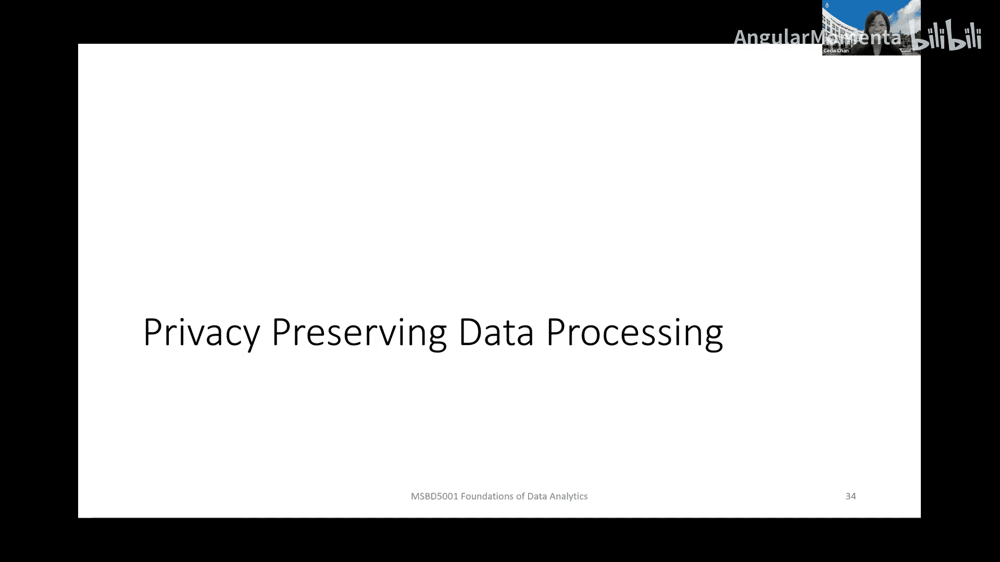

# 【香港科技大学】数据分析基础-｜-Foundations-of-Data-Analytics-p27-19-02-02-匿名化处理--BV1oKFDznE6L_p27-

So let's discuss some privacy protection measures or methods The first one that we are going to discuss is the anonymization so anormization you can see in the previous slide that it's like applied in like as different like privacy by design strategies in different like data value chain phases for example in the data collection data analysis anonorymization should be applied and then like so you can see that anonormization is actually one of the most common methods for protecting privacy and then like anonymization it' to theid the records so that means it's also known as theidification so that means we don't want the data the records in the data to be linking to a particular individual so which means we'll be able to identify a particular individual based on the records so then well that's why we have。

😊，AnonymizationSo we wants the identity of a particular record to be removed， concealed or hidden。

 so we don't know what like which individual is that record we be belonging to。

Now the anonymization can either be performed by the data users or data providers data users means that those are the people who are doing data analytics that means before doing data analytics then we can perform anonymization to hide to like hide the identities or like the anonymization could be done by the data providers。

 for example， like before the storing of the data set like while we are collecting the data。

 we may anonymize the data and then before we store the data we may also want to like remove the identity of the records and then before we sold it before we sell the data like as a data providers then if you want to sell the data or to share the data to like others。

 then of course like anonymization has to be done before that so then how anonymization can be done。

Here are some basic techniques， for example removal。

 so if there are like personal details like for example indirect records in the data we have those identifiers like names。

 email addresses， IP addresses， biometric information， mobile phones， mobile phone numbers。

 medical devices， identifiers， all of those are actually direct identifiers。

 meaning that by using them alone， for example by just having the mobile phone numbers alone。

 the email address alone we can identify a particular individual then that's direct identifiers for direct identifiers。

 of course we want to remove them right？😊，And then like even for indirect identifiers like date of birth。

 age， gender， so on then we may want to consider like anonymizing them by either removal or omission because actually those are quasi identifiers right we have mentioned about the four types of attributes in data identifiers。

 quasi identifiers and then the sensitive data sensitive attributes and nonsensitive attributes quantity identifiers are the ones that when we combine them together it may still reveal certain identity so that's why like for anonymization we may need to consider the removal or omission of indirect identifiers。

 quasi identifiers as well。Now another technique for doing anonymization is student imization。

 which means that what we need to be able to like distinguish individuals。😊。

Or because we need to link it with some other records or some other data sets so that means well we'll need to keep the identifiers。

 but then okay of course we don't want to release or review the actual identifiers contacts right actual identifier attributes values so then we substitute them with code numbers either by encryption or by hashing so we replace those personal details by like a code numbers。

So then while we encrypt them hash them right so then that means while we may want you to do different things afterwards。

 that's why we have reversible pseudonymization or irreversible pseudonymization reverssible pseudonymization means that the code number that we obtained okay through hashing and reion encryption can be like used to and then can be converted back to the original identifiers。

So that's reversible right from identifiers to hash codes and then from code back to the original text right so then okay that's reversible pseudoonymization so sometimes when we may need that so that like if we discover like for example doing that data analysis and data processing we discover anything we may need and when the time we need to identify the individuals we are still able to do so。

And then of course， the opposite， which we are not able to convert back to the original identifier is the irreversible pseudoymization。

 which means that after having the identifier attributes values convert it into the code numbers。

 we won't be able to convert it back。And then while you can see that it's going to help protecting the data privacy more。

 but then of course， it's not going to like it may not be very helpful when we have like a data processing。

 when we are doing data analysis， and then there are a situation that we want to identify people back that we won't be able to do so with irreversible pseudonymization。

Besides removal and pseudoymization， then another anonymization techniques will be grouping aggregation or classification of data by age。

 gender， postcode， etc， so which means that well we are kind of grouping the data okay based on the identifier or like the attributes value so that well the combination of them will not be leading to the review of certain individuals okay so that's anonymization。

😊，So anonymization is a common method for protecting data privacy like however anonymization is not going to prevent reidentification attacks so like it means that even when like the data is already anonymized with the identifying details removed while individuals can still be reidentified so that's reidentification attacks it's an intentional act to identify individuals and then reviewing personal details so you may ask okay so the data is already anonymized how can we reident someone right so supposedly the identifyentifiers to identifys they uniquely identify attributes are actually anonymized so then we should not be able to identify like individuals with their records so what do you mean by reidentification right so that means now。

When the dataset， the anonymized dataset is integrated。😊。

Or combined or link with another data set or some other under the data sets。

They could be from different sources。😊，And then the integration of the data set is going to review the identity of certain individuals。

It could be like because of like the added attributes because of the added information through the data matching and the data integration。

 so then with the additional information it's going to give us more like a information about individuals and then it's going to review the identity of people or it's going to give a unique combination of the attributes value which will be able to uniquely identify okay another person okay。

So this is very typical when we have。Like records which are already the identified and merge with like another data set which is having the identity information so then for this matching so then we'll be able to find out who the original records are okay now there is like a famous study okay which is done by Dr。

 Sweeney and then Dr。 Sweeney is looking at the。😊，Anonymized medical records you can see the like green circle there。

 the attributes included in the medical records are already with the identifiers removed so there is no like patient names there is no like。

😊，Identity numbers etc。 So what we have are just the identifiers and other like sensitive and nonsensitive information But then Kate if we integrate and then matching them with another data for example the rotor records and then this time the rotor records has the identifiers which is like the name and addresses they are identifiers so then through the matching of the sex date of birth and zip code so then we will be able to uniquely identify a particular person with a particular address and then we'll be able to look at their sensitive data like the medication and like the diagnosis。

Okay so then like how easy is that is like you can see that because the combination of the quasi identifiers actually is giving us a high uniqueness of individuals so Dr。

 Swweeeney find out that 69% of the like voters in the voter records can be identified using the birth and birth data and also the zip code so that means based on the data of birth and the zip code then we'll have a unique combination will be having a unique integration the linkage of two records。

😊，And then like a fruit is matching， so actually the covenant of Massachusetts is being identified re identified along with some other individuals okay。

 and then like if we look at the zip code。😊，Gender and date of birth combination。

 So recall that in here， we say that the birth data and zip code。

 then we'll be able to identify 69% of individuals while if we are looking at the zip code。

 the combination of zip code gender and date of birth。

 actually 90% will have a unique combination of that。

 So that means if we like integrate these free attributes values together with another records which have these free attributes value。

 we'll be able to have a unique matching between a particular record okay of these combinations with another record which might be having the like a identifiers okay so then that will be able to like have the situation of reid someone。

😊，Another example of reidification Act tech is that like so。😊，K for。

 like there is an anonymized data， which is like about the Netflix subscribers on the movie ratings。

 Okay， and then it involve 500000 Netflix， like subscribers。

 And then like researchers study that like just by having a slight background knowledge about a particular subscriber。

 Okay， and the subscribers records among these 500000 Netflix subscribers can be easily identified with a high probability。

And the background knowledge not even needs to be precise。

 for example you can just be looking at a particular age range and then in a particular like area of locations and then together you may be able to identify like it's a very high probability that we will be able to identify some subscribers records okay so that's again an example of reidification attacks。

Another very famous example will be the AL example Now in 2006。

 AL American online actually released 20 million users search queries over a few month period of time and then like it's to facilitate information whichval research and then the queries are already anonymized So that means we don't have those identifiers。

 but then okay now and then also the personal or sensitive information like the Social security or the credit card numbers are all replaced by random numbers like well。

 that means like the data are already anonymized anonymization are being done right on the data but then within just two hours after the release of the data there are two reporters from the New York Times is' actually able to identify a particular user。

Which with the user number， 4417749。And then who that person is by cross checking。

 cross referencing the search history。On with the phone book listing。

So that means like the search history that are being matched is just like these phrases。

 these search keywords， for example， like it includes the numb fingers and then 60 single man and then do that urs on everything。

 landscapers in Melourne and then several people names with last name Ar and Arold and then home sold in shadow like subdivision green country like a Georgia。

And then by course tracking with the phone book listing。

So then they got a match and then that record is belonging to Fmer Arant。

 which is a 60 year old widow so you can see like the search queries by comparing with the phone book listing is actually reviewing like where that person is while and then it's limiting the possibilities and then like around the age group and so on and then the last name as well and then it's exposing that while that user so like the。

Reporters is able to reidify the user number 4417749 which is just a code right。

 but then like they are able to reidentify the person with a specific name okay and it's really an individual okay so that's reidification attacks。

😊，Now we have seen some examples of with identification attacks。

 while we can actually like divide the reidentification attacks into three types correlation attacks。

 obate attacks and also target identification attacks correlation attacks means that we are linking a data with another data from other sources to more to create more fine grained so sorry about this fine grainined and unique data entries。

 so it could be like we have the pseudonymized customer data for example of pharmacies and then to director of hospitals to show like。

Which hospitals has bought medication from what pharmacy？

Okay so we are like correlating we are matching like the data to look at the correlations okay and then that's one type another type of attacks reidentification attacks is arbitraryu attacks like it's just like a well by linking one dataset to another data set okay and then we'll see whether there is like。

😊，High probability of a particular entry is actually relate is actually going to be linked with a particular individual。

 So just like the AOL case， filmware Ars case right， So then like the reporters is just linking the。

😊，Search records with the phonebook listing so then it's linking the dataset together。

 they are not intended to identify anyone， but then it turns out that there is an individual being like I had identified so that's arbitraryu。

And then the third one， which is the most like a serious one。

 dangerous one is called the I target identification attacks it's an intentional one because。😊。

For this kind of attacks， it's targeting a specific person。

 which means that you kind of have some individual like you kind of have left person's background knowledge you have some knowledge about that person and then you make use of that background knowledge and then cross referencing cross checking with like some other data sets and then you intentionally wants to identify more data you also identify more information about that person okay so then that's why this is like intentional and then it's more threatening okay well target identification attacks well it could be happen more often than we have thought about for example an employer like which with some API like a details personal knowledge of some personal details about a potential like employee then he may be like the employer employer may search。

Cross checking with some like a medical records or some insurance records and then to find out like what are the potential disease or what are the disease that like that person have or what are the previous problems that previous details of that person at with Okay so then that's。

Targeted， intentionally trying to identify more to get more information about someone。

 Another example could be like an insurance company trying to find prospective applicants。

 So that means like he already insurance company already like a。

Have your application with your background knowledge， with background knowledge about yourself。

 and then they try to find out more okay with cost referencing with other data Okay， well。

 even other data are anonymized because they already have your identities and your background information like indirect identifiers。

 the quality identifiers， they can cost check with other data to find out more And then while it doesn't have to be employer insurance companies。

 well， it could be just someone around you right， for example。

 neighbors there could be some noise noisy neighbors who is trying to because they are your neighbors。

 they know something about you and then they are going to cross check with other like data or databases in order to find out more and then just like the error example。

 it could be generous or it could be even more dangerous hackers who is finding more about you and then trying to factoring you so then。

You can see that anormization is not enough to prevent reidification attackss。😊。

Because anonymization is not enough to protect against reidification attacks。

 so that means we'll need some other measures， which is to ensure that even we have like a merge with other data set then well it's not possible to uniquely identify a particular individual so one of the measure is called K anonymity。

Now， K anon T means that while in the records or in the data set， Okay， so then well。

A particular individual's record will not be distinguishable from。

will be indistinguishable from at least k minus one records， for example， if k is free。

 which means that while they're free records， so they won't be distinguishable to according to like different individuals。

Like for example， if I have some background information about a particular individual and then if I look into the data。

 then I will see that there are two other records which are having the same background information。

 so then I wouldn't know which records is corresponding to the person that I was thinking。

That I was intentionally trying to identify。So then okay now how can we do k anonymity so let's look at an example on how we can achieve k anonymity It's done by suppression which means that some or all of the values of some of the attributes or particular attributes is going to replaced by like a symbol so we are doing suppression hiding certain information and then it can also be done by generalization for example a particular value of the attributes so like for a particular attributes like originally we have individual values for individual records right so then we are replacing each of the individual value by a category or by arrange range for example like the age so if the original age attribute value is 28 then we can replace it by a range for example。

 less than 30 okay so that means we are like kind of grouping things together。あ。So then okay。

 now let's look at this here。 So that means if our original data is like those。

 so you can see that now if we I know someone's age and nationality。

 then I can already identify a particular record for a particular person and then I will know what disease that person is having。

 okay but then if we are achieving like four anonymity。 So which means that now K is4。

 So then you can see that here with the combination of like the non-sensitive attributes value here。

 the combination of zip code age and nationality， So for example。

 if we are looking at age less than 30 and then you can see that by just looking at age 30。

 even if we know what is the nationality， So then we're still be looking at。

For recordsus okay with the same combination of those quasi identifiers。

 so then we won't be able to uniquely identify a particular person， we only knows that okay。

 so there are four people which is K S4 so that's why it's for anonymity There are four recordsus in this data which shares the same combination of the quasi identifiers or nonsensitive attributes values so then we won't be able to deduce what is the sensitive or what is the disease that the person we have in our mind to be of okay。

Right so then that's why we have K anonymity which is like a protection against reidentification attacks but then K anonymity may not be able to protect against target identification attacks。

 why are we saying so if we go back to this example here， let's look at the last four records here？

You will see that the last four records， even with the data suppressed and then with the suppressed and then also de generalralization。

 youll find that these four records okay they are。Having the same combination of the nonsensitive attributes。

 But then because there is only one value， Okay， of sensitive like a attributes for the whole four recordsus。

 So that means well if I know someone who is having a zip code starting with one free zero and then his age is 30 something。

 Okay， and then like no matter which nationality we are talking about， then well。

 because the only disease that are for those four recordsus is cancer。

 then I will still be able to tell that， okay， so the person that I have in my mind is having the sensitive condition cancer。

So that means it's not like preventing the reidification attack we are still able to obtain sensitive information about a particular individual okay based on the linking or based on the matching so that's why what we need some enhancement for example。

 one of the enhanced version of K anonymity is the L diversity。😊。

Now the problem with not having the like not preventing red and reidentification attack in this example is because for the four recordss。

 while they have the same attributes value so what if we guarantee the diversity of the attributes value if there is more than one attribute value not only the value cancer then we won't be able to tell for sure like what the person that we are trying to reident is having the disease of so then L diversity is trying to do that so that means is reducing the granularity of the data representation。

 the idea is that for each group of recordsus sharing this combination of the identifiers attributes there should be at least L values for each confidential attributes so。

An enhanced version of this example。Is from for anonymity， having free diversity。

So which means that among each four like a reus， so the combination of the Q identifiers or the identifiers is giving us four recordsus but then we find that four recordsus there should be three different values on the sensitive attributes so you can see that for the last four recordsus so then the combination is age less than 40 and the zip code is starting with one free06 and then we don't know the nationality。

 but then there are three attributes values for the disease so heart disease viral infection and cancer so then if I is targeting someone who has the identity of age over 40 and then the zip code is starting with one free06 I won't be able to tell。

Which disease that person is having， it could be heart disease， it could be viral infection。

 it could be cancer， so then I won't be able to tell what exactly is the sensitive value。

Okay and then you can see for the other ones as well。

 so this four records is giving us three different attributes values for the diseases as well and then the next four records free again so then that's for anonymity and free diversity for anonymity because each combination of currency identifiers is giving us four records and then within each four records okay of the same combination we are having three different attributes values on the sensitive attributes that's free diversity okay。

😊，And then you can see that like these examples here is using suppression and also using like aggregation to like ensure to achieve anonymity and diversity okay so you can see for the zip code we only retain the first three numbers in a forward anonymity example while the second the last two numbers are replaced by the star and then the asterisk and then for the nationality we are also suppressing the data and then for the age we are grouping them right we are doing aggregation。

Okay。😊，Now besides L diversity， there is also the differential privacy。

 which is again to protect against reidification attacks。Different privacy is like。

The concept is that it's trying to create a synthetic dataset and it's going to add noise to master the values of the records so that when we are making a query with added an individual it should not be different from a cur made without that individual okay so that means like by having different queries we won't be able to tell what is the difference and then what is that particular individual so that means like well that's differential privacy we will be able to protect against reidentification attacks now for differential privacy now because it's going to add noise it's going to have a synthetic data then again the tradeoff is going to be considered here so differential privacy usually wants to consider the added noise to like。

Maxum to minimize。The chances of identifying identifying the reus。

 identifying the identities of reckus。So to lower the reidentification risk， but at the same time。

 because the data is changed， then while we still hope that the accuracy of theque is not going to be lowered。

 so that's why the differential privacy usually is trying to maximize the accuracy of thequeries while minimizing the chances of identifying its records。

So it wants to introduce the noise so that it's not going to affect the accuracy of thequeries。

So that's differential privacy。Besides anonymization。

 besides k anonymity and error diversity there are other privacy protection methods， so for example。

 like data aggregation so it means that we are aggregating in retro records within a report base and sumization format before release so you can see it's kind of similar to k anonymity it's trying to like a group things together so that it's not going to have like it's not going to have unique combinations of records so of attributes it's going to be like having multiple records with the same like a combination of attributes values and then like button。

😊，It's giving a report base since it's giving a report based summary K format。

 So you can see that it's going to make the analysis at the final levels heart difficult because the data is already summarized。

 So that means we won't be able to do analysis and then we are not looking at the raw data。

 We won't be able to do analysis at the final day level。 Okay， and then also like。And then also。

 like come。Sometimes it will create problems because by doing the aggregation you well we may be creating new relations which are not existing in the like aggregated data。

 so you can see some of the like privacy protection measures or methods because it's actually changing the data。

 it's more the data which will create problems in the like for the data processing or data analysis。

Now besides data aggregation， then data suppression， which are like aggregation suppression。

 they are actually methods that we have mentioned when like we discuss K anonymity。😊。

So for data suppression it means that like the values are not all released， so some are removed。

 some are withheld or some are disclosed， but then when we like data being like withheld right so then again like by based on the like remaining data so then we may not be able to do an accurate like a data mining or analysis besides aggregation and also suppression then data swapping so data swapping means that some of the values of some of the selected records is going to swapped so that it's going to hide the true on of the records。

Now。Okay， well if we have a high rate of swapping， okay so that means the relations involved with the variables。

 the like original data set might be destroyed So again like you can see modified data will of course affects the subsequent data processing。

So another one is called the data randomization data randomization means that we are adding noise of randomly generated numerical values to the data variables。

 So that means it's going to destroy or it's going to distort change the values of the sensitive variables Now once it's changed。

 then like it's not going to review the like values directly Okay。

 so that's why it's hiding the it's protecting the data privacy。

 But then because again the data is distorted right。

 So then if we are going to like do data matching or do data analysis。

 then again it will be affected and then like。If we are adding large variants of noise like and then like which leads to larger variances and then which is going to have like the distribution distorted。

 then that means there might be like having like measurement errors and then inaccurate like a regression coefficient。

 if we are using those data for doing like a data processing。

 okay for example data mining doing like a regression analysis or classification etc。😊。

So besides like a data suppression， data aggregation， data randomization， data swapping。

 and then another one could be data synthesis， which means that the sensitive variables are replaced by synthetic values generated by simulation。

 then of course， again we are changing。😊，The values right。

 so then changed values might be affecting the data processing results。

So you can see we have mentioned many like privacy protection techniques which are like focus on anonymization from basic anormization then we move onwards onto the enhanced versions like K anonymity and L diversity which the anorymization can be done by like a lot of different measures so then the next。

😊，Set of measures that to protect data privacy is encryption， so we are going to talk about NA。

So encryption is of course another very commonly used measure in protecting data。

 so then encryption means that we are encoding information so we are converting the original values of the data which we call them printt into an alternative form which we call it Cypherax so then we are converting we are transforming the data So that means like well if people are looking at the encoded data the ciphert and they won't know like more about an individual they won't be knowing the actual data So then like it's frequently used for encrypting datas for example like。

With the big data， that means like a data announced stored distributively。

 so then there is a project called rhino， which is actually offering encryption to Hadoop implementations。

No。If we are having like encrypted data so then like there might be issues right so for example。

 if we are looking at encrypted data so how can we do data analysis on the encrypted data and then like well if we decrypt the data then it's actually like not protecting the data privacy So that means we want to be like having the data encrypted but then we want to do big data analytics so then that's why like the researchers on the encryption of data in protecting data privacy is also evolving to like considering doing the data analytics data analytics or data processing on encrypted data。

So for example， what do we mean by like being able to do like a data analytics without decrypting the stored data。

 it could be that we are doing an encrypted search that means like we want to be able to do searching without disclosing personal details that means without decrypting the data and then okay so that means we wants the encryption to preserve the data the property of the original data so that's why like we wants the approach to be property preserving encryption so that means it's going to be encrypted the data is going to be encrypted in a way that the property is preserved so that we can do data analysis and then also like。

We may want to do the data analysis directly on the cipher tax。

 so then okay you should be giving us the equivalent performance on like doing the data analysis on the print tag so then this area of like encrypt methods will be the privacy preserving computations。

Now these are some examples on schemes like a for example。

 we have the identity based and so IBE which means that like it's going to have like a the control the SS the SS control is based on the identity of the uses Okay so therefore like。

😊，So therefore we like have complete access over all the resources and then you can see because we are doing this like that means it's going to be like very time consuming and then like it's going to be hard to implement granular SS control because based on the user's identity we allows like the complete SS okay so then okay。

😊，And then like the changing of the cyber tags receiver is also not possible because the SS control is based on the identity of a particular user。

 so that means if you change the cyberpher like a receiver then like you need to change the encryption and then okay now for identity based encryption。

 well we won't be able to do like a data analysis on the encrypted data。

 if we need to process the data then data has to be downloaded by the particular user and then which we need to decpted and then do the analysis。

So then that's why we have other kinds of like encryption schemes。

 another one is called the attribute phase encryption。😊。

So for attribute based encrypts it's attribute based。

 that means that SS control is based on a user's attributes when a particular user's attributes match with certain criteria then we'll be able to allow that users to assess。

 for example， a part of the data or like a certain like dataset among the whole among all the resources。

 so that's why we have like with attributes based and encrypts we are able to do a granular SS control。

And then it's going to be more secure and flexible because like we will be able to allow different uses with like particular combinations of attributes to assess different like a data among the databases or the data sets。

😊，So then because there are like attributes based right so then that means again we need computation overhead and then still because it based on certain users attributes。

 if we want to change the Cypher tax receiver again it's not possible。😊。

Because that different receiver is going to have different attributes values。😊，So similar to the IBE。

 the identity based and Christian， so again the data have to be like downloaded and then decrypted in order to be further processed。

So the other two encryption schemes are proxyion reencryption and homomorphic encryption now proxy reencrypted scheme is actually to handle the problem with updating cyber text receiver so it can be deployed either in IBE or ABE settings okay and then it's allowing the receiver to be updated。

😊，So then。The again， like you can see the because there are encryption。 So then again。

 the computational time is going to be large and then the again。

 the data like in order to before further the process have to be downloaded and encrypted and the last encryption scheme is the homomorphic encryption。

 which like it's。😊，Features or its objective is to having like computations performed over the encrypted data so you can see that it's going to be very。

 very secure because we don't need to decrypt the data so we are not going to look at the plain text we are going to just look at decipher text so there is no data privacy issue but then you can see this is going to be the most difficult one and then the algorithm is going to be very very complex and that's why it's computational overhead is going to be very very high Okay now these are the different encryption schemes that like investigated and then are discussed in order to protect data privacy with the encryption of data。

Now， previously we have been looking at like a different privacy protecting data privacy protection measures that can be like used in different like a data。

Value chain phases， so then next we are going to look at specifically on privacy preserving data processing。

