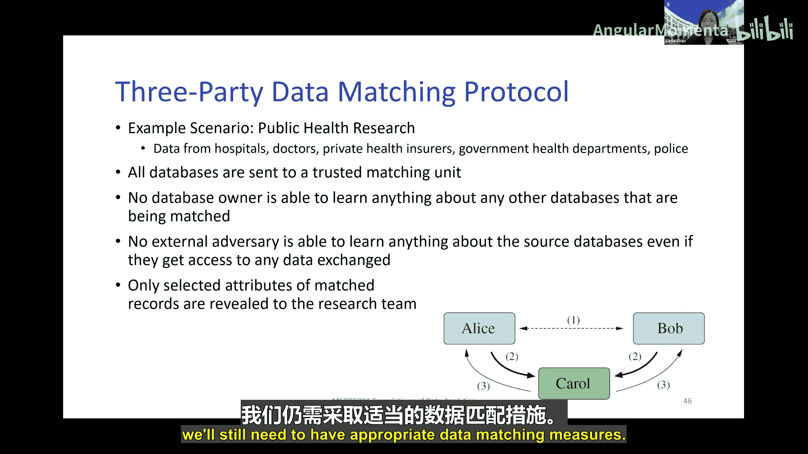
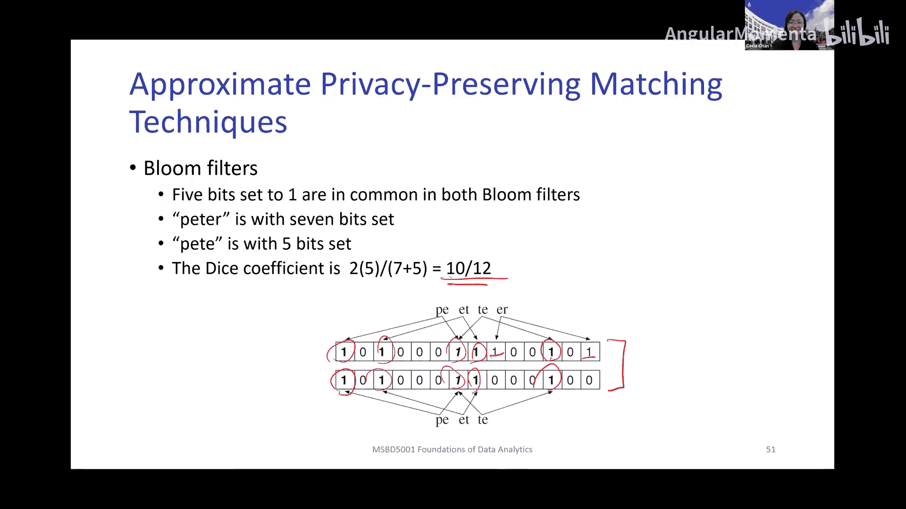

# 【香港科技大学】数据分析基础-｜-Foundations-of-Data-Analytics-p28-19-03-02-隐私保护数据处理--BV1oKFDznE6L_p28-

So we have discussed many different data privacy protection techniques or measures and then you can see many of those measures like that's going to like have a tradeoff between the data protection。

 the data privacy protections against the data processing right the accuracy of the data processing and that's why like when we are working with data processing then we really needs like techniques or measures in order to preserve the privacy and then at the same time allows us to do accurate data processing and that's why recently there are areas of investigations on the needed or related techniques so the areas that we that needs like a。

Technical measures in guaranteeing privacy and then protecting and then ensuring accurate data processing the areas of privacy preserving data mining。

 which investigates which are focusing on like the data mining approaches that at the same time we'll be guaranteeing privacy or data mining issues that it's like protecting privacy at the same time and the second area is the privacy preserving biometric of education。

 meaning that when we are doing biometric of educations。

 then what we don't want to review the biometric information。

 we want to do we want to be able to preserve privacy。

The third area is with the data or record matching again we want to achieve privacy preserving data or。

 So let's talk about each of them with a bit more details。

 So first for privacy preserving data mining， it means that when we are doing data mining very often we want to be able to do data mining on the integrated data。

 So when we are looking at data from different data sets or different data sources Or we are going to integrate the data into a centralized place and then we are going to do data mining on that centralized like integrated data but then okay if we want to like ensure data privacy So that means we do like we don't want to have we may not be able to have the original data。

 which is having like private and sensitive data。So in order to protect data privacy。

 then we once see like for example， the data to be like with random noise or geometric rotation so that the data is perturbed and then we are integrating the pertubed data and then we are doing data mining on pertubed data。

 meaning that we won't be able to access those like a sensitive information or private data directly so that's why it will guarantee data privacy okay but then the problem is if the data is modified so then will the models that the data mining is building or will the patterns that we are trying to discovered and then the the prediction later on will be affected as well so then if it's affected then it's not going to be a good data mining algorithm so that's why like privacy preserving data mining this area。

Is looking at is focusing on how can we like do data mining on the pre per data。

 So then the per data should like a。Have the distribution reconstructed at an aggregated level because the distribution of the data is maintained in the pertu data。

 then we'll be able to build an model and then to do the like a pattern to extract the pattern and then to do like for example。

 the data mining task accurately。Another area like besides doing the privacy preserving like data mining。

 another concern on the data mining， this area is that now typically data mining is done on integrated centralized data warehouses but then you know when we are collecting data when we are integrating data into a centralized place。

 it will be increasing the data privacy concerns and then also the confidentiality concerns because multiorganizational data will be merged and then put into one place that means there is a potential rig ofularized uses and then also like because everything are put together then of course while it's having more risk so then therefore like data mining like once may prefer to be done in a distributed like a distributed like a data instead of the centralized warehouse so then that means each organization is going to。

Retain their own data set and their original storage places and then while through the collaborative data mining we'll be able to obtain global data mining results so then of course you can see how hard it is right so with data distributed and distributedtributive and then we are still able to do like the data mining successfully so that's why like this is an area that is like raising more and more like a concerns and more important but of course like it's difficult it' complex so therefore these techniques are still inefficient。

And then okay， we need no four approaches to be based on cloud computing and also we'll meet new cryptographic primitives。

Besides like privacy preserving data mining， there are another area that is like a with researchers like a。

Focusing on this barrier will be the privacy preserving biometric authentication。Now。

So for doing biometric authentications， usually we have the users providing their biometric informations and then matching with the recorded or stored biometric templates of the users now。

Bometric templates represent like the sensitive information because they can uniquely identify a particular user so that means well we don't want to be directly assessing the biometric information。

We want to be able， for example， to be like working on the encrypted biometric information and then we are doing the authentication based on the encrypted biometric information so that means we'll need a combinations of like hashing techniques and coding techniques and then also like some serial knowledge proof of knowledge protocols。

 which means that we'll be able to prove that those data， those templates。

 those biometric information are matched without reviewing the actual biometric information that's serial knowledge proof of knowledge protocols。

So then okay now if we are working on the encrypted data then it's very likely that we'll fail to match the data that means that may lead to like false rejection rates and that's not something that we wants for biometric authentications if we have false rejection rates how can the people be authenticated and then assess the things right so then that's something that is not desirable so that means we wants like methods or measures to be able to reduce the false rejection rates and that is what something is being needed here and then of course because we are working on the encrypted data right so that means we'll need like appropriate homomorphic encryption techniques we call that homomorphic encryption techniques refers to the techniques on doing data processing data analysis on encrypted data。

不。So another area is the privacy preserving record matching so we know that record matching is performed by like integrating different data sources and then we want to identify common information right so for example。

 we want to identify records from different data sets so that they may be referring to the same person or same identity and then as the previous examples have shown like matching records from different data sources it's very likely going to course data privacy issues like for example。

 by matching records together we may be having reident attacks so therefore like in order to prevent those like data privacy issues then we'll need approaches to do for example data transformation so that we won't have the sensitive data like SS directly。

 we'll be having the encoded or transform data and then with the encoded or transform data with still。

bleTo do matching so that's why like many recent approaches are considering data transformation and mapping and then into eva spaces and then like to do matching on top and them or like it's like a considering the combination of secure multipart computation and then also like data sanitization or data anonymizations like differential privacy and anonymity。

So now because when we are doing record matching now very often we want to have like approximate matching。

 not only accept matching， but then if we are working on like for example anonymized data or we are working on like encoded data and very often it will be like restricted to like direct exact matching。

 so that means we won't be able to do other more complex matching， for example。

 approximate matching or somatic matching， which very often well need to have that in the like record in order to have like a good and accurate record matching。

 because in our data there could be like variations there could be noises which will will need like to be able to do more complex matching in order to like be able to integrate records successfully。

And then because it's doing like a data transformation is going to do data mapping and so on。

 so then that means we also need security models and then we'll need to do like security analysis。

 and then that it's going to guarantee the inequity of the data it's going to guarantee that the data is not distorted or not corrupted and that's why like we need new approaches。

 new techniques， new security models etc。Now you can see like the free areas that we have mentioned are the areas that we definitely need some like new or like more advanced approaches in order to achieve like the data processing and then preserving the data privacy。

 protecting data privacy at the same time。So next next let's focus on discussing privacy how data matching now you can see that like data matching is like discussed in this course and then it's like a very important in data processing so we had mentioned we have discussed data matching in like schema alignment in order to like align the schemmers between different like data sets or from data source different data sources and then we are also using data matching in doing record linkage or the duplications so we are comparing records from different data and then in order to identifying like whether they are related to a particular objects or particular entity and then like when we are doing like a data matching so we can see that like data matching techniques that we have mentioned or like for example the similarity measures。

 the record matching methods algorithms that we have mentioned or assume that。

Data are in their original format。 They should not be encrypted。 They should not be encoded。

 If they are encrypted and encoded， we won't be able to do the magic because we are looking at the actual like a values or actual text。

But then okay， we know that like the databases that we are usually matching。

 I actually like a records about individuals。 So then if there are records about individuals。

 that means when we are doing data matching， then there is an increasing risk of like having the data privacy issues because data matching is going to add more things to the like。

The original data and then like。And then when we are doing data matching usually we don't have the unique identifiers across dataset record like what is the problem definitions of like a record or record linkage we don't have the unique identifier to I directly match the records link the records together we usually look at the details the attributes values of the records in order to do the matching for example we are looking at names we are looking at the telephone numbers of individuals we are looking at days of birth etc so then these usually are sensitive data or like they are if they are not identifiers they will be like a quasinc identifiers so then that means how can we like a do data matching and at the same time like ensuring data privacy that would be like a lot to discuss a lot to investigate。

去。And then now data matching can actually be done or can actually be performed under different scenarios。

 So we are going to look at these different scenarios and then investigate whether there is the like privacy issue with different like a scenarios Now first。

 if we are looking at data matching with a single organization usually privacy is not a concern because if we are doing data matching within a single organization。

 that means within a single organization， we can like assume that like everyone is aware of the data privacy policies or like they are going to be like they are going to know the policies in like data security data protection and then within a company because we are not disclosing the data to others then data privacy is usually not a concern。

And then even for the match data okay even for the match data they are usually used for internal purpose to an organization。

 for example， within a company is trying to integrate the data to identify like fraud and then it wants to like an integrate data together to have customer mailing list and then it's kind of doing some internal research to add value to the company itself or to do some like customer relation related investigations and so on so like within the company because the data is used within a company usually like steps will be taken to prevent a authorizedized assets and then what the data will not merge data will not be made public to others so again that's no like privacy consent if the data is like a protected the data is the data security is maintained。

But then today there is another scenario which well data privacy is going to be a problem。

 for example， when we are doing data matching with other organizations。So then， when the match data。

 okay or like when we are doing the matching and then the match data actually have to be shared with others。

 it could be like it has to be pared to some organization or the match data is supposed to be released to make available for further like investigations。

 for example， like public health study。Okay it could be performed by different universities right so therefore like the public health study done by like a different universities will need to be released to the public because it's like a supposed to do so to raise the health like issues of the like a general public so that's why the data matched needs to be made public so then of course privacy concerns arises because while the match data could be reviewing more about individuals and then you are now releasing the data to others that means there could be like reidentification attacks right there could be privacy concerns so that means well need to consider privacy and confidentiality regulations when the data is being released。

Okay， so then well。Of course， like what， when we are releasing the data。 Okay。

 so the data should only involve that。Will not leads to identification of individuals right otherwise the data should not be like a public so you can see like why privacy is important here and then like of course。

 when we are doing data matching like if you're doing data matching across organizations now data might need to be shared right so then those data which is like having the identify identifiers or identify information when they are exchange or shared than privacy concerns arises because like the other companies or the other organizations may know more or may be able to identify certain individuals which they originally cannot right so then of course data privacyacy is going to be our concern here。

Now in the last scenarios that we are talking about because data is going to be like shared or they are going to be like transferred to other organizations。

 that means once you have the data transferred or shared then we lose control we lost control on the data that is like a sensitive or data that is containing personal details because they are being shared by others so then we lost control on how the data is going to be used by the other parties so then well in order to like protect the data privacy。

 that means we want the data to be encrypted okay but then you know we mentioned that most existing approach requires the data to be in original and encrypted data so then you can see there is a contradiction here so then how can we do the matching with preserving privacy so that's why we want privacy。

Serving data matching， so ideally， we're once an accurate data matching。

Without requiring that identity and identifying data be given。

 so that means either we don't need the data to be in its original un encrypt format or we don't need the data to be shared directly to the other organization。

Now besides the previous concerns about like for example。

 we want to be able to do control to still have the control of the data without the loss of the data control and then we want the data to be encrypted etc so then another the like。

Concerns here is that now very often the matched data so the data the combined information are usually highly sensitive。

 for example， like if we are matching or combining different health databases that means we may be able to have reidification attack right that means a particular individual a particular high profilefi individuals are like politicians or government officials or like famous people then like who has serious problem health problem and then like for example。

 a contiguous disease right so then that means like well it may be known through matching with the like health databases and then if they are reviewed to the public then we may be able we may identify those like individuals and then that's not going to be like protecting the data privacyacy going to be。

A bridge of data privacy。Some other examples involve like if we are matching the medical details of the patients with socioeconomic information here。

 then there may be a situation that we are kind of like a finding that a particular racial or particular cultural background of people will be having a high relation to like a certain disease。

 a high relation with a certain like kind of situation here。

 then like because it's linked to be to a specific race or a specific cultural background group of people。

 so that will need to magnetmatization。Which means that it's going to create ethical issues right there could be discriminations there could be like a stereotyping people like for their like because of their like backgrounds and then which will lead to certain like disease。

And then some other examples could be like。When we are doing data matching。

 if we are talking about data matching to like identify potential individuals that are involved in crimes or terrorist attacks。

 so if we are doing like matching，And then like especially we mentioned that if we are using privacy preserving data matching。

 then there is an increased chance of having force matches。

 then force matching pair will be having severe impact if we falsely matching a particular person to be a potential terrorist a potential criminal then that will like destroy that person's life because he is being falsely accused so then this is again like not desirable so all these are something that we will need to like prevent from like the matched data。

So then in order to have privacy preserving like a data matching。

 so then like different measures and then also different like protocols have been proposed or have been like adopted in order to like achieve what we have mentioned so like one one protocol that have been suggested is the twopart data matching protocol so then the twopart data matching protocol can be like adopted in like scenarios like business collaborations for example two companies is planning to consolidate that business together and then they were once to identify the common customers and suppliers so that means well because it's like a two companies to consolidate that business they definitely don't want to involve a third party to do matching they want to do the matching between the two companies。

That means what they want to do is to identify the records that are similar across the two databases from two companies and only the identities of those records matched will be reviewed to both organizations。

So the like objectives here is that we don't want any of the two parties to be learning something else about the other companies confidential data。

 Okay so that means like companies is going to try to protect their own data so they won they don't want to like review the confidential data to the others Okay so then how is the twopart data like matching protocol can be done。

 you can see that here now within the two organizations。

 we are representing the two organizations by two people's name Alice and Bob for for like easy to explain easy to explain but then you can imagine Alice as one company Bob as for another company So then the two database on this Alice and Bob is going to first。

Communicates between each other to decide what attributes to be used for matching and then the techniques to be used for prepossessing because like prepossessing steps have to be the same have to be standardized in order for matching to be successful and then also like how they can because they are going to communicate like they are going to share data so how should they or encrypt their data and then any encoding or encryption keys like are needed and then of course we don't want the other party to know to be able to decrypt the data okay so we want to protect the data from the other parties so therefore the encryption or like the encoding keys should not be known to the other organizations。

So then each company will have the data encoded and then will send to each other。

 which they will be conducting the matching by calculating the similarities between records and then the identifiers of the records that have been classified as matched so that means the records have high similarities with each other is going to send back to like the two database owners so afterwards then the database owners can decide do they want to exchange the details of the matched records or like what attribute values they want to send to the other parties okay and then to do further like operations or analysis。

Okay so generally speaking under the two party data matching protocol。

 it is generally like a more secure because the companies usually want to like hide private and confidential data from each other so therefore like the because the data are going to be more secure the computation is going to be more complex as well。

Now besides the twopart like data matching protocol。

 then for certain situations we may want a free party data matching protocol to help ensuring or to help increasing the protection of data privacy for example。

 like in a scenario of the public health research so we mentioned that like a different like data from like hospitals like or like doctors private health insurers or even like government health departments or police will want to like provide the data sets and then to like do their data matching okay in order to like provides like themat result for further analysis。

So that's why like because it's involving so many parties and then the databases have to be sent to a trusted matching unit。

 so there is a trusted matching unit as the third party so that is why now we have the two organizations and then a third party so that's why it's a free party data matching protocol and then in this scenario in this protocol here so we don't no database owners is able to learn anything about the other databases that are being matched Okay because all the data are sent to the third party。

And then again， we don't want any like an external adversary is going to learn like about the source data。

 okay source databases， even they get access to any data exchange。So that means。Yeah。

After the matching only the selected attributes of the match records will be reviewed to the research team Okay。

 so then the free party data matching protocol is done with three major steps The first step is that the two database owners is going to exchange details just like the previous example previous like two party data matching protocol is going to like exchange the。

Tchnes used to like a prepo and then what attributes to be used and then which what encoding or encryption like a methods to be used and then any encoding or encryption keys required again the encryption keys or encryption like a encodings should be kept separate from the other parties。

And then like the encoded databases should be sent to the matching unit。

 so which here we have one more party here Carol so then the encoder databases are sent to Carol so Carol will do the matching by calculating the similarities between the records and then Carol is doing it on top of the encrypted records so then again the identifiers of the record pairs have been identified as matches is going to send back to the two database owners and then again the database owners Alice and Bob can discuss like how they can they wants to exchange the data how they wants to use the data。

Okay， now。There is a drawback in this free party data matching protocol here now the drawback is even though Carol is not receiving any unencoded data okay。

So Carol is only processing all the encoded data， so therefore Carol does not know anything about the contents of the two dataset sets。

But then it's possible that Carol is colluding with another party， for example。

 one of the database owner， for example， Carol is colude with is collud with Bob and then which Carol will be able to decode the data and then Carol will be able to know learn more about the data so that's the potential risk of the free party data matching protocol Okay now under the two party and three party data matching protocols will still need to have appropriate data matching measures okay。

So next we are going to discuss about some like privacy preserving matching techniques which can be employed and then used in the two party or the three party data matching protocols now first we'll look at accept privacy preserving matching techniques so like these techniques well it's going to ensure data privacy but then it's going to like be accept matching。

On the data only now， for example， like one of the techniques is to use one way hash encoding functions like SHA secure hash algorithm or message digest M functions to like encode the message that we want to match。

 So for example， like say that you can see that here like a string Peter and then P iss going to be like a encoded into like a decode。

 So if like we are using the SH A1 hash encoding function。 you see that like。

A different strings will be hash into different code and then even one single character difference。

 for example， like missing an extra character in our。

 meaning that we'll have completely different protocol different codes and then even with a different in the uppercase and lowercase characters like Peter with the first character in uppercase and Peter with the lower case in the first character will give us different hash code。

 so that means well if we are using these hash code to do matching。

 we only be able to do except matching okay even up to the letter case the uppercase and lowercase matching as well。

So then well， using the。One way hash encoding functions means that well we'll only be able to do except matching on the hash codes andx matching is obviously not feasible okay。

And then what we can do in enhancing this matching will be probably we need to do pre processingsses and then。

 for example， steming。And then standardizing the inputs to like some base forms for matching okay and then now with that we'll be able to like probably enhance the matching。

But then， Kate， now， for this matching to be like employed from the like to be used。

 then it can be used in a free party protocol。It can be used with the free party protocol because the matching is done by Carol。

 the third party and then Carol is only going to do the matching based on the hash codes right so then therefore Carol the third party is not going to learn anything more about the data from the two database owners but then if we are talking about the twopart protocol so then it won't be hiding information from the database owners So that means one way hash encoding function is not suitable for the twopart scenarios it's going to be suitable only for the three party scenarios but then okay even with like the free party protocols then one way hash encoding matching is still subject to dictionary attack or frequency attack because like we can be like a person can be like applying hashing。

With like a dictionary of terms and then comparing those like a code with the data set provided。

 and then that will review like the encoding will review the actual terms or like the。

hassh encoded like terms so we can actually compare its frequency。 for example。

 a particular hash code， its frequency in the data and then comparing it with like a actual or real data and then comparing with the frequency of the terms of the of the words in there。

 and then the frequency similarity will actually reviews the terms or reviews the strings。

 So that is why like the one way hash encoding functions may not be able to prevent dictionary attack or frequency attack。

 So then the solution to it is adding a secret key in the free party protocol。

So then like well the previous like a measure the one way hash encoding function is for accept matching and then we know that like for doing data matching well just having accept matching is not going to give us like the ability to identify similar records okay because very often they are going to be errors they are going to be variations in the data so we'll need to be able to handle those like errors and then that means we need to do a approximate matching and that's why we need some approximatema privacy preserving matching techniques so like we are going to talk about a few different techniques so then one is the first one that we are going to talk about is a twopart protocol for security securely calculating at the distance now when。

We are calculating that at the distance， we will have an at distance matrix。

 well have a distance matrix and then which like at the end of the filling in the matrix。

 then we'll be able to identify the at a distance between like the two records or the two like strings and so on。

So then okay so the approximate privacy preserving matching techniques is using at a distance at a distance is doing approximate matching。

 but then as we have mentioned we don't want like the other parties to learn more about the other data right so therefore we don't want the distance matrix to be like a review to both parties so then that means we want the like distance matrix to be stored in a shared fashion between the two databases owner and then while the distance matrix is generated iteratively without reviewing the actual calculations of each database owners so obviously it has to be done on homomorphic encryption approach that means well have to do like data processing data analysis on top of encrypted data。

Okay， and then another like techniques is the blindfold record linkage。 Okay。

 and then it's to be used in a free party setting。 and then it's to be used for finding dice coefficient。

 What is dice coefficient。 dice coefficient is taking the number of common tokens across two strings。

 for example， And then okay we multiplied it by two and then divided by the number of tokens in Bx and the number of tokens in the B。

 the y string。 Okay， So then for blindfolded record linkage， we are considering tokens， right。

 So that means while we are。First， having kilograms instead of the full string values。

 So then we cash and quote the kilograms。 Okay， so let's take a look at example。

 So say we are trying to match two strings， Peter。And then Pete。

 we call that Alice is one organization while Bob is the other organization。 So then first。

 Alice and Bob each generate list of kilograms with their strings。 So for example。

 Alice generate different list of kiloilgrams or the possible list of kiloilgrams for example。

 like the full kiloilgram list P E E T T EL And then while like it's also generating the sub list of kiloilgrams。

And then okay。Bob is also doing a similar thing。 So with Pete。

 So then Pete has three kilograms right， So then the complete list is three free2grams。

 And then Bob is also having the sub list generated， for example， two out of the three gras。

 free2 gras， two out of the other two out of the three grams free2grams and then two more Okay So then for matching。

 Alice will send。The list of kilograms in hashed code。 and then together with the record。I D。

 and also， the number of kiloilgrams in the list and。

The total number of kilograms in the original string and then Alice will generate this one okay for the full kilogram list and then the other ones for the sub kilogram list and then that's the whole list here the four kilogram list in hash code and then with the like a number of tokens and the number of like the identities are the record identities and also the maximum the total number of kilograms in the original string to the third party Carol okay and then similarly for Bob so Bob is again okay。

Sending the hash code together with the number of hash number of2 grams in that list and also the total number of two grams in the string that we we are matching。

To Carols as well。 Then Carol will compare these two list and then find the one that matched。

 So the underlyinglined ones， this one。 and also this one are the matched。

 And then based on this matched like a kilogram list will be able to calculate the dice coefficient。

 So the number of kilograms matched is free。 So therefore we multiply two by3。

 And then the number of kilograms in the string of Aliceice is4。

 while the number of kilograms in the string of bo is free。

 So therefore the diece coefficient is6 divided by7。 So that means like when Carol is doing matching。

 Carol doesn't know the like a actual kilograms。 And then what is the actual strings as well。

 So Carol is only doing a blind folded。那去几。Comparing matching the codes。

But then okay with the matching of the two grams， the kilograms。

 then we'll be able to obtain the similarity score here。

Another like a techniques will be to employ the broom filters in doing the calculation of guys coefficient。

 Now， each database owners is having the。kiloilgrams， okay， hatchhed into like the b filters。

 So you see that like five bits are set Okay， in common， for example。

 for Peter Okay so then we have this， this this this and this set to one well for pes， again。

 we have like five bits。In common set 21。 Okay， but then K for like the。String Peterer。

 it's going to have five bit set， okay， because there are two additional one being set， okay？

And then for Pete is' going to have five。Bit set。 So therefore。

 the the dice coefficient is the number of common bits being set， which is 5。

 and then multiplied by two divided by the number of bits set by Peter。

 this string and also the number of bits set by pe， that string。

 So then that would give us the dice coefficient of 10 to 12。

 So because we are matching on the broom filters。 We are not matching directly of the on the original strings。

 So again， well it's a blind foldeded record linkage， meaning that we don't know the original text。

 Okay， and then again， broom filters just like the。

Rinforded reckoning cage should be applied in a free party protocol。

So these like approaches are some examples on how can we do how can we achieve approximate privacy preserving matching because we are matching on the like kilograms and then we are actually obtaining the similarity score so then we are not doing exc matching so that's a matching so you can see that because we are not matching the original like text so we are not having the we are not matching the original sensitive attribute values or the identifying attributes values so that is why how it guarantees privacy while doing the matching now we have seen like many different algorithms so they are actually a lot more so then in this section here what we want to like do is we want like to be able to like be aware of data privacy when we are doing like data。

Processing。Because while we are looking at big data， there is the variety。

 there is the volume okay and then variations of ververity and then all those like a problems here。

 so then that means。Okay， we are like facing increasing challenge of data privacy So then okay。

 when we are doing data analysis， it's very important for us to like a protect the data privacy while we are doing data analysis Okay so that's why this is the last topic and then that's why like we like wants to like introduce and discuss it here so that if you are going to do like a further like a data processing and then if we are going to like manage or like a collect and then also analyze and then process large amount of data then while there are a lot of like。

Sts that we need to be careful with， and then we may need to consider different kinds of techniques like the common techniques anonymization and the enhanced versions like the K diversity。

 sorry K anonymity and then L diversity and then of course when we are doing different data processing。

 we also have to think about like how are we going to preserve data privacy while doing the data processing。

 data processing， like the data privacy， like the privacy preserving data mining。

 privacy preserving data matching etc。Right so then that's like a what we are going to discuss。

 that's what we discuss， what we are going to discuss。

That's what we are discussing what we have discussed regarding the data privacy but of course。

 while due to the limited time we won't be able to cover everything but I hope that this like session is going to give you some thoughts and then some like thinking about the data privacy issues and big data and also data processing。

