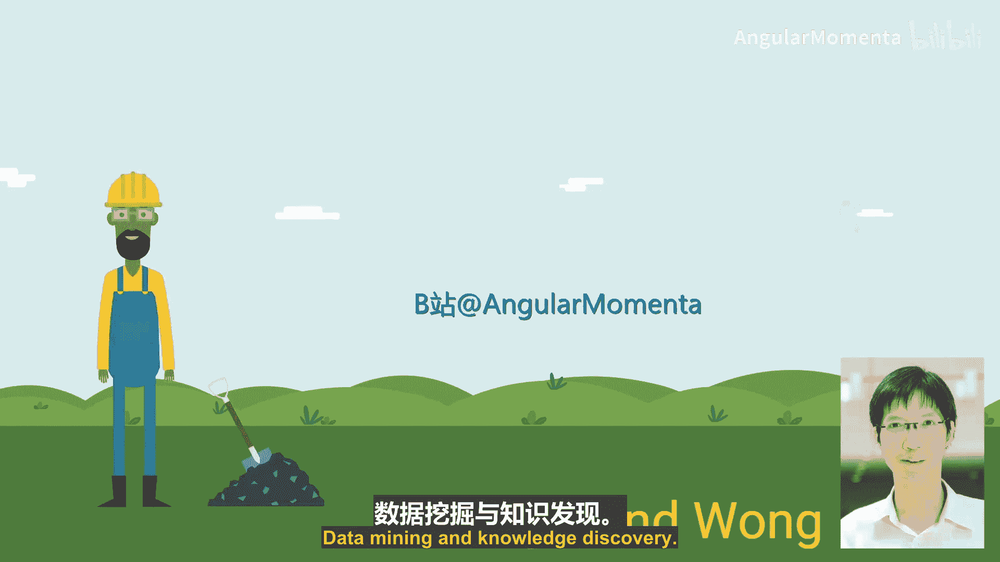
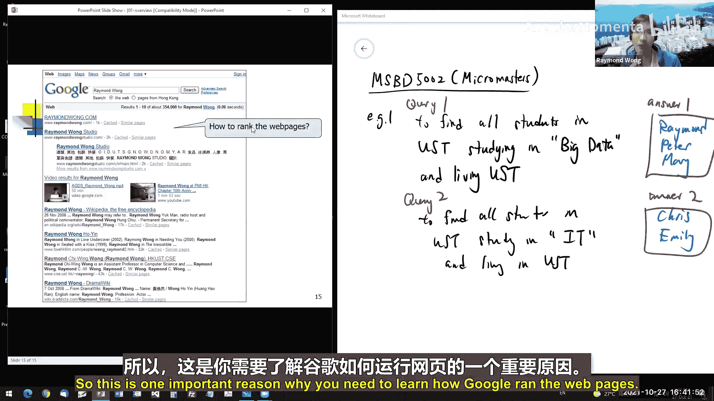
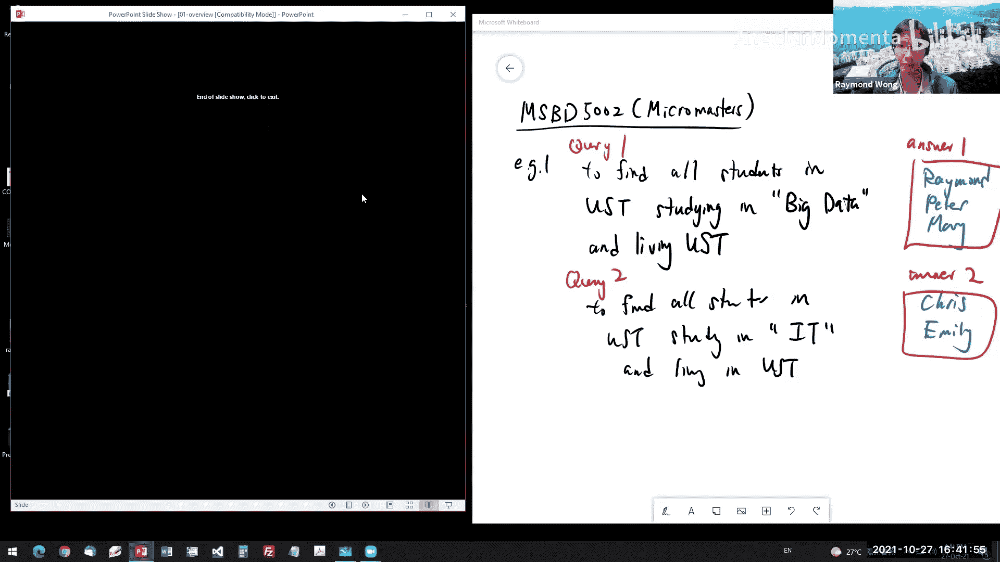
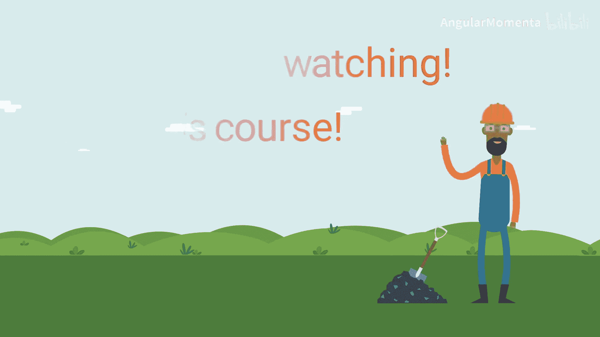

# 【香港科技大学】数据挖掘与知识发现-｜-Data-Mining-and-Knowledge-Discovery-p01-03-01-02-概览--BV1gEFDzVEU3_p1-

嗯。🎼Da mining and noish discovery。🎼Be a mining image no N discoveries。

Hello， everyone。 This is MS B， D 5，002， Michaelmaster。

The course title is data mining and knowledge discovery。

 This is the overall and Raymond award from the Hong Kong University of Science and Technology。

And this is the reference book mostly we use the papers and we also use some textbook， data mining。

 concepts techniques， and also the second textbook is introduction to data mining。

And here is the five topics in this course association。Cstering， classification， data warehouse。

 web databases。 Let's go for the first one association。Here in a supermarket。

 we have customer Raymond， customer aid， customer Grace， and he bought apple orange。

 She bought orange and milk。 She bought apple and orange。

 And this is the summary of all these items or items that items is a single items items that is a set of items。

 Here you can see that Apple。 we have Raymond and Grace bought apple。 So the frequency is too。

And you can see that we have two customer buying apple and orange together， Apple and orange。

 apple and orange customer Raymond and customer grace about this too。 Okay。

 so we have this corresponding statistics。 And suppose that we would like to find the items or items up with frequency at least two。

 And then you can see that this one， this one and this one， their frequency at least two。

 So we call this a frequent pattern or frequent item。

This one are called frequent pattern or frequent item or this one is called frequent pattern or frequent item set and this is one output of association another possible output in this topic is association root in this phone apple to orange or orange to apple and something like this What this actually this is something like。

Some proportion of customer who bought Apple probably also bought orange。 Let's see。

100% of the customer who already bought Apple also bought orange。 You can see that in this example。

We have two customer buying Apple， which means Raymond and Grace and these two customer also bought orange。

 can see that in this example， two customer buying apple and also among this people only two of them also buy orange。

 So two divided by two100%， similarly orange to apple。

 The proportion of customer who bought orange and then Apple is 67%。 The reason is as follows。 Okay。

 let me use blue color。 the blue color is here。Yeah。Okay。

 we have the green color here we have three customer buying orange。

 So here three customer buying orange and only two of them buying apple， So two of them。

 so two divided by three67%。 So we have this one in this topic we would like to find all the frequent patterns。

 frequent items of frequent items set and also all the association routes。

Now we discuss the first topic and go for the second topic clustering。

Custom is very simple we have student Raymond student Lewis student Wman and Raymond obtaining 100 score in computer score subject and 40 score in history subject and if we plot this into two dimensional computer subject score and history score and all this green dot correspond to a student this is a student Raymond 100 score and 40 score each green dot correspond to a student virtually we can see two group one group and the other group here we call customer one number one high score in computer。

And low score in history here we have a customer number two。

 high score in history and low score in computer in this topic。

 we would like to find all the customers very simple。😊。

Now going to the third topic classification classification。

 suppose that I know a new customer I know that the race attribute of this customer is white。

The income attribute of this customer is high。 And I also know that this customer have no child。

 I want to predict whether this customer will buy an insurance policy or not a product。

In this insurance company， and I want to do the prediction。 supposeupp that I have this one。

 This is called decision tree based on some past data in my company。

 I can deduce whether this customer will buy an insulin policy or not。 let's see。

 Let me use a red color。Here with the root note， we can see the left hand side child is equal to yes or child is eager to know This customer child is eager to know。

 go to the right hand side and here， and then we can see left hand side income high income no income is high go to the left hand side。

 So we reach here which means that this green color means that our prediction we predict 100 percent or chance of this customer will buy an insurance policy So this will predict as yes。

 So we know that this customer will probably buy an insurance policy based on this decision。

 we will learn more details later。Now go to the fourth topic， data warehouse。

Data warehouse is something like this suppose that we are the user you will trick a query what's the query just like we want to ask some question and then this is the database after the database management system process this query you return the result if the query is very complicated。

And also， the database is very large then this will be the result will be returned with a long term。

 for example， we need to wait for a long time so that we obtain the query for example one day to one week。

 Okay， let me use。Rightbo to say some example about the query， for example， one query number one。

 suppose that I want to find。All students。In our university， UST。Studying。然。Big data。

 studying a big data。And also。Ling in。For example。UST in our campus and then suppose that this query is very complicated。

 very complicated and the database is very large then maybe we need to wait for a very long time and then we obtain the answer。

 maybe Raymond。One student， maybe another student Peter and maybe another student married。

 and I want to say that maybe this is our this is our answer I say this is answer one。

 and I can say that the left side here is query。Number one， similarly， we also have pre number two。

 we can also ask similar question， maybe I can also ask to find all student。In UST。Studying in。

 for example， we also have an MS program called I I T program and also living in USD。

 maybe this time we have other we result placed。And maybe an。And this is the result call answer。2。

 okay， we have answer to。 What I want to say is that every time if we trigger this  query。

 if the database is large and this  query is very complicated， we may need to wait for a long time。

 So the user' experience is not good。Here， data warehousee is doing something like like this。

For the database， okay， before the user issue this query， before the issue the query。

 I expect the system know that the user may have this black color query and this black color query before the user ask this I already trigger this query and compute this result for example one day or one week and saw this query and also this answer in my hard disk。

And also this query and this answer already in my hardest is in my hardest。

 this hardest storing the precomputed result we call data warehouse and then if the user asks the same query now since this has been stored。

 the answer has been stored when the user ask this question。

 just look at at this hard disk and then we can return the answer very quickly within one second。

Okay， we finished the data warehouse now go to the last topic web database。

And web database just like Google being and so on， if we type my name Raymond Wang。

 and then we can see there's a lot of Raymond Wong web pages here， how Google when the web pages。

 we will learn this are in later in this course。And why do we need to need to learn how to when the web pages is as follows。

 I want to tell you that if I don't know how Google ran the web pages if someone type my name Ray originally my web page could not be in the first search page this can be found in the second web page and also first page and so on since I know how Google when the web pages we design my web page so that some skill inside so that my web page can be shown in the first page so maybe later when after your graduation when you want to do a startup company and you want to your startup company web page can be search and can be shown in the first web pages you need to know how Google when the web pages and also maybe in the future if you work in the small company or side company you also want to help the company to when their own web pages in the first first。

Search page， with not paying any money to Google。 So this is one important reason why you need to learn how Google went the Web pages。

So we are done。

