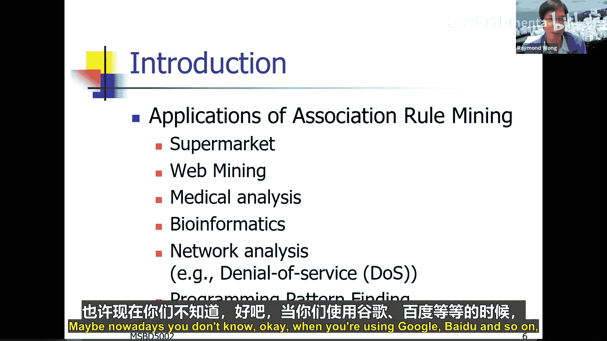
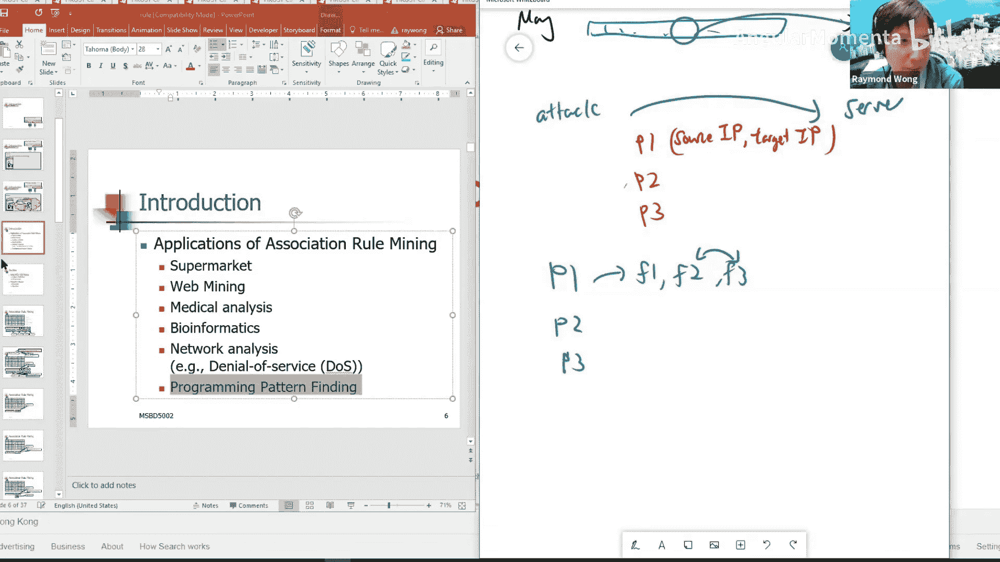
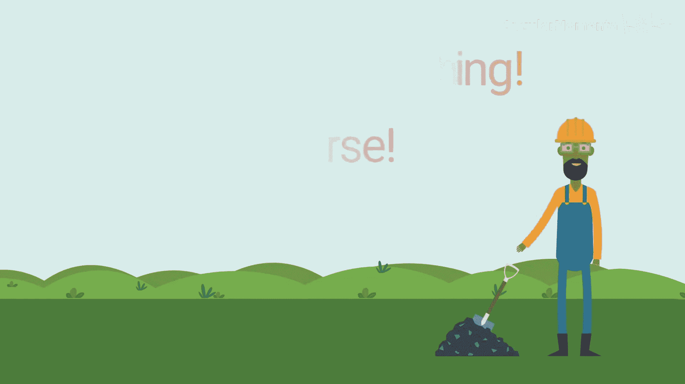

# 【香港科技大学】数据挖掘与知识发现-｜-Data-Mining-and-Knowledge-Discovery-p02-04-01-02-导论--BV1gEFDzVEU3_p2-

🎼Data mining and knowledgeish discovery。🎼It mining and nourish discoveries。

Association room mininging， all right？

Now， as I mentioned， this is a supermarket scenario in the supermarket。

We know that we have four customer Raymond。😊，David， Emily and Derek。

We know that Raymond bought Apple， Coke， coffee。Each of them is called an item。

The whole thing bought by me at a times stamp， we call a history or a transaction。😡。

And also we have baby bought diaper。 this is an item for baby， this is Coke。😊，And so on。

 milk biscuits for Emily cooked and milk for Derek。😊，I want to say that in this topic。

 we want to find some associations between items。 What I want to tell you is that。

We can find this interesting association diaper， an item for baby beer beer， an item for adult。

 This is for baby。 This is for adult are usually brought together are usually brought together。

 Do you think that this is very strange。😊，Can you guess the reason， Okay。

 who want to tell me the reason。Waise up your hand if you want to answer this question。OK之后。

Because some of the father do not want to take care of their baby。

 So they they want to drink some beer to release their pressure。 Oh very good。 Okay。

 very good answer。 Yes， thank you for your answer。 Yeah， you also get the coupon。

 his answer is one possible explanation。 He mean that the father may don't don't want to take care about the baby and then want to drink some beer to relieve the pressure of taking care of the baby。

 Okay， this is one possible reason but let me tell you some possible reason given by other people。

 I think his reason is also reasonable Let me give the other reason given by the other people。

yes see。Why is this thing， Okay， let me tell you more about that actually。

 this pattern occurs frequently。In the early evening。

 In the early evening during the day from Monday to Friday。

And during the daytime the father of the adult， okay， in the office， Of course。

 he's now working and working and now go to the doing when we come to early evening。

 he need to leave the office， but he still remember that in the morning， his wife。

Taking care of his baby。😡，Ask her husband to buy the diapers for their baby。And of course， okay。

 when he leaves the office， he of course， will look for diapers， this is the item asked by his wife。

And also， at the same time， he will buy beer。 The reason why he buy the beer is that this an adult。

YeahI didn't tell you the the data come from United States， come United States， American。

Usually like adult like drinking beer。 So when he look for diaper。

 he will also look for his favorite beer together。 So diaper and beer will always to not always usually book together。

 this explanation this given by other people Okay in the film。 Okay。

 but I think Zhou is also the reason is also reasonable。 So after that。

 even though Zhou explanation of my explanation of the the research explanation about this one。

 suppose。I' am a supermarket manager。😡，If we know that diaper and beer are always brought together。

 do you know that what should I do of the supermarket。From promotion， okay， how to do that。

 who want to tell me if you know that Okay， yes， a car cho。开通， you can unbu yourself。

Hello hello yeah I you yeah yeah so I think maybe they can put both the diaper and beer into similar or they can do some promotion together like you diapers then maybe beer will be or like that yes you you have already propose to the first one is diaper and beer should be placed to each other the second one is that you want to make some discount maybe buy one get the other things discount so on right good so you the supermarket manager and then you will boost the sale of the supermarket very good。

Let me ask you， okay， this is good。 Okay， see supermarket manager can design many strategies。

 maybe let me ask you， do you think that if I'm a supermarket manager。

 if I put diaper far away from beer in the supermarket。

 do you think that it is also one possible strategy。啊，子子怡。Yeah。

 I think it's a better strategy because when， when you buy a diaper like the case that you describe in the part one。

 then the husband also want to buy a beer。 So if you put them far away from each other。

 then one husband get one。And he wants to get another one。 He need to pass the long way。

 So he may also view other items that sell in the supermarket。

 Its the same set strategy that Ikea use。Iikea use yeah yes yes I I have another strategy that is because these two items are buying together in this case。

 right your husband needs to buy them together so I。I do not consider them as a discount。

 but I have another thing is like if you buy this two together， you can get another item free。

 So that will boost the sale。 But if if you only buy these two item together。

 like if you buy this two together and you get a discount， that will lower the sales， I mean。

 lower the revenue that get from the supermarket get。okay， thank you for yes， yes。 actually。

 different supermarket manager must have different strategy。

 I think you just mentioned that diaper and beer and buy this and then you have other item and then this will also the could also a。

 you have question or you want to answer something So you have a question question if you put far from diaper it will get some promotion。

 I don't think so because we know that man doesn't the man doesn't focus on the things they don't always grab the things they need and。

So I don't think this is a good way for men， but for women。嗯。It all get the promotion。

Okay thank you yes yes no problem。 different people have different strategy and mindset about this one。

 supposeupp that maybe diaper and beer just put two shelf after that maybe it also good right diap and beer and then he passed by this and those are he also something about that different people different no problem but the most important want to that after some pattern supermarket manager can based on what he know about to promotion agree with thank you。

Now let's see we could have some application of association room mining you can see that I already illustrate one real life example about the supermarket manager supermarket I think this is very clear for the following I think I need let me illustrate so that you understand that maybe nowadays you don't know okay when you're using Google Ba do and so on actually web mining is also using association room mining let me try it。

😊。

Let's see。This is Google， right， Maybe you don't know actually。

 they are using the association rule technology。 supposeuppose that I type computer。

You can see that computer。And size。Computer and， computer monitor。 Actually。

 you can regard the this item and this item。 This item and this item co occurs frequently in all the web documents in the Internet。

 So usually computer science is the most frequent item。 This is the next a second frequent item。

 So you can see that if we write down。ig data。 And then you can see big data analytics and so on。

 So you know that actually， Google and also Baid do are also using association remind mining to do this recommendation。

 but you didn't discover if I didn't tell you。 So this is called web mining。 the first one。

 let me use the white actually is easy。 I just want to make you understand so that you know that actually association remind mining can find it heavy well。

I use the medical analysis here the medical analysis like the current situation， let me see。

 suppose that I know that we have the patient Raymen and then we know that the gender is male and I also know something about Raymon。

😊，Raymon， okay smoker。 No， I， I didn't smoke and so on。 I have a lot of attribute related to Raymon。

 And also， I know that whether this patient suffer from， for example， lung cancer。

And then we also have married， female， she smoke and so on。

 Maybe she didn't suffer from lung cancer and so on。Now we have a lot of record。

In association room mind， I think you know that。They may have something place example。

 with some correlation。Between some attribute for some smoke smoke and cancer and so on。

 this is a what I mean by correlation， think this is very easy for you to understand about correlation in medical analysis for bioinformatics is is also similar。

The thing is that we also had the， for example， the patient and married。

And then this time we have not， we have some DNA， this is just a D， okay， this is a D。

In bioinformatics， they know that some gene is related to let me see lung cancer this is not lung cancer maybe some cases here is related to lung cancer。

 you know that there some people already discover some gene is related to some cancer So this is called bioinformatics association remind Now go to here network analysis。

Deniable of surface attack。 maybe some student't know this time maybe some student don't know this time。

 let me tell you， this is the behavior using by the attacker。Called the knife or server。 What I mean。

 Okay， suppose we have the web server or mail server。 if I'm the attacker。

 I don't I don't like this server。 I want to make this server done。

And then I will do this the of surface attack。 What I mean that I I am in the attacker。

 I send a lot of traffic to the server and then this server could not handle a lot of traffic So the server will be done So this behavior the attacker behavior iss called the of I make the done So this is called the。

 What I want to say is that you know that in the network traffic。

 we know that when this is the attacker。If wes send to the server。

 you know that we are using something like a packet。The packet， we have the sauce。😊，IP address。

 we also have the target I address。 Okay， source I address is the attacker IP address。

 Sur address is the target IP address。 So we know that we have a packet one。

 which means the traffic one packet 2 and packet 3。 So in the server。

 if we know that we have a lot of packet coming from the same source with frequent So that one will be identify as the attacker and then the server will brought all the assets from this attacker。

Similarly， for the program pattern finding very easier but I don't want to give the detail with program one。

Program two， program3 and so on and according to some machine learning and also data learning candy。

 we can extract some features， feature  one feature2 and feature 3。 And then based on this。

 we have something know this are something related some people maybe have some features writing style and some writing style and then we know this features correlation and do some analytics based on the pattern。

