# 【香港科技大学】数据挖掘与知识发现-｜-Data-Mining-and-Knowledge-Discovery-p03-04-02-02-1._基本概念--BV1gEFDzVEU3_p3-

Oh。🎼Heateer mining and noish discovery。😊，🎼E the mining and no niche discoveries。

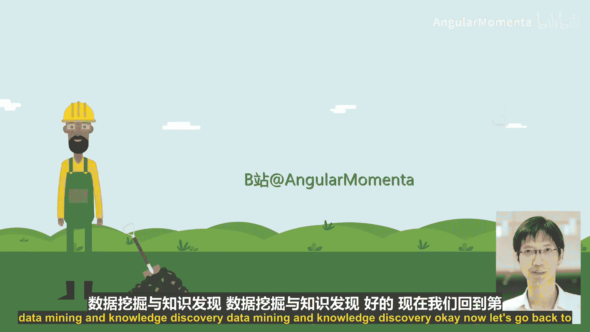

Okay now let's go back to slide seven。Soization rule mining， okay， we will give a。

 a formal discussion about this。First of all， we talk about the problem。😊。

Here is another representation of the supermarket scenario we have transaction one。

 which means for example， Raymond， this is one transaction。And this is item A， item B， item C。

 item D， and E。Transction one， transaction 2， transaction3。

 transaction4 and transaction5 correspond to five customer and also this one called transaction ID。

So let's see transaction one， this one， for example， Raymond bought item A， bought item D。

 One means that this transaction containing a still means nothing。 Okay， you can see that A D。

 So transaction to a B， D just and representation， this representation。

This is called an item list of representation only just a different representation Now let's define some which may be used in the later part of the mechanisms single items。

Or simply items。ABC。D and E。Items。Items set， as I mentioned， correspond to a set of items， right。

 So we have a set discounting two items are set with three item are set with three items。

And a set containing a single item。 This is also an an item set， Okay， containing one item。

And see here here， we have a set containing two items。 We call two items set。

 These two correspond to two items here。 This one were three items。 We call three items set here。

 we call three items set。 And this one， we call one item set。 Okay， very simple。

And now we define one term called support。Support。Of an item is defined to be the total number of transactions。

Containing a。Let's see here we have transaction  one， transaction 2， transaction 4， containing a。

 So this number is 3。Similarly， the support of this item。😡。

It's defined to be the total number of transaction containing B。 So we have transaction 2。

 transaction 3， transaction 4 and transaction 5， containing this a B。 So we have four。烧啦你。B。

 the support of B C is the total the total number of transaction containing B and C， okay。

 maybe use another color so that you understand clearly B is here。 B is here。 B is here。 so free。

And finally， we have ABC of West， ABC that we use。Orange is， let me see here。

So transaction for continuing it， okay， so so we're simple。

Let me use an rotation In the later explanation， I will use this rotation， support。

 I will use this location， support。Brerackett。And then let me write down support B this will be will be used by me the support of B。

 which means that the support of B， which is equal to three。 Let me write down。

 which is equal to three。 So this is my location now go further。Here， large items set。😡。

Corspond to some items that would support at least a different value。 For example 3。

 this number is given by a supermarket manager or a user of the supermarket。

 This is set by the supermarket manager。 Now， if we set this to3。In this example。

 a the support is three， which is at least three， so a is a large item set。B， the support is 4。

4 is at least three。 So B is also a large item set B， C， the support is3。

So it is also a large item set。 So B is also a large item set。 However， ABC。

 the support is equal to one，1 is smaller than the given number3。 So ABC is not a large item set。

 This is very clear。 We also have another term for large item set， frequentequ item set。 Okay。

 they mean the same thing。Underて。Now we also have another term in knowledge。Let' see。BC。

Here we have items set of size to this。 Okay， actually， this refer to what we have seen before。

 two items that exactly the same thing。This item set of size2。

 These two means the number item in an item set。And this free frequency means that。BC。

 the support here is free。 So the frequency of this one is at least。

3ree frequency means that these items set assigned to the frequency or the support is at least three。

And similarly， we have ABC。 let me do it again。This ones item set or size three means here。

 ABC and then。And then。And wait a moment。 I want to use。10 one frequent， Okay。

 means that the support here must be at least one， at least one。 So this is what we have defined。

Now go further association rule， we have learned that。

Something like left hand side and then to right hand side this time and left left hand side is an item set the right hand side is the a single item Now we define the support let we use another location I also want to use this location support。

And at this time it's not an item set， I will put it B， Okay， it's a rule。To Y。

 I will use this location later。 the support of this rule is defined to be the total number of transaction containing both the left hand side and right hand side。

 I repeat the support of this association rule is defined to be the total number of transaction containing both the left hand side and also right hand side。

 this example to， let's B C， E B C E。 So this two transaction containing both the left hand side and right hand side。

 So this is what we mean by two。 So when we write down this one。

 So what I mean is it is equal to two with simple。Now let's see the other descriptor of this association rule。

😊，Call confidence。The confident of this rule， let me use also allocation confidence。

And then an association rule。BC。To E。 And then actually， it's eager to And let me write that 66。7%。

 How What is the definition that we define you。 The confidence is equal to a fractional number。

The luerator， the upper and the denominator， the bottom part。The denominator， okay。

 which means the bottom part correspond to the total number of transaction containing the left hand side。

The left hand side， okay， let's see。So the left hand side where PCBC so we have three。

 so the number is three。Now， the upper part， the luerator correspond to the total number of transaction containing both the left hand side and right hand side。

 exactly what we define here。 So this is equal to 2。 So this is equal to 66。7%。

 So intuition behind is what I just mentioned in the overview slide。We know that 66。

7% of the customer who bought the left hand side， which is B also bought E。

 This is what we have defined before。 So this is confidence。 understand now go to the the next one。

 B to C。Is any student who want to help me to disise support and confidence are Zheng Hao。Okay。

 hi professor。 And so as we can see， there are four lines of data have B。

 but only three of them have C。 So what what is the support maybe I understand you understand what is the support support Yes。

 The support is B to C， This is our support the support of B to C is。Yes， yes， what number。

 what number？😡，The number is， you mean the answer。 Yes， is 75%。 are talking about confidence support。

support the support for b诶 support of b to c okay诶 the support of this one yeah。On this one。

 we got three。You got three， yes， why？Because we we got free length of data have B and C。

 at the same time。 Yes， how about confidence， yeah。And the， the confidence is 75%。 why， Yes， yes。

 correct， yeah。Because we got four lines of data have B。

 but only three of them have C at the same time。 So it's three over4 iss 75%。 Okay。

 thank you you correct。 Okay， you get the coupon now continue Okay， thank you okay。

 this discuss I don't need to discuss。

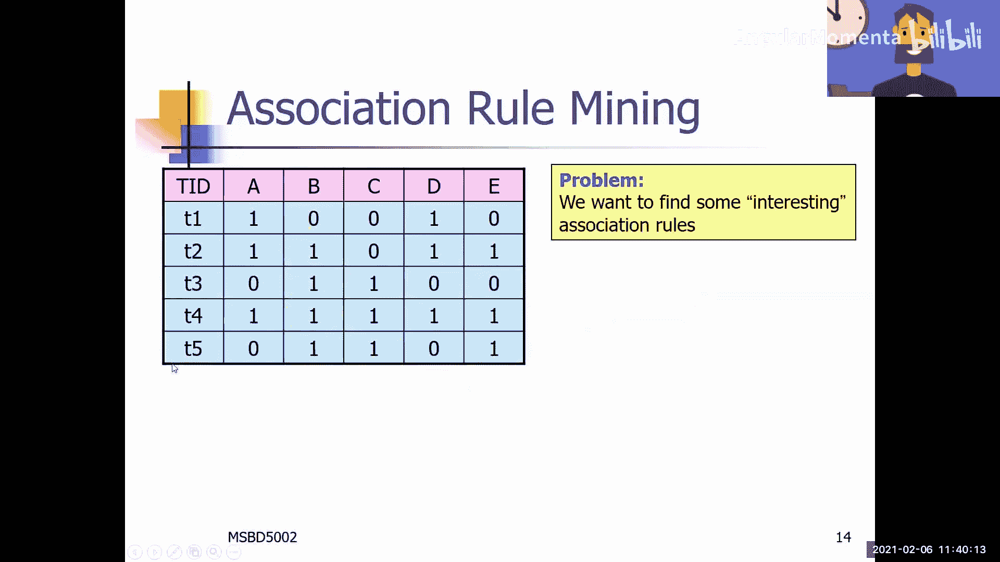

うん。🎼Data mining and noish discovery。🎼E mining and no N discoveries。

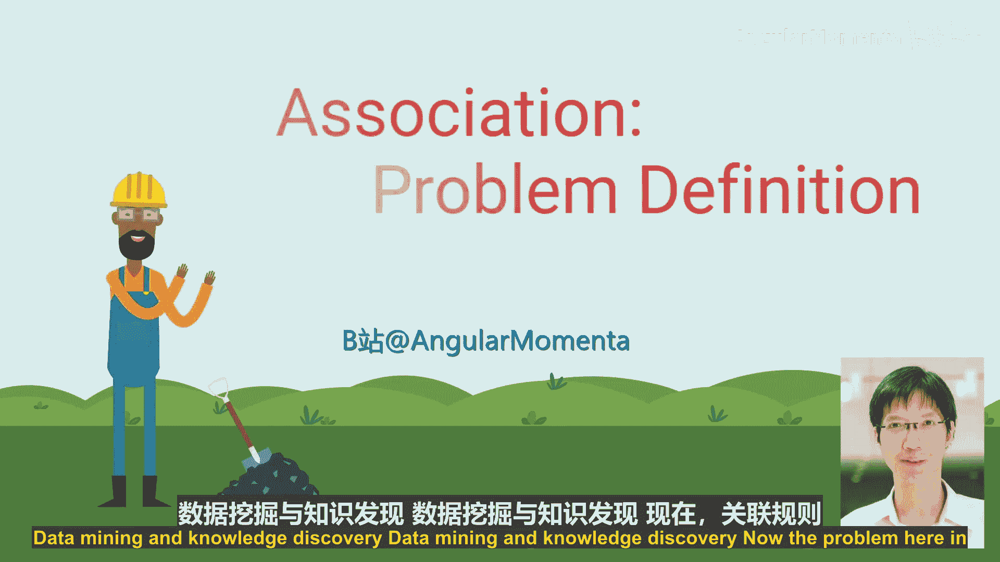

Now， the problem here in this association room mining is as follows。

 we want to find some interesting association rules。

And then this is one association rule illustrated by me。

 This is another association rule illustrated by Zheng Hao。 Okay， and also， we know that B C to E。

 we know according to the table， we can calculate the support and also the confidence Okay in the previous slide and B to C also illustrated by Zhengo。

 the support and also the confidence。 Okay， so for each association rule。

 we can also do the same things。 Okay， many rules。 Okay。

 now we want to find some interesting association rule。

 but we haven't precisely define what we mean by interesting。 Okay。

 now we need to define it precisely。 Okay， association rules with support at least a given number 3。

Confidence， at least a given number，50%， these two numbers are given by user， for example。

 supermarket manager。 Okay， so you understand that this can be given by the supermarket manager。

 Okay， now I also want to use the label okay to either way this concept。 Okay。

 if you have no more question， you can lower down your hand。

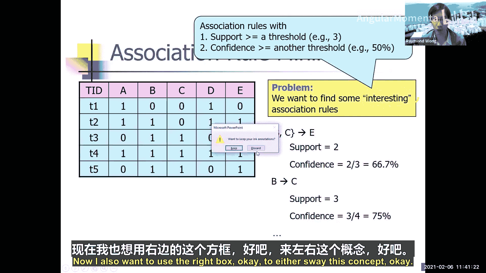

ok now go back here let's see sorry okay啊 okay let me go to here， okay。I want to use the whiteboard。

 okay， wait a moment。Okay， let's start okay now I think you understand what we have discussed about this let me use a simple example okay。

 now let me write down aBc okay， this is smaller example compared with this example okay and then we have for example one。

1， one， maybe something like this okay， maybe still and one okay。

 and so on okay now we have something like this okay， this is the table okay。😊。

I want to tell you is that okay， I'll go， okay， I'll go， okay， here， Okay。

 you can see that our'll goal is to find。😊，All their roots， okay？Which is interesting， okay。

 which means that with support。At least three。And also， the coveants。Is at least， for example。

5 percent。 okay， these are given by the user。 Okay， okay， user requirement。 Okay。

 now I want to tell you is that okay， let me use some animation， okay， okay。

According to the left hand side example， Okay， you know that maybe use some rotation with a moment。

 Okay， okay， done okay， here， let's consider this association root。 the support is equal to2， okay。

 which is not。Greater than or equal to3。 So this is not satisfied。

 So this one is not an interesting rule。 Okay， now consider B to C。 Okay， let's see the support。

 okay， the support is equal to3， which is greater than this one。

 So condition one is now let's see the confidence is 75 which is at least 50。

 So this is also correct Okay right so this is interesting So what I want to say is that B to e is not interesting。

 but B to C is interesting。 We can do it at one by one for each of the remaining rules。

 what I want to do it here is also as follows， what I want to say is that in the following。

I will give you one straightforward forward。😡，Or I call naive， okay， approach。

 Okay to solve this problem。 Okay， the first step is that， okay， step number one， step number one。

 Okay， what I want to do is that， okay， I want to eliminate。All possible rules， Okay。

 all possible route， Okay， I want to eliminate all the possible route and then step number two。

To find。The support。😮，And also。The covidants。Of each route。 Okay， this is step number one。 Okay。

 and step number three。What I want to do is that we want to find。All interesting。😮，Rs， okay。

 this is our step。 Okay， In fact， I have already illustrated on the right left hand side。

 but I just quantify it on the right hand side only。 Okay， now I think you understand what I'm doing。

 Now let me use this example for illustration。 Okay， suppose that okay。We have rules。 Okay。

 we want to eliminate all the possible rules。 Okay， one form is A to B， right。

And other form is a to C， right and then I can also eliminate B to A， C to a， right？

 And also we can eliminate okay， C to A C to B and so on so we can you can eliminate many possible rule we like okay here I have some problem Okay sorry okay。

 this should be B to C， Okay， B to C， Okay， so so we have this kind of possible association rule and this is that number one all the possible rule step number two for to find the support and also the confidence of each rule。

 So here let me add a column support。And also， the confidence。 Okay， let's see。 Okay。

 now let me do it together。A to B， Who is the support。 Let me see 1，2。 Okay。

 we know that this is two confidence， let me see A to B and I will do it quickly。 Okay。

 which is 100%。Let me do one more AC was the support AC， the support is equal to one。

The confidence of A to C， let me see。It's equal to 100%。Okay。

 is there any student who on to help me to fill in the plan for the four remaining roles， okay？

Yes呃 X高。😊，省交要要 yeah。I will help me finish the next end yeah this one yes yes， what is that yes？

やた yeah。Is to continue， continue continue to and confidence is the 50%，50% yes。

 continue and B to C is three。 Support is three， Yes and then confidence。Confidence is 75%。 Yes。

 continue continue C to C to A。CD  one，1， yes， continue。And 33%。Yes， and C to B C to B is three。

3 okay， yes， and then okay， thank you。 you get the coupon。 Yes， sure。 okay， so this is correct。 Okay。

 and then let's continue。 okay， now we have already finished a step number two okay， now Chong。

 you have question Chong I think the confidence of a to C is 50 percent I think double check let me say a to c yes yes。

 I should be5 percent okay， wait a moment okay Chong。

 you also get the coupon you to correct this mistake。 okay， okay， good okay okay continue。

Okay now we know that we have step number two。 we have this table and now go to step number three to find all the interesting rule as I define before we just want to check condition one and condition two okay。

 so we have this one let me check one by one Okay now here we create one call and call interesting okay let's see check the first one two which is more than this one so not so we know that this is not an interesting rule Okay a to c okay is also not the support at least three not Okay okay your question。

And先 and i also louder louder hell louder诶 hello louder louder。I could not hear clearly。

 Can you help me now louder， louder， You can speak louder。 I could not hear clearly。Okay。

 can you hear me now right now， I could hear you but not not not nice name， okay。Okay。Yeses。

 you can send you know嗯 the confidence of a to B is。67%。Is not wander。

A to b yes5 percent thank you thank you okay write down your name okay you also get the coupon you yes percent no a to b is0 percent sorry should be1 percent are you are not should be one percent could are talking about table right this table。

A to B， okay here we have two a。 So 10 percent。 okay maybe you can get the coupon next time。

 never mind thank you okay thank you okay now continue A to c okay since a to this one the support is least and this is not least。

 So no okay。And let me ask some students to help me to do it， who want to do the remaining one， okay。

呃，称凤。冲锋盘。helello hello i could hear you could you tell me is take or okay this one does not the goal and two a and B to c is yes this can。

And this is also yes。 this is also okay。 Yeah， so that C to A is cannot， yeah。And the final C2 B。

 okay。Yes， okay。 thank you。 You also get the coupon。 Thank you。 Yeah。 So this is also correct。 Okay。

 yes， thank you。 so we understand based on this three step methodology。

 you understand that let me circle something okay， the reason why I need to highlight this is okay okay lets see this one this one so B okay will be in my okay。

 so let me draw something behind okay， know it okay。

 now you understand that finally we will create a set okay， we will create a set okay。

 and this set B to c okay， we have C to B we have a lot of elements in this set we know that everything here is a set of all rules interesting rule。

With support。At least three。And also， confidence， Okay， at least 50%。 Okay， this is what we know。

 Okay， we understand that this is our。Decide output。 Okay， this is what we want。 Okay。

 this is what we want。 Okay， this is very clear， right， Okay， I think this is very clear。

 And then I want to tell you is that what is very clear is that this approach is a naive approach。

 Okay， and also straightforward approach。 and I also mentioned that this approach is time consuming in the following。

On the。啊 yes 书通。You have question I think we also have some rules for yes some yes yes， I didn't yes。

 yes， some rule okay， I didn't write okay here。Here okay。

 yeah doctor i didn't write yeah I also系 something okay，多多多 okay， i didn't yeah， okay summer活 okay。

 thank you okay。

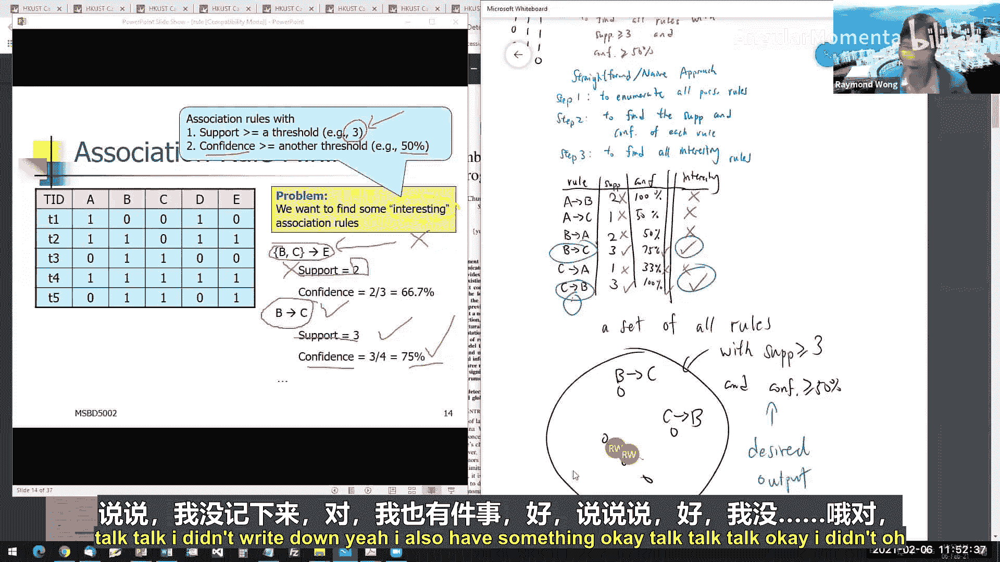

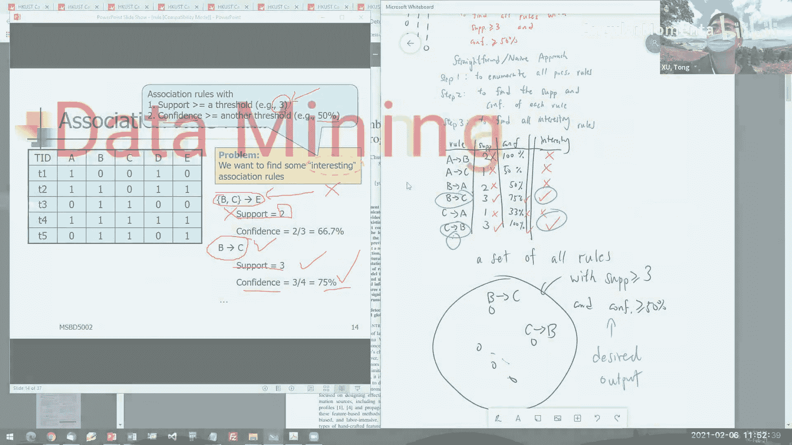

🎼Be mining and noish discovery。🎼E the mining and no N discoveries。

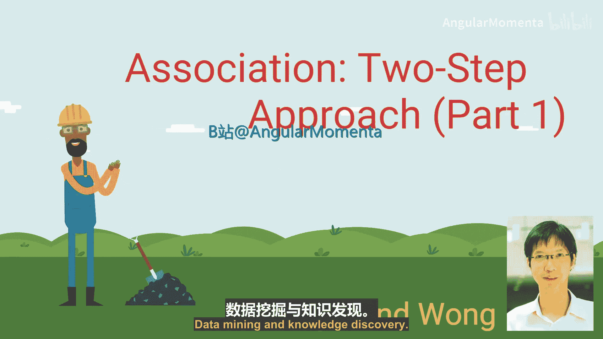

Now we understand that for this straightforward approach， okay， very straightforward。

 but this straightforward approach is very time consuming。

 but on the slide on the left hand side here。We will give another approach。

 We I call to that approach， which is faster than this approach， faster than this approach and also。

It will return the same answer。 Let me see the left left hand side。

 How can we find all the interesting rules efficiently。

Compared with this straightforward forward operation。Step number one。

We want to find all large items set。 That is item set with support at least three， for example。

 items set B C has support equal to 3。 So items set B will be in the output in step 1。

And set number two。We want to find all the interesting rules。Based on the result of step  one。

 which means that from all the large items set in step  one。

 find the association rules with confidence at least 50%。 This is just a high level description。

 Let me give the details on the right hand side。 Let me see。 Let me erase it wait a moment。Okay。

 good now let me give some this now I want to give you a two step approach to you so that you understand what I'm talking about。

Here Im now using the whiteboard， wait a moment。Now what I want to say is that。Here we have a table。

 right， we have a table。Let me copy again ABc and then 100111111110 what I want to say is that we are using the two step approach what I mean is that different this table。

We will go to is that。1。And then after step one， according to what we described here to find all the large items that right。

 so we will have this set， this set let me see。小得要停师。We want to have a set of all。😊，Large。I can set。

What I mean by item large item set is that with。Support。At least。3， okay， I think this is very clear。

 So you understand the heavy element in this set。Must have some support at least three。For example。

 B， the support is equal to。4。The support of BC is eager to free so we have this step number one。

 although you don't know how to do step number one I will talk about this later and then now we will have a step number two and based on step number two which means that we have some results like this in step number one and based on step two we will generate。

And other set。We have some element in this some problem with the synchronization Wait a moment yes。

 with some element in this one， one element here， we will have B to C。 Okay。

 we know that here this is a set of rules。Let's see a set of rules with confidence at least 50%。With。

Confidence。At least 50%， we know that this confidence， we calculate it is eager to， let's say B to C。

 the confidence is 75%。So we understand that what I describe on the left hand side step one in Sta is these are blocked out where this is very clear。

Now， let me give the details about each step。Step number one。From this ABC， the table。

 we want to generate a large light ice concept with support at least three。😡。

Although I didn't give any method how to do this。😡，Up to this moment。

 you have already learned how to do step number one。 I repeat。

 although I didn't give any detail about step number one up to this moment in our today letter。

 you know how to generate the frequent items set or large items set here based on this table by using the major idea。

 straightforward naive approach。 I let me light and lighten you how to how to inspire you is that。

Take a look on the left hand side。The wet colors is our gold。 We want to find all the roots。

With condition one and condition two。All the roof。And then the straightforward approach is that step number one。

 we eliminate all the possible rules。And then step number two。

 we find the condition one and condition two measurement here and here， step number three。

 we want to find all the rules satisfy condition one and condition two。Understand， okay。

 now you understand what I'm talking about， in fact。The red color go for rules is similar here。

 We want to find all the items set。😡，With some condition， the condition is here is here。😡。

So we can also use this straightforward forward approach。😡，To do it。

So let me write it down for the black color things。Before the black color thing。

 we also have the blue color thingss。Who want to answer this one step number two。

 and yes Xu Tong you do you have question or you want to answer。no， no， who want to answer this。

 Okay， now I my question is that we want to have a straightforward approach for step number one to answer this 1。

 I want to find a set of all large items that。小小 z啊 you can ammute yourself unm you you you can do it by yourself。

 yeah， okay， I see it step number one。Yeah， for the all the large items。

 I think there might be B and the items at B now what I want to say is that could you say the step step number one toerate Oh。

 toumerate all the elements。That appears more than。Equal more than 3 to delivery all the items set。

 right。Yeah， okay， and that's that number two。And step number two is to。嗯。

To list all the elements that its support is more than3 equal or more than 3。 before that， Okay。

 maybe I just want to make it a consistent with the blue color fence。 Okay。

 maybe let me write maybe let me write down the first。 the girl here。 Okay， let me see。Is to fight。

All items set。With。Support at least three so you can see we have one to one mapping eliminate all the possible rules。

 so eliminate all items set right。Yeah， we want to find something。 Okay。

 something is to find the support of all the， okay to find the support。Of each item set， Yes。

 continue and then to find the item sets that with the support at three。 Yes。

 I to find order as items set with support。At least three。

 So now we understand that we can use this blue color things。

 Can you help me to tell me we also we will create the black color table， Right， Okay， yeah， yeah。

 and then can you tell me this is item set， right。Yeah right。

 and then could you tell me this are all the possible I can set？Yeah， it's ABC and ABBC， A and ABC。

yes， okay， I will wait a moment。 okay， I I need to write that have we can also know that this is also a set of item or items set and then we are done here。

And then now we this is step number one， step number two is we want to find the support， right？Yeah。

And then the support， could you tell me the remaining one。 or maybe I I ask other student。 thank you。

 Yeah， so that student Okay， hoinghui。The support of A is 2。 The support of B is 4。

Ex sorry I didn't continue repeat guess sorry A two two the support of B is four yes。

 the support of C is three yes continue the support of A B is two， yes， the support of A is one， yes。

 the support of B is three yes and the support of ABC is one。Right， right。 How are you correct。 Okay。

 you also get the coupon。 So its that number 2。 And then also the last column is to find all the interesting not item set with support at least three。

 So which is whether they have support at least three。Also， students also want to do it。Let me see。

靠好欧阳。y so so the item that B c and b c have support larger than three larger or equal to three Yeah yeah is this yes and then so this are okay。

 but the other one is not okay， right。okay， thank you。 You also get the people。

 So we understand this easy。 Just use the blue color straightforward forward approach and then we just circle all the text。

 which means that this one will be in the output。 So after there we understand that。

Circle out all of them。 And then this will be in my output。 So up to this moment。

 you know how to do step  one。Step one is also the same1。

 I also want to say that you understand that this is a sweet。Forward， okay， and naive approach。

 this is a slow approach， although you know how to do that now。

 but this is not the fastest way to do that。Step  one is the slow approach。

 Now you understand from this table， we can find this set。 Now go to step 2。 Let's go back。

啊 which moment go back means go啊中山 you have question中山。hong you in step  one。

 we do not need to calculate every item set yes yes， yes yes。

 we don't I just say9 if one we learn some smart for step number one you want to give some idea to us。

 no problem。 Yes， you can do it now to find item set which support is larger or equal than3 and first we only need to calculate the items that A B and C and we found that only B and C satisfy the condition So after that。

 we only need to we do not need to calculate。AndABC， and we so we only need to calculate。AB A and B。

 and we do need to calculate AB。 Okay thank you。 Okay。

 I also give a coupon to you Actually what you are talking about is what we will discuss later in today lecture Chong ising or suggesting smart way or faster way to step number one。

 which will will discuss later in this course don' need to I just want to say this is naive method speak approach can do now we understand that this is time consuming method we have a better later now we step number one at this moment。

 you know that given the some you have learned before and then we will this is what you understand now。

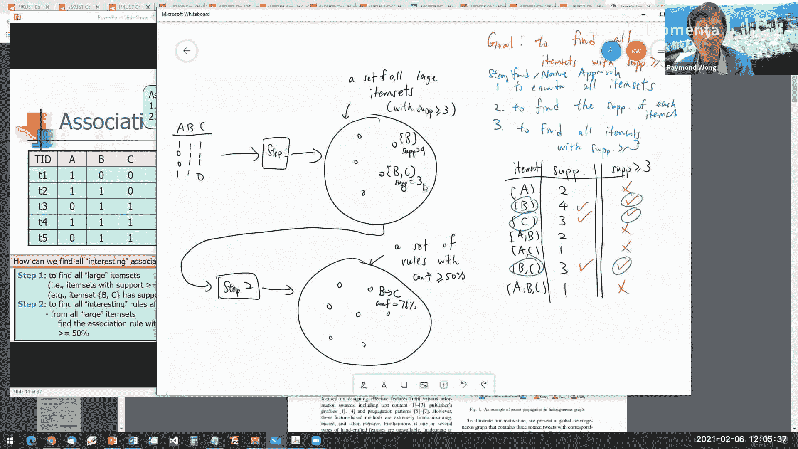

🎼Great mining and noish discovery。🎼It a mining and nour N discoveries。Now go to step  two， step  two。

 Now go to step 2。

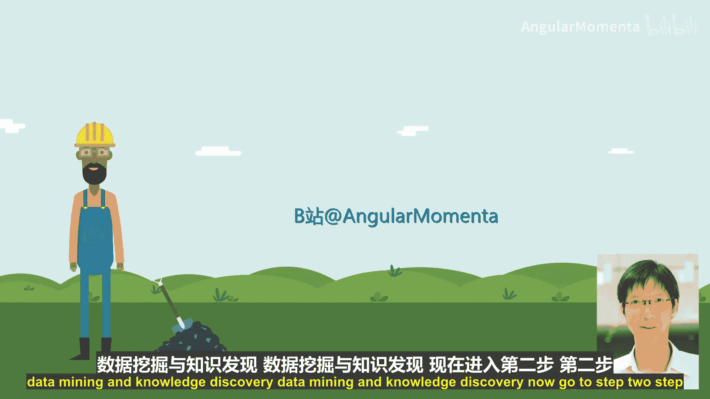

Step two to find all the interesting rule after step one， how to do that。

 find from all the large items set in step one， which is here， we want to find the association rules。

With 50 percent， how can we do that。 Okay， let's see let me write down this things this is quite let me write down more a formal one here let's see I will write a formal one here I also use the right I use green color。

 Okay I use not blue color is。Yes， step two。Yes you can see。For actually。

 what they are doing is that for any。To。Elements。In the set one。

 set one means this is the set maybe let me label it wait a moment。This is S1， let me see。Here。S 1。

 Okay， I call here。 This is S 2。Then we call this S2。As one S two， and then I also call this one。

As S log。I just give some location to as log。😡，S 1 and S 2。 Now you understand， Let me continue。

Here for step 2， I want to give a concrete step for any two elements in S 1。Maybe let me write on。

linnie。It。😊，And also why too bearable where。It is a subset of why。😡，if。The support。

Of something why divided by the support。Of X is greater than the given thresholdhold， for example。

50%。Then I will generate。An association route。In this form。Maybe it look complicated with you。

 but I will eat this way on next。😡，Step number two in fact， okay。

 if you go back to the site to fund fund the result in step number one。

 which means some large items that we find our association room with confidence at least 50%。

 maybe do it one by one。 step two， actually for any two elements in the output。Of step number one。

 which is here。X and y where x is a subset or y if this one is at least 50% we will generate I will like this maybe it looks very complicated when I gave some example then you will you this will be very easy let me give the example let me see for example。

This is B。So for example。This is busy and then you will feel very comfortable。

And then let me write out， this is also Y is also B C， this is also B。And this one。Is B to C。

Maybe now you have better idea。 Let me elaborate now for any two elements in S1， for example。

 here with S1， we have two elements B and B， let me use some annotation Wait a moment。

 I want to use soon annotation B and B C， this is two elements。 So two elements。And then。

For any two elements in S1 B and B where x is a subset of what。

 I think I've assume that most student of here is coming from some mathematical background。

 computer science background X is a subset of web you should know what I mean by subset if you don't know you just do a Google search。

With this key word， okay， I don't want to explain here。This is actually is a set。Subet。😡。

set subset okay， if you don't know you can search by yourself x is a subset or y means that okay。

 you can see x and y okay， you can see that x there's an element b I can find b here right b so x is a subset or y x is a subset or y if。

The support of why。Divided the support of eggs。is at least 50% I will generate an association group in this form。

😊，X， the left hand side。Its B。 So I write it down B。Actually， why minor x。

 maybe some student don't understand this is also related to set if you don't know。

 maybe I also want to say that you can search the worst set difference if you don't know。

Set difference， set difference， which means that okay。

 maybe I can also use a layman language y minus x， which means that now I focus on y， okay， B。

I don't need any information related to X。 So Y is here。

 and then I don't need any information about x， which is B。 So I remove B。 So y minus X actually C。

 So you understand that actually here。Y minus x actually refer to C。Y minus x is referring to C。

 So we understand x。啊，arrow楼。Which means Barrow Y minus X is C， Okay， so we understand B B C。

 we will create B to C now maybe continue more maybe continue more。Maybe。I think you understand。

 let me continue more that。😊，We have defined the confidence， confidence that we use other color。

 the confidence。b台 c。You could not see it。 Let me z out a little bit， yes。Oh。B to c。Now。

 the confidence of this rule， you remember that we have the denominator and the lumerator， okay。

 the upper part and the lower part。We understand that the lower part， the bottom part。

 the deminator correspond to the number of transaction containing the left hand side。

Let hand sign mean B。 So we understand that actually， this correspond to the support of B。Right。

The luerator， the upper part correspond to the lumber transaction containing both the left hand side and right hand side。

 So both the left hand side and right hand side means the support of B。

 right This is what you have learned before。So we understand based on this， you can see that。

Thisis confidence support B， Okay， maybe now we very clearly this support B。

So the upper part oh support B is here。 The bottom part support B actually this things， this a。

 Let me write down In fact this fraction。Is exactly the cod。Of。6。2。Y minus in our example， actually。

 this is the confidence of B to C。The confidence x to y minus x which is this one。

 the example is confidence B to see， let me write an example。So this is an example confident B to C。

 So what I want to say is that。Maybe let me use some layman language now we have the output of step number one。

😡，And then we just focus on any two elements， for example， B and b。 So this is output S1。

 any two element B and also B okay， we have two elements focus on it。

 So we have B and b nothing we have B and b now we want to know that there are some correlation between the x and y X must be a subset of y So x is a subset of y and then if this fraction is divided something like this support of B divided by support of B is greater than the firsthold。

Then we will generate an association rule based on this form。Actually， B to C。

 So we understand that this B to C， the confidence of B to C must be at least 50%。

 So this is consistent consistent with what we we thought on the left hand side from the association from the large items set。

 which means here。We can find the association rules with confidence at least 50% which is here。

 so step two the implementation is here。Let me era something to so that you understand what I'm doing。

 Step two in fact is doing something like that。 Now I focus on any two element B to PC。

 then we will generate B， okay， oh， B to C， and then maybe B to and other things。

Maybe let me erase this one。 And then we will also consider and other things。 Okay。

 maybe this place maybe is ego， for example。Yes。Maybe no no example， maybe anyway。

 I create one a example A B A B and then A B we also do a B， okay。

 suppose that A B also have to support a very large B and A and then we also do the same thing。

And generate the corresponding association route， if the confidence is at least 50%。Underて。

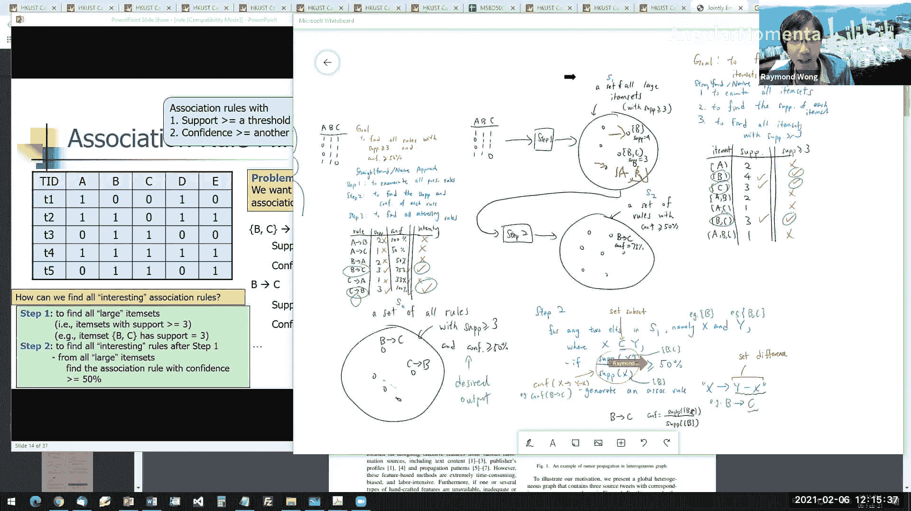

Oh。🎼Great mining and noish discovery。🎼It mining and no N discoveries。

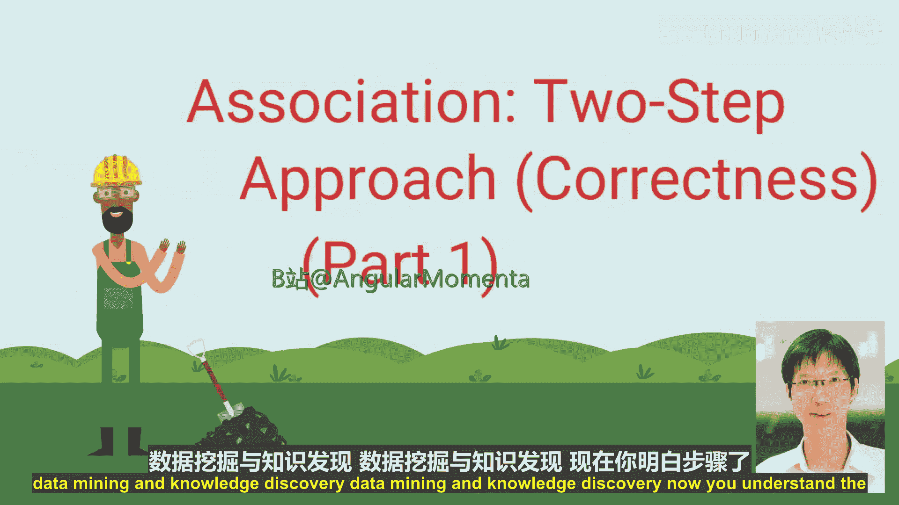

Now you understand the step。Stat number one is here step number two is here。

 I think you understand that now my next question my next question yes now let me give ways of question。

Do you think that okay， do you think that。S 2。Wait a moment。 S2 is this one。 S 2 is this one。

Is this equal to。As0。A srup， which is you。Maybe let me use some layman language to say。

 let me block this here。I brought here， we know that our goal is to find all the association with support at least free confidence at least 50%。

We know using these blue cas。 we understand that this is what we want。

 This is we find all the rules with support， at least free confidence at least 50%。

 This is our decided output now。We have another approach call two step approach let me write down clearly this is called two step approach let me write down this is a two step approach in the natural notes。

And then doing step one to using this blue colour frame and then start two using this blue colour frame。

 And then we have this output called S2。 Do you think that S 2 is equal to S log。😊，愿行月远行。远行。

远亨要其 and yourself远亨。You can unmute yourself。 hear mean。Yes， I think they are the same。 Why。 Yes。

 could you elaborate briefly。 Yes， Yeah， because the the first approach is calculate the support and the confidence together and the second approach is divided divided the divided to two steps I we should calculate the support at first。

 then on the basis we calculate the confidence。Thank you。 You。 You give a rough idea。 Thank you。

 You This is roughly correct。 Thank you。 Now， Yes， the answer is correct is。

 which means they are equal。You end up， maybe you most of you have some mathematical background。

 you know that S2 is a。As lot is a set。Usually if you proof that a set is equivalent to another set if you read your mathematical proof。

 usually they will do the following。What I mean the following is that first of all。

 they will prove that S2 is a subset or equal to S law。

And then the second step is that they want to prove that S log is a subset or equal to S 2。

 When we prove claim  one is correct and claim 2 is correct， we can prove that S 2 is equal to S log。

 This is the correct way to prove the equivalent of two set。So my now my next。

 although Yu already answer briefly， I want one student to explain some major idea why claim one is correct。

 why claim2 is correct。Maybe let me give some idea。

When we prove one set is a success or another thing， actually you have learned it in your university。

 maybe you didn't notice that when we want to show this is correct。

 usually what we are doing is that S2， some condition is certified already satisfied given in S2 and then you just do some deviation and finally you find out that all this element also satisfy the conditional specified in as law。

Similarly for claim two， we know that some element。

 which means association rule is now in S law and each rules have already certified some condition this condition do some deviation and you know that they will also satisfyify some condition in S two who want to tell me this for claim number one and claim number two。

😊，Who want want to do that Actually， is it more difficult than Yuunhan is just briefly。

 It is not a formal discretion。Any student who want to answer this question？If no， maybe you， you。

 you still some time you still need some time， maybe let me give you one major property use in these two claim first。

 Okay， so that you understand it no。This properties is very important。😊。

Let me see this is the property。if。Then we see， you have the support。个 b c。It's greater than three。

Let me ask you。Actually， Yun had maybe impit have his mind have this property， but he didn't。

 She didn't explicitly say that， in fact， proof。The proof of this two claim need this property。

 If you didn't have this property， you could not say something like a what Yu say。

 The property that is the support basis at least3， the support of。B。Do you think that？

Support of B is also at least three yes or no who want to answer it。This is a yes。啊，红龙。红龙红龙。

Hi can you hear me I could hear I think that if the support B is large or equal to 3。

 I think that B is also large or equal to3 why why。

Because that for the first time in the B set in the B set， it includes B B set。Yes。

 maybe yes correct。 Yes， yes。 let me wish some student may I think most student can follow what he is doing。

 but let me whistleline and then you know what he he is talking about support B is at least free which means that the no the there's at least free transaction containing B So I can write down free transaction right and then free transaction containing B and C。

😊，I don't know I don't know the I don't know the other things I don't know the other things right so the support of B okay you can see clearly that we have three transaction containing B so the support of B must be also at least so this must be too we will use this property in this claim。

Maybe some students don't know how to express it clearly。😊。

I think if you are just远 saying it just a high level way we don't know actually precisely whether this is correct。

 Maybe let me give you the clean clearly so that you understand clean number one。Cing number one。

Which is this one。S 2 is a subset of as long。 Actually， what we want to show is。For each element。

 which means for each room。😡，In S 2。This group must be in as long。 Okay。

 let me see which student wait a moment I need to him Xiang let me mut you。Let me continue。

We want to prove this one。😊，So that we understand that this one is correct。And then， maybe。

Also write on claim number two on the right hand side， claim number two。

And then click number two is also similar。 Let me use the annotation which moment click number two is here。

 actually is very same matter。Let me write that。For each。Element。In e law。

Which means sorry for each element of which means rule。In as log。This is also。In S  two。

 So this is also in S  two， maybe in order to check the answer easily among all of us let's use an example。

B to C， for example， we use the B to C for for illustration， for illustration。

Maybe let me do one step for you and then you can try to do that here for click number one。

 let me start with that so that you you can warm up now click number one for each we in as to which means here。

We want to see if this room must be as long， This is what we want that we do Here is the proof now that we use a black colour。

Sees。Maybe going right on tooth。Since B。B to C is now in。S 2。And then。嗯。Since this rule is in S2。

S 2 is here。 We know that the rules must be have confidence at least 50%。

 This is given S  to have this property， right， So I write down。The confidence。Of B to C。

Is at least 50%。At least 50%。And then now we understand that this element。

 the confidence is at least 50%， right？Let me go go go go go go， go go go go。

What I want to say is that。啊。Here， S log， right， we want to show that this is also in S log。

 Let's see。 S log， there's a requirement that。The rules must satisfy confidence and support。

 so we understand the PC Sa condition tool here。对。But we don't know this b， the support。

Its larger than or equal to 3。 Let me write up， actually。The remaining question。

The remaining question is。Whetherather B to C。In S2。Has support。At least three。 we don't know this。

 the remaining question is the remaining question is whether this rule have a support at least three in the following。

 I will show that B to C， the support must be at least free based on property based on some property based on some property maybe not this。

And then we have the result Now maybe I give you let me see， I give you a set analysis。

Let me say I know I see。😊，Will check the answer。 okay。

 now you you you can啊 do it by yourself will check the answer at twelve thirty five。 okay。

 I want one student to share your screen to show your answer。About this one。

 Now you can do it by yourself。 Actually， you need to use your brain so that you understand the major idea why this two step approach is correct。

 correct means that the output of this two step approach is exactly equal to what we want currently is also unclear。

 although you also mention some high level thing。 It's also unclear。 Okay， it's not unclear。

 You can do it now we check the answer as 12，45。Okay， let's do it now。 Let me see soon a little bit。

 Okay， yes， you can do it now。We will check the answer as 1245。

 and will ask a student to share a screen if you are using iPad and so on， yeah。

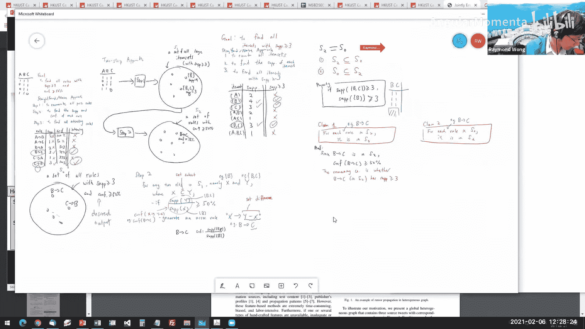

う。🎼Greater mining and noish discovery。🎼It mining and noish discoveries。

Maybe some student is still doing it okay， anyway， maybe I illustrate how to do that actually it very easy to do that。

Now let's take a look， I think you can also see here。😊，Clean number one， clean number two。

 but now click number one will be with this one。 Let me swing in a little bit。Wait a moment。

A little bit。Clan number one for each association rules in S two， for example， B to C。

 This is also in S law， as I mentioned， since B to C is in S two， as we know。

As to we have the confidence at least 50% we roll down。

 Then the remaining question is whether B to C in this set has the support at least way in the following。

 I want to show this is correct。 Let let's see how to do that。

The first one is which moment I want to find an individual variable， okay yes。Let me write Anna。

Sinces。B to C。Is now in my output in my output means that in the S  two okay， is in my output S  two。

We know that。We have to。Calculate。对 support。BC。Divided by the support of Bill。😡，In start start。

 let me right on the start is here with a moment。Okay， maybe give you the idea。

 We understand that wait a moment。 I want。 Okay， we understand that this PC is not in my outputpo。

This is the output right B C is in my output B C in my output must be generated by step 2， right。

 step 2， This is my output， right， This is my output in my outputpo。

 of course in order to generate this output， this has been computer already。

 So we understand that support B support B must be computer。

 So we know that we have to calculate this one in step star。

 when we generate B to C C B to C is my output。 is my output。 this should be understand。

And then that we continue。😊，In other words。In other words。BC。And also B。Are both in S 1。

 The reason is that you understand that here we have B C。 We have B， right。

 These two happen here means that this must be here， right。

 This must be here means that these two elements must be in S 1 must be in S 1。

 So these two elements must be in S1。Since this must be in S one。

 what I mean is that actually in S one means S one actually it means that here B and B。

 let me go upwards。 Wait a moment go upward。B and B， C。

 which means items that we support at this way。 So we know that the support we soon out。

 So we know that the support of these two。Bc。Or must be a library and also the support。

Of B must be a least so we understand this two as a statement should be correct so we can conclude we can conclude what I mean by conclusion is that。

This is our our remaining question。 The remaining question is whether B to C had the support at least rate。

 right， So let me conclude。 this is the support of B to C。

 This is the support for items that let me write。Since。The support of B to C is exactly the support。

😡，Of D。B C。So， we can conclude that。The support B to C is at least。

So this is what we want the support of B to C as a rate。

 which is what we want Any question for this one。So we have already showed the correctness or claim number one。

Now， if you have no question， now let me continue。This is clean one now go to claim two clean two I' haveve already wrote down a lot which a moment I want to make it which a moment。

Maybe here。 wait a moment。 I want to make it larger。老着。Good。Claim to， for each rules in S law， Okay。

 which is here， this should be in S2， similar to my logic。

Now we are in rules as in as as is let me go to the left hand side， the left hand side。

 as law means that the rules has support at least three and also the condition confidence at least 5%。

 which is given now given go back here。So since this one， maybe let me use the annotation。

Since B is now in as long so we know that the support and confidence must be at least three for support confidence is must at least 50%。

 this is different， right， and I want to rewrite the confidence into this form。 The upper part。

 maybe you cannot see clearly the support of B。The bottom part here is the support of B。

 So we have the upper path divide divided by lower part， which is at least 50%。 Just rerite it。

 So this is given very simple。 Now the blue colors， we can see the blue colors here。

 I want to do some deviation based on the property we just learned before。 Let's year。Suppose that。

No suppose since the support of B is exactly the support of B to C。Then we know that this。

 this is different， right， This is different， This is different。

 So we know that the support B is at this rate， right， This is what we want。

And we de use that PC now。Is in S1。CBC the support is at least。

 So we know that this item set must be in S one。 So this is our conclusion and then see something and then we de something。

This one， all I highlight that is that I want to use this property。

Since the student are Yuhan I didn't use this one。 actually。

 we need this we do not have this property， we could not continue。

 Let me fill in the blank Oh maybe let me ask a student。Actually， finally， I want to deduce that。

See this and this actually is here。 who want to tell me what is this green color Let me see reason。

Hi， hello， recentson， hello， yeah。It could tell me are these two green telephones yeah the first one so the first empty spot would be the support of item set of B Yes right and using the property we know that the support of the item set B is also greater or equal to three yes and then after we know this actually consistent with this we deuce this this ded what。

this also reduces that the support of the items that B is in set one Okay。

 thank you yes you understand this one after we understand this so we know the scene。B and also B。

 Okay， let write down。 this is actually is B。Since。B and also PC are now in S 1。

Step two in our method， which is here step two in our methods。Must consider B and B C together。

 Remember that in step two， consider any two element， Okay。

 any two element B and B together and also must generate B。

Consider these two element and also generate B to C sees this one is satisfied in order to generate this one。

 this must be certified。 support B， c， support B， C divided by support x， which is here。

And this one must be greater than equal to 50%， which has been explicitly mentioned by me here。

 right， you can see that。 So since this is certified， this must be generated。

 So B to C must be in my output。😊，B to C must be my output。 So I also show that clean2 is correct。

 So we have show that clean one is correct。 Clean2 is correct correct。 Clean1， correct。

 Clean2 is correct。 So we know that the answer of my output S 2 must be equal to our decide output。

 So we we， we are done。 Okay， so we understand that to that approach is correct。

I also want to tell you is that this step is more efficient。

 We don't need to delivery all all the possible items that。 Okay。

 so what I want to say is that this step is very efficient。 Any other questions。Oh。

🎼Takeker mining and noish discovery。🎼It mining and lowish discoveries。

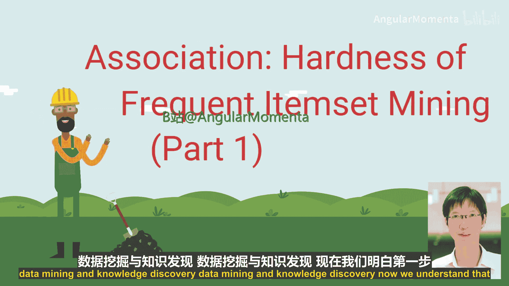

Now we understand that。Step  one and step 2 can generate all the interesting association rule。

 which is what we want。The next question I want to ask is that。Now where's that one。

 where's that number two in general。😊，Do you think that step one is more difficult or step two is more difficult？

Okay， let us go here。Which one do you think by your feeling。

 you since you are also studying big data， you know that we have task number one and task number two in your company。

 you also need to estimate which task is more difficult。More difficult。

 which means that more time consuming in general， which one bara。

OkayI think step one is more difficult because correct， correct， why， why。

Because there's more item sets to iterate over to see which one the support is going to be greater than three step two。

 it's a smaller subset of item sets that we need to iterate over so the number of sets we need to check confidence for is more limited so it's。

It should be more efficient to do step 2。 Yes， good。 Okay。

 So I think when you do at the company as a manager project manager of course。

 you know that maybe some task one task number two。

 you can estimate the workload Yes step one task number one is more you have already the since that one you have a lot of different items here and this is very difficult to check the support of each item and step number two we know that we on the result of step number one。

 since we just focus on any two element， any just focus on any two element and then generate the result。

 So this is limited scope to the final answer easier compared with step number one So step number one is more difficult than step number two and you know that in step number one。

 I use a time consuming approach to do that and also one student have already give one smarter this one can speed up the process that process is。

M， but we also have another smarter approach to be learned in our next class。 Let me continue。

 Let me continue。Let me continue。 so we know that step  one is more difficult。 Step 2。

 we know how to do it easily with the blue color things。 Okay， which is here。 Now let's continue。

Now we want to go to the MP harness， what I want to say in the following。

 we will focus on step number one。 step number one means that frequent items finding。Next。

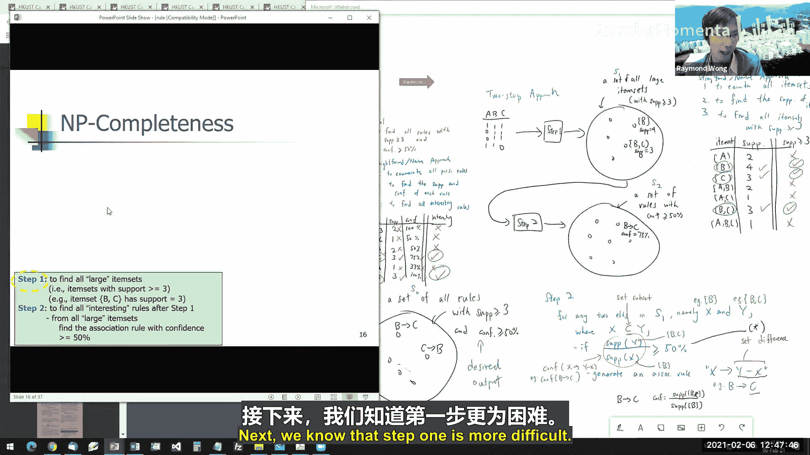

We know that that one is more difficult。And then we focus on this problem。

 The problem is to find all large items set items that will support at least three。

And then we actually can rewrite this as follows。 Okay， let's see。 I want to use and yeah。

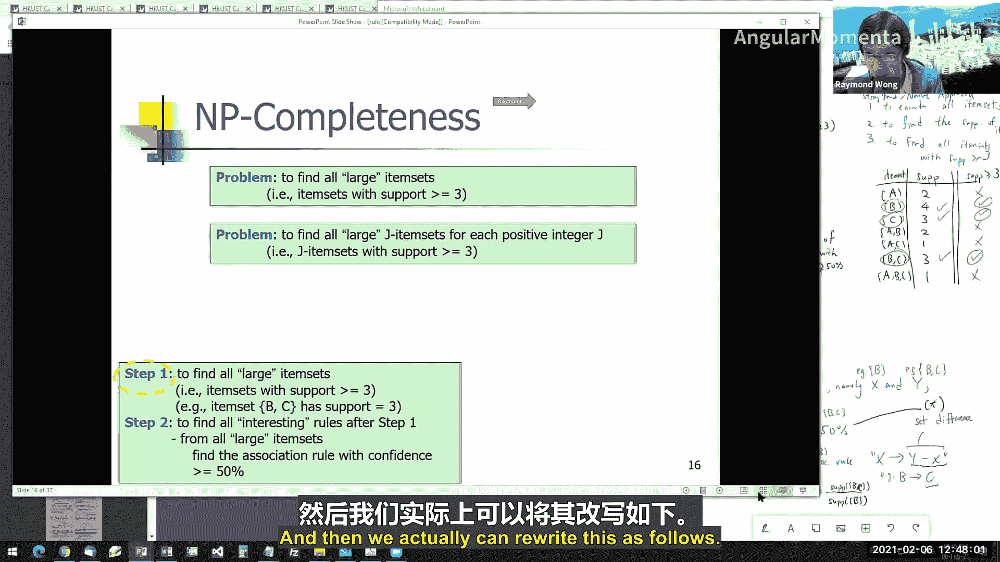

Not wait， wait a moment。 I want to use the full screen mode okay。

We want to find all the large items that actually， we can rewrite this problem into this problem。

Let's see。 To find all large。This item set， right， of any size。

 We just write on J item set for each positive N TJJ， actually， they are equivalent。And yeah。

 above it， items that we support at least three， we just say J items that we support at least three for each positive inJJ。

 this is equivalent。And then in the following。In our next lecture。

 I want to show that you know that we also studying computer science or big data。

 We you need to have a computer science way to say that step number one is difficult In the following the next lecture。

 I will talk about that。 Actually， this problem is MP hard or MP complete。We have this problem。

 This problem is， what is this。 Okay， finding large J item。

 The reason is that given a database containing a number of records， record number 1，2。

3 and 4 and  four items， we have this question I there an a frequent item of sign J。I repeat。

 is there an every frequency of item set of sign J。 Let me illustrate way。 okay， for example。

 this is4。And this is true。 Maybe I let me ask you。

 Do you think that does there any exist four frequent item sets or sign to who want to answer。

We have already defined four frequent items of size too。😡，Do whoho want to answer this question？ Yes。

 Jing。A rice and oil。You mean it this table。Size2， yes， the answer is， yes， or， yes， thank you。

 And then let me ask another question is three。 What do you think can we find it？ Yes or no， Jimmy。😊。

No， no， correct， Okay， correct， Okay， thank you， yes。😡。

Although now Jian could answer the question very quickly。

 I could tell you is that this example is very small。 So he can answer quickly。 However。

 if this table is very， very large， Okay， many items and also many transaction。

 This is very difficult to answer。 We will use an existing empty complete problem。

 balance complete by paragraph to do some transformation to show that actually this problem。

 our problem is very difficult。 we will talk about in our next class。 Let's end the lecture today。

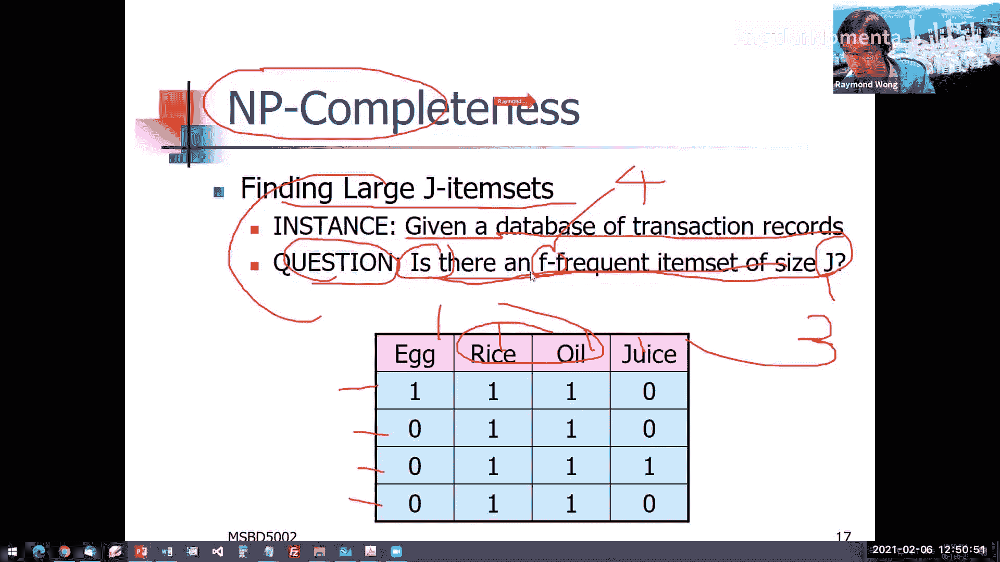

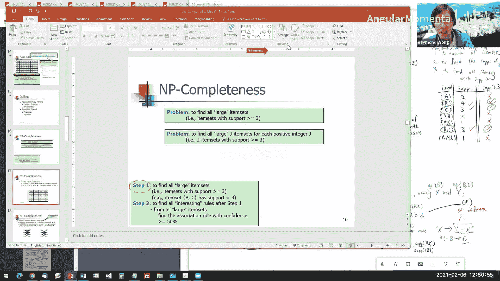

Oh。🎼Greater mining and noish discovery。🎼It mining and no N discoveries。

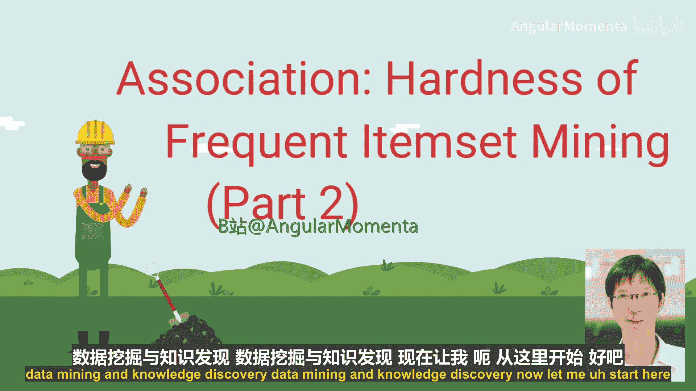

Now， let me start here。 Okay， we have already start a little bit here。

 Let me restart start again here。

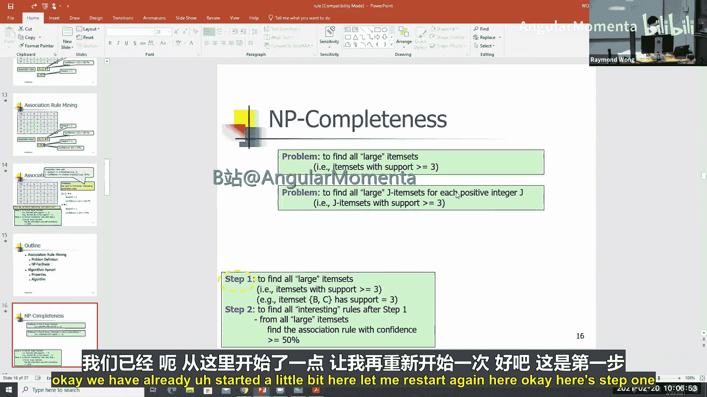

Here's that one。We want to find all the large items。 This is what we want to focus。

 and we want to show that this step is difficult， which means we want to show this part is the problem is MP hard。

Let's see here。 Or， the problem is to find all large items set。 Okay。

 we want to find all large items set。 That is item set with support。At least three。

 this is very clear。 Just just echo with this statement。 Now。

 I want to rewrite this statement a little bit。Let's see the rewrite statement is as follows to find all。

let's see some problem。 Okay， to find all large J let me see。 I want to restart this power。 Okay。

 I think there's some problem with let's see。 See I cannot not do annotation wait a moment。

 I want to use annotation。

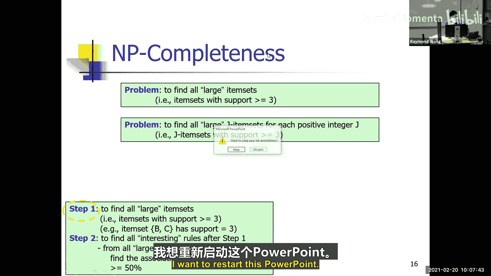

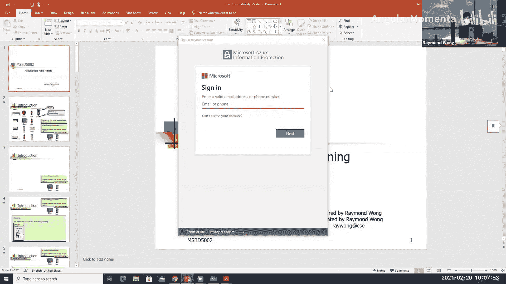

Let me see whether I can use the annotation here。 since I know that。 Oh， yes， I can do it。

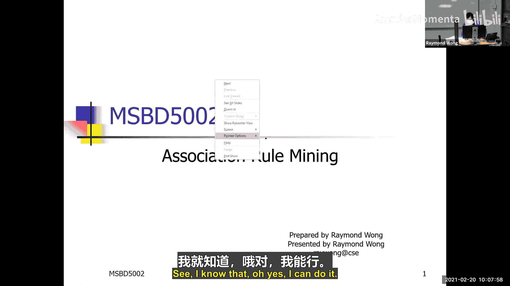

go to there为什么问？I know that PowerPo has some problem on that。 We need to restart。 Now， let me see。

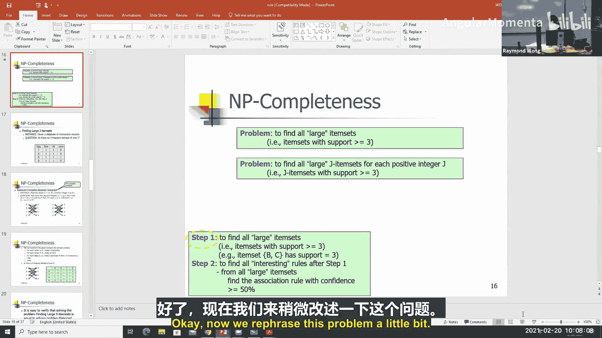

Okay now I we we we phrase this problem a little bit to find all large to find all large also item set。

 But this time， we have the J item set you remember。

 I just we kept your memory J item set means that their item set containing j items and then for each positive in J J。

 So we want to find J item set we support at least three three for each positive in J J。

 So we know that they are equivalent。And then let's see what I want to say。I want to say is that。Now。

 our problem can bewritten as this decision problem。

 If you understand that MP hardness or MP completeness things is the decision problem。

 See what I mean by decision problem。 Find large J item set， given an instant。

 the instant is that we have a database instant of transaction record， we have transaction 1，2。

3 and 4 and four items，8 rice， oil and juice。 And then the question， decision question yes。

Is there an S frequent item set of side J。Last time we have asked a student to answer it。

 we do very quickly。 for example， if this is4 and this is equal to2。

 then we know that the student last time answer that is there are F four frequent item of size 2。

 the answer is， yes， since the student answer that we can find rice oil， the item of size 2。

 and totally we have four transactions。 So this is correct。 And also if we change this number to3。

And the answer for this question is there are F four frequent answer of size 3。 The answer is no。

 As I mentioned last time， although we can answer this question easily， now on this simple example。

 This example is very simple。 So we know that it's easy to answer。 However， in the in practice。

 this data sets have a lot of transaction and also have a lot of item。

 this question is very difficult。 How can we say that this is very difficult。

 we can use an existing existing MP complete problem， MP complete problem to show that。Our problem。

 this is our problem。 Okay， I say this is our problem。

 This is an existing MP complete problem proof by other researchers。 This is what， what is this。

Balanced， completepartize sub graph。 What that the instance is that we have thepart graph ofpart graph means that we have something like this。

 we have ver  one and ver 2。 Okay， we have two set of veres。

We a set of vertices include two set of vertices， We 1 and V2， and then a positive E T J K。

 which is at most the total number of vertices。 The question is also a decision question。😊。

Are there two this subset we won， and we too， which is belongs to the whole set of vertices。

 such that the size of we1 and the size of we2 is equal to K and also such that for each you in this first set of vertices。

 And for each we in the second set of vertices。 you and we together belongs to the set of edges。

 let me give an example。 And then it's easy for you to understand。 suppose that。K is equal to 3。

 Suppose that K is equal to 3。And then NSFC。I can tell you， okay。

 this is example 1 on the left hand side。 This is example1 on the right hand side is example the another example for example  one。

We can find the C1。This is we1。 I can find this。 We1。 and also， I can find we2。😊。

I can find V1 and V2， which is a subset of the whole set of vertices。

 such that the size of these two vertices。Is equal 1，2，3，1，2，3。 They are equal， equal to3。 Also。

 And also for each you and we in the first set of vertices and the second set of vertices。

 they belong to the same a。 Let's see。 Now can that we 1 a， right？

 And then I can see where we have an h to E。 We have an h to F， we have an h to three。 Similarlyly。

 for B， let me use another color。For B， we can also find E， F and G。

All all of the water in the opposite side。 I also have the edge， and also may be。C。😊，For C， E F3。

 So the answer for this question is yes in if K is equal to 3。Undered。Now， let me ask some student。

 okay。If are the positive integer become4。Do you think that the answer is yes or no。

Who want to answer this one。You can wait hand。 if the question now become。

 let me see use white color。Wait a moment。那 my question。

 my question is that suppose that I change this to4。 I change this to4。

And then do you think that in example one， the answer is yes or no。 Maybe it's too messy。

 that we are are too messy。 I think you cannot see clearly let。Now。

 the question is that if this is equal to4。Do you think that this answer is yes or no in example。

 one who want to answer by raising your hands。No one。You what。Let' see， no one。Hease equal to4。街名。

You can ammute yourself。 Can you？ Yes， okay， Thank you。 No， maybe deal。

The D is not satisfied the requirement。is not yes， yes， this already have three， right， yes。

 C we have four， and then we must have four edges for one ver since heavy ver here have only let me see this is three three edges。

 This are three edges。 This has four。 anyway， we could not achieve it。 Thank you。 Youll get a coupon。

 Thank you。 Yes， So you understand this is very clear。 I think you also understand that。

If this is fire， oh no fire。 actually fire is do。If this is equal to two。

 do you think the answer is yes or no this is simple for example， one， who want to answer。Yes。

 Zhong Hao。🎼Yeah， I think the answer is yes。 yes。 could you give one solution to me， yeah。🎼呃AB。

E F and B。Yes and and also F and yes， yes theres a lot of combination。 Thank you。 Yes， yes， yes。

Thank you。 Yes。 So we understand it if this is too， then it should be。 Now。

 I think all of you understand it。Now， let me give an example to it。 I think iss also easy。

For example，2， let me ask you if K is equal to3。Do you think that we can find the answer， yes or no。

 this question who want to answer。Example 2， yes，ingoingo。 I think， I think it is no。

 because the a point and a point just have2 edge and the D point just have one edge。Yes， yes， yes。

 yes， yes， yes。 since K is equal to three。 So we know that we should have the left hand side at least three veres with a degree3。

 which means a three edges， but we have only two。 So this are not okay。 okay。

 So you understand that this one the problem setting。

 But I want to say that this balance complete by of graph is an existing and MP complete problem shown by others。

 So we understand that this problem is very difficult， very difficult。😊。

And then now we what we want to do is that we want to do the transformation from the graph problem into the item set problem。

 What I mean is that for the previous problem， we want to do the transformation to our problem for each ver in we want。

 create a transaction for each ver in retail， we want to create an item for each edge create a purchase of item we in transaction U。

 And then in our problem， we have the F and J F is the F frequent of size J。So， F is set to K。

And Jay will be set to k for k， let me go back。F frequent or size J。 This is our problem parameter。

 And then this is the balance complete by part graph problem。 We have K。And then let's see。

 is that a K frequent item sets ofsi J， let's see。How do do that。a b c d啊啊 create a here a b c d。

Item and E， FG， H create some transaction。 Supp that A E。That's see A A year is here。

 So we have the edge A F， we also have one and then A G sorry， okay A F is here。 A G is here。

 and then you can see that A H have nothing。 So this is0， similarly for the other things。

 for example， D， okay， D F， okay， D F here。 Okay， D for other things， we all have seal。

 So we understand this is easy to be creator。After that。

 what are we are doing is that this is the original graph problem。 And then on the right hand side。

This is the table transform from the left hand side graph problem to our problem。

 And then F and J is equal to K。 Okay， now let me see。

Our current problem is that is there a K frequency of size K。

 Let's see if K is equal to 3 in our problem， Let's consider our problem。Is there any。

 we have already known this answer Yes， yes， the reason is that we can find ABC。

This is the set of item set of size 3。 And also this item set containing free transaction。

Pre frequent， so we can find this up in our problem after we find after we find ABC or E， FG here。

 the corresponding。The right hand side and the left hand side， ABC here， E。

 F G on the right hand side。 Okay， E F Gs here。 So here our solution could be met back to here so we can show that this problem。

 our problem is MP hard。If you are not familiarized with this MP harness proof。 Okay。

 the original form of MP harness proof， actually， the step is as follows。

It's easy to verify that solving the our problem。The problem finding the large K item set is equal to solving the original problem。

 The problem balance complete by graph I have already mentioned on the previous line。

 If this is a true， then our problem finding large K item set is MP hard。

 I have already show the proof about MP harness。 If you don't understand， Okay。

 let me give this a step。The method to show that a new problem is MP hard is following three step。

 step number one， finding an existing MP complete problem。 In our case， complete graph problem。

And then step number two， transform this existing MP complete problem to our problem in poly long tongue。

This is what we have done before。 step number  three。

 We just show that solving our transform problem is exactly equal solving the original MP complete problem。

 So after that， we can show that this problem is MP hard。😊，Now。

 we have already show that our finding large items set is very difficult。

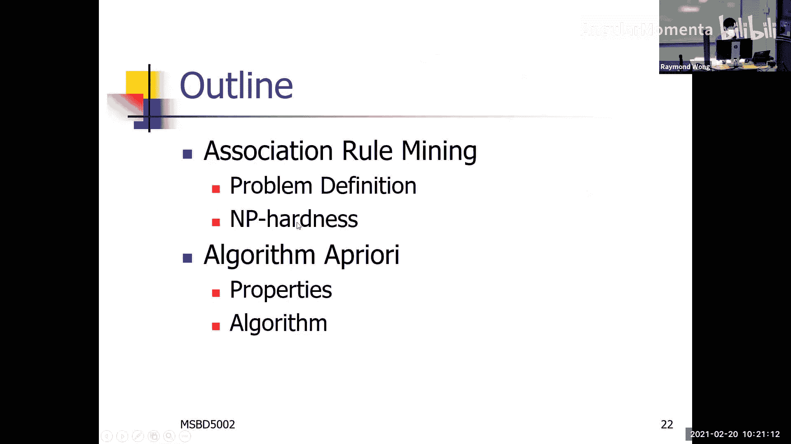

