# 【香港科技大学】数据挖掘与知识发现-｜-Data-Mining-and-Knowledge-Discovery-p04-04-03-02-1._Apriori_性质--BV1gEFDzVEU3_p4-

🎼Da mining and noish discovery。🎼Beer mining and noish discoveries。😊。

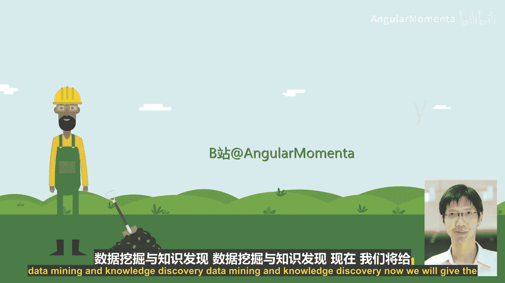

Now， we will give the first approach to solve this problem。 Okay， this call are prior。

Here is the table。 transaction 1， transaction 2， transaction 3 and transaction 4 and 5。

 We have item A， B， C， D， and E， And then suppose that we want to find all large items。 For example。

 items that with support at least  three。And then we know that B is large， right。How to do that。

Firstrs of all， okay， first of all。In order to do that in order to do that。

In order to know where the PC is not。Firstt of all， I need to scan the table。

 I need to scan the table with the table stored in hard disk， stored in the hard disk。

And then B is here。 B is here， and B is here。 So we know that the support B is equal to 3。

And then support is at least rate。 So we know that this is large。 It understandable。

 since we can read the table。 We can reach the hard disk。😊，Understandable， now， let me tell you。

 okay， following， suppose that。That' forget get this table。 Okay， I could not wait the hardest。

I just have this information。 I just have this information。I think student can also answer this one。

Yes be large。I think this one who want to answer again。 Okay， last time I also ask this question。冲上。

重上。Yes， if B， C is large means the support of B， C is larger than3。

 So the support of B is also larger than3。 So its large。 Yes， thank you。 Yes， correct。 Yes。

 so this is large and also C is also large。 So we can see that B is here。 C is also here。

 last time I also told you that actually。B， this one is a subset of B C。 Okay， as I mentioned。

 if you don't understand this one， you can imagine。 This is called subset。Okay。

 let's see what we want to conclude。Our conclusion is that if an item set S。Is large。

 This one refer B， C， Okay， if B C is large， then any proper subset of S must be large。

 So B C is also a proper subset of B， So they must be large。 Remember this rule。

 we will use it later in our approach。Next， we will talk about property2。Let's see。 Similarlyly。

 we can read the hardest。 We can read the table。 and then B C， E。

 I don't know whether it's large Then I need to read the table。 Let me see B C， E。 Okay。

 yes only have two。 The support is equal to2。Then let's check this number。

 This is not greater than or equal to 3。 So B C， E is not large thing I can read the table。

 I know this。 However， in the following， similarly， I could not read the table just。

Only this information。 How can we proceed。 Okay， let's see。Yes。😊，A b c E large。佢广调安息。燕。子豪。No。

 it is it is not large because B C E only got to including a means that it will be less。 Yes。

 the support must be less or equal， right， Yeah， thank you。 Yes。

 so the support of ABC E must be at most two。 So this must not be greater than three。

 So the student also know that。And then note， and also， this one， B， Okay， you can see B， E here。

 And then we have one more item D like what we have done。 So this is also not large。 Now。

 let me conclude。And item set。Last in the previous line， we we say subset here。

 we just use a super set， the opposite meaning。The opposite meaning。So what I mean here。

 if an item said S is not large， which is this one。

 then any proper super set of S super set means that B C， we will include more item。 For example， B。

 A is here， here， B D E D here。 So proper super set of S。

 which is this two example must not be large。 This has been our conclusion。

 let me summarize property 1 and2， property 1， if an item set S is large。

 then any proper subset of S must be large。 property2， If an item set S is not large。

 then any proper super set of S must not be large。 This is very clear。

 We will use this two properties in our method to be discussed later。

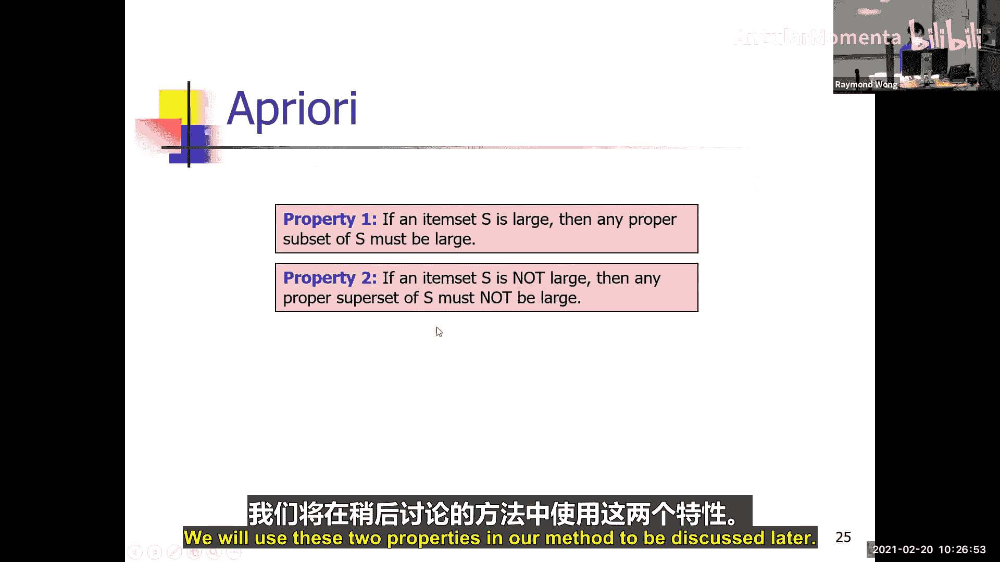

Oh。🎼Greater mining and noish discovery。😊，🎼It a mining image no N discoveries。

Okay， let's see。 Now we will go to the algorithm， which are using property 1 and property 2。

 Let's see Al means approach， approach method。Let's see。 Now we have the same table。

 And then the first step is to create this frequency table。We have ABC， D， E， ABC， D， E。

 and then this frequency table just kind the number of these occurrences of a。 Let's see a。Okay。

 we have free transaction containing a。 So this number is 3。 And similarly， for B， D。

 we can do the following。 You can check it by yourself for 3，3 and 3。 And then remember that。

 suppose that we want to find all large items set。 for example， items that we support at least three。

This is our problem。 And then we know that this numberber， this number。

 this number and this numberber， healthy thing are at least three。

 So it's very easy for us to know that ABC， D， E are also large。😊，A BC， D。

 E are large item sets of size  one， or simply， we call it large one item says。

So we can write down L1 is equal to A， BC， D and E。 Okay， so you know that L1， this one。

 the definition is that this correspond to a set of all。Large items set of size 1。

This is the definition。 So we， we have find this。 We have find this。Now。

 the second step is as follows。第 see。L1。Which is we just obtain here L1， ABC， D E。

 We just obtain here， right， L 1 is here， right， And then the following period approach is do you doing as fast。

 First of all， we have this green box。We want to generate all the large two item sets here。

 and then I will show later。 we also have another green boss here。

 We will generate large free item set here。 And I also may have the green boss here。

 La four item set generation。 Let's focus on the first one。 La two item set generation。😊。

Now we understand that here we have L1。And then we are the first arrow。

 I want to emphasize that this arrow， we want to generate some candidates。

Of large two items set candidates without reading the hard disk， I repeat for this error。

 My intention is that I don't want to read hard disk。I don't want to with the table。

 just only the information everyone。 I just base on this information on everyone。

 I want to generate the candidates of all the large two I set here。

I emphasize that I don't with the hard disk。 I don't with the table。

 I will explain the reason later after I finish here。 I don't need to read the hard disk。

And then the second arrow， I need to read the hard disk or the table so that I know that each candidate。

 the support is at least something。Here， we want to generate all the large item sector。

 that is very simple since we have a lot of candidates。 Each candidate need to scan the hard disk。

 and then if this candidate support。We find that it at least three， then put it here。 However。

 if the candidates here， the support is smaller than three， Then we will remove it。 This is the step。

Now， let me explain the reason。 okay， why this step we do not want to read the hardest。

We don't want to with the hardest。 You understand if we are with the hardest。This will be very slow。

 Maybe some student know that within the hard disk is very slow， but some student do not know that。

 Okay， how can you experience that within the hard disk is very slow when you open your windows or Mac or Linux。

 if you open a lot of applications。 for example， you open a lot of video at the same time and maybe you also open photoshop photo editor。

 and then you will use a lot of memory。 And then after you utilize all the memory And then the operating system will use the hard disk as a virtual memory。

 virtual memory means the hard disk。😊，At that time， you will be your computer will will very slow。

 So you may experience your computer may be very slow when your operating system with the hardest a lot of time。

So we want to avoid we the hardest a lot of time so that we have faster algorithm。

 This is our intention。Now， you understand it。 Okay， and then continue here。

 we also want to generate the last three item set generation。 Similarlyly。

 I also had the first arrow， the first arrow candidate generation。 we don't want to make the hardest。

And then based on this information， only L2， the January C3 are set of candidates for last three I set。

And then here， the second set， also， the same large item set generational。

 We want to generate all the large item set by reading the table。For each candidate。

 just with the table and know the corresponding support。 You the support is at least free。

 Just put it here。 If the support is more than free， just discard it。

 So the remaining one is this L free。And then we continue again again for large4 items5 and so on。

 until see something， for example， C 4 or L 4 become an empty set。

 empty set means a nothing become nothing。 we stop there， okay。And then let's see。

 candidate generation， we have two step。We call John step and prunes that we will illustrate later。

 And this one， large item set generation， we have a term called counting step。Now。

 I want to illustrate this algorithm with the in class exercise 1。 Now。

 let's open the in class exercise。 Okay， now go back here and then we go to the in class exercise。

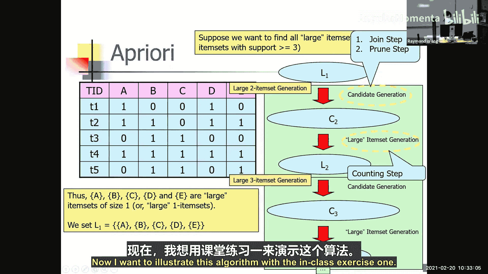

And then open this in class exercise one。We have this table。We have this transaction。

 and then the support vessel is equal to2。 This is not free。 Okay， in our slide here， this is 3。

And this is2。 Okay， remember that this is 2。 Foow the style of our priori approach and deduce L 1。

 C 2， L 2， C，3， L 3 and C 4， until all the large items set are discovered。Currently。

 you understand the step。 Let me see。 L1 very clearly。 However， for last two items set generation。

 last three items set generation， I didn't cover in detail。 So now could you use  five minutes。

To do this L1， which means that you need to create the frequency table。And then based on this one。

 And then based on this one。 and then obtain this one。 Okay， you can do it now，5 minutes。

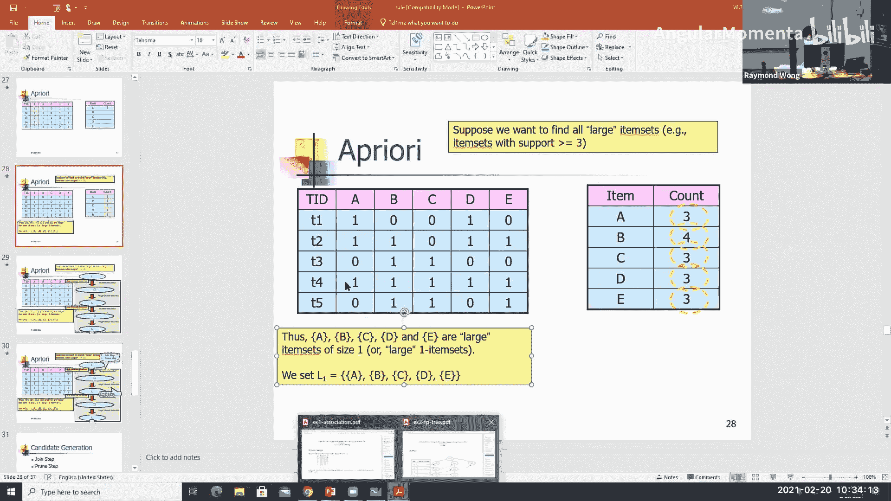

🎼Great mining and noish discovery。🎼It mining and noish discoveries。

Okay， the towns and then who want to answer this one to get the coupon。烧狗。想啊想搞。Yes， can you hear me？

And the first step， the count of one item， the A is。4 and B is。Continue and B 0。

 and C DE is all three。All three。 And then how about this answer here。🎼I want a c D E。 thank you。

 yes， okay， correct。 you get the couponang交 very good。Now， okay。

 let's go back to what in our natural looks on the left hand side。 Wait a moment。Let's see。

 let's see our natural look。Here， we know that L one is very easy。 since we learn it in the lecture。

当。Here。caning style。And John step。How to do that。 Okay， let's see how to do this step。

 Let's see on the white。 We have already done L one here。 This is very simple。 Now。

 I'm teaching you how to do large two items that generation here。 Let me write down here。

 Let's do it together so that you understand the process easier。Now， large to。Item set generation。

 we want to generate all the large two item sets here。

 We know that we have joined that and print that in this first web colorarrow。I want to tell you。

 is that。In last2 items generation， Z said and Pu that are merge。Which means that we just have。

jo step。And points that。Together， okay， together。This is special case。 However。

 John step and print step are separated in large free items set generation。

 large for items set generation， last items set generation。 So John that and Prince that merge here。

 is just a special case in large two items set。 So here we just have a merge step for John and step。

 So here we have a one single step here。Now let's con， let's continue。Here we。

 we understand the objective of this what error is to generate the candidates of large item set without reading the table。

 without reading the table。 So this is the candidate in our example。

 What we mean is that we want to write down candidates that。And one candidate said。

 we don't want to read this table。 We don't want to read this table。

 What I want to say is that I just look at L1， which is now in my memory。

 I want to create all the possible candidates of size 2， based on what I know， now， what I know now。

The process is very simple。 Let's see how to do that。 Okay， let me use this soon， okay。First of all。

 it's very simple。 Okay， now I just fix one。Element in l  one， for example， a。And then。

I look at the second element pointed with my blue color arrow。 So we have a。And then c。

So we can generate one possible thing is。A。A c。Since I I see this at large and this is large， I， I。

 I guess， okay， this is my guess。 A and C must be large。 A and C must be large。 Now。

 let me move here。 A， D， A D， So we have A D。And then now let me move the blue arrow next to it。

 So we have a and E。 So we have a。And E， very simple。 Now， we process all the C DE。

 and then the web arrow will be moved。Next to it， next to it means here。

 And then the blue arrow doing the similar thing。 Okay， since C is here。 So C will point next to it。

 So C and D。 So we will create C， D at the bottom。And then the blue arrow move。 So C and E。

 So we have C and then E。And then， lastly。We have already processed this one。

 So the white arrow will also be moved。 Okay， the whitet arrow will also be moved。To the next one。So。

 we have。第。And then the blue arrow will remove。Next to it， which is here a D and D。

 So we create all the possible candidates in the John step and P step。 This is what we have done。

Any question？Since we， we guess a is now large and no， A must be large。 C must be large。

 We guess that the combination of these two。Maybe be also large。 So this is called candidate。

 Just candidate for large two items。If you understand， okay， let me erase this one and then continue。

 Let me continue。Now here， we have already talk about the John step and push there for this word arrow here。

 We have C 2， which is here。 And then we go to the second arrow。

 The second arrow is called counting step。 Very simple， very simple。 Let write that。

Just with the table， counting step。We have the count style。 After the counting style， we have L2。

And then we have this answer with this， actually， as I mentioned。

 for each candidate here with the table to know the support of this one。

 this one and this one and this one and this one， If the support is at least this number 2。

 to be here。 if the support is not at least 2。 I will remove it。 Let's see。 okay。

 now I want to do A C and A D to find the corresponding support。 Let me see A C。

 the support is let's see 1，2， let me write down here， this one。

 the white color here means that the support of A C is equal to 2。

I don't want to write a lot of things。 The support of A is2， A D， Let me see， A D1，2，3。

 So we have three。Fe。And is there any student who want to help me to write down， Oh yes。插重。

Howong佢 help诶 help me yeah tell me tell me tell me yeah。Unmel yourself。 Ca， we could not hear you。

Hello yes I could hear you a speak louder speak louder okay， A e is free。A E is three， correct。

 and then continue。 C D is one。C， D is one correct， C， E is 2。 C， E is 2。 Let me。 Yes， D， E is 2。

D E is2。 correct。 Thank you。 So you understand you。 Thank you。 Thank you。 So based on this number。

 as I mentioned， that if this number is at least2， just put it here。 If this not at least2。

 then remove it。 So what I want to say is that at the end， you will just write on A C。And also， A D。

 and then A E。And then c d， we do not need to write down C e C D we do not need to write down we write down C e and D e。

The reason is that C the support is one， which is smaller than our first hole。

 So L 2 is this five item set。 So L2， we are here。 So very simple， right。

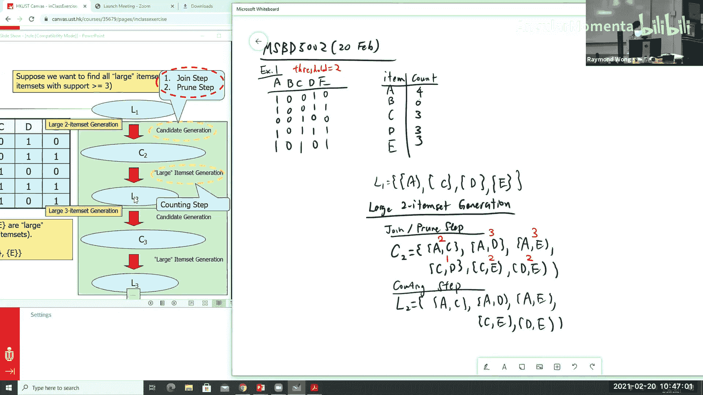

Oh。🎼Greater mining and noish discovery。🎼Be the mining and no niche discoveries。

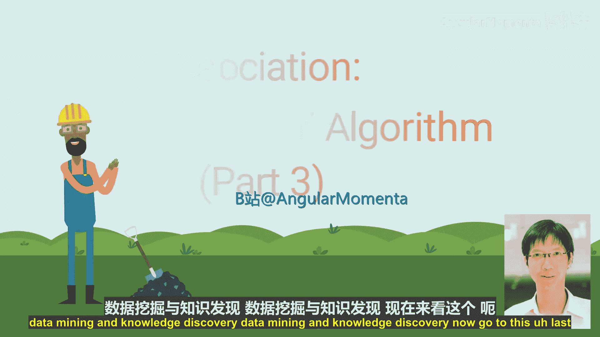

Now go to this last three item set generation。Now that we do it。入面 do it会从冇乜哦。Wait a moment。

 I want to write on the here。Now I want to write down last three items set， okay here。拉。诶，我什么问？

Last three items， that generation。And then we also do the same things here。

 We have the candidate generation。 where John step and Pstead。 This time， as I mentioned。

 John step and P step are separated， are separated。 Let me write down John step。😊。

And then we had the candidates。And then the prune step。And very clearly， the pointss that。

We have separated。And then C3。Let's see the how we do it let see。诶。

ea sir you have question 陈 easier sir有 question来 easier sir。Yeah。 hellello， I have no question。

 I think you ask someone to help you feel this question。😊。

Fill in the question you want or you want to you think that I I need to no， no。

 no you I will ask again。 You can wait wait for me。 Okay， I will okay。Good。Now， let's see。

 I will ask later。I think you very active。 No problem， but I want to explain some guideline first。

那我信不了你。We are here。 Can generation。 We just have the information of L2， which is here。 We have here。

 just based on this information， we want to generate the candidate without reading the table。

Let's see。 We are using the same approach。 We are using the same approach。

 The red color arrow and the blue color arrow。 But before that， I want to define one concept。

 I want to define one concept。I want to define one concept。Here， AC。We write an AC。

We are that all the items within these items set are sorted in alphabetical order。

Suppose that if we write down C A immediately， I will write down A C。

 supposeupp that if I write down E A here， I immediately write down A E within one single item。

 this should be sort in alphabetical order。This is what I want to say。

 And then after we have this concept。For each item set。Ignore the last item。 ignorere the last item。

 which is C， in this case， ignore the last item C。顶。This one is defined as the previous。

The purpose of this item set is a。Let me write down clearly。The papers。Of AC is equal to a。

The pre of A D is equal to a。 The previous of A is equal to a。 The previous of C is equal to C。

 The pre of D is equal to D。 is very clear。 Now， let's go back to our first red colorarrow。

 I need to use this concept。Now let me are use the annotation in Zoom。 first of all。

 I also had the white color things pointing to the first one。

 And then the blue color arrow point next to it。 So A C and A D， this time， I need to do something。

 A C， and A D， if they share the same。Same purpose。Since they share the same people A。

I can do the version here。 Okay， A C and A D， they have the same preferences。 So what I can do is。😊。

Just copy all the pre， which means is a。 and let me highlight which is screen color one。

And then sorry it's， is upper  one， upper one。 sorry， is' upper one。Here a。And then let me highlight。

 this is the green a color， the common previous。And then the remaining one C And D。

 we just put it here。 Very simple。 The remaining one， which is C。And then the。

Then we understand that if they share one common papers， we can generate。One free item set。

 a candidate for a large free item set。 So we have three items here。

Then we proceed the blue color is here。 move next to it。And then we can also do the same thing。

 We can do the same thing。Here， the green color frame is okay， is also the same。The p are the same。

 so we can do it very quickly。 Let we do it quickly。 And then we will have。😊，A the common one a。

and then c e c the remaining one。And then let me continue the blue color1。 This time。

 the white color1， A C and the blue color1 do not share the common people。So we do nothing。

 We do nothing。Similarly， we move the blue arrow since A C and D do not share the same papers。

We still do nothing。I think you understand it。Now， let me continue。

Let me continue using the white color1。AD， we will move next to it and then。

Who want to and to tell me the next step。文棋文棋。弯弯子未未明。番子胶嘅。Yeah， the next step is the we look at the。

 Yes， the white color one and blue color one。 Do we need to generate anything here。Yes， yes， reason。

 is there they share the common papers， right， Yes。

 and then let me write down what this what was what will we generate， Yeah。

 what will we generate A D， E。A DE A DE A DE。And then， and then not the blue arrow。

 Do we need to generate anything for these two， two item set。 No， No， yes。 And then how about these。

 two。These two generate the C DE。C， D， no， this one， A D and D。

 since they do not share the common papers， right， Yeah， so we do not need to generate anything。 Yes。

 okay， so thank you。 thank you。 Yeah。 thank you。 Yeah。

 So we do not need to generate anything continue。 and then the white color1， white color1 A E。

And then we change the blue color one。A E and C you。 I can do it quickly。 A E and C。

 they do not share the common papers。 We do nothing。 A E and D， they do not share the common papers。

 We do nothing。 So we， we we are done okay， and then continue continue and then C E is here and then let we use the blue color one C E and D。

 they do not share the common papers。 We do nothing。 we do nothing。 So we， we。

 we are done we are done。So we are done。 this is what we have。So we understand that we have this one。

 and we write down this one。And then this is called drawing step。 This is called John step。

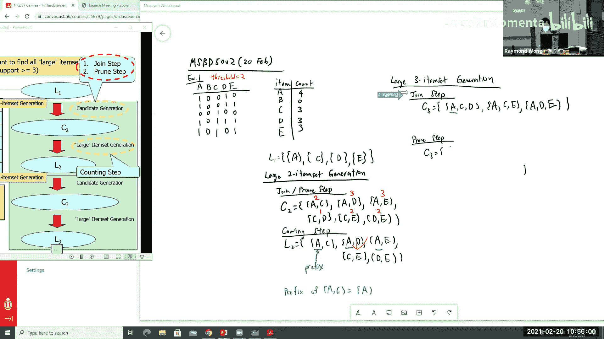

🎼Data mining and noish discovery。🎼Beer my image， no N discoveries。And then now， next。

We will do the prone step。 Okay， the prone step is as follows。 Okay， let first of all。

 you waste something first， you waste everything here。Good， and then。

I want to write down the style of p style。 Actually， p style is very simple here。Let me see。 points。

 The first step is that。We need to eliminate。All the possible。wo item set。Of each candidate。

言 c three。And then the second step is that。We want to check。Whether。Each of them。

Each of the two items set。Is large。Or not。The first step。If。One of them。Is not large。Then， I can。

Re move。で。😊，Candidate。Maybe let me show the that。 And then you understand what I'm talking about。

 Let me illustrate way with AD。This is the candidate， right， ACD。What I want to do is。

Elimerate all the possible two items of each candidate you see in C to you。 Let me do it。

Let me do it 1，2，3。 Actually， we have three possible can two items set。 Let me do it。 Actually。

 it's very simple。 Some don't find this that very difficult。 AD。

 since I told you that this is sorted within this one。 Just think that ignore the last item。

 Now we can remove the D。 So we think that we have A C。And then。I just remove the last item。

 and then remove the second last item。Then we haveAD。 So we have AD。And then similarly， okay。

 I move a cursor to to towards to the left。 I remove move8。 So were C， D。 So were C D。

 very simple to obtain this。So here， according to AD。

 we can eliminate all the possible tool items set， which is A， A D and C， D。

And then check whether each of the two items set is large or not。 Actually。

 I don't need to read the hard disk。 I don't want to read any hard disk here in John step and prun step。

 Just wait here， just wait here。 A C， Yes， we can find it。 We can find it。 Let me use green color。

 We can find it。And then A D， let me see， we can find it。 So this is also a tick。 And then C， D。

 let me see， oh， we could not find it。We could not find it。

All I want to say is that if one of them is not large。

Any super set of this one must not be large based on property， too。

 I repeat if C E D is not large based on property  too， you just learn AD must not be large。

 So I understand that AD will not be put here。 So if we understand AD must not be large。

 So let I emphasize here。 you don't need to write down here。AC c d。I don't put it here。

 I just emphasize that AD could should not be put here。 Similarlyly， we can do for a C， E and A D E。

 Let me do this one one。Some problem。 Let me see。one。2，3， and also 1，2，3。Who want to do that。

 Was up your hand playing。配演。Yes， yes， could you tell me the first one A C E and then this three Okay so for A C E。

 the first one would be A C and then A E and then the third one would be C E Yes correct and then tell me the green color。

 which means whether A is large or not A A is large and then all of them are large all of them are large then since all of them are large will write down A C here let me write down first。

诶。C Y， thank you。 Thank you。 Yeah。 And then the other student who want to tell me A D E Menghua。

诶 the subject is a d a e d yes wait哦 o a d yeah。😊，呃AE yeah。And D， E， yes， and then green color one。

 which means whether this is large or not can tell me all of them are large。啊 yes， ok thank you。 yes。

 so we will write down a D e here。A D E here。 So we understand you。 This is called Prune step。

 Let's go back。 Let's go back here。So John that and that are separated here。

 Canid set for large free items set generation。 John and that discussed on the right hand side。 Now。

 we still read didn't read the hardies or the table。So we go to the next step， counting step。

 very simple， exactly the same thing。Can't think that。餐厅。St。And then we also write down L3。

And then this one， similarly， we need to read the table only very simple A C E。

 What is the red color support， What is the red color support， Who want to tell me Ni Feng。Yes。Yeah。

 tell me， yeah， What is the support of A， E。Is。Its2 or free， free。ACE is呃呃呃啊 two two two two two two。

Is2。 Yes， and then。A DE is a free。あ对いす。A D E three or two在处理 two， two， yes two， two。

 okay and then and then so this two number are also at least two。So。

 so we will put so we will put A C， E and A D E here， right， Yes， put A C， E and also A D E here。

 right， right？ I that true。 Okay， thank you。 You also get the coupon good。Now。

 you understand that we have A C and A D E here。 So we are done here Alre， we are done。Oh。

🎼Data mining and no discovery。🎼Biger mining and no niche discoveries。

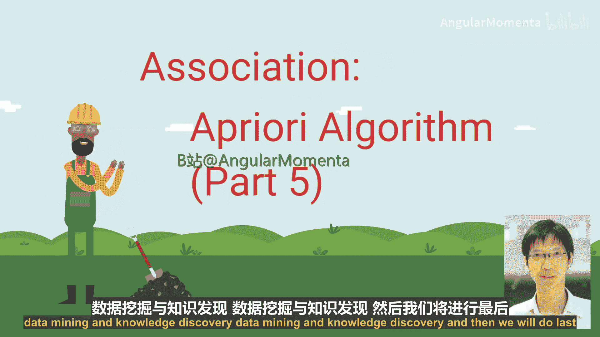

And then we will do large four items that let me write now。Lastge for。Item set generation。

And then what is the step， Similarlyly， as I mentioned。

 we also had the join step and pull step separated。 Let's see the join step first。师傅。

And then what things。 Let's see what we are doing。 similar we have the first arrow。 Okay。

 without reading the table， Just wait at here。Similarly， use the white color things。 Okay。

 let me use the white color things here。A， E， and then we had the blue colors。The blue color arrow。

 Okay， pointing to it， as I mentioned， Okay， the definition of P is very clear for each item set。

We will solve solve all the item in alphabetical order。 If we write AEC， we immediately write A C， E。

 Okay， similarly， we have write this， as I already tell you that for this definition。

 just ignore the last item。 The remaining one is the previous。

 So what I want to tell you is that the previous here is A C。The preface here is AD。😡。

So let's see the white color thingss and the blue color thingss。 since they do not share any p。

 They do not share any proof。 We could not generate anything。 So this is an empty set。

 This is an anti set。 When we reach an empty set。Then we are done。 Okay， we are done。

 which means we terminate the method， terminate the method。 However， for echoing the question。

 since the question is asking us to find all the large items that。 Okay， maybe write on。

 So we need to echo the question so that we know what。 now we want to echo the question。

 The large item that is exactly equal to L1， which is here。And then。This one。

 maybe some students don' don't know it。 Okay， actually， this is the set location set union。 Okay。

 you can do a Google search。Set union and then L2 and then L3。And then just copy and paste L 1。

 L 2 and L 3 here。 Let me do it now。 wait a moment。Just echo the question。 Now， let me copy Now， L 1。

 okay， will be A C and then D and then E， and then L2 A say， okay here and then A C， and then A D。

 and then A E。And then let me say C E and D E okay， C， E。And等啲二。And then lastly， L 3。

 where is say here， A C， E and A D， E。 Okay， let me write on A C， E and A D， E。

In the homework and also examples echo the questions， Some will be given here。

 since you need to echo the question。当 still have question啊冲锋啊中锋 panelo。Li Feng。

 you have no question。 You can have lower down your hand。 if you have no question。李eng。good。 now。

 this is the answer for this in class exercise 1， I will give more complicated example later after you understand this one。

You have no question。 Okay， now let me give more complicated scenario。Now， we understand that。

The count that here， after that， we have every something like that。 and large4 items sex generation。

 the join that is something empty。 Now， let me more define this example are literally so that you understand the process more comprehensive。

A and A D， Okay， now let me write this step out。 Okay， let me write this step out at the end。

 I just want to use some complicated example。 You understand what we are doing。Now。

 suppose that we have L3。And this everyry is eager to suppose you have an example。ABC and then。A B F。

And then， maybe。A， let me see， B， K， and then let me see B F and so on。 we have some items。

 I want to do the joins that maybe write down first。 Now， I want to have the large four。

Item set generation。And then we also have the drawing step。 I want also have a drawing step。

 We also have the drawing step。And then we have C4。师课。And then we want to do the following。

 Let me put it upwards。Similarly， okay， you understand the heavy item are sorted within an item set。

 And then the previous is has been defined clearly。 I just highlight it so that you understand it。

 Now that we are do something with。Similarly， we point it with the white color things and then use the blue arrow。

Here， ABC and A B， F， they share the same papers， right， So we just write down the previous first。

 A B。The same cr。And then the remaining one， C and F will be put here C。And then， F。Here。

 so we understand that this is the four item sell four item sell。Similarly， we process this one。

 process the next one。We also find that ABC and A，K share the same preference。

So we can also write down a B。 and then the remaining one c and K， C and K very simple。

 and then now go next。ABC and BC， F， since they do not share any common papers。

 We do nothing and do it again， again and again for dot dot dot。And then now after we finish it。

Then me finish this run and the red color will be moved next to it。

The white color will be moved next to it， which is here。

 And then the blue color one will be next to it。 Okay， they share the same common p。

 So I think you also understand that we can write on A B。The common papers and F and K。

 So we will write on F and K。 And similarly， the blue color here， they do not share common papers。

 we do nothing。 So we understand the process。 Now you understand the drawings that。 Now。

 let we are also way the p step here。The prunes that maybe maybe see。The puns that， wait a moment。

为什么 I need to e为 something。为什么啊，以为 it。Good， and then now I just just want to do the prunes that we use this one with a moment soon out a little bit。

 yes。Now， prunes that。You you remember that okay， and at the top at the top last three item set generation here we have some candidate。

 And then I say that eliminate all the possible two items set of each candidate in C 3。

And then check whether each of the two items set is large or not。

 And then if one of them is not large， we remove the candidate。 Now， let me change this a little bit。

 Change this。 The meaning is that since we are talking about four items set。Now。

 let we use a blue color to change it。 Suppose that if this change to fold。

Does suppose this change to full。Now， so we understand that this one must be C 4， right， This is C 4。

So this is also C4。And now， the remaining one。To， I can say， actually in this process。

This number is just a number dec by one。 So 3-1 is 2。 So if I change 4， then 4-1 become 3。

 So become 3。 So this will become 3。And also， you understand this process。

 if we want to generate large5 item set generation， this number will become 4。 This number become 5。

 and this number become 4。You understand the process。 Now， go back to the blue color 1。

 large4 item set generation， E all the possible three item sets of each candidate in C 4。

 check whether each of the three item set is large or not。 If one of them is not large。

 we can remove this candidate。 Okay， let's use one example for illustration。

 Let me use the first one to illustrate way。Let me use the first one。

 I want to eliminate all the possible free item set。 Let me do it。 Let me write down。1，2，3，4。

 In fact， if you follow my process， is the way is just ignore the last one。 ignore the second nu。

 ignore the third last and ignore the first one。 And then we can generate a lot of candidates quickly。

Let me first write down this one， who want to tell me these four candidates。

hi hello hello hello i could hear yeah it will be a b c a a b c yeah。ABF。A BF， right。Yeah。BCf。BC F。

 yes。And。嗯。ていいよ。CFACFACFA。I could not repeat again AFC AFC c or A A f okay A okay。

Did you follow my step actually， you don't need to think a lot Yeah， just ignore ignore F， then ABC。

 ignore C， then A B， F， ignore B， and then A F， and then ignore A， then B F。

 you can see it my process， just ignore the last one。 Second last。

 the third last and then until to the top one。 Then it's easy for us to come up with this one。Now。

 we have already done the this process。Elimerate all the possible free item set of each candidate in C4。

 And then now we want to check whether each of the three item set is large or not。 Okay， AB C。

 let me see。 yes， let me put a green color tick， green color tick。😊，And then A， B， F， let me see， O。

 we can find it。 A， B， F， right， and then B， F， O， we can find it。

Suppose that a f could not be find here okay， could not be find this in do do do， okay。Put across。

 Put a across。And then AF is not。 okay。 So we understand that ABC F。

 we have one of these eliminated free items set is not large。 Then we can remove this candidate。

 Okay， maybe write down clearly。This one， L4。ABCF will not be included， not be included。

So you understand the process similar。 I think you can understand ABC， K， A， B，F，K and so on。

 similar process。 Any question for this first。Any question for this。If no， okay。

 let me also wait some question to you。 Okay， wait some question to you。 If you have no question。

 wait a moment。Yeah， you question Zo Zo Zo professor got a question like how many and totally how many times do you need to cur the disk in this example。

How can he speak louder， I could not hear louder louder。

 I could hear something yeah totally how many times do we need to curate the disk in this example or in this example。

In this example， how many times we need to read the hard disk， right。Yes。

 you main example means in class exercise 1， right。Oh yes， yes， in class exercise 1。 Thank you。 Okay。

 let me tell you。 okay， in this example。 Okay， this is the example and then how many times do we need to read the hard disk Okay。

 let me tell you how many times。Here we have a table in order to create this frequency table。

 we need to read the hardest one。 Let we write down what color things。Here。

 we need to read the table one so that we have this frequency table。

And then now this is in the main memory。And then now。

 if we remember that your join step and points set， we don't need to read the hard disk。

 And then now the cutting step， Okay， we need to read the table。 We need to read the table。

 This is our second time。😊，And then now go to here and then join step， Okay， as I mentioned。

 John step， we don't need to read the table。 that， we also don't need to read the table。

 However the cutting step here， we also need to read the table。And then after that， C 4。

 we just read every free okay in the main memory， we don't need to read the table。

 So in this example， which means in class exercise 1。啊。1，2，3。 We need I mean。

 we need to read three times。To read three times here。However。

 if we have large five items set last6 or so on， this will of the we have more times to read the table。

 Yeah， hello yeah。Because the tableid is small or why should。

 Why don't we just save it in the memory。 And we don't have。 Yes， yes， oh the waste month。 Yes， okay。

 yes， yes， if the table is very small。 Of course， everything in the main memory。

 this can be very fast。 However， since we are talking about a general case in general。

 the supermarkets have a lot of transaction have a lot of items。

 This cannot be stored in the main memory。 And this is the reason why we， we。

 we have this process in in general in practice。But if you are very fast。

 the data set is way small then we can put it in the main memory。 Yeah。

 we are talking about the general case， yeah。Thanks， thanks good。

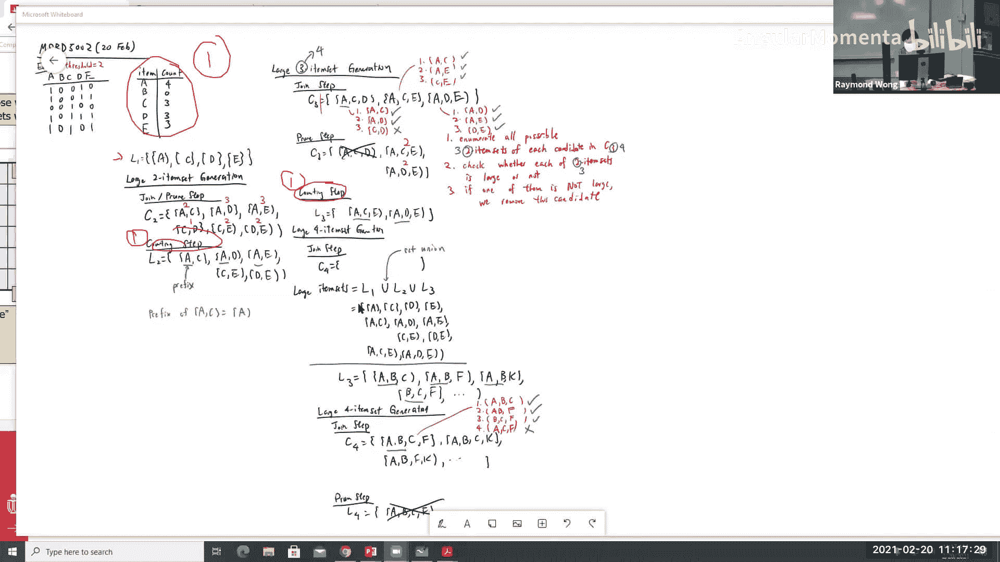

う。🎼The mining and noish discovery。🎼It a mining and no N discoveries。

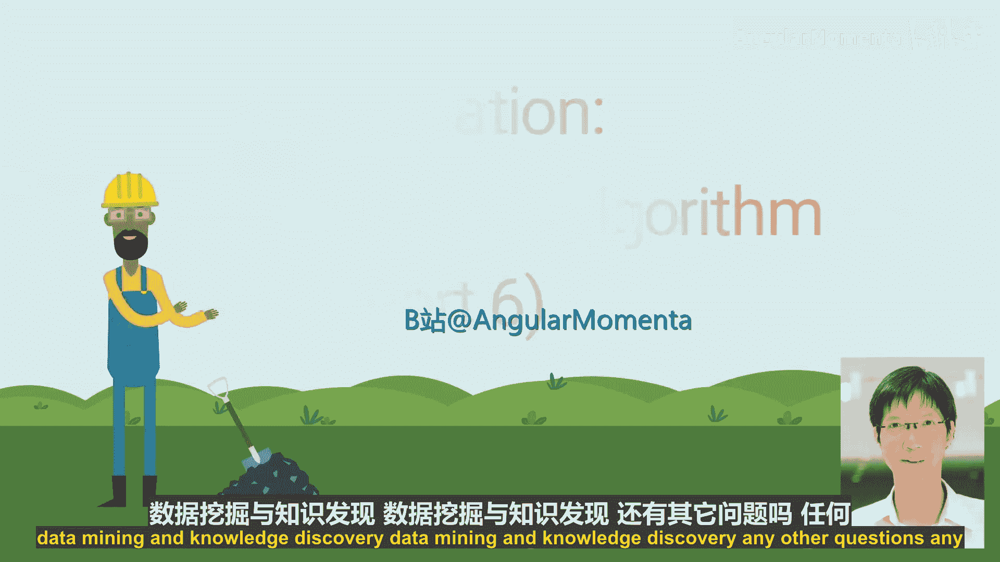

Any other questions？Any other question。Yes theres no question。 Let me raise some question to you。

 According to this one。 Wait a moment。 annotation is raise first。Let's see。 Okay。

 I think you understand my point。Yes， suppose that I generally see three。Here we have AC。

We also have A D， right， If they share some common papers， I will generate AD。 Let me write down。

 This is my method。Wait a moment。 I want to write it down on the right hand side。

Let me use my method。 Let me see。 Oh， yes， you can see。 My method。 actually。

 this is the original offer method， Or researcher method。We want to generate。3。

itm set ok in this example。瞓。wo。2 item 3。Which。Have the same。Pface。I think you understand that I。

 I do it this way。 This is my method。I want to tell you， is there。Maybe some of you。

 maybe some of you。We think that。Your method， okay， student method。To ja。3 items set。

 I just replace my method with this statement from2。Item 3。Which。Sre。One common item。

Let me give you an example。 And then you know what I'm talking about。 Okay， example  one and 2。

Now let's see， example one。Example  one Z Z Y， I will answer you later。 answer you later。

 Maybe finish this one。Suppose that we have A C。And then A D in in L2。Example one。

And then I also have example too。 L2 is eager to， for example， C E。And also， dig。

According to my method， According to my method， example  one。A C and A D。

 they share some common prefers。 They share the same common prefer。 In my method。

 the candidate generation will generate A， C and D in the answer。However， for example， too C E and D。

 they do not share any purpose。 so in my example。We will not generate anything。

 Then we emphasize with our crs。However， the student method。

 we will generate free item set to item2 to item set， we share one common item。

The student method will do this example one again， and also example 2。Let me copy it first。

 A and also A D。A l two is c e and等 d e。For student members。

 see this example 1 can see this example one， this item set and this item set share one common item。

Then student we write an a c d。Which is like what we have seen。Above， however， for this example， C。

 E and D， E， you can see they share one common item call E call E。 name you。

 So the student thought that。We will write on C D E2。Okay， C D E2， okay。

 so what I want to say is that in my method， C3， I will not include this one， but in student method。

 student will be write down C D E。 I just want to highlight this one。 Now， my question is。

 my question is， let me raise my question。My question。The first question。

I just want to guide you first。 This one， you can answer later。 Okay。

 maybe if some student want to answer。Do you think that。This is my question。You finger得。My method。

Yes。Better。Than the student method。If you don't know the oh somebody don' have already know the answer。

 good。啊，清清汉清汉。I think your method is better because if c d because if c d have the support of two or more。

 you will find that on。above because and the c secret include the c DE and the support of c D。

Its is not enough。 So C also is not valid。Yes， yes， yes。 correct。 I understand your point。 Okay。

 and and yes， thank you。 Your， your answer is correct。 Yeah， thank you。 Yes， good。 Yes， you。

 you totally understand these things。Maybe something don't know what he is talking about the reason is that he talk about c d e and then it will create one two item c d and c d could not be fine in L two。

 maybe you also could not follow what I'm talking about anyway let me guide you now。

A dear a professor， this what I want to answer。You want why I want to raise my hand。

D question my hand for for this answer for this okay， okay， you can answer Okay， yeah。

 yeah for your question， if we calculate the time complexity for your method。

 the complexity is n square for comparison， right and for student method it will be the two times the sum of the arithmetic away。

 so it will be two times。It would be n square minus n。 So if n comes to larger。

 the student method will be a slightly better than yours in in the large library。

 Why the time complexity of my method is larger than the student method， yeah。Yeah。

 it's a slightly larger because the because the dominating term is n squared right。

 but the student method is only slightly better than yours because it minus one n one n what do mean one n one n let me show you for example。

 your time complexity is n square right and the student method student method is if you want to count。

It counts the。Ace， for example， in。I would just say， like in the left slide let me put in this way。

 Okay， let me ask some question with you And then to see whether your answer is correct。 Okay。

 let me guide you first。 Now， let me ask question number two， question number two here。

Do you think that now here C 3 is generated by my method。 I didnoted as C  three， C 3。

 I didnoted a C three， I didnot a C 3。And then now we place all everything with the student method。

 And then we obtain C 3 Pi。 I want to ask you， do you think that this。Subcept property is a set not。

 which means that。The set I find in my method must be smaller than or equal to the set find by the student method。

 Do you think that this is true or not。Do you understand my question，子 Z一。Sorry， you know。

 what does mean by the。Yeah， yeah。 Can you repeat again Okay， my repeat again。 Yes。

 my question is that okay， based on my black color things or black color things。 This is C 3， right。

 I just weigh down C3 here， right。Suppose that my methods is change a little bit to the student method only this part。

 And then the student method， of course， will generate some items right here。

Student method also at C3。 I say C3 prime。 And now I want to compare this two set。

 Do you think that we have this an equation relation。Yeah， and I think yes， yes， yes， yes。 Okay， yes。

 Thank you are。 okay， well， I I want to guide to first。 now see free。

Must be equal or smaller than C3 prime。 So you understand that the student method have more candidates。

In the状 right。More candidates in the Jones step， correct。Yes。Correct， okay。

 let me get you the the next question， question number 3。

Although the student method have more candidates， do you agree that。C3 is here。

 And then I use the black color frames ofing L 3。 I alter L 3。

And then the student method also do something and then do something。 And then we have also L3。

 I call this L3 pi。Do you think that this is equal L3 or thing from my method is equal to the set of T by the student method。

 Do you think that this is correct， Yes， yes， now， let me ask you。

 now the candidate set Consider by my method is smaller than the candidate set Consider by the student method。

 right。So in the pruning set and the counseling step， the student method need to do more operations。

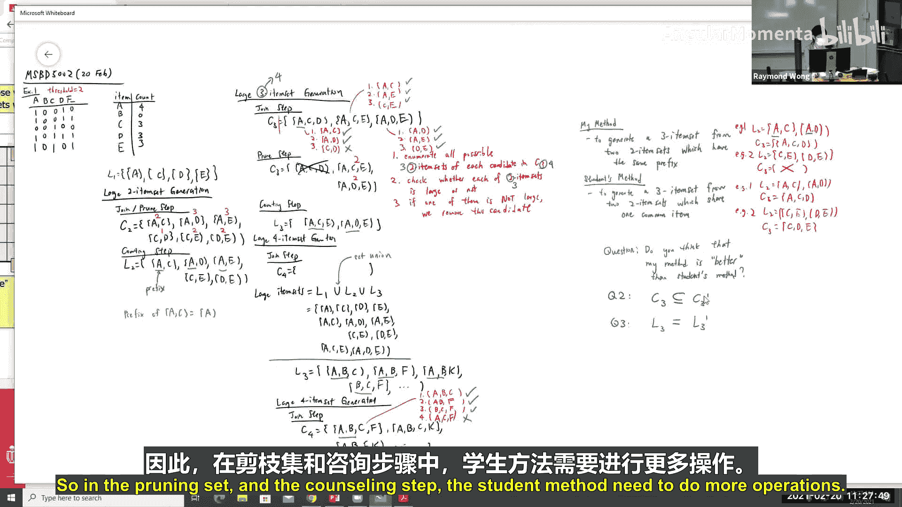

Yeah， yeah。 in the yes。 And then the of all all those things X one must be removed at the end， right。

 And then such that my method and the method must be the same。 The answer， right， Yes。

 so let me say my claim is that our method is better than the student method。Oh。

🎼Da mining and noish discovery。🎼Eer mining and no N discoveries。

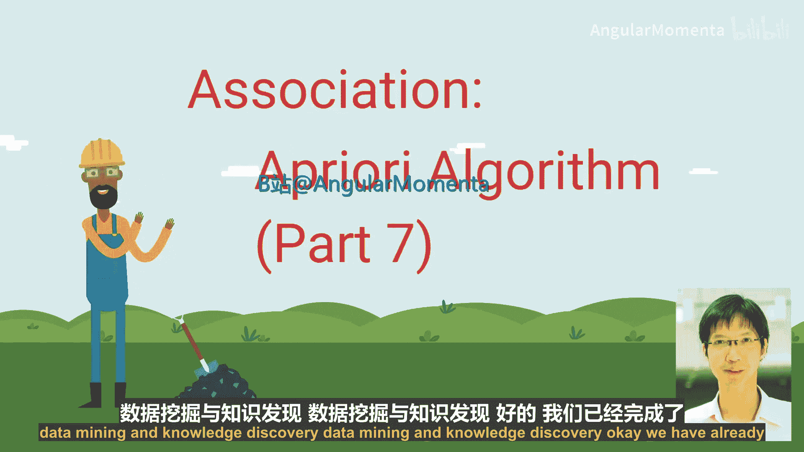

Okay， we have already finish all the in class exercise 1 and also make a complicated example here。

 and also student method and my method。 And then you understand the major idea behind。 Now， go back。

 go back。

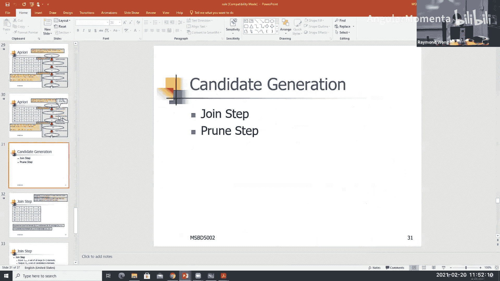

Let me go back here。 Let me give the formal some John that and that Let's go to the John and that。

 Okay， written in our natural notes。 Okay， the John is as follows。

 actually is what I'm talking about in the income is sign1。 We have the property1。

 If an item set S is large， then any subset of S must be large。 property2。

 If an item set is not large than any proper super set of S must not be large。Suppose that， okay。

 in L2。We know that B c and B， e are already large。And then as we mentioned， B is the pre。

 B is the pre， I guess， I guess。Is it possible。 Okay。

 its possible that the previous and the remaining C and E may also be large。 I guess this is true。

 Okay， I guess this is true。 So this will be in my candidate set。 Okay， actually。

 the concept is something like that。This is the sickco statement。The sickco statement。

About the previous and so on。 You don't need to understand it。

 if you don't understand this statement。 If you understand the green color pre， you are okay。

 In fact， what I want to tell you is that this is correspond to previous。They didn't write down。

 And then this correspond to the remaining one。 If you don't understand this， it doesn't matter。

 If you understand my illustration in the in class is size 1， it should be okay。Now， go next。

As I mentioned， is it possible， it's possible that I sorry。

Its possible that item set PC C is also launched。 And also Jia Wei ask。

 why do we need to do the princes since currently I now in the main memory。 I know that。 Okay。

 suppose that I know that C E。A subset of B is not large。 didnn't touch the hard disk。 immediately。

 we can remove B C in the candidate cell can have a smaller candidate set。Here we have the pseudo。

 This pseudo is simple。 Let me illustrate it。For each item set C， for example。

 in the candidate set C 3 or from the Z step。 we will do the following。

 Remember that I say that this-1 become2 for each two item set of this candidate if this S is not find in this L 2 is not large enough。

 One of them is not large enough。 Then we will delete this candidate from the candidate set。

 This is what I just mentioned about this in the white color things on the whiteboard。康汀油。

For cutting set， for example， just a with the table。After the candidate generation。

 the John sets that we are given a set of candidate item set。

 We need to verify whether this candidate item set are large or not。

 We have to scan the database to obtain the support of kind of each item set in the candidate set。

 The alpha is very simple for each item set C in the candidate set。

For the table or hard disk or think the support of C。

 And if the support of C is more than a given value。

 then we will remove this from the candidate set the remaining one correspond to okay。

 this has been discussed with me before and also in class is very simple。

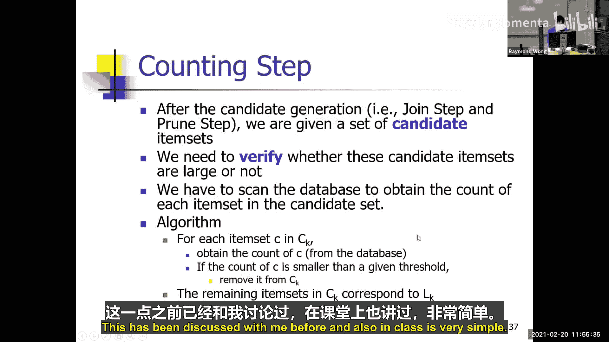

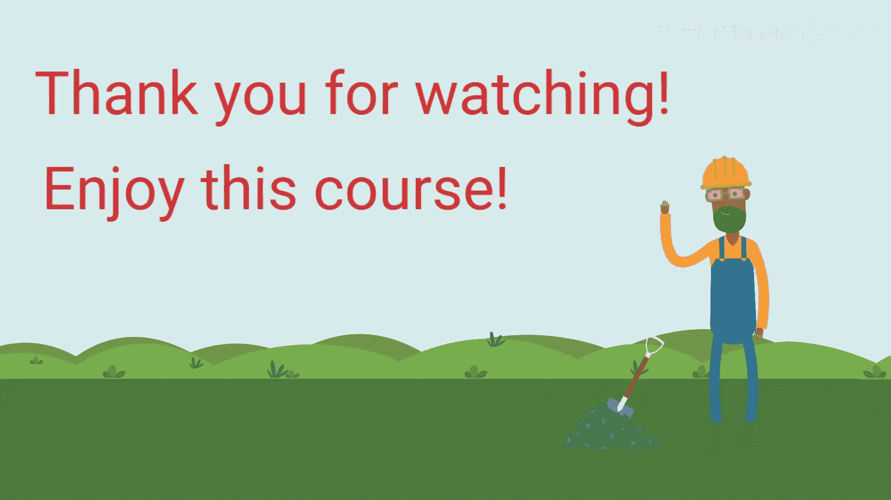