# 【香港科技大学】数据挖掘与知识发现-｜-Data-Mining-and-Knowledge-Discovery-p05-04-04-02-1._FP树_第一部分--BV1gEFDzVEU3_p5-

嗯。🎼Data mining and low discovery。🎼E the mining and noish discoveries。

We know that large item set mining， exactly the same term， frequent item set mining。For example。

 we have this table， transaction 1，2，3，4，5。 This is transaction I D and transaction  one。We have ABC。

 D， E， F，G，H items bought by this customer。And the problem here is to find all large or frequent items that we support at least a given number。

 for example， we support at least three。Now， let me put this disadvantages to you first。

Here is the RPO approach learned today。 Okay， we know that candidate generation Jia Wei also mentioned that we had a joint step and step。

 right， And then also we had the cutting step。 In fact。

 there's some disadvantage here and also disadvantage here。 Actually。

 the Jo Wei question related to this one。😊，Disadvantage one for this RP approach。

It's very expensive to handle a large number of candidate sets。😡。

We want to candidate that as small as possible。Even though we reduce the number of candidates are there。

 but the number of candidate set here is also very large。

 It's very expensive to handle many candidates。 This is one disadvantage in this ROV approach。

The second disadvantage is that。It's tedious to repeatedly scan the database once again and once again and check whether they are large or not。

 So we understand that we need to read a lot of things about this， which is very slow。

 So here we know that theres some two disadvantages of this prior approach in the following。 Okay。

 I want to say that F P tree。Do not have this disadvantages。

This FP tree just scanned the hard disk once。To store all the importing information in your data structure call F。

 P3， frequent pattern。And this FP3 is very concise。

And it' used in directly generating all the large items set。So you can see that F 3。

 if we have something concise， very complex， then we can generate items set very efficiently。

 What I want to say that F3 is faster than the approach。 Okay， let's see this。 Okay， Well step 1，2。

34。 I will not go， not go through with you Now， Okay， let me go for step 1 first。😊。

We deduce the ordered frequent items。For items with the same frequency。

 the order is given by the alphabetical order。 step 2，3，4， we will discuss later。 step 1。

Here is our problem。 We want to find large item set or frequent item set。

 We support at least a different value。 Here is the table。Then put it here。

 and then we create one more column call ordered frequent items。Some seller in the past。

 also forget this word ordered。 just write down frequent item， which is insufficient。 Okay。

 remember that we have ordered。 I will explain what I mean by order later。Next， the first one here。

 Okay， in this example is equal to three。Similar to the RP approach。We also create a frequency table。

 likex。And then just do the count A A， A， A4， and then let me see B， B， okay， and then B4。

 and then similar， you can do it by itself。 Okay， we have this one and also similar to the RP approach。

 We had the first so equal to 3， right， and then just pick all the item with support or frequency。

 at least three。辟辟辟。And then pick O。 So we have A， B， D， E， F，G， with support at least free。

And these are the frequent items。 Now， let me define what I mean by order。Order means that， okay。

 we need to sort all these frequent items in descending order。

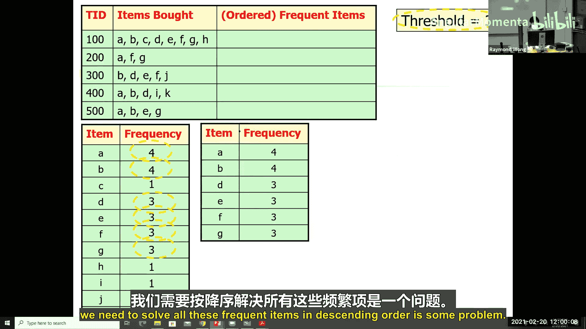

Some problem。 let me we open it。 okay， let me reopen open it。

 okay for this powerpoint we open it the powerpoint is some problem。 Let me reopen it。

And we will open it so that I can use some annotation。Let we go back here。Okay。

 we want to do sort it in descending order of the frequency， the descending order。 Now here，4，4，3，3。

3，3， All of them are now in descending order。

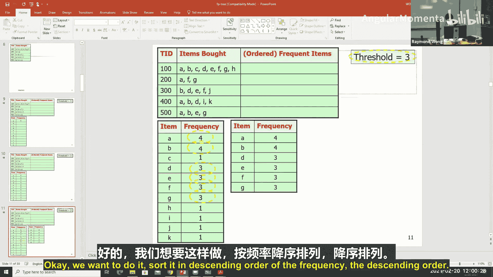

If they have the same frequency， alphabetical order， alphabetical order， same frequency。

 alphabetical order。 So accidentally， this are ordering is A B， D E， F G。 Okay， no。

 let me change the example a little bit so that you know what I mean by all the frequent icon。

 Let me change this example a little bit。

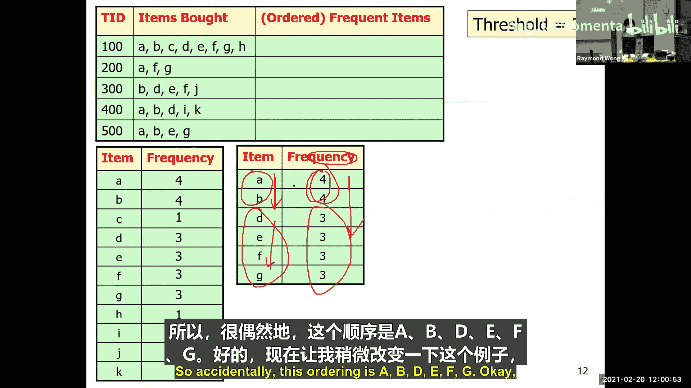

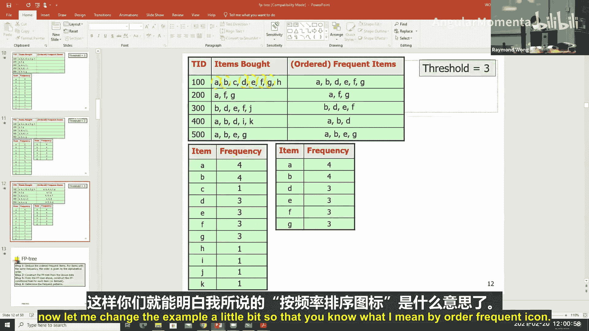

Let me change it。So that you understand what I'm talking about。Let me change this to， for example，7。

And this one， it， maybe this one is 5。 Let me change this。Now， as I mentioned。

 this is just frequent item。 We need to do the ordering， descending order or the frequency。

 let me see。8，7，5，4， and then 3， and 3。And then this is the order。 and then continue。 Okay。

 let me wipe back the corresponding item。 This is E。 And then this is B and 5， which is F。

 And then 4 will a 3 here。 We have the。And also， dream。Since they had the same frequency。

 we need to sort it in alphabetical order。 So alphabetical order means D and dream。D and three。

 D and three。 So we understand that this is the order of the frequent items。

 Suppose that we have this frequency。 Okay， and then let me write down here， All the frequent items。

 Let me change this example a little bit so that you understand what I'm talking about。Now。

 let's see。Let me process the first transaction， A， B， C， no， no， C is not here。 A D， E。

 F and G are all frequent items。 C are not frequent。 H are not frequent。

 but we need to write down in order。 Okay， let me write down the order， which is we have E。

 So write down E， and also we have B， the write down B， E， B， and then F。And then a。and then啊啲。

And then three。 So we have this all the frequent items right down written down here。 Okay。

 I think it' simple。 I want to ask the we to help me to help me to fill in the four remaining roles。

 who want to do that。小猪。hello hello， yes， louder louder。😊，ok。Yeah， could you tell me this one。

 What is this？ This is F， A F G。So， F a。Yes， A and G， G， yes， and then the next one。

 and this one could be B。F。F。b b f d b f d啊 more okay， you can see that啊 you all b f d。

 do you think that e also should be included。哦， oh yes E， D f d， yes t， okay， thank you。 yeah。

 thank you thank you very much。Then we ask one more student。加加加龙加加龙。卡龙。yes， yes。

 could you tell me the we two remaining one嘅 ok b。啲。

Yeses da day yes how about this oh sorry still have a yeah yes where where should I put。B啊。

In between b and d yes b a d okay  thank you okay  one more here yes this is b。诶 sorry e b a g。E B。

 A G， okay， thank you。 correct。 Thank you。 I think most student here understand the definition of order and also know how to construct the order frequent items。

 The reason why we need to do the ordering will be explained later。 Okay， few slide later。

 But now you understand the process first。 now follow the ordering。We have this one。

 now go back to the original example。 This is go back to the original example。

The original example is that the order is A B， D， E， F G， Okay， so A B， D E， F，G， so we have A B， D。

 FG and then A FG， okay， just A FG and so on。 you can check it by yourself。Now。

 we create one more column called all the frequent items。

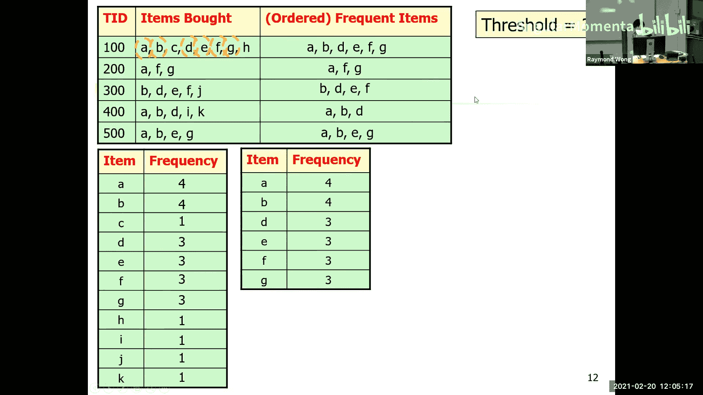

う。🎼Great mining and noish discovery。🎼It a my image no N discoveries。

And then now go to step number two， Con the F P3 from the above data。This is what we obtain。

 This is the column。 And then we want to create this F P tree。 see。 first of all。

 we create this header look table。 Let me write down。 actually， this is called header。no。替补。

And then this ordering is based on what I define the descending order， the frequency。

 If they have the same frequency， alphabetical order。Now， let's see we do one by one。First of all。

 we create a note called root note。No。And then。A pausees the first one And N B， D， E， F K。 Okay。

 now we are here。 we are here。 Which note。 And then under myself， under myself， which is here。

 There's no no。 There's no no。Then relate to a。 So we will create a note A， a is here。

 And this one correspond to the total number of occurrence of a starting from here。

 from root to here。1， and here we have a。 we will create a horizontal linking to here。

Now we move next to you， okay， remember that we are here now。

 we are here now since I just processed here， go to B。Now， I here。 under me， there's no note about B。

 I need to create a note called B1， B1。And also， we have the horizontal Santo link linking here。

Similarly， and here cross the next item， which is deep。Here， no look related to D Okay。

 so we have d one and also we have horizontal horizontal link here。 Similarlyly。

 I think you know that E also doesn E F。And then G， okay。

 I think you can use your imagination to do this A， B， D， F， G。 Okay， very simple。

 Now go next the second transaction。Second one， also， Im original。 I'm here。 now I will start， right。

 I go back to the wood note。 I'm now in the wood note。 I'm here。A now I'm here under me。

 theres a note related to a。 So I will go here。 A related to a。 Okay， here， the number one。

 will will increment by one。 This correspond to the total number of related to a starting from root no to here。

 So here we become2。 to。 And then now I'm here go next F。Under it， under me。 Okay， we have B。

 We have no F note， no note related to F。 So we will create a note F。F1， F1 here。

And then the horizontal link related to F will be at here。 This is related to F。 Okay。

 we need to add this。 The reason why we need to add the horizontal link also will be explained later。

 You just need to follow the step first。 Now we have this horizontal link。 Okay， linking to the F。

 Now I'm here。And then process the next one， next one， G。Next one is three。 Okay。

 we have here also horizontal here。 you understand。 Let me process one more transaction。

Now we are here before I answer your question let me continue here。

 the first transaction we have be I we start here which no。Which note， then under it， we have a。

 right， However， we are processing B。 This not B。 So we will create a notebook called B。B。

And similarly， the horizontal link B， yes， and then idea， similarly， under it。

 there's no look related to D。 So we have D and the horizontal link here。 and then similarly。

 E and then similarly for F。This is the process for the first free trans。 Any question。

If no question， you can go back home。 Okay， to read A， B， D and A B， E， G O， exactly the thing。

 You can read it by yourself。 Okay， read it by。 since there's a lot of animation， you could follow。

Now， after we process all the file transaction， we obtain this are FP trip， frequent pattern tree。

 frequent pattern tree。Any question， if you have no question， let me ask some question with you。Now。

 you understand that。Let me see the what color where I here。 Okay， given this column。

 and then we can construct this one， can construct this F3。Do you think that given this F3。

 can I construct this column。The question is that now we understand that we know this column。

And then we can use my method to create this FP tree。 My question is。

 if we are given this F P E tree， is it possible for us to construct back。This column， yes or no。

Yes or no。 Who want to answer。ho want to answer maybe simple oh yes， I could see Zo。Yes。

 I think we can reconstruct the Yes， we can reconstruct how yeah， sure。I think。Yeah。

 you can stuff on the。Maybe we can start on the rule notes and traverse each path and traverse to the end。

 Yes， and and and then this is no and we will remove minus one for each wait a moment help you to elaborate more。

 Now we find this one。 and then we know that A B D E FG。

 let me write on A B D E FG We know that all these items must have occurrence of one right。

 right Zo right and then Zo just mentioned that after that we need to come by one So this become 0。

 This will become0。 this will become0， this will become one。

 this will become 2 and this will become3。 And then next timeo yeah。The next step， yeah。ho呃。

Do this again， again， again again， right， until everything becomes zero， right。Thank you。 Yes， yes。

 thank you。 You get the coupon。 So we do it again。 Okay， now we know that this one is zero。

 so you can say that actually， you can remove it。😊。

And then we do it again for each also try words or one path towards words to the end。Here is one。

 So we have A B， D。 Okay， we have A BD， and then the count is equal to this number one。Similarly。

 equipment by 1，0 equipment by  one，1 equipment by  one，2。 So this one is 0。 Remove it。 Do it again。

 again， again， again until order not be conceal or removed。

 So you can you can go back home and try to construct back this。

Are this a column by from this FP tree。 So you understand that， actually。

This F P tree is a is can represent this column。This column。Is obtained from the original table。

 which is smaller。 you know that this column is smaller than this one。

 size of this column is smaller than the original table。

 So what we want want to say is that this table， this F3 can represent this one and also more compress than the original table。

 this is the first one I want to highlight。 Now， let me ask the second question。The second question。

The second question， then we do it here。 Then we also use the white color。 Okay， then we count it 1。

2，3，4，5，6，7，8，9，10。 Okay，1112，13，1415，1617181920。Here we have 2 here， right？

20 occurrences of items you know that now here for the F  tree。

 lets ignore the which just let me come 1，2，3，4，5，6，7，8，9，10。11，12，14 and 14，14。I want to ask。

You you think that。This inequalities must be true or not。

20 correspond to the total number of currents。In this column。

14 correspond to the total number of long root notes here。啊 let me see南ang。Y男， hi for that。

can you hear me Yes， we could hear you。 I think this is true。

 Yes elaborate because if the ordered frequent item share the first item for example。

 if they if they share a which means there the a node will plus one and there will be no another a node。

 Yeah， yeah。So， and。Other other items will become will be the node in the graph， so。诶。I mean。

There will be list notes。In the graph then the fruit items。Thank you。 Yes， here。

 you can see that we have a A A and four four times can four times here。 However， a for here。

 which just count once。 So we know that A A A， this4 a has been count only once here。

 So we have each item maybe at most one or multiple items here may count once only。

 So this number must be smaller than or equal to this number。

 So you understand the So we understand that actually， this F 3 is smaller。😊，Thenhan this column。

 I mean， in terms of this number。 And then this column is also smaller than this one in general。

 This F P tree is more concise and more complex than the original database。

 This is what I want to highlight more complex， more concise。 This is what we want to say。

 I think you understand it。 Now， let me ask you other question。Here。

 I think most student here coming from the computer science background。

 even though you are not computer science background， doesn't matter。 Let me define one thing。Here。

 one， let me define height。You don't know what I mean or death。 In fact。

 we can define height or death of a tree for the original 1，2，3，4，5，6。

What I want to say is that the death or the height of this tree is equal to 6。 This is very simple。

 just from the。 No， going， going， going， going up to the lift of this6。 let me come it again。

 So that1，2，3，4，5，6。The longest  one， even though we have 1，2，3，4。 Okay， this is2，2，2，2 shadow。

 go to the longest one to 6。 So we understand that we have the death of height of the three，6。 Now。

 I want to ask a question。Could you use some English meaning。

 What is the free meaning of this number 6 in the original problem。What is the fee Yeso Zhu。

Xozhou unmute unmute yourself unmute yourself cannot okay。

 I think the height equals to the number of items the number of items contained in the frequent items that that has the most。

嗯That has the most items。And it that。 yes， I get your point。 I think you I understand。

 Let me make it a more con at the word。 actually， Okay，6 actually correspond to。The maximum。Number。

Or frequent items。Yeah， in a transaction， right， I think this is what you mean and understand what you。

In a transaction。In a transaction， this is the physical meaning of the height or death of the tree。

 maximum number of frequent items in a transaction。You good。No， I feel you understand all this phone。

 Let ask this question another question。Okay， you understand that。We have defined order， right。

 This is the order。Now I want to ask you， suppose。At the beginning， I reverse all this ordering。

 Re means G F， E。D and then B， A， everything will be reverse one based on this reverse order way。

 And then I obtain another trip。 I obtain another trip。And is it tree number one。

And this is three number  two。 You know that in three number one， we can。

 the total number of Nor no is 14。Here we can also count the number， for example， n。

Do you think that in general or in general， n is greater than 14 or n in general， smaller than 14。

 of course， we have special case in general， which one do you expect。

Let me see you want answer yeah now I think is generally smaller than greater greater than4 Yes， yes。

 why yes， correct why yeah， because you know if you reverse the order the frequency is from smaller to large。

 So when you begin with the least items the G might appear more times than a you。Yes， correct。

 Ne yeah。 thank you。 you are correct。 Thank you。Let's see。 Let me use this for illustration。

 We understand that according to the original ordering A A A A， they are very frequent， right。

 they are very frequent。 And then in the current ordering。

 they are very near to the left hand side or near to the root note。 So since they are very frequent。

 we are near to the root note。 This is more likely that a this4 a will merge together to form one single note。

However， if we reverse the ordering。 So you can see that A A A A will be at the at the backward。

 So it's more likely that A A A A will be at the end。 The more frequent one will be at the end。

 So we this will create more looks at the end。 So in general， and is greater than 14。

 So now you understand the reason why we have this ordering。 We have this ordering。Yes。

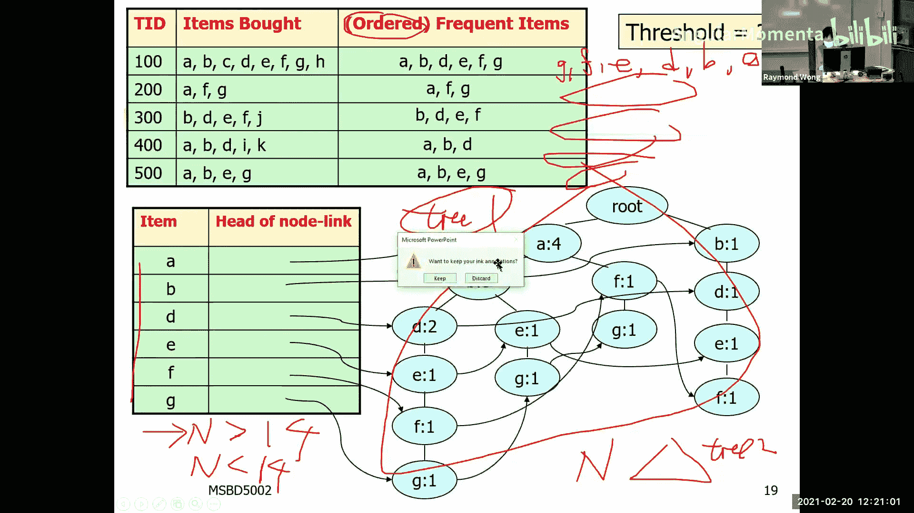

Oh。🎼Da mining and noish discovery。🎼It the mining and no N discoveries。

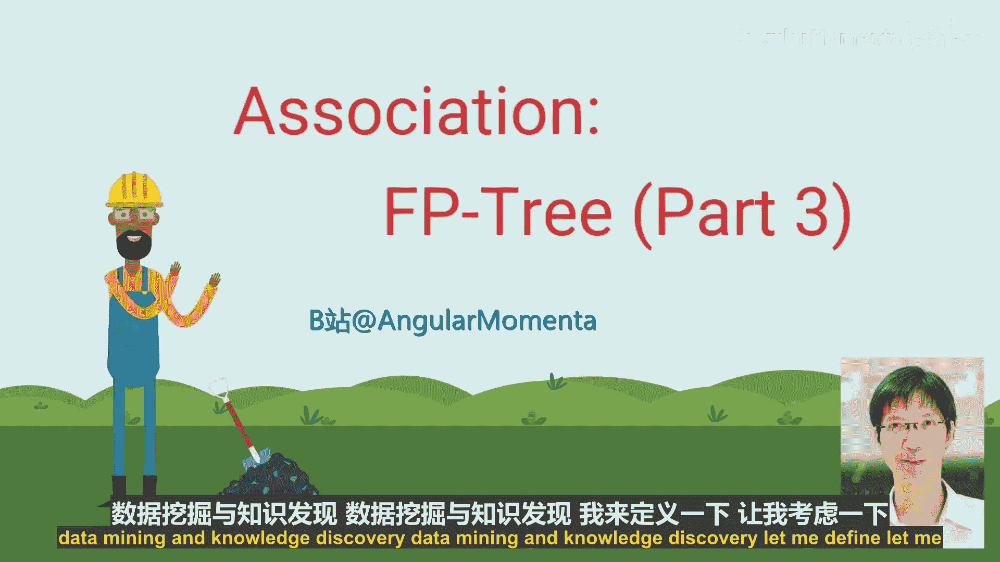

N we do you find？Let me consider this one。 this transaction。 Okay。

 I want to define the cost of inserting this transaction， inserting this transaction。

 Let me define what I mean by cost。The course is exactly okay， like this A and then here。 and then B。

 and then I put it here， right， And then D， I put it here。 And then E， I put it here， right。

 Remember that I'm doing something like this G F is here， and then 3， I will put it here。

 So the cost here is 1，2，3，4，5 and 6。 So the cost here is 6。

So I think the student can also understand that the cost of inserting this transaction。

 What is the course who want to answer。Who want to answer the yes X gao。嗯 for B yes， yes， yes。

 and then let me ask you now you understand it in this is for。

 Can you give a physical meaning for this one。The cost of inserting a transaction is equal to。

Before all an insert B cost one insert understand。 I just want to use language the is this the number of something in a transaction。

What is the physical meaning for this four， okay。Or what is the physical convenient for this one。

Here。Where here here here。 maybe that me wait a moment。

 I I think maybe it's not clear at your side here。The number of something in a transaction， right。

 Yes， number of。Number of B， number of frequent items in a transaction。

 So what I mean is that the cost of inserting a transaction is exactly equal to number of frequent items in a transaction。

 Right， Right， right， number Thank you。 Yes， You also get a coupon。 Thank you。 Good， okay， and then。

So you understand this one。 This will be in our slide later。 Now， let us continue。Now。

 you understand that we have this one。 Last time we haven't talked to you about what I mean by the horizontal。

 maybe let me put in this way。 We haven't touch this part。

We know that the horizontal link will linking all the a， all the B for example B is here。

 or maybe never erasse it so that you can clear。 Okay， since too many color。 Okay。

 let's see here we have a。And all the A will be linked with this horizontal horizontal link。

 and this horizontal link for B。 we link all the B。 and also we link all the D。

 We know that the horizontal link are linking all the notes are indeed。 this we will use today。 Now。

 you will know why we will have this call horizontal link。 Let's continue。 Last time we stop here。

 Let us go further。 Okay。

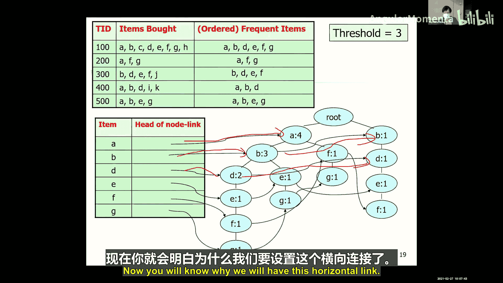

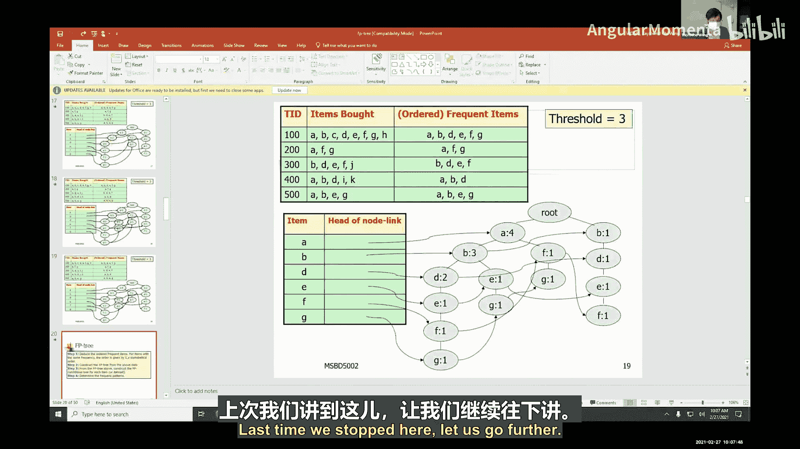

Step three。Stuff free from this FP2。We want to coin the conditional FP3 for each item or item set in our particular example。

 simple example on our slide。We just focus on each item later on the web I will illustrate next。

 I will talk about for each item set。 Now， since this example is very simple。

 So we just construct the conditional F tree for each item only later。

 we discuss a complicated example for each item set。 Now go to step 3。

He is the F P3 we have seen before。 Okay， let's see go upwards。 And then in the following。

 I will construct the conditional F P3 on three。Later， I will construct the conditional F P3 on F。

Conditional F， P3 on E， conditional F P3 on D， conditional F P3 on B， and lastly。

 conditional F P3 on a on this line， let us focus on that this one， conditionitional F P3 on dream。

 okay， conditional F P3 on dream。The process is exactly very simple。 Let's see。 Okay， here。

 as I mentioned， the horizontal link， we haven't finished in the following， we just say。

 focus on three only follow the horizontal link。😊，Going to here。注。And then in our last letter。

 we know that we actually means that co curve with A， B， D， E F， and G。 So we have F， E， D B A。

 this has been answered by a previous student in our previous class。

 and we know that we have this transaction。 and we know that the total number of transaction containing A。

 B， D， E， F， G correspond to this number one， so we can write down A B， D， E。

 F G and the total number of transaction is equal to one。Suppose that。

 let me change the example I to be。 supposeuppose that this number is 2。

 I think student also know that actually， this number is 2。

 We know that we have two transaction containing A， B， D， E， F， entry。 Okay。

 let's go back to the original example。啊。Okay， now we are here。 Follow the horizontal link here。

 right， And then now let me continue the horizontal link from here to here。 So we reach here。

 Similarlyly， we also go upwards E B， A， Similarlyly， we can do A B， E，3。

And then the kind is equal to this number one。 So A B， E three one， we finish。

 and then we are still here。 go next one， horizontal link go to here three and then go up F and a。

 So we have A F three， A F three， the kind is equal to this number one。

 Now the horizontal link have no more。 So we stop here。In the following。

 although I didn't teach you how to do that， let me inspire you。 Let me inspire you。

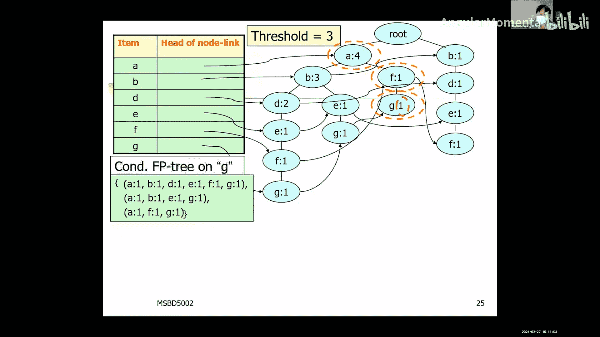

Let's see， do you remember that？啊，你是。Here we have a table。 Okay， we have a table。 We have a table。

 We have some transaction，1，2，3，4，5。 And then remember that we will need to create the frequency table。

And then。We will pick all the frequent items out based on this number。

 And then we need to do the order in here in descending order or the frequency and then alphabetical order in the same frequency。

 And then after we have this order， and then we create this column。

 And then we fill in the blank for this one。 And then based on this。😊。

We will construct this F P31 by one for one transaction for each transaction and and so on。

 We can finish this one。 Now， I want to tell you is that actually， the conditional F P3 on。😊。

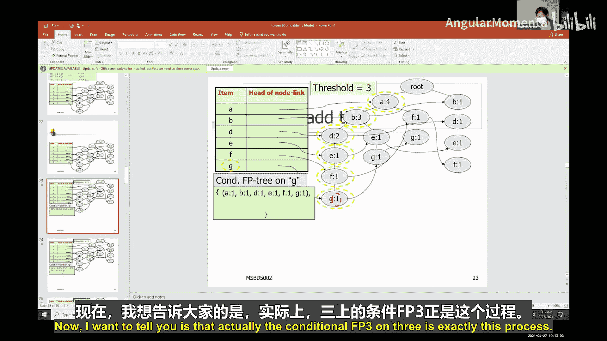

Is exactly this process。 You want to tell me how yes。Yeah。Yes， where are you。카타 거 문화나。hello。Hello。

 you are not waiting here， right。Okay， who want to answer this one，Yes ho ho yes， yes。

 What is the next step。 What is the next step here， Yeah， could you tell me。We have to find。

 we have to filter， find the frequency of each node。

So the next step is that we want to create a frequency table， right， Yeah。

 and then just cant let we are do it now A A A so free， right。

 and then continue can check it at home and then and then and then we refer to out all all the items that doesn't have。

😊，Buttter than 3， Yes， better than or equal to  three。 all the frequent items based on this number。

 So just 3，3， which is this two。 So we have。This one a and three。 So we have this frequent items。

 and then we need to do the sort， right， Then we will do the order， the Yeah。

 we need to do the ordering descending order the frequency since they have the same frequency alphabetical order。

 right， Yeah， okay， thank you。 hold on。 Okay， in this conditional F tree。

 we have one additional step here。Since we have already generated this frequency table。

 And then since we want to know the support of this conditional part 3。 So immediately。

 we can write down this three here， this three here means the support of this three。😊。

and then continue pull in continue  yeah。This is the additional set。

 which cannot be find in step one Sta， and then continue， yeah。And then we'll construct structure3。

 I， We need to create one more column， right。The all frequent item， right， Yeah。

 the all frequent item of each。 So we need to create this column， yes。And then how to do that。

 The first one is A G。 Yes， A， and then the count is one。 The second one is also A G。

 A also the count is one。I love one is also AG。Hold on。

 And this conditional F tree is something a little bit different。 See everything。

 we know that all the transaction here，1，2，3 also call or cap with three。😊。

Conceptly conceptually ignore okay， conceptual just conceptual in fact they appear。

We know that heavy cold or curve with dream。And then based on the remaining item， A A， A。

 and then we can generate the tree， right， How， Yes， yes， and then we will have this one， right。

 on the。 Yes， thank you。 Okay， you get to couponpon ho。😊，So this is the conditional F tree on drill。

 A A A， So A3。And also， in the step1 and statute， they we call all the frequent item But in the paper。

 they mentioned that this is called conditional pattern base of G。

 exactly the same thing with different terminology。 Okay， all the frequent items。

 Any question for this conditional F P3 or construction。😊。

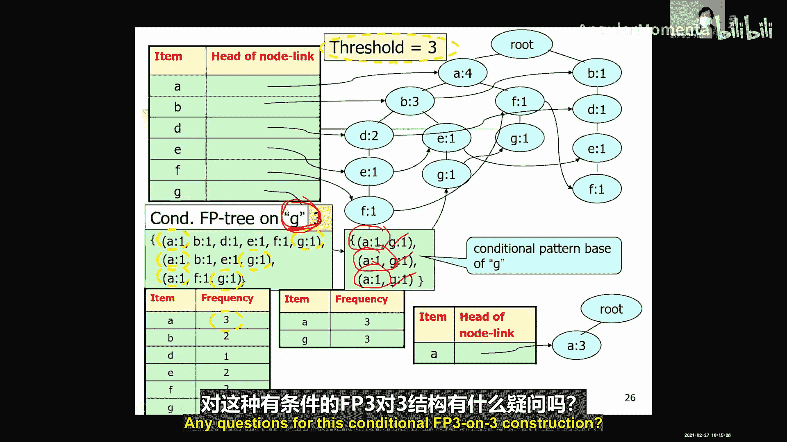

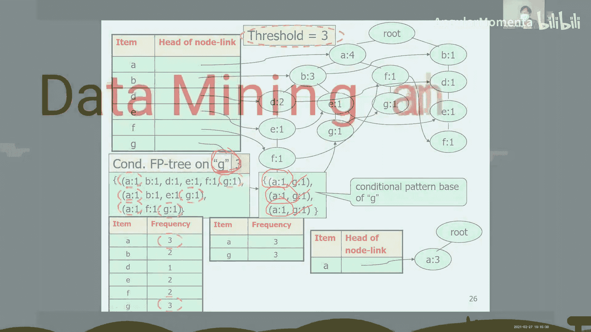

🎼Da mining and noish discovery。🎼It a mining image no N discoveries。

Now， we have already January the conditional F P3 on three。 Then we will move upwards here。

 Conitional F P3 on F， next one。Conditional F3 on F。 now。

 also January the this things and then follow the horizontal link。 follow， follow。

 go to here and go upwards。 We have A B， D F， A， B， D E F， and then the count is equal to one。

 follow the horizontal link going to here。 go upward and also the count is one。 So A F。

 and then the count is one。 follow the horizontal link going to here and go upwards。 So we have B， D。

 E F and then the count is one。 So we have a， sorry we have B， D， E， F 1， B， D E， F 1。 And similarly。

 I think you know the process。I go through very quickly。

 we create the frequency table and then can you a a okay， too。

 And then the remaining number you can fill by yourself and check by yourself and then。😊。

Based on this number， first so three， we just pick this one F frequent item。

 And then since we have this one。 and then just put it in the conditional part three and then create this all the frequent item or conditional pattern base of F。

Then pick O， F， F， F， F， F， F， and then as I mentioned。

 everything must callex with F conceptually ignore F。 So we have this one root。Just a wood not only。

 just a woodn only。Any question up to this moment。If no。

For the remaining one conditional F p three on E。I will not go forth with you。

 I create a lot of animation。 You can read it by yourself。 exactlyly the same， exactly the thing。😊。

So we have this conditional F3 on E and the next conditional F P3 on D。

 you can also read it by yourself at home the methodology are exactly the same。

 If I describe with you will， you will feel very bored can read it by yourself。

 We also have this conditional F3 on D and then conditional F P3 on B can read it by yourself at home。

And this one and conditional F3 on a can also be did by yourself at home。So we have this one。

 So we create a lot of conditional F tree。And step number 4， determine all the frequent items set。

 Let's see what what we are doing。 Now， let me summarize what we have in step number 3。

Conditional F3 on。 This has been discussed before。Which is this one， conditional F3 on F。

 which is also discussed by ourselves here。 And the form remaining1， I， although I didn't discuss it。

 you can read it by ourselves Conditional F3 on E， we have this one conditional F3 on D。

 We have this one。 conditional F3 on B， We have this one and conditional F3 on a， we have this one。

 So we have this all the conditional F3。 Now we will generate the item set as follows。 Okay。

 let's see how to do that。😊，Now， we have this conditional F tree on three。

 we have this number before we draw this this tree， before we draw this three。 Okay。

 let me see before we generate this tree， we can generate3 support free。

 which means I just look at here。3，3，3 support is equal to free。 Just January this one here。😊。

After we January these three， we know that A must call O with G。So we will generate a 3。

 The number here is 3。The number here， after we generate this 3， we generate a3 support is 3。

 I think student are already smart。 If this number is 5 and this number is 4。

 Could you tell me what is the number for this， What is the number of this one。yes啊 catko mua。Yes。

 professorfeor， yes， hi。Yeah， I could hear you yeah。Hello， professorfes， are you able to hear me。

 Yes， I could hear you。 I could hear you。 first What is this number is5，5， yes。This number4。

 thank you。 Yes， correct。 Thank you。 So you understand that actually。

 this is5 and4 just based on this number。 I think students are smart。 Now。

 let's see the next one conditional F T3 on F similarly before we generate this three。

We generate F and three after we generate this trial。 So we have do not have any long wood item。

 So we generate nothing after we generate these three， we generate nothing。Similarly。

 before we generate the three， just focus on this part E3。 okay。

 before we generate E3 after I think you know that E and B together， E and B together。

 the support is three， Similarlyly， before we generate this one， we generate D three， which is here。

 after we generate this three， just B and D together B and the number is three。And also for this one。

 before we generate this three， just a focus here before， before we generate the three。

 we generate before after we generate these three， A B together。 And then the number is 3。😊，A B is3。

 And then before we generate this tree， just focus here。 A 4。 and then we have a 4。

 after we generate this one。 See we have nothing about the root long root note。

 So we do not need to generate anything about the item set。So let me conclude wait a moment。

 Let me go back。 Okay， let me see yes。I just want to you yes， Wait a moment。Now， usually。

 we need to echo the question。 The question is asking us， what are the frequent items that。

 So at the end， we need to write down frequent items that is equal to unequal to this one， this one。

 this one， this one， this one this one， this one， this one and this one and this one and this one at the end so that we can echo the question so that we know that we answer this question。

 Any question to you up to this moment。If no， if。Before I give a complicated example， yes。之后。

can this method can generate more than two items at。More than two items that what to me。 here。

 we have two items that what to me。 I， I mean， free animal， free animal， free animal。Free neighbor。

 what doing mean free neighbors。 I， I mean， free elements of。 Yes， yes， I will talk about next later。

 Yes， yes， I will answer it later。Before I will give a complicated example later。

 let me finish the slide first。 Now you understand it based on this simple example。

We understand we can generate all these frequent items up。 Let me continue first。

 I will give a complicated example later， which include Zha question。Now。

 the complexity of building this FP3 is exactly too scan of the database。

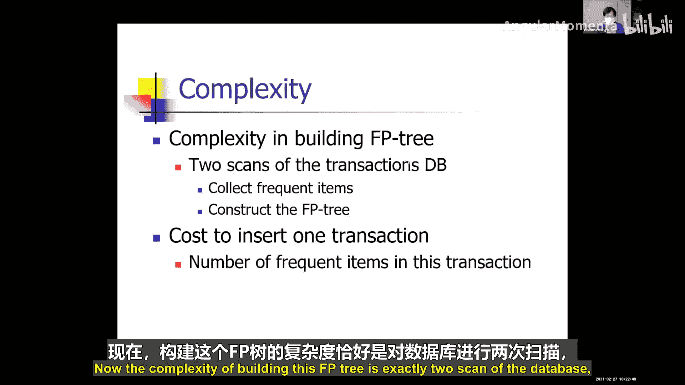

To scan on the database。 If you forget， let me are talking about again。Here we have the table。

 This has been stored in a hard disk， store in the hard disk。 Okay， store in the database。

And then now I need to read the hardies first。 This is my first time to read the hardest on the table so that the frequency table。

 which is stored in the main memory。😊，Has some number。

 So we understand that Now we wait the first time for the table， first time。And then all of that。

We also saw in the main memory， didnn't touch the hardest。And other that。

We have a this of frequent item。 And then since this is in the hard disk， This is in the hard disk。

And then we need to read this table again。 This is my second time to read the table。

 And then for each transaction， I will create something which is smaller than this one。

 which will be stored in the main memory。😊，So you understand that this is my second time to read my heart disk。

 So now this is in the main memory。 and then in the little process， this is in the main memory。

 this can be also stored in the main memory。 and everything in the little process is are in the main memory。

 So let me go back。😊，The two scan or the hardest as I mentioned。

 this related to the frequency table and also the order frequent items， as I mentioned。

 And also at the beginning， I also mentioned the cost of inserting a single transaction is exactly the number of frequent item in this transaction。

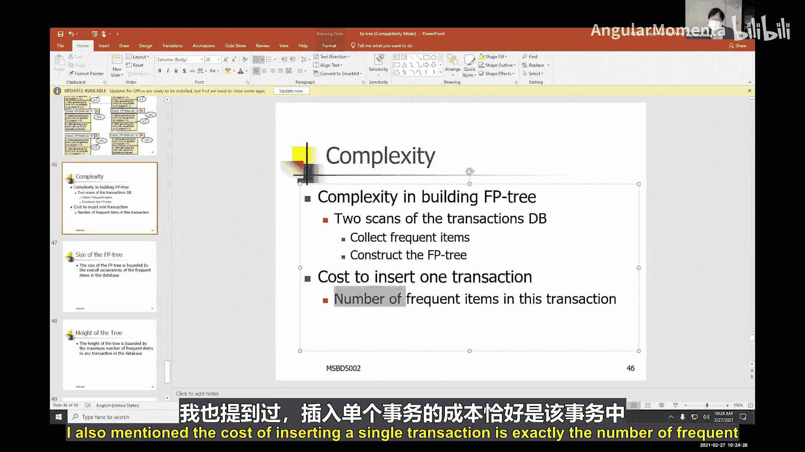

And then next。The size of the F 3， which is what we mean by the number of long wood notes in the F3。

 If you remember that last time I count it as 14。And then maybe we can also write down plus  one。

 which relate to the word note Okay，14 this is mention last time。

 is by the total number of occurrence of the frequent items in the database。

 You you remember that last time we count this as 20。

So we know that 14 must be smaller than or equal to 20。 Okay， this has been discussed last time。

And also， last time we talk about the height of the tree is found by the maximum number of frequent item in a transaction in the database。

 This has also been discussed before。 And then with respect to the total number of item store。

Is F 3 more complex compared with the original database。

 Last time we also mentioned that this size correspond to 14。

 And then the all the frequent item is 20。 And also， we have the additional column。

 This number must be greater than this one。 Maybe let me go to that page so that you understand what I'm talking about here。

😊。

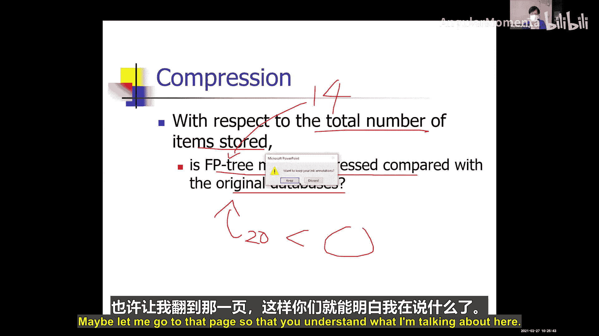

Aait a moment here。Here we have number of long route note here is 14。

 And then here we know that we have 20 number of occurrences。

 We also understand that the original databases here must be more than 20。 The number of current。

 So more than 20， which， for example， this one must be greater than this one，14 is what we mean。

What we with we mean， go back here。So FP3 is more complex compared with the original database。

And then here we have the pseudo code for this algorithm。

 Maybe some students find it difficult to read it。 It doesn't matter。 Now。

 I would illustrate the more complicated example to illustrate the process。

 I don't go through night by night。 I just want to use that example so that you understand the process。

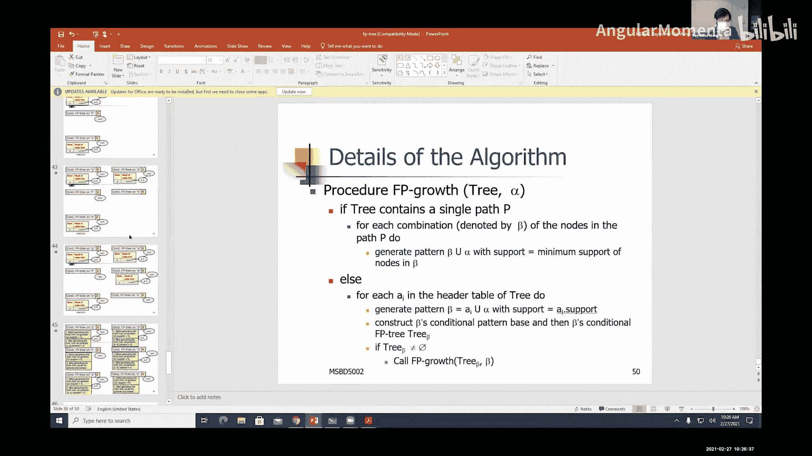

🎼Data mining and noish discovery。🎼Be mining and no N discoveries。

Now， go back here。 This is Z Hao question。O， we understand that wait moment let me use this mode。

On the left hand side， okay， we know that。Before we generate this one。

 we have three3 after we have this one sorry。😊，We have。After we generate these three。

 we have A and G together 3。Now， on the right hand side， on the whiteboard。

I want to use a more complicated example to illustrate the process。 Actually。

 I it more difficult than what you think。Now， let me do it now， using the white。 Now。

 let me change this example a little bit。 I just want to change this example a little bit。

Let me change， change it to a difficult one。Maybe write up conditional。FP3。Also， on drill， on。

And also， the count is equal to3。 Let's see。 Now， I think the example a little bit difficult route。

And an呢 v c。Maybe this time， I use f。MakeMake it larger so that you know at this。This is 12。

And this is 10。And then let me see， a 7。Suppose that we had this one。Item and also head of note link。

Remember that we should have a head the table and there with something like that。Now。

 how can we do that， Let me use red color to tell you what we want to do， step number one。

Similarimilarly before。We generate the tree before we generate the conditional。FP推。ミシーストルンクの。

Before we generate the tree， okay， we generate the conditional part， generate the conditional part。

The conditional plant。The condition of practice term。Then we use blue color is 3。

And then the current is equal to 12。 is a very simple， exactly what we have seen before。

The second step yes， I mentioned。After we generate。The tree， we will generate the combination， right。

 we generate。The item set as follows， the item set。As follows。明明你你咩咩 k啊。As follows。诶。First of all。

Eliary。All items。Sead。瞓。All items。In the tree。Let me sing out a little bit。We delivery all the items。

From all item in the tree。 Okay， I will talk about maybe let me write down more clearly。

 all possible。All possible items set in a tri。And then B， okay， I will， I will say and then。

Aend or add。The conditional part。To each possible item set。We just listed。

Let me do it now with blue color。 No， let me do it now。Consider this one。 We have F and A。Now。

 we want to eliminate everything。Let me see。 I want to eliminate size 1 item set。 Okay。

 we have F and a here， right， So I just eliminate。 Let me see F。And then， a。Right， this size 1。

And then size2， which means that the size  two items set， including F and a together。

 then we write on A F。And then I think the smart student also know that the support of this F。 Okay。

 let me see the support of this F is exactly this number， right， So let me write down 10。

And then this a， the support of a is equal to this 1，7， right， I think you know that。And also。

 I think the soon also know that A F together。We have 10 and 7。 of course， this one should be used。

 Okay， since a is here， right， So a is here。 So this one is 7。 Okay。

 we know that we have some support like this。 However， we need to go further for a step 2 B。

 Append the conditional part for each item set， which is 3。 Let me use green color。 So we have3，3，3。

😊，So we understand that according to this tree。 Okay， before we generate the tree。

 we have this conditional part。 this one， after we generate the tree， we will have size1， size 2 F G。

 A G and A F G at this answer。 So we will generate the frequent item set like this。

 I think you understand the process。 Let me modify this example to more complicated1。

 I think students could guess this for the next one。 let me see。Conditional。F p推。Still on dream。

And also using 12 as this a support。 And then that we also use a more complicated example。

 the wood note。And then let's see。 this time， I have F。We have a also the same。

 and then let's see soon out a little bit。And then this time， I want to add one more B 5。

So we have F A B。 I think students are smart enough。 and then you can guess the meaning， even though。

I didn't talk about it。Head of the notebook link。This is a more complicated example。

 And then we still go on step  one。With a moment。 we still go on step 1 and also step 2。

Who want to help me to do it for the green blue color one for one and two for this one。啊星月。星 you， ok。

Yeah。呃 step step one g。G yes， and then the account yes。2， yes， how about 2，2， We have2， a。

 Could you go for a first， We need to generate size  one， right？ one， Yes， Yes， what， what。

 what are they F。F yes。And continue A yes， A and then continue。And then B。

 what is the support for this one， Could you tell me。An F is 10。10， yes， and then7，5，7，5。

 And then we also need to generate size，2， right？ Yes， Yes， could you tell me have thing F A。

 F A and then F， B。And then F P， And then an A B， A B， And then could you tell me the support Also。

 first one is 7。first one is seven， yes。7，5，5。5，5。 And then we also need to generate size 3， right。

 Yes， F A B。FA B， and then the support is fine。Fine， and then and then we go to step 2 B， right。

 and as G。G， have inside， right， yes。Thank you。 You'll get the coupon。 So you understand the process。

 So we understand that finally， we have this one。 we can have G 12， size 1， size 2 and size 3， so on。

 So we have this one as the frequent item set at the end。So we understand you。Now， let me give more。

 I think you understand， even though we have 4，1，2，3，4，4 looks under， I think you can also know it。

 Now， let me give more complicated example now。Now， let me tell you。On the left hand side。

 this is our natural example。 this natural example。

 we have one note under I can say that I have one path。 Let me say that Let me use。This one。

 I can say that。This tree have a single puff。Have a single puff here。Here on this con this tree。

 this tree also on the whiteboard， I can also say that。This three have a single puff， a single puff。

And similarly， for this tweet， we also have a for starting from go out downward， one child。

 one child one child， one child until the end， we also have a。Single path。 have a single path。

 We only have a single path。 So what I want to say here is that whenever we see a conditional F tree on something。

 if we have a single path like this single path like this。

 we can use the white color procedure to generate this one and also this one。

 this tree also contain a single path， So we can generate step  one， step 2， like this。

 this is very simple。And also， this one， we have a single path。 We can generate something。😊。

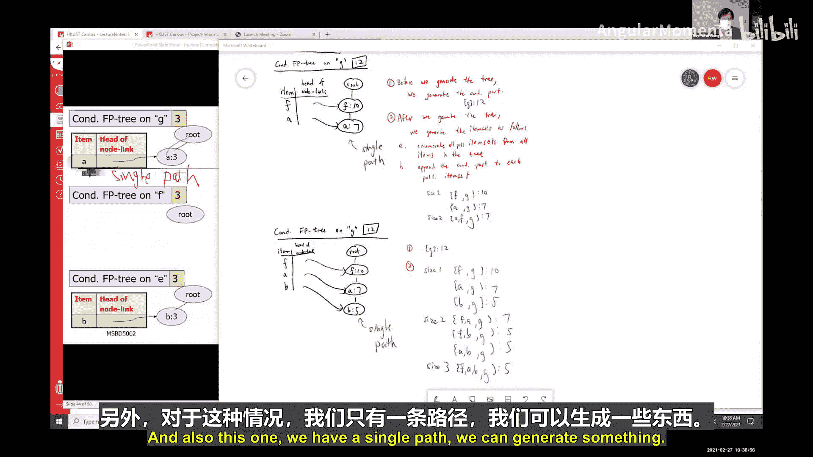

Oh。🎼Greater mining and noish discovery。🎼It mining and no N discoveries。

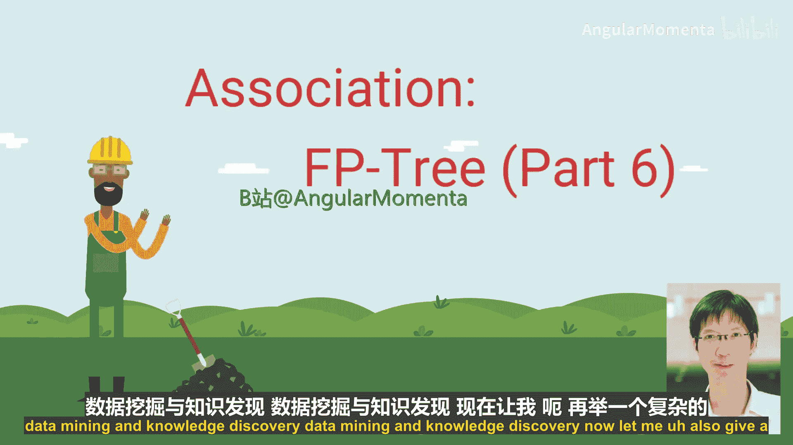

Now， let me also give a complicated example。 Now， I want to change this example a little bit so that you know。

 actually， this is a little bit not simple。Conditional FP three on。3， similarly， I also use 12。

 Wait a moment， I want to adjust it。为咗 moment乜。And then。Now， let's see。

 I'm little bit more complicated。 Let's see。 This is F A B。And then we have F。 we have a。

 and then we have。B， let me use1 also ten7 and five。Maybe we have。This one maybe B，2。

Maybe we also have a。 and then we also have， let me see。B one， okay。

 maybe we have something like this。嗯。S c。Maybe we have something like this。

F a b b and a let me啊 draw the horizontal link let me draw the horizontal link。

Let me draw the for to link。This is the conditional F3 on。 Supp we have this complicated example。

With this example。But let me tell you， Okay， maybe let me fill in first item and the head of no link。

 head of no link。Now with this one， let me tell you how to do this。 Now， let me tell you。

 this is the conditional F P tree。 I could tell you that this tree doesn't contain a single path。

 doesn't contain a single path。We will do something later。 We will do something later。

 but I didn't teach you now。 But up to this moment， a smart student may know how to do that。

We know how to do that。 even though you haven't learned this F P3 before。We inspire you again。那是。

Wait a moment。 I feel after I inspire you know what I'm talking about。Now， let's see。

At the beginning。Wait a moment。 I go学校。At the beginning， based on this all the frequent item。

 we can construct this FP  tree， right， right， we this FP tree。

 I could tell you that this tree looks very complicated， very complicated。

 it doesn't contain a single path。 It doesn't contain a single path。

 So what I want to do next is that I want to do the conditional on3 on F on E on D on B and on a。

 such that you can see that conditional F P tree on three。 After that。

 let's see the tree become smaller。😊，Become smaller。

 And then it's more likely that this tree contain a single path。 If this contain a single path。

 I can use the red color procedure on the whiteboard to generate a frequent items。

This is the major idea of F 3。So you understand my tone。 Now。

 the conditional F3 on three currently doesn't contain a single path。

 It look very difficult to generate all the frequent items set we could not use the white color one。

 So the next step is that who want to tell me， just give a major ideas。

Lets see远行 you can open your camera。Could you hear me。Yeah we just on your web。

 could you take on your web。Okay， we just， we just generate conditional F tree from B and A B yeah and and A and the F。

Thank you。 Yeah。 thank you。 Yes， correct。 So I think our our student can capture the idea。😊。

Let me do it now。 Let me do it now。 Wait a moment。 I want to erase something first。Now。

 the student know that actually， this look very complicated。

 This doesn't contain a single path in the following。We will generate。The conditional F P3。降心颖。on心。

And the student have already answer that。 We will conditional on。B， right， on B， which is this one。

 Let me use some annotation here。诶 on。B， so this is B。 Remember that this tree。

 everything coexist with three。 So in this part， I didn't teach now this new part。

 This three will be forward to here， which means that I will keep this tree here。 Let me write down。

😊，Actually， the three will also be tipped here。 Originally， we have three。 We also put three here。

 and then the new part B will be generated。 Similarly。

 the student also answer that we need to generate the conditional F P3 on a。 Let me write down first。

Conditional FP3。let me see3 will be put here first。And then the new component。

 the new component is a。 we have a。And similarly， we also do this for this one。Conditional。FP3。

On three something also the new component of the component is f。そう いう アンデスタイー に。

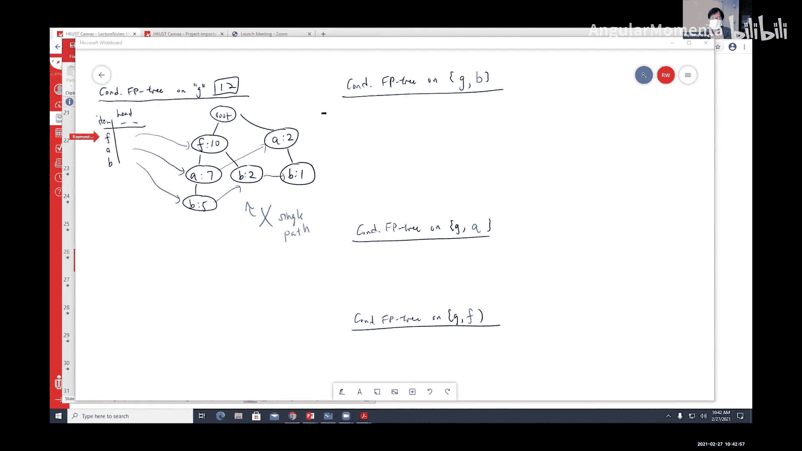

Oh。🎼A mining and noish discovery。🎼E mining and no N discoveries。

Now， let me illustrate the conditional F3 on G B again。 Let me do one by one。 Okay。

 now this is the tree。 we have actually some step to generate， like what we have seen。

 Let me make make it clear to you。 Firstly， since we know that this speed。

Is new things just be Then we use we color step number one。In fact。

 we know you know that step number one， just follow the horizontal tool。Flows horizontal link。

 we go here。 now this be alright， B A F， So we write on F A B， let me write down。啊F a b。

And then the current is eager to this lumber， right， So this lumber is  5。Its five。

And then follow the horizontal horizontal link going to here。 We know that B， F B， So we write down。

F。B， and then the kind is equal to this number， right， This number is 2。 So this number is 2。

And then the next one who want to tell me， who want to tell me， waste up your hand if you want， Ya。

Yes， yes。The next one is A B， which board is first one。And yes， thank you。 Yes， A B。 The kind is one。

 And this is the first part。 And then we that we know that this step number one， the transaction。

 And then the second step is to create the frequency C table。 So we had the frequency table。

 And then the frequency table。 just write down all these things。 for example。

 just random we have an have ordering first。😊，Item and then frequency。 Just count it。 let's see F。

 the frequency could help student don't help me to fill in here。 Who want to tell me。一啊湾子。Gao Wangqi。

 yeah， can you hear me， I could hear you， Yes， could you tell me what is the support of F， Yeah。

 F is 7， Yes，5 plus 2，7。 Yes， continue A is 6，5 plus 1， Yes，6， correct。 and the next B is 8。Yeah。

5 plus 2 plus one。 So which is it。 Thank you。 Yes， you get the coupon。 Now go further。 Now we。

 we remember， okay， suppose that didn already down here， suppose。The first hold。

The support vessel is equal to free， suppose。Now， have here。

 the number are greater than or equal to 3。 So step number 3。😊，Just pick all the frequent items out。

 Now， the frequent items are7，6，8 Oh heavy out。And then， remember that。

We want to do the sorting step number 4。We want to do the sorting based on the descending order or the frequency。

 If they are the same frequency， Albetical order， Let me see X 7，6。 Let me write down here。

 So this is。8， and then 7，6。 So we have this ordering and then make the number B， F， and then 8。

So the ordering is B F A。 This is very clear。 As I mentioned， since this is conditional FP3。

 we need to go to here to write down the support of this one。Which is this B。 Let's go to here。

 So this number， let me write down 5 step number 5， which is here。 and then put the blue color box。

 which is here。 In fact， this number is exactly this number 8。 Let me write down 8。 the number 8。

 The number 8 means the support of G B， The support of G E B。 Now we finish step 5， go to step 6。

 generate all the frequent item。Which is here。 Oh， we will generate based on this。

 the ordered frequent items who want to tell me this transaction。

 raise up your hand if you want step number 6。呃，卡 call了。Yeah。Yes， I could hear you。 Yeah。

 could you tell me the first transaction how to do that， yeah。First transaction。 yes， yes。

 What is that that yeah。Yes。First transaction。Is。Will take。Route F no， no。 this one。

 It just can we F A B， A B， F or what else here here here that one that is B， F A。Yes， B FA。

 And then the can is。The support of this one， the support of B FA years5，5 Yes， continueue。

 continueue yeah， the next one， B， F。B， F， yes， and then support。Do， two， and then continue B app。

And then A， wait a moment。 And then the count is one， right。Yes， purpose。 And then I wait a moment。

 since this is the conditional F tree。 We know the healthy thing co exists with B。So conceptually。

 just conceptually。ignre be conceptually ignore beer。And then now we can create the tree， right。

 The tree is， could you tell me。Root。诶。一。😊，What is the number here。 Yeah， could you tell me。

Number is 7。 numberumber is 7。 Yes， and then continue。え。What what what， what， what do mean a， yeah。

 Where is under right？ Yes or a， and then the number is。The number对 the number next to a is。The5，6，5。

5，5， five5 five and more。From again， F。Here， right， we need to yeah， Yeah。 And then this is a， right。

 And then1 years。1， one， thank you。 You get a coupon point。now。

 we understand that according to this tree B， we create this one， right， F A and then A。

 let me tell you， actually， this tree。By definition in that paper is also doesn't contain a single puff。

 single puff mean only one path。 doesn't contain a single path。

 wait a moment doesn't contain a single path。 doesn't contain a single path。

See this doesn contain a single part， we will do something later before I do something later。

 I don't talk about it first。 what I want to say is that we also need to for G A and the conditional F on G A and G F let me do one more very quickly I do very quickly with you so that you know the process。

 we will continue this part later。 let me G A G A means here G E A okay。

 let me do very quickly I do very quickly。Step one and then a。

 and maybe let me also use some annotation so that you can follow easily A， I go to here。

 and then this is F and then a and then 7 and then a， I go to here。 And then 2。

 And then step number two， just a frequency table。 So we have the frequency table like this F a。

 and then item and frequency。 I don't write down。 okay。

 and then this is9 and this is 7 and then3 and then 4。 let me see。

 And then everything are also greater than3。 or equal to3。 And then we put it here。

 And then based on this， we need to sort it。Deing order have this one， A and F。 And finally。

 we go to step number 5。 step number 5 is here， and then we will have this number。

 this number come from this one，9， and then we have this 6 step number 6。

 and then we just pick all the frequent items in this ordering。 So we have this one F A and then 7。

 and then sorry， A F A F。A F， and then we have two。 And then finally。Based on this。

 we know that heavy think code exists with a conceptually ignore a。 So finally。

 we will have this root note and then F 7。😊，Something like this。Item and head of note link here。

 I didn't write item and head of note link。So with this one， I could tell you that this one。

 this three contain a single path， contain a single path。We could do something。And then for G， F。

 I will not go full with you。 Okay， I want to say that we can also do something。

 and then we have some tree we have some three。 Okay， similarly， okay。

 now I have already generated conditional F3 on G B， conditional F3 on G A let me do this first。

According to what we learn at this moment， before we generate the tree。 Okay。

 we know that we have this G E A 9。Let me write down something。 let me see。

 Let me use what maybe let me use。Breen colour。 green colour。Green color。 Okay， and then this 1。

 I can generate。😊，G A and then night。This is the frequent item I can generate at the end。

 I want to tell you that before I can generate this 3，8，9 at the end。Here。

 since these three content are single parties is easy for us so we can generate based on the red color procedure on the left hand side。

 let me soon out。😊，Based on the white color procedure we discussed before。

 we can generate all the frequent items。 So here I can generate。G A F， let me write down。 Actually。

 we can January。G， A F and the account is 7。 So what I want to say is that based on this one。

 we can generate this one and this one。 this two frequent iPhone set。For this one is similar。

 I don't go through you。 understand since this very simple。 So we know how to do that for this one。

3 B8。As I mentioned， before we generate this one， before we generate this one。

 before we know that we have this one。 So， of course。

 we can also write down the corresponding frequent item set。 Usually， the student miss this one。

 Okay， I want to highlight that。 You need to remember that we need to generate the frequent item set based on the conditional part。

 Just copy。 this is the final answer。😊，Now， after we generate this one， we don't know how to proceed。

 We could not generate any frequent iron。Next， we need to do something。

 I think some smart student know the next step。

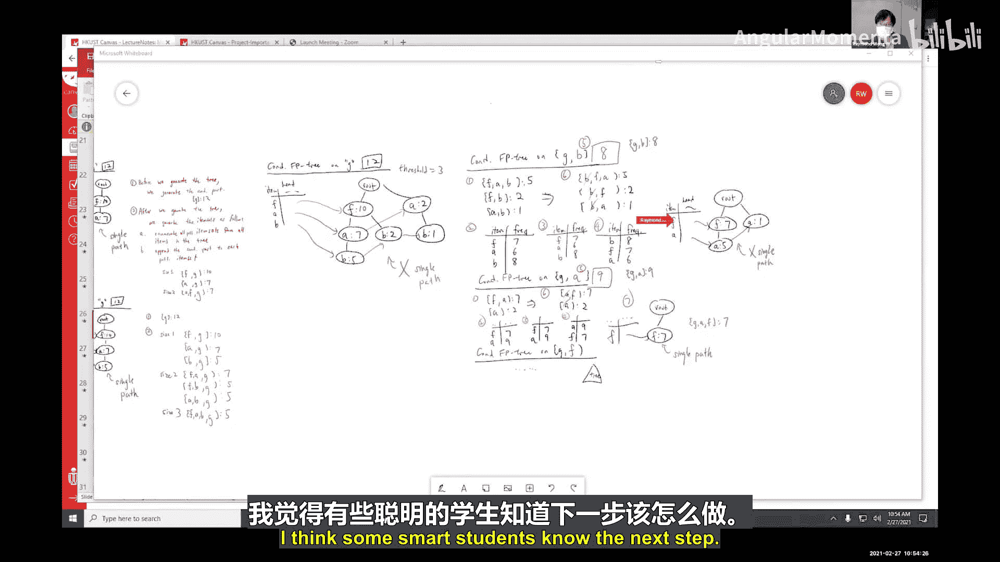

嗯。Take mining and noish discovery。🎼Ber mining and no N discoveries。

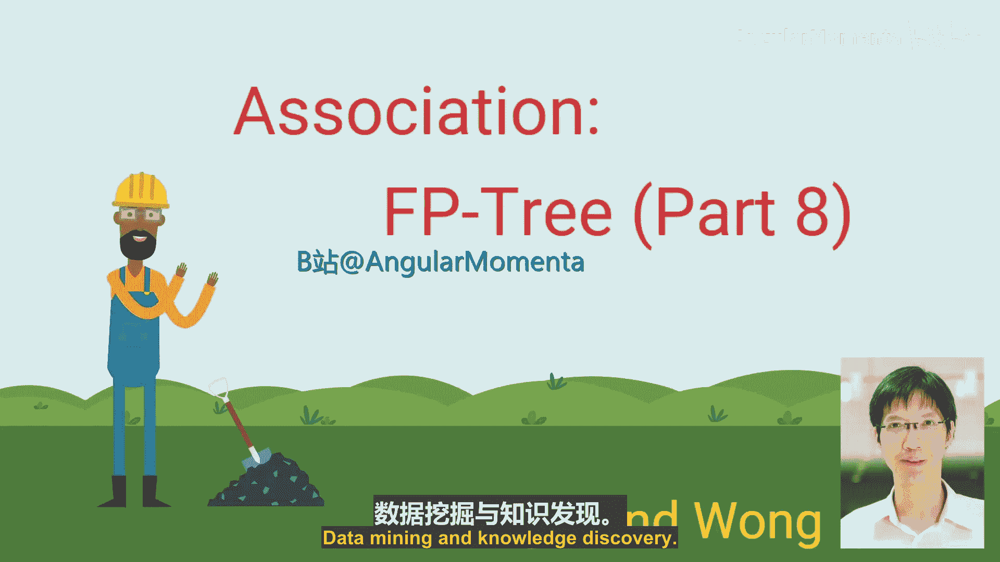

Okay， who on to tell me what is the next step。播 want调 tell me。You can raise up your hands。yes，啊G正eng。

主珍。yes， can you hear me？ Yes， I can hear you now。Yeah， so continue build frequency table and then up。

First continue we are the same are tied to。 Should we generate the conditional F3 on a。

And N G B and M F and N G B is that， what you are talking about。 Okay， thank you。 Yes， yes。

 thank you。 Yes， this is the answer。 Let me write down actually， for this one。😊。

Let me use black color for this one。Will construct the let me write down conditional F P3。

On something， similarly， we know that this one G B already here， just write down G B here。GB。Y B。

 Yeah， and then we just write down this one。 The new one。 Let me use the blue color a， right。Yeah。

 is that true。 And then we also need to generate a conditional F P 3 on G B， something， Yes。

 and then we will have this F。 Okay， thank you。 Thank you。 You get the coupon point。 Yeah， Thank you。

 Yeah， so we understand that we can do that。 Let me let's wait one more very quickly。

 I think you get the point。 Now， I also do 1，2，3，4，5 and 6 here very quickly。 I do very quickly。1。😊。

Just here a， just follow a。 Okay， so we have F a。And then the number is equal to 5。

 And then a go to here。 And then the number is  one。 and then 2。 And then the frequency table。

 And then we have F A， okay， item and frequency。 And then a is equal to 6 here。 And he is equal to 5。

And then step 3 and then step 4， just pick the frequent item。 Everything are also at least three。

 So pick it out and then which is this one。 And then need to do the ordering。 Okay， the ordering is。

😊，6ix and5 A and F。And then， based on。This a， this a， just 6， right， So put down the6 here。

 So step number 5 is here。 And then we have the blue color 6。 And then next one， step number 6。

 which means based on the ordering here， A F，O we will just have A F 5。And then a1。 And finally。

 okay， since we know that this is a new item conceptually ignore a， just ignore a conceptually。

 And based on this F。 So we have。😊，The不の。Which is step number 7 here。 And then we just has F 5。

 And then we have F， Okay， This is item and head of look name。And then we have this one。

And as I tell you， okay， this one is very simple， right， S means single path。

 This contain a single path。 So if we can see that these three contain are single path。

 we can use the white color procedure discuss before to generate the frequent items。 Let me see。😊。

This is a single parcel combine。 So let me use the green color。 Actually， we can write G A， G A。

 G B A。And then， and also this numberber， F and the pan is equal to this numberber 5。

 So we have this one。 Of course， of course， before we generate tree here。

 we also need to generate this one。 Okay， so we have G B A， and then 6。😊。

So we have this these things， Similarlyly， okay， we can also draw this。

 I will not go through you can do it by yourself。 And then we have the tree。

 I think this should be a single。 And then since this a single。

 we can also use the color procedure to generate these two things together。

 And then we are done for this conditional F3 on G， we have this two and G I already discuss here G。

 you can do it by yourself。 And to see whether this contain a single。

 if this a single just use this one。 if this doesnt contain a single like this one。

 we need to do the conditional again again again。😊。

So the rule of thumb is that whenever we generate the conditional F tree。

 which doesn't contain a single path。 we need to do the conditional on each item。For example。

 A and F and all the original conditional item we will put here and do it again and again。

 again and again， again and again until the tree contain a single path。

 After we have the single path， we can generate something like this。

 something like this based on the what color procedure。On the whiteboard on the微board， which is。

Soon out， which you see it， although you could not see clearly now。

 but I have already illustrate this two red color procedure before。Any question， any question？

I have already complete all the F p three procedure。Any question？

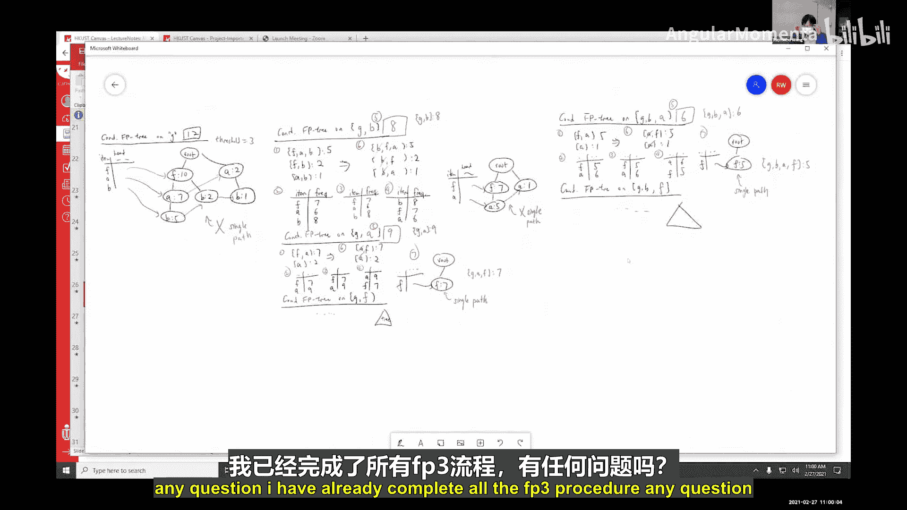

