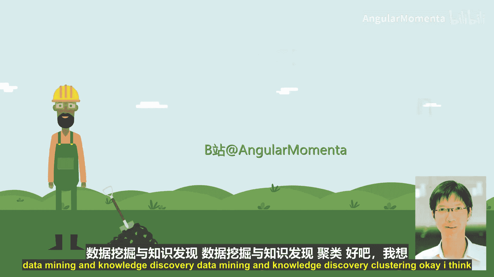
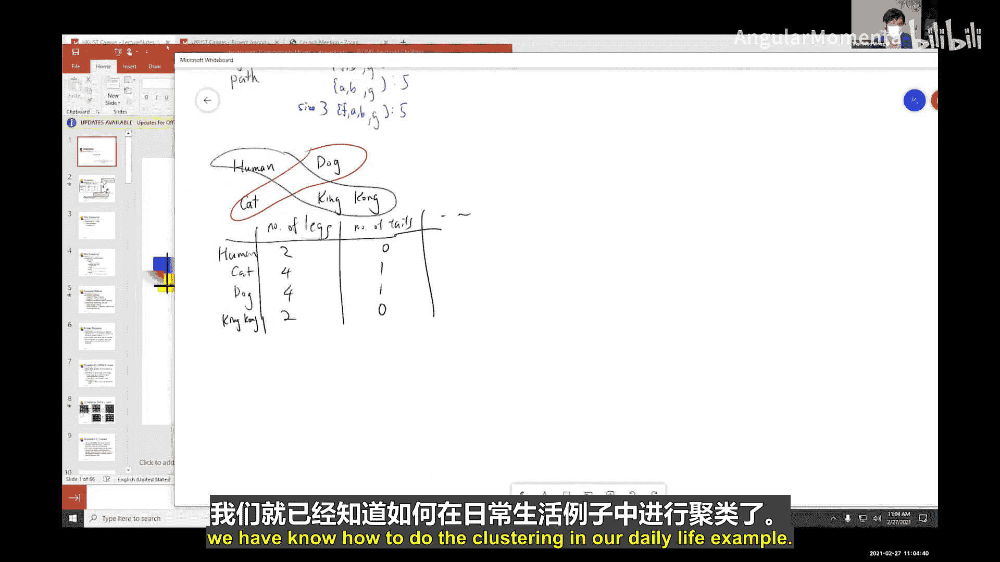
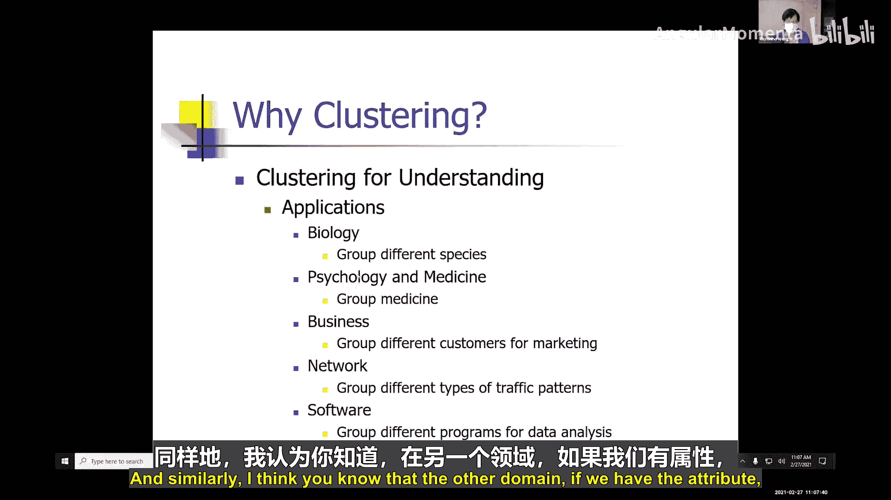
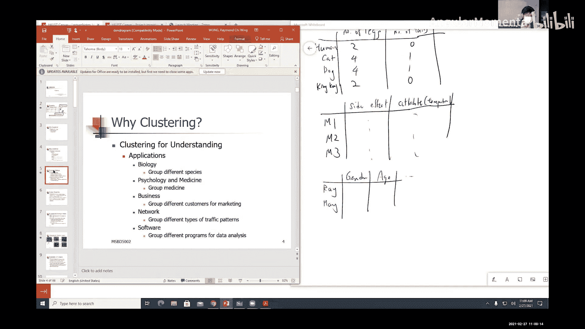
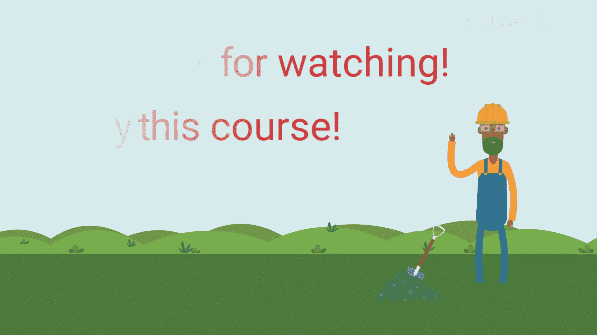

# 【香港科技大学】数据挖掘与知识发现-｜-Data-Mining-and-Knowledge-Discovery-p06-05-01-02-绪论--BV1gEFDzVEU3_p6-

🎼Data mining and noish discovery。🎼E mining and nourish discoveries。

Coing， okay， I think all of you know the meaning in my first class。 Let me give another example。

 In fact， addition to the example I gave in my first lecture， this one is also common。

 Let me use the whiteboard。I think student can also answer easily。

 even though you haven't learned clustering before， let me write down here。Here。Let me ask you。

 of course。啊 we are human。 we are human。 we are human。

And then suppose that you maybe some people have dog。And some people have cat。And also。

 some somes have king Kongong。I want to ask you。According to your ination。

Or just your interpretation。 If I want to group these four species of things into two groups。

I want to group these four species into two groups， which two group you will group。

 who want to answer just a layman。啊，开通开通。Helloello Ka Cho so if I I will dog cat into one group and group will。

 yes because actually dog and cat is like four animal they are similar kind and then。

 What do you mean by similar kinds。 I think they just like let's say they have some similarity use four legs to rock Yes。

 okay wait。 numberumb of they are four human right， yes， yes。

 are using one attribute numberumb of next。And then cat and dog at4。 So they are very similar。

 And then group them together。 And also number of tails， right， yeah， we do not have right， Yes， yes。

 and so on， we have different attributes for them and cat and dog are very similar。

 And then you group them together。 In fact， by your human brain originally。

 you have some attribute inside。 And then you want to put them together。 Such that， such that。 Okay。

 such that。This attribute， they are similar。 This attribute are similar。

 and this human and king Kong are similar， right Yes。 Thank you。 Yes attribute。 Actually。

 in human being already we have know how to do the clustering in our daily life example。

 So let's see our warning example in the。 In fact， this is lay human Kong cat and dog some attribute。

 Okay， just specify clearly to you Raymond of computer score subject 100 score40 score in history and so on and then we have computer subject1 and history score here。

 and each wind correspond to a student。

This is Raymond 100 score and 40 score in history way and so on。 We， okay。

 I think your eyes can know that we have two group。😊，One group and another group group number one。

 usually， we call customer  one by our eyes， we know that all the green dots here have high score in computer。

😊，And also， low score in history here， Cu 2， we have high score in history and low score in computer。

😊，The purpose here or the goal in this clustering method is to find all custom。 find August Here。

 we have two custom。 This is the major goal。And also， why do we need to do customer。

 We have two major reason。 The first one is summarization。 The second one is compression。Here。

 suppose that we have million or student here， million or student here。

 We have many student here and also many student here。 We just summarize the whole data set。

 don't need to say， Raymond 100 score，40 score， new Year or 90 score and 45 score。

 We just say that we are good or student here。 with high school in computer and no school in history。

 Maybe you can say that we have2000 of people also here。 we have 4000 people here。

 high school in history and no school in computer。 Just summarize the data summarizemar。😊。

Compression。Compassion actually is similar to summarization。

 The reason is that sometimes this data are too raw， too data。

 I don't want to store all this data in my hard disk。 since this a waste of hard disk space。

 I just want to say， oh， I just want， I just have a high level。 I just know。

 I just know wait a moment。 I use another notation。 annotation。

I just have2000 people or student here and high school， maybe just maybe I say， say80 score to 100。😊。

And then maybe low score， maybe 0 to 40。 I just need this information。 instead of individual record。

 And also， we just need this information at the end。 we don't need a lot of detailed information。

 And then originally， we have millions of record。 Finally， we just store this and store this。

 So we have a compression。 We have compression， we have compression， which is this one。😊，Now。

 you understand that I just illustrate the first applications for clustering biology。

 We group four different species， human， King Kong and cat and dog。 And similarly。

 I think you know that the other domain， if we have the attribute。

Then we can put different medicine。 Let's see。 Okay， I just make it clear。 Okay， in fact。

 I think most students may guess it。 for example， we have medicine one or vaccine one Covid  nineteen vaccine medicine two and medicine 3。

😊，And then we know that。Where there's some side effect。😡，霍心粉。Or maybe this can has some attribute。

 Okay， that related to it， for example， whether this is the temperature。 Okay， the。

 the control temperature to store this one。 And then we have different attribute。

 And then we can also group different medicine or we together so that we know they are very similar。

 similar advance like this。 And similarly for business， I think you also know that， for example。

 where one customer women and the other customer marry based on the gender。The age。

 we can also group different customer into different group。

 And then the company can do some marketing for different customer。 It very simple。 Similarly。

 I don't go through this one。 I think you know that for networking。

 we can also group different types of traffic patterns based on some attribute about the traffics。

 The source I address the target， I address and so on or the content。 The source。

 we can also group different program for data analysis。 If we have some attribute for the programs。

 is very simple。

