# 【香港科技大学】数据挖掘与知识发现-｜-Data-Mining-and-Knowledge-Discovery-p07-05-02-02-1._原始_k-means_第1部分--BV1gEFDzVEU3_p7-

Oh。🎼Da mining and noish discovery。🎼Beer mining and noish discoveries。Now， go the first one。

 This is the first clustering method。 cameing clustering。

In this gaminging customer， okay， I think most of you or if you learn gaming。

 you learn original gaming customer， but you haven't it doesn't matter。

 We will talk about this about original gaming。 In fact。

 it's the two variant about gaming called sequential gaminging。And also。

 forgetful sequential came in custody。 We will talk about this today。

Before we go to the original gaminging clustering， we will also talk about hierarchical clustering method。

 algorithm method and divisive method。 This we will discuss after we finish all this gaminging cluster today。

 Fo on the original one gaminginging。 What's that， Let's see。😊。

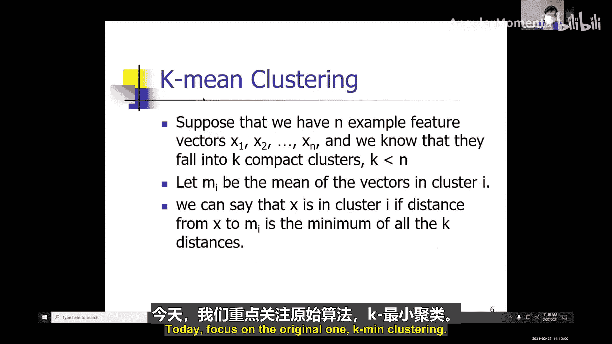

Let's see。 Okay， now I want to use this。Suppose that we have an example feature whether X 1。

 x 2 to X， N。 And we use an example here。 usually students find difficult to understand the location。

 Suppose that in the two dimensional plot。We has8 datata point9 is。 And then we call this is x 1。

 x 2， x 3， x 4， and then x 5， x 6， x 7 and x，8。 So just an x 1 to x2 to x 8。

We know that they four in， for example， two cluster in our example， K is equal to two。

 this is user parameterter。 for example， the supermarket manager gave it。

2 customer K2 is smaller than n。 And then that。A I be the mean of the water in the cluster eye。

 What is that， Okay， supposeupp that now we can see that this is cluster number one。

And this is cluster number two。 I call this is Cu 1。 I call this is Cu 2。

And then now I define one thing， called mean。Here。I call this one， mean。

And then we denote it And and want one this one correspond to the customer number mean is defined as follows。

 let's see。Is defined as x 1 plus x 2 plus x 3 plus x 4 divided by 4。 What's that， In fact。

 what I'm assuming is that here we have a coordinate， for example， x 1 is 1，2。

 and maybe this one is2，3。And then maybe this one is 5，5。And then 6，68，6，7。

 And what I want to say is is that。We just add this coordinate very quickly。 Okay。

 let's see what I'm doing。 What I'm doing is that  one，2。Just put one，2 here。 and then x 2 is 2，3。

Just copy this one here。 And then this is just a vector coordinate。

And then then we do quickly and then divide by four and then just sum of all the number。

 which is one plus two plus5 plus6 comma and then two plus three plus5 plus seven and then divide by four。

And then by simple calculation， you can calculate by yourself let me see。火天。And then this one。

 or maybe give student to answer。 what is this number。质证。主俊。呃，是这样亲。Yeah， I could sorry。

17171717 or17171717 not 1717 okay， and then now we have this one。 Thank you。 Yes。

 and then14 divided by 4 and 17 divided by 4。 Okay。

 I think you can use your calculator to calculate it。 So we know that the mean of n one is this one。

 the mean of the customer is this one。 Okay， you we have already defined。And then next。

 we want to define something。 We say that are data point it。Is in customer  one or customer 2。

 If the distance from this data point to M 1 or N2 is the minimum of all the K distances。

 Let me tell you what we are doing here。 Let me join it in the black color distance。

 Let us consider X 1。 consider x 1。It one。啊维 moment啊 we我 are oST。X 1 which mode here。 and then yes。

 we can see it。And then here， okay， maybe let me write down here。 Here， we also have M2。

Suppose I hear M1 here and also M2 is here。 And for this data point X1。

 we can calculate the black color distance between x1 and this M1。

 And also this point with this M2 can see two black color9。

And then we know that x 1 is closer to this M1。 So we know that x 1 is in cluster 1 instead of cluster 2。

 So we say that x 1 is in cluster 1， if the distance from x 1 to M1 is the minimum one among all these two distances。

 the black color distancessymmetrically， then we see x 5， then we use x 5。Here。

 the distance is very small。 And also， this is a very large。 This one is smaller one。

 So we say that x 5 is in cluster 2， rather than cluster 1。 This has been discussed here。 understand。

 Now， let me define something。 Let me define something so that you know。

 how can we calculate the black color distance。Let we do it on here。Suppose that we had two points。

 for example。It's  one is equal to one，2。And then suppose we have another point is9。

And this is equal to 5，6。I want to calculate the distance between these two point。

 One common metric is called you clicking distance。In our course， we use Eucidean distance。

 the Eucidean distance between x 1。And also， x 9。It's eager to very simple。

Some still learning before。 Some still havet learning 1-5 square plus 2-6 square。

Just put this one minus5 square，2 minus6 square， and then by your calculator， just calculate it。

And then。We had something。And then just 16 multi， maybe 16 plus 16。And then we have 32。Squa， okay。

 you can use your calculator to calculate this number。So we know the distance。 okay。

 now you understand it。 okay， now continue。Let me continue。This is the king clustering procedure。

 The procedure is as follows。Make an initial guess for being M1 M to and N K。

 as I mentioned on the right hand side， on the right hand side， this one， originally， okay。

 we know that we have two cluster。 So at the beginning， M1 and M2 are just a random guess。

 just a random guess。And then until there's no change in any mean。

 I assign each data point to the cluster Who means is the nearest and then calculate the mean of each cluster from I from for I from one to K。

 we replace the mean with the mean of all the example for customer I。

 Maybe it's not that clear after I read this one。 doesn't matter since I will illustrate the example next。

 Let' see。

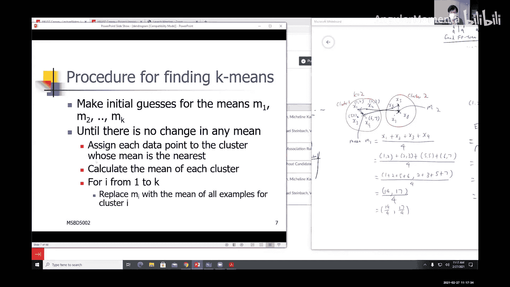

う。🎼Great mining and noish discovery。🎼It a mining and no N discoveries。

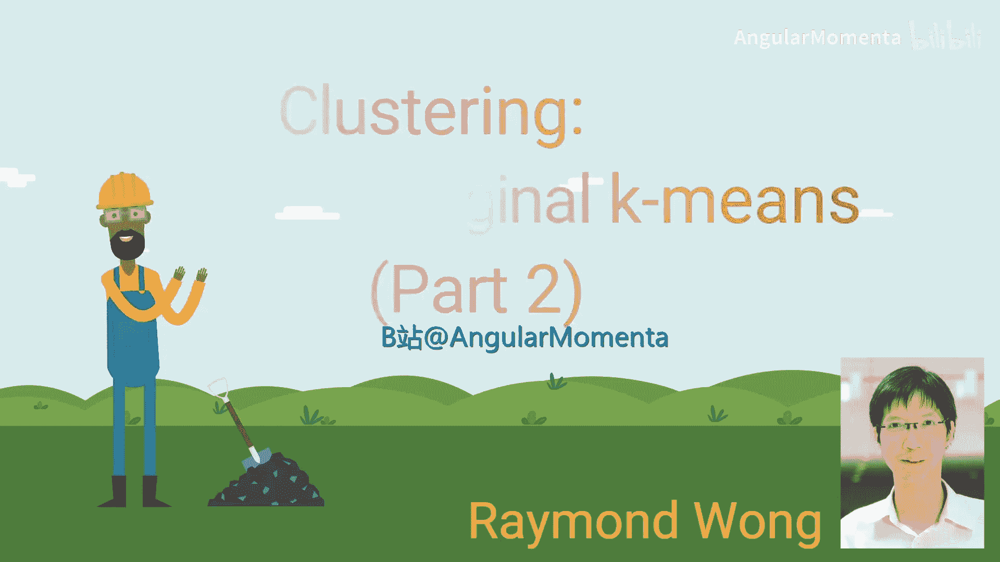

Here at the beginning， at the beginning， all the points are represented as the pale blue color or dark blue color。

 I the white color first， this is given the pale blue color and dark blue color originally。

 no color distinguished。 all， all these are dark color or pale blue color are the data points given。

And then at the beginning。Close our eyes， and then randomly。

Mark two red colors here randomly on the streets。 After that， we mark this two red color 1， red。

 red color1。No。We do next。 we do next。And then do we remember that we have defined the black colour things。

 Alright， the black colour things Let use the black colour。Now， this data point。

We can calculate the distance between this one and also the distance between this one。

 this point and the white color things。We find that the left hand side is shorter one than the right hand side。

 We know that this will become discussed by co 1。Similarly for this1。

 I can also calculate the distance between this one and also the distance between this one and this one。

 This one is close1。 This will belong to the right hand side1。

 So the dark color1 means a cluster on the right hand side。

 The pale blue color means the the cluster on the left hand side。 based on what I have mentioned。

 continue。So we have Cu 1 and Cu 2。And the next thing is that since we know that this is customer 1 and customer 2。

 We use this formula， use this formula to calculate the mean 1，2，3，4，5，6。 We have 6 data point。

 just something up divide by 6。And then， we have。This mean similar 1，2，3，4。

 just some all these four point divided by 4。 We have this we do。And then next。

 the next process is that similar to this one。 since we have the mean。

 all I'm doing is let me also use the annotation。 Okay， now let's see this this thought。

 I can calculate the distance here and also distant here。

 You can see that this distance is smaller than this one。 So this form。

 we will assign to the left hand side custom。😊，And similarly， for this point。

 you can calculate the distance here and also distant here。 This will be closer to this one。

 This will be assigned to the right hand side。 You can see that in this powerPo。We assign。

 You can see that this point originally is the dark 1 now become a pale blue 1。 Or， this is a pale 1。

 and this will become dark 1。 Similarlyly， I think you know that this maybe let me also use annotation。

 This one， we can calculate the distant and distant。 of course。

 is still remains since this distant is smaller one。

 So all the update membership or the clustering has been found here。

 I think you understand it this is like this case。 And then。

Update to me again based on this formula and do it again， again， again， again。

 again until the white color dot doesn't change too much。Okay， doesn't change too much。

 This is one stopping condition and another stopping condition is that。

Is the number of tons we want to update the red color things。 Okay。

 maybe the maximum number of tos we update the what color means is at most， for example，200。

 This 200 is given by the user parameter。 For example， the supermarket manager。 Is that okay。

If you are okay， then let me ask you some question。 era it， Wait a moment。Let me see on here。

Let me give a some example， let's。Example  one。Example  one。Now， I have some， for example。

 I had some data point like this。And also。Example 2， I also have something like this。

And then example 3， I also had something like this。 Let me write down clearly。 Exle 2。

 exactly the same。Data points， however， the starting position of the beam may be different。 Now。

 I close my eyes， for example，1， Now I close my eyes and then put two we dot inside and close my eye。

 Now， let's see what I put。I put this we top here and we top here。 And then example 2。

 I also close my eye and then put this two we top here。 And similarly， for example 3。

 I also put my red top randomly， for example here。And here。Oh， now， maybe I want to ask。One student。

 do you think that after the came in custody， which two cluster I can find， Let's see。啊，红龙。

hello hello yeah嗯， which cluster yeah yeah yeah sorry is here here yeah嗯。😊，Yeah， could you tell me。

For the example1， I think that the first cluster is on the left and the second cluster is just like on the right。

 Yeah wait a moment。 So you understand after that the meal may be updated something like this。

 right something like this， right yeah。Howle example，2。

I think that example two is like it's like all up and down the color something like this up and down。

 something like this， right， And finally， the white color thing may be updated to something like this。

Yeah， yes， how about example three？Example 3， I think that because the left red dot is most exactly at most of the points is close to that left red point。

 So it will be one cluster， I think。Thank you。 Yes， thank you。 Yes。 Thank you。

 So I think Hong already answer this one。 He understand this one example 1， we have two cluster。

 which is what we like。 This is our inition example 2。

 we have this one cluster  one cluster 2 example3。 We have one cluster here and one cluster here。😊。

Of course， I think most of you or all of you know that example  one。

 the clustering result must be better than example 2 and 3 by your eyes， right。

 I think you know that this is a true。😊，Now， let me ask you， okay， the computer， of course。

 they do not have our eyes。 Usually they are using some metric。s match。To compute how good it is。

 Okay， maybe let me say that the good next。Of the clustering result。 Okay。

 the goodness of the clustering result， they have something to calculate。😊。

Can you guess what they will use to measure how good it is。 Could you tell me， who want to tell me。

Yeses，ng the mean square area。y i could hear you重上 the mean square area。

Mean square air right could you elaborate more。 I understand this time。

 but I student may not understand。 okay， what do the average square distance between each price and the middle point is the average distance between a point。

And is， for example， close the wind， right。Yes， and we need to square it。

And also do a square for this the average square distance， right， good Thank you。 Yes。

 this is one possible matrix。 So average distance between upon and this me or average square distance between upon and this me is also okay。

 So we understand that。 okay， on the left hand side， if we calculate the distance。 Okay， like this。

 So we know that we just calculate all this things。😊，And then calculate this value。 And then。

 finally。We have some number with some number。 for example， this number is equal to， for example，6。7。

 maybe this one。 of course， this number usually will be larger。

10 point2 and this number may much larger。 maybe equal to10。

5 and so maybe we have some number like this usually we will choose a customer result with this matches smaller one。

 for example， average system between point and is closer mean。 So this will be the final one。

So you understand this one。 So we understand that in cameing customering。

 The result depends on the initial position of the mean。 If we have this one。

 then we will have this result。 If we have this initial position where this result and if we have this position where this result。

 So in the cameing customering， usually they will trial trial number one。

They will have a trial number one， one position and do some clustering with。T number two。

 randomly and other one。 and then custom the without to。 And then12 number 3。

 we have some result maybe be not that good and then more trial。

 And until we find one child with the smaller F H system between upon and this closer meal。

 So this is their process。Understand now continue， okay， continue。

The way to initial the mean was not specified。 I just say I close my eyes and then randomly pick two color points。

 And other common way to start is to choose。Two of the example， what I mean is here。

 Let's go to here。 Although this is randomly， in fact， and other approach is。

Since we know this blue color， this blue color。 I just randomly pick some point。

 Let me make it explicit。 In fact， some common approach。 suppose we have some blue color。

 and then we just pick one point for example。 I pick one point here and the coordinate of this meal this mean one is exactly this coordinated。

 I randomly pick one for example this one。😊，And then I set the coordinate or the mean too is exactly the coordinate of this blue color。

And then in this case， we can ignore this We will， We will not go through this case。

 since this red color thingss do not have blue porn here。

 So this can make sure that each red dot must have one point inside the custom。

The result produce depends on the initial value of the being， as I mentioned on the right hand side。

 And it frequently happen that sub optimal partition are fine。 What I mean。

 the sub optimal partition is that for， for example， example， too， when we update something here。

 Okay， we could not improve more， this is called sub。Okay， so optimal。 we could not improve anymore。

 The standard solution is try a number of different starting point， trial 1， trial 2 and  trial 3。

Disadvantages of this came in customer in a bad initial guess。

 there's no point assigned to the customer to the initial mean this has been easiest way here。

 example number three。Example number 3。The value of K is not user friendly。

 Since if we draw this in the two dimensional space， you can see two cluster。 However。

 if we have four dimension， five dimension and more dimension。

 we do not know how to do not know the number of customer before we want to find the cluster。

So this is the disadvantages of gaming custody。 However， in the later of later。

 we can address this issue。

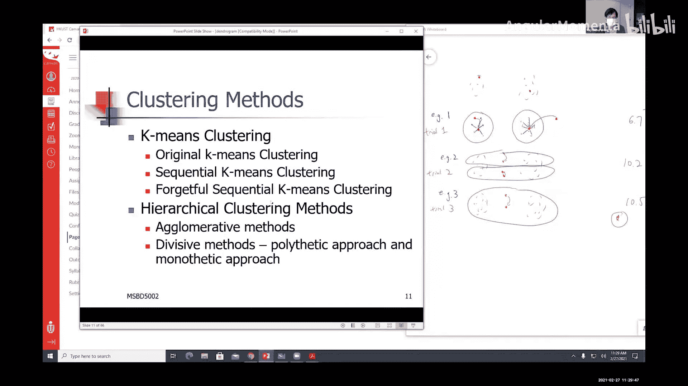

Oh。🎼Great mining and noish discovery。🎼It the mining and no N discoveries。

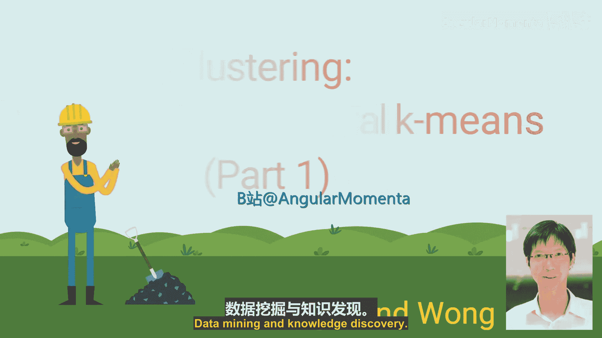

Next。We will talk about sequential came in customer and forget guessful sequential came in customer。

 In fact， you can see the word sequential。 Actually， this related to time。

Let's see what Im I'm talking about before I go to the sign。

 Let me use the whiteboard to talk about what， what is this。 Let's see。 Let me go to the whiteboard。

高才威博。Let事。At the beginning， O， at the beginning， we have some point， for example。X1。And we do here。

 X 1。And then at the beginning， we have， for example， M1 and M2。And then， x1。

We find that this is closer one。closer one。And then we will find a this， right， This is what we know。

And also， if we have many points。X 1， x 2。X3 and x 4。And then x 5 and x 6， x 7 and x 8。And finally。

 if we want the original gaming customer， we know that finally。

 this M 2 will go to here and then we found customer 1 and customer 2。 This is very clear。 Okay。

 let me tell you。 Now， what is the time， Let's see this is 11。😊，42 AM。 Now this is 11，42 AM。

Now go further。For example， for 1145 AM。We know that we have one more point。

 Let me copy the original poem first。The original point is x 1， x 2， x 4 and x 3。 And then let's see。

 x 5， x 7 or x 6， and then x x。 supposeupp I have one more point， for example， here。X9。X 9 here。

 You understand that I can also use the original gaminging cluster original gaminging customer to run it again and again。

 and then find， finally。Let me highlight this。 Finally， let me use this。Here。

 I will put put this in this 1。 I call the original。Came being clustering method。

They just have the blue dot put inside。 maybe let me give some number。 for example。

 we need one minute， for example， I need one minute。Finally， I can find the answer。

 Find a two customer。 The cluster is。😊，Let me see。 We have 1，2，3，4，5。 And then finally。

 we find customer 1 and customer 2， and the mean is here。 M1 and M2。

 This is what we have discussed before， discussed before。😊，But now I want to say that。

 I want to say that sequential came in customering。 Just want to shorten this one minute to。

 for example， within one second， Let me see。 actually， the sequential came in customer。 Okay。

 let me make it here。The sequential。K means a clustering。Its actually。Is something like this。

It has two input。 The first input is。The original clustering result， the original clustering result。

 Okay， let me put it the original clustering result， which is custom 1 and cluster 2。

 So we have cluster  one。And also， we have cluster 2。 What we will input is this one。

 M1 the mean and view。 and also the corresponding M 1 and n to M1 correspond to the total number of data points in cluster 1 and to correspond to the total number of data points in cluster 2。

 just three inside and also the new data point and also the new data point here。

 the coordinate of new X 9 and just 1，2，3，4，5， put it inside and immediately。

 it was has some result like this。😊，You will have some without like this cluster  one and also cluster 2。

 Okay， so we know that we have some result like this Okay Cu  one and cluster 2。 And finally。

 we have something like N1 and N 2。😊，And I want to say that since we use some intermediate wecaster 1 and clusterer 2。

 without using x 1， x 2， x 3， x 4， x 5， x6 and x7， and8。

 we do not know and use all the detailed information。 So this will be very quick， for example。

 one second， one second。So you can see that according to this sequential gaminging clustering。

 we can have a fast processing task。 And also when at one 1142。

 we have this customer 1 and customer 2。 we know the result。 When we have one new data point。

 Just update with one second。 And then we have this result。

 Don't need one minute to update all the result， This is the major idea of sequential cameing customer。

 now go back to our line。 Okay， this is the intuition。😊，This is the intuition。Let's see。 now go here。

sequial gaming customer。This is another way to modify the claim procedure。

 which is to update the means one example at a time whether than all at once。

 you can see one example， we can update the clustering result， also the mean。

This is particularly attractive when we acquire the example over a period of time。

And we want to start clustering before we have seen all the example。

 So suppose that we have 100 example the end before we see the 100 example， when we see， for example。

9 data。 we have this one，10 data one。 we also have two clustering result。

 So we have seen some parcel clustering result before we have seen all the100 example。

 here is a modification of the K means procedure that operates in the next night。Firstly。

Make an initial guess for the mean M one and M to let we are do it on the right hand side。

 at the beginning， we know that theres two customer given by the supermarket manager。And now。

 we have M1。And also， M2， we have M1 and M2 at the beginning。And we know that currently。

 customer 1 and Cu 2 do not have any data points。So we have M1 is equal to sell the total number of data points in this customer。

The number of the number of points in this cluster is 0。

 and the number of points here is also equal to 0 at the beginning。

 So n1 to n2 is set to 0 at the beginning。 until interact obtain the next example， for example。

 we have the next example， for example， we have this example。X 1 is here。

 The point is that x1 is here。If M1 M1 is closer to x， O， okay。

 you can see that X 1 is closer to this M1 rather than M2。

So we know that anyone will become this custom。 Let we use green color。 Actually。

 this will form one customer here。And then what I am doing is that。听唔到。And1。

Will be implement by one implement and one。 okay， let me do it。 This will implement by one。

And then this will become one。And then we will replace the old min， which is here by this formula。

 be write down here。This one。 and one。Will be update with this formula。And one， okay。

 this is the new position of mean one。 This is the old position of mean n one， which is here。

And then one over and one。And then multily by x minus M1。And then after we do some calculation。

 you know that anyone will be updated。We will update it to something here。I could tell you that。

 I could tell you that this N one， we be update to something like here。

I can say that anyone is exactly equal to the coordinate of x 1。 This a magic formula。

 This a magic formula。 I will tell you this the correctness of this one later。

 Let's follow the procedure first。😊，And then now we update this one。 Now， go further。 Okay。

 until to what。LikeQu the next example。 Suppose that we have the next example。

X 2 is here Similarlyly。 Okay， I can find the code the distance between this 1。

 X 2 and M1 x 2 and M 2。 we find that N X 2 is closer to this one。

 So we know that this will form a cluster。 And similarly， you know that this N 2 will become one。

And then and this are mut， this M tool will be updated。

 We have also some similar formula like this one， like this one。啊This one is one。 this is 2。

And let me do one more。 And then now we are here。 Let me erase the original coordinate。

 Let me erase this one M one。And aim 2。This is let we you waste it。

So that now this is in the current state is something like this。 Let me do one more。

 and then you understand the point。 Suppose that I have。X3 here。

And then we know that this x 3 is closer to M1 compared with M 2 x3 So is inside cluster 1。

 And we know that。This one closer and then in and one。 So one will become 2。And then become two。

And similarly， I can use this magic formula。 I can use magic formula。

 The current M1 is here using this one。 And then we will update the M1。😊，Will become something here。

 Let we are we are write this again， actually。 everyone one is eager to the old being。Plus。

 one divided by n1。And then x3 minus M1。And then I think you understand the processor。

 Su code here is very simple。 And just follow it。 And then you can understand what I'm talking about。

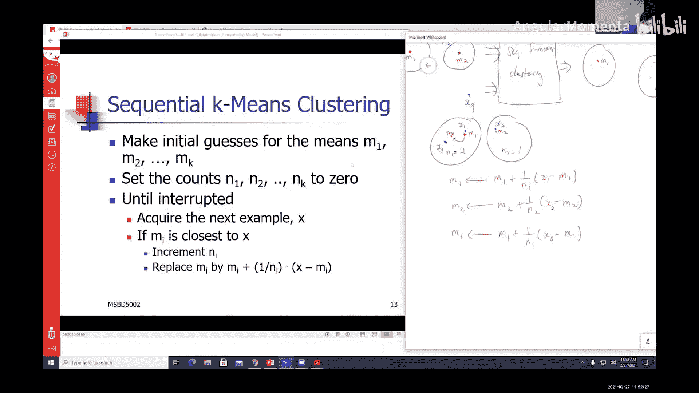

🎼Data mining and noish discovery。🎼Beer my image， no N discoveries。

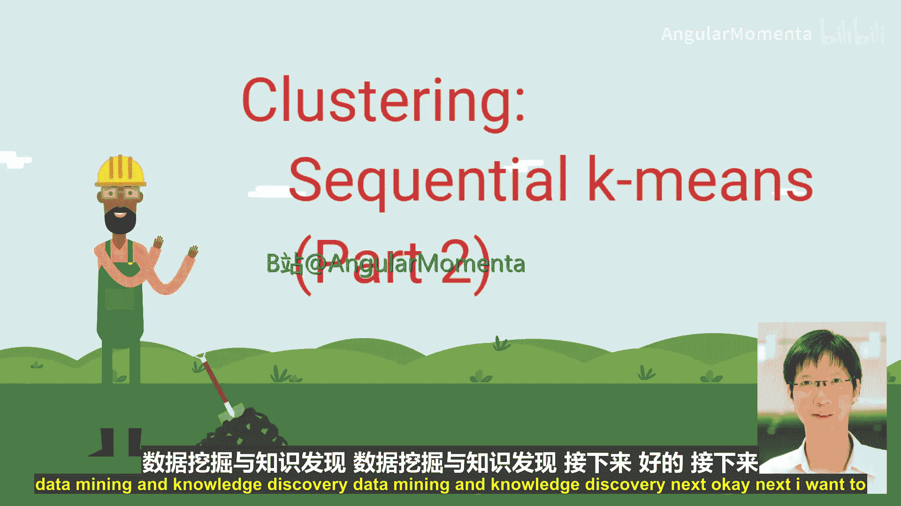

Next， O， next。I want to ask you to show the correctness of this magic formula。

 What I mean by the correctness is as follows。This is what I want to say。 Let's see。一 miss。Oh， no。

 Wait a moment。Move here， move here。 Wait。 Let me see soon out a little bit so that I see where I am。

 where I am。And here， now go go back， go to here。 go to here。I want to move to some place here。

 Wait a moment， I also need to see my robotboard Which a moment one oh， five， where I am。32。 Okay。

 yes， can find。 Now， let's see。Now， I want you to do the following。

 I want to give some locations first， Let's see of black color。Black color。咦喂人。

It iss some problem with my whiteboard。 Wait a moment My white has some problem Okay， yes。Next， okay。

 you can see。 okay here。Now， I want to use some locations。Let me define S j。correspond to。The j。

Example。In cast。I， this is my location。And then， MI I T。Horspond to the being。Rector。Of cluster。I。

con听ing。T examples。This is my location。狂尸 the that。X。Is the teeth。Example。In cluster I。

And then I want you to do this， this thing， show that。After you show the correctus of this formula。

 the slide should be correct。X， I T is exactly equal to MI， I T-1。Plus， one over T。X T minus X。

 I T minus-1。 Okay， maybe you let me be clear。啊 t minus one。Let me make it clear with you。 Okay。

 let me put it on the left hand side first here。And here right hand side。

Let's see what I'm talking about。Focus on this equation。You know that。This one is the old min。

This one is the old min。Old win。 okay， only means here。

All means means that the customer containing some example， for example， T-1 example。

 containing T-1 example inside。The old mean， right？ I think you understand this one。

 And then this one correspond to the new mean。 Of course。

 you know that the new mean have one more example， Or， T minus one example。 So we have P example。

We are key example。 So we understand that this one is the new mean。Next。This is the new example。

 right， The new example， as I mentioned， the new example is X T。Is X T is X T。And then you know that。

 okay， this is the new example。 And then we have already increment。And I already。

So N is already equal to。T T， let me use green color。

 So this one is already containing all the example， including the new example。

 So one divided by N I actually is here。 So you can see that the right hand sign here is exactly this one。

😊，And the left hand。Should be equal to the mean of this clustering， containing T example。Now。

 in the following。You can use what you have learn up to this moment to show the correctness of this equation。

This is very simple。 just a three to four night of of of sentences to disquire。

And then you can use five minutes to do that。 We will check the answer， next。

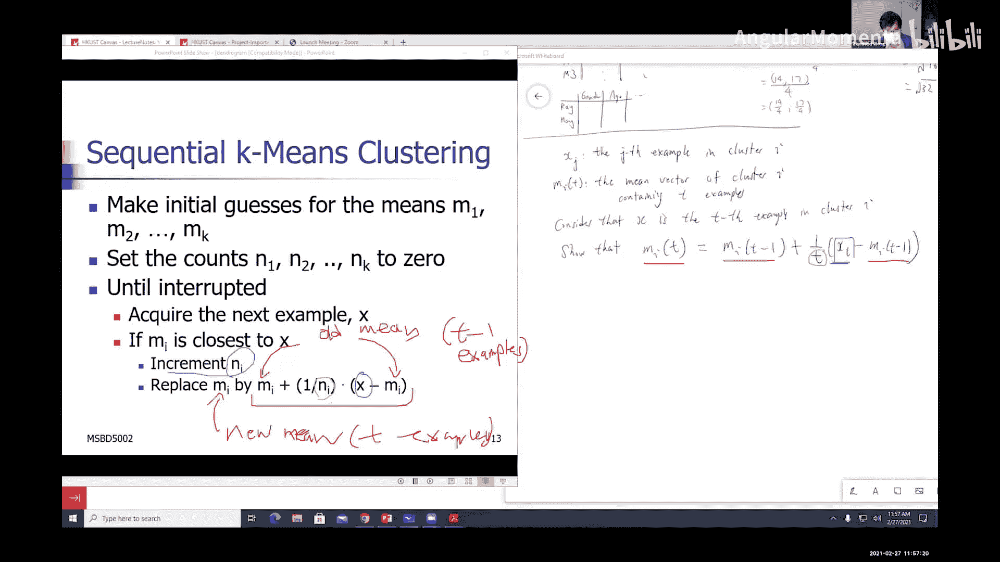

🎼Greater mining and noish discovery。😊，🎼E the mining and no N discoveries。

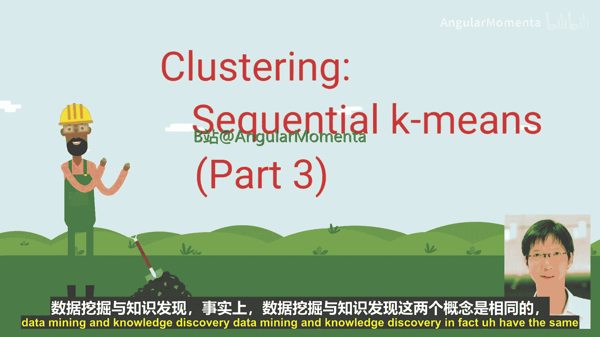

In fact， have the same concept。 maybe let me write down actually。

 the same one x one plus x two plus dot dot dot to x t minus one divided by t minus one。

 exactly what he is doing。 and then X I T。And then we also have x 1 x 2 up to X T1 plus X T divided by T。

 In fact， the student mentioned this point。 I also use this here。 Okay。

 I just want to say that actually， I used here。Here x1 plus X T minus1 x1 plus x。

T-1 is exactly equal to wait a moment。And notation， okay， wait a moment， wait a moment。

It's 1 to X T-1。 And then actually the multi between these two。 In fact。

 the student is using this concept and do it here， multily by MI I T-1。

So what I want to say is that I want to use this expression here。 So I know that。Let me do this。Oh。

 no， let's see。 this X1 to X T-1。 just replace this under color with this one。t啊 black colour。

 black colour ok wait同 moment问。T-1。Multiply by MI， I T-1， and then plus X T plus X T。Plus X T。

 and then continue。Divide by t。And then just do it some simple deviation。 T-1 divided by T。

Maybe let me do here。 Okay， wait a moment。This could not do is here。This do you。

 this actually equal to one divided by one over T。M I T-1。one over device X T， O。

 just simple calculation of诶来我想问问。This one。X， I T -1 is here and also here。1 is here。- T，-1 is here。

 and then one over T is here。 So just combine this two。 We have this one。 So we complete the proof。

Any question？

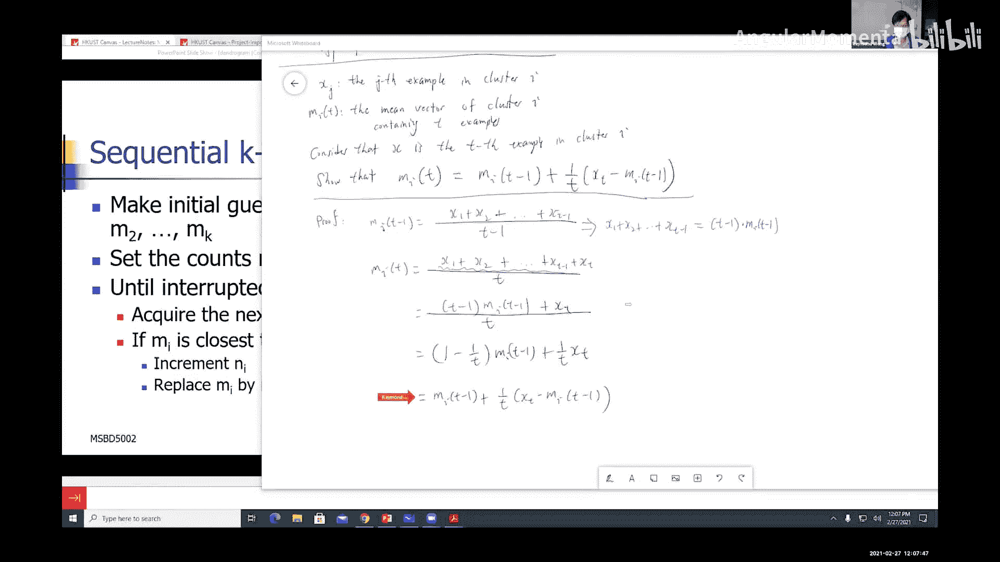

🎼Da mining and noish discovery。🎼A the mining aid no N discoveries。

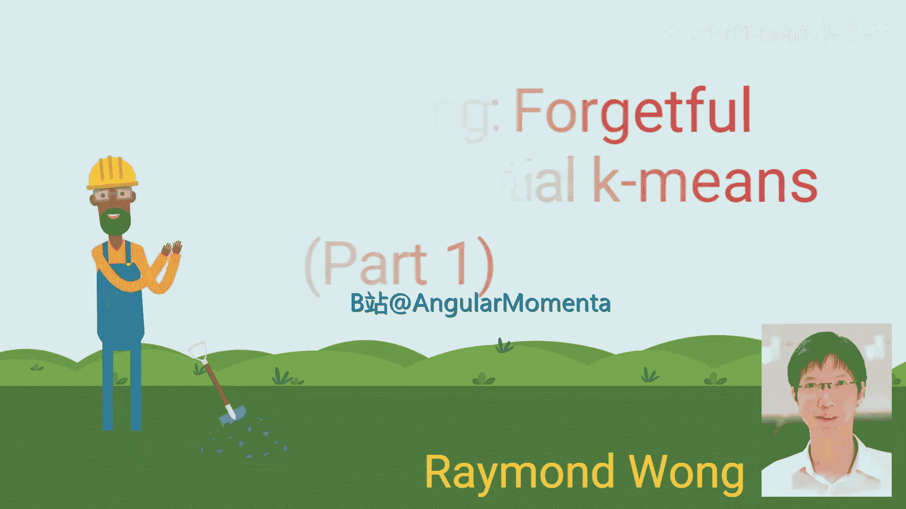

Now， go to the next one。 Forful sequential came in customer。

 You can see that also the word sequential sequential。

 is it also related to that every time we see one new data point。

 we have the came in customering result。 But this time， we add the word forgetful。

 forgetful means that oh， if we become older and older， we will forget something all things。😊。

However， we still remember some new things。 This is the major concept Before I also go to the slide。

 I also want to use the whiteboard to illustrate this idea。 I want to illustrate this here。😊。

Let's see， okay。here。Let me do it。Now， suppose that we have X2 and X 3 here。

 We have three data point。 Maybe let me z in。So that you can focus here。With three data points。

And then suppose that they found one cluster。 Okay， they found one cluster。 We have and one。 okay。

 this is。This is the cluster。castster forcast one。And we understand that， actually。

Let me use black color。 M1 is equal to x 1 plus x 2 plus x 3， divided by 3， right。Now。

 let me go further。Go further on the right hand side。Now we understand that we have x1。It's to。X3。

And also， maybe this time， we have a new data。Ex4， of course。

 we can also use what we have mentioned here here。 Okay， let me see where I here。😊。

Suppose that we have new data point put it here。 We have one second to do something。

 And then this one is called for carefulful sequence gaming customer。 We can update something。

 but difference is here。 The difference is here。 The difference is， let me talk about here。Let's see。

 See。 I say forgetful， forgetful means。 I want to forget something old thing。

Let's see what I'm doing。If we do not forget anything， usually， okay， in the original method。

The mean。The mean。M one。Is also equal to this one。X 1 plus x 2 plus x 3 plus x 4 divided by4。

 This is the original gaming customer or for guessful for or sequential came customer。 Now。

 let me tell you the difference between for guess4 and non forgetful。 Okay， let me do some deviation。

Now， let me divide。De wifeve， so you understand the point。Here I divide something Left hand side。

 actually， x 1， x 2 and x 3 is something like1 over 3，1 over 3，1 over 4 on the right hand side。😊。

Let me do it on the right hand side。I also do the similar thing1 over 4， x 1，1 over 4， x 2，1 over 4。

 x 3， and also one over 4 x 4。 And then what I want to say is that。If I in some variable。

 for example。Let me circle all this  one。 I call this is W 1， W 2， W 3。

 This correspond to the weight。Of x 1， weight of x 2 and weight of x 3， Similarlyly。

 on the right hand side here， we can also do something like this。 W 1， W 2， W 3 and W 4。

 currently in this example， in this example。W 1 is exactly equal to W 2 is exactly equal to W 3 On the right hand side。

1， similarly， W 1 and W 2， W 3 and W 4 are all equal。

 So we understand that all the data points are equal importance， equal importance。

 all the data points on this scenario， also have equal importance。 You understand the point。

 since and， as I mentioned， I want to forget。Forget some old things。 Okay。

 suppose that X1 is the oldest data point。X 2 is the newer one。 Okay， this is the old data point。

Oldest dataable。 And this is newer and newer and newer。So the number here is this number is larger。

 This newer。 So I want what I want is this is what I want。I want that W1 should be smaller than W2。

To be smaller than W 3 and so on。I want this1。 I want。 This is the designer of the algorithm。

They want to decide some algorithms such that W 1 is smaller than W 2 and smaller than W 3。

 so that I can forget。Has less importance on the oldest data point。 This is the major idea。

Its a major idea。Now， let we randomly， not randomly， just randomly assign these things， for example。

W1， let me see M1。Wait a moment the。M1。And then we can write on this format， right。This方。有秀理由。

They will just use some formula for W1 and W3。 Okay， I just give this equation this expression。

Maybe they can use this number， for example。This is zero point2。This is0 point2 power to one。 Okay。

 actually， this is power to one， power to 2。And then 0。2 power to 3。 So we understand that， actually。

This is smaller。 This is larger and larger。 So we understand that usually if they have some relationship。

 So this will be oldest one。 So we have this one。And on the right hand side。

Suppose that we have this seen this formula they will also use in this way。

W 1 x 1 plus w 2 x 2 plus W W 3 x 3， and then W 4 x 4， and similarly。This one。

Since we have the newest data point， the newest data point in this scenario， the newest data point。

 we have 0。2 power to one， right， So I also want the newest data point have 0。2 power to1。

 So you can see that W4 this time is 0。2。😊，Power to one。 and originally。

 that will the weight is equal to 0。2 power to1。 And this time， Im make one data point order，0。

2 power to 2。 Okay， this is the major idea。 And then this is 0。2 power to 3。 And this is 0。

2 power to 4。 Similarly， we have also this inequality。

So we understand that whenever we have a new data point， the new data point。

 the weight will become this one。For， hold this one。

 the original weight for this one will be smaller， Or0。2 power to3。 This will become much smaller。

 For example，0。2 power to4 and so on。 This is a major idea in this forgetful sequence gaming cluster。

Any question。If no， you catch the major idea。 Oh， yes， Batra。So one question。

 wait a moment wait a moment。 wait a moment。 wait a moment。 let me yes， you can speak it now。

 the weight need add one in this case yes， okay yes， I understand。 Okay， you raise a good question。

 Yes， I didn't mention that In fact， the sum of this three number or the sum of the weight must be equal to one must be equal to one in this example on the。

 I just capture the major idea about this one。 In fact， we need to make this number。

 the sum is equal to one in our slide。The sum of the weight must be equal to one。

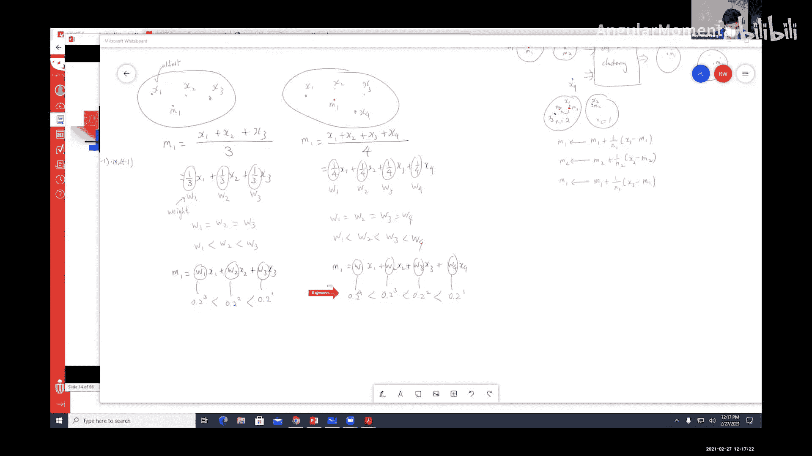

🎼Greater mining and noish discovery。🎼It mining and no N discoveries。

For careful sequential came in custody。This also suggest other alternative in which we will place the by the come by。

 Maybe you don't understand this。 I will illustrate here in particular。

 suppose that a is a between and one and consider the following variation。

 Maybe you don't know what we mean by a， we will talk about this in this。 Firstly。

 we will make the initial guess for the mean M1 M2 to M K。 okay。

 also the same as the sequential came and1 and M2 randomly at the beginning until interrupted。

Acquire the next example， similar to what we have seen before。 If this example is closer to M1 or M2。

 we will replace this mean with this magic formula and other magic formula。

 The magic formula is as follows。 Then we are talk about this。😊，The omen。The old man。

 This is the old man。And this is the new data point。And then multiply by a constant a。

 given by a user。And then this will become the new mean。

This is the formula decide by the researcher or the Al designer。 I will tell you。

 this is decide by the researcher。 since they decide by in this equation。

 then they have some properties like this。 We will discuss later。 This is decided by the researcher。

This is designed by the researcher。Now， let me continue。 Now， what is the physical meaning of a。

 Let's see this example。 Suppose that a is equal to sell。So， you understand that。A is equal to 0。

 Then I will not learn more new data point。 So the old mean is exactly equal to the new mean。

 The old mean is exactly equal to the new mean。 Let me do another way。 Okay， let's see。

 Suppose that a is equal to one。 see what is this。A is equal to one。 This is one。 and then x minus o。

 Okay， so we can cancel out。 So the new example is exactly equal to the new mean。

 which means that this this guy， okay， or this algorithm form just only or only consider the new data point without considering all the old data point。

 This is the the illustration。 So if a is equal to some number between。

 So we will have some importance for the new data point and also some importance about the old mean This is what I want to illustrate here。

😊，Now， you understand that we have this magic formula decided by the office of this paper or researcher。

Based on this design。Actually， we can come up with something like this。 Okay， let's go through here。

The result is called forgetful sequential k means procedure。 Here is what we talk about。

 It is not hard。To show that am I。Is weighted average or the distance。That were closer to MI I。

Where the weight decreases exponentially with the age of the example。

 Maybe you don't understand this。 Let me illustrate one by one。 Now， let me focus on the first part。

 which is here。M I is the weight average of the example。 This has been illustrate here。

 The wait average at W1， which is here。M I is the waiter effort。 Okay。

 this is called waiter effort of the all the example。

 provided that this some of this number is equal to one， the wait average。

And then the weight decreases exponentially with the age of the example。

 I have already the illustrator here。 You can see that。wait a moment or I you waste first。

And then move here。呃Annotation。You can see that X W3， Okay， Or，0 point21。

 is is the newest data point。 However， it W 3 is not the newest one。 And then this older。

 So you can say see that 0。210 point power to 2。 So this will become exponentially smaller。0 point21。

0。22。 This will decrease exponentially with the age of the example。 This is what we mention。Here。

 so we understand the point， although the exact formula is not this one。 In fact。

 they are consistent。 Now， go further。That is， if M is the initial value of the mean vector。

 and if X J is the J example out of the n example that were used to form M。

 then it's also not difficult to show that the final mean is exactly equal to this formula。

If some student has some problem about this， let me use an example。 Let me do it。 Now。

 I just wait a moment。 I want to make it smaller。 And then on the right hand side where here。

 let me do it here。Let's see。 let me do it now。 Now， I want to illustrate this example。

 Some students may not see obvious result about the weighted average of the example。

 Let me right down here。 Suppose that okay， let me use black color。 Suppose that a is equal to upon8。

 Okay， I'm talking here。 A is equal to8。 A is equal to8。Now， let me use this1 minus a， of course。

 is equal to 0。2。 Suppose that now we consider that n is equal to 3。Let me substitute the formula。

In fact， this formula is eager to。 Oh， you cannot see it right here。0。2 power to 3 am not0。

8 sumation K is equal to one up to 30。23 minus K X K。

 I just substitute some values into this equation。And then if we do some deviation very quickly and then I do very quickly can follow it。

And then you know that we have this equation，3 minus1 x 1 plus 0。2， and then 3 minus2 x 2 plus0。

23 minus-3 x 3， and then continue continue。continue， okay， the微board is important yes先。

And then continue 0 point23 m lock to0 point8。And then so point two。And then。哦。Alす。

Then we do it again，0 point2。And then this is 2 x 1 plus 0。21 x 2 plus 0。

2 power to 03 and then continue。 Okay， we have 0。3。Multiply by this one。

 This is a more complicated one。 This is asked by a bus。And this is actually the correct weight。

The call wet wait。I didn't。 This is the correct one。 Now。

 let me give this one so that you understand it。 Let me circle out。 In fact， the weight is here。

The circlecle one。This is W 1。 actually， we also have W log W 2 and W 3。 You can see that。 okay。

 according to this equation。 Okay， we can write down the weight at the mean of the customer containing free example is exactly equal to way 0 multily by the initial mean。

Plus， W 1 x 1 plus W 2， x2 plus W 3 x3。So you can see that。This one。Is smaller。Than this one。

And also， you understand that if this is M4。This one will be conceal point8 multiplly by 0 point2。

You can know this is the formula。Now， you understand that this is the equation。You can also do。

 You can also check whether the sum of this four number is equal to one after the class。But now。

 I want you to do the following， See in our lecture。

 we say that it's not difficult to show that this is correct。 So in the following。

 I want some student。To do this kind of proof， let me see。 I want in order to make it consistent。

Let me write down the location first。 I want to write the location so that we can check the answer more easily together。

 Let me use some location。It's also one possible exam question。Its J of it， Let me do it soon out。

 soon out。啊。Somethinging a little bit。sme啊 location。Extra for the first。J example。二カタアイ。

And then M J correspond to the being weather。Of customer I。After。The first draft。Example are added。

In the following。收单。And， and exactly this formula。 Okay， let me copy。1 minus A N， I just copy。

And then am not just So this is correct， And a。And then k。诶， some problem。你未度有惊啊。

Of M log plus K is equal to one n， and then one minus a。And K and A X K。

 We want you to show that this is correct。 Just show this is correct。

And this is more complicated than the previous one。 Let me see we should， let me see。

 maybe we give you 10 minutes to do it。 Okay， we will check the answer at 12，40 PM，124，40 PM。

Before we， we， we give you the chance to do it， let me do the first one。

Since we know that M N is equal to something。 In fact， what we want to do。 Okay。

 you can use a different proof technique using deviation。Proof deviation， M N weaknessness C。

We understand that the new mean is exactly equal to the old mean plus a。

 the new example minus the old mean。 In fact， this means that， let me write down。

The only is actually something like this。The mean without one example plus a， actually。

 Im writing this formula plus a。And then x， this time X is the new example。

 The new example is the end example。 So I write down X N。And then the owe me， exactly this one。

 Just copy this one。And then we have this one。So by this one and then continue and continue。

 Maybe let me give two more one more step。 and then you know what I'm doing。You know that this N。

 N and this M， N-1 M， N-1。 I just want to put it together。 These two things。 Let me do it。温。

us a and and-1 plus A X， N。收得。I want to have this formula。M and is equal to the white color phones。

1 minus a M M minus-1 plus a X N。 I want to have this equation。

 I want to have this equation I want to have this equation。

 You can see that originally this n and this n minus-1。

 So what I want to say is that suppose that this one is n minus-1。Of course， this n-1。

 and this one will become。😊，And-2 and n-1。 So what I want to say is that actually。

 this one could be replaced。😊，会。This one， let you write down1 minus a。And-2 plus a X M1。

 and then something like that。And then you can continue and continue and continue until you wish this one。

 You can do it now。 Okay， you can do it now。

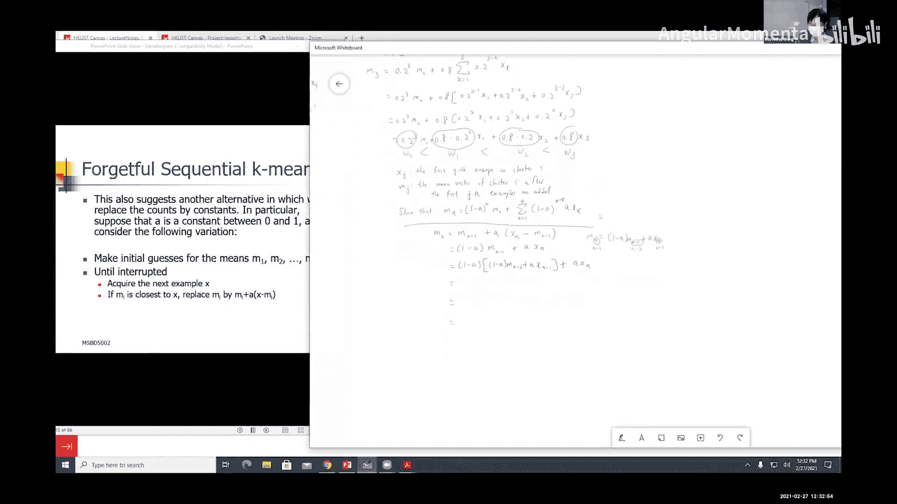

🎼Greater mining and noish discovery。🎼Iter mining it no N discoveries。

Do you talk it now， yeah。对。やり。嗯あ。我会 wait moment wait moment你 cannot hear you。Oh。

 we just transform the I。Im N2 into1 minus a apply。M the M N minus3 which maybe。Where。

 where are you talking about， You can use white color O。And according to the teacher， say。

 we get this。呃。We get this， and we just transform this part。Into this part。And others。

 we just copy them。And the next step with just to transform this part。呃。Unlike like， like the。

How to say we just transform this part， and then we can get this。And then we just ate the。

 the same things。And get。这次。And this is a。The okay， thank you yes， his her answer is correct。😊，Okay。

 thank you。 yeah yeah get the coupon point thank you。 yes。

 I think the student although some student may not follow from here to here。 okay anyway。

 let's see let me share my screen。😊，let me share my screen。In fact。

 the student is following what I'm doing。 and then just do some simplication for that。 wait a moment。

 I want to use this。 In fact， her answer is correct。 let me make it clear for some point first。

 Now I just want to M and2。 just put it together。 So this will become come one minus a square。

 and then this one， this two， we will combine。 we will have one a and then a X M1。

 and then the student will do it again and again， let me do one I don't write down the details actually。

 the student have already write down something like this just copy okay， this one。 M M2 is in fact。

 just using this one。 Okay， let use blue color。 In fact， the student is using blue color。

M-2 and then M-3 and then M-2。 put this blue color things inside to this dot dot dot and then copy these two things here。

Just it proof。 You can do it by yourself。 I just want want to capture the major idea。

 And then we will also do some simplification like from here to here。

 we do some simpl from here to here。 we also do some simplification。 Finally。

 we will have something like this18 also keep。😊，And then something like this。

And then you can see that we have this equation after we do this deviation。 Just copy。

 Just copy this two term。 Just copy this two term。And then。And then we will do do the deviation。

Dot dot dot， which is here。 actually， just do dot do。

 And then by your by something mathematical deduction or deviation， you can divide this well。

Maybe if you don't know how to do this deviation， okay， let me give some major hints to you。 Okay。

 in fact， you can do some observation。We are now this one。 N， M， N minus 2 and M， N minus3。

 And then we know that this will be equipment and equipment equipment equipment at the end。

 this will to end log at the end。We also observe that。This things。

 the sum of these two number must be equal to n。 Okay。

 you can see that the sum of these two number must be equal to n。

So we understand that this is M log M 0。 and sum of these two term must be equal to n。

 So we obtain this term。Similarly， I think you can also deduce that。 The next term is just3-2 this1。

1 M1。 So this correct。 And this one A let me see whether I miss something and then a copy。

 And then this one M-2， you can see that this is2。 this M-2。

 Also the sum of these two term must be an M-1 and one the sum of this two term must be one。

 Similarlyly， okay， we can divide the next time， I don't go through with you。

 And then just copy the the the last two term。 this one is this one and this one is this one。

 So copy And then based on this equation。 and then just keep this term here on the left hand side and the remaining one。

 which means the green color 1。Should be the sum that we see the green color one。

 The green color one is here。 Just use the location。 This is just put it here。 In fact。

 they are exactly the thing。 Okay， you can check it by yourself。 You can check it by yourself。

 wait a moment the green color haven't been done for this one。Here， good。 So we obtain this one。

 So we obtain that this is a correct one。Any question？If no question。

Then that's the initial value m not。 you can see that the m log。I eventually forgotten。

 as you can see on the top。Yeah。Let's see on the top M not0 point2 power to something。 And okay。

 this actually correspond to the total number of data points。 This will become smaller。

And recent example， we more weight than the old example。

 This is what we mentioned by this red color inequality。

This variation of K means is particularly simple to implement。

 and is also attractive when the nature of the problem changes over time and the cluster center drift。

 Maybe this word you don't understand， actually， what we mean is that the cluster center。

Wait more for the recent data point rather than the old data point。 So this is what we want to say。

And then we finish for all the caing clustering。

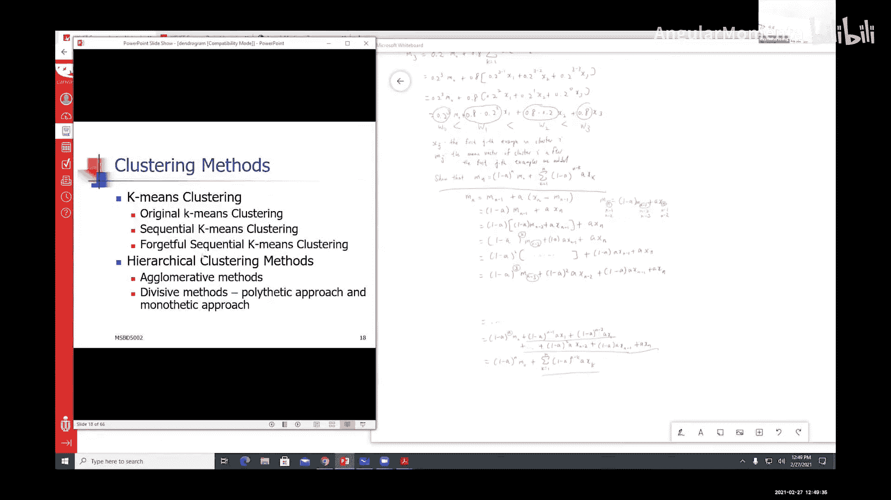

