# 【香港科技大学】数据挖掘与知识发现-｜-Data-Mining-and-Knowledge-Discovery-p08-05-03-02-1._层次聚类_引言--BV1gEFDzVEU3_p8-

The mining and noish discovery。Beer mining and noish discoveries。Today， we will talk about this one。

 hierarchical clustering method now go to De。

Herarchical clustering method， you can see that in the hierarchical clustering method。

 we have this approach a ofative methods and also divisive method。😊。

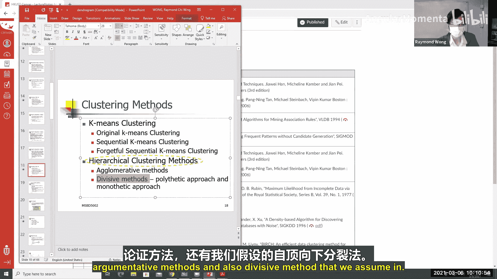

That we assume in。In fact， okay， this one in en， maybe this difficult to you。

 If I use some la language， maybe this is easy to you。Actually。

 this correspond to the layman Anguish bottom up approach。

For let me for this a the other method is called divisive approach。 That one is in fact。

 in layman language。Talk down approach。Top down approach。

 So you understand that the first one is bottom up。

 The second one is top down approach under the top down approach。

 we also have two approaches called effective approach and mono approach。

 which will will mention later。 at this moment， I want you to introduce what I mean by bottom up and top down approach。

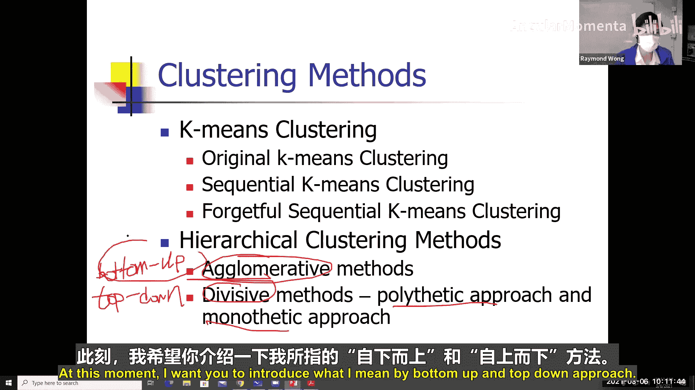

Now， let's see on the white board， on the white board。 Let's see on the right hand side。

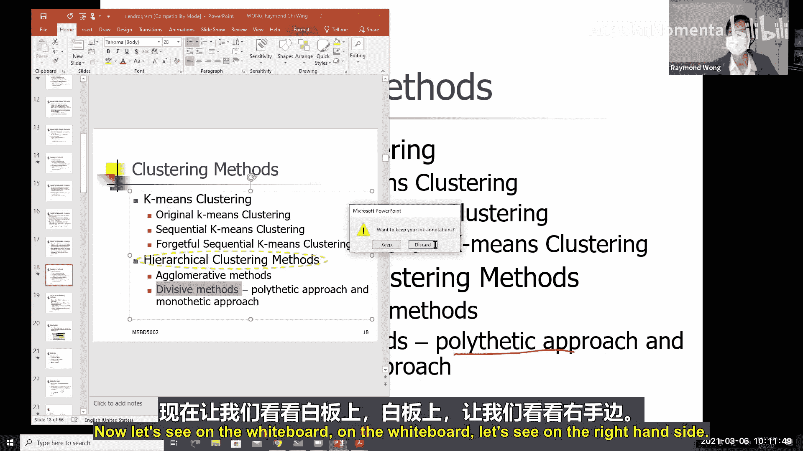

Now I'm using the whiteboard to write something。Let's see。First of all。

 we need to define what I mean by button and what I mean by top。What I mean by bottom。

 what I mean by top。 Now， let's see， first of all。Before that， we have some data points， for example。

 we have eight data points like this， suppose that we have this eight data points。And then this is。

 I call bottom。 Okay， let me use some color button。Oten。Butottton。

 and now I will finally go to the top。What is the physical meaning at the beginning at the bottom level。

 each blue dot or each point form a single cluster， form a single cluster。

And then the top level also some blue dot。把这。We have one single cluster containing all the data points。

So you can see the difference。 Okay， at the bottom level。

 each blue dot form a cluster at the top level， all the blue dot form a single cluster。

 So I think you can also guess the middles step here in the middle step。😊，From the bottom。

 I want to find the closed appear of the custom。 For example， these two are the closed appear。

 And then in the next level let me write down in the next level。These two， we be merge together。

Let we do something so that you can be clear。You can see that this blue may be the closer pair。

 I will merge this into two。 and then this will originally， we have8 cluster here。 Finally， here。

 we have 7 cluster。 And the next step， I think， I think you can also understand that。In this level。

 we want to find a closed pair of two customer， for example， this cluster and this customer。

 This two customer will be merged together to form a larger customer like this。

So let we put down the blue dot。And then you can see that。When we do the merging， merging emerging。

 finally， we form one single cluster at the end。 This is very simple。

 So this is what I mean by bottom up approach， a approach。😊。

Now let me talk about the divisive method， divisive method is the reverse one， as I told you。

 this is a top down approach， top starting from the top and going to the bottom。Starting to the top。

 I want to divide the large cluster into smaller cluster。

 smaller cluster and smaller cluster until that each blue dot form a single cluster。

 Let me do the first one。 Here we have one big cluster and then。

We just divide this large cluster into smaller cluster， for example， into this two smaller parts。

And then for this one， I also do the same things。 I want to divide this cluster into smaller cluster。

 Okay， which is。Oh let me see into this smaller cluster， which is 1，2， three，4，1，2，3，4。

 and then we will sorry sorry be one so be one， two and sorry using the blue dot。1，2，3，4。

 And then maybe this form this to custom。And then the。Rightright hand side。

 we will have these two custom。So we can see that this one top down method is divided cluster into two into two into two until。

All the customer form ones contain one single blue dot。 This is the divisive approach。

 Now you understand the major idea about the approach and divisive approach on the whiteboard。

 This make you understand the method to be into this later easier。 Now， let's continue。

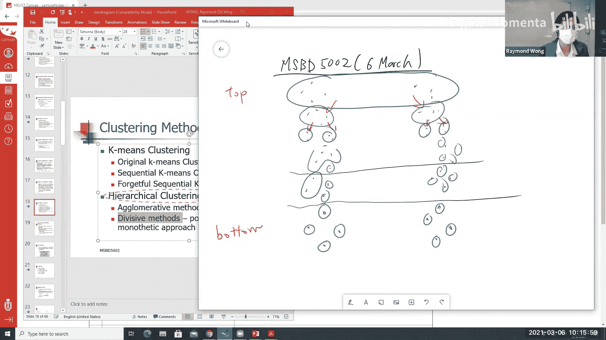

Let's continue。Herarchical clustering methods。The partition of data is not done at a single step。

 which means that we can do step by step。 Okay， one step merging step， merging step。

 merg step or partition， partition and partition。These a two methods of hierarchical methods。😊。

Ago method， button up approach， successively fusions of the data into group。

 which means we want to merge， merge， merge， merge。

Deisive opposed separate the data successively into final group which means we divide and divide and divide this is what I have mentioned Okay。

 before I go to these two approaches， I need to give the representation of this clustering method。

Thank Gilil Greg。Herarchical grouping can be represented in a two dimensional diagram known as dental。

 You can see that in this example， In fact， what we are mean， what we mean is that data point1。

And data point 2。Will be merged together in this example， data point1。And data point。2。

Since they are very close。The distance is equal to2。 The distance is equal to2。Then we will merge it。

 so one and two will be merged as a distant two like this， and then we found this。And then next step。

 palm 3 and palm 4 will be merged together at distant 3。And then finally， this is one cluster。

 and this is one cluster。 This two cluster， will merge together at the distant4。😊。

So we have this large cluster and this small cluster。 And then finally。

 this large cluster and this small cluster will be merged together at the distance 5。0。

 This is what this dentalogram mean， thisogram mean like what we are talking on the whiteboard。😊。

You understand this。Now， according to the dentalogram， in fact。You can know the customer。

 Suppose that I want to find two custom。I can draw a vertical call9， like this。

And then this cut one paw here。 and also second point here， this paw。 under we have this paw。

 this paw under we have this point。 So we are customer number one。And cluster number two。

 So if we want to find two cluster， we can immediately know that customer number one。

 we have point one and point2。 customer number two。 We have point3， point4 and point5。 Very simple。

 I think you understand the point。Now， never I ask you， okay。

 suppose that I want to find free cluster。 What are they who want to answer。Is very simple。

Who want to answer？ Yes Yannan。It should be cut at the。Between the distance 3 and distance 4。

Distance three is this draw our vertical9 here， right？

no horizontal yeah yeah yeah yes yes yes yes yes， yes， yes， this slide， yes， this line。

 and then we have this cutting point， this cutting point and this cutting point and then。

Family house three groups。It other one we have walked。3 and4， yes， customer 2， we have5。

 Yeah and the last one， we have2 and1，1 and 2。 Yes， so we have this free cluster。

 So you also get the coupon。 Thank you。Now you understand that based on the dental。

We can know the number of cluster。 Okay， remember that， okay， here， the dental。 in fact， we should。

 we can have have no public key at the beginning。 supposeupp that based on this bottom up approach or bottom up approach。

 I have this dental， for example， something like this。You can see we have something like this。

 suppose。I just want to make the motivation why we have the dental grant。Of course that。

 we don't know the total number of cluster in this data set。 For example。

 this data set contain five dimension or six dimension。 Now， actually。

 we draw the dentalgram in a two dimensional plot so that we can see that here。You can see that here。

 The distance is very large。 The distance is very large。 We slowly， okay， we can see that actually。

 this form to custom so we can find that we find two custom。

 So we know that customer one and custom2 are well separated based on this dentalogram。😊。

So we understand that even though we don't know the number of cluster in a six dimensional space or five dimensional space in the diagram。

 if we draw something like this， it is possible that we can see how many cluster there， okay。

 whistle。😊。

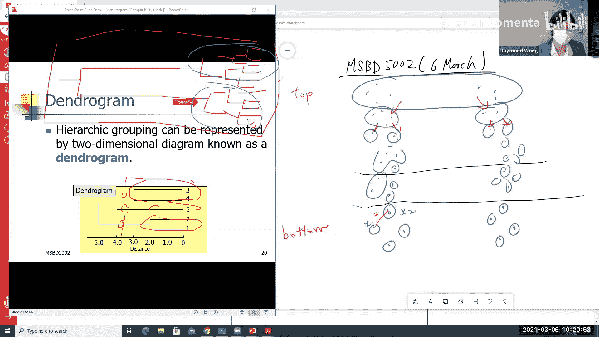

う。🎼Great mining and no discovery。🎼It mining and no N discoveries。

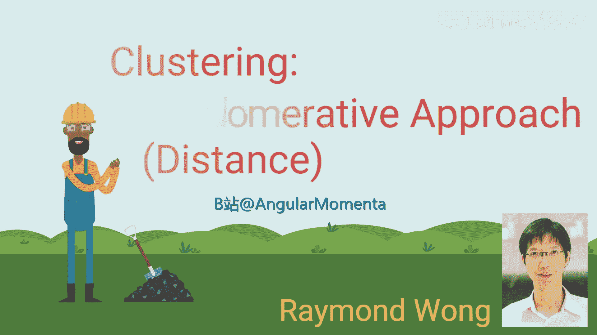

Now， before I co the algorithm， button up approach or top down approach。

I want to give the distant measurement between two custom， between two custom。

 let me less way on the right hand side。I think all of you understand that， okay。

 different one point。For example， this point one，2 the coordinate。 the other point， for example。

 the coordinate is 4，5。 You understand that we can calculate。This distance， you click in distance。

You确 distance。Very easily。 Okay， the distance is equal to 1-4 square plus 2-5 square。

 This is very simple。 We understand that we had the blue dot blue dot， then calculate the E distance。

 Now， my question here is another question。Suppose that we have some points on the left hand side and some point on the right hand side。

 This form are single cluster and this form and other cluster。

Do we want to calculate the distance between a customer and also an other customer。

What system should we use？In this night， actually， there's a five different possible distant metric that you will learn。

 But actually， this is a common knowledge you can also propose by yourself。

 who want to propose some distant measurement between two cluster。 Let's see。let see Zhengongo。

Maybe we take the。Maybe we take the average of average， What do you mean by average tangible。

take the average of points in a cluster。Air fish in the distant in the cluster， something like this。

And then then we use this average point to represent this group。

Air fish air fish length or the wet nice。As the distant， right？what you mean？I mean， not this one。

 can you elaborate again。We can take the So in each cluster， there are many points， so we。请开嘢。

So central point central points so central no problem let me write up first of all。

 we find the of example， let me use mean， we find the mean yeah。And then。

Then we use the mean to to calculate the Eucan distance between the mean Oh yes。

 we after we find the mean we find the distant Euclidean distance between these two mean and actually the student is just talking about central linkage Thank you。

Zihouang Zhou you have other possible explanation right？ could you tell me Yes。

 actually has been talked about okay， maybe maybe the closest point between what do you mean by closer what what is the closer point yeah for example。

 here you you can see two cluster and the closest blue do between I see for example， okay。

 the blue do this tool the one so the student also proposed a good yes。

 actually the student is talking about single linkage。Now， Chongshan。

 I think you have another Chongshan。Chongs we can also use the longest distance between any two points in a group。

 Yes， a longer distance， for example， the longer distance between two blue dot right like this。

 right？ Yes and then this is a complete linkage， right。Any more， you can propose。 Oh， yes， Z Yang。

 you can turn on your video。Okay， just like yes I could not hear you， Zngang。

正ang your mic has some problem。Hello， no， no， we could not hear you， Zheneng Yang。

We could not hear you。hello ， when you talk you can see your microphone诶 at the bottom or at the top即系 some some green color hello 张样。

Hello， hello， we could not hear you。 Maybe you have a have a test later。 now we could not hear you。

 okay okay now then we are find other student oh young carho。Yeah。

 I think we can use the mediumn of the point to media what do mean by medium。 Yeah， I guess actually。

 the last one is difficult。 Yeah， yes， how do we say medium。 Yeah， for example， if thats the5 point。

 So we pick the third point as the medium and calculate the distance between this two point as the distance。

Now we for example we are two dimensional one dimensional。 How can we find the media yeah。

 So we calculates called ordinary media and why and then calculate this two for use of the group and and then and then calculate distance。

Calculate the media for each coordinate great and then find the media for its coordinate and y coordinate we find a point right and here find a point and then calculate the eucan distance between these two point。

 right。Thank you。 This is one possible way。 actually。

 it's not the media linkage I will introduce next。No problem。 Okay， this is one possible。

 but this not the media linkage I will talk about next。Good， no problem。 Okay。

 you can also get the coupon。 and then I want student to guess this one through average linkage。😊。

Who want to answer啊其微。I guess this average linkage is like I measured older points to another older point。

 all points in the first group to the another group。And something like right for this blue dot。

 I have all the pink color line， right， And then this one。

 I also have all the pink color knife to all the blue dot， right， Yes， yes。

 and then we have a lot of pink lines， right， Yeah， and that's the distance。

 We calculate the average distance。 Yes， and then we calculate the average distance。 Yes。

 this is what we have。 okay， so up to the student answer。 we have already finished single linkage。

 complete linkage group， average linkage and central linkage。😊，The last one is difficult。

 I will talk about it later。We have different clustering measurement to measure the distance between two cluster。

How can we use which one， There's no universal judgment that which one is the best one。

 This depends on the user requirement。 Some user may think that single linkage is good。

 Some people may think average linkage is good。 Some people may think that the central linkage is good。

 So it is a user parameter， depending on the user need。

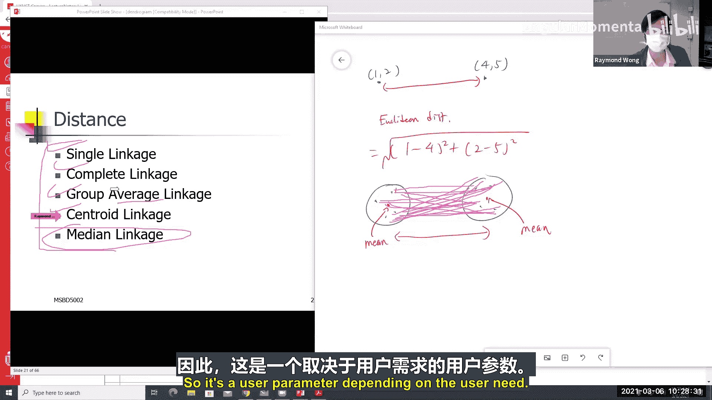

🎼The mining and no N discovery。🎼Be mining and noish discoveries。

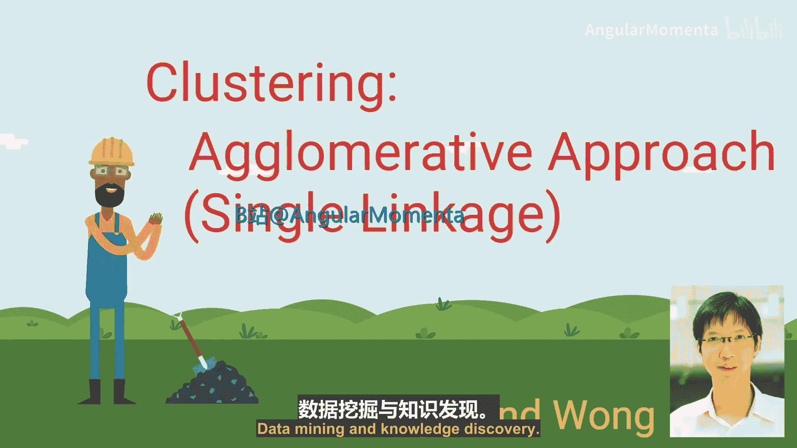

Now， let me continue。 Now， let's focus on the single linkage to illustrate the idea of this bottom up approach。

 the bottom up approach。Single linkage， also known as this neighbor technique。

The distance between group A and group B is defined to be the closed pair of the data where only pair consists of one record from each point from each group are considered。

 for example， customer A in cluster B， find the closed pair， which is this one。

 The distance between this dog and this correspond to the distance between cluster A and customer B。

 This has been answer by the student where is it Now， let me use single linkage to it for this one。

Now we are at the bottom。 we are at the bottom。At the bottom， we have each data point。

 in this example， we have five data point。 Let's see。 We have five data point。

 I want to illustrate on the white bottle that you know what I'm talking about on the left hand side。

 which is here。 This one we call this is called。Pair wise。Is the matrix？And then。This one。1，2。

 we have this one。 In fact， if I draw this on a two dimensional space， you will understand better。

 So suppose that we have these five data points。And then did we measure this distance between between X 1 and X 2。

This one， the distance is here，2。0。And then similarly， the system between one and three is 6。0。

 so we have 6。0。And similarly， I think you understand this is10 and this is9。

I think you understand this is just the distance between any two points。Now anyway ask a question。

 I think students also are very smart， why I didn't write down some number here who want to tell me why I didn't write down this number。

哦。It one题。Okay， because the distance between one and2 is just equal the distance between the two and one。

 So this is also the two。 So we don't right on the right hand side。 Yes， they are exactly the same。

 right， and also we can know that this is6。 This is 10 and also 9 So this distance matches is same matrix。

 So all the number here Okay in this upper triangle are exactly equal to the number in the lower triangle。

 So we don't need to anything good， you also get the coupon1 here okay， good okay。

 thank you then continue。 now we understand that we understand that。This is the distant mattress。

 Now， I want to go to here。 Remember that now， everything at the bottom。诶 form single customer。

F single cluster。 And then I use this example for illustration。 At the beginning。

 heavy blue do form a single cluster。 And next， I will find the closed pair。

Here you according to this matrix， you can see that the smaller distance is 2。0。

 which means that I want to find the closer pair， which is this x1 and x2， I will combine it。

 combine it， I will combine it so this one will be or maybe let me have have so that this should be here X1 x。

It 1，2，3，4，5。 and these two will now become one cluster。We mature it。

 and then let me use some annotation on the right hand side。 So we understand that。Now we have one。

 two has been merged and then we have three， okay， the cluster with data point3， four and five。5。

And then 1，2，3，4，5。 We still draw the pair distance of all the cluster up to now。 We know that， okay。

 this diagonal， everything are0。Now， let's see。For this one， this number is 4，5，4，5。

 which means three， just copy3。For this one，3 and 4，3 and 4， this number is 4。3 and five。

 which is five。 I think this is a very simple。However， for this one。And this one。

What is the physical meaning， the physical meaning is that the distance between this cluster three and the distance and the cluster containing one two。

 which is here， let me draw here， which is this one。😊，Now we are using single linkage。

 single linkage means that I want to find a closed appear。 we understand that。

 let me see some nine here， we understand that one and three， one and three， this is 6。0。

And then we know that two and three， okay， let me see  two and three is 5。0，5。

0 since we are using single linkage， single linkage means which one。

Is any student who want to answer， You should turn on your questions so that I will call you。呃，卡冲。

Hello， yes， hello， yes。 Tell me what is the the number。 The distance between 3 and 1，2。 What is this。

 What is this answer。 should be5。0 Yes，5。0。 The reason is correct， correct。 Yes。

 shortest distance between the point。 Yes， yes， should be Yes， thank you。 Yes。

 I think you understand the point。 Similarlyly， okay。

 I think student can also can do this very quickly。

But you can also do the original method like on the right hand side。

 This is the fundamental definition。 And then we can do it according to the right hand side。

 And then right here， In fact， I want to give you one short hand for this question。 Now。

 you can see that  one，2。We have three。These two should be merged together we know that point3 one。

 we have six point32， we have five since we are using single linkage here we have these two value okay。

 you know that we're six and five in fact we just pick the minimum one so the shorthand is six and five pick the minimum minimum one five and then this one in fact is here pick the minimum one is nine。

And then here， pick the minimum1 is 8。 So I do it very quickly。

 Now we have this updated distant matrix。And then Z， if you have no question or down your hand。

Now we understand that the smaller， the smaller distance is here。 drawaw the dental brand。

 We know that one and two will be let's see one and two will be merged at distant to。

 And then based on what I illustrated， I have this this black color matrix is exactly the white color matrix。

 Now you understand it。 Let me illustrate one more more one more iteration。 Let me erase everything。

Next this is the the result we have move to the left hand side， similarly， according to this one。

 we want to find the close appear this time， let's see the close appear。 Oh。

 this one is the smaller value。 We want to merge 4 and5 now， let me merge4 and5。Now。

 I want to merge4 and 5， merge 4 and 5。 Similarly， I also do the same things let me do it。 We have 1。

2 here， and then 3， and then 4，5， and then also 1，2， and then 3， and then 4，5， similarly， we have 0。

And then since this is new things， let me consider the first one，1，2，3，1，2，3，5。

And now the remaining process is related to four or five。

I think smart student can also know that I can use some shorthand。 who want to answer Tian。Yes。

 first1，1，2 to the 4，5 is a。 Yes，8。This one， then another one is4 and other one is for good。 good。

 Thank you。 Yes， you get the coupon。 So this is very simple。Now go back to this slide。

 we find the close here。Which is three。4，5，4 and 5 will emerge at distant three。

And then by some update， okay， we will have this matrix exactly the red color thingss。 Okay。

 I don't go through with you。 Maybe erase this。😊，And then we have this right hand side and then go to the left hand side here。

 Similarlyly， we find the closer pair。 I don't repeat again。

 think you understand the step you can read it by yourself Here， we find the closer pair。

 which is this one，4。0 So3 and 453。And4 five， we will merge as distant4， we similar process。

 you can take it at home where this one move to the left hand side and then find the closer pair。

 which is this one。 Then the distance is 5。0。 This one will be merge as this 5。0。

 So we have this dentalogram。This is what we have learned about the bottom up approach using the single linkage as a distant measure between two custom。

Any question？

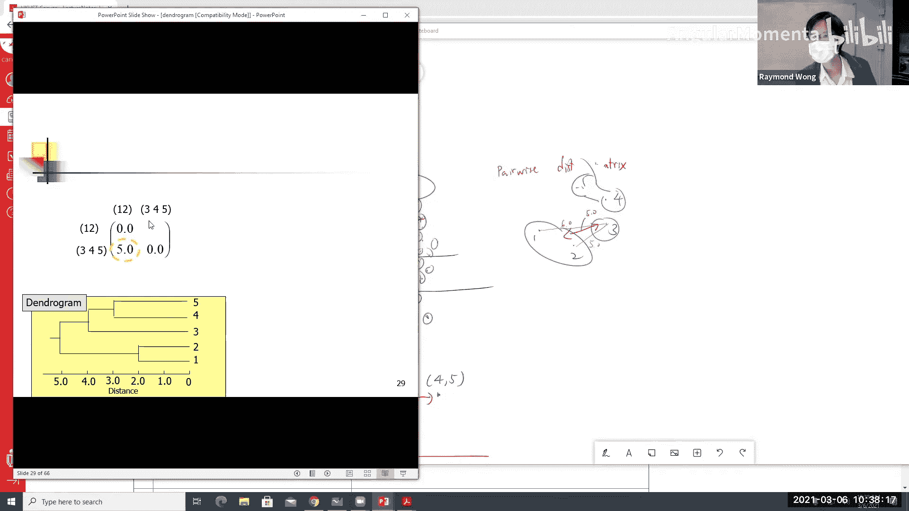

🎼mining and noish discovery。🎼Beer mining and no N discoveries。

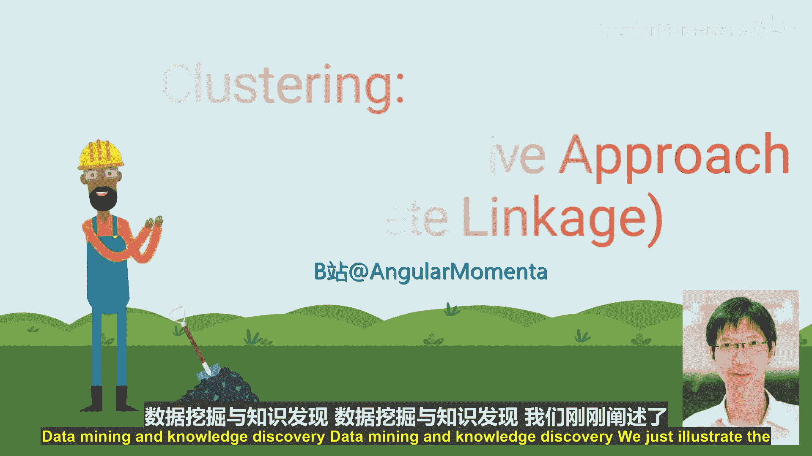

We just illustrate the idea about using single linkage。

 The bottom of approach can also use using complete linkage group air linkage。

 central linkage and media linkage。 Now， I want to illustrate one more。 complete linkage。

 exactly the same example。The distance between two cluster is even by the distance between the most distant member。

 Cu A and Cu B， find the father's pair， as we mentioned。

And the distance between this point and this point correspond to the distance between cluster A and cluster B。

 very simple。 Now use the example to illustration S example， Similarlyly， we find the closer player。

 which is 2。0。 We know that one and two we be merge at this distance too and let me do it very quickly exactly the same process。

 but this time we are using sing complete linkage。We are using complete linkage。One， two。

 and then three， four， five， exactly the same process。And then just copy。

And then also use the blue color， using the blue color or green color。

And then I can also use shorthand， although I didn't talk about here， Okay。

 I think smart student also can know how to do it。You should turn on your we so that I will call you mean how。

Yes， can you help me？ I could hear。 The first one is 6。 Yes，6， good。 The second one is 10。1， yes。

 the last one is 9。 Yes， good。 This we using complete blankets。 We want to put the larger one。

 which is this one。Good， and then let me see。 Okay， And then we have this answer。 Okay。

 let me erase this one。And then after that， going to the left hand side and then also pick the smaller one。

 okay， which is 3。0 four five。And then three point zero distant。 And similarly。

 we also have this one。 Okay， let me do quickly。😊，I just want to give this idea to you。 Also  one。

 two， and then three， and then 4， five。And then 1，2， and then 3， and then 4，5。

And then with have0 and0 and0。 Similarlyly， this is equal to 6。 And then we use the blue color。

And then circle out。And then who want to answer next？呃，为为民。hi hello yeah。Oh can you hear me？ Yes。

 I could hear you。 Oh thank you。 Oh I think1，2，2，4，5 is 10。10， yes， and 32， 4，5 is 5。 Yes， fine。

 Thank you。 Yes， correct。 So you understand the point。 So we have this answer。

I also don't go through the details in the later process。 This is where straightforward。

 find a closer pair，5。0，345，345 will emerge at 5。0 and then do some process can check by your home。

And then we have this distant matrix。 Find a closer pair， which is 10。

 So this one and this one will be merge as 10。 So we have the dental ground。

 You understand that the bottom out approach can be applied to different distance measurement。😊。

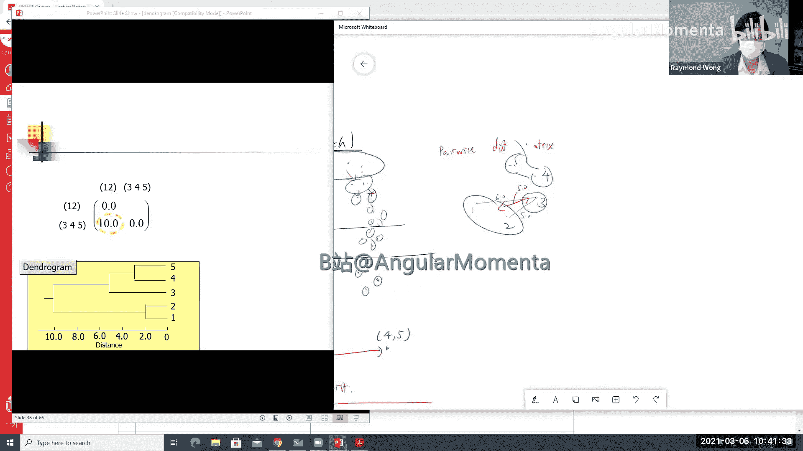

🎼The mining and noish discovery。😊，🎼It mining and noish discoveries。

Now we will give the definition of group F linkage central linkage and media linkage this too has been either way on the way but since students answer。

 let me repeat again。😊，The group average linkage or custody。

The distance between two cluster is defined to be the average of the distances between all pairs of records。

 one from each cluster In this example， customer number one and customer number 2。For you thought。

For example， this this stop， draw an line to all the opposite point。 we have free night。

 and then for this one， we also have three nights。So obviously point and then take the air length of the red color actually。

 this means that all the white color lie the links。Divide by 6， the total number of nices here。

 the air fridge， the air length of the website night correspond to a distance between cluster A and customer B。

 very simple。Now go next。Sanral linkage is also very simple。

 some student have already answered that the distance between two cluster is defined to be the distance between the mean or the two cluster。

 The distance between cluster A and cluster B is exactly equal to the distance between small A and small palm B small A is exactly the mean or cluster A and small palm B is the mean cluster B。

 So where cluster A calculate the mean defined in our previous letter cluster B， find the mean Okay。

 we have this mean and then calculate the distance between these two yellow dots and then this correspond distance between cluster A and cluster B。

 very simple， right。Now， go to the next one medium linkage。Before I go to this window linkage。

I want to ask this question。 I want to ask this question so that you know the rationale。

 why we have the media linkage。The poster on the left hand side， are four points。

And then on the right hand side， on the right hand side， I have a lot of blue dog， a lot of blue dog。

 I think you understand that。 Sorry， Okay， green， green color。We have。今日カスタヒよ。

In the algorithm approach， in the algorithm approach， Finally， okay。

 we will merge this two customer into one customer， understand。Before we do the merging。

 we understand that。This is， we can expect the mean is here， right。

 And then if we have some bluelu dot calculate the mean。😊，The mean is here。

If you forget what is the mean， the mean is equal to the sum of all the points。In this cluster。

 divided by the total number of points， This has been discussed before。 This is also the same。

 The sum of all the blue dot divided by the number of points。 I think is very clear。 No。

 suppose that。These two cluster will be merged together。 will be merged together。

 These two cluster will be merge to a single cluster like this。So they will become larger。

 become larger。Become very large like this。 and then we know that we have four points here and many top here。

Let me ask you a question， originally， the mean is here， originally， the mean is here。

Suppose I draw a knife from here to here。 Suppose I draw a knife here。Let me give some example。

 Suppose that this one is the midpoint。Or these two mean。Let me give free choices。

 suppose that we have paw a。旁飙。And also， paw see。After we merge these two small customer into this new customer。

 do you expect。The mean of the final cluster is a is B or is C。 who want to answer the V。

I think it will be C because we have， yes， yes， because we have more point in close to C。

 So they have the bigger weight。 Yes， bigger weight and more more points。

 And then this contribute and more point will will towards to the right hand side。 So the final mean。

Typically near to see see， right， right， thank you， yeah。Now， actually。

 I think this is understandable， but some people think that this is not fair， not fair。 In fact。

 they think that。Customer one and Cu2 should have equal in importance。

Although here we have a lot of points here。This may be a correspond to minority。 okay。

 maybe recently we call a matters。 This is the minority and this is the majority。

 They think that they are equal importance。When we do the mergerrging between these two customer。

 this mean and this mean should be very important。 So finally， the mid point。

 the mid point between this white color things and this we color things correspond to the center。

Of this custom。I repeat。In Indian linkage， actually。

 media means this we dot and this we dot take the midpoint Indian actually Indian。

And this mean point become the center of the merger customer of the merger's customer。

Let me illustrate way on the slide here。The disadvantage of the win method， we calculate the mean。

 the central linkage， wearing a large cluster light on the right hand side here is merged with a smaller smaller one。

 which is this one。 The central， which means the win or the combined cluster would be closer to the larger one like the student answer see。

That is the characteristic properties of the smaller one will be lost。

 So everyone fires twos to the large customer。 So we have no thing representing the minority。

 so not that equal。😊，In the middle linkage， this is the definition after we have combined two groups。

😊，The mid pond or the original two cluster center， which is a pump B here。

 will be used as the center of the newly formed group。

 This is the definition Now let me give more detail。 let me give more detail。The detail is。

 as follows。Now， let me give a smaller example。 give a smaller example。Now。

 suppose that originally we have one，2， three， four，5，5 data point that we label is as x1， x2， x3。

 x4， and x5。Maybe let me make it closer so that you understand this。Now。

 in the process in media linkage， understand that the algorithm group research approach。

 everything at the beginning。The each blue dot form a single cluster。

 each blue dot form a single cluster。And then at the beginning， there's a concept called center。

 not mean this center， I call center。 this is a new definition in media linkage， this is center。

 not mean。The center is defined to be the coordinate of the points here。

 The center of this cluster is exactly the coordinate of X1。

 The center of this cluster is the coordinate of this x to understand。Bank proceed。

 bank in the algorithm approach。 we want to merge the close pair， suppose that。

These two are the closed pair。And then we merge， we merge， and then we merge into a larger cluster。

This is the original Pluto。😊，And then now， since these two smaller cluster are merge based on what we define in the media linkage。

 what we are doing is that。According to the original red color dots door are9， find the big。

 This is the mid。This is the report。 So this will become the center。Of this custom。

 the center of this custom。So now we understand that the original center can be removed。

So we understand that the center of this new customer is this one。

 I think you it' easy to understand。 Let me continue。 Let me continue。 suppose that。This time。

These two are also the close up here。 Of course， I will merge these two cluster into onesymmetrically。

 similar to the previous case。 just draw a line。From this red color things to another red color things。

 we also also find this center。 I think this is understandable next。

Suppose that these two cluster are the closer pair next， I will merge I this is this will be merge。

 let me merge merge it。I want to merge it。And then we have larger cluster。

 the center here of this one is just draw a line。And this is the bit paw。This is the report。

 This wave correspond to the center。Or discuss the containing these three blue dot。

 So this is the center。 understand。 And then if these two are close pair at the end。

 then we will merge it。 Okay， I will merge it。 Okay， we will merge it。 let's see。

 I just want to make it clear so that you understand the Indianian linkage。Mer， and finally。

jo a blue do do do do and then the mid here。This red and this red。

 the big point here correspond ball to the center of this cluster containing five objects or five points understandable。

 So media linkage is defined as this one。If we have the center， suppose。

Suppose that on the right hand side， based on what we have learned。We also can find the center。

If we want to measure the distance between this customer and this customer。

The distance is exactly what we have learned before， just。

The distance between this center and this center correspond to the distance between cluster  one and cluster 2。

So we have defined he。

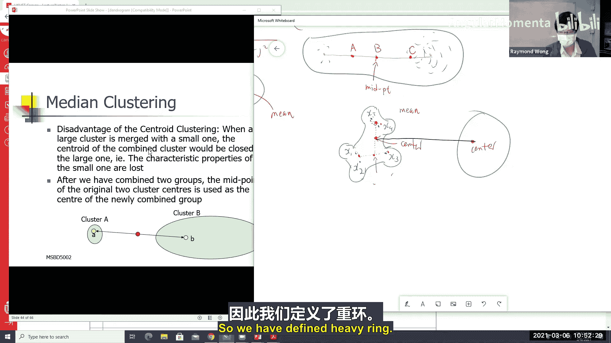

🎼The mining and noish discovery。😊，🎼Neither mining and no N discoveries。

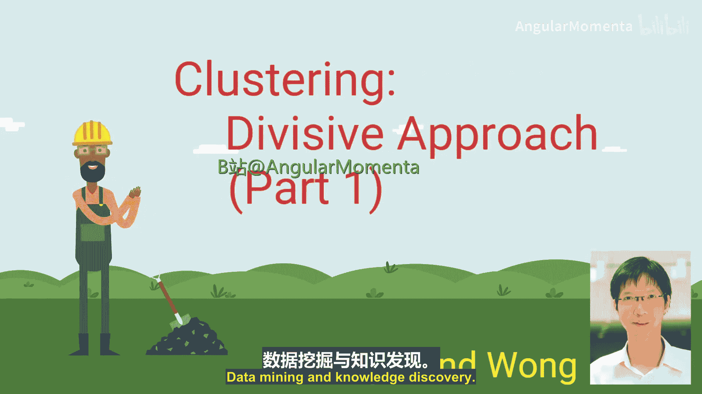

Now， go to the divisive approach， divisive approach， as I mentioned on the whiteboard。

You're just the opposite。We divide the cluster into two smaller cluster。

 and then this cluster will divide to two smaller cluster and so on until each blue dot form a single cluster。

 Now you understand this。 Now， go to the divisive approach poly approach first。In a devices approach。

 we start with the assumption that all the data points form are single customer like this。

We then use a distant quality with single linkage， complete linkage group F and so on to divide the cluster into two。

And then subdivide the cluster until a stopping criteria， which， for example。

 each blue dot from a single cluster。We have polyetic approach and monophatic approach for polyetic approach。

 we divide the data on the value by all attribute。Poly poly means all the attributes。

 Monfric approach。 We divide the data on the basis of the procession of a single specified attribute。

 So this one is all the attribute。 This one is the one single attribute。

 But well talk about in detail later for this one。 Now， let's see the polyfric approach。

For poly approach we use all the attributes similarly we can all this measure single linkage complete linkage group average linkage central linkage and media linkage now let me focus on group average linkage this can be applied to single linkage complete linkage group average linkage you can see that this one I use a bigger example we are seven data upon。

😊，And then this is the pair wide distance matrix。This time。

 let me use the white box to illustrate the major idea。

You understand my ideas that divide into two divide into， actually， we are doing these things。 Okay。

 we are doing this things。 We want to divide this into two。 we use this on the whiteboard。Now。

 let's see。 at the beginning， we have 7 data points，1，2，3，4，5，6，7。 Okay， we have 7 data points。One，2。

 three， four，5，6 and seven data point。 Let's see what we are doing。First of all。

 we will calculate something called distant one star Let me tell you what they are doing now let me write down pong one。

 you can see that this is point number one and then now let me ask this one as a one single cluster。

At the beginning， we know that this is one single cluster。

 What this step is doing is that one star let me write down。 in fact。

 this is doing something like that。This stuff think all the computer science student or book data student。

 You know that stuff means anything here in this location is all points。Except point one。

Except point one， except point number one， be careful。

So what it means is that now we have point number  one，2，3，4，5，6 and 7。 Okay， now is 2，3，4，5，6，7。

We will be a single customer。This is part of Po 1。 And similarly， we will also have porn 2。And so。

 let me write down one。1，3，4，5，6， and 7。 So here we also have this one。

And I think you can also guess what I'm doing next， let me z out a little bit。

And theyll be right on top top top。T talk， talk。 And then finally， you understand that at the end。

 we have 7 here。 and then one。2，3，4，5， and 6。 We have something like this。What I， why I do it。

 Let's see distant one and start。 Actually， I want to calculate the distance between this one and this one。

 Let me draw actually， the red color things。I will draw next。This one， this one one star。

And then I also calculate the distance。To start and also the distance between 7 star。

 Maybe you don't know what I'm doing next。 Okay， I will give the major idea later。

 Now we have one star here。 Remember that we are using group average linkage， group average linkage。

Avalanche K means that the distance between this green color cluster and this green color cluster is exactly this one。

 Let me do it。1 and 7。 Okay， let me write down first1 and 6。

 Let me draw all the black color phone first。Tistem 1，2 can be found here is 10。110，1。

3 here can be found here，7。And then one，4 is 30。 Okay， let me write down quickly，30，29， and then 38。

 And then this is 42。 We understand that this is the group average linkage。

So we understand that actually， this one is exactly equal to what who want to answer it。

 who want to answer this one。 What is the equation。啊Please turn on the camera。 okay，冲锋ong冲锋ong。Hello。

 yes can you hear me yes， I could hear you yeah okay then calculate of link yes the what is the formula here can you tell me the formula which is1 plus seven plus  thirty plus twenty nine plus  thirty8 plus forty two over six yes correct thank you。

 thank you yes。So you understand that， actually， based on this equation， we obtain 26。 Similarlyly。

 we can also calculate D2 stop。D2 star， D，3 star， and so on， and so on。

 and so on and so on and so on。 Okay， so we all this one。Remember that what we want to do。 Okay。

 let's see what we want to do。 What we want to do is that we want to divide the large cluster into two smaller cluster。

 The characteristic is that this smaller cluster， all the blue dot are close to each other。

 All the blue dot are close to each other。 However。

 the blue dot here and this blue dot here are far away from each other， far away from each other。

 This is a major idea。阿怕因土席。Now， we have one。2 up to 7。 We want to move one point out first。

 let's see which， which point are more far away from the remaining points。 Let's see which one。

We can see that 26 is the most farthest away from the remaining points。

 so we will remove this point one。From this large cluster like this， like you can see here。

 point1 will be on the left hand side， group A， and the remaining point will be 2，3，4，5，6，7， x。

 Let me write down on the whiteboard。 Let we erase something first erase。And then continue。Now。

 the current status is that。I have already moved palm one out。Let me use blue car。 Qua1 is here。

 And then 2，3，4，5，6 and 7 in other customer。 Now， we are in this stage。

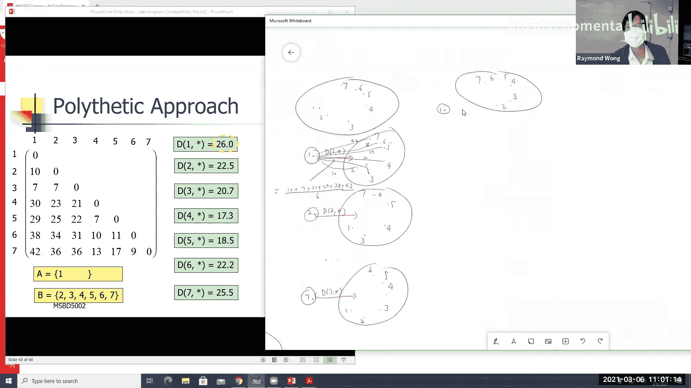

🎼The mining and noish discovery。🎼It mining and no N discoveries。

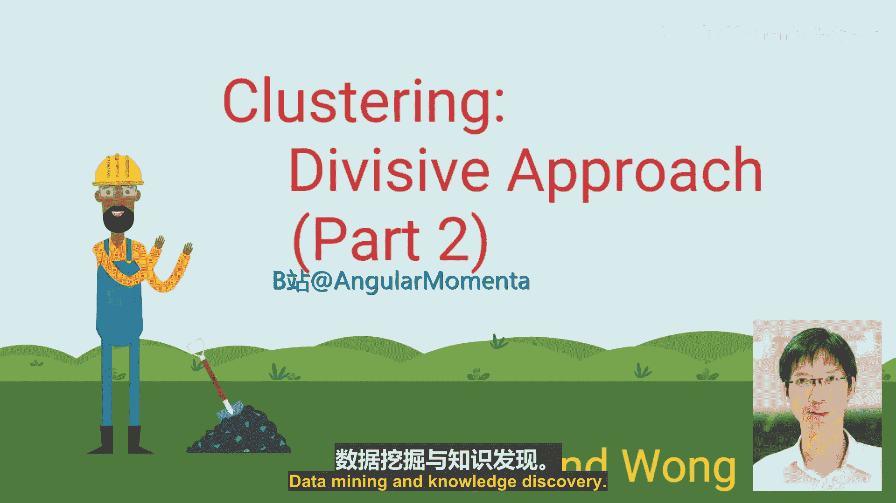

In the following process， I want to remove someone out and put it inside so that they are far away from the remaining cluster。

 Let's see what I'm doing Now here， distant 2 a， okay， let's see what we are doing。

 Now we have already finished one what we are doing next year as follows。B follows。Let's see。

Here we have a Po one。And then we have a soil， we have a three， four， five， six， and seven。

And what they are doing is this one， considering point2。 So we have point2 here。

 This is their method， their method。Pon two。And then， green color。

Now what they are doing is similar something like this Now I extract point2 out from the remaining one。

 which is here point2 is here I want to measure the distance between a and this point actually this is distant to a。

Ist than 2 A， which is consistent with here2 a。And then distance 2 a is very simple。

 I think most students also know that。If I draw a single nine here， we are using group F linkage。

 we have only one single nine this distance is exactly a one distance between one until one and two10。

 so very good。And then point number 3， paw number  three， we still also do similar things。 Okay。

 the left hand side， point1 the customer  one is here。 And then we also have the right hand side。

 This time， we will extract point number 3 in the middle。 And then let's see。 we have two。 sorry。

 used should be blue color，2，4，5，6 and 7。So we understand that we pick out the pawn three。Out here。

 and also calculate this distance。The3，8。 And then I also dot， dot topt。 and then finally。

 paw 7 point 7。And then we have point7 at the middle， one， and then2，3，4，5 and 6。

 And then we have this cluster and this cluster。 and we know that we are calculating this  seven8。

So this is consistent on the left hand side， can see 3 a 7 a and song do and then  seven a17 years。

 42 and then。Next， you can see that I intentionally write something like that。 In fact。

 I will do this one。 This one means， let me see。 I also calculate the distance between this the middle cluster and the right hand side cluster。

 which is D to B。 Let's see the powerPo。啊，为什么问啊为什么问啊。I want to use annotation this one。

 remember that B， okay， we have 2，3，4，5，6，6，7，2，3，4，5，6，7。 Currently， they pick two out already。

 In fact， this is consistent with what we we wrote。 This means all the points。言 b。Except。碰。2。

 except 02， except 02。Ex's a point to。So you understand that we also can calculate the group average linkage。

 Okay， let's see we have this one and also some line here。

 I think student can also know how to do it。😊，This one is equal to some number divided by 1，2，3，4，5。

 divided by 5。Go want to tell me。啊婉亨。Prohiemia。Yes， yes， what it was the what is the equation。 Yes。

 Could you tell me are the luerator of this equation here。 Yeah。

 is 7 plus23 plus25 plus34 and plus 363436。 Let me see this What you are top is 7，25，25。

44 and 36 divide by5。 Yes， correct。 So you understand this one。So we have after using this formula。

 we have 25。 and then similarly， we can calculate the remaining one。D，3 B and so on。

 And also top top talk at the end， we have this one， D 7 B， D 7 B。

 Let's see the animation in the powerpoint。We finish all then。But what is the use for this system。

 In fact， the most important is here， we will calculate a value called deelta。

Let me calculate the delta。After you understand the delta， you know what I'm doing now， Delta。

 Delta2。😡，Delta 2 is just this number。Minus this number， which means this length， minus this length。

😡，We have 15。And then that has three。😊，And and so on， we have Delta 7。 So let's see our PowerPo。Now。

 we understand we have a lot of deelta。 Some are positive， some are negative。

What is the physical meaning of a positive value， What is the physical main value of a negative value who want to answer。

Let's see。Chongshan。If Delta is positive， which means that the price is more closer to A。

 and it has a far distance of to B。 Yes， thank you， yes。Yes， good。 Now Chongs understand the concept。

 If Delta is very positive， this point will be closer to this one A rather than B。

 So we we think that this point should be put into the left hand side at left hand side 1。

 remember that we want to separate the whole cluster into two smaller group。

 such that the left hand hand side should be close to each other and far away from the remaining one。

 So this achieve our purpose。 So now let me find the deelta which one is the largest one。

 we find one164。 So we will move point 3 to this cluster。

 So we can see that point 3 will be moved here。 So finally we have one，3 and 2，4，5，6，7。

 So let me do it on the whiteboard wait moment of erase something first erase。 And then I want。

ToJo on the robot。 Now， the current result is。We have one， three， and then the remaining one is two。

 four， five， six。7， and then we have this result。 We have this result。

And then let me move a little bit on the right hand side。Good。

And now the process are in the remaining is also the same， also the same。

 If you understand this process， this is the large cluster 2，3，4，5，6，7， we will process 1 by1，2，3，4。

5，6，7。 And then we have D2 A and D2 B and so on。 And then we have Delta。

 Let me start with a link the first few step。 and then you understand what do。 Now。

 the next step is that I want to consider point2。Which is this one。 And then the next one is paw 4。

 which is this1，5 and 6。 can see that。 I also top top top。 And at the end， we have paw 7。

I think you can follow it。 So here， similarly， on the left hand side， we have one three。

 we have one free。then 1，3。And then1，3。 and then we have the green color， one clusterer。

 one clusterer， and then one clusterer， and then the right hand side， we also have a big cluster。

 we have a big cluster， and then here we have 4，5，6，7 here。four five six seven。

And then the middle one is 2。 The middle one is 4。And then here， we have。2，5，6，7。 And then finally。

 at the end， we have 7。 we have 2，4，5，6。 and then draw this one。 we have some， something like this。

 Similarlyly， we can calculate。The distance， this was a2， a， and this one is2 B。And this one。

Distance between4 a and distant between4 B。 And then finally， we have distant 7， a and distant 7 B。

 And then we also understand that we need to calculate the deelta， the deelta。And also， the delta 7。

 the delta is equal to this value minus this value。 Let's see In fact。

 this has been years way on the powerPo D2 a， which is this one， D4 a。

 which is this one and so on and so on， D7， a， we are doing something like this， and then D2 B。D2 B。

 D 4 B， and then D 5 B 7，6 B， and 7 B， and then calculate the delta。

 the delta2 this number minus this number and so on， as also mentioned by Chongshan。

 we want to find the one with the greatest deelta value。

 which means which is more far away from the remaining points。 So here 21 is the greatest value。

 we will pick this one。21， so point2 point2 will be remove this large cluster put here。 So finally。

 our cluster will become like this。ないです。ラッシー。The customer will have。1，2， sorry， blue color，1，2。

3 on the left hand side， and then 4，5，6，7 on the right hand side。

 we have one cluster and other custom。 Similarlyly， we also do the same。 I， I will not draw it。

 Actually， this can be can be fine in the powerpon。Here。4our，4 a，5， a，6， a and  seven， a，4， a，5， a，6。

 a and  seven a。And then also， we have B。4 B， 5 b， 6 B， and 7 B。

 and then calculate the delta this one minus this one。No heavy things are negative。

We have no positive。 What are the physical meaning， What is the physical meaning meaning here。

 Go on to answer。Please raise up for your hand。 My question is that in this stage， all the points。

 the deelta value are now negative， negative， negative， No positive value here。

 What is the fiscal meaning， What is the fiscal meaning in this scenario。

 Could you illustrate way here， Who want to answer。You can turn on your web so that I can call you。

If no what can turn on， I cannot call you。Seeing year and also Yu， you have no weekend open。Yes， a。

 Okay， it means all the points are closer to the big big group。 Yes， if all the points are negative。

 which means all these points are closer to B， right， So they are very close to B rather than a。

 right， Yes， Thank you。 Yes， So we understand the cluster。 Okay。

 all4 point4 are close to this remaining point 5 are also close to the remaining point 6。

 also close to the remaining point。7 are also close to this points。

 So we should not remove this point to group A。 So we should not remove。

 So we already done our purpose， our purpose is to divide the whole cluster。The whole cluster。

 this one into smaller group group A and group B， we， we are done。 We are done。

 All the differences are negative。 We are done。 What I mean by done is that we have already finished this process。

Smaller group and smaller group， we have already done this process。However。

 the process could continue on each sub， which means here let me use annotation we just done this step we have just done this step。

 In fact， we can also do the same for the remaining point to divide it into smaller group to divide into a smaller group this can be done until some stopping conditions is which for example。

 all the blue dot from a single cluster okay like this。So we finish any question。If no question。

 let me continue。 We just talk about the poly approach。

 The reason why we call this poly approach is that we use all the attribute。 Okay。

 we understand that the pair distant matrix this distant is， in fact。

 calculateulator based on all the attribute upon one and also all the attribute upon2。

 So this is the reason why we call poly approach。 we use all the attribute upon one and all the attribute upon2 to calculate the distance。

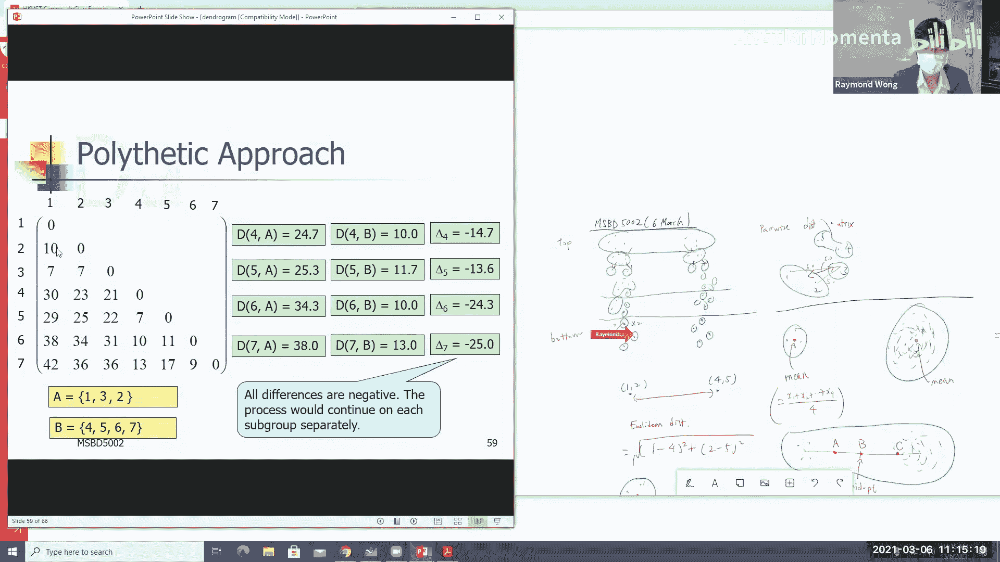

The mining and no niche discovery。🎼It a mining and no N discoveries。

Now go to this one more noic approach。 Let's see what it it is。More noveltic approach。

Is usually used when the data consists of binary attributes。 For example， we have record number one。

 record number two up to record number 5。 We have attribute A， attribute B， attribute C。

 And then this 1，0，1，1，0，1，1，1，1，0，1， and so on。 know that they are all binary attribute or variables。

Before we go further， we need to give you one concept called Ti square measure。

 this pronouns as kind， not cheap。Ti square measure。 how to do it。 Okay， you can see that。

We have a complicated formula here。This formula， actually。Measure， okay。

 let me write down on the right hand side。 Wait a moment I want to erase something go further go let me see I go here。

 wait a moment I need to find my whiteboard to go to this place Yes。

 go here now I want to tell you is that。This one， what I mean is that。

We want to calculate something like the correlation。Between attribute A and attribute B。

Ti square A B， I want to calculate the correlation between A and B。Between a and B。

 you can see that we have a complicated formula here。 What is this take this table as a look， Okay。

 we have a。2 possible value one and0， B， withre two possible value  one and 0，1 and 0。

 And then you know that this number is the total number of webs with a equal to one and B is equal to one。

 Let's see Let me use some annotation。 This three means we have three we cos。

With a equal to one and B equal to one， so three。This one means that we have a equal to0 and B is equal to one。

 which is this one and this one， no record with a is equal to1 b is equal to0。

 This one means that we have one record with a equal to0 and B is equal to0， so we have this a table。

Now， let me teach you how to remember this complicated equation。 Many student also find difficult。

 Let me teach you how to do that。 Let me remember together so that you know how to do that。

 Let's see。 Let me write down chi square A B。开 square a。And then equalco， let's see how to do that。

 Let's see here。Make cross。across。According to this9， this931， and we write down three。1。

 this three one。Should be have a product free multily by one。 The reverse ordering。

 I also write on sale。Multiply by one， easy。 remember if you make a cross since this is your reverse diversion。

 negative， negative。And then just think that the above one should be have a square。 Remember this。

And they multiplly by the total number of records here，5。And then we finish the numerator。

 which means the upper pub。Now， go to the。Bottom part， the bottom part is very simple。

 Well let's see。3 plus1，4。Se plus  one，1。 Now， let we do the column 3 plus 0，3。1 plus 1，2。

 I draw all the blue color， right， Just ported on this blue color for。Multiply by one。

Mulultiply by  three， multiply by two， then I'm done。In翻电衣衣服 us。In fact。

 it's easy for us to remember this formula Ti square A B。 Okay， now you can see the PowerPo。

3 minus0 square multiplied by the total number of pointss and then divided by four，3，2，1，4，3，2，1。

 I have already teach you how to remember this equation。By your calculator， we have this one。

1 point x，75，1。875。 Now you understand the equation。 Now。

 let me give you some inition behind high square。Okay， maybe some student have learned it before。

 Let me ask some students who have learned it before。 What is this chi square mean。

 I I just say correlation between A and B， Could you give some physical meaning to me who want to answer if you had learned high square before。

😊，Okay， maybe most students haven't known it。 It doesn't matter。 Let me do it。Now， actually。

 high square A B， in fact， measure the correlation between A and B。 Let me give two example。

 example one。An example too， these two example can allow us to understand what is the meaning of high square。

 Let me do it。Now we have a。B。😡，And then we have this one，1，1，1，1，0，0，0 and 0。A b。And then this 1，1。

0， maybe so 1，1，1， and 0，0。Now you can see that on the left hand side。Just by human。 Okay。

 you see that if we have a value one here， we also have a value one。Yes。

 two record also matches what we have if we have zero， we also have a zero but our intuition。😊。

A and b。Are very。Core， right， a very correlated。 This is about intuition。 Now。

 take a look on example 2，1，0。However， in other record， one。And one。

 So it seems that they are not consistent if this is 0 and then one， and this is 0 and 0。

So you can see that， actually， in this case。A and B。Are not correlated。

 Maybe I say in very independent are very independent。This is what we find， according to the table。

 Let's see a kind square。I don't go through the calculation。 Let me write down the answer。

 You can check it by yourself。 High square A B on the left hand side is equal to4。

 The right hand side， high square A B is equal to 0。You can calculate by yourself at home。

You can see that if this high square value is very large。

And this should be these two attribute are very correlated。 If this value is nearly equal to 0。

 they are very independent。 So my conclusion， my conclusion。但系。

If high square value have a higher value。Then these two attribute are more correlated。

 These two attribute are more correlated。 This is the physical meaning about the high square can do more example。

 and then you see this pattern。Now， you understand the physical meaning of high square proposed by some mathematical people or statistical people。

 they find this is very interesting that if this value is larger than these two attribute are correlated。

This will be used later in the clustering method， Let me continue。Continue。 Okay。

 let me put this on the left hand side。 and then we just calculate the correlation between A and B 1。

67。 this small ABC D is just this one。 And N is the total number of data points。 In fact。

 we can also calculate the high square between A C and B C， Okay， you can check this at your home。

 we have this high square A， high square B C， Okay， you can check it by yourself at home。

In the following。What I'm doing is the clustering method。 Okay， let's see what I'm doing。

For attribute A， for attribute A， attribute A。We will do the following。 We will do the following。

And then you will understand why and do it。 Now， let's see。Before I go further。

 let's see on the left hand side first， suppose that currently。We have two attribute。

 not free attribute。 Then you understand the process on the left hand side。

 see on the left hand side， Let's see。 I use green color。Suppose that。

 all right to all this is A and B。And I also draw here， A and B。I think student are very smart。

Suppose that I draw all the pointss on this two dimensional plots。

 You can see we have two blue dot here， two blue dot here。1，1 and 0 and 0。 For this one。

 we will have。4 blue dot here， according to this， you can find that if A and B are very correlated。

 are very correlated。We can find some customer like this。 We can find some customer like this。 Okay。

 if A and B are very correlated， we can find some custom。 However， for example， too。

 if they are very independent。 Okay， you can see see they are independent。

 All the blue dot spread across the space。 We could not find customer easily。Based on this intuition。

If this is more correlated， then its easy for us to find custom。 So now we have three attributes。

What we are doing is that using this high square， thanks。For attribute A， what I'm doing。 Yes。

 I want to find。The average correlation between A and B and A And C。 So here。Here。

K square a B and high square a， o， the they want to find the average correlation。

 Let me write down average correlation。Let me write on average。Coallation。Between。A。And an attribute。

 and an attribute。And then。The sum of this a， the chi square divided by two， I will tell you why we。

 we do not need to multiply one over two later。 Okay， supposeupp that we have one over two。航听有。

And then we have this one divided by two。And similarly， for HO B， we can also do similar things。

 We can also have divided by two and divide by two and divide by two and then。We have this one。

 and for attributebue， we can also calculate A C and B， C。

And then we also one over two and then we make a clear bracket and then A and B C， Okay。

 everything is within here with B and then we have divided by two and then。3 all five。

 you understand that we have something like that。 and we on the。

 we know that if they are more correlated， it's more likely that they have some custom。

 So based on this intuition。This method， find the one have the largest average correlation between attribute ABC。

And then attribute。 let me see oh， this one is the larger one。

 And then we will use attribute A to split the data point into two parts。 Let's see okay。

 now this is the monohartic approach。 This different from the polytic approach。 Currently。

 I know that attribute A has a high correlation between this attribute and other attribute。

 I choose this attribute A。 that we use attribute A can we use annotation。

 Now I understand that currently I choose 8， only one attribute。

 we understand that this attribute have only two possible value。 this value 1 record 2，3，4。

 and also record 1 and record 5。 So we can split the record into two parts。1 is2，3，4， the other 1，5。

 You can see that we choose attribute A for spliting and then we divide the data points into two groups。

2，3，4，2，3，4， have the a value is equal to one。😊，And then 1，5 have the a value equal to 0。

 So here we split the data point from the dental grant。 Okay， let me draw。

The dentalogram like this suppose that we have one， two， three， four， five， one， two， three， four。

 five like this。And then we can divide the point into two plus group a。And also group B， group A。

 we have 2， or3，4。And N B， we have one and five here。

This is the divisive approach using one single attribute。

 I think also smart student know that we can also proceed this process。

Again and again and again and again， we just finish here。Any question？Any question， If no question。

 Okay， let me elaborate more for this。 See， we understand that in this step。

 we just choose the greatest value。 You know that everything is divided by two， divided by 2。

 divided by 2， divided by2。 So we understand we know this process。

 So it doesn't matter that we divide by two or not since everything also divide by2。 So finally。

 we don't need to divide by2。 So finally， we do not need to divide it by two like this one。

 So we can also do the same process like this。Any question？

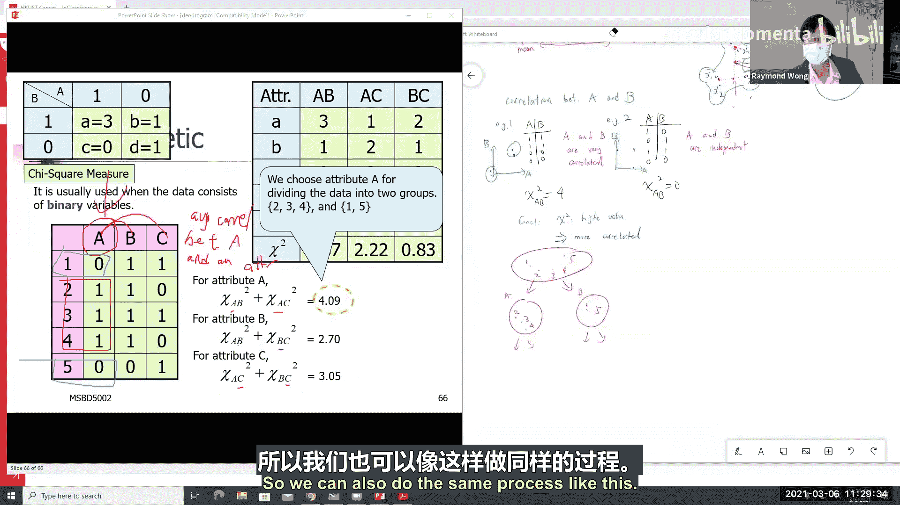

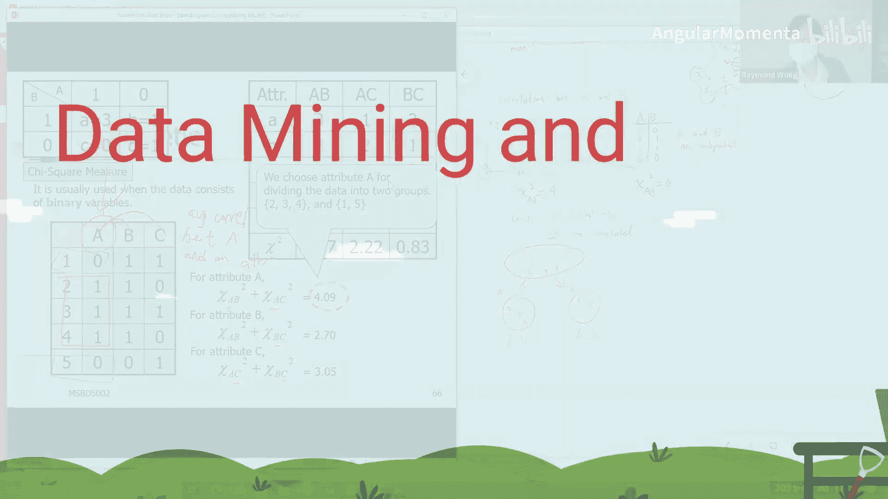

