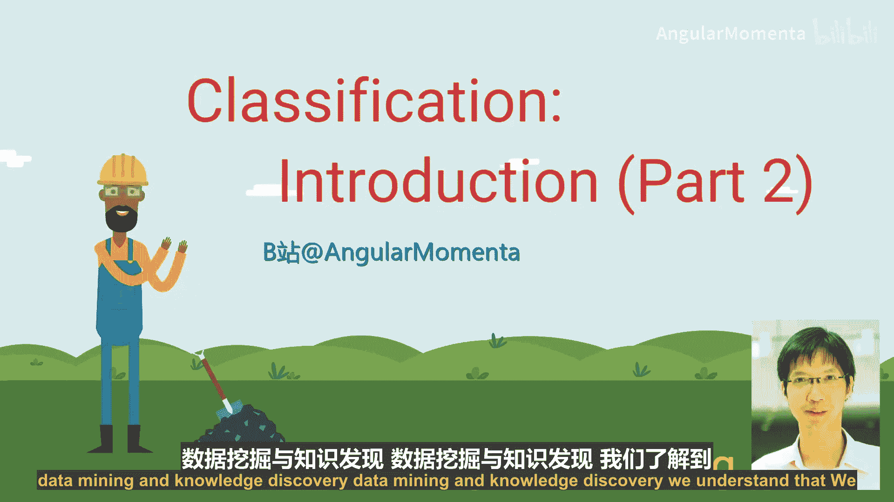
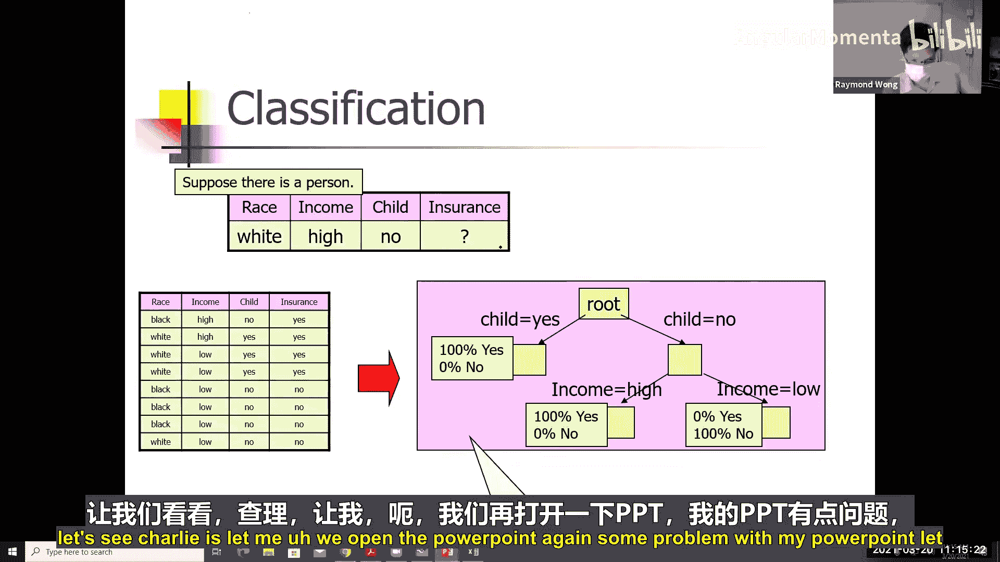
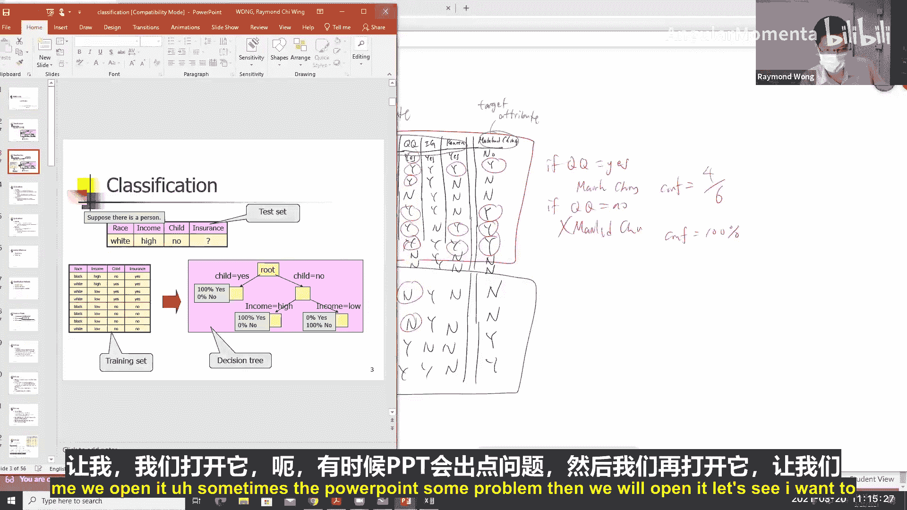
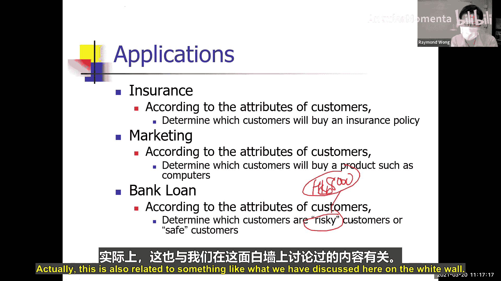
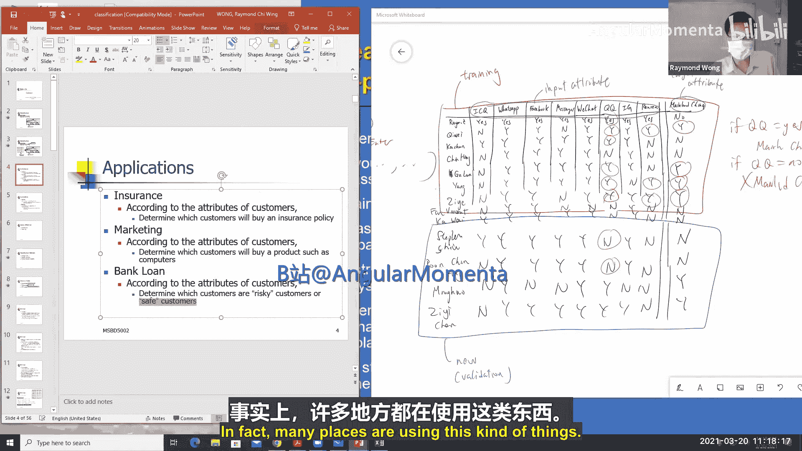
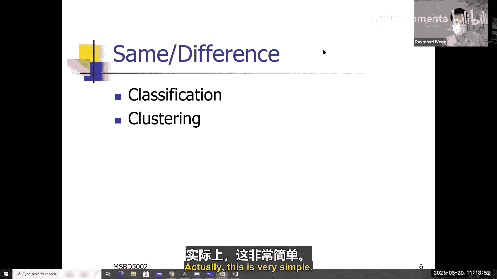
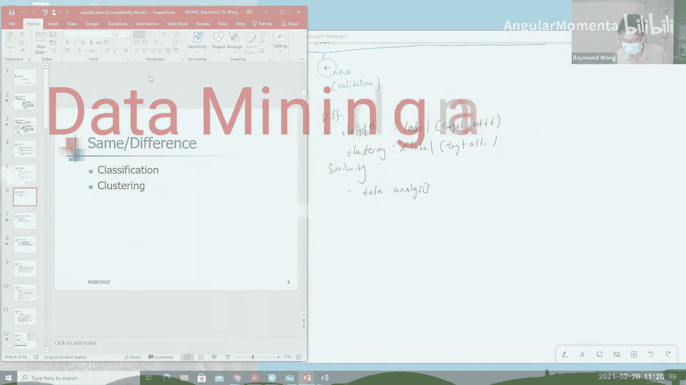
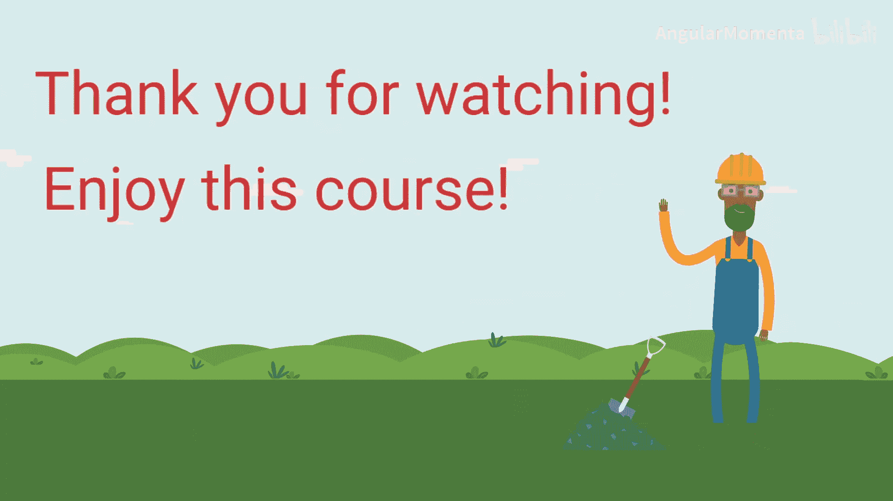

# 【香港科技大学】数据挖掘与知识发现-｜-Data-Mining-and-Knowledge-Discovery-p09-07-01-02-1._引言_第一部分--BV1gEFDzVEU3_p9-

う。🎼Be a mining a noish discovery。🎼Da mining and no N discoveries。

Now we have classification and then with some example before I go to the example。

 I want to use an example which are closer to your life， closer to your life。

 which is some student example， let me see where I wrote maybe I let me write here。Then we wait here。

With a moment Well， I want to use some examples so that you can part more more familiar wise with this topic。

 Now， let me start with。Me， let me write down， Raymond， Raymond。And then， for example。

 I'm a person in UST。Let me see。I want to see whether I have something。 let's see。Let's see。

 Do I have ICQ account， I think ICQ account。 you know that which is old people to use that and the old people。

And then。I think most people， if you are now in Hong Kong。

 maybe you also have Whatsapp account now if you are now in Hong Kong。

 maybe you create your Facebook account。And also， maybe you also create the Facebook Mesenger。

And also， I also have this。And also。Some people in Hong Kong also have Wechat account， and also。

 I also have Qq account。And I also have the IG account。And also， I also have Yuan yan account。

And now you can see that we have many， many different account， we have many。

 many different account and then。😊，And then now my target， I want to see。

 I want to predict this student or this person， whether this one come from mainland China。I say no。

 I say no。Now， let me see some student who want to get EQ point today。

 or I just fill in your name and then you just tell me whether you have something like this or tea wave。

yes， okay， yes， I could hear you。 Let me write down your links to， yes。And then tell me， yeah。Yeah。

 so I do。 do not have an ICQ account， yes。And I do have the Whatsapp account， yes。

I have Facebook account， Yes， but I don't have the messenger account。 Yes。

 I do have the Wechat Q Q account， yes。And I do have the IG account， as well as the rating account。

And then finally， yes， thank you。 You want to also volunteer to do that cartoon。

卡通啊 hello其诶 louder louder hello hello诶 maybe let me here okay诶诶 can you speak。😊，helello hello。

 can you okay， I just my wallet here。 okay， yes， I could hear you now， yeah okay。Yeah， so I have。

Or do I can accept the last one。Except the last one。 Let me see。 yes。

 whether you come from mainland China or not I know。

 and I come from Hong Kong Yeah you come from Hong Kong。诶 thank you let me see全衡 right全衡。Qing，Yes。

 can you hear me， I can hear you。I don't have ICQ。Yeah。And I have whatsapp。

 Facebook and Facebook Meenger and Wechat。 Yeah， I don't have Q Q。I have I G。

 and I don't have the last one。Thats one yeah and then you come from I don't come from meeting in China。

Thank you。And also， let me ask。Car龙卡龙。hello， yes， k long yes let me wait down hello sorry sorry卡 long yes yes。

 i don't have q q and。1 one， The last one。 Yeah， the last one。 and then happy one you have， right。

 Yes， and then you Hong Kong。 you come to Hong Kong。又 come from Hong Kong。你是啊曾洋曾样系。hello。

 can you hear me Oh yes， I could hear you I dont have ICq you don't have ICq I have whatsapp。

 Facebook， Yeah， message Wechat，  Q q。yes no no no not i g no i you have wechat write and q q啦 yes no and and q q yeah。

呃，2 one。I come from in China。 Yes， thank you。 Yes， let me see my stat first。 Yes， no， no， yes。

 let me find to 1，2，3， Oh，1，2，3， one more Let me see。Let me see。 Let me wait a moment。

 I want to find one more main name China let me see。

 yes wait a moment so that we have more number okay。是子烟子烟。yes yes。Yes。wait a moment wait a moment。

 yes，呃 yeah。그， yeah， continue you。I don't have S CQ and messenger， and I have all the others。

 all the others。 Thank you。 and I'm from Milan China。 Thank you。 good。

 Now now we have all these statistics。 I just want to say that。We have some statistics like。

 We have some statistics like。Now， with some statistics like this let me find some more student to answer this one。

 but I want the student do not tell me the last column， the last column。Let me see。Stephen。一本。

sorry Stephen hello professor yes are you shoe shoe are are your name in the A r o is Stephen okay。

 no problem。 I can find you okay。And then could you tell me all the attribute。

 except the last oneDifferent。 I have all of them。Yy and Qq。Except y y and Q Q。Good。Thank you。

And then let me ask P Chng Fng。Hello。Hi， can you hear me。 Yes， I could hear you。 Okay。

 and I don't have ICQ Q Q and run run and I have other No yes， yes， no。

 I don't I don't have ICQ run run and Q Q。Yun y and Qq， yeah， and everything you have right yeah。

don't tell me the last one and mean mean hello hello。

 hello I whatsapp and wechat and Q q andt Whatsapp系 wechat。And Q， Q and Q， Q others are no， right。

 yes。Let me find one more person。Z I call before know yeah yeah yeah i do have iCq and you you you didnt or you you have I do i did not did not have this two right I saw sorry maybe let me out you do not have the iCq account and right and happy one you have right。

一。ok now okay， wait a moment。 now we have four more students， Stephen。😊。

Pun Ch Fong and also Bing Hano and Zhu Y， We don't know this one。We have an other data set。

 We have other data set。 This a circle out in the blue color 1。 I think you will understand now。

We have the first data set， this data set usually we call。Training data set。

 we call training data set。What do we mean by training since we learn something and then we want to train our model to be learned later。

 And then this blue color things， sometimes we call a new set。😊。

Maybe sometime maybe we can have the core validation set and so on。 Okay， But in this example。

 we just say new set。 we don't know whether this student coming from mainland China we。

 but we know some attribute before it。This attribute， usually we call。 Okay， let me circle out。

This one， since we know our heavy about this， we call input attribute。😊，We call this input attribute。

 And then the last one， you can see that I have a clear objective。😊。

I want to predict whether this student or this person coming from mainland China， this one has way。

 a good target。 We call target our target target attribute。 I'm very clear。 at this moment。

 we know this student no yes and no yes and something yes， no and so on。 Now。

 let's see this red color training set。Now， and the company。

 I want to see whether the student coming from mainland， China or not。

Then let's see now let me try check check check check and then let me circle out something。

I want to predict， yes， let me circle out and then。Let's see啊。嗯。run润啊 let see。I find。And等qq。你是q q。

嗯 that see。I think the statistic is not enough anyway。 Okay， I know more okay in the world。 Okay。

 anyway， okay， now based on this staistic， let's see。

 I want to predict whether this person coming from mainland China， let's see if Q Q is equal to yes。

 see if Q Q is equal to yes， we have many want to。😊。

Let me ask one more since we have only one person without Q， Q。Let me ask them some more。

Who did not do not have Qq account and want to fill in the blank。

 I just want to have more statistics here， we do not have enough statistics。Maybe winson， Winson。

Hello， Winincent， are you here。let me write down your name first winson your name have also winson right现现 a r okay let me write down winson only okay。

Could tell me the remaining one yeah， I only have whatsapp louder louder louder。

 we cannot hear clearly louder。 I don't have I cq。Yes， don I do have Whatsapp on Facebook。Sorry。

 louder， and maybe I could not hear clear hear maybe wait a moment， let me adjust the volume first。

You canI have Facebook and messages。Yes。Yes， I do not have Wechat and QQ and Rmin。

Q Q and then then you I you have I G， right， Is that correct is what wecha you do not have， right？

 Yeah， that's correct。II correct or not correct， correct。 correct。

 So this is what I wrote is correct。 So what you mean is  Q  Q is also no。 Thank you。

 I want to find one more person without  Q  Q account so that we have enough sta。哦， let me see卡位卡位。

H hello yes， I could hear you。 I dont have Q Q and y You do not have Q  Q and others yes right yes yes I just want I want to ask you why do you have ICq account account I think the old people just using ICQ account Why did you Why did you use I t CQ account。

Very long time go couple okay， thank you。 okay， okay car we you are coming from mainland China or not from Hongng kong from Hong Kong。

 okay， thank you and also win some fun。😊，Where do you come from， Hong Kong， Hong Kong。

 so do also not film convenient in China。 Thank you。Now， we have enough。

 since I just want to have more no。 Now， let's see， if Q  Q is equal to yes， let me see 1，2，3，4，5。

 We have five of them and then how many coming from China。 Oh， no， I have one more here。

 we have six of them and then and then coming from name China。😊，Let me see the confidence。

 Let me write down the confidence。 The confidence is eager to1，2， Let me see。 Let me count it，1，2，3。

4。4 out of six， four out of six also over the 50%。 So we have also high confidence and then if Q Q is eager to know if Q Q is eager to know not coming from Lname China。

 let me see 1，2，3。 So the confidence is eager to 100%。😊，Now， we understand that if Q。

 Q is eager to yes than coming from mainland China， the chance is more than 50%。

 if Q Q is eager to know are this student not coming from mainland China is exactly 100%。

So let me see this one。 Now， this is the rules we learned。啊From this table from this table。 okay。

 now let me check it。Let me check gear。Let me see。 not this one。 no， no。Let's see this， too。

This two guy， Stephen， are you here？Stephen Su， Stephen Xu。Are you here， Stephen， yes， yes。

 let me ask you now， I I based on what I love an other student。I know that you have no Q Q account。

 You do not come from mainland China。 am I correct。Correct。Thank you。 Also pun Qng。Yeah， yes。

 I think you also do not come from mainland China， yes。

So we are very smart to use this white color things， right。

 now let's see the later one being how I think that more than 50%， I cannot assure。😊。

You are more than 50% coming from mainingland China。 Am I correct， correct， Thank you。 Yes。

 and also Ziyi。😊，可意。So understand。 okay， so we understand that it seems that we are very smart。

 if we use the white color things。 Now， let me conclude。 Okay。

 I think of you have your background knowledge。 we know that Q Q are attributes related to mainland China。

 However， in practice， we have a lot of data。 we have some input attribute and the target attribute。

 We want to do some data mining or some data analysis to find some input attribute is related to some target attribute。

 This is what we want。 and we want to find some hidden knowledge about the color things in the training data。

 And based on this web color things。 we want to predict some student to predict something like the target attribute。

 So we understand this is very useful。😊，🎼Be mining and noish discovery。

🎼Beer mining and no N discoveries。

We understand now。We have the new customer， for example， the new customer。

 some raise are equal to white income is equal to high。 child is eager to know and。 We don't know。

 Okay， this is our target attribute。And then based on something based on our training set。

 input attribute， and then the target attribute has already filled。

 and we can find this kind of red color rules like a Q Q is yes and coming from mainland。

 China or not。😊，And you can see that actually， if we follow this these things， okay。

 light are red color rules。😊，Let's see。 Chao is it let me we open the powerPo again。

 some problem with my powerPo。 Let me we open it。

Sometimestime the PowerPoint is some problem that we will open it。嗯。Let's see。

 I want to use the annotation in PowerPot。你试会啦。No。Now this is the child is eager to know we are in the root child is eager to yes and child is eager to know go to the right hand side since child is eager to know and then now income what income income is eager to hide go to left hand side。

 So this green color means that we have the 100% confidence to predict this person。😊。

We buy an insulin zone policy。 so we will predict this customer will buy an insulin policy at the end。

So this is very useful， as we mentioned before， this is called training set。

 and this is called test set or new set and so on。 And then this one in the today lecture。

 we learn about decision three。 and actually， there's a lot of applications。😊。

In classification insurance， you can see that according to the attribute of the customer。

 we want to determine which customer will buy an insulin policy。 Okay。

 or will buy a product for marketing， According to some input attribute， for example。

 the customer or customer， we want to determine which customer will buy a products such as computer。

And Bang loan。According to the attribute of the customer。

 we will determine which customer are risky customer or say customer。

 I want to highlight something here since many students are now in Hong Kong。

 and then maybe you apply for the credit card。 Okay， in one of the bank in Hong Kong。

 maybe your credit limit are not many， for example， your credit limit。

Maybe something like eight thousand， I don't know the current your credit limit in your credit card is  eight0。

Actually， this is also related to something like what we have discussed here on theboard。

 So student which coming from for example， from some country。 Okay， which。

 but they also get the credit limit only 8000。 The reason is not whether you have a which family and the reason is something like that you are here and they predicted that maybe you are the risky customer。

And the reason is that some similar student before will be studying the big data before and coming of the same country。

Or a similar background。 they are also classified at whisky customer。 And then when you come here。

 they also think that youre whisky customer and you may not return better money。

 Then they will get give you 80 Hong Kong dollar credit limit， However。

 if you come from some country， okay， which are safe which means the past student return the money safely then you will have a higher credit limit。

 In fact， many places are using this kind of things。

And networking， according to the traffic patterns， we want to determine whether the patterns are related to some security attacks and software。

 According to the experience of the programmer， we can determine which programmers can fix some certain bumps。

There's a lot of applications。😊，And now we have learned classification previouslyly。

 we learn clustering。😊，Could you use some layman language。

To say the similarity between these two and the differences between these two actually。

 is very simple。 I think most students， if you just have some analytical mind， you can also analyze。

Who want to answer Cheng Shaang。Yes， in classification wait a moment since I I just volume too large。

 Okay， let me wait a moment， let me lower down the volume in our classroom first。Yes， okay。

 you can see it now。 Yeah in classification， we already have the label you are talking about the difference。

 right。Now， the student is talking about the difference。 The first one。

 the classification theres some label。 I haven't defined label。

 Some that student means that you have already learned this before， right。😊，yes。

 yes okay I will talk about what I mean by label late later yes and then clustering do not have label no label let me let me re this。

In classification， we have the target attribute。We have the target attribute we learned before。

But here we do not have a target attribute。And similarity。

Both of them needs to separate the the data points into， into several groups and。Okay， yes。

 both of them also need to separate into different group。 Can I say in this way。

 Maybe I let me make it higher level。 Both of them are also for data analysis。 Is that correct。😊。

Just analyze the data。 Yes， thank you。 Yes， you I I think your answer is also correct。

 I just make it more general。 Both of them are also doing an analysis of there on the data。

 So we understand that it's easy for us to find the similarity or differences between these two。😊。

