# 【香港科技大学】数据挖掘与知识发现-｜-Data-Mining-and-Knowledge-Discovery-p10-07-02-02-1._决策树_ID3算法_第一部分--BV1gEFDzVEU3_p10-

🎼mining and noish discovery。🎼Beer mining and no N discoveries。

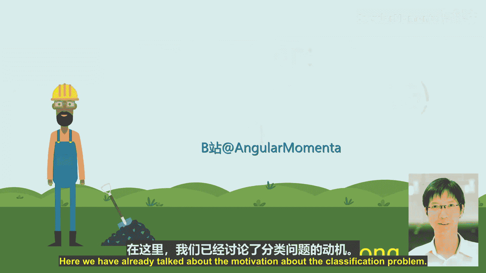

Here we have already talked about the motivation about the classification problem now go to the decision trail。

Here we will learn three variants of decision three The first one is called I3 usually we we use this abbreation。

 the short form this called iterative deconomizer in norm and C4 or5 is a classification version 4。

5 this version  three and card is classification and we question three。We usually recall cut。

 first of all， we focus on ID3 first。Now， let's see its also using en。 Entro is use a web common。

Data mining， and also machine learning。Consider a random web。

 which has a uniform distribution over 32 outcomes to identify an outcome。

 We need a label that takes 32 different values That by between sufficient are label this is a easy let me this way on the variable here with moment。

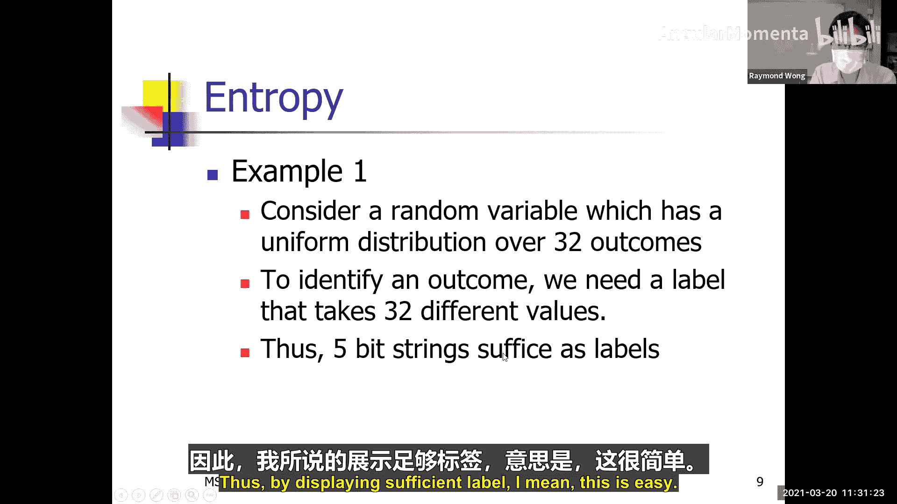

嗯。Let me see where I am。Let me find where I am now。 I'm here。 Okay， I'm here。 Okay， now let me write。

supposeupp that we have a show we have a five B。 we have five B。And then。

We just this and all of them sew， seal， seal one and then and then finally。We have this one。

 To we know that we have 32 possible outcome here。So we define its。And then， continue。

As we mentioned in our previous previous topics of space clustering entry is a measure to measure how informative a note is。

 This is what we have seen in the space clustering。😊，If we。

 if we are given a probability distribution。P1， P 2 P， N。Which means that we have n possible outcome。

 each outcome we have the probability one， probability two up to probability n。

Then the information capture in this distribution also called entropy of this distribution yes。P1。

 which is the probability multiplied by lot phase two。😡。

Pbity one plus probability two multiply by log base two probability two plus dot dot dot to probability n multiply the log probability n sum and then finally minus all lot are based maybe it is difficult for you to understand with this a general formula。

 Let's use this example for illustration use this example for illustration。Now， first of all。

 suppose that we have two possible outcome， we have two possible outcome。😡。

And then one possible outcome， we have the probability equal to0。 one， for example。

 then we write down。Example one， example one。Where the probability equal to I suppose that we are to account。

 the probability that are tellss occurred is equal to 0。5， the probability that had occurred。

Is equal to0 on fine。 The entropy is exactly equal to。This formula， the entropy。Its equal to05。

Just copy this number and then lost 0。5。And then plus  zero。5， this has been learn before。

And I just we kept your memory， kept your memory。And then similarly， for example， too。

 we can also do a similar things。😊，Example two。And then we also have the probability that tell is equal to0。

67 and the probability that head occurs is equal to0。33。

 And then we can also use this entropy formula。 just put0。67 here，0。

33 here and then by your calculator， we are 0。92。 And the last one probability that tail occurs is equal to。

Let me write down so that I will ask some question here the probability that the tail is equal to one and then the probability that ahead occur is equal to0 and then one put here one one if we remember that of this equal to0 plus zero not zero last time we also mentioned that zero not zero is equal to0 So everything the en is equal to0 is a very simple。

And now you can see that。The first one is the entropy is equal to one a value 1。

 And then the second one， you can see that the probability， okay， Or even distribution。

 And this time， we have higher probability in。 So you can see the entropy culator have a smaller value has a smaller value for the first one。

This one have the all the probability。 This one do not have probability。 So the entropy is smaller。

 now， let me ask you， forget the entropy。Suppose that we have the con。I have this call。

 call number one， call number two， and also call number three。Suppose that we do a gambling with you。

 I want to do a gambling with you。And。Do you think that if we do the gambling， I have a con here。

 I want to to the con and to the con。 And then who want to tell me what is the outcome for this one。

If I toast a account， do you think that my the outcome of toing account is ahead or tell who want to answer it I think it will be a tell why why do you sure that this is a tell because the probability of getting tell is equal to one is like 100 percent we will get a tell Yes thank you。

 Yes， actually this actually I want to inspire other student So the already know that since this is one and this is zero we know that we have some information we have some information。

 However for this one， I think no student can tell me if I account。

 you know the answer ahead or tell So we do not have you do not have enough information。

So we understand that we do not have much information here。We do not have much information here。

 However， for this coin in the middle， you can see in the middle。I think咧 if you do the gambling。

 usually you also predict。More likely we have a tell。

 but you also expect that sometimes we have a head。 So we can have some partial information here。

 We have some par information here。 So what I want to say is that entropy is exactly catches this kind of thing this we have a lot of information answer by we know that many information in entropy。

 this is zero。 However， for this case， column number one， we do not have any information。

 a larger value。 However in between。 Okay， we have some value in between。 So the entropy。

Is a way to measure the amount of information we have， the smaller the entropy like this。

 the more information we have answered by the。😊，Understand this。

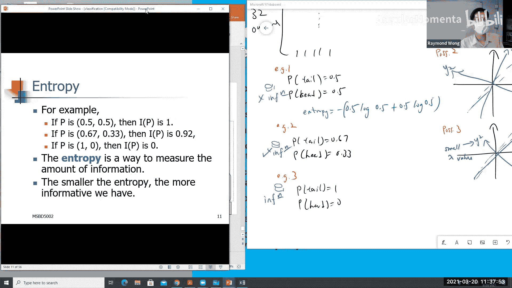

🎼mining and noish discovery。Beer mining aid no N discoveries。

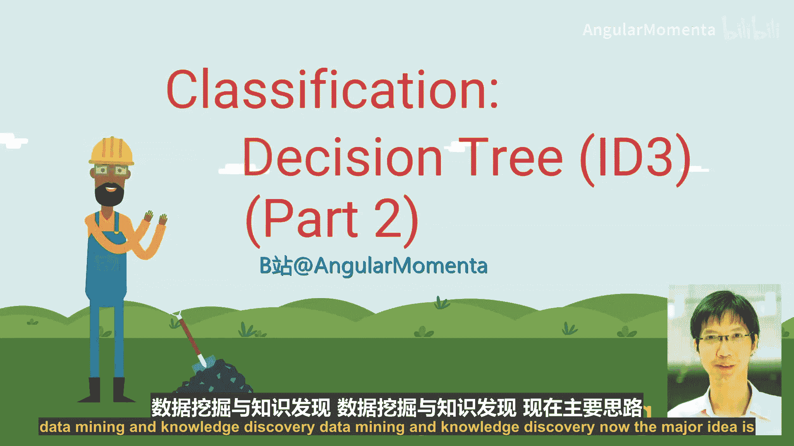

No， the major idea is very simple。 The major idea is very simple at the beginning。Now。

 I do not consider any input attribute。 I do not consider any input attribute。 Okay。

 I do not have any information about the input attribute。

 I just understand that I have the target attribute。

Without any information about the input attribute， I want to know the entropy。

For this target attribute， Okay， how to do that。 now。

 let's see the probability that the y zone values is equal to yes。

You can see that according to this table， we have 1，2，3，4，4 out of x。 So we have one over 2。

 and then the probability that the in values is eager to know the probability value is equal to 1，2。

3，4，4 out of x。 So we have one over 2。 So we have these two probability。 we can use the formula。

 The en to P formula to calculate。1 over2。Put it here。And then。1 over two。

And put here in your entropy formula。 we just learned we calculate the entropy of this data set without the input attribute is exactly equal to one。

 exactly equal to one。 This measures some information。

 You know that actually this is an equal probability。 This is the greatest one now。

 understand and next， next， you can see that I will consider the race attribute。

 let me close all the annotation go back。 No， I consider each input attribute one by one race attribute。

 And then on the next line 1214， and then we will consider income。 and then slide 14。

 we will talk about Chao。 let's consider the income the race attribute。 We have black。

 let me circle all the black black record。 now， consider the black record。 Now black record。

 the probability that the black record。 let's see the in values is equal to yes。We consider the race。

 Okay， yes， and this a free note。 So we know that one out of four。

 The probability that the in values is eager to know is equal to3 out of4。

 So we have this distribution。 And then the black record calculate the entropy  one over4 is here。

Free over4 here。 So calculate the entropy。 we have this value。 Similarlyly。

 we can do it for the white record like white record is here。 and then we have this three yes and no。

 So the probability that in value is equal to yes means a in value is equal to yes。

 we three out of four The probability that the in value is equal to no is equal to one out of four one over4。

 which is here and three over4， which is here entropy。 We have this one。

 And then now we have two different entropy value here。

 We want to combine this two entropy into one single value， how to do that is just a simple equation。

This in T black is here。 This in T white is here。 and this part。

And this part is just the proportion of the record with black。 Okay， let's see。The black record。

 let's see 1，2，3，4， with four record。 So 4 out of it record。

 the proportion of the black record and this one correspond to the proportion of the white record。

 We have one，2，3，4。 So4 out of8。 So we have this two value。 And by your calculator。

1 over two multiplied by this value，1 over two multiplied by this value。 We have this value。

 and then continue。 Let me erase it。And then continue。The information game， information game。

 they usually use information game。Which is the entropy， which is this one。

 the original entropy before we use the waste attribute。

This one is the end here after we use the waste attribute minus it。

 we understand that this value is smaller than one。We have more information。So one minus something。

 and then we have this number， let me summarize for attribute rates。

Just the information gained is eager to this value of summarize any question。If no question。

 let me one more attribute called income。 In fact， the idea is the same。

 Similarlyly before we have this in this input attribute， our entrepreneur is this one for income。

 the same idea。 just focus on the high income， high income we have this one。

 the probability that in well is equal to yes is equal to one the probability that in well is equal to know is equal to sell。

 so we know that high。We have one。And then，0。And then next， okay。

 I think you know that we just focus on the low income， which is here。

And then we have two yes and four no， so we know that the probability that in well is equal to yes is two out of six and then the probability that no equal to four out of six by simple simplification。

 this is one over three and this is two over three。 So one over three。

 which is this one and two over three， which is this one by simple calculation where have this one and we also want to combine it。

This one is here and this one is here and remember that this one is the proportion of record with high income。

 We have two record out of x so actually this correspond to out of8 and this one correspond to the proportion of web cost with low income 1。

2，3，4，5， six So we have six out of8 so actually this correspond to three over four So by simple calculation which have this value and similarly we want to calculate the information gain here and then information gain here is just this number。

Minus this number， this number one minus this one， we have the gain like this for attribute income。

 just copy this this here to here。Now， we have already calculate the information gain for race attribute。

 income attribute。 And then now go to the child attribute。 I don't go through with you。

 You can read it by yourself at home。 Okay， you can read it by yourself at home。

 So we have the attribute child。 The information gain is here。 The next thing。

We want to find some attribute。With something greatest information gain or smaller information gain。

 such that。😊，I can have more information， have more information in the following process。

 in the following process， let me do it here。

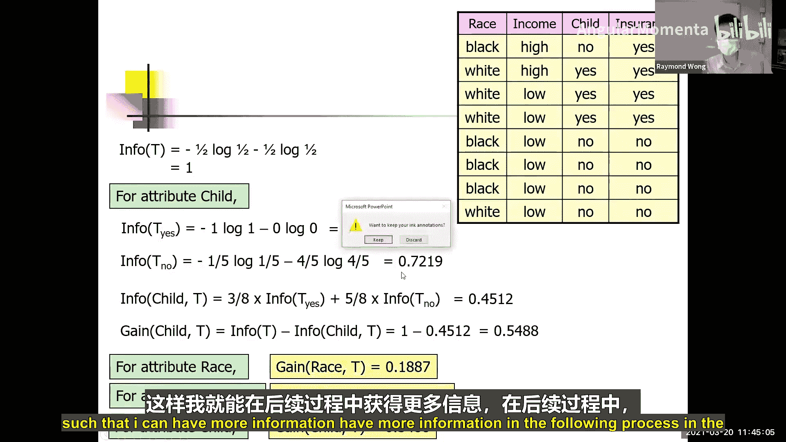

In the following process。I want to do the following。 You just understand the major idea。

 We have the root note Or， the root note， we had eight record， one record， second record。

 the first record and the eight record。 We want to sweep this record into different parts based on one attribute sorry based on some attribute。

Raace。Maybe race。Or maybe income or maybe child。 supposeupp that this should is a child。

 Maybe this is a child。And then we will switch the record into two parts。And then the child。

 the left hand side will be。2，3，4。And then the right hand side， we have the one。5，6，7，8。

 We have something like that。 And then we want to street the record like this such that we have the。

Greatest information game or smaller information games who want to answer this one。😊。

Do we want to have the greatest information gained that's。But yeah， high professor it should be。

Hello can hear hello yes， I could hear you yeah yeah so it should be split on income because that has the highest information then after we should have the greatest information game or the smaller information game。

😊，Great information gain， the greatest information gain。 So here which value have the income。

 gain income income， why。😊，then me ask you this Sil maybe never write down small well0。1。 This is0。3。

 and this0。5， Which one is the greatest value。😊，Oh， sorry， yeah， it should be on the。呃。Yeah。

 there a which one has the larger value。 Okay， maybe maybe me ask this first value first。

 which0 point10 point30。5 which one have the larger value Yeah0。1 yeah。Sorry the largest value。

 not smaller one， the largest value。The largest 0 Yes， Sil5。

 and then we want to find the attribute with the greatest information game， right， yeah the yes， yes。

 so we will have we will choose attribute child， right Thank you。 Thank you。 Yes thank you。

 You get the coupon。 Okay so we understand that we will choose this one。

 we have the greatest information games and we have this attribute child So here yeah at the original just the left hand side Ryan side is equal to yes and child is eager to know1 side is equal to 2。

3，4 as I mentioned， the Ryan side is15，6，7，8。😊，And then usually we focus on the target attribute。

 So let me summarize all the target attribute as statisticsistic 2，3，4，1，2，3。

 just we have three yes and  zero， no，1，5，6，7，8， we have one yes and four notes。😊。

And then now usually we need the percentage。 Now we summarize it 100% yes and so percent no here。

 we have 20% yes and 80% no， So we are bang here。Now we have finished the first speed。

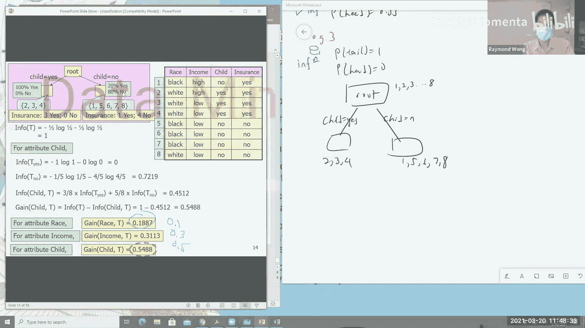

🎼The mining and noish discovery。🎼Beer mining aid no N discoveries。

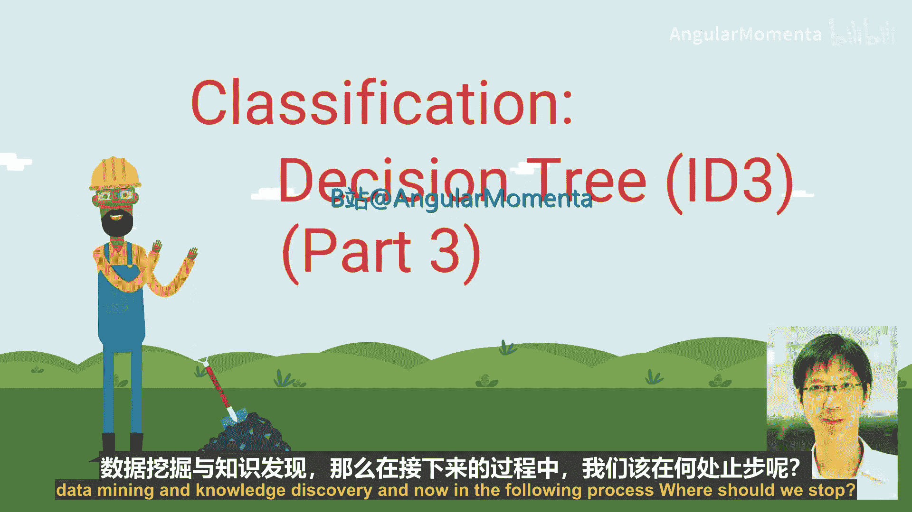

And now in the following process， where should we stop， this depends on the user requirement。

 For example， supermarket manager。 Okay， supposeupp Im the supermarket manager。

 I want the green boss。 I want the green box。 One of the value Yes or no should be 100%。

I don't need to do anything here。 since I have already achieve what I want。 However。

 on the right hand side here is 80%， No and 20% Yes。 I'm not a sacrifice。

 I want to split it into two parts， such that。We have 100% yes or 100% No at the end。

 This is one stopping condition by the supermarket manager。 Supp this is my stopping criteria。

 and then I will proceed next。 I will proceed next proceed means that I will speak this record again。

 based on what we have thought before。 maybe era here。

How to do that let we do the full screen mode again， full screen mode。With moment of。fo cream mall啊。

Here。

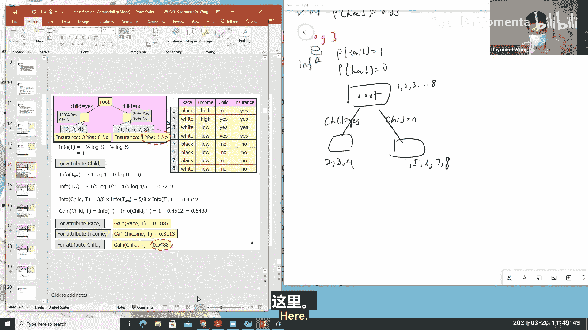

With a moment， I want to go back to full screen mode。 Now。

 we want to do this this one to further to do the same process。 see how to do that currently。

We only have record 1，5，6，7， which means that record 2，3，4 are not here。 Just remove it。

 Now we are considering 15，6，7，8。 just we have this record and then similarly。

 without considering the input attribute， we want to consider what is the information。

 the probability that the in values is equal to yes。It's equal to one out of five。1 out of five。

 the probability that the in values is equal to know。 with have 1，2，3，4，4 out of five。

 So we have one over  five。4 over five， we have the enalpy word like this。相对嚟你。

We have already used the child attribute。 Now， we have two remaining attribute for splititting。

for spitting。For sweating。Which is the race attribute。 Let's consider the race attribute。

And the race attribute， we have two possible outcomes。The first one is black。The second one is white。

 Now let's consider the black record。 black record is here。 The black record we have one。

 yes and three no， So we know that the probability that yes is equal to one out of four。

 the probability that no is equal to three out of four。 So one over four。And also three over four。

And similarly， for the black one。For the white one let me use white color， the white one。

 were only this one， so the probability that yes is equal to zero and the probability that no is equal to one so we have this formula and you know that this is equal to zero and also combine this two we know that T and this correspond to the proportion of black white here we have one。

 two， three， four， four out of five。And this corresponded to the proportion of the white record one out of five by your calculator with have this one。

 and then with the information again。Which is this value， minus this value。 So we have this one。

 And then where this value， just summarize this value for race attribute， we have this result。

This information game 0。0729， understand any question？If no。

 I think you can also understand that for the remaining attribute attribute income。

 you can do it by yourself。 I will not go through with you。 Okay check it at all。

 Now you can read it by a set and for attribute income。

 we can also calculate the information gain is this value。

This time we need to split it into two parts， which attribute should we choose， We want to answer it。

王复安息。啊，荣威。永威。Here you let me view here of you bit。Yes， you can see now。

in the in themic in in and your唔 your soon。And因，因 you can unm yourself in the in in your phone。

we we can we can hear you online yeah we should choose the income。

 you should choose the income the recent years。ACo the information。Information gain is the largest。

 Yes， the information gain is large。 Thank you。 Yeah， okay， you canmute yourself。 Okay。

 Thank you yeah。😊，Now， let me go back。 Let me go back。Now let me go back。 let's see。

 Now we will choose this one and then we will sweep it into two part income high and low。

 we know that we have one，5， six，7 a year that we circle out。11，5，6，7，8。

 I want that high income is this one。 So we have the left hand side 1。

 And then the right hand side is 5，6，7，8。 And similarly， just summarize the target attribute value。

 Let's see The left hand side will have one yes and still no。

 the right hand side will have sale yes and for no， and then green color boss summary。

100% yes and sale percent no here。Still% yes and 100 percent no。 So we have this one。 Now。

 this achieve the stopping condition set up by the supermarket manager。 One of them are 100%。

 So this satisfy the supermarket need。 Then we stop。 And then this is the decision tree re generator。

 and then suppose that we have a new customer as we mentioned childo is eager to know and income is high。

 Then we will predict this customer。 We buy an insulin insulin policy。And as I mentioned。

 the stock condition is designed by the supermarket manager or the user。

 I just mentioned that I one of them should be 100%。 We have different kind of stopping condition。

 For example， the accuracy or each note mentioned by me。

 Some people may use the maximum height of the tree， for example here。

 The maximum height of the tree is equal to2。 supposeupp that the supermarket manager relate to the maximum height of the tree should be at most one。

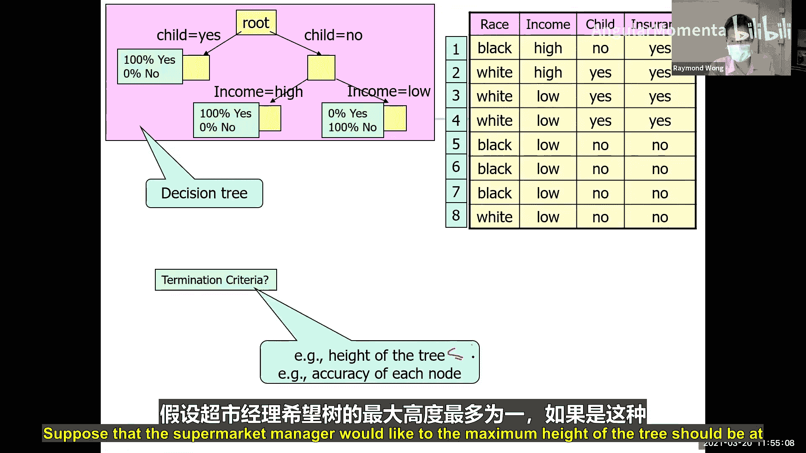

If this is the case， then the tree will be。This one will be this one。

 If the height of the tree should be at most one， then we don't need to further a splitiing。

 So different stock condition will have different decision to。

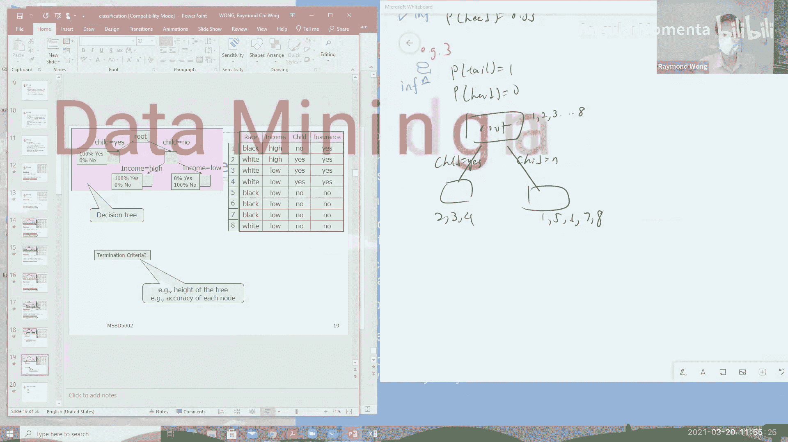

🎼The mining and no N discovery。🎼Da mining and no N discoveries。

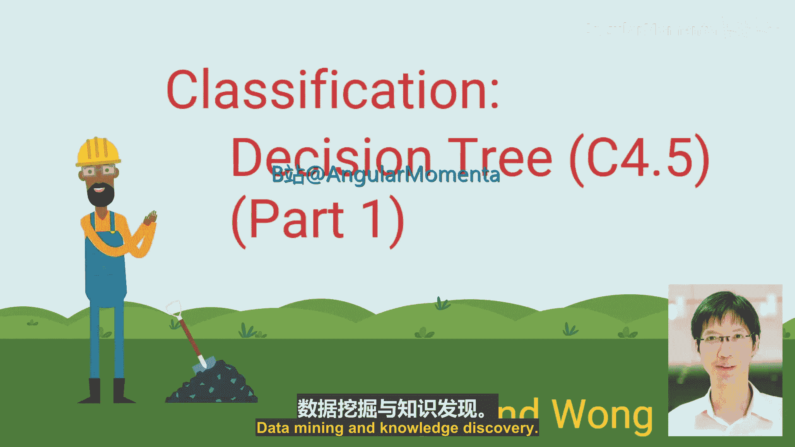

Now， go to C four topt  five， actually similar to I D free。

I don't know whether the student or if you have learned it before。

 I don't know whether you know the difference between these two。

 let's see here I D3 we just learned we have the input measurement。

 the information game as we mentioned， is the entropy before we are using the input attribute。

 and this is the entropy after we use the input attribute a and this is what we have learned before。

 this one C for five。Before I give the intuition， I give the form lovers and then after that。

 I will give the intuition。 The information gain here is exactly what we have seen here。 Okay。

 just copy， just copy。😊，And then we need to derive this difference with the speed info of input attribute。

 What is this meaning。The meaning is the speed info， this info attribute。

 and then something like this， you can see that we have PV。Pre we。 and then also a lot。 also a lot。

And then sum， what is that actually， we is a possible value for a。

 We just sum all the possible value about this term and then make a minus。 Actually。

 this is the entropy。 This is the entropy。Maybe it's difficult for you to understand this formula here。

 Let me use an example， and then you understand it after I illustrate， I will give the intuition。Now。

 similarly， for this C4 file， the whole process are exactly the same。

We don't consider the input attribute。 We just focus on the target attribute。 Okay。

 we have a half yes and half no。 So we have something like this before we are using the input attribute。

 The entropy is equal to one after we use the entropy after you use the input attribute。

 we use the same formula。 Okay， this is copy and paste from the previous line。Exactly the thing。

 I don't go full with you exactly the thing。 But now this is the new thing。

 the new thing I want to slow down。The spring info for race attribute， this is defined as follows。

The probability that the waste attribute， the waste attribute is equal to black。

It's eager to let me see1，2，3，4，4 out of five sorry4 out of8。

And then probability that the race attribute is eager to white。And then this is equal to 1，2，3，4。

4 out of8。 So this is equal to one over2。And this is equal to one over 2。

 So we understand we have this probability， this probability using the N to P formula， one over 2。

This one and this one over2， one over2。And then summation and minus。

 and then we calculate this value。Now， the information gain is update is something like that。

 The information gain， as we mentioned， minus difference and then divided by this big info。😊。

And then by your calculator， which is this this value， one minus this value， and then divide by one。

 we have this value。 and then finally， summarize。The information gain for this race attribute is equal to this value。

And similarly， we can also calculate the attribute income and attribute child。 Okay。

 let me say one more for income。For attribute income here， copy and paste from the previous line。

 I don't go full with you for sweet income income。 Okay。

 just very simple focus here income also the probability that the income is equal to high。

The probability that the income is equal to low， low income is equal to。 let's see 1，2。

 So we have two out of8。Here we one，2，3，4，5，6， so，6， out of eight。So we two out of our eggs here。

And then six out of it here。By your calculator with this value， Similarlyly。

 the information game is equal to this one。In front T， which is this one， minus this one。

And then divide by this one by your calculator， we have this value。

 Lets summarize we have the attribute income， which is equal to this， equal to this。And therefore。

 attribute child。I didn't do it。 You can do it by yourself。

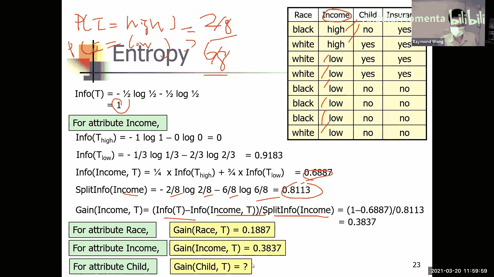

🎼Be mining and noish discovery。Da mining and no N discoveries。

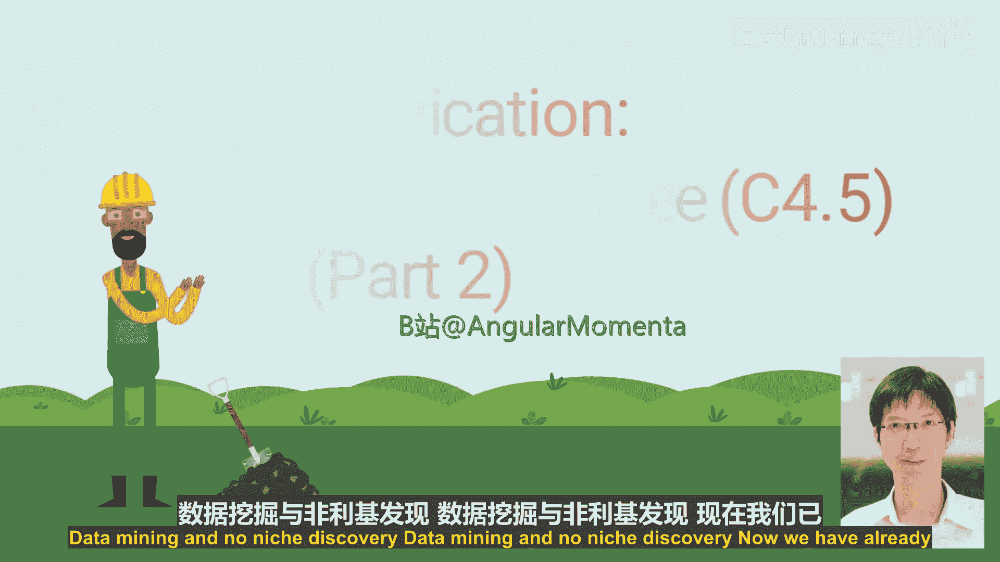

Now， we have already finished the illustration about this C4 dot5。

 but I haven't mentioned the intuition behind。 Let me give the intuition behind is more important。

 Let's see。 maybe I put it here information。 first of all。

 I need to give some example to you so that you understand it。 let's see。 Now let me copy this one。

 child attribute。 In fact， I'm copying this child attribute。The child attribute and the Y attribute。

 supposeuppose that we have this web like this。 We have something like this。Yes， yes。And then， no。

 no。And then， no， no。And then。We have an ID， suppose that we have an attribute ID1， two， three， four。

5， six， seven， eight。And then something like that。 we want to predict whether this customer will buy an in soon policy at the end。

And then we' something like this。Now， forget all the entropy C four five I and I D three and so on。

Now， I want to use one of the attribute， child or I D to predict insurance。By intuition。By intuition。

Do you think that which attribute should I choose？To p the some value okay for the insulin attribute。

Which attribute， child or ID， who want to answer？By inition。

My question is that now we have child attribute and also I D attribute。

If you want to do the prediction for each customer。For the insulin attribute。

 do you choose only this child attribute or I D attribute to do the prediction。

 who want to answer and waste up your hands。 Yes caring。We should use the child attribute。 Oh why。

 yes， yes， your intuition is correct。 Yes， yes， child attribute。Why， yes， just your intuition， yeah。

because we can see some， for example， clustering or grouping for the child attributes。

 But for the I D is like some random number random number。 okay， let me actually you。

 you are nearly to the point。 Okay， let me ask you here， we have two possible values。 correct， right。

And here we have it possible value， correct， right， And then says we have two possible value。

 It is more generalized， generalized to describe the data set， right。Coing。Yes， yes。

 since we have only two possible value。 If we just use， yes， child is equal to yes。 and then is， yes。

 then it's easier to describe the data set， right， Yes， However， for I D， we have many。

 many different values。 I can say that if we have some rules， rule I D is equal to one。 Yes。

 I D is equal to2。 yes， I D is equal to3。 Yes，4 yes， and fine is no。

 we can also have 100 percent confidence to generate a lot of rules， in fact。

 but we will not use the possible value， right， Yes， Yes。

 the reason is that we have a more generalization about child attribute compared with I D right， yes。

 okay， thank you。 yes， thank you。 Yes， so I think student may also understand that by our in。

Child attribute is a better attribute for prediction。Sincein are due to the generalization。 now。

 let me give you more number。 and then you know that what I mean in I D3， let's see in I D 3。In I D3。

 if we want to calculate。The child attribute。And also， the I D attribute， we want to calculate。

For example， the information game。According to this example， according to this example。

 i don't show the the in the middle result。 I just show the last step。

The information game for this I D3， let me put it on the right hand side so that you know the comparison。

 Now， I D 3 is here。 Okay， I calculate something。 okay， I skip does that you can check it at。

 this should be equal to0 point548。And then for I D this attribute， I D T。

 and then this is equal to one minus， let me see0 equal to one。And then you can see the I D file。m超。

ID， attribute I D。Of for sweeting， we must。Toth。Attribute。I D for splitting。So this is contradicting。

Contratracting with our intuition， I just want to say that this contracting with our inition。

The reason is as follows。 Let me write down。 Actually， the intuition is this blue color things。

ID free。Have a higher tendency。To choose。An attribute。conining。冇。バリ。

I D3 have a higher tendency to choose an attribute， containing more values。

If you go through the the step， you will see that actually is is really the case。

 if we have more values。I D will choose that attribute。 choose that attribute。 Okay。

 you can calculate by yourself。 Okay， and then next， okay， if you understand this， okay。

 let me continue， okay， let me continue。 Okay， since I didn't give the the formula。

 I think you can check it by yourself。 you can verify this statement at home next。

And then now I want to go to the C 4 top 5。 C4 top 5。 We have one for attribute child。

And then we had the speed info， with the speed info。In order to make you understand what I'm doing。

 I want to show this space。 the speed info for a child。

We can calculate based on this probability distribution。Which is something like3 over 8。 Okay。

 lot3 over 8。And then-5 over 8 log，5 over 8。 And then finally， we had this where 0。9544。

And then the information thing here。For this child attribute。

And is exactly you remember that is this numbermber。Divideed by this number。 So let me write down0。

54，8，8 divided by 0 point9，5，44。 Finally， this value is equal to 0。5750。Let me do one more。

 and then I'll do some explanation。 I D， Let me do I D The I D， the speed in is eager to。😊。

The sweet in of this I D is eager to。 let me give the formula  one over 8。六。

One over 8 multiple by  eight times。It times and then equal to three。And then， again。

Or this I D T is just equal to this number divided by 3。1 divided by three。

 So you know that this equal to silicon 3，3。 So you can see that according to this information game for child attribute and the information gain for I D。

 Okay， we have this value and this value。 Of course， we will choose a larger one。 So we must choose。

We must choose。Attri child。Attrie Cu， we will choose attribute tau for spliting。Okay。

 you can see that this time C4 5 will choose the child attribute。

 which is consistent with our intuition。 Let me write down the reason here。 The reason is。

let me use green color。Let me write that。Actually， see4 of5。 Try to penalize。Try to penalize。

An attribute。containing。冇。Values， containing more values， containing more values。

 Let me explain here。Let me explain here with some a notation。Now， C4 file， as I mentioned。

 at the at the top， I D have8 value。 C， Okay， we have two value。 Okay， we have manyy value。

 You can see that child only two value。 if we calculate the three in。

 usually this value is very small。I D， if we have many value， if we calculate three info， usually。

 this is a very large number。If you understand our explanation about the intuition。

 we want more generalization， which mean we want do not have more value。

 and we have this I have more a lot of value。 So if I D have a lot of value。

 then this inform must be very large。So the information game。

 although this is equal to one after that， we divided by this large value since we have more possible value and this sweet is very large divided by then。

 So this is what we mean by we we want toize the attribute with more values。

 So we divide this with info So that this value one will become smaller due to the more value。

 So we understand that see for is all doing something like like that。

 So here info can help us to find this attribute consistent with what we want。Any question？

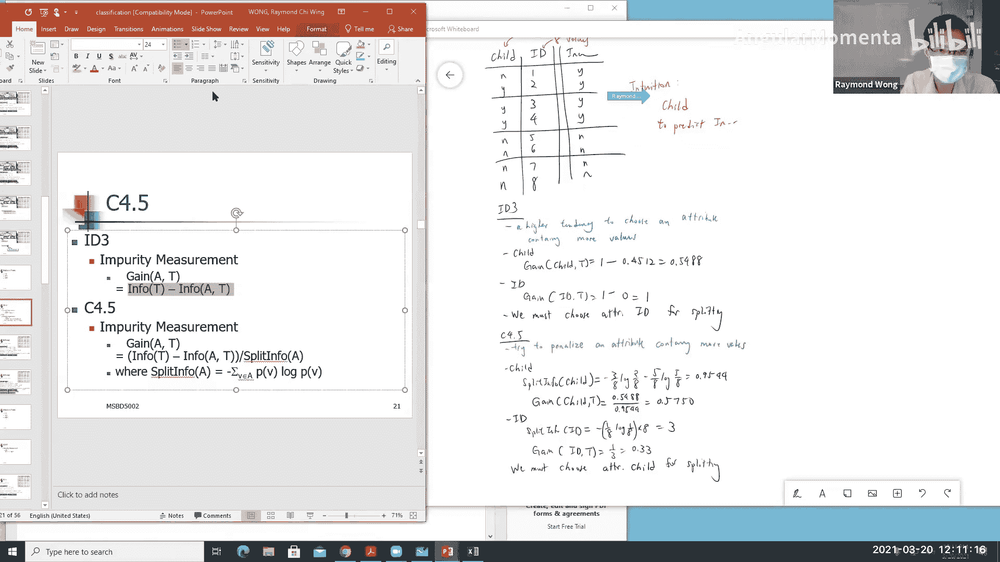

🎼The mining and noish discovery。😊，Be the mining age no N discoveries。

Now， let's go for the last one。 The card is also a common decision trip。Common decision to you。

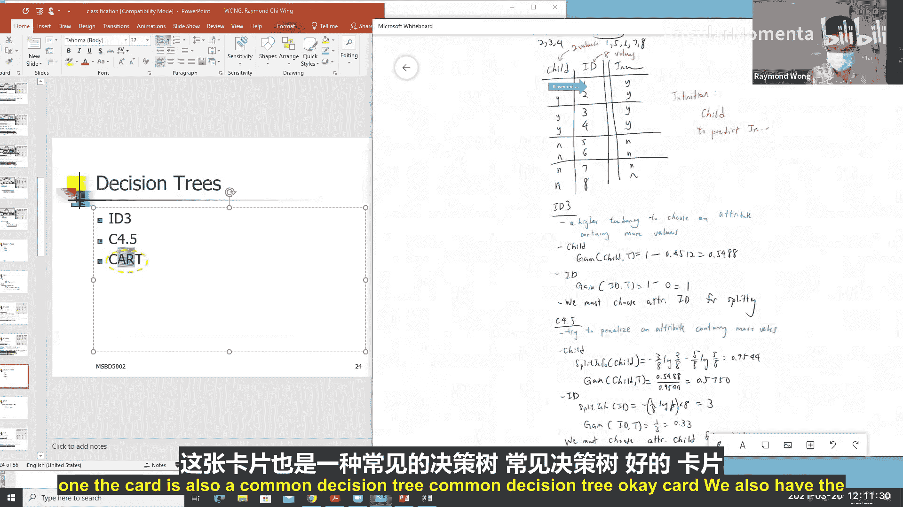

O，看。We also have the inputprint measurement。 Okay， like the entrytro。

 But this time they are not using the entrytro。 They are using gen index or gen number in statistics。

 also coming from mathematics。 This is an equal to this equation。 I also will give the in later。

 Let's follow the step first。1 minus some probability square。 and then sum。 Okay。

 let's see what we are doing。 Let me remove the annotation in soon。Similarly similarly。

We also not consider the input attribute at the beginning。

 We know that we just focus on the target attribute。

 The probability that the Y soon well is equal to yes， is equal to fall out of8。

So here and the probability that in well is is equal to know， Okay， which is equal to fall out of8。

And then is it one over2。And this is equal to one over 2。

 The formula is that one-1 over 2 square minus-1 over two square。 So we have this equation。

But your simple calculator with one over two Very simple。 And then next。

 I think you remember the process。 The process are exactly the same exactly the same。

Now we just consider the race attribute。And then we consider the black one。 Okay， the black one。

I want the black one。We had the probability。 Yes， is equal to one out of four。

 The probability that no is equal to three out of four。 So by that equation。

 the gen in index number 13 over4 square，-1 over four square。

And then I think you also know the next step。The probability that the entropy of the white record which is this three and this one。

 So here we have three yes and one no， So probability that yes is equal to3 out of four。

 the probability that no is equal to one out of four。

 So one-3 over four square one over four square by your calculator with this one。 Similarlyly。

 we can combine it with this one and also the same the proportion of record with black and the proportion of record with white。

 this has been illustrated before by your calculator， we have this one。

 and also the information gain is this one at the first time this one minus。this one。

And then we have this one。 Let me summarize that for attribute rates， we have this one。

And then we also do it the same for the second attribute income。I don't go full with you。

 You can read it by yourself at home。 You can it by yourself at home。

 We can also find the information gain of this raise attribute sorry this should be income income should be equal to 1。

6，7 and also for attribute child， the information gain is question mark question mark actually is also asked in the in class exercise 5 question 1 B exactly this one。

 you can do it by yourself。

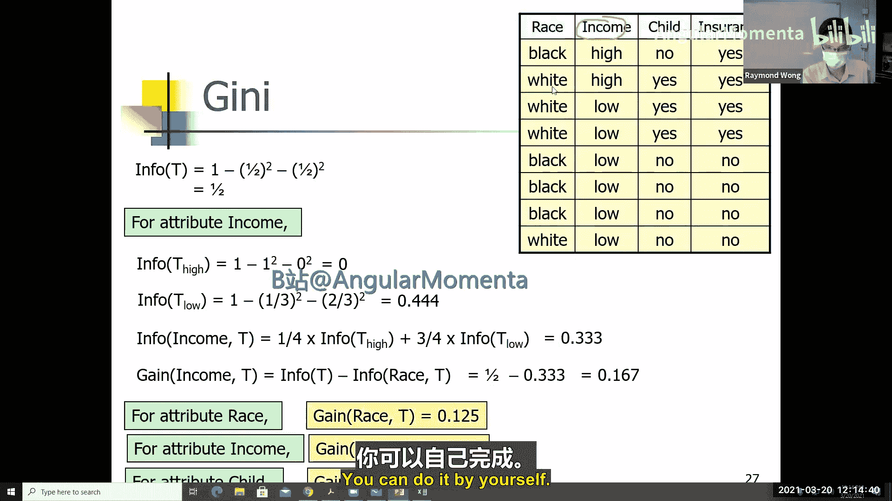

Now we are done。 we have already finished the G index。

 and now let me give the intuition about this G index with an example on the webboard。

 Let me find some space。 I let me find the space here with a moment。啊， here。

Let me find this space before I explain it， let me give you some example， some example， suppose then。

I have a container。 I have a container。 We know that in this container， we have two typess of ball。

 We have two typess of ball。😊，We have some some。And also， while we two types of ball。And then。

The probability that we can pick out this ball out。Is P， X。

 The probability that I can pick out one ball here is T Y。Now， let me ask you。

 supposeupp that I want to get two ball out。With。Replacement with replacement。 Okay。

 replacement means that after I get the one ball out， I will put it back to this container So that P。

 X and P， Y should be the same。So we understand that we have replacement。

 So we understand that when we pick out two balls the probability that we pick out x is P X。

 if we pick out the ball with y， then the probability is equal to p y。Now， let me give this question。

 The question is。The probability that。2 boys。Have。The same。Values between X or y。In our case。

 actually， this same value correspond to。In values in values in fact this two value is yes or no。

If these two ball had the same value， what is the meaning， Okay， In fact。

 I think you know that in mathematics， usually we can compute it with this complements。😊。

Who want to tell me what is this， What is this， you can raise hand。My question is that now。

 the scenario is that we have a container。 We have two types of ball。 The probability is P X for x。

 The probability here is P Y。All the ball if I get two ball out with replacement。

 What is the probability that the two balls have the same value， sorry sorry， maybe have this sorry。

 I I I， I maybe should should here should be have different value。Shouldll have different value。

 should have different value。If a two ball have two different values。Then what is this formula。

 What is this formula。 Okay， who want to tell me。Yes， are also Cheng Shaang。Its 1 minus P， X square。

 minus P， Y squared。is's one minus P x square， minus P Y squared。 Actually， what。

 what do you mean by here here。phys meaning physical meaning is that two boss two ball are p。

Have this had the same value x the same value x and also two balls here have the same value Y， right。

 Yes， okay， thank you， yes。Okay， now you can see that after we write something like this。

 we have this equation，1 minus some square minus some set some square。

 exactly what we have discussed here。 Okay， we have discussed here。

 What I want to say is that genie index is something like this is something like this。😊，啊 continuein。

 let me continue continue。Example one。Example 1， and also， example 2。Let me give this P X。

 suppose that also use the something like this。 supposeupp that we had the probability that P X is equal to one and P Y is equal to 0。

 Then if we calculate this probability， let me this a P。

Which is equal to one minus one square minus0 square， which is equal to0 and for the other case。

Which is p1 is equal to 0。5。 P is equal to1 minus0。5 square minus0。5 square and then equal to 0。5。

We also understand that we also understand that if we do not calculate this genuine index by your eyes。

 we know that this one have more information。And the later one do not have much information。

We understand that it is consistent with the end。 If this value is very small。

Then we have many information。 If this value is larger， we do not have information in the middle。

 we also are in the middle value。 we are also in the middle value。

 So we understand that do the conclusion。 the conclusion is that if the P value， okay is smaller。

Then we have more information。We have more information。We have more。Information。

 this is consistent with what we have seen before。We have seen before。

More information means we have high probability for this one。

 Maybe let me go back to this black color thing。 If P is smaller。

 if two ball have the different value， different value have a low probability。

 have a low probability， which means that the two ball more likely have the same value。

 same value means something like that， something like that。

Properly the two ball are very skill like we have this more information。

So this is consistent with the black color things。Any question to you？

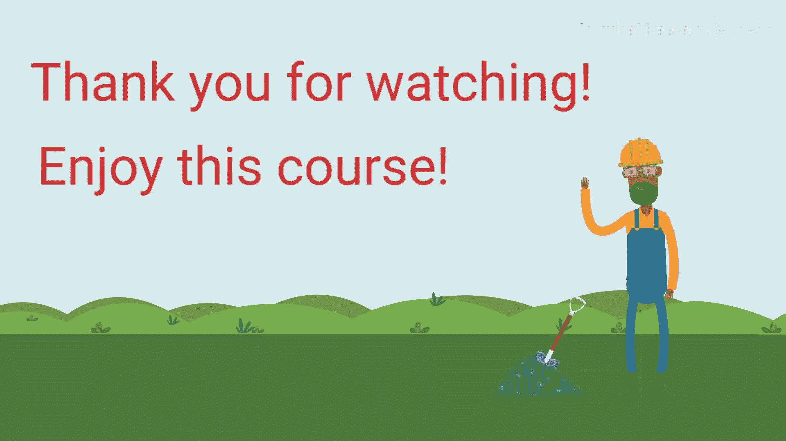