# 【香港科技大学】数据挖掘与知识发现-｜-Data-Mining-and-Knowledge-Discovery-p11-07-03-02-1._朴素贝叶斯分类器_第1部分--BV1gEFDzVEU3_p11-

🎼The mining and noish discovery。😊，🎼It mining and no N discoveries。

ba on class。Here basin classifier。 we have two a version。 One is called naive， naive1。

 The second one is called basin belief network， which is more complicated one。

 Let's go for the simple one first， naive one。Here for the naive one， we have the。

 we will talk about the statistical classifier probability and conditional probability， let's see。😊。

Conditional probability， I think most of you also learn conditional probability。

We have a random wearable， B， random wearable。 This is the conditional probability。 probability A。

 different B is exactly equal to probability A and B divided by probability B。 Okay。

 this is the definition。This has been learn by you okay。

 maybe in your year one or year two in your undergraduate study。 This is very simple。😊。

Just remember it。 if you forget it， now。You can see that we have one things called base rule。Also， A。

 B are random variables。 And then you can see that this is also the conditional probability before。

 But this is a derived lama， derived lama。The probability that that a given B is equal to probability B。

 given a multiple by a divided by probability B in fact。

 this is a divide from the previous equation that we divide。The probability that a。

Even B by the previous life， equal to probability that A and B。Divide by the probability， B。And then。

The below is probability。Hello。诶子子子怡有有 question。Hello。😊，No， no question。Now。

 let me continue the probability that be given a。Is， in fact， by the definition。

 iss probability the B A。Divideed by probability A什么。Let me mut Okay here。 This one is， in fact。

 can be wewritten down in this blue color things。 the probability that B a。

Equal to probability that be different a multiple by probability A， right。

 And then you also understand that this one is exactly equal to probability A， B。

 A and B or B and A are exactly the same。 So this blue color will be put here。

 probability that B A and then P A， So you can see that probability B different a probability A。

 Okay， exactly the same。You see that actually， I just let me use this one。

I just divide one and then derive one。 just two step。 Okay， one step and two step。Then we have a。

Dive Lamma。 and we have a name called base rule。 Just simple。

 Even though I do not have the this name， I can derive by myself。 I can derive by myself。

 Very simple， right。And then let me ask some student in this one。

 I think most of you have learned grace rule before。😊。

Maybe you don't know the reason why we have the name。For this one， suppose that I'm wear old。

I am the one who designed this Facebook。 And then that come， this is called Raymonds rule。

So以 this is just simple。To the name of the researcher Facebook。Just a simple deviation。

 we have this name。Do you know why we need to say this rule explicitly， we can divide it very easily。

 who want to answer this question you have learned you before。

 I just want to know whether you understand what you have learned before in your year one or year two。

😊，播光调安徽。Why do we， okay， maybe maybe maybe we ask in another way， Okay， why do we have this equation。

 maybe not the name， Okay， Why do we have this equation。😊，Explicitly have this equation。

 although the deviation very simple。😊，No one。No one。It's very surprise。 Oh no one。 Do you know Okay。

 you why do you need to learn this space will before。卢文。ok。

 maybe啊 let ask in other way okay啊哦 yes 啊加 wei加 we嘅。😊。

Maybe because after we have seen some something occurs then。We should change our belief to one。

To un random arrival slowly the belief I I I hear the belief。 Do you elaborate again。Yeah。

 maybe we have after we have some observations to something after we had some observation different something yes。

Observation， we observe something new， something new have something new on that。

Then we change our original belief to one random variable， for example， a。

Maybe if you can use this level to denote what do you mean by observe。 Okay。

 you mean a is the observation or B is observation。 Could you tell me more。 yeah。

 after we see B is happening。After we see B is happening。Then。We have a new。

Like new belief to invent a。You be to prevent to predict a new new b， i mean。嗯。

We believe the probability of event A happening is。is something you啊。

So you can elaborate on I so that I understand your point。 I still cannot get your point okay。

 now maybe never guide you， first of all。The probability that a given B， okay。

 we know that this is our goal， right， This is our goal， right。Now。

 we want to know that given something。We want to compute the probability that a occurs， right。Yes。

 this is what we want。However， in the real world， okay， in the real world。

This one could not be obtained directly。Cannot obtain diversity。 However， in the real world。

 we have another term， which could be of more easily。

 which is the reverse of this conditional part and the consequent part， right。

I don't know whether your posteror or your belief is a like something like that。 Or。

 the con the different part is B。 Now， the con different part is now a。

 and then we want to compute the probability B。 This one is easily obtained。eaily我听。

And then if we have this scenario， then we will use the base room。

I think actually you have learned it before you I think your belief。

 I think you learn from the base learning and so on。

 I guess you are using prior belief and positive belief and so on。 Okay， anyway。

 I think this is what you learn no problem。 you also get the coupon Now， let me summarize actually。

 this kind of thing is that this is our objective。 we want to compute probability A given B。😊。

And then sometimes this is difficult to obtain directly。 and then in the real world。

Is it more easily or think if we swap the conditional part and the consequent part like this。

And then immediately， we can write down the rules。 This happen a lot。

 So the researchers just divide it。 And then many people can also， if we use this kind of concept。

 then we will use space。 So if you are well old enough， then we will have the name of your something。

 your invention。😊，Understand， now， let me continue。 Let me continue。

Now we understand that baseball is just we want to use it when we want to spot the conditional part and consequent part。

Now， continue for the naive basin classifier。Actuallyually。

 this is called myive means that they系 some assumption， independent assumption。

Each input attribute are independent， given that the target attribute is different。

 Maybe let me write up。 Actually， this means。All the input attribute are independent， given that。

We know， given that， we know。The target attribute， given that we know the target attribute。

 this is their assumption in the na basin class file。 Let me elaborate here。

 given the target attribute in our case， this is insurance， this is insurance。

And then the input attribute in this case， is race， race。And this one is income。

And this one is child， since they are independent。 If we know the insulin attribute。

 So we know that the probability that the race multiplied by the probability。

 the income multiplied by the probability child， Given that the target attribute is known。

 they are independent。 that are independent。 This is the assumption in my if facing classifier。

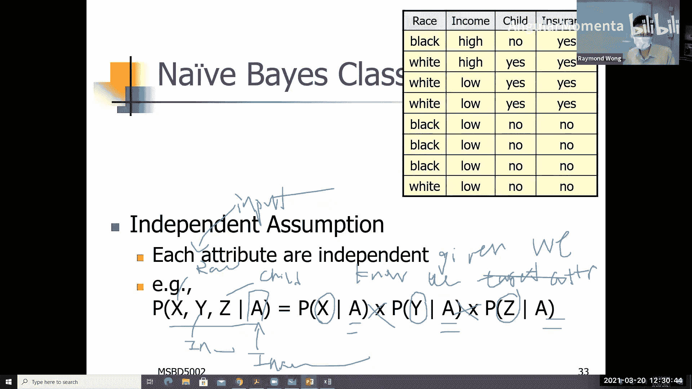

🎼The mining and noish discovery。🎼It mining and no N discoveries。

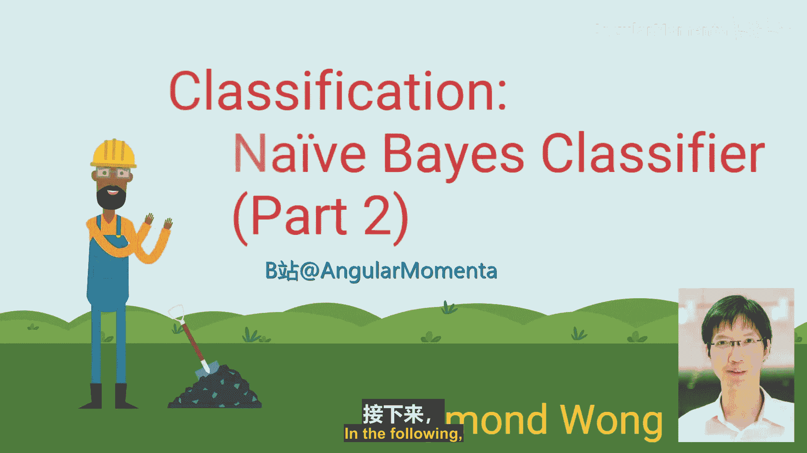

In the following。What I want to do is that I want to I want to compute the probability that the in values is equal to yes。

 given that。This information。Now， in in in this topic， in this topic。

 everything are related to probability related to probability。 So in the probability。

 usually we need to compute some probability。 So we need to define our goal in this topic。

 The goal here is to， is to predict whether this is yes or no。 So as I mentioned。

 we want to compute the insurance value is equal to yes， different some information。

 The information is raise。Is ego to white。And then the income is eager to hide。

 And then the child is eager to know。This is our goal。

 The first step in this naiveration classifier is to set up our goal。 This is our goal。😊。

Then after that we can post it， we can post it， we can post it， let's see。😊，Now we proceed。

 let's see。Ne year， I want to use an annotation next year。Race is equal to white。 Let me see one。2，3。

4。 We have four record with that。 Let me see income is equal to high。 Oh。

 we have only one record with these two value matches。 Cho is eager to know。 Oh， this one is yes。

So there's no record， no record related to what we want。There's no record related to what we want。

 What I want to say is that this is the training set， only it record。In the real world。

In the real world， we have a lot of record。 We have a lot of record， but didn't show here。

 didn't show here。 We know that we have one person in the real world。We want to compute this one。

 But in our data， its difficult。It's difficult for us to obtain this value。

 Its difficult for us to obtain this value。So now， since I know that this is difficult。

 now I could not obtain other value。So this is what I want to say is that。

The背呃 the base probability that啊A given B。And then B different A and then P A， and then divide by P。

 B。And then we just use this equation to do it。 see the next thing is that。We let me use。What kind。

 the probability that， something like that。dide multi by something divide by something。

Who want to tell me what is this content and get the coupon who want to do that。

Just tell me what is the content here。Or or you don't want to get a coupon。Sa红 two会不会 release立 soon。

Also， a similar difficulty。Or do you think that it it okay， okay， no problem。 Let me do it by myself。

 Now we just a is here， right。And then P， we just write down insulin。Is equal to yes。

 And then B given a， which is here。Which is a different aid insurance is equal to yes。

And then race is equal to white。And then income is equal to high。

And then childo is eager to know and then divided by PB， which is here， so this is eager to raise。

 is eager to white。And then income is eager to high。 And then child is eager to know。

 we have this kind of things。 Okay， let me continue。 Let me continue。 Okay， we have this a form。 Now。

 let me continue。Now， this is the target attribute。 Insurance is equal to yes。

 and this is the input attribute and input attribute and input attribute。We have one equation。

Call independent assumption。 okay， we know that。This one must be independent， independent。

 as we mentioned before， we can write down something like this。 insulin is equal to yes。

Insuance is equal to yes， In is equal to yes。 And then this race is equal to white。

 and then income is high。And then Chao is eager to。Let me see no equal to no and then continue。

And then just copy this insurance is equal to yes。 probability the insurance is equal to yes。

 and then divided by something。 we don't know。 this is the real word scenario。

 we don't know the probability， the real world scenario we don't know the probability。 Okay。

 just put it here。 We don't know。 We don't know the real word。

 We don't know the real word What is the probability。 Okay， it doesn't matter。 Okay。

 it doesn't affect our us。 Let me copy these things。The the bottom part， the race is equal to white。

 and the income is eager to hide。 and then the child is eager to know。Okay， now we have this one。

Given that income is equal to yes， and then race is equal to what is very simple。

 Then we use the same annotation or or less yes see。Given that insurance is equal to yes。

 we have this four record。 And then among these four record。 let me see 1，2，3。 we're three。

 So just write down three over four。 And then the next thing is here。 In is high。

 different insurance is equal to yes。 income is high is equal 1，2。 So were two out of four。

 and then the probability that child is equal to know， given that insurance is equal to yes。

 we have one。 So we have one out of four。 and then the probability that insurance is equal to yes。

 Okay， you just use this four out of8。 So we have four out of8。By your calculator。

 by your calculator， we have something like probability， something let me see。

 Let me see the PowerPot。There's some value here， okay， wait a moment。

Let meSkip it let's see the value。 Where is the value the value is equal to simple。s four six啊。7。

 five。Let me continue。 Okay， let me continue。 Okay， here。

 we have already computed the probability that insurance is equal to Yes， is this number。Now。

 we I saying we don't know this number。 Okay， we don't know this number。 We need to continue。 Okay。

 we need to continue。What I mean by continue is that we can consider the other possible way。

 The probability that insurance is eager to know。Given this information， I just do all the deviation。

 exactly the same。 Here is no， this is no， and this is no and this is no， and this is no。

 and this is no。 And then we just change all this red color number。

 We just change this red color number。😊，Just change this color。

 who want to answer it based on this figure to get the coupon。

Or you don't want to get the coupon now。Let's see。 anyone I think Jia Wei is not asking。

Te me you want to ask question or answer。安先 sorry hello安先 you want to answer this question。

啱先 i' here sorry sorry wait什么啊 you are here呀。Yeses， hello and先 yeah。yes。

 you can come to write join the微。 you can come yeah。Yeah draw here。 okay。

 so the answer is if the it's no， So it's0。 is no is 0。

 create this one is wait I want to use some annotation。 Now we are considering this one。

 and then we want to I know that finally， I know the student know that this is 0。 Okay。

 create an elaborate more。 What is this。 Yeah， it's one out of four one out of four。 Yes。

 and the second is。Hi is0 out of Yes 0。 Yes， and then continue。 And the child is no and is 0，2。 this。

 what is this value4 is4 out of4 no， no， is one。 Yeah，4 out of four equals to one。 Yes。

 and then how about this one。 Yeah， and this is no is one out of two4 out of8。 one over2 one over2。

 Yes also4 out one over2。 Yes， Thank you。 thank you。 okay thank you。 can mu yourself。 Okay。

 you mu yourself。Thank you。 Yes。 now understand。 now we understand that for probability issue is's to know we have this zero。

 And then let's see。😊，This is what we all think Wait to moment。 Okay on， on the powerPo。

 we already explained this kind of things already。 Okay， but now I read way on the whiteboard。 Okay。

 the probability， yes， is equal to this one。 The probability no is equal to this one。

 I think you understand that now we have this number and this number。

 This number is larger than this one。Yes， it's larger than the no one。

So we will predict the foreign customer will buy an insurance policy。 Okay， so this will be yes。

So we understand it。 We also understand although you don't need to do it。

 we understand that the sum of these two probability must be equal to one。

So we understand that actually we can estimate this value。😊，This value maybe maybe be explicit。😊。

Which means that。So four six， six， seven five。Divideed by something plus sell。

Something must be equal to one。 I think you can do a division and can you can derive this value。

 Okay， but it it doesn't matter that we don't know the value。

 We know that the more important things is that we know this value is larger than this value。

 So this is yes。This is a live basin classifier。

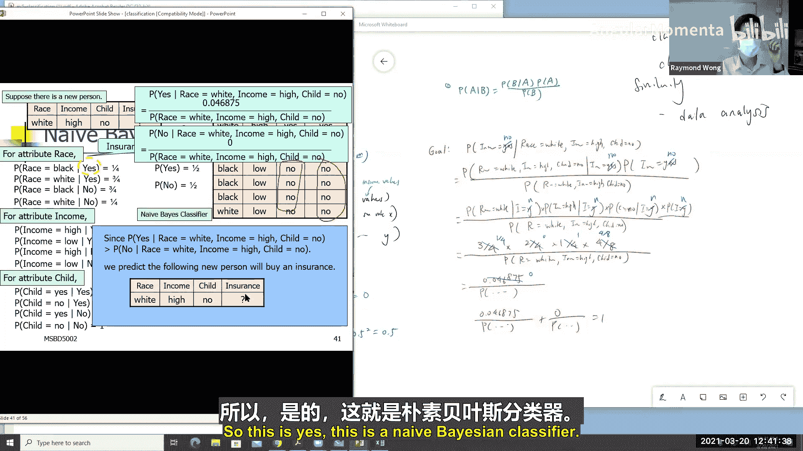

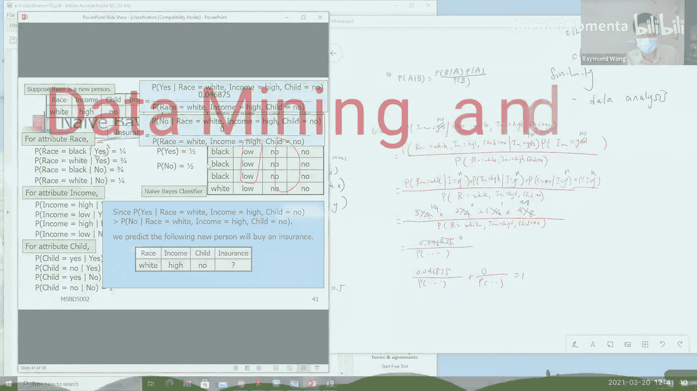

mining and noish discovery。🎼It mining and no N discoveries。

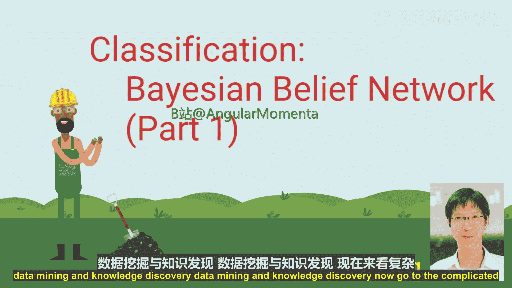

No， go to the complicated one， the Ba belief network。Face on belief network。

The difference is as follows。The9th basin classifier。We have the independent assumption。

 We have the independent assumption。And then for the Ba belief network。

 we do not have this independent assumption， which means that some attribute is depending on the other attribute。

Let's see this example。 We have this radical data。😊，Exercise， okay。

 whether the patient did some exercise， Yes or no， whether this patient have a healthy or unhealthy diet。

 whether this patient have a heartburn， yes or no， whether this patient have a high or low blood pressure。

 whether this patient have a chest pain or not， whether this a patient have a heart disease or not。

I think you understand that， you know， this medical data。

 some attribute are depending on other attribute。 Okay。

 some attribute are depending on other attribute。 I think you also understand that if you do more exercise。

This will reduce the probability of suffering from heart disease。 This is understandable。

 In our notation， we would be know as follows。Exercise。E and heart disease， something like that。

 doing more exercise will will do some probability of suffering a heart disease。

 We just add an arrow， something like that。And then in general。All this attribute。😊。

Each arrow means something has some correlation。 I I want to use the full screen mode。

 I want to use the full screen mode Wait a moment。

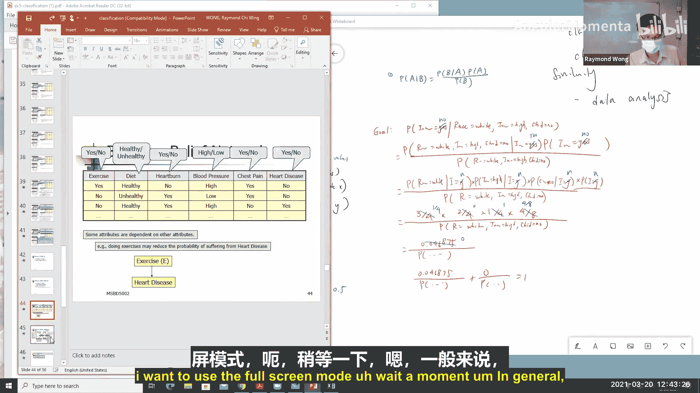

In general， we have this and this and this， this means heart disease we if we do exercise and also healthy diet。

 the heart disease the chance will be affected。They affected at the same time D if we have a healthy diet。

 then maybe we have a lower heartburn or some probability will affect heartburn and so on。

Let let me give more number table here for you。Based on the previous medical data。

 we can calculate this table。 This table there's a physical meaning。

 This one correspond to the probability that E。Is eager to yes。

 The probability that exercise is equal to yes is equal to0。7。

This number is obtained from the previous medical table， obtained from the previous medical table。

Although you also understand that we have E is eager to know， we know that。

The probability that E is equal to know is equal to 0。

3 since the sum of these two number must be equal to one understand。 and similarly。

 for the right hand side， the diet， the probability that B is equal to healthy is 0。25。

 even though we have the hidden column D is an equal to unhealthy。 The probability is equal to 0。75。

 I think this is a simple。 and now go to this one。Now we have some course。Now， y。

 we have two possible cases。D， we have two possible cases。 Ca means yes or no， here。

 Health or unhealthy。 We are two possible attribute affecting them。 So totally。

 we have four possible cases here。For y is equal to yes。😡，And he is eager to know。换师得。

D is equal to healthy， unheal。 D is equal healthy and healthy。 So totally。

 we have four possible cases， four possibly cases。And then now we are focusing on H is yes。

And this number， what the physical meaning， The physical meaning is。The probability that。

H D is equal to yes。Even this things。二。Is equal to， yes。And then B is eager to healthy。

He is equal to healthy。And similarly， I think you also understand this one。0。45。

 the probability that H D is ill to yes given E is ill to yes D is equal to unhealthy and so on。

 I think you understand 0。55 and 0。75。I also guess that you understand that。

 although we didn't write down H D is eager to know here， you also understand that actually。

 we have a hidden value，0 point 7，5，0 point5，5 and so on。 This correspond to this kind of thing。

And just know the probability that H D is equal to know。

 different that E is equal to Yes and B is equal to help it。 I think you understand this one。😊。

And then similarly， for this heartburn， very simple， we have just one error point to it。

 H B is equal to， yes， we have two cases。 D is eager to healthy， and D is equal to unhealthy。

 And then this one， I think you can know the meaning。😊。

In automatically make it explicit actually you know that this correspond probability that H B。

Is equal to yes， different that is eager to help understand。 then continue This one。

 we had the blood pressure。 Okay， blood pressure high and then H。Yes or no。 And some number。

 I think you understand the meaning。 And also C similar to this case。

 A C B we have two arrow and we have two cases and two cases。 So we have four possible cases。

 And this0 point X correspond to this C is equal to yes。 I don't go good with you。

 I think you understand it。Next。Now， we need to introduce this a term。 let X， Y， Z。

 be free random variables。X is said to be conditionally independent of y。Given Z。

 if the following host， this is the definition， this is the definition。The probability that it。

Differentiff Z， difference Z is here。And then it set to be conditional independent of why。

 So see now I say that they are conditional independence， which means that why can we move out。

This is what we mean。Let me before we end the class。 Okay。

 I want you to have a test on your mathematics。 just three step or two step。

If x is conditionally in the handle of y given z， which means this equation is correct。

Do you think that this equation is correct， Originally， we just get the Y O。 Now here。

 Y is now in the consequent part， not the conditional part。 Do you think that X。

 Y given Z is equal to X given Z and Y given Z。You can fill it within three minutes。

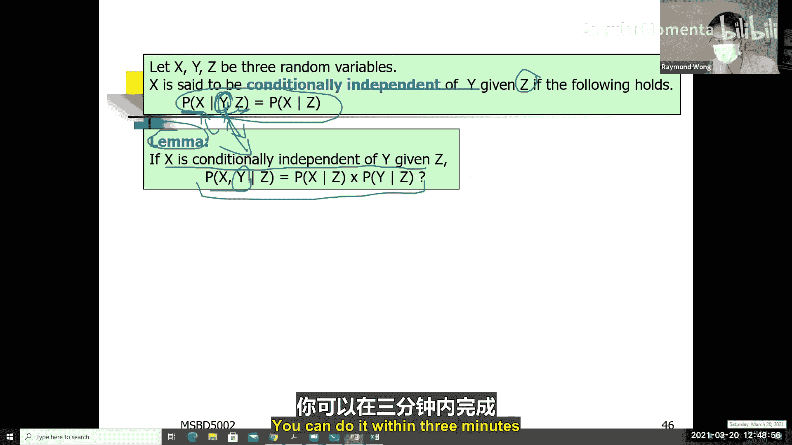

🎼The mining and noish discovery。😊，🎼mining and no N discoveries。

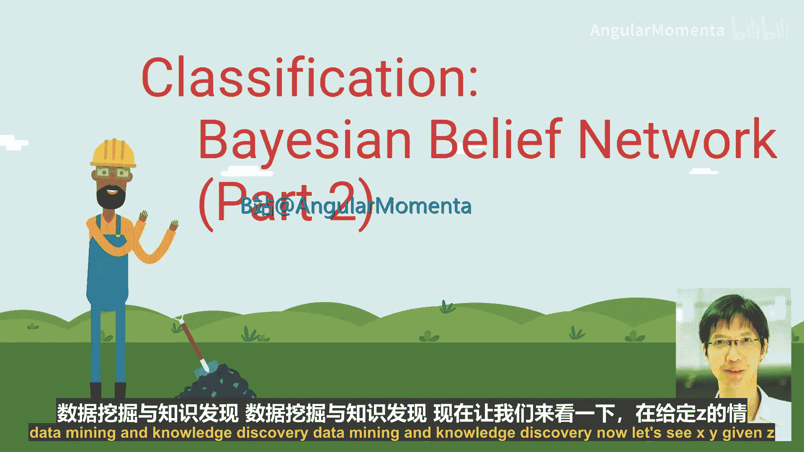

Now， let's see。 X's Y， given Z， actually， we just use the conditional probability rule number one。

 Very simple。This one just use rule number one。 And then we just copy X， Y， Z。And then Z here。

 And then we just add two more terms。 Actually， these two more terms is based on what we want to be。

 Okay， you can see that here Y given Z， okay， we want to have why。And given y z here。

 So we understand that。On the this one should be this one by definition one， this one。

 I think you know that this should be is given one z。

And we understand that probability that x given Yz is exactly probability x given z。

And then we are done。 We are done。 This is the proof for this one。Any question？Any question。

Any question。Very simple。 Just a few step this what you learn。 rule number one。

 conditional probability， rule number two， conditional independent。

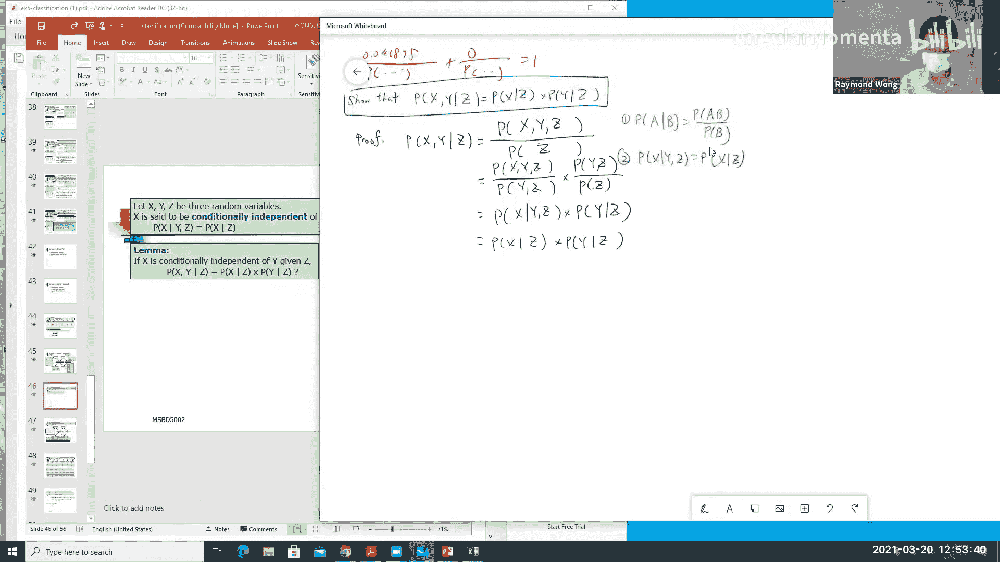

🎼mining and no N discovery。🎼Be mining aid no N discoveries。

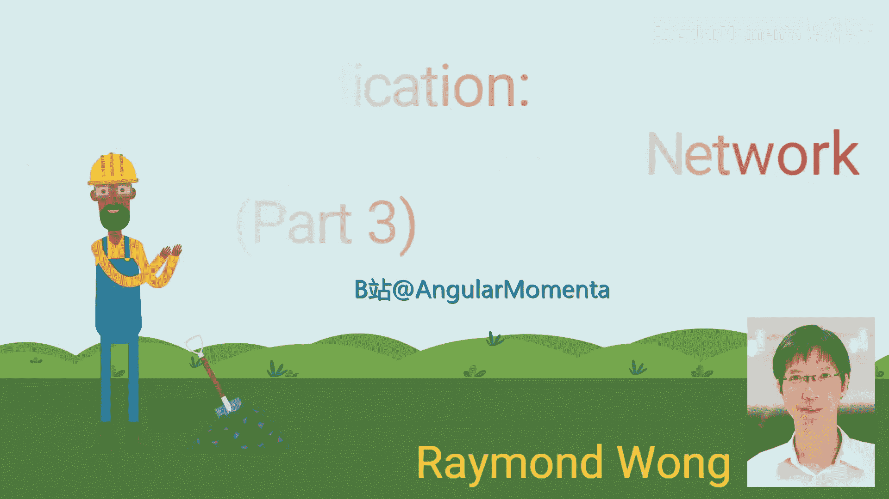

This one in this basic belief network， they have this property。

A note is conditionally independent of its long descendant。 If its parents are。

 there's a lot of term， long descendant parents。 And this term has been known by you。 Okay。

 let me give more background to you on the left on the right hand side first。

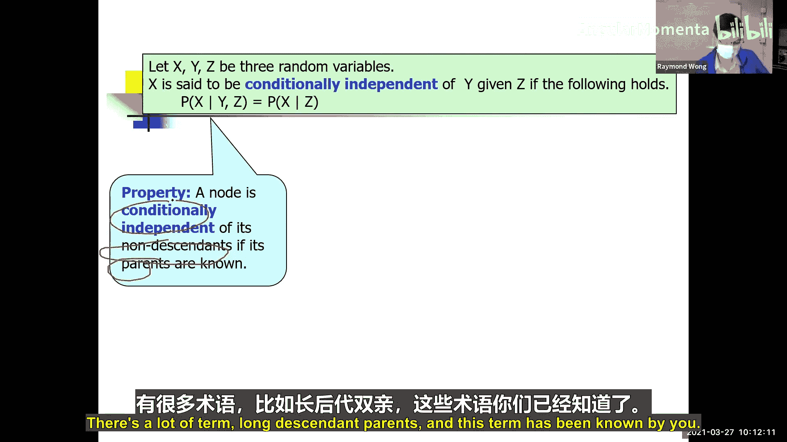

Conditionally independent， let me use the whiteboard。

Let me use the whiteboard to illustrate this concept。Let me draw a figure。for example。

If we have a look， a。And then， we have a look be。And then we have a no C。

 and then maybe we have T and then E and then F and O so that you understand E F G and then H。

Now let me see。 supposeuppose that。My focus。My focus。My focus is here。 now I'm here， I'm here。

 My focus is here。Now what I want to say is that in computer science。

 I think you know that this is a graph。We know that。There something above me， this one。

 let me write down。 This one is my parents。Is my parent。I it my current。And then you understand that。

😊，Anything under me under me are descending， Everything here are call descending。Deenting note。

So we understand this relationship。 If we have a starting with a focus parent and this are long this are descending。

 So anything。Not in this green colour things are called long descending。

 So what I want to say is that this one， this one， this one are also long descending are also long descending。

Anything not inside this green colour box are long descending。 And also。

 this one is also long descending。 Of course， this one are also non descending。 Usually。

 they will not refer this。 So have under this green colour films are long descending。

 understand Now if you have this idea。 Let's go back here。 note。😊，Is conditionally independent。

 Actually， this note meanss our focus。 Our focus note is conditionally independent of this non descending note or it non descending note。

 If the parents are known， if my parent is known。Let me give this illustration on the left hand side。

Now we have this one。Let me here。 We have this probability。 Now， I want to draw some color。Now。

 let's see my focus， I use blue color。 Okay， currently， okay， my。

 the probability that B P is eager to hide。 this is my focus。The probability that I want to know。

 So let me circle out， this is my focus， blue color is in my focus， so this is also my focus。

And then what I want to say is that this blue colour phone is upgrade that we use color。

 This one is my parent， right， this my parent。😊，So let's see， given that I know my parent。

 So you can see that I circle the color parent。And then then we use green color。 Okay， let's see D。

 D is here。 You can see that D is here， which is not under my focus。 So this is long descendant。

 This is long descendant， long descendant。😊，So we understand that this is non long descending based on this property。

 note the blue color note is conditionally independent of its non descending note。

 which means the green color note。 if the parents， the white color notes are known。

So this green color can remove from the condition。😊，So this is what we want to say with these things。

B P， okay， maybe let me are use some color so that you understand better。

 the blue color thing our focus is conditionally independent。

Of something this something is the non descending note is non descending note。

 given that we know the parents， the white color is very clear。 Let's go to the next example。

 The example is also similar。 Let me illustrate also with some color。Similarly， our focus is BP。

 okay， the probability， this one。 and then we are， we know the parents， know the parents。

 know the parents。Let me make back the color。 And then now let's see。 okay， the difference is C P。

 okay， C p let's see C P is here， Similarlyly， not under the blue color。

 So this is also long descending。 This is also non descending。

So we understand that the blue colourphs， given that we know the parents。

 the white caphs and this is long descending， so we can remove it out so you can see that I can write down this one。

This one means let me put back the color first， this is the white color and then this is the blue color。

So we understand that the blue color， my focus is conditionally independent of nonde norm。

 given that the parents is known。 This is what we want to say in our in the today lecture。

 we will use this properties a lot。 Please remember。😊，Now， I think you can remember。

 let me go to the next night。This is what we have is the medical data。

 And then this time we want to predict something for some new patients。

 supposeuppose that we have a new patient and I want to predict whether these patients suffer from a heart disease or not We have a three count of patient patient number one。

😊，We know nothing。About this patient at the beginning。

But we want to predict whether this patient suffer from heart disease。No， I'm a medical doctor。

 I ask more info ask more question to this patient。

 and then I may know this patient have high blood pressure。

 When I know high blood pressure from this patient。

 I want to deduce the chance that this patient suffer from heart disease and then patient number three maybe also the same patient。

 I ask more question。 maybe I know that this patient have healthy diet and also did some exercise。

 more information。 I want to deduce whether this patient suffer from heart disease or not。

This is what we want， This is what we want。

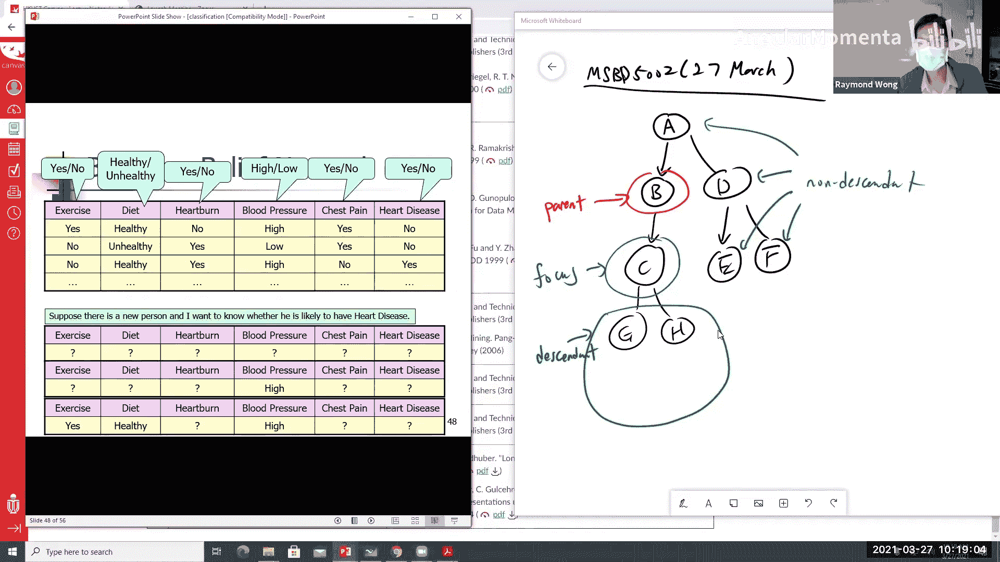

🎼The mining and noish discovery。🎼Daer mining and no N discoveries。

Now， let me use also the whiteboard to give us for the major idea in this Bay belief network。

In this natural， since we are talking about probability。We are talking about probability。

 So what I want to say is that。We want to calculate the probability。 Now， let's see the first one。

 example， number one。Now， let me set up our goal。 Let me write down our go。Our goal， okay。

 is to compute some probability。We want to compute some probability。

 The probability for patient number one。 Let me go to patient number one。

Now I'm talking about patient number one。Patient number one， now patient number one。

 we just have this information what we want is to calculate the probability that heart disease is equal to yes。

And then we want to do some computation。 No， we want to do some computation， how to do that。

 Let's see， go go go go。Go back to。This lie。This slide with a moment， which is the next night。

This one， we have this kind of information based on this kind of information。 And then we compute。

 Let's see H D， where we can find H D we can find here， but we know that H D is equal to yes。

 given something， right， given something。 So we could not obtain the value。

 H D is equal to yes directly here。 So what I want to say is that。Now。

 I want to use some kind of basic probability to do some deviation。 Let's go to the here。

I think most students know that discount of equation。Rule number one。Rule number one。

 we understand that supposed that I want to calculate。someing for example。

 harsh disease is equal to yes。I think in your university。

 you know that this can be computed like this form， the probability that HD is eager to yes。

 given that this patient， for example， for example。

 gender is eager to male and then multiply by the probability that。

Gender is equal to male Plus the probability that H D is equal to Yes。 genderder is equal to female。

And then probability that gender is equal to female。 I think this equation。

 you have learned it in your university。And now let me generalize data。In fact this one。This one。

Can be say， case one。And this one， we can say case two。

 So we understand that when we calculate H D is equal to yes。

 what we can do is that we can write down something like。These blue color things。HD is yes。

And then case one。Multiply by case one。Plus。H D is equal to， yes。

Case2 and then probabilityity that case 2。In some cases。

 you know that gender have two possible cases。 sometimes some attribute will have different possible cases。

 So maybe we have case 4 case2， case3 and case4 in similar formula。 I think you understand this form。

Now let me go further， we go further here。Here we know that that we use some annotation in Zoom that we use color。

This one， we know that this correspond to the probability that H D is equal to yes。

Different that he is eager to， yes。And then D is eager to help it。Now， actually。

 this is as consistent with what we wrote。 H D is you to Yes， different something。Even something。

In fact， I can say that this is maybe let me use blue color。Case one， this is case  one， case 2。

 case 3 and case 4。 Let me write down on the on the whiteboard。 Let me write down on the whiteboard。

This is a means。あ。The probability that this is equal to probability that HD is equal to yes。

 given that case one。Let me write on case one first。Case one。Actually， case one we here。

 case one refer here and then。Maybe way quickly。We have different cases for possible cases。

So we just write on very simple。Case two， case three， case4。And then right down， right down here。

And then2，3，4， case 2。And then H D is eager to， yes。D is eager to yes， and H D is eager to yes。

I think you have no problem on that thing I have already illustrated on the top right corner。

 which is this one， which is this one and then let me continue we know that this one。This one。

 this case won't correspond to what we mentioned on the left hand side。This is equal to E。

 Its equal to yes。And then D is eager to healthy。And then case two， case 2， in fact。

 correspond to this one。 he is equal to yes。And then these is equal to。Healthy。

 unhealthy or unhealthy。And then similar， case three and case4， let me do it very quickly。Case three。

 case four。We will have this one。E is eager to know。 And then D is eager to healthy。

 And then finally， okay， E is eager to know。 and this is eager to。Unhealthy。

This is very understandable now let's post it。Now the first time probability that HD is equal to just given this kind of things。

Can be found here the red color things。 And then this is equal to 0 point25。

 Let me weigh down0 point250 point25 multiply by something。

 I talk about this later and let me continue plus something multiply by something plus something。

And then。Let me put a blue colors first。 Who want to tell me this three answer to get the coupon。

 raise up your hand， if you want。呃。红狮。Oh， you are in a wait a moment。 yes， wait a moment。

 Let me a beauty here。 Wait a moment。Yes， you can unve yourself， yeah。

0145 what one you5 five0 and then continue75 you okay thank you you get next okay understand that student can this one here this three number here and then let one this one let me copy this word here that you understand what are doing probability that is to yes。

He is eager to healthy。And then this one， E is equal to yes， and D is equal to unhealthy。

And then similarly， we have the remaining terms， we have the remaining terms。He is eager to know。

 E is eager to know。 And then he is eager to healthy。And then this is eager to unhealthy。

Now how to continue， let me teach you how to do that。Now we understand that knee is here， right？

D is here。 So these two have nothing let me see， let me。Theres no edges。Pointing to this two note。

This two look， there's no edges pointing to it。 So this means that there's no dependency between E and D。

 Okay， I repeat。Since there is no edges pointing to you。So this e and D啊。independ 地啊 independent。

So there's no edge are up So E and D are independent since E and D are independent。In mathematics。

 we know that this one should be equal to probability that E is equal to yes。

Multiped by this D is equal to healthy。And then similarly， we have 0。45，0。55 and 0。75 plus plus plus。

诶 multily by some number let me weigh down quickly。This is， yes， this is no， this is no。

And then this is E。And they multiply by d is eager to something D is eager to。Unhealthy， healthy。

And unhealth。You can write， I think you get the point。 and then let me continue。Let me continue。

 It is equal to yes。 The probability is equal to some number。This is Eagle to Se Paul 25。

Which sorry equal to zero point seven zero point seven。This can be obtained here。

 E is eager to yes here0。7。 So we obtain this 0。7。 D is eager to healthy， which is here 0。250。25。

So let me write down， actually， this is also 0。25， this is also 0。7。

Who want to answer what is this value and this value and get the coupon？诶啱先。I think， yeah。

 I know mut you。 I know you are yeah。 I yes。Tell me the answer is0 point9 which one this one thisalth isalth mean equal to yes0 know answer just value p to isth0 and is the probability is to answer here okay the answer is equal to what。

Here the point for nine for nine。 Okay， thank you。 thank you An for night since the student just calculated with his calculator。

And then so this is the answer。 So we understand that probability H D is equal to yes is equal to zero4 line。

 for symmetric reason。 Okay， usually this topic， they will do probability that H D is also equal to no。

 The other way， just change yes to no。 And then they just write down one minus。Seil palm four night。

 which is e to seal palm5 one。And this is the probability。 And then usually don't miss this one。

 This is also very important， the conclusion。😊，The question is that we want to predict whether this patient will suffer from heart disease or not。

And based on this number，0。51 is slightly larger than this one， we can say that。This patient is a。

Well， likely。That。D patient doesn't this patient。does not。Suffer from heart disease。

 does not suffer from heart disease。This is the conclusion we want to echo the question。

Any question for this one。If no， okay， let me write down the conclusion on the right hand side。

 first， let me write down what we have here。 Let me write down in red color。

What we had is that we just computed the probability that H D is equal to yes。

H D is eager to yes is's equal to0。49，0。49。 And we also compute H D is eager to know iss equal to0 point。

51。 We just compute here。H D is easy to know。 iss easy to0。51。 I just summarize on the top。 Now。

 this is what we have for example  one， patient number one。

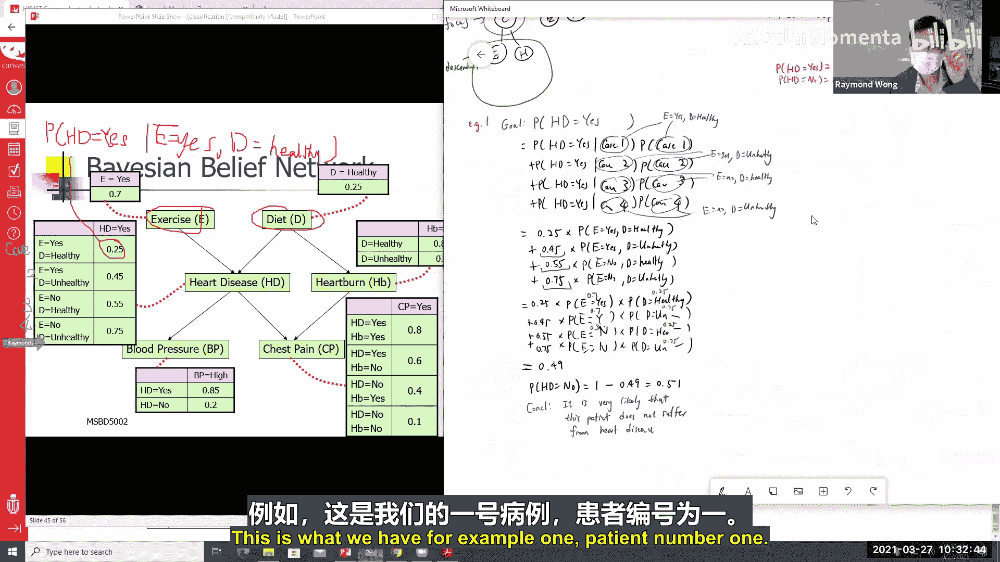

🎼mining and noish discovery。🎼It mining and noish discoveries。Now go to patient number two。

 go to patient number two。Now go to example two patient number one or patient number two。

 We also need to set up our goal。 What is the goal， let me erase all the annotation here。

 and then the let's go go go go go go go go， which is here。 patient number two。

 We know this time of inflammation， High blood pressure。

 but we also want to deduce whether this patient suffer from heart disease or not。Similarly。

 the goal is that we want to set up the probability term。This time we have two part。

 the first part we want to compute whether this patient suffer from heart disease。

So heart disease is equal to yes， this is our goal on the right hand side。

 the conditional part I think student could guess it， who want to answer it。😊，By raising your hand。

 the conditional part。Who wants to answer。Oh no one。 Okay， yes， Yong wei。You are here， right。

 You can turn on your webcam。You take on your welcome first。Now it's okay now。 Yeah。

 turn on your weapon， Can you。turn on your camera camera， yes， yes， you can talk it now， yeah。呃。

Given the blood pressure is high， given louder louder blood pressure is high。 high pressure， yeah。

I's eager to。 hi， thank you。Highper pressure is equal to how you can unbu yourself， okay。Let's see。

 continuein。 Now we have this one。 We have this one。 Now， we want to compute it。

 also thing as before， we will， we need to go back to this slide。 Let's see what we want to see。

 Let's see。 Now， H D is eager to Yes is here。And B， P is equal to high。 B， P is still to high。

 You can see that Wait a moment。 Let me do it here。 On the right hand side， Let me say that I'll go。

This is just on your draft paper。We understand that this is different thing。 Okay。

 usually we say that BPp a different thing。 And then we have an arrow pointing next to it。

 which is HD D。 Okay， this is our goal。However， the given information。

 which means the given information here yes。HD is on the top。And then BP。Is at on at the bottom。

You人 see that。😊，This is the cost。 This is the consequence。 This is the cost and consequences。

 This is a reverse one。 This is a reverse one。 If you still remember that what we have learned。

In our last lecture。 Okay， I don't go back there。 I just write down here。

 Now this is rule number one， right， In fact， you also learn rule number two。

 You also learn rule number two。 Let me see right down here。 rule number two。Remember two。

 if you remember that。Last time we learned this space probability that a different B。

 And then we want to do the swap between the consequent part and the conditional part。

 So this is what we want to do it now。Now I want to swap it。

 Now I want to swap the con conditional part and the con part。

 you can see I swap it and the multiply by something probability a。Divide by probability B。

This is called Bay through。 Okay， this has been learned last time。Facebook。

Maybe be Raymon rule or your name rules you discover at that time。 Now we understand that。

 So here we this is our goal。 We want to do the swapping。 Now， let me follow the rule。 Okay。

 in this case。Here。Let's seen that we found example to， this is a。And this is B， just what we。

Just what you let me use a black color。 The probability that something multiply by something。

And then divide by something who want to tell me what is the something inside in that black color同ng Xu。

Oh youre here。 okay， let me yes， you can speak louder， yeah。也全跳不远。诶Yeah。

P B P equals to high B P is equal to high yes given H yes H is to yes then P H D is B P is equal sorry H is to H D is equal to yes B P is high B P is to high Thank you yes。

OrYou can unmute yourself。Now， I think you can continue。 Okay， let's continue。 Now we。

 with this formula， this is very easy for us to continue。 B P is equal to high。

Different H D is u to yes， in fact， can be obtained in this table here。 Let's see。

 This one is equal to probability the B P。B，P is equal to high。

Given that we know that H D is equal to yes， given that H D is equal to yes， this one。

 So this number is 0 point x5。 So write down0 point x5 multiply by something。H D is equal to yes。 No。

 for example one， we have already compute probability that H D is equal to yes is equal to0 point49。

 just write down0 point49。And next。Popity that B p is equal to high Similarlyly。

 B p is equal to hide given something has been given。 However， probability B p is eager to high。

 we could not do it Similarlyly， we can use rule number one， let me put it on on the right hand side。

 Let me write down in green color。Now， I want to compute。B P is eager to hide。Similarly。

 I can use rule number one， since we have some cases， some cases like this， case one。

 this is case one and case two， just write down。The probability that B P is equal to high。

Let me also write down case one。Multiply by case1 plus probability that this BPp is equal to a high。

 given that case2 and then case 2。Now， case one， what is this。

 In fact Ive already mentioned HD D is eager to yes， and H D is eager to know in this table。

 So let me write on。 Okay， let me use web color， case one。In fact， correspond to this one。

 H D is equal to yes。H D is eager to yes， and case 2 is eager to H D is eager to know。 Now。

 continue with the green color things。Let's see。 the pop that P P is equal to high given that HD D is equal to yes。

 is exactly this red color film Sil x5。😊，So point x five multiply by something what something okay probability that h D is equal to yes。

Can be found here sale pump for night， sale pump for night plus。This two number。

 who want to tell me what is this two number。Let me see。唔配人。Yes，It would be 0。2 times 0。2。sorry0。

2 times 0。51。旁小朋 five one 啊 wait moment啊。The first one is0。2。

 let me see whether correct populated H D is equal to2。 yes， this one 0。2。 and then this one is 0。

51 right， Thank you。 And then by your calculator， you can compute some number here。

And then this lumber put here put here。Put it here， Put it here。 And then also by your calculator。

 you will obtain a value。 Okay， a value multily by value， divided by value。

 You will also obtain this value。So we have obtained this value， okay， in our powerPo。

 we have already compute this one with more let we clear all the annotation。😊。

We have already computed。 Let me see what is the value。 Okay， the value is equal to。

S point x o something。 let me write down。 Actually， this is0 point8 O 3，3。And then now。Similarly。

 we want to compute the reverse one forsymmetric reason。

 So the probability that H D is equal to this time is not yes。 This is no。

Given the same kind of information， BP is eager to high。 okay。

 we know that this is equal to one minus0。803 feet。By your calculator， okay。

 you can see that this is eager to silicon。1，9，6，7。Similarly。

 we also do the same thing as example1 the conclusion。Here we want to write down the conclusion。

We also write down the conclusion， for example， too， let we write down the conclusion。

The conclusion this time， yes， H D is you to yes， this is Sil point。 Its something。

 H D is you to know the you to about Sil point 2。 So let me write down at the conclusion。

 is is very likely that。CouldAny student help me to tell me what is this one。

Just something like this。Who want to tell me it's very likely that this patient suffer from heart disease or doesn't suffer from the heart disease。

 who want to tell me？No one， this is very simple， I think。小通。Again， yeah， maybe wait a moment。

 I need to。 Yes， you can speak it now。😊，You unmute yourself， unm yes。

The patient is more likely to suffer from the disease suffer from heart disease why Yeah because。

The T H is yes given B P is high is0 point。诶诶诶。A033， which is larger than 0。5。 Yes， okay， thank you。

 Yes， okay。 your answer is correct。 Yes， so we we we expect that this patient will suffer from heart disease。

Now we are done for a patient number two。🎼The mining and noish discovery。

🎼Da mining and no N discoveries。

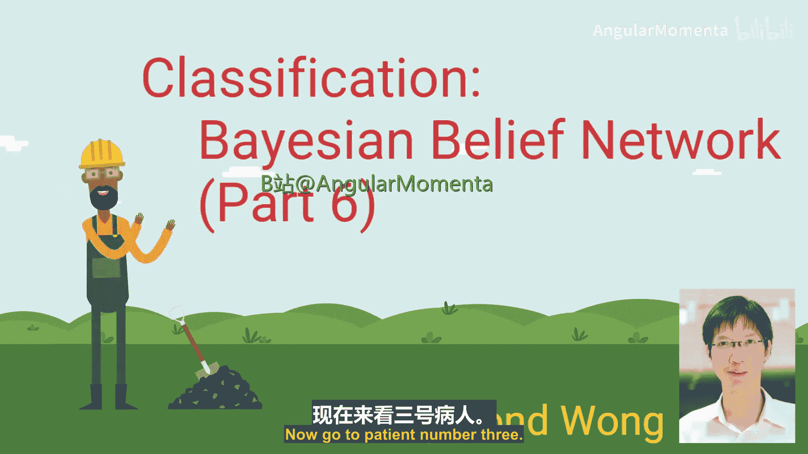

Now go to patient number three。Patient number three is something like that。

 We have a lot of different information。 This one is very complicated to some student。

 let me do it step byse。 Now go to patient number three， go to patient number three， go go， go go。

 go to patient number three。😊，Usually student feel headache for this one， example three。This one。

 let me also write down the go， the gold。 like the blue color go here。

Let me write down the growth first。Our target， the target is that we want to compute the probability。

The probability that H D is equal to， Yes， I want to see whether this patient will suffer from heart disease and then given some information。

This information is very simple。 I think I don't want to need to ask。 Just copy。

 E exercise is equal to， yes。And then the second one， we know that the diet is equal to healthy。

And also， we know that blood pressure is eager to hide。 B， P is eager to hide。

So we understand we have this three kinds of information， these three kinds of information。 Now。

 let we do the same things as what I did here。 Okay， what I did is that on here in on a draft paper。

 Let me write down the go。In fact， what I'm doing is we have E。We have tea。

We also have B here and then something like we have arrow pointing to H。

And then now let me write down the different things， the given things， the given one。Let us go。

 go back， Let's go back to the PowerPo， the basin belief network。Which is。This slide， let's see。

 Okay， E is here。 Let me copy。 E is here。And then， D is here。And then， H D is here。D is here。

And then B P is here。 B P is here。So， we understand that。The goal。

 the relationship among these four is different with the given a basic belief network about the four notes。

 I think you understand it。 Now， let's see how to do that。In order to make you， make you clear。

 let me use some deviation。 let's see， let me use some color。For example。

 currently our focus is HD D， right， Let we circle our H D is here。HD is here。

 This is my focus at this moment。 Okay， HD D is here。Now let's see E and D， E and D are at the top。

 right。H D here， E and D are at the top。 So the cause and consequent relationship have no problem。

 has no problem。 So we don't need to see this one at this point。 Now， take a look on B， P B， P。

Now this is at the top， right， B P is at the top compared with my focus。 However， in the given part。

 B P P P is at the bottom。So we understand that。This one。

The white color thing and the green color thing。The cost and consequence or the top and the bottom must be swapped。

 and E D， currently， I don't care。I don't care means that I don't care means currently just ignore this at this moment。

 Let me copy。 H D is equal to yes， this time， I ignore this two things first。E And D。

 I don't put it here。 Now， I just focus on H D is eager to。 Yes， B E P is eager to hide。

And then in the following， I want to swap the we telephones and the green telephones using rule number two using rule number two。

I want to use rule number two， which is this one。That we do it here。

 I want to use rule number two to swap this two。 So this time， we understand that。This one is a。

And this one is P。So very simple。 Okay， let me write down。

 I think this one is very simple probability that。Let me write down first。

And then divide by something。Eide buy something。How to do that many student also could do it by yourself。

This is BP is eager to a height。And then given that HD is eager to yes。

And they multiply by H D is eager to yes， and then B， P is eager to hide。

I think this is just using this space route to do the following。

Understand it now let me give some the equation for rule number two and in fact。😊。

Rule number two in mathematics， you if you learn mathematics well。

 let me copy the probability that A given B。B given a。You can see that I make some space here。

Im probabilityability， if you know that。Be given something。 suppose that I have more things。

 for example， I have。B andE here。FD e here。And then this is in the conditional part。

 have turn on the right hand side， we can also put it in the conditional part。

D E now in the conditional part here， I also put D in the conditional part。第二。

So here is also in the context of D E condition， condition， D E。

Since this is what you learn in the probability。 So based on this。

 the black color things is what we wrote。 Now I want to write back the blue color thing。

 which means E and D here。 Let me write down here。 Now， let me put back。 Now。

 I think the black color thing。 you understand。 Now， let me put back the red blue color here。

 Yes is E to yes， and D is eager to healthy。And then this is in the conditional part。

 So put it in the conditional part。E is eager to yes， and then D is eager to healthy。

 And then on the right hand， also in the conditional part， student usually miss the conditional part。

😊，And then E is eager to yes， and then D is eager to healthy。 And then on the bottom。

 we also have the conditional part。E is eager to yes， and then D is eager to healthy。

This is what we have just learned here， Any question？If you have no question， let me continue。 Okay。

 let me continue。Let me continue， equal to something， equal to something。

 Let me see what I mean by something， okay。Let's see。 This is the different part， right。

 This is the different part。And then。My focus this time is the green color things， which is here。

 Let me write down here on the right hand side。 Okay， this is my focus， this is my focus。

This is my focus。And then let's see， this is my focus。And then other part， this is my parent。

 this is my parent。This is my parent。Let me circle out the color， first。This is the color。

 and then the green color is here。And then you will understand that E and D are not under me are not under me。

 So E and D are long descending。 Let me highlight， this is long descending。This is non descendant。

So we understand that based on what we have learned long descending。This E and D can be removed out。

 So this is what we have just learned。Here。Im not focus note is conditional independent of is non descending note if the parents are not。

 let me apply this formula here。 since this is my focus。

 this is my parents and this are non descending。 Just remove the blue color things。

 So let me write down Let me write down this is this one。

 the probability that Bp is eager to hide H D is eager to yes， exactly this one。

 and now let me see the next one， Given that E and D， okay， E and D。

 and then we want to compute H D is equal to yes， which is here。 Oh exactly this equation right。

 exactly this relationship。So this one， in fact， can be found in the Bayian belief network。

 let's go back， let's go back。Let's go back to。The natural， the naturalox， which is here。

Let's see this one E is equal to yes and D is equal to healthy， which is here。

 given that probability that H D is equal to yes， which is this one0。25， let me copy0。25。😊。

This one is 0。25。

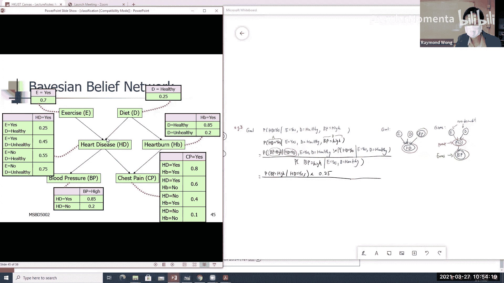

🎼BeThe mining and noish discovery。🎼It a mining and no niche discoveries。

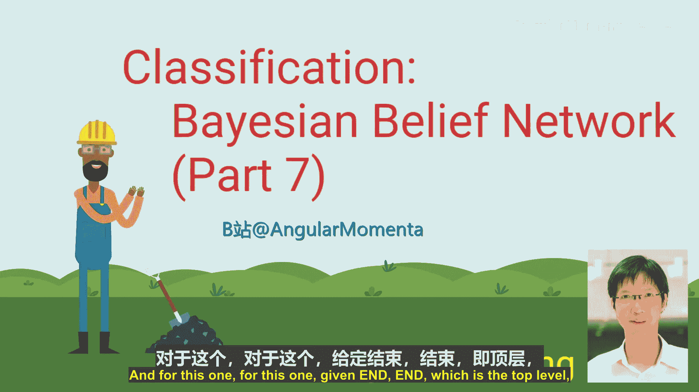

And for this one。播 this one。Given E and D， E and D， which is the top level。

And then we want to compute the B P is equal to height， which is the bottom level。

 So if I say this level 1， this is level 2 and level 3。

 So where we want to compute something related to level 3， Given that level one。

 So this is far away from each other。 So we need to compute something。

Let me focus on this poem first， Let me focus on this poem。C pawn on the right hand side of this one。

 the probability that。BP is eager to high， is now in level free， in level free。And then given that。

We know that we have the level one information is a level one。

 so we can see that some information should be put inside should be put inside in order to bridge level one and level three。

 The information is the middle level。Level 2， level 2。 Now suppose at this moment， at this moment。

Just consider the。We do not have any information。This one。In fact。

 we can also do the same like the rule number one。 Okay， let me highlight this one。Now here。

 rule number one， I wrote down something like that。😊。

H D is equal to yes is equal to H D is equal to yes。

 given that case one multily the probability case one plus probability that H D is equal to yes。

 given that case two multiied by probability case  two emphasis equation can be can be can be written down in an other format。

Then we write on。The probability maybe let me use web color。The probability that H D is equal to。

 yes。I also intentionally make some space the probability that HD is equal to yes， case one。

And then probability， that case one。Plus， probability the H D is equal to， yes。And then， case 2。

And then probability， the case，2， Similarlyly， on the right hand side here， I put D， E， D。

 E on the conditional part。 This time， I also put D， E here。Let's see in the conditional part。

 I put a conditional part， conditional part。I put D， supposeupp that I have the conditional part D。

Then we can also put D in the conditional part。 Okay， this is now in the conditional part。佢啲。

And case one， conditional part， let me write down D。 Okay， remember that we have a bar here。 Okay。

 student usually miss this bar now here we have a bar here， put it inside D E。And then case two。

 put a bar here conditioned。D E， okay， this concept is exactly what we have illustrated on the right hand side。

 exactly now go back， go back， I think you understand my point， Okay， go back here。

My point here is that currently， we have D and so on ignore it at this moment first。

 so that you know what I'm doing next。Here we know that BP is eager to high is here。

 This can be fine in this table。 Let me write down the annotation。 In fact。

 this one is equal to the probability that BP is eager to hire。Given some information。

 case number one， H D is equal to， yes。So this time。

 we also have case number one and case number two， so you can expect next what I'm doing next。

 I will write down something like this。Is equal to probability B， P is equal to high。

If on that case one。Multiply by probability that case one plus。D P is eager to high。And then case 2。

 and then multiply by case 2。 We know that case one means this one。 Let me write it down。This one。

 this case， one， in fact， it means H D is eager to yes。Case2 is this one。H D is eager to know。

 I think you understand it。Now， I want to put back E and D in the conditional part。 Let me put back。

 Let me put back before I put back， let me give some space first。Here， I want to like some space。

 Now， let's see E D， put it in the conditional part。Maybe let me use some color。

 Let me use web color。Now， I want to put it here in the con。Additional car here。 he is eager to yes。

D is equal to healthy。And then now this is also in the conditional part。

 So we will write down E is eager to yes， And D is eager to healthy。 And then case1。

 this is also in the conditional part。😊，So this is in the conditional part。 E is eager to yes。

 and D is eager to healthy。 And similarly， I think you know that let me put it quickly。

 E is equal to yes。 D is equal to healthy and E is eager to yes and D is eager to healthy。

So we understand this， let me do the deviation next。Now， you can see that similarly。

 B P is equal to hide， This is our focus。 This is our focus。

 And then here case one is H D is my parent。😊，E and D is in fact long descending a non descending。

 so I can use a better original equation to remove theu okay， you can remove yeah。

continue so are韩 maybe maybe always yeah。Continue， the probability that B P is equal to hire。

This is my focus。And then my parent， okay， the parent is this one。 H D is eager to yes。

HD is eager to yes。E and D， as I mentioned， is non descendant， non descendant。 Then I remove it。

So we understand that this term will become this term。Since we are not using。

 were moving the long descending。Similarly， for this term， HBP is equal to Ohio higher。

This one V P is high is here。 My focus focus case to H D is parent is my parent E And D are long descending。

 So we move long descending。 So we have this term。 Okay。

 let me write down the probability that B P is eager to high， given that H D is eager to know。

Continue。 okay， let me continue。 this term， the probability that H D is equal to yes。

 given that E and D。 In fact， this information can be fine。Here。This one。

 if we remember that this one correspond to probability that H D is equal to yes， this one。

 different E is equal to yes， and D is eager to help it。 So this term just copy02，5。😊，Sil H 25。

And then similarly， for this term probability that H is equal to know。

 given the same case E is equal to yesD is equal to help with。In fact， this numbermber。 Okay。

 what is this number who want to tell me。个 want to tell me。Yeses啊 Lu Yu。Here okay。

 let me wait a moment呃 let me啊。Yes you can unm yourself， yeah。有于。不 know。

s point seven five thank you zero point seven five yes let me zero point seven five。

So this is equal to 0。75。And then continue， continue。😊，This1。

 I think you also understand that the probability that B， P is equal to high is here。

 given that H D is equal to yes， exactly this one。 So this one is 0。85。Multiply by 0。

25 plus this one。 we have a number multily by 0。75。Who want to tell me this answer，nie， yeah。0。2，0。2。

 Thank you。 Yes， this can be obtained from this number 0。2。So we understand this similarly。

 similarly， we can use your calculator to compute something， for example， some value here。

 So this value can be put in the original equation。Which is here， which is here and then continue。

Continue， which is we have a square boss multily by 0。25。And this one。

 I think you also understand that can be obtained here。Which is equal to Sil85。

Then by your calculator， a value multily by a value divided by a value should be an another value。

 So this value has already compute in our powerPo。 Let me see the value on the powerPo。

Let us see the value in the PowerPoint。Let's see。 what's the value。 The value is equal to。

So5 this equal to X 5， x，6，2。And then for symmetric reason， we also computed the reverse one。

 H D is eager to note。😊，Just change this from yes to no and then copy the whole things。

E is eager to yes， and then D is eager to healthy。 And then B， P is eager to high。

And then also1 minus0 5，8，62。 And then finally， we have this answer a seal point 4，1，3，8。😊，So。

41 x38 similarly， we also want to have a conclusion。呃 it is。Very likely that？Similar。

 I want to ask a student to answer it what is this answer。 okay。

 yes very good thank you for support and yeah yeah tell me yeah okay the patient is more likely to suffer the yes。

 the patient has more likely to suffer from the heart disease because p h equals to yes given is zero zero five eight six to。

Yes， yes yes。 Thank you。 Since this value is larger than this one。

 this value correspond to HD is equal to yes。😊，So we understand you， now back， go back here。Now。

 continue。 Now we have already finished all the basin belief network。

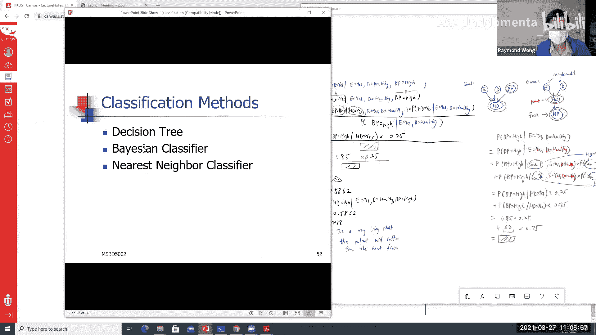

🎼To mining and noish discovery。🎼Da mining and no N discoveries。

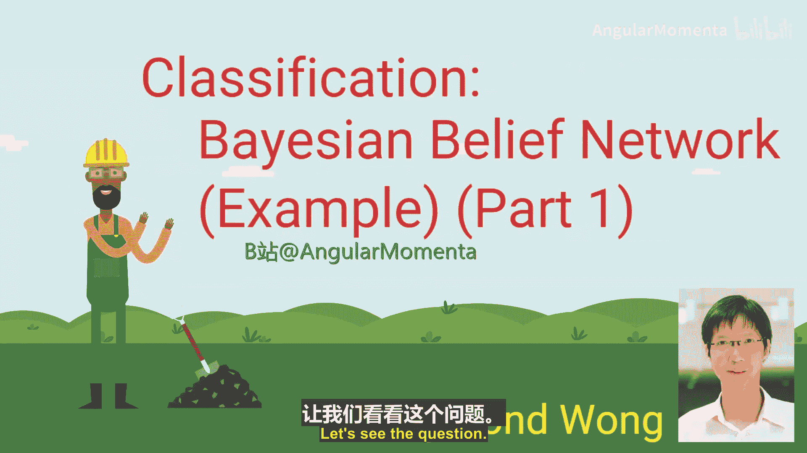

Let's see the question。 The question is。This is the basin classifier。

 we have the following basin network， let me make it larger with a moment。

And then this is E exercise， heart disease， blood pressure， chest pain。

 and then suppose that we know this customer or this patient， this is patient。

 he does not have he did some exercise exercise is yes， He has high blood pressure。

 blood pressure is high and chest pain is yes， we would like to know whether this patient we will suffer from heart disease or not。

 This is our summary。 his use the basin belief network or the classifier。

 to predict whether this patient suffer from heart disease or not。

Now that we also use the whiteboard to illustrate all the idea here， now that we use the whiteboard。

Since this is a little bit difficult， some student may not know how to do that。 Let me do it。

Now let's see this is the in class exercise。呃，five。Question 2， let let's do it。First of all。

 we understand that the Ba belief network， we need to set up our goal。

 let me write on our goal or our target， we want to compute our probability。

The probability is something like we want to compute where the probability that the patient suffer from heart disease is equal to yes。

And now we know three kinds of information，1，2，3， right， Given some information。

 E is eager to yes and their blood pressure is eager to high。And then trust pain。

 trusting is equal to。Yes。I just copy from here here just copy this information here I think you understand it now let me do the following you just still remember that let me put this here and put it here and then let's see。

Do you remember that last time I told you that in your draft paper。Then we can write down our go。

 our goal is something like EBP c， okay， let me write down EBP cP。

 and then we have something like this this is H。And then we also know that we also know that the different let me see the different things is something like this Yeah I also write down on the right hand side。

 The different things is E and then H D and then B more better here B and then C So we have this kind of relationship this network is given is given we could not change it。

 but this one since this is some probability term we can change it。 Okay。

 let's double check E H D E H D So this relationship is okay E at the top H D at the bottom E at the top H D at the bottom So this is okay However B can see that B B is here。

 This at the top。 but here is at the bottom。 H D is at the bottom here is at the top。

 So we understand that。This time， we want to do something。 Okay， we want to do the swapping。

Between these two things， okay， we want to do the swap。 We want to do the swap。 Now。

 let's see how to do the swap。Now we want to do the work between B， P， C P。

 and also H D is equal to Yes， this is what I want to say。 Let's see what we have learned before。

We have learned。Let me use a green color。Now， the first number one rule is that the probability that A given B。

I's equal to probability that be different a。And then multiply by probability a。

Divide by probability B。This is what we have learned before。 This is what we have learned before。

So let's see。Here， suppose that the conditional count， if we add more， let me do it。

 Suppose that I add。E and then F。 suppose that I add more thing。 Okay。

 E and F in the conditional part。Then on the right hand side， each term。

 the conditional part can be added with E F2。 Okay， let's see。 Okay， here。

 the conditional part is a contain a， so I can add E。F， right？ And then here， a。

 the conditional part， we can also add。E F。And here for this term。

 we can also add a conditional part。E F， this is has been done in your probability class。

 you didn't learn it， learn it now。Now we understand that this is true。

 Remember that many student make mistake in the past is that they did not write a bar here。

 They just write B comm E F means this E and F is not in the conditional part。

 This should be in the conditional part。 Also， this is also in the conditional part。Understand。

 and then we， if we understand this statement， let's go back here。 This is correspond to a。

This correspond to B， This correspond to， for example， E F， something like that。

 So that as a firstly。Ignore this E is equal to yes first so that we can know what and we are we are doing。

 Then we write down。Suppose that I write down something like that。B P is eager to hide。 and then C。

 E P is eager to yes。 I just write on this。 I will write this back later。 This is a， This is B。

 So according to the green color at the top。So we can write down very easily。 okay。

 which is this one。Which is this one。C P is equal to yes， different H D is equal to yes。

And then multiply by something multiply by something and then divide by。心永。Okay。

 who want to tell me what is this something inside just based on this red color things。

 you can raise off your hands， any student who want to answer this one。No what。No one， right。

 Let me see whether I miss someone。四。O， maybe no one want to answer。Actually， this is very simple。

 Okay， this is very simple。 You don't want to answer our homework free will be released today。 Okay。

 it's also very difficult Now continue。Here this one is a， as I mentioned， this is a。

 So we have H D is equal to yes。 And at the bottom is related to B。

 B is exactly the whole thing here。 So B P is equal to high。And then C P is equal to， yes。

And then now we this is what we wrote about the green color things that we add back the green color things。

 which is E is eager to yes here。So this is in the conditional。

 So everything here is also in the conditional here， This is in the conditional。

 So this E is equal to yes。😊，And then on the right hand side， we also put it in the conditional part。

So E is equal to yes。 And this one， E is eager to yes， understand。

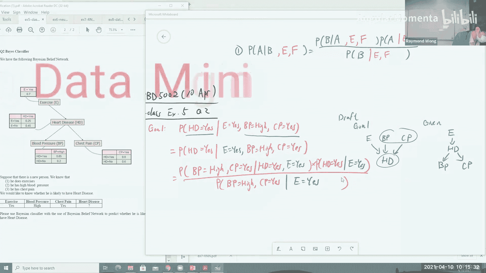

🎼To mining and noish discovery。🎼Neer mining and no N discoveries。Let me continue you。

Let's see what what we want to continue now， BPP， B PCP is here， right。HD is here， right。

 and E is here。 Let me write down something what we we have learned before。Let me use some color。

 Let me use some color so that you know what I'm doing。 Now， I suppose that H D is a red color。 Okay。

 H D is a red color。 for example， B P is blue color。And then啊 let me see c p啊 no。

 maybe啊 e is green color e is green color and then c p is black colour。

Suppose that we have this kind of color。 Okay， we can see that the blue one and the black color is at the bottom。

 And then we have the parents。 So let me write down。 This is our focus。😊，And then this is my parent。

And then you know that this is non descendant。You still remember what we have learned last time。

 so we can remove the long descending。 Okay， we can remove the long descending。

 So what I want to say here is that in the next step is very easy。

 I just write down B P is equal to high C P is equal to yes。 and then H D is equal to yes。

 and then E is equal to yes， can we remove。 this is a long descendant and then continue。This one。

 let me see a。上音啊。And continuein this one probability that H D is equal to yes。

 given that E is equal to yes。 Okay， let's see。 Actually， this one can be fine here。😊。

On on the left hand side， let we use the annotation here。This one， let's see。 This one。

 What is the meaning， If you remember what we have told you。

 this correspond to the H is eager to yes。Which is this one。 given this one， he is eager to。Yes。😊。

So exactly what we wrote here。 So this one should be equal to 0。25。 maybe write down 0。25。

This is equal to 0。25。Now let's see the next one， Okay， which is here B P and C， B P and C is here。

 E is equal to yes here。 So we can see that B P and C is in the very bottom level。

 E is equal to yes in the very top level， if I say this is level one， level2 and level 3。

 So B PC is in level 3 and E is equal to yes is in level  one。

 So level one jumping to level 3 So big gap big gap。 So if you remember what we learned a last time。

We want to bridge level one and level3， rear level2。The process is here。 Okay， if you forget it。Here。

 in fact， we also use the second rule。 Okay， the second rule is that suppose that we want to this time what instead suppose that we have something like。

 okay， H D is equal to yes。And then we know that。The probability that H D is equal to yes。

 given that。Case1。And then multiply by。Case1。And plus， probability that H D is equal to yes。Kase2。

 multily by case 2。Suppose that we have two possible cases。 One example。 Okay， one example。

 suppose this one， this is gender is e to male。 This has been illustrate way before。

 And then this is gender e to female， something like that。 Okay， this has been learn before。 Now。

 I also want to put back the we color things here。Let's see。 Suppose that I put the red color here。

EF， so on the right hand side， have conditional part。We also need to add something like the EF。

So here in the conditional part we add here and of course here the conditional part we also add。

 let me do it， we need to add the conditional part okay， wait a moment， we will have E F。

 we also have E F and then close the black。So we know that heavy EF is will be put in the conditional part。

Understand， so in this formula， let me put it here。 Okay， I want to put it separate， put it here。

 Let me write on the right hand side。 Okay， maybe let me write it here。

The probability that B P is equal to high， C P is equal to yes， E is equal to yes。This time。

 similarly at the beginning。I don't want to make it very complicated。 Let me ignore this term first。

 let me write down this one P B P is eager to high and then CP is eager to yes， okay。

 I don't write anything。 and then I want to use this kind of case one case one and case two and case two what I'm doing Okay。

 let me write down P B P is eager to high。And then C P is eager to yes。Case number one， okay。

 I will tell you what I mean by case number one。 Let me soon out first。Case 1， No， okay， case 1。

And then multiply by case。1。😮，So out a little bit。 Okay， maybe go to here。 Okay， case1。And then。

Plus probability that B P is equal to hide C P is equal to Yes case two probability that case two。

Now， what I mean by case one is， is you still remember that we want to use something like level 2。

 level 2， which means case one is related to this one。 So we understand that this one is， in fact。

 let me circle one。 H D is equal to some value。 yes。我 equal to。No， so we understand these things。

 This is in red color。 Okay， in red color。 and B， P， let me also go back to some color。

 This is the this is the let me see blue one is this one， the blue one。

 and then the black one is C P， Let me circle out。Now we understand that from here。

 we can obtain this one based on rule number two， which is。This one， rule number two。

 so this is correct。And then I want to put back this E ego to yes。It is a green color。

 Let me use green color。Let me put back E is eager to。 Yes， if you。

 we know what I'm doing here about E F。 So you understand that actually。

 I will put back here for the conditional part。Conditional part。Conditional part。E is eager to yes。

 and also E is eager to yes。So very simple， let me continue。 okay， let me continue let me continue。

Now we can see this example， let's see诶。Not啊 not here。 Okay， now it's here。 B， P and C P。

 B P and C P is here focus。And then the parent， this is the parent。

 and the green color one is non descendant。 So you understand that this term can be rewritten to this one。

 Now， I can remove the non descendant。 So we have B P is eager to high。CP is eager to， yes。

And then this is my parent。You can see that。He is equal to yes has been removed since this is non descending focus。

Parents long descending can be removed。 Similarlyly， for this term， I can write down。P is equal to B。

 P is equal to high。CP is equal to yes。And then H D is eager to know。

And then multiply by something multiply by something similar oh no， not this this one。

 I don't need to write down this probability since I can write down the number， like what we did。

This one， probability that H D is equal to yes given that E is equal to yes is exactly this number。

So I can write down this number。 This numbermber is eager to Se poem 2，5。

And then we also need to write on this probability。What's this number who want to answer？

 This is very simple。啊，八爪。W， it's 0。450 sorry，0。45，0。45 let me see。W yes why， yeah， why。

 let me tell you啊 this is。You mean this one。Yeah， sorry let me write on。 let me write down actually。

 this mean the probability that HD is equal to yes， given one condition。

 the condition is E is equal to no right Yeah， sorry， I made a mistake Yes， do you try Yeah。

 So we need E is equal to yes， and H D equal to no。 So that will be 0。75， which is the 1 minus 0。25。

 Yes， thank you。 this should be sorry you you get the  coupon Thank you。 So this one is equal to 0。

 75 So we understand that is's equal to 0。75。🎼mining and noish discovery。

🎼It mining and noish discoveries。

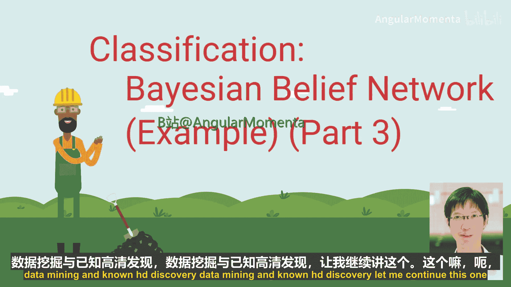

Let me continue。This one， this one is if you remember in my email。

 I mentioned something like that here， H D is here。 This is the parent。 B P is at the child。

 C P is also a child。 different the same parent。 These two are independent。

 I repeat different this one。 These two are independent。 Let me write down clearly here。

 wait a moment。 I want to write down。 Okay， maybe write down some here I write down here。

Number three， rule number three here。Rule number  three。Suppose that we have the same parent。

And then if we have something like B P and also C P。B p and c p given the parent。

And then we know that they are independent。 They are independent means that b p。

Given H D multily by c p given that H D啊为什么问 is here。So given one single parent。

 these two are independent。 this is the the assumption use in basic belief network。 Given the parent。

 these two under it， they should be independent。 independent means that the probability。

 this one multiied by this probability， Given these things are exactly the same。

 these two do expression。If you understand this one， now， let me go， go， go， go， go， which is here。

 given the let me use the annotation here， given the parent。

 given the parent and then B P and C is the child。 So these two are independent。are independent。

 So what I want to say is that I can write down。This thing。

 I can write down probability that B P is eager to high， given that the parent。

And then multiply by the probability that C P is yes。HD is equal to， yes。

This could not be found in the nationals。 This is new to you。

 This is new to you and then multiply by 0。25。Plus， the probability that B P is equal to high。

Given that， HD is eager to know。Multiply by the C P is equal to Yes， H D is equal to no multily by 0。

75。And then continue。 Let me continue。听狂天语咯。Now呃 let me continue now let's see。

We have one term multily by another term， multily by this one plus this term multily by this term and multiply by this term。

 Na me write down。Which is this one， this one multiplied by 0。

25 plus this one multiplied by this one，0。75。Who want to answer this four terms of different。

Hi professor hello， Stephen， I could hear you yeah， yeah。And the first term is0 point x5。

 wait a moment。 wait a moment。 I want to wait a moment。 sorry， okay， I want to reference here， okay。

I want to make it a clean。 wait wait a moment Okay， now youre talking this one， right， Yeah。

 And then this one， what is the number，0850 points85， which is this one， right？ Yes， thank you， yes。

0。85。And then what's the next value， zero upon x the right hand side。0。8， which is this one， right？

 Yes， Yes， thank you。 And then continue。And this is zero point2 zero point two right which is wait yeah and continue。

 yeah and zero6， which is this one thank you。 yes， you get the coupon。And then by simple calculation。

 we can compute this square boss。 So this square boss。😊，And then let me go back。

 So we just put back the square box here。 We put back the square box here。

 This is just a value by your calculator and then continue， continue the duration。 This one is。

 in fact， like what we have seen before。 if you understand。B， P here， C P is here。

 and H is just the parent， Similarlyly， given the same parent， they are independent。

 Just write down again。B P is equal to high， and then H D is equal to yes。

 multily by C P is equal to yes， given that H D is equal to yes， multily by point25。

 and then some value。And then continue。 I think this is very simple。

 I don't ask student H D is equal to yes， and then B P is equal to high is here is here。

 So0 point x5。And then multiply by this one。 this term， H D is equal to yes。

 and then C P is equal to yes， okay， which is this one。 So0 point 8。

And then just copy all the numbers。Remember that this squareboard is also a number by simple calculation。

 we see my answer。 Okay， the value， okay， you can use your calculator to calculate it。

 which is eager to。0。65 is equal to 0。65。And then you also understand thatsymmetrically。

 we also need to do the reverse one。The reverse one is probability that HD is eager to know。

We were one wins this yes become no。 and the heavy thing we mean the same。Maybe copy。

E is equal to yes， and then B P is equal to high。 and then C P is equal to yes。

 And then this equal to1 minus 0。65。 And then finally， this number is equal to 0。35。

And then if you remember that， I always emphasize that we need to have a conclusion。Our question。

 let's go our question。We want to predict sorry， Okay， we want to predict， okay。

 whether this patient will suffer from heart disease。 This is our conclusion。 What is the conclusion。

Who want to answer this is very simple。With some with someia right， Yeah， yes。

 he's more likely to have heart disease or why yes。

Because the probability for HD equals yes is higher than the probability for H equal no。Yes， yes。

 Thank you。 Yes， he will suffer from heart disease。Okay。

 then this is the answer for this in class exercise， Any question。Any question with someone。

 you can lower down your hand if you have no more questions。

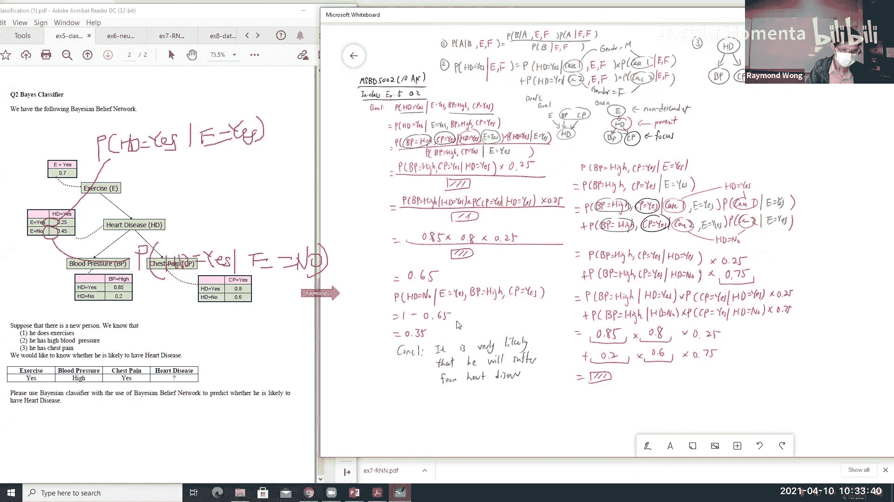

