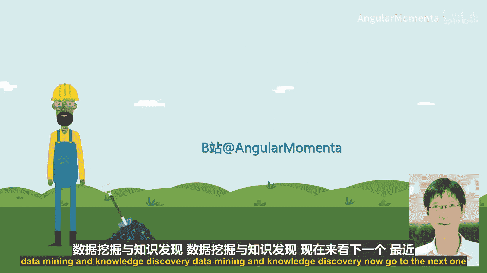
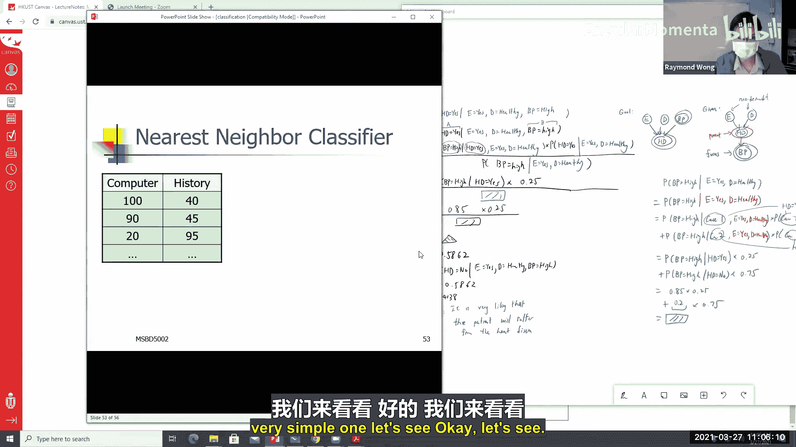
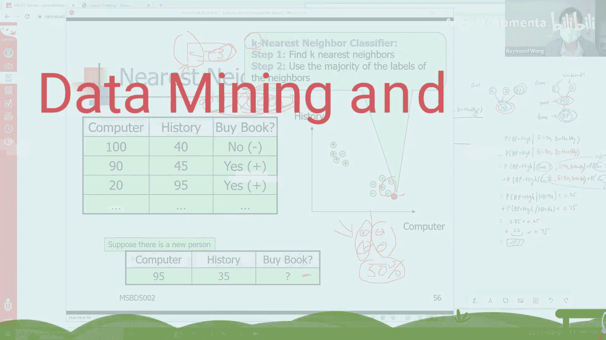

# 【香港科技大学】数据挖掘与知识发现-｜-Data-Mining-and-Knowledge-Discovery-p12-07-04-02-最近邻分类器--BV1gEFDzVEU3_p12-

🎼The mining and noish discovery。😊，🎼Ber mining and no niche discoveries。

Now， go to the next one， near neighbor classifier。 This one can be finished within five minutes。

This is a very simple， just very simple one。Let's see。

Okay， let's see now we have something like a student student number one or 100 score in computer4 score in history。

 we understand this， we have this figure this has been seen before。And now we have one more column。

 the target attribute， this is a target attribute to den whether this student bought a textbook or not this student didn't buy a textbook。

 this student bought a textbook and so on， so we can see that。This student did not。

 This student did not。 This student bought a test。Now。

 the question is that suppose that we have a new student。For someone 95 and 35。

 we don't know whether the student will buy a book or not。

 Let me practice one this student 95 and 35 here， but we don't know the label。

 the label means positive or negative the label at this point。

How to do that in this neighbor classifier， they will do the following very simple。

N neighbor classifier。 that number one， Find the nearest neighbor。 So according to here。

 the the closer point is this one is this one is this one。 This one is negative， right。

 This one is negative。 So we use the label or this label for for this classifier。

 So we understand that in this topic。This one。We will predict a negative。

 We predict this student will not buy a testbook， will will not buy a testbook where simple， right。

And then next， in general， they can generalize the techniques to K needs neighbor classified K is a user parameter given by the supermarket manager。

 supposeupp that K is equal to three。😊，Step number one， five，3 nearest neighbor here in this example。

 let me use some annotation。In this example， I find this three nearest neighbor。

For example K is equal to three。And then we use the majority of the label of the neighbor。

 Here we have two negative and one positive。 So we have about two foot confidence to say that this is negative。

 So we say that this is negative， okay， which means the student did not will not buy a textbook in our prediction。

We are done。 But before we finish this  one， I want to say that usually in practice。

 this number is usually set to an odd number instead of an even number。Do you guess the reason， Okay。

 do you get who want to answer this question。Usually， we set K to an odd numberber。为明。哦。

If we set the number is even， it will be a condition that the positive one and the number of positive one and the negative one is equal。

Yes， and then what is the problem。 Yes， yes， when we set this up to a even number。

 Then it's possible that we will encounter a case that we have a same number of positive and same number of negative。

 And then yes， and then we can't decide whether we should decide the。The， the weather is a。

Positive or negative yes， yes， since this is in the boundary case。 So we don't know how to proceed。

 Thank you。 yes， thank you。 Yeah， so you understand that usually we set this to an odd number to prevent this situation to happen。

 In fact in our society， usually if we have some committee okay。

 to make some decision usually this are the committee also evolving odd number of member The reason is also explained by we。

