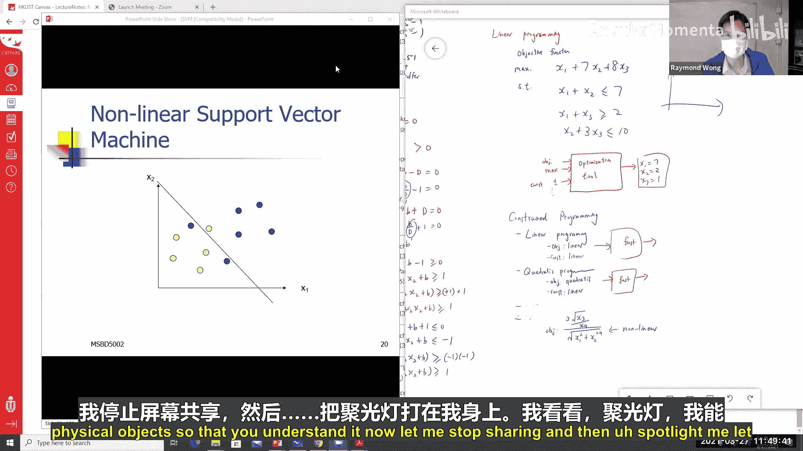
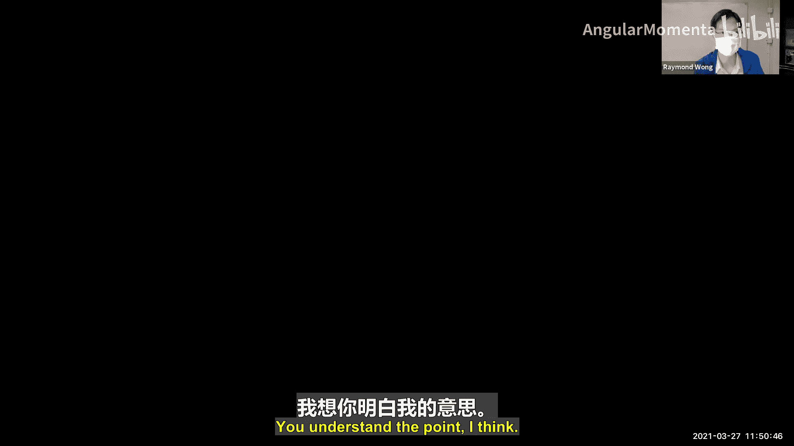

# 【香港科技大学】数据挖掘与知识发现-｜-Data-Mining-and-Knowledge-Discovery-p13-07-05-02-1._线性支持向量机_第一部分--BV1gEFDzVEU3_p13-

🎼The mining and noish discovery。🎼Beer mining and no N discovery。S weM support we machine。

 usually we say S weM， S we。Okay， we have finished this decision tree basin classifier nearest neighbor classifier now today we will talk about SVM and also we will start a little bit about neural World network today okay。

 and then later well talk about the current neural World network and also this very popular recently。

😊，Now go to SVN first。Support ratt machine。 We have two variants。

 The first one is linear support ratt machine。 The second one is non nonlinear support rat machine。

 Let's go for the first one。 The simple one。The advantages is that this can be whistleized。

We can whistleize the result。 And also， is is very accurate if the original data is well partitioned。

 this is the advantages of support writing machine。 Let's see what it is。😊。

Here we have import attribute 1， x1， input attribute2， x2。

 and we have eight data points in this data set and then this blue dot correspond to the target attribute equal to for example。

 yes。And this yellow attribute correspond to target attribute。 you go to know。

 So were two different values for the target attribute。 In this example， we can draw online。

 We can draw online to separate the whole data set into two parts。

 The first part is all the blue dot。 The second part is all the yellow dot。

 So this can be whistleized。 And then let's see the formulation here。W1 x1 w2 x2 plus B equal to0。

 This is equation form。 Okay， linear form in this two dimensional plot。 and then usually okay。

 let me use the white board to use so that you know what it is is1 w1 x x1 plus w2 x2 plus B equal to0 You know that x1 and x2 some s here。

 So this are some variableable and then let me go to the whiteboard。

 let me see I want to find a space here example1 Wait a moment I want to find the space Ex1 on my whiteboard yes。

 I can find the space now continue。What I want to say is that this equation， sometimes， okay， maybe。

 maybe。Can be written as。4 x1 plus3 x2。And some maybe we have some number plus 7 equal to0。

 So this is a w1 W2 and B are some constant。 we know here。 this should be given。 Okay。

 if this is the9。And then what I want to say is not only this example， in fact。

Here we know that all the blue dot， for example， this blue dot has some coordinate value。For example。

 thisd is nine， nine is nine， nine discord if we put let me see， okay。

 if I compute four multiple by nine plus three multiple by nine plus seven。

This must be greater than 0。And if this one is equal to10。Maybe8 and put it inside this long。

 This equation is also greater than 0。 I just want to recap what you have learned in your high school and also for the yellow color。

And this one， suppose this e to seal maybe one， you put this this equation， this will be negative。

 will be negative。Will be negative。Put here will will will be negative。

 We understand that the blue color will be positive。 The yellow color will be negative， understand。

顶 continue e呃 this微 e。Now we understand that。In linear support record machine。

 we can draw a light to separate the space in the two part blue part， yellow part。

 In fact this this light can be put here， Also separate the space in the blue part yellow part。

 we can also separate in another manner like this。And also like this。

So we understand that we have different partition。 This is called partition 1。

And then this is called partition2。This is called partition three， and this is called partition4。

I want to ask a student if we want to do a partition which one you prefer1，2，3， or four。

 who want to tell me the answer。I would repeat my question， suppose that we want to part yes。

 also Tongxi， okay， I think you understand yeah。😊，ok， wait we let me lower down the volume here okay。

Yes， okay。I would like to choose the first one I would like to choose the first one the first one because the margin is the margin okay。

 I haven't talked you learn it right suppose you have a no margin you use some label language。

 because。Because what yeah， say right point is the blue form here and also yellow form here a noise。

诶。这。The the the the noise and the noise some noise may over overlap the。啊 partition。let me help you。

 okay， now if we draw this point and then suppose that okay。

 this blue do change a little bit with some noise。 I think what you mean yellow。

 we some noise can a then actually we also have blue color and yellow color like this However for this one if we yellow some problem with some noise here right and then this line not separate well similarly for other cases。

 with similarly for this case， if this blue color has some noise put here some problem and also this one。

 if we some point like this here and also here this some problem。

 So thank you yes So we understand that we use partition one for that let's continue。

 let me make the warning better。 Yes， now we understand that usually we will choose this partition。

 let me formalize it。😊，In fact， the student have already learned it before。 Okay。

 this is called margin。 What we he mean by margin is as follows。Now we have a solid life。

This is the partition。 Just move this solid line towards to the blue dot in parallel and touching this blue dot and also move this line towards to the yellow partition and touch this paw。

And then we have another top line。 We understand that this one， we have some distance。This distance。

 we call margin， this margin。And then let's define this。 we want to maximize the margin。

 if we maximize the margin， then the case are mentioned by Tong Xu can be avoided。

 You can see that okay， this one margin is maximize。 however， let's see the other example。

 for example， this one， maybe not this one this one maybe using this one。This one。

 the margin is very small。 you imagine。It's very small， is very small。 This will maximize the margin。

So after we maximize the margin， so even though we have some noise， we have some noise， okay。

 and then we we can afford it。 So this is what we want to see margin。 we want to maximize the margin。

And why I have already explained。And then now， this one。This start night。Touching this point。

In this technology called support water。Support water。 This one is also called support water。

 The reason is that we want to support， support this line and support this night。

 We means maybe pond support water support water and that machine means model。

 support water machine and linear means that this9 is a linear。 So linear support water machine。

🎼Be mining and noish discovery。Daer mining and noish discoveries。Let's continue。Now， in mathematics。

 we know that this is the equation equal to0。 something like this。 We have this equation。

 and we also understand that in your high school， you know that if this9 is parallel with the other9。

 They should have some equation like this one。 This one， exactly the same minus D D is a parameter。

 and then this one， if this is have the same distance here from here from here to here。

 So this one will be plus D plus D。 Okay， so we understand that we have something like this。

 let me copy this， this equation。😊，Let me copy this equation。Let me copy one W1。

And then x 1 plus w2 x 2 plus B minus d equal to 0。 Okay， and also。

 we have w 1 x1 plus w2 x 2 plus B plus D equal to0。 So we can see that we have many parameters。

 usually they want to standardize the notation。 You can see that actually。

 this is in in a mathematic this called in in intercept in the intercept。

 So we want to make it to one parameter。 Currently， we have two parameter。In this equation。

 divided the whole equation。By。This one d， so divide the whole equation by d。

 So we have w one divided by D x one， W  two divided by D x  two plus B divided by d minus one equal to0。

And the following is also the same divided by B。So you understand that everything divided by some constant。

 okay， is also exactly the same。Now， we know that w one divided by D， we can we get this one。

As W 1 pi and this one， W2 pi and this one is B point similar for this one。

 W 1 pi and W2 pi and this one B。 So we understand that we can write down W 1 x1。

 W 2 x2 plus B plus 1 or minus1。 So what I want to say is that you learn in high school is something like that actually。

 we can standardize to this one。 we can have this one。 Okay， this one is W1 actually， in fact。

 is correspond to this circle1。 And then we have the upper1 w 1 x1 plus w to x2 plus B1 minus1 equal to 0。

 And also this one this equation plus1 equal to 0， which is this equation。No probleming。Next。

Then that's also the same。 All the blue dot， all the blue dot。 If I put it here。

 as similar to what I mentioned before。If this is nine，9。And then if we put it。

 this is9 and this is9。 and then this the left hand side must be greater than or equal to0。

 See we touch it。 So this maybe have the equal sign， so greater than or equal to0， Similarly。

 on the left hand side， if we put this colony to this one。

 we know that this is more than or equal to0。 this term must be smaller than or equal to0。 Okay。

 this is very clear now go next。😊，That why did the label of a poem， for example。

 this is called positive positive one。 and this yellow color。

 we use a blue negative one and negative one， Okay， negative one。

 What I want to do next is as follows。Lets see。I want to write down this equation first。

 let me write down this equation again。I use what color。W1。

It's one plus w to x  two plus b minus one equal greater than or equal to0。 Okay。

 now let me do some deviation， Let me do the deviation W1 x1 plus w to x two plus B greater than or equal to0 just do some deviation and then let me。

Multiply both sign with this label， positive one。Let me positive one， sorry， it this one。 Okay。

 multiply by positive one， multiply by positive one。Positive  one。

We have this equation since this is a positive one。

 I know that the label of each blue dot here is a positive one。 I just write down why。

W 1 x 1 plus W2 x 2 plus B greater than one。 So this is what we wrote here。

So why is multiplied by this term is greater than or equal to one。 So very simple。

 Let also do the same for this one。 Let this time use the blue color。

Let me copy W1 x  one plus w to x two plus B plus one small than or equal to0。

 I am copying this equation on the right hand side， I do similar deviation。W1 x1 plus W2 x2 plus B。

's more than minus0。Now this time， I also want to multiply both sides with the value of this label negative one。

Negative one， now I multiply it。We obtain this equation。

Remember that after we multiplep sign with negative， this sign will be changed。

So minus one multiply by minus1 now minus1 I change to the y value， okay， which is y。

W1 x 1 plus w2 x 2 plus B。 And then this is equal to one。 So we have this form。 Okay， now this one。

 we will change to this form。Okay， the reason why I'm doing this de is as follows as follows。😊。

After I do the transformation， you can see that this orange color and this orange color。

 the form are exactly the same， the form why， why， and this expression。

 everyone is one plus w2 x2 plus B and then greater than or equal to one greater than or equal to one。

 So we have the same expression， So we understand that the blue color one and yellow color one。

 we can use the orange form to represent it this is what we want。😊，顶铺et铺et。培色。No， okay。

 we want to maximize the margin。And then in high school。

 we understand that we have this daughter night and this doctor night， You just learn。In high school。

 okay， the distance between our this line and the other parallel line is， in fact， it's very simple。

This is the margin B-1 put0 maybe let me use some annotation。An notation， okay。

 B minus-1 and B plus one。 just make the difference。 calculate the difference。B plus1 and B minus-1。

 The difference， the difference。And then divide by W1 square plus W T square square root。

 this one obtained from your high school math。 This is related to the distance between two parallel lines。

Over there， okay， just simple calculation。Then we obtain this one。 this。

 we will cancel out to divided by this one。 So the margin is equal to this formula。So go next。

So and let me era something first， you erate it。We want to we want to maximize the margin。

 we want to maximize the margin， which is this one subject to some concern like the orange color I already illustrate here。

And these orange color if you still remember that this is related to the pond for each data point x1。

 x2 and y okay， you understand that x1， x2 y means here for example， this one is9。

9 y value is plus one for example this value is02 then with02 and then y value minus one for each data point and then y is the label of the point plus one or minus1。

Now I think you understand this one。 we have the objective function。 We have some constrain。

 maybe let me ask you how many constrain here in our example who want to tell me in this form Very simple。

 I just want to know that you are checking your understanding how many equation in this form。

 Yang Yi Yang。🎼いやすね。Yes， I think there are three。 I think there are three。Because。

That is the x1 x 2 and for each data for each data。So how many are all each color。

 all each are color。What， what？In total of be三 we are one point second four foot four five。

 six seven eight。We're 8 day4 each day4 we have this equation， right yeah， so totally we have eight。

8 right， so we have8 inequ。 Okay， so according to this one for each data point we have this one。

 So we have8 inequ。 Okay， let me give one example。 Okay， in fact， okay， in this example， this one。

 Okay， in our example， for example， we can write down for the previous one。

 let me write down positive one。Why we know positive one and then W1， this time we don't know。

 we want to find W1 and then it's one this time， we know maybe the value is9 plus W2。

 I don't know the value。 I want the system to be fine multily by9 the coordinate of y value plus B。

 we also don't know。Greater than or equal to one。 So this one， refer to the the our example。

 we have this one， and we have four blue dot here。 Supp that this one is called 9，9。

And then we know that the label is equal to positive one。So we write down this equation。 Okay。

 this inequ。 Similarlyly， we have this four yellow do。 for example， this one is sale2。

 So we write down negative one。And then W1， and then x1 is equal to 0 plus W2。And then， two。

Does be greater than or equal to one。 So each data point， we will also write this form 1，2。 Okay。

 I we refer to these two example。 So totally we have eight data point。

 So we have it inequality like this。🎼The mining and noish discovery。😊。

🎼Da mining and no N discoveries。Now， continue。Continue， this is the margin。

 and then we have this equation。I think you also understand that we are now maximize this one。

 You see that， okay， W1 and W2 currently， we want to find it， but we don't know。

I think in automatically， when we maximize this one subject to this， this is also equivalent to。

This one， minimize。I just want the denominator and the numerator。 If I maximize this one。

 this means actually， we are minimize this expression。😊。

I want to minimize this one when you understand it。No if you have no question one okay。

 and then now we understand this is the objective function。 And then now you。

 you want to minimize this one。 In fact， this is equivalent to minimize this one。

 Just we move the square root and also divide by tool So minimize this with this one。

 So we understand that we have this form。 You can see that。Originally。

 we have this form form number one， and then I transform to form number two。

And then I transform to phone number three。Now， let me explain the reason behind。

 I want to explain the reason behind since this is about the back one in in computer science。

 Wait a moment， I want to find a space。Now， let me ask you。I think most of you have learned。

Linear programming。Maybe in your high school linear programming， okay， if you remember that。

There's a two component。 The first one is the objective function。The object function， for example。

 x1 square plus x2 square。plus， for example， x 3 sorry sorry， linear this a linear function x 1 plus。

 for example，7 x 2 plus x 3 something。 Okay， maybe will you want to maximize。

You want to maximize this objective function subject to subject to some kind swing， for example。

 x1 plus x2 must be at most 7， and maybe you also write an x1 plus x3 must be at least two。

 maybe x two plus something like this three should be most 10， something like this。

 this has been learned in your high school。 And then if you remember that this linear program。

 and you maybe you have some mathematics for example， you draw something like two dimensional part。

 and then move your ruler on this dimension。 It doesn't matter。

 what I want to say is that there some technique。To solve this kind of linear programming。

 if we give the objective function and also con number one and con number two and con number3。

Now in the real world， okay， we have an existence tool， we call optimization too。

You just put this objective function。Ojustive function inside。 and also。

 you say that this is a maximization problem and then you just give done constraining one。

Constraining number two and so on。 Give all the contrain。 immediately。

 this object optimization too can help you to find out X 1 is equal to something。 X2 is equal to2。

 maybe X 3 is equal to one。 It will tell you to find the answer at the end with some existing optimization tool in Microsoft Excel。

 this call Microsoft Excel software。 Okay， in some system this call software anyway。

 you just understand we have the optimization tools。In your high school。

 you know that the linear programming， in fact， is a kind of let me write down these things。

Is it a kind of constrain programming。 If you learn cons programming。

 you know what I'm talking about， but you don't know it doesn't matter。

 Constraining programming is a broad name。 There's a lot of different various。

 The first one is what you have long learned about linear programming， linear programming。

 What is the linear programming， linear programming means that the objective function should be in linear form。

 See that the objective function is in linear form。 and also the constrain。Is also in linear form。

 You can see that heavy is linear。 we do not have square or square。 Okay， so everything is in linear。

And also， we have many different types of contraining programming。

 The one common one is called projectdtic programming， projecttic programming。 What is this。

 The objective function is in cadratic form， cajecttic form。

 And then the contrain is in linear form in linear form。 Of course， we have more。 we have more。

 We don't want to do it now， Okay， but what I want to highlight is that。On the left hand side here。

 the objective function here is called draft form。 The concern here， if I wrote it in some example。

 just I wrote， this is in linear form。 Y is a constant W1 is variable。

 X1 is a constant plus a variable a constant plus variable。 So this is a linear form。

 This is called form。The reason why I need to transform it into the project form is that。

Seeing you understand this is the optimization too。

 suppose that we have some objective function and con swing。😊，There's a lot of research。Put inside。

 And then we have a fast algorithm to find the solution。And also for qualitative programming。

 since this is a one form， just put all this objective function and consumer put inside and also we have a fast method to find the result。

😊，However， you understand that con program and the objective function can be very complicated。

 okay like。The objective function can be very difficult， square would。

one square plus x two maybe two point four how to two point four。Maybe something like x3。

Something like that。Much very difficult。 Okay， in some form this is we say this is very difficult and also long linear。

If we have some form like this there's not much research paper working on that with this fast optimization to or optimal tools to find a solution。

 so we want to transform it to some wellknow optimization problem so that we can solve this problem more easily so this is the reason why we need to transform to this project form。

Understand and then cognitive objective linear counsel。

 and then we use cognitive programming to solve this problem。

Now we have just described this this one。 Okay， after we do this transformation。

 just put it in some existing optimization too， we can solve the problem more easily。

 We don't need to do it， just give it to the to the tools。

 and then the solution can be found automatically。😊，Okay。

 we have just described two dimensional spaces。😊，We can divide the space into two parts with a night with a single light。

For any dimensional space， where any can be greater than two。

We can use a hyper plan to divide the space into two parts。 If n is equal to three。

 we just you are use a plan。 If this is 40，50，60， we we just say a hyper plan。

Now we have finished the linear support recttan machine。🎼mining and no discovery。

🎼The mining and no N discoveries。Now go to this one long linear support rack machine。

 We just finish the linear support rack machine。Let's see。

 sometimes you can see that even in two dimensional space， in the two dimensional space。

The blue color one and the yellow color one are mixed。 We could not draw a single night。

 We could not draw a single night to split the whole space into two parts。

 such that one parts contain all the blue dots and the other part contain all the yellow dot。

So you can cut it here， some yellow dot is here， some yellow dot is here。

 some blue dot here some blue dot here， even though we cut it in another way。

 suppose we cut here some blue dot here and some blue dot here， all the yellow dots here。

 so we could not cut it perfectly。So what I want to say here is that long support writer linear support return machine is the idea is want to find some。

Higher dimensional space， such that the blue color and the yellow color can be partition into two space。

 Let me use some physical objects so that you understand now， let me stop sharing。

 And then spot like me。 Let me see spotline。 Can I spotline myself， yes。😊。

Now， you can see me。And in fact， let's see my finger。 Okay， my finger， this is the blue color one。

 The tip of my finger is blue color1。 and my tip of my finger here is the yellow one。

 So right here is something like that。 And then if we use a knife to cut my hand， cut my hand。

 so you can see that my finger will be cut。😊，And this is what I illustrate on the PowerPoint。

 But now， actually， everything now is on the two dimensional space。Suppose that my right finger。

 okay， move towards to you。You can see that now I transform my space from two dimensional space to three dimensional space。

 right， free dimensional space。 And then we can find our plan to cut this space into the the top part and the bottom part。

 So what I want to say here is that go back to our powerPo。😊，You understand the poem， I think。

Let see and need let me。We move the s right。 Okay， now， you understand that Or。

 this is in two dimensional space。 All the blue dot now may be elevated to a free dimensional space。

 Okay， in the space and the yellow color is still on the ground。

 And then we have three dimension space。 after we have three dimensional space。😊。

And then we can use the original linear support vector machine on free dimension space free dimensional space to do that。

 This is what we want to say here。😊，To step step 1。

 transform the data into a higher dimensional space。 Okay， like what I'm talking about。

 using some long linear mapping。 This can be done by some long nonlinear mapping。 step number two。

 use the original linear support weapon machine in this pi dimensional space。 Okay。

 we can find a plan to cut the three dimension space。 This is what I just mentioned。

 So we understand that the blue color and the yellow color。 if we are in the free dimensional space。

 and we can use a hyper plan， the original linear support weapon machine to partition the data。嗯。

For the details， you can study the machine learning course。 We just highlight the important concept。

