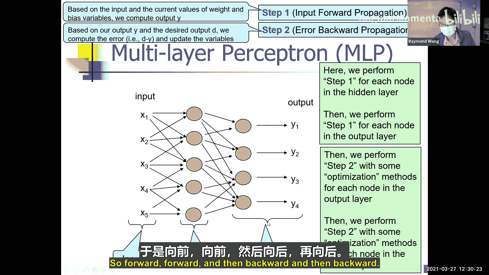
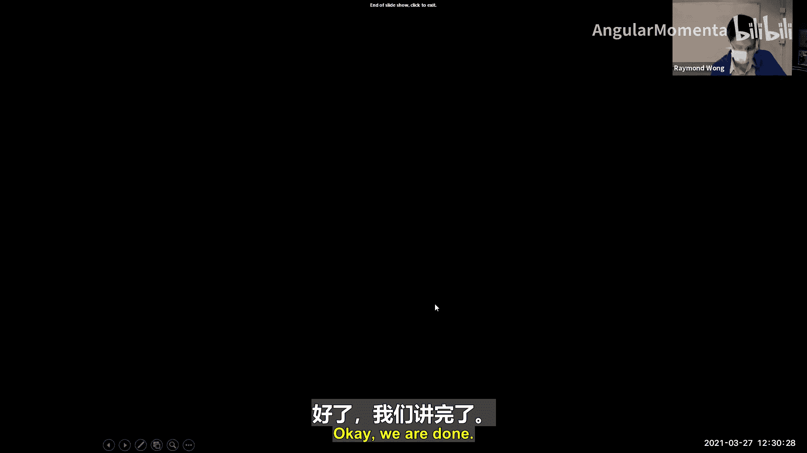

# 【香港科技大学】数据挖掘与知识发现-｜-Data-Mining-and-Knowledge-Discovery-p14-07-06-02-1._神经网络_第1部分--BV1gEFDzVEU3_p14-

🎼mining and noish discovery。🎼It the mining and no N discoveries。

Other classification model neuraler network。 And then we have talked about the support rec machine。

 This time we will talk about the neuraler network。

 and then later we will talk about the current neuraler network Okay new network， What's that。

A new network before I go to this one， Okay， many student also just understand it in in English or some model。

 let me use some figure so that you understand actually this is actually what you have experienced in the real world。

 you experience in the real world。This is more like let me see I want to find the space here and and using my whiteboard okay。

 my whiteboard is too large let me find the space where am I wait a moment let me see I'm here yes。

Let me do something。Can i加心咩系。No， I can't wear can't wear。

 And I let me see this is the white color things。Wait a moment。 I will find。 Oh yes， I can find it。

 Okay， now I find it。 Okay， now let me。Let me draw a human。 Let's draw a human。This is a human。

And then you can see， we have the eyes。And also， nose and mouth， and so on。Now， this is like a human。

 and then。Of course。烟世。We have our brain。 we have our brain。 We know that our input is our eyes。

 we have the brain。 Now， let me tell you more about neural network。 This is inspired。

啊 in human in the brain， okay， if you learn biology。Here we have a lot， lot of brain cells， okay。

 we have a lot of brain cells。We have a lot of brain cell here， Okay。

 one brain cell another brain cell and another brain cell and then we know that。啊。This brain cell。

 okay， will be connected with each other with each other and so on。Now， let me ask a question。

Now I had just model our brain like this， maybe let me ask a student question so that you know actually why。

You remember me。Who want to I say， okay， why you can remember my name， Raymond， Who want to answer。

 Okay， in a layman language。We want to answer you。 just a simple question。

o why did you remember my name Raymond now之后 you can answer yeah。Hello。

 because because I saw it in the zoom and then I know you are my。 Yes， you can see my name。 Okay。

 supposeupp that now you block that my link there。 Can Can you remember my name。I think so。

 because yes why， why， yes， I just want to know why yeah， in my mind。

 I just map the name and your face。together。 So that's why I I saw your face。

 and then I remember your name。 Oh yes， thank you。 yes， yes at your map。 thank you。 yes。

 thank you Zhou okay， this is some human interpretation why Zhou remember my name。

 In fact let me make it a more scientific。 In fact， okay。

 I'll bring some some part is related to Raymond and so on。And our storage is， in fact。

 suppose that your eyes see my face and also you see the word， A Y， M， O， N D and so on。

 You will remember it actually， how you remember it is that。For each brain cell， okay。

 you have some edge linking to you。 and we have some kind of chemical。

This is some kind or maybe maybe me use a white color with a moment。here。

We have some kind of chemicals here， we have some kind of chemicals here。Sttoring here， storing here。

 storing here and storing here， Sting here。 See you have eat something in your breakfast and also your lunch and so on。

 So this will create some chemical here so that you can remember my name here and also in the brain in the cell。

 You can see that there's also some dot do do here inside the cell where some chemicals inside the brain cell so that you remember me最 want to re ask you。

It okay， my question is that during that after 10 years， you may forget my name。

Maybe maybe yes understand。 Yeah， you may forget my name。

 Do you know the reason why you forget my name after 10 years， Yeah。

 because I seldom think of you Yes yes and yes， that neuro on maybe that that cell will be de that cell maybe the cell may be gone or even though the cell is there maybe the chemicals here may be lost gradually thank you thank you。

 so we understand that actually this kind of chemical okay along the edge and also on the cell is related to our memory and also inference process So the chemicals is very important after some you may forget the reason is that the chemical here may lost gradually maybe Zhou may still remember after half year maybe two years later you may forget me。

Since he lost all these chemical related to bill， so you understand this kind of thing。

 you understand these kinds of things Now go back here， in fact， this one inspire us。

 maybe inspire researcher in this field。To do the following， Let's see。 neural network is， in fact。

 a computing system made of of simple and highly interconnected processing element。

 which means this one。 Thisel， thisel are connected with something。 Okay， like this one。

And these are other terminologies， Okay， in the field， connectionness model， PDP。

 parallel disive processing model， artificial neural network。

 and then computational neural network and neural computers。

 There's a lot of terminologies for neural network。😊。

And this approach is inspired by the way that the brain process information like this one。

 I have discovered with Zho okay， which is entirely different from the way that conversion computers do。

 for example， decision tree and also near neighbor classified。

Information processing occurs as many identical， simple processing element called neuro。

 neuron or called unit。 This is called cell。 We can also call unit， and also， we can call notes。

And also， interne connection swing， which means here， we see that there's some chemical here。 Okay。

 in fact， there amount of chemical here， the amount of chemical here。 let be write down here。😊。

The amount of chemical， the amount。Of chemical here actually correspond to the weight。

The interconnesscent swing， which means the amount of chemical here， correspond to the weight。

Which I used to store the knowledge。 So Zhou， remember me are here。

 So this is why you remember me the wait。 now continue。In fact。

New network okay is actually similar our human。These are two advantages。Parallel processing。😡。

And for tolerance。In fact， parallel processing is very simple。 Each neuron operated individually。

 Okay， you can see that let me soon name myself。 Okay， again， spotlight to everyone。

 now you can see me。 In fact， for example， my writing side is also some cell lemon side or some cell。

 okay， you can see that they can operate simultaneously。

So you can understand that they can operate parallel。 understand。 Now， go back to this one。

 I think this is very simple。 The next one for tolerance。

 What is the meaning if a small number of murals break down。

The whole system is still able to operate with slight degradation of performance。 Let me also use me。

 for example， supposeupp that I also have left hand right hand。 suppose my right hand is broken。

And then I still can move my left hand， but with some painful feeling。

 So this it means that we still。Can operate with slight degradation of performance since I have some painful feeling。

 So we understand that we still can work， even though we have something wrongly。 Okay。

 so thought tolerance is also an important concept in neural network。🎼To mining and noish discovery。

🎼Beer mining age no N discoveries。Go further。 Okay， now。

 let me use a very simple example for illustration。 The example is this one input attribute one。

 input attribute to and target attribute。This one， we are using all function。

 If you learn logic before。I think most of you learn logic before， zero means Fox。😊，1 means2。

False or false。Fourse， false or true is true。 Tru or false is。2，2 or2 is 2。 Okay。

 I think in your brain， you can also do this mapping。

 Why can you do this mapping is also related to your brain operation。

 You have some memory about that。 So we understand that actually。

 this neural network is just your brain。 You have x 1， x 2， and then the output。Now。

 let me eat this way the operation。 Okay， let's see Here we have neuraler network。

 Your brain have a lot of self。This time， I just eat way with one cell with only one cell here。

 one cell， your brain only have one single neuron， one single cell。

 and this single neuron can be we gather have two parts the front side and the best side for the front side。

 Okay， let's see this one input and then we have net。 Okay， what's that。Here。

 the input putting inside for， for example， your eyes and so on， we have some connection connection。

 This W1 and W2 correspond to some chemicals along the edge。😊，And then we call weight extreme before。

 and then after that we will operate okay， with something like this kind of things。

 actually this is similarly our brain processing unit。Here let me use annotation in soonm。

Now you can see that w one， you see a x one， w one and x one， some chemical multier input。

W2 and X2 multipier and plus something B。B is something like some chemical on the brain。 Okay。

 some chemical。 So some up。 and then we have the output dot net。This net is the output。

 And then after that， we have this output。And then this will match to the output。

 This is called best side。 And there's a lot of different mapping between the net and why。

 We have linear function。 Y is equal to net exactly the same things or Y is equal to net multiply by a A is also some chemical。

 Okay， on the best side。 and some long linear function。 Let's see a way to move and let me erase it。

 Okay。Here we are some long linear function。 in fact long linear function also include linear function anyway。

 okay， we are some activation function。 first of whole function， step function， heart limit。

 actually， this free term refer the same things。 And then we are linear function identify function。

 We also have value I think student know this ratifier function or ratifier linear unit and signal function。

 This one is high popular tangent function。 Then let's go for the first one。😊，The first one。

 first whole function， step function hard limited very simple net and then why。

 if net is greater than0， then y is equal to one。 Okay， like this。

 if net is equal to a negative number， then y is equal to0。

 So we have something like this with something like this。 this is simple one next。😊。

Ninia function or identity function， just like this net and Y it's equal to together。And also。

 some linear function variance maybe be linear function with different slope。

 You can see that maybe the slope can be equal to something like this。

Just different with the the slope will be different。And then， the next one。

Whattifier function or recify linear unit。 Okay， is also a common one。

 Let me use a full screen mode Wait a moment。 I want to use the full screen mode in order to help me。

I want to use this an notation。No。Some problem。 Okay， okay， wait a moment。 this is neural network。

 Let me close it and open it。 Where are we。We open it。The Power has some problem。

 Let me we open it and go back to that slide this one。Net is a positive， which is here。

 So net is eager to why。 so we can see that we have a curve like this at night net is negative。

 We just make it to0， something like this。😊，This is very common use your neural network。Understand。

 we just want to make all the negative things to0。The other things is called sigma function。

 It also where common。This one， we have this one。 Y is equal to one divided by one plus E power to minus net。

 net is the input E。 Okay， is the earliest number。 I think you know that iss equal to 2。

718 and so on。And then will put some net value。 And then we have this function。 This sigma function。

 When will will use that， Some students don't know when we will use the net sigma function。 In fact。

 it's very simple。 When we use sigma function。 The output is with the win from0 to one。

From zero to one， when we will use six what function since we know that our output， for example。

 the S we n example， we have positive one or zero。 if this is zero。

 then we will use six what function。Suppose that our oppo and positive one and negative one。

 Then we will use the next example。 High popular tang。 Okay， you can see that in this figure。

 we have negative one and positive one When we want to have some negative one to positive one。

 we will use this function。 Similarlyly， we have this function。

 Y is equal to E power to2 net-1 divided by E how to2 net plus1 E also is some number L number。

So when we use high popular tension function， our output must be between -1 and one。

 If we use signal more function， our output must be in0 to one。 very simple。

Now we are done this kind of activation function will be。

 we learned again in the recurring neural network。 This is very important。😊。

🎼The mining and noish discovery。😊，🎼Beer mining and no N discoveries。Now。

 go back to our neural network。We know that the fun size we have this function。 The best side。

 maybe be， okay， now let's use the the common one signal function。 This is the form。

 supposeupp that our brain cell one of them is this one。两 this percent。W1， W2 and B。

 you understand that our brain， some kind of chemical are here。When times go by。

 how forget forget we。 So this chemical we will be reduce and reduce and reduced。However。

 if you see my name regularly， this W1 and W2 B will be increased。

 and so will be adjusted accordingly。 So we understand that this free variable will be updated when I see example one by one。

 understand。 Now， let's see this is our learning process。 Let alpha be a learning rate。

 which means that suppose that you are still young alpha will be very large。

Suppose that I'm very old， I could not learn anything。 Alpha will become civil。

 Let's see what is this。Here you understand that we have some chemical in our brain W1。

And then we will update it to update it to a new wait。 Okay， how to do the update， You can see that。

This is related to input I。 Okay， for example， one， for example， this one。 suppose that this is one。

 So you can see that D is the output， which means the expected output。

And why is the output of our neural network， which means our brain。 Now our brain output。

 and this is the decided output。 if they are the same， if they are the same。

 So our brain chemical will not be updated since we have already know。

 we have understand or remember my name。 However， if the decided output is different with your your brain output。

 there's some differences。 So we will multiply by the input and also the learning rate。

 So some different。 So you will update your brain you will update your brain chemicals。

This is for W 1 and W 2， if we have two inputs， Similarly， if we had the this one， Okay， this one。

 let me call。 actually， we have the name bias variableable in our brain。

The bias where variable will be also updated with D minus y D minus y multiply by alpha。

 And this time， since we do not have any input just have something like that。

 Now you understand the updating formula。 Let me use one example for illustration so that you understand the exact process。

Now， this is from sign copy， The best side copy。 We have these two things。

And then go to this example。 supposeupp that our learning way， our learning way that we are。

The learning way， okay， is eager to seal upon it。And then that's how to do that。First of all。

Our brain。 our brain。 This is our brain W1 W2， some brain chemicals。

 We have some chemical at the beginning。 See when you are born and your brain has some chemical in your brain already and then continue。

 Now， you want to revise our natural note for the final exam or homework2。

 And then now you read the first role with the first role。 Currently。

 your brain structure is just have one neuron with this kind of chemical。 Of course。

 you have some mechanism to see whether your prediction to this target attribute is correct or not。

 Let's see。😊，Now， let's see the step number one， we call input forward propagation。

 I will illustrate what why I mean forward。 And let let's see we have step number one input forward propagation。

 How to do that here， net is equal to this one， right。So we just use what you have。

 W1 is our brain chemical one multiplly by x1， which is our input， what we see by our eyes plus W2。

 which is here one multiplly by x20 plus B， this is our chemical。 And then after that。

 we know that it's equal to one。The net is equal to one。 say net is equal to one， right。

 And then put it in this formula。 And then we can compute why sigma function， right， equal to 0。7。

 something。 You can use your calculator to compute it。 This is 0。7 something。

 So we can see that this number。 and this decided output is a little bit different。So go to step 2。

 A backward publication。 and we talk about what I mean by backward word。

 Now I know that we have air right。Everyone means my brain output is different with the desired output。

 We will update with this formula， W1。And then plus alpha D minus Y and x 1。 Okay， let's see。

 now put it here。 X1 is here， and then alpha is here。D， the decider output。

 which means our decide output is here， which is0。 and my brain output， which is here。 and x1。

 which is here。By your simple calculation with your calculator， we have this value one。

 So we understand this one similarly for W2。 okay， we do the same process。

 you can check it by yourself。 I think this is very simple for BM me E way B the original one。

 which is T B， and then alpha is this1， zero point it and then decide output is this1，0。

And why is my brain output， which is also this one。 So by simple calculation， we have this one。

 So we understand that now this one become。1 become this value。

 W 1 will become this value and W to become this value。 Okay， so let me summarize we have this three。

Similarly， when you read the first word， you need to also process the second row。

We do the same process。 Let me illustrate one more time here。

 you also do step  one input forward pro。 Let me see some student。 I need to mu it up。你说为同么事。

Oh let continue step one input forward a propagation。

 we have this one also use this term and also puts those value inside。 Okay。

 maybe illustrate one again。 W1 here1 multily by x 1。

 which is here0 plus w  two is here1 multily by x2， which is sorry sorry here。 Okay， a one。1。

And then plus B， which is here， zero point 4，1，5，1 by your calculator， we have this value。

 And then finally， using this net value， put it here by your simple calculation with your computer。

 Then we obtain y value like this seal point is something， which is different from this one。

 So we also go to step2 A backward propagation。And then we also use this equation。

 This w1 come from here。 alpha coming from here。 the decided output is here one， and then y is here。

 copy here。 x1 is here，0。 and then we have one similarly W2， I don't go through Okay。

 and then you have this one B， we also have this one。 You can check it by set at home。 So we have11。

15630。5714。 summarize this one 0。5714， and then one， and this is 1。1563 summarize with this one。

So we understand that we have a second row and then go to the third wall， okay， for this slide。

 you can read it by yourself and then you can with this animation， you can read it by yourself。😊。

And then we know that after we read the first row， we update something like this。😊。

And then now go to the fourth row。 Okay， we still do the same process， same process。

 same process read by ourselves。 and then we have this kind of things。 we summarize it。

 which is here。 And now what I want to say is that we process all the data points in the table。

 which is four data points。We say that we process the data set in one echo。

 This is the terminology in neural network。 Remember that you will process one data in one echo。

 which means that we process all the data points once only。 okay， one， once only。

We could continue to process all the data points again and again。

 and update the weight variable and the bias variable， W1 and W2 and B。Would like this one now。

 This is the summary。 and then we go， okay， after we process the first four and then go back。

 go back， go back and go to step number one， input for pro and copy this one。 And this time。

 let me illustrate this one。 This time we we do again。 W1 now is this one， which is this value。

 And then x 1 is this one2 is this one。 and x2 is this one and B is this one。 use your calculator。

 We have this value。 And then net value is6 one put here。

 by your calculator we have y value equal to this one。 And similarly for step 2， similarly。 Okay。

 you can with it by yourself。 We also use a same equation with those updated content。

 You can read it by yourself。😊，And then finally， we will update this again with this variable and that we are done。

😊，Then you will read it again and again。 Okay， let's see the next line。

 We repeat the above process until a stopping condition is certified， for example。

We just the number of echo set by view， maybe the supermarket manager is at most too。

 Then after we go through two runs of reading， then we stop。Maybe。The other stopping condition。

 I think student are also smart enough。 Some other stopping condition is let me see。

 some stopping condition can be。 suppose that this is my output。Maybe my output is 0。 1。

 and this is 0 9， and this is 0 8， and this is 1。0。

Some other possible stopping condition is that calculate the error okay for example here。

 the error is equal to0 one and this error is equal to let0 one。 Also this one。

 the error is equal to02 and this error is equal to0。

 So the error totally maybe they are using some of the square error 01 square plus0 one square plus02 square plus0 square。

 okay， we have something like error。 And then some maybe they just say after we talking about processing the data with many。

 many echos and the error。Should be at most， for example， zero zero on zero zero one。

 This is also given by user parameter。 So there's a different stocking criteria about this new network。

So you also understand that why， okay， in the final exam or in the written exam in the previous course offering。

 some student may obtain higher accuracy。The reason is that some student may repeat reading the natural notes many。

 many， many times。 Okay，100 times。 And then the accuracy of the model will be very good。 Okay。

1 maybe 99%。 maybe student just read the natural once the accuracy is just maybe 50%。

 So this is related to how many times you you with the notes。The first thing you understand。

 now go further， go further。The stopping condition could be specified with the following。

The maximum number of apple is at most 100。🎼The mining and noish discovery。😊。

🎼Either mining aid no N discoveries。Now， here， this is what we learned。 The one side is this one。

 The best side is this one。 Now， let me continue。 In fact。

 this linear this one neuron can only solve linearly separate problem。

 What I mean by linearly separate problem。 Let's see this example 1 example 2 and example 3 example 1。

 we have four data points。 example 2， we also have four data points and this we have four data points here we have blue color means the target attribute。

 for example， positive one， yellow color， maybe a0 target attribute or-1 and so on。

 You can see that this one， we can draw a night。 we can draw a night。

 such that blue color in one partition and yellow color in another partition。

 So I can say that the example1 and example2 are linearly。Separable。

 so I can put a night there to separate the space in the two parts。 However， on the right hand side。

 even though I draw a night here， draw a night here， I draw a here。

 I could not separate the space linearly。 So this one is not linear。Separable。

 this is not linear separable。 So what I want to say is that the single neuron can solve this problem。

 The single neuron can solve this problem。 However， for this case。

 the single neuron cannot solve the problem， cannot solve the problem。Luckily。

We can solve the right hand side problem by using multi layer per se， NLP。ボいステース。

We just learned that the neural network， our brain is something like that。

And then we have only one cell。 Supp that your brain only have one cell。

 You may not talk with we like what Z howo talking with me in fact。Our our。

 our newer network is more complicated involving one single newer here in single newer in practice。

 this is by experimental result。 they find that okay， your neuro。

 if we do some prediction with binary attribute Okay in the target attribute。

 we are using s function。 is is a nicely used as a activation function。

Now our brain become more complicated。 We have two brain cells。 we have two brain cells。 Now。

 first of all， we have one brain cell and then go here and then we have one another brain cell like this this become more complicated in our brain。

us okay， they are in experiment okay in the research paper。

They find that if here we are using rectifier function， not a sigma function here。

 And then here using sigma function， the result is the best one。 This is by experimental result。

 So usually at the last level use signalig more function in the middle， they are using wet function。

 then the result is good。And similarly， if we have something like more complicated brain like this rectifier。

 rectify function up here。And then now you can see that we have much more complicated one。

 multilayer process like this。With some input， for example， our eyes， our ear， our mouth and so on。

 This is called input layer。 and then we have some look here， Hi layer。

 We have a lot can have a lot of hidden layer。 I just give one hidden layer and then we have one output layer。

 We can have maybe speaking， maybe we can also moving and so on。 So we have different output。😊。

And usually， as I mentioned， the long output layer。

 we are using recifier function and the output layer， we are using signalma function。 Okay。

 now you understand this。 let me say that after we have this multi layerer process this this model can solve not only the linearly separate problem。

 but also the long linear separate problem mentioned by us So this is very powerful and also some research has already proved that this is a universal proator。

 what is the meaning for this one， this one， this model。Is a universal app。

 It can model all types of function。 What is the meaning。

Maybe if I eat very more and then you know that。Suppose where x， we have Y。

 even though we have any function like this， some function like this。

 put in the neuraler network and then the neuraler network can model this function well。 and also。

 if this function is si x。AndY is equal to sign X。 And then the neuraler network can also model if even though the function is。

 for example， size square x plus maybe square root something like this can it can also model。

 So neural network can model all types of functions。It's very powerful。等。Let's see this aside。

 I want to give some time knowledge。If the total number of layers is very large， for example。

 more than 10 or more than 20 and so on， this neural network is called a deep network， deep network。

 we have many layers， deep network。If we use this deep network for training。

 for classification or prediction。We call this process called deep learning things are you。

 you need to understand the word。And。this all maybe I think you also learn this in your machine learning class。

 I just want to recap what you have learned nowadays already learning is very popular。

 It attract a lot of attention from both academic research and also industry。

 Maybe you are now working outside This is because it can solve a lot of problems magically。

See you don't know the reason you just put it the neuraler network there and then you can solve the problem nicely。

 One possible reason is that this deep network is similar to our brain， similar to our brain。

And other possible reason is that it can solve many， many different types of problem。For example。

 classification， prediction， regression， and so are many kinds of problem we can solve。

 So this is very useful actually， the major ideas and what I mentioned。😊，Next。

 I will show how to perform the followings that are multiple notes in multiple layer perception。

 not just one single neuron so that you understand what I mean by forward， what I mean by backward。

 step one input forward propagation and step two， error backward propagation， let's see。

This is our neural network。 This is one single neuron。 Okay， let's see what we learned before。😊。

Step one， input power propagation。And step 2， A backward web publication， step number one。

Based on some啊 input诶 let me see move okay， based on some input。X1 and X。

 and the current values of the weight and the bias variable。

 we can compute the value while the output of our brain。St number two error battery propag。 Yes。

 if you remember that based on the our output， the output of our brain and the desired output。

 there's some error， we compute the error， D minus y and update the weight variable and bias variable is what we learned。

 Let's see。😊，Now， step number one from x 1 x 2， compute something。

 Comp something based on the weight variable。 Okay， we can compute this one。 step number one。

 This is step number one。 Now， we know that this value compute with some weight variable。

 we output something， our output。And this output。We will compare with some decide with什 moment。

Deide output， okay， so we calculate some difference， some difference。

 and then we will update the weight variable in the neuron。 So you can see that this is forward。

 and then we are backward here。 Upates take some weight variable。

 So this is why we call forward and backward。 This is for one single neuron。

 I think this is very simple for you。😊，However， when we go to multiple layers。

 this will become more difficult。 Let me see actually， the ideas as follows。Here。

 suppose that we have one layer and the second layer。 in fact。

 this count of step is can be illustrate way with the powerPo easily。Now let's say X1， x2， Okay。

 now I also want to do a forward。Computer compute。 Oh， we have some value in the middle。

This cost that one。 And that's since I some value here。 So we input here。

 we go to also step number one。 so we can see that forward forward。

Go to the our this our output and our output and the decide output theres some differences。

Some differences。 I need to update the weight again here。 So we go to step two backward。

 After we have some output here， we can deduce that this decided output annual。

 Also the original output。 Okay， so we have some difference here。 some error right here。

 then we will after we update the variable on the right， which means the weight variable。

 we could compute the error right here with some optimization methods we compute some error here。

 Okay， computer with this step。 And then after that go back some error and then update this weight variableable。

 So step number two。 So this is the process。 I think you understand it。Next。Similar。

 I think if you understand the concept。 now here is step number one here。

 we also have step number one computer。 and then we have some input。 step number one。

 And then here we have some A go back and then similarly。

After we update the variableable on the right hand side。

 we could compute the error here with some optimization method， some error。

 some error and go back update this to variableable。 So this is step number two。 step number two。

 understand then in general， this is a large neural network。

 I think you understand that here we perform step one for each note in the hidden layer here do it then we perform step one for each note in the output layer and then do this one again for step number one similar number what and do and then the backward。

 we perform step  two with some optimization method for each note in the output layer。

 So step two here and then we perform step two with some optimization methods for each note in the hidden layer。

 So step two here So forward forward and then backward and then backward。

 So this is what we illustrate weight。

Understand， okay， we are done for some detail about the mathematics。

 You can find it in your machine learning class。 I believe the machine learning class have taught have taught this one。

