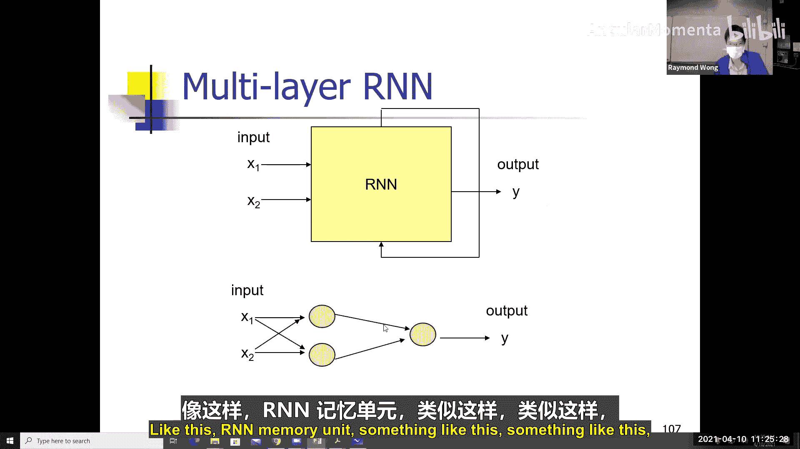
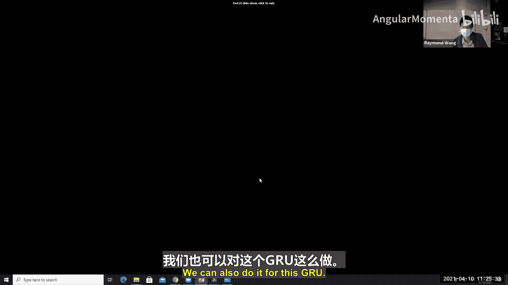

# 【香港科技大学】数据挖掘与知识发现-｜-Data-Mining-and-Knowledge-Discovery-p15-07-07-02-1._循环神经网络_RNN-概述--BV1gEFDzVEU3_p15-

🎼The mining and no discovery。🎼Iter mining and no N discoveries。Maybe we kept your memory。

 we come a new network。Here we also have the newer network like this。

And then the input attribute and then the target attribute， now with the first row。

We train the model starting from the first record， right。And then second record。

 the third record and the fourth record。And then we do it again。

 we train the model with the first record again， this has been discussed before。😊。

Here we know that the training， the model with one record。Is， in fact。

 independent of training the model with other record。 You can see that we just train one1，1 time。

 one time without looking back to the original record。 So independent。

This means that we assume that all the records in the tables are independent。

 This is the major idea for the current new network。You see that in some cases。

 the current record is related to the previous record in the table。

So the record in the table are dependent。So we want to capture the dependency of the model。

We could use a new model called we current new network for this purpose。

What is the meaning of dependency， Okay， suppose that let me use the whiteboard for illustration。No。

Suppose that we have record number one。Record number two， no， this is maybe time， for example。

 this is let me see this is 11 no here11。And then 11 PM and then 1 PM and 2 PM。

So you can see we have some record here and then in fact， if I talk about temperature。Temperature。

 for example， if this is temperature， it is 24 degrees Celsius。Record number two， actually。

 this record is in fact somehow depending on the previous one， for example， increase。

 and this may be also 25 and 25 and so on。 You understand this one。 other example。

 I think you also understand。I think maybe most student or some student here are also doing in the finance industry。

 stock price， the stock price maybe now it is 100。 Okay， maybe next time 101 and then111。

03 and so on。 So you see that the stock pie within different time。

 we have the stock price related to the previous stock price。

 So this is what we mean by dependency among the records。Now continue you continue you。

We currently want network something like that， let me we we draw some location of we represent the location。

 okay， here I write x1， x2 and y let me rewrite。1，1， x 1，2 correspond to first attribute。

 second attribute， the first one means the first record and this why one means the first record。

 the output。 Then we also we draw this one。Call x 1。 This is x1 vector with this value 1 and value 2。

Wecor number one now let me write on input x1 vector， this is a record number one。

 this is the output now this input we and this is output attribute and then in we current neural one network okay。

 in fact。It is very similar， you can see we current neural network is here。

We call a neural network here， but there's a different， you can see that。

This one is the difference we currently work network， we have a loop。We have a look here。

 We call newer network with a loop。 What is the exact meaning of this newer network with a look。

Let's see what we mean。 The meaning is here。 Let me make it smaller。 Our N N。

 we current neural one network。 In fact， if we talk about the look。

 unfolded version of this R N N is here after you see this diagram。

 you understand what we mean by a look。For example， town stand equal to one。We have x1。

 and then why want this what you learn in the newer network without the recurrent one。煲汤3处。In fact。

 we current neural network is something like that。Suppose we ignore this ignore this error。 Okay。

 we know that x2， Y 2， we can do this。Now we just have something like this arrow。

 this arrow means we just have the out on the be let me we start this the PowerPo has some problem。

 Okay， we current neural network let we restart the PowerPo。

 we current neural network where is it okay， is here Okay， the PowerPo has some problem。

When let me go back to the like。Here。Now， for times then equal go to2。

The output of the previous time stand。 This is the output of the previous time stand。

Will be the input。Of the current time stand。 So we have this one。

 This is just the difference between we current neural network and also the original neural network。

 this is the difference。 So if you understand this idea for times stand3， we also have this one。

 The output of this recurringcurrent neuraler network at T stand equal to2。

 we will become the input of the neural network for time stand equal to3。 Similarlyly。

 I think you understand we have something like this X T， we will have Yt。

 we have some input from the previous time stand。Don now， let me make it general。

 suppose that we have constant equal to T。 We have this one。 Of course。

 before we have constant stand equal to T minus-1。 and then we have something like。T minus-1， Y t -1。

 and then this is the input。And then for trans1 T plus one。

 we know that we also have the output here。And then we have X T plus one， Y T plus one and so on。

 I think this is very general。 Okay， and also here we will introduce some weight actually just just lightweight weight。

 they call S minus1。 Okay， stay variable。 Okay， this is the output of t minus1。😊。

And also internal stay wear and this is XT and so on， internal stay wearable。

And also X T plus one in state variable。And now let me make it larger is a larger one and then times1 t minus1 and times 1 t plus one。

Different people may have different variation for this R and N。 We will talk。

 we will talk about the details later。The limitation here is that。

It may memize a lot of past values or events。However， and also due to this complex structure， okay。

 it more complex than the previous one， the traditional neural network is more time consuming for training。

😊，🎼The mining and noish discovery。😊，🎼It mining and no N discoveries。

And now well go through three various basic R and N traditional LSTM and GLU。

 you need to remember LSTM and GLU are the common one。 R NN is just a basic one。

 There's a different version of basic one， let me illustrate the most basic one for R N N basic R and N。

 The basic R NN is very simple This contains only one single activation function for example。

 high popular tension or linear linear rectifier linear unit let's see this is our illustration before。

 I will put some details inside let's see it here。Now this is basic RNN。你是。

Let me use one memory cell。 Okay， we have one memory cell or brain cell or neuro inside。In this cell。

 we will have。Auation function put it here。 And then this S -1 put inside。

And also X T the input insight。And then this will be the output of next day and Y T。

 This is the simple form。 There's a different version of basic R N。 just focus on this one。

And usually， this activation function。Is high popular tangent or whatifier linear unit where do。

 okay， where do。That's illustrate way with this are high popular tangent。This will be in this form。

 Okay， actually， usually in this topic， the ideas very simple。 Let's see。X T。

 you can see that this is the input。 Just put some input here X T。

 and this is also the input X T minus1。This one means concatenate these two batches into one single we。

And then remember that I always say we have some chemical。 These are some chemical related to weight。

 this chemical related to biasers。 and then after that combine it。

 we will have the activation function， this activation function。

 we want to have minus- one to positive one as the output range。 So I use high popular tang。😊。

And then ST which is here， so let's see yt is exactly equal to Xt ST Okay。

 so let me put put this equation on the left hand side and this equation on the left hand side。

 so we have this one。Now let's see W and B， of course， at the beginning。

 we have some chemicals in our brain already。 So w has some value， some value， something like this。

 B has some values here。 W is a vector。 B is a value。And then let me continue in the following。

We want to compute the weight values in the basic R N N similar to the neuraler network。

 The basic R N model have two steps。 step number one input forward propag。

 step number two A backward propag two step。 However， since in your machine learning。

 you have learned it just a focus on input forward propagation in the basic R N N A backward propag could be solved by existing optimization to。

 like what we have done in new one network。 Now let's focus on step number one only。

Consider this example。 Okay， consider this example with two times1，111 and11 2。

T is U to one T is U to2。 We have two input attribute， X T 1 and X T 2。

 and this is the target attribute。 So some value here， we want to do some prediction。

 We want to use the basic R N N to do the training。 I want to train my brain。

 I want to train my brain。This is what we have， we have this one and this one。

And when t is equal to one time is equal to one， let me put it the number， this is 0， one。2。

 I think you understand it and then its the exterior。This is x Y0 and x1。

 x2 and then x2 and then y 2 and x S0 and S1， so I have already replaced now we can see that now we have only the first data on x1 and y1 here here we do not have any state before okay its just think that this is just some kind of chemical in our brain before okay。

 and we focus on this one。😊，Y 0 and also S 0， we don't know。

 You just think that just some kind of chemical before。

 usually in the question in our exam of me we will give you this one。 La our brain at the beginning。

 we， we have something in our brain already。 Okay， let's see。 okay， now this is the the data。

 and at the beginning， Y 0 and S 0 has something of， for example，0。 Okay。

 at the beginning have nothing in our brain。And then continue， this is our two equation。

We do the step number one Okay， let's see。 This is the chemical in our brain brain。

 the weight and the B。 Let's see。Now， with the first record， with the first record and then。

Step number one， input forward propagation。Now copy the whole equation。And then， let me continue。No。

 you can see that。this are w。Just copy。Here。X1， okay， let's see X1， actually。

 it means the first record is here actually。So c point one。

 zero point4 and concate with S block S block is here still and B， which is。Here， so four。算了。

In this nature looks example， we just use these things。 In fact， this means this mean here。This mean。

 okay， this location。 Okay， in this example， we are talking about， let me erase it。

What we are doing 0。7 multiied by 0。10。3 multiplied by 0。40。

4 multiplied by 0 plus plus plus okay plus 0。4 okay in this natural example。

 we use this rotation and then by your simple calculation we will have this0。

59 and then by your cculator about this one then we will have this value So we have this S1 this S1 So S1 is equal to this value。

 put it assign we will use it later and then we also know we will have this equation y one equal to S1 and then just copy this one So y1 is also conclude on the right hand side。

So we this one and then。We need to calculate the error。 okay， we need to calculate the error。

Typically， I think that a different definition， a different research paper， a different well。

 some research paper means the decide output minus the the the out output。

 But here in that research paper， they use my current output。

 my current output minus the decide output anyway， just use this equation。My output is this one。

 This is the decided output still concrete。 And then we have this value。

 So we have some error right here。Now， go to before we go to this one。

 we need to update our internal state。 Here is y 0。 Now become y1。

 many student also miss this step when we do the second row， okay why one。カピや。As one copy here。

 after we update this one， then go to the second row。 Go to the second row。

And then we do the same process， copy this equation to here。And then W， okay。

 let me do it once again。 W is here。And then it 2， Okay， is here。And then S 1 is here。

 If you didn't update this one。 this should be wrong。 Now this correct。 So we are this one。

 B is equal to 0。4。 And then by your calculator and do it again， again。

 then S 2 is equal to this one。 So we have this value。

 And then Y 2 is equal to S 2 just equal to this value and y 2 is here。 So we are we are done okay。

 and also error is equal to y 2 minus Y， Y 2 is this one。 Y is this 0。5。

 your calculator with this one。 So we have already finish the basic R and N。

🎼The mining and no niche discovery。🎼Be mining and no N discoveries。Traditional LSTM。

We have discussed our basic R and N last time。 Now。

 this time we will talk about to well known and commonly use a we neural network in the recent year。

 you need to know that its very popular LSTM and GRU。The traditional LSDM。

 which is the most traditional one。We， why do we have this one is as follows since there are some disadvantages of basic R N N。

 the the previous lecture you learn it there's some problem or disadvantage。

 The basic R N N model is too simple。Just one gate or so on。

 It could not simulate our human brain too much。It's not easy for the basic R N N model to converge easily。

It may take a long time to train their out N model， which means that a lot of ittuition。

Many app course so that we can learn something things we have only very simple structure in the brain。

 So this takes a lot of time to memorize or train the model。 This is the disadvantage of basic R N N。

😊，And now here， before we want to give the details of our brain， actually。

 LSTN is simulating our brain。 We want to emphasize that。

There is an internal state variable called variableable S T， to store our memory。😊。

This is very important。In LSDM， we also have this internal state variable to store the memory。

The next R N M model describe is called L S TM。 What is this Stan for long short term memory。

 long short term memory。 So we can remember some long and short term memory model。 Okay。

 something like that。 Let's see。 what is this。Let me give， I think some students also know LSTM。

 but maybe you don't know the rationale behind how the researcher designed this LSTN model。

 let me give the rationale of the researcher。So that you understand the design of LSTM model。

Actually， this LSTM model can simulate our brain pause。 Let me explain here。😊，Now。

 you know that our brain。May forget something， right， Al may forget something。

 So this L t m have some features called forget features。 so it may forget。 So in the brain。

 it can decide。To forget a portion of this internal stay variable， as we mentioned。

 this one is our memory。😊，I can forget some portion of the internal state variable。

 This has been discussed in my last lecture。 We have some chemicals there。

 It will decreases over term。 So there is some unit or features。

 which can forget some portion of the internal state variable。 Okay， remember it。

 the next features is that since I will see some input of a new input。😊，Since I some new input。

 I have the input features to update my memory， okay you can see how to do that。😊，It can decide。

To input a portion of this input。For the model。 So I have some input。 Okay。

 there's a some number coming to my brain。 I can decide a portion of this input。

 putting inside in my brain。Some production。And then the second point is that I can also decide the swing of this input for the model。

Which means after I design a portion of the input， I can magnify or decrease the， the input。

 Actually， if you don't understand what I mean by swing， you can for that this is just a wait。

Wage are multiplied by the portion。Yesly， this weight。Is modeled by an activation function。

Inside our brain。So as I mentioned here， the weight of the input。You will learn more about this。

 but now you understand the high level idea。 This is our brain structure。

 Then the next features is the output features since our brain can also output something。😊。

We can decide， also decide something to output a portion of the output in the model。

 So our is West smart。 We can control some portion of the output。To output something。

This is also symmetric with the input。And the second feature is that it could decide also the swing or the output of the model as we are this is very consistent with what we had learned in the input feature。

 we can decide the portion。 We can decide the swing。😊，Similarly， for the output。

 we can decide the portion of the output。 We can also decide the swing of the output。 Similarlyly。

 this swing is the weight of the output。 and this swing can be model by an activation function。

 I think after I go through this two slide。 You have a very high level idea。

 how else model works or in practice in our brain。 But in the following。

 we will give how this these three features for features， how I forget something。

 how I input something in my brain， how I do some output in my brain in the following with some details。

 If you understand the high level idea， this great。 And then go next。😊，I bring， in fact。

 includes this six component， modeling the three features I just mentioned。😊，Forge component。

 which is related to the forget features。 I will forget something。

 input component means some input I can control some input input activation component is also controlled by some input For component in in the model they call forget gate input component how much input I can input the of the input this can be by the input gate。

 You still remember that we have the weight of the input this can be model with with this input activation component So activation function So this is input activation gate actually。

 this model the weight of the input this is consistent with what I told you with the internal state component。

 In fact， this combine this two together we call input state gate so that we have something combination of these two and this final two component is related to output output output。

Right， output component also related to the proportion of the output I can decide。 So output gate。

 and this is the final output component， which is called final output gate。

 also include the weight of the output。 Let's see this six component in the next line。

He is the standard R N N， as we mentioned， where time stand T X T， the input。

 some model and then the output。 you understand that in the previous day。

 we have this internal stay variableable S T minus-1 inside。 and actually。

 we also have X T minus1 and Y T minus-1。 and you also know that in our in this model。

 current time stand， we will output the internal stay here。

 S T here to the next time stand like is I think this is very clear。 now go next。

Now I want to go for the this is the standard R N N， but for LSTM， there's some slide modification。

 this is the R N N， this is the traditional LSTM， the slide modification is as follows。

 which is here。You can see that the standard one is this one。 LSTM just have this one。

At the top right corner， you will have the output here。 and this output， will also put it here。

We put here， which means that in this town stand in the previous state in the previous model。

 not only the internal stay variable， but also the output will be become the input of this traditional L T model。

 which is different from the previous basic R N model and also for here。 Okay。

 will understand this one。In the next model， GR U also has something different。

 I will told you later。Anyway， let's focus on the traditional LTA model。Now。

We also illustrate with one single cell， one memory unit。 You understand that we can model with。

 many memory unit here。 We just use one single unit to illustrate the major idea。

🎼Be mining and noish discovery。🎼Beer mining and low N discoveries。We have now one single cell here。

And then now go to the details。This is the sig function。This is the sigma function。

 We had the sigma function， this input， and also。😊，Y T -1 be the input。 And then with this one。

 This is called F T。 Okay， let's see what is the name。 The name is called this is called forget gate。

 Remember that I can decide some portion of the internal stay variable to forget。

 So this is the proportion。Now， let's see this proportion， how to generate。 This is proportion。

I want to forget。 I want to forget how to do that。Remember doing this kind of principle。

 then it's easy for you to understand L S TM and the next model。

 All the model or most model in the research paper is in the design in the following way。

 Do you understand this， This is very simple。Now， here you can see that usually they are using sigma function or high popular tangent function。

 Let me use a sigma function for。 And then there's some input。 This is the whole input。

 The whole input actually is a combination of the previous state。 Let's see。 this is Y t-1。

 which is here。😊，Which is here， yq -1， and also the input。Its still combine this two。 Actually。

 this means concateulation between this vector and also this value。 So we have a vector。

And this weather multily by。ダを。W is a weight matrix。

 You can see this like what we have learned in the neural network， a weight。

 this weight like our chemical in our brain。 this chemical will change over time。Change over time。

 And also， this like what we learn in the newer network。 This is the best variable。

 But here is a writer。So let me illustrate way。 let me copy the whole equation on the left hand side before that。

 Okay， the signaligma function， if you forget it this also learn in your previous letter。

 the sigma function sigma net is， in fact， equal to one divided by one plus E。 Okay。

 the natural number power to minus net。 just put this number inside。 Okay， this is a sigma function。

 And then let me copy the this equation on the left hand side。 and then let me this way this。

W o f okay， maybe something cannot see。一事。W F is something like this one。 This is a vector or matrix。

 Okay， we have this one。 and then B F is some value like this。 Okay。

 like what we have learned the weight。The weight。The weight like what we have learned are in the new network。

 W1， W2， W1， to2 and W3， something like this。 And this one is the bias variable This has been learned in the new network。

 And then after that we have the activation function remember this format actually。

 if you remember this format， have you think become very simple in the later process。Now。

 if you understand this。Then this step， the forget gate。

 how to determine the portion of things to be forgotten is determined by Y T -1 and X T with something like this formula。

 understand。 now you will understand， go to the next component。Let's see。 also using s signalma。

 Let's see。 Also X T pre inside and also Y T minus1。 let me see Y T minus-1 here。😊。

And then some output call IT。Let's see。 Actually， the name is called input gate。

 If you still remember what I told you before， we will control or design a portion of the input。

 Actually， this is related to the portion of the input。And similarly， the same format。

 you can see the same format。Also， seek more function and then X T。And then Y T-1， exactly the same。

 And also， we had the weight and also the bias variable。 Okay， however。

 this content must different from this one。 This W must be different from this W。

 This B must be different from this one。 Let's see。

Copy this one and also write down W I is something like that B I is something like that。

 I think you can catch the point。And then since you understand the format。

 So you also understand that actually， sigma function。😊。

And high popular tangent are also an activation function。This is in the range between0 and one。

And this is in the range between -1 and1。Since they think that they can minus some multi use some negative number here。

 So they use high popular tangent。 Let's see what this actually the same format it T and then the white color things and then output。

This is also called input activation gate。You remember that in the input features。

 we we have the portion of the input。 We also have the weight of the input。

 This stand for the weight of the input， I want to multiply something with this weight of the input。

 Okay， called input activation gate， Similarlyly， the formula are exactly the same。X， T， Y。

 T -1 is2 X T and Y T -1。 And then high popular tension。

 And then these two are also some are variable。 Okay， E in your brain。 And then we have this80。

 So here， high popular tension。 If you forget it last time we have already told you is this equation。

 Why is equal to E power to 2 net-1 divided by E power to2 net plus one。

And then just copy this equation。And then okay， sorry。国嘅。过白。

And then let me put this one W A and B A here。 Actually， this is just some chemical in our brain。

 This will be updated from time to time。😊，Understand。Then go to the next one。 Now here， we want to。

 you can see this is multiplication。 and this is the multiplication。 And then some what's that， okay。

 let me do it。 This is the internal state gate。 if you remember what I told you before。😊，Now。

 this is the internal state， my memory， this is my memory my memory。 Okay。

 this is the previous memory， this is the previous memory， As I told you。

 I can design a portion of internal state to forget。

 So F T and S T minus1 will be do on multiplication。😊，F T multiply by S T-1。

 The portion I want to forget and so on。And then here is the portion of the input。

 the portion of input I want to input。 And this is the weight of the input。

And then do the multiification。😊，And then put here and then do a sum。

So this is consistent with what I told you。 If you remember the features。

 it's easy for you to understand this internal state gate。 So we understand that， oh， after that。

 we may forget the old thing。 we also have some new input。

 The input will be and manipulated with some portion and multiplied by the activation function and so on。

 This is my new memory。 This is my new memory。 This is my new memory。😊，Understand。

 let me copy on the to left hand side， and then continue。Here similarly。

 you can see actually under although you can see the equation are similar。

 but they are doing different purposes。😊，Now， let's see this is that this one and this is this one。

 exactly the same format。 And then do output。 this is called output stage gate。

 You still remember that。😊，This one is is related to the portion of the output。

 the portion of the output， similarly， we also have X T， Y t minus1， x T and Y t minus1。

And this one are also the chemical in our brain。 this time， we use the sigma function。

And then put W O and also B O at the top。 So we have W O and B O at the top。

 this will also change over time。And then next one， which is this one。

 let me see the final output state gate， which is this one， you can see that。This one。This我。

The whole thing is called the weight。The whole thing。Its called the weight。Of this output。

 of this output， how to call。Control it。 This is used with the activation function。

 This activation function and this activation function， This input correspond to my new memory。

 my new memory putting in the activation function。 This become the weight of this output。😊。

And then as I mentioned， this one O T correspond to the proportion of the output。

 Just do a multi and then multi。 And then we have this output。 Okay， we have this output。

 This is the major idea behind L S T M。And then now we have this six equation。😊。

🎼mining ain't noish discovery。🎼Beer mining and lowish discoveries。And then now let's see。

In the following， we want to compute or update the weight values to this traditional LTM。

 similar to the neuraler network， this traditional LTM model contains two step。

 step  one input forward publication， step  two， area backward prop。 However。

 since this too boring to go through everything in the following。

 we focus on step  one input forward publication。 in the traditional L T A battery prop can be solved by some existing optimization2。

 like the newer network。 but we do not focus in the today lecture。

 just focus on step one so that you know what what it means by LTM。Now let's see here is an example。

 same example as the basic RN time is equal to one， we have record one time is equal to two。

 we have record2， okay， we have input attribute X T1 X T20。10。

4 at time1 equal to one and the output is 0。3112 is0。70。9 as the input this is the output 0。5。

And we have two tos stamp， we will use the traditional LSTN to do the training， let's see。

ok let's see。Here is what we have told you， okay， and learned it。And now。

 when Tang Stan is eager to one。Then we chain， this will become 0。 This will become one。

 This will become2。 and then the wearable name will also be changed。And then came to。

And change change it okay， so you can see that the t we will change change change chin。 Now actually。

 okay， we have some very like this。And then I want to say， this is our focus。 This is our focus。

 However， for this are two variable。 Okay， since we usually do not have time1 equal to 0。

So what's this usually okay， in this traditional LSTM model and also in our brain。

 something must be already in our brain already some chemical okay。

 so usually they will assign to0 assign to0 anyway， okay。

 I just want to say that and even though we do not have times then equal to0。

 usually they will assign some value usually zero， but maybe some other well is also possible seeing our brain has some chemical inside。

This is our example。And then。We know that y0 and s0， as I mentioned， this is equal to0。

 and let me copy all the six equation we have seen before。

 and then we also seen this WF B B F or W I and B I and so on。😊。

So we have seen this in the previous line before。 W F for gas， input activation， output and so on。

 These are something in our brain already。 Now， let me use this example for illustration。 Let's see。

Now， I want to read the first record。I want to with the first record。 What I'm doing。

 Let's see Co the first equation in this input for publication。 Copy this equation。 Okay。

 I just copy the first equation and then do the deviation。 I want to do the deviation。

Now let me copy the first one do the duration F1。F one and then x one x one and y zero。

 don't forget this y0 and then do some deviation now you can see that。W F， just copy from here。

 W F is here。 Just copy。X1， x1 is actually means this one x1 is here0。1，0。4。

 which is this one and y0， which is here0， just copy this is a contactlation as I mentioned and B F B F is here0。

4。This one in our natural notes this is just a top powder。 top powder rings。 Okay， let's see。

s point seven multily by zero point one。0 point three multily by zero point four。

 which is this one zero point four multily by zero， which is this one and then sum them up。

And then plus小 four。And by a simple calculator， then we have this value。

 And also with your calculator， the six function with this one become this value。

Then this is very simple。😊，Now we have already灯 for this F one。Put it here， F1 here。Now。

 let me do the next one。 next one。 Okay， this one， I won。And then WI and X1。And then x t minus zero。

 similarly， okay， let me go through once again。This one S more W I just copy this one。

And then x1 is here。And then y0 is here。And then B I is here。 Just copy。 Okay。

 and then using some manipulation top product pursue point2 by your calculator and also by your calculator we have this value。

 So I1 is here。In the following， I don't go through one by one since this will be tedious and boring to you。

 I just want to say that we also have similar equation， right， activation function， saying equation。

 okay， a similar equation。And then eight， I don't go for okay。And then after that， we have this A1。

And then S T actually is also very similar。 Okay， S。This one I need to be different。 Let me this way。

 This one is equal to F1。 Okay， let's say F1 is here。Copy this one as， as log where is is is here，0。

 and I want， I want is， where is this。 Okay， I want is here。And then copy here and A1 wheres it。

 which is here。So just do a simple calculation， we have this value， so as one， we will put it here。

And then the next one， O T， you can see also， we have the same form that I don't go through with you。

 You can read it by yourself set。 You have read it by yourself。 So we have all one equal to this one。

Then go to the next one y tオ this is different one Let me also illustrate y one is equal to o one high popular tan S one and then me do it o one。

 which is here。Copy have popular attention。 S 1。 Okay， where is it， S one is just here。

Some student may use this one wrong， this one and then calculator， we have this one。

 so we have y one equal to this one。 Now let's calculate the error， as I mentioned。

 some student may use y minus y1， but in that reference paper。

 they use this one let' us follow this one y1 minus y okay y1 is this one。Why1 minus the。

 this one is the standard one， the standard one is this one Sil three。 So this is the error。

 This two， we have the error。 we compute the error。Finish for this one for the first time。

And then now。Remember that we need to update this variable。 This is for0。 Okay。

 now we will update to Y 1。As why one is here， copy this one。And then S1， which is here。

 since our memoryory will change and the output also change。Now， this one is very important。

 Some students also forget to update this one so that the later process will be wrong。

 This one will be updated。 Okay， now go next。Now go to the next record， the next record。

 we also do the same thing Let we do it again。 copy this equation， this equation to here。

 And then this time， this is two。2 W F， And this is also2，2。 And then 2 -1 is one。 So this is one。

Now， let's see WF。Which is this one。And then x 2， which is this one。And then why one， why one it。

 which is here？Also， student make mistake stick for this one let you emphasize this is not y zero。

 y1， okay， will be updated。And B F is equal to Sil on4。By your simple calculator， okay。

 do do do then we have F two something like that。 I think you also catch at the point。 Okay。

 I don't go full with you one by one。 now we going to I two and then you can read this notes by yourself。

 do it yourself。 And then I two， we have this one。 And then a two。

 we also need you to read it and do it again and then we have this a2。And then also。

 as can we did by itself。 It's very easy。 Just follow the animation S 2， and then all2 do it by。

 And then we have this one。 And then finally， we have Y2。😊，And also follow the step。

 Read by a set at home。And then we have this one。 So we have these six variables update data。

 And then finally， we also want to calculate the error right Y2， which is here minus y。

 which is this one。 So we have this one equal to this value。😊，Any question？If no question。

 then we finish this LSTM nearly okay about this single neuron similar to the neural network。

The LS TM model and also the basic R N model we mentioned before could also have multiple layers and also multiple memory units in each layer。

 Let's see what I mean here R and N， we can also have one memory unit here We can also have discount of things to sell。

 we can also have something like this。 we can also have something like this mentioned in the new network。

 exactly the same concept。🎼mining and noish discovery。🎼Beer mining and no N discoveries。Okay。

 now go to G R。G L U what is that。 Okay， let's see。

 It's also very common is now more common than L S T M。 Let's see G L U stand for gated recurt unit。

Daate recurrent unit， data recurrent unit is a variation of the traditional LTM model。

This structure is similar to the traditional LTM model。This structure is simpler。

simple than the LSTM model。Before we introduce GRU， which is simpler。

Let's see the properties of the traditional LST model first。

The properties of this traditional ASSTM model is as follows。

The model has a great power of capturing the properties of the data， since this is very complex。

It can capture a lot of properties in the data。Thus the result generated by this model is usually more accurate。

 since it's very complex。Besides， it could remember or memorize longer sequence compared with GLU。

 since this is very complex， it can remember a lot of things compared with GLU。Now。

 let's see why we need to use G L U。 Okay， since the structure of G L U is simpler than the traditional L S team Although。

 it has the following advantages， the training time。Its very important。

 If you use L S TM model for training， this spend a lot of time。

 The training time is much shorter than L S TN a lot。

Its also require fewer data points to capture the properties of the data。

 since the structure is not that complicated。 We don't need a lot of training data to capture the properties of the data。

 So GU is well capturing the data in recent years。Different from the traditional LSTM model。

The3RU model does not。Have the internal state variable。

Which means the variable ST I always emphasize to store our memory。

They do not have this internal state variable。However。

 they want to simulate the memory process it weize the predicted target attribute value of the previous record of the previous record。

With an internal operation called reset。This is an internal web operation call as a reference to store the memory。

 What I mean is that how are this G you store the memory is that in the previous record。

 we had the predicted target attribute value。And then based on this value and also some operation inside GIU called Re。

We set this as predicted value to some value。 That value can be considered as the memory in the brain in GL U。

Although there's no internal state variable inside GU to store the memory， In fact。

 they have the mechanism to simulate the memory in G。

 which is the predicted target attribute in the previous record with some operation called reset。

 and then that output can be considered as the memory in GU。😊，If you understand this concept。

 everything becomes easy to understand GLU also， so you can understand also the rational now how the researcher。

Designing G out， why they have this component。 Many students just know the component。

 but don't know the rationale behind。 Let me are also repeat here。Similarly。

 the G r u model similar to our brain process。We had the reset feature， as I mentioned。

 this is also related to some kind of memory， it could regard the predicted target attribute of the previous record as a reference to store the memory and then use this predicted value and some reset it so that this will become some memory in your brain。

We set it。And then for the input features similar to the LSDM。

 you can decide the swing of the input of the model。Which means the activation function。 However。

 in G L U， they do not have the decide the proportion of the input。

 They just have the swing of the input， which means the weight of the input。 This is the difference。

This is the difference。 So this will be make the model much simpler。M simpler。 Okay。

 See we just need the multiplication of the weight。We don't need the proportion of the input。

Understand。Next， all features。It could combine a portion of the predicted target attribute value。

And of the previous record and also a portion of the process input variable。 Okay。

 so we can see that here。 we have two parts。 We compile something like the predicted target attribute of the previous record。

And then make a portion as I mentioned， okay， we may want to make it a some memory and then this is some portion。

 and also they will have some input inside to the brain and then we process the input and then we have two things the first things here and the second thing here。

 we want to combine these two things like we want to combine the memory and the input together how to do the combination in this G they are doing in a different way compared with LSDM they are using。

Call update features。 They call update features to combine this two portion。 Okay， for example。

 if this is called V1 and this is called V2， V one some value and this V2。

There's some ratio between these two portion。 They just want to like， for example。

 this is0 point2 and multiplly by V1 and plus 0 point8 multiied by V2。

 So there some proportion to combine it。 and this will become the output。

This0 point2 and0 point8 will be learned in this update features。U the feature。

 we will learn this Sil point to seal point。So we understand this is the model mechanism in G。

 Remember， the first one is the reset feature is like we just adjust the predicted target attribute value with some reset feature to make sure that this will become my internal memory input features。

 we just address the swing of the input。😊，We do not have the portion of the input。 And then finally。

 the output is just combination of two terms。 This。

 the combination of this two terms can be achieved by update features，0 point20。8。

 this two component something like the memory。😊，AndThe memory can be derived from the predicted target attribute weather or the previous record。

 And the second component is something like input， some input。 You understand this high level idea。

 Everything become easier later。 Okay， let's see。Here， our bring include the following components。

The first one is called reset component。 As I mentioned， we want to reset our memory。

 We call reset gate。 We also have the input activation component， The weight of the input。

 we call input activation gate。 We also have the update component to address the weight the0。2 Okay。

 which is0 point2 and0。8。 So this is called update gate and final output component is called final output gate。

 which is the final output function。 Let's see this detail here。😊，This is the standard RNA。

And then this is the traditional LSTN， we know that here。We know that here。 We know that here。No。

 let's see。Traditional L S T M where something like this。 However， in G R you。

 it will become remove move the internal state level， something like this。So they will have the y。

 okay， the output put it inside， the output put it inside is not the internal state variable put it inside。

 This is the difference。 This is the difference。Now similarly， I also use the memory unit。

 one single memory unit for illustration。🎼mininging and noish discovery。

🎼Great mining and noish discoveries。Now， similarly， I also use the memory unit。

 one single memory unit for illustration。 Let's see， similarly， if you understand S TM。 well。

 this one is also much simple。 Let's see。 we also have discount kind of signal function。 Okay。

 if you you， you can also design by yourself very simple in fact。

 and then put input and then we have this Y T-1。 and then some output。

 let me see whats the name here。 called reset Ga。 we call we。

 If you remember that this is the weight variable， this also the price variableable， where X T。

 the input and also Y t-1。😊，And then this is the signal function。 And then this one。 we。

 as I mentioned， this related to I want to reset something like the output at this the output。

 the previous record later。 Okay， you understand that this will be combined with this later。

 So this is related to that one。 This reset。 Let me copy the left hand side and also copy the weight variable W and also be out。

Understand similar to the previous one。 Similarlyly， the next one， we will do this。

 You can see that what I'm doing。 Let's see。 I want to adjust。The weight of the input， in fact。

 similar。With this time， we are not using simple function。 We are using high popular changing。

 The reason why they they use is that they want to introduce some negative number such negative number。

Now let's see XT is also this one and then this time a little bit different。

ConConcateulation with something like this， this a new。 Okay， not could not be found in L S T M。

 This one， Y T-1， Y T -1 is here。 and then multiply by this out T。out铁。And then plus B a。

 something like that。You remember what I told you before， what I told you before。 This one。

 this is the output of the previous record。And then I want to change my memory。 Okay。

 I want to change my memory due to the reset reset gate， so I do the multiplication。 In fact。

 you can regard this is just something like the memory， the internal state variable。

Since we do not have S S T-1 now， they do not have this one。 This actually doing this role。

 the internal state variable。And then after that， we combine it， okay， we have this one。

And then just copy this one。 And then also at the top， we want to put the weight W， A and B A。 so on。

 So after this is the internal memory like and then combine this。After there。

 this one is called input activation game。 So we understand that。 Finally， this one。

 the this is correspond to the weight of the input correspond to the weight of the input。

Understand next。Go next。 And then similarly， we also have the same structure， similar structure。

You can see that the update game。 Remember that the update game will be use as light point20 point8 to adjust the proportion of the two components in the output component。

 Let's see。 Actually， this one can be also in the same format。😊。

X T also this black color X T and also Y T minus1， the red color phone here。 also the same。

 And then we are W U and B U sig more function。And then copy on the left hand side。

 maybe at the top W U and B U。 So we have something like that。And then next。

 this one is the the final equation。And we put on the equation first。This one， What's that。

 This is called final output game。 Remember that， okay， as I mentioned， this is the update feature。

 You can see 1 minus U T。UT， right， like this is seal point2。This is li小鹏。The weight。

 the proportion of two component， one component， and the second component。The first component。

 as I mentioned。Is related to。The P are the Pfa one， the piece， the Pfa one。This one。

 Y T minus1 is related to something like a before previous one。

 And then this one related to this one， A this related to some output related to some output。

 So we just combine this two together。Which is consistent with what we learned before。

 First component and second component， combine it。And then copy on the left hand side。

 And then we are done。We are done so we have four equation。

 You still remember that the traditional L TM， we have six equations in our N M。

 we just have four equation， So which is much simpler， okay much simpler。

In order that you understand much clear， let me give this example。

 although I think you can catch catch it easily。 You you understand what I'm talking about。

In the following， we want to compute the weight value in the GLU similar to the neuraler network。

 the GLU contains two step， step number one input forward propagation。

 step two A B propagation In the following， we focus on step number one input forward propagation in GLU okay。

 A B propagation can also be solved by existing optimization tools like our neuraler network。

 but we just focus on step one。Let's see， same example， we have a to11 times12 same example。

 This time we are using three R U。Think as before， just put back the team is equal to one。

He is equal to one。 put back。 Okay， I just put back the value。 We focus here similarly。

 also the same here， the variableable， we don't know and also maybe we it to 0。 go to next line。

 Here we have this table。 and this is equal to0。 as I mentioned。

 copy all the equation at the top four equation。😊，And then also。

 the corresponding weight and the bias variable here， this has been mentioned before。

 And now go to the forward propagation。Now， with the first step。With the first first row。

 and then copy。This one， let me eat this way some equation first。All one。Sigma WR， this is one， one。

 and this is0。 copy the same。 And then let's see x one， in fact， is this one0。

 one0 point4 y 0 is here is 0。And W r， W r is here。 So copy the whole phrase。 B r is here，0 point4。

 similar to what we done your calculator， your calculator， your calculator。

 and then we have y  one equal to this one。The next one， a， I don't go through a you。

 I think we will be well boring。 Okay， you can read it by yourself。Do it again， again， again， again。

 And then we have a1。 And the next one， you， okay， you can also do the thing exactly the thing equation equation and do it again again again。

 again。 And then with have this one。 Now go to the fourth one。 This is a little bit different。

 I want to illustrate。😊，Now this is y1，1 minus u1， and then y 0 plus u 1 a1。

 So we have this equation。Continue，1 minus u 1 is you coming from here。

You can see that this U coming from here and y0 is here。And then， a  one is here。Okay。

 by your simple calculator， do it。 We are this on y1。 So we are we finish for four equation values。

And then， of course， we also want to calculate the error。 The error is y 1，1 is y。

 Y1 is this one and why is this one， then calculated with this one。Finish。

 and then this is for the first one。 And then we need to update this one。 Y 0。

 Remember that some some forget why one is here。 and then the value is this one。😊。

And then go for the second row also， okay， similarly， if you remember what I did for LSTM。

 we still do the same things。And then copy the first equation。 This time is 2， and this is 2。

 And this is one。 So correct。 And then do it again。 Why WR is here。It's two which is this one。

 which is this one， y1， okay， remember y one not y0， which is this one。

And this always make respect B is still point4。 and then by your calculator by your calculator where this value okay。

 so I think you understand the point similarly， a2， you can read it by yourself。

 you can read it by yourself where a2 you two okay。

 you can read by yourself We have this one and y two， we also do it by yourself。 Okay。

 we have this one and finally， we have the error right y2。

 which is this one minus this0 point5 We have this one。Similar to the neuraler network。

GLU could also have multiple layers and have multiple memory units in each layer like this R and N memory unit。

 something like this， something like this。

And also something like this， we can also do it for this GRU。

