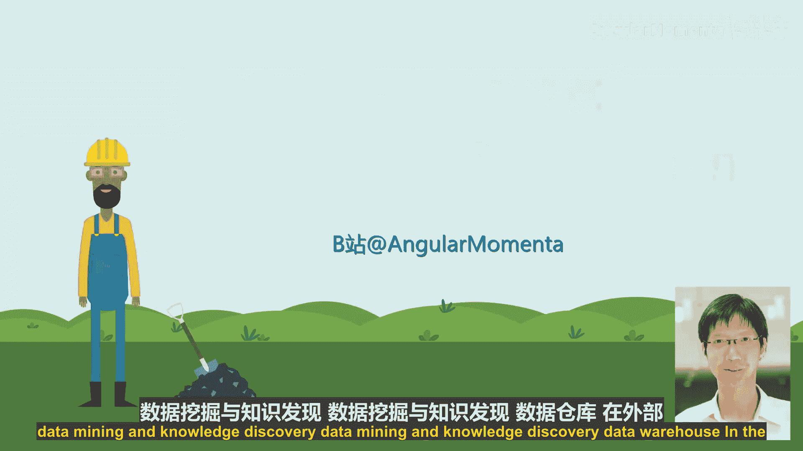
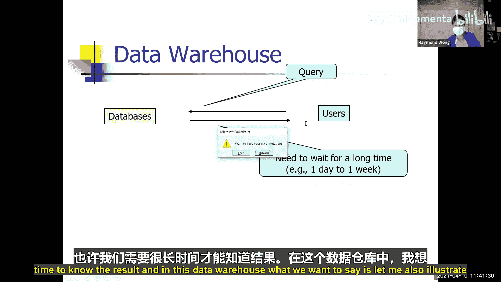
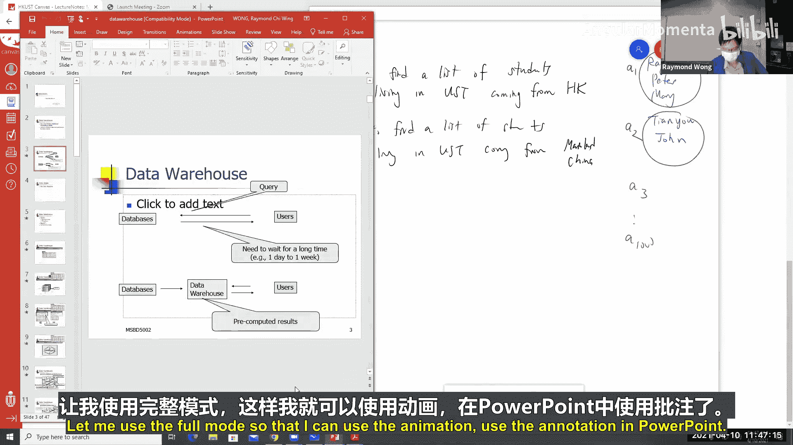
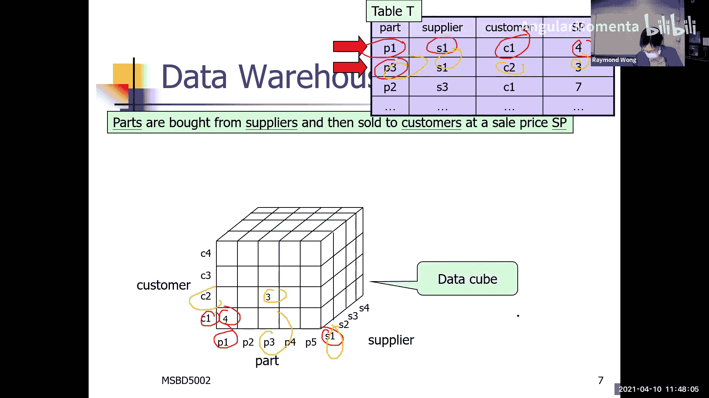

# 【香港科技大学】数据挖掘与知识发现-｜-Data-Mining-and-Knowledge-Discovery-p16-08-01-02-引言--BV1gEFDzVEU3_p16-

🎼mining and noish discovery。🎼Beer mining and no N discoveries。

Data warehouse。Oh in the outside world， some students also working outside this is also called OL。

 some people still call OL OL what is the meaning online analytical processing。

OL A P online analytical processing， usually they will not say online analytical processing。

 They say O lab。Many company use data warehouses for their data analysis。Let's see。

 this is our example illustrator in the first letter。 This is the user， and this is the database。

 if we have some query。😊，Ask it and then maybe we need to wait for a long time。

 wait for a long time so that we will obtain the result So this is what we have learned query。

 maybe we need a long time to know the result and in this data warehouse what we want to say is let me also illustrate with the whiteboard that me use the whiteboard for illustration。

Let me do it on here。I want to use the white box。We moment money okay。 I'm using the微 let' see okay。

Let's see。啊喂同我问啊 the微博啊。Just disappear。I你条 we open it。Wt a moment。 I need to restart the wayboard。

Good， I should see。this I'm now using a physical device about the whiteboard。No， I think I could。

How for the queryway one。Suppose I use this example。To find。A list of student。Living。

In a free example。In UST。And also。com明。饭。For example hong kong。And then， for example。

 the database is very large， very large。 And also， this query is very complicated， very complicated。

 Maybe we need one day。 We need to wait for one day and obtain the answer like， oh， maybe Raymond。

And then Peter and then married and so on， so we have some answer like this。

Now we have pview number two， sometimes maybe some student or people， we ask something like this。

 we want to find a list of students。Living in UST。Also do the same。 however。

 some different for example coming fun。For example， mainingland China， mainingland China。

Maybe we had some student。拉啊。Can you。Maybebe hell。John and so on。

 So we can see that we have the other answer。 Okay， maybe this time we need to wait also。

 maybe one day。 Okay， maybe this is the database is very large。

 And this query with the structure is very complicated。 So we understand that we have a 1 with a2。

So in general， we have Q free。😊，For example， to kill 1000。 And if we are each user， if they ask this。

 then maybe we need to wait for a long time to obtain this one。

 What I want to say here is that in data warehouse。 before the real user ask this query。

I'm the database administrator or the the company manager。

 I before the user triggered this query with， I need one day to obtain this answer and this answer already store in my hard disk。

Before the user trigger this query， I saw this in my hard disk， so this is what I want to say。

 let's see。Now we have this all this story。 The query and also this answer is stored in the hard disk。

 This called data warehouse data warehouse pre computer result。

 which we before the user ask the query， this answer has been store already。

 So with the user and then ask this and then since this in my hard disk the user ask this question immediately I look of it look up the table and then we read this answer。

 So we need within one second to find this answer。 So we return this one to the student to the user。

 So within one second。 So the advantage。 One advantage is fast query was one time， one advantage。😊。

Let's see。 Now let me formula the problem。 Let me formula the problem。In fact。

 what problem we want to find is。Currently， if you understand that we have many， many， many。

 many possible query， if we for each possible query， we store the answer， this will be very bulky。

 very bulky。 This occupy a lot of space in the hardest。 This is not desirable And in the following。

 we want to find some smart technique to to select some representative query here。

 such that I just store a little bit in the hardest。 And at the same time。

 I can answer the query very quickly。 lets us see what I want to say。 The problem。Here we are part。

Are bought from supplier and then sold to customer as a selling price， S P。Here's the table T。

And then we're part supplier， customer and selling price。

Part one is supply by S 1 and so to customer C 1。 And this is the selling price。

 And then this is the table。And usually this kind of data warehouse usually is presented in form of a cube。

 let's see we have three dimension 1，2，3， this three dimension and this is the measurement dimension。

 Let's see what I'm talking about part where P1 p2 p3，4 p5 we also have supplier Okay S1。

 S2 S3 and S4 we also have customer C1， C2 C 3 and C 4 See what I'm talking about let me use the so that I can use the animation use the annotation in in powerPo。

你事。Okay， let's see the first one。 P1， S 1。P one。S 1， C 1， C 1， actually， which is here。4our， okay。

 let's see four。And dang。P3， let's see。 then we use another color， P3。P3， which is here。 and S 1。

 which is here。 And then C 2， which is here， which means here。 So we're free。

So you understand that we have this one。 This is I have a technical term in data warehouse。

 This is called data could。 Okay， like a could。

