# 【香港科技大学】数据挖掘与知识发现-｜-Data-Mining-and-Knowledge-Discovery-p17-08-02-02-1._基本概念_第一部分--BV1gEFDzVEU3_p17-

嗯。🎼mining and noish discovery。🎼Beer my image， no N discoveries。

I feel most of you learn sickle Sq L before C left from where goodbye， if you haven't learned it。

 it doesn't matter。Here， I just told you， select part customer customer。

 some selling price from table T group by part and customer。 If you forget it。

 even though you learn actually the concept is that I want to obtain something from table T， Okay。

 which is this table and group by part and customer。 Okay， so just focus on part and supplier。

For each one， each role should be unique。In the answer， let's see P1， S1， P3， S1。

 P2 and S3 are also unique role。 And then in the answer and then the answer that which means the answer column part and sub customer part and customer sorry part and customer So sorry。

 I need to this this one。No here。 Okay， sorry， okay， I need to do it again， okay。

Good by part and customer， which means this part and customer P1， C1， P3， C 2， P2 and C 1。

 all are exactly the same unique value。 So we obtain this。 and also at the output。

 where are part and customer。 And then we are some of selling price 4，3，7。So we have this answer。

I think you understand this simple for example。 Let me change this example。

 and then you understand what it means。 Let me change this example。

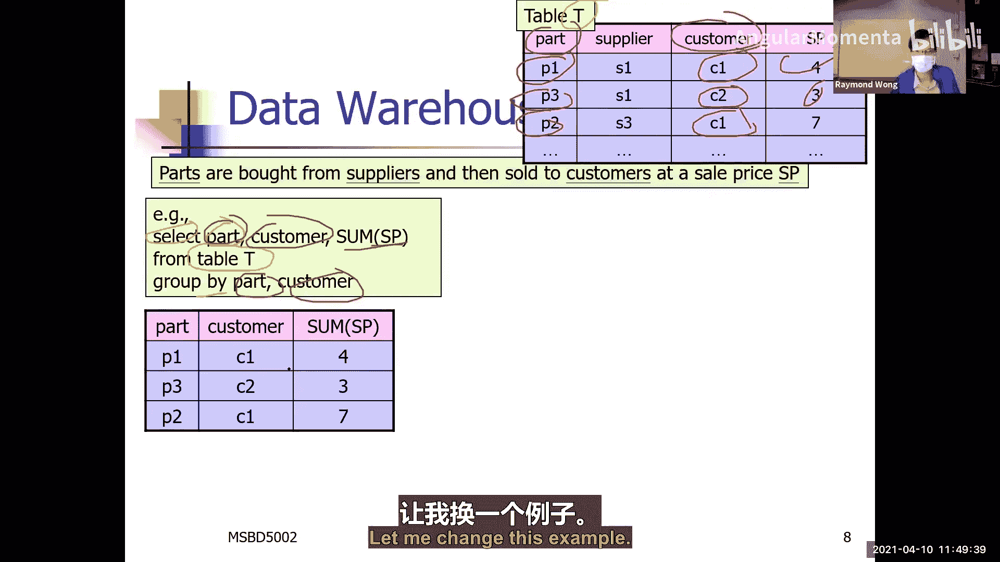

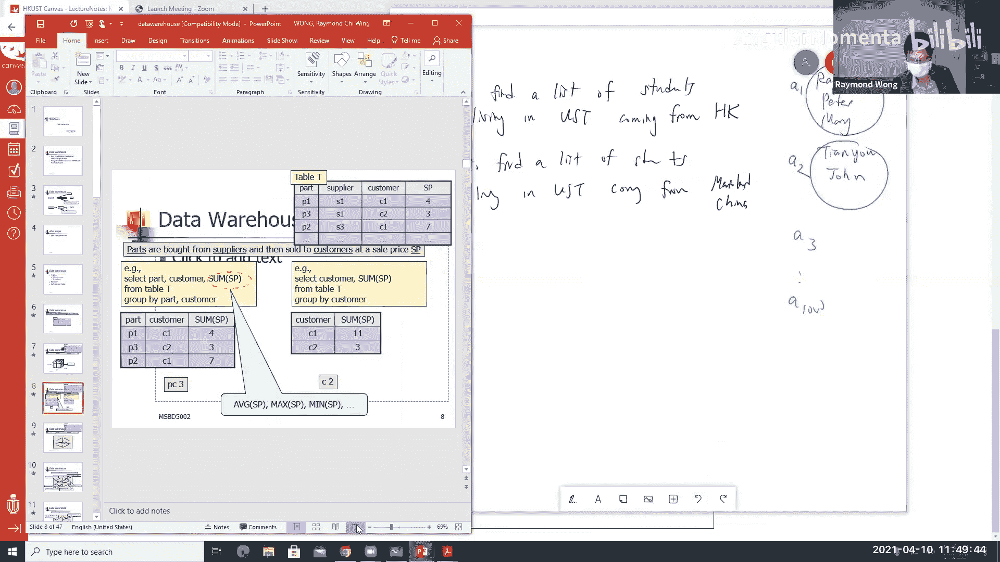

Change this example。 Wait a moment。 Now I want to change this example let me see。

Suppose that I change this to P1 here， as I mentioned。Select from table T， which is here。

 Good part and customer， which is part and customer。 currently P1。

And see one here are exactly the same one。 As I mentioned。

 I want to have a unique role based on part and customer。

 So we understand that this two role will be combined in a single role at the end here in the answer here。

And since we have two numbers here， how to combine it， we can using the sum。4 plus 7。

 which is equal to 11。 So actually， the answer here will be this one。😊，P1 c one p1。

 c  one four plus seven， so eleven p  three C two so this is equal to three I think it is understood。

Okay， and and then let's go back to the original example， let's go back to the original example。

In fact， this one， the sum can be replaced with average maximum or minimum。

 I think this is very easy。 Okay， if just the before example P1， this is the sum4 plus 7。 Okay。

 if we replace average， which means four and 7， the average value。

 maximum means that I put the maximum value is 7， if minimum， just put the value4。Continue。

Now go to the right hand side， go back to our this example。

 go back to this example on the right hand side。Similarly， okay。

 we also want to group by customer only。Customer only。

 and then select customer and Sam Prime customer。 Oh， only C one。 This two must be combined。4 plus 7。

 And then C 2，3。 So we have this answer。 C1。And then 11， C 2。 And then we have three。

 So we have this answer。 or Any question， If no， okay， then we will use some location。😊，P。C。

Represent this one。In fact， if I write PC here， which means that the whole yellow thing。

The whole yellow thing， Okay， which means the query way。 Okay， like what I did。This is the query。

 And then this number 3 actually means what 1，2，3。 in the answer， I we saw this answer。 Okay。

 the whole table。 and we know that the total number of this row number of rows is equal to 3。😊。

Similarly， on the right hand side， if you understand it， see。So were C and then we two rows。

 we will start this answer， so two understand。It's very simple。😊。

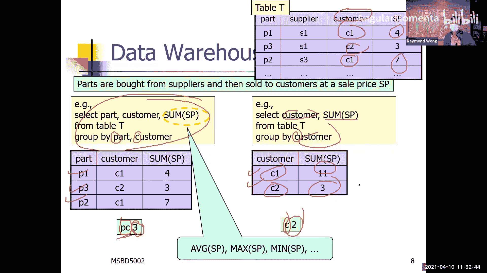

I already mentioned this kind of things。 Now， let me ask a question。

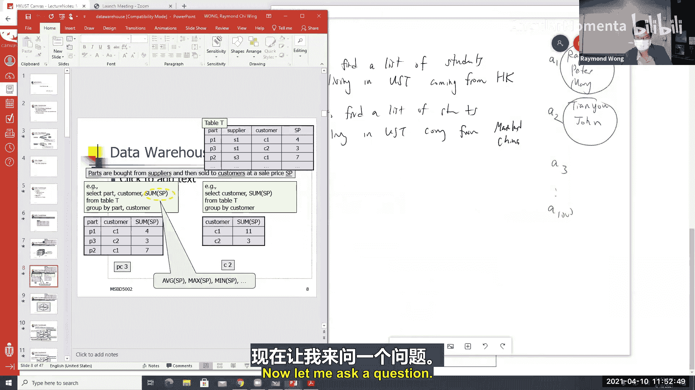

Okay， we understand here， let me go to according to the original table。And this yellow query。

 I understand that I can derive from the original table to obtain this a smaller table。

 I also understand that on the right hand side。This query from this table T from the this table T。

 derive it。Otain this table， right？ I think this is understandable。 Now， my next question is。

Now I focus on this query。 I focus on this query。 Supp that I don't need this table。

Could I use this The answer of the first query to answer this green query， Is this possible。

不 want to answer。父 want to安徽啊 we咪。Hello， women， hi， hello， I think， yes。Yes， why， yes， yes， yes。

Because from the table 1， a。The key is the part and customer。 and the table。

 The key is just a customer， so we can count the the same customer in the table1。

 and we can derive the second table。 Oh yes， good。 get the coupon。 Thank you。

 maybe So we can be okay， actually， for the second query。

 we can derive the answer based on the answer of first query in addition to the original table。

 So even though we don't have this original table， you will answer this query。

 if we know the answer for the second， for this first query。 we can answer the second query。 Okay。

 understand it this is very important， very important in the later slide。 If you understand it next。

Here in general， we can draw this Africa。 Or， we have PSC， right， and we have6 billion records。

Suppose that we have P we can derive this information divide this PC that this query based on this。

 Okay， we draw online line and here we have  four million record and similarly， if we have P， okay。

 we have something like this and something like this， this is derived and also if we have P。

P can be divide P here。 divide P here， since there's no P here。 So there's no line connecting here。

Although I think student also understand that actually。

 we can have this one since in order to make the graph simpler。

 we don't write down this one since we can see the transitive property from here， understand。

 continue。😊，And then this one as okay， we can find S here S here。

 but no S here and then see we can find here， we can also find here， understand and then okay。

 you understand that this is group by supplier， this is group by this customer。In this topic。

 usually they will write down discount things， none。We're free attribute to attribute。One attribute。

Like no attribute。 And then we have one。 We have one here。 although I didn't teach this part。

 do you guess what is the physical meaning here， according to your logic。According to the logic。

 logic means here 3，2，1，0。之后。The total number of the attribute。Yeah， records， right， record Yes。

 thank you。 Yes。 so you are very smart。 So we understand that。Even though we don't know this one。

 we can guess no attribute， which means that all the attribute we don't need。

 so we just sum all this records。We all some all this value Oh。 Okay。

 so actually this in our example， this one is。Actually， this one， only one role。 Okay。

 this role is a in fact equal to the sum of all the selling price in all the records。

 all the records to how it already answer。 So we understand。

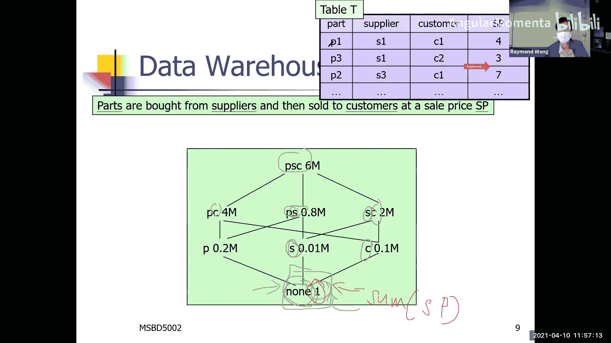

🎼Be mining and noish discovery。🎼It mining and no N discoveries。

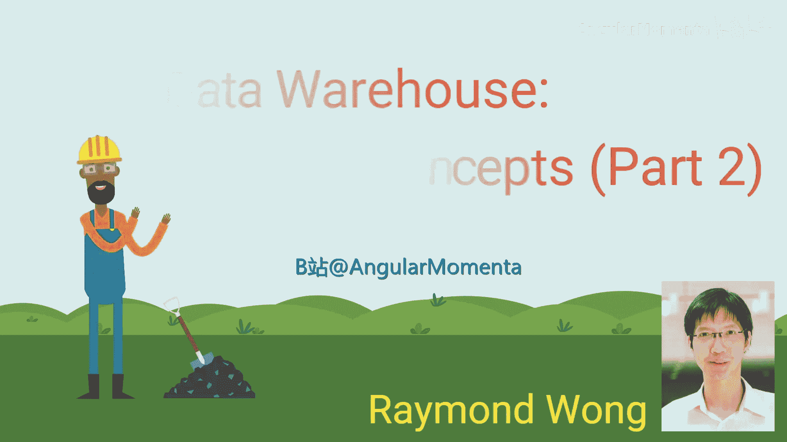

Now continue。Suppose that。We materialize all wheel。 Okay， maybe you don't understand some terms。😡。

What is the meaning of wheel。This is we call a view。 A view in turns。

 contains the query and also the answer and also the answer。

Materialize means that we want to store the whole things in our hard disk。

 materialize means we store the whole things in my hard disk。 supposeuppose that we store everything。

In the hard disk， this means we want to materialize all views。These waste are a lot of space。

 it waste a lot of space。Now let we define something。

 then we define something so that you understand it later。 Okay， see this is in the hardest。

 this is in the hard disk。If I want to answer this query with why I want to answer this query。 Okay。

 the course for answering this query or and then after we answer this one。

 we need to assess the answer this or PC。 Okay， the answer， the size is equal to 4 million。

 So the course still I need to read the hubies。The hardest cost is 4 million white。 So we。

 I will say that the cost for answering this PC is equal to 4 million。

 This is our definition since this is in the hardest， we need to read the hardest。Similarly， P S。

 if we want to answer this one or assessing this P S， this is equal to this size0 point8。

 Similarlyly， I see the four this one the cost for answer this one is2 million。

 the cost for answering this P is 0 0。2 n。 the cost for answering this S is equal to 0。01 m。

 the cost for answering C is equal to 0。1 m。 I think this is understandable。Continue。No。

 suppose that we materialize。😡，The top view only the top view only the top view only which is this one only okay。

 the top view only。Then。What is the consequence， Okay， let's see。The cause for answering。PC。

 which is this one， is not for m。 See， this has not been materialized。

 This has not been materialized。 Okay， this is not materialized。😡。

And then as we just know that this PC can be obtained from here。 P， right， P can be obtained here。

 So we need to read this in the hardest。Six n and process it and such that we have this answer。

 So the cause for answer this when is 6 million。Similarly for this P， I think you also understand。

 since we do not material this one。 we need P here at 6 million。

 So the cost for answering this P is equal to 6 million， not68 m。

 So you understand this one cost for answering this one is also equal to 6 n cost for answering this one is 6 n cost for answering this one is6 n cost of answering this one is also equal to 6 n very simple Now go to a more a little bit more difficult one。

 Next one。Suppose that we materialize the top view only， which is this one。😡。

And the will for PS only， which is here。So we know that we materialize this two will。

 Let's see the course for answering this six view。 Okay， let's see。

The cause for answering this will is equal to。6 m， still6 m。 The reason is that P。C。

PC can be found here。 So we need to read this hardest 6 m。 still 6 m compared with the P slide。

Previous line is still 6 m。However， for this one， P has been materialized。This one。 So this one。

 the cost， of course， is Silon 8 M。Not6 and previouslyly on the previous slide。

 I want to focus on the previous slide。Similarly， for SC。We can also read SC which is here。

 so the call for answering this SC is equal to 6 m still 6 m Oh let's see。Let me ask you。

 what's the course for answering this P， who want to answer lets see howo Tian。好听。好听。Yeah， yeah。

 yeah。 the size is 0。8。I see it so point on8， right。Yeah， but why， why， yes， yes， a to。

 Yes P from P S。Yes， P we want here we have P， right？Yeah， yeah。 you use this information， right。

 Yes， here， we also have P。 Why don't we use this information。 Yes， you actually， you are called。

 Why don't here P， we have here this information and this information。 Now you chose this one。

 not this one， right。Why do you choose the second one， right？ Why。

 Because the second one is smaller and it contains enough information。 Yes， this is smaller。

 So this is a reason why we choose this one。 if we want to answer this query。 Of course。

 we are smart， although we have two possible choices。

 we want to choose the smaller one So that we will be faster。 This will be have faster。

 So this one is 0 M。 Thank you。 how， and then we have this answer。

 not 6 m previouslyly So we understand this is the major idea。 in this topic。

Now if you understand this， yes。Similar we have here as and then we're seal on 8 m and also 6 m。

And then we want to answer it。 So we want to answer the cost for answering this one is equal to0。8 N。

 chooseose a smaller one。 How about see， who want to answer。Yes， are bears。unm yourself， will。

And we could not hear you， but they were right。helello， and maybe I mut you啊I could。Yes， hello，vo。

 yes。That cost will be 6 million6 million。 Yes why yes why， yes， correct。

 Why Because can I use this one， Can I use P Sil because you don't have C yes， we don't have C。

 Thank you。 Yes， you understand concept。 Okay， now this is the basic foundation that you need to understand in data warehouse。

 So actually， we are using something like some concept like this later。

 Now you understand that the cost or answer 6 n is this one。 now you understand it。

Now let me clear all the the annotation。 okay， we have something like this。Now。

 you understand that compare with the previous line。

 previous line is that we just material the top view only without this one。 Now。

 we have one more view。This is the result on the previous slide。

 This is the result on the this slide。 So I want to see when I mature one more view。

 What is the game， The game here for this one is 0 here，6 m previouslyly。 Now we're 0。8 M。

 The game is equal to 5。2 m here。😊，Here here yes thing is equal to 0 And here5。2 m。 Okay。

 just make the difference between this two number and this two number，5。2 n， this two number0。

 So this is all the gain we have。 And then I want to say we want to define something。😊，The game。

 originally， just a top view。 This is the original one。

 And now we have the top view and also the view for P S。And then compare it， the game is equal to 5。

25。25。2。 Actually， that's some M5。2 m multily by three， which is equal to 15。6 m。

 So the game is equal to 15。6 m。 understand。 Okay， this is the definition of gain。And then you over。

We ignore okay， although， okay， we have this this view one single cell since this single cell just do not occupy a lots of space。

 Usually we ignore this one。 Okay， we do not calculate the gain for this view。Understand。

Now in the following problem， we will describe is as follows selective materialization problem。

 we want to select a set V of K wheel， for example。

2 views such that the game before it the top view only。

 and now we have top view together with some views in the selection set。 Okay， for example。

 two wheel。 so that the game is maximized。This is our problem。 Before I go further。

 I want to make sure that you understand again。The definition for this example， this is simple。

 So you understand you。 Well， now let's go to a more complicated example in the in class exercise。

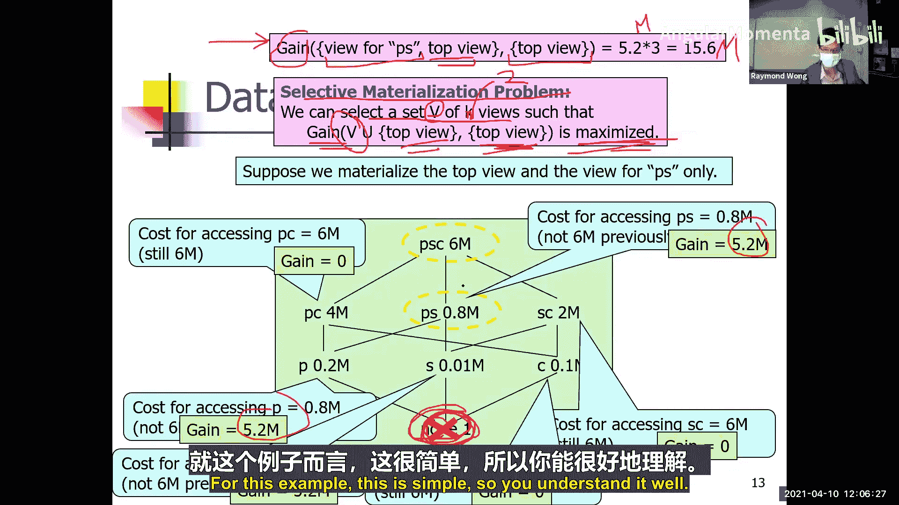

Go to the in class go to the campus， go to the in class exercise。This should be in class exercise。

 let me see。 This should be in class exercise 8， go to in class exercise 8。In class exercise 8。

 question 1， now you can do question 1， A and question 1， B。 Now。

 I want to come check the answer with you。 Usually some student may make mistake for B， A is simple。

 but B， maybe some student make mistake。Let's see。 Okay， you can do it now。

 you can use  five minutes。🎼The mining and longish discovery。😊，🎼Da mining and no N discoveries。

Come backt， who want to answer。Yes啊 Lu Yu。You you are here right wait moment啊 let we do the volume control wait moment。

Hello， okay， you can。 yes， you can say。Yes， you hear bill your show。Or you want to share your screen。

 right， You could， right。you could share a screen， right， Luu will share her screen。 Okay。

 Luu is now in the class。

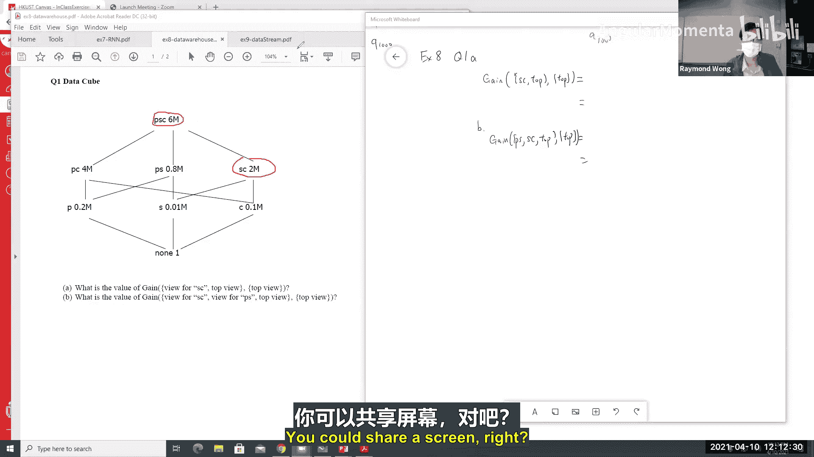

Okay， maybe we also ask one more student。 maybe casting， you can share a screen casting later， later。

卡星唱里。You see， right， for the first one， the answer is equal to4 multily by3 equal to 12。

 And let me see whether I can use。 Okay， okay， actually， we have the unit million，12 million M。😊，调不了。

And then the next one， Okay， he all， she also share his answer。 doesn't matter。 Okay。

 and the answer is 23。6 m。 Also correct， Also wait for some student。😊，3 second，3，2，1。

 This is the correct answer， except we add M。 Okay later。 Thank you。 Thank you for sharing。😊。

Cassing 10， you can also share your answer。 I think you are consistent with this one， Caing。

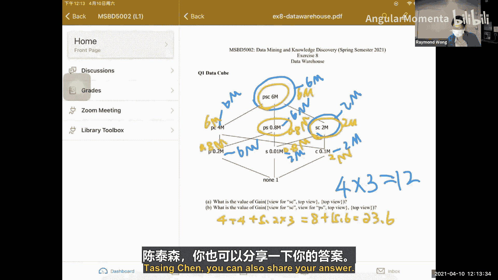

Csing， yeah， you can share your answer。嗯 sorry wait a moment。

 I I need to use my  iPad to share my screen。 Okay， no problem。 Okay， now and you are preparing。

 right。

Yeah。ok ， then wait a moment。 okay， can you see my screen we could see your screen yeah。Yes。😊。

And the one the the one is my answer on the question B。Yes， I see it。 Yeah， A is4 m， right。

 I could see the answer， right， and then B， the answer is whats the answer B is be it my wrong。

 I think right。洗一水。I think my answer is wrong。 Okay， so I ignore the answer for part B here。

 His answer for part a is correct。 Do you know why you did call incorrectly for part B， No， no。

 no yeah。 I know may have make mistake。 Okay， no problem。 Okay， you also get the coupon your part。

 Thank you。 so correct。 Okay， let me explain the answer for part B。

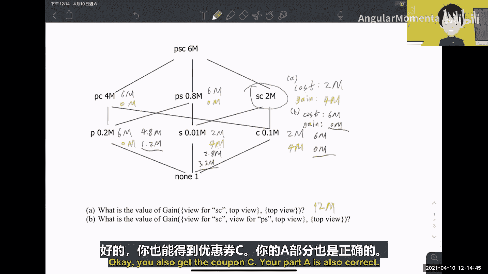

Some still still are also have some problem Now for part I for part A。

 I will not explain yet or partly I explain yet now let explain it。Herere similarly。

 information game top view。And then here， the top wheel together with PS and also S C。

Now let's con the this one first， Let me circle this one top view。Now the top wheel means here。

 top wheel means this one。 So now let me do what I'm doing。But actually。

 this is consistent with our national。The course will answer this one this time is 6 m。

The the course for answering this one also equal to 6 m。 I think this is very simple。

 if I do it this way， I think this is very clear。I think the student Lu Yu also do this way since I see her draft。

 the course is equal to 6 m here， the course for answering this S is also equal to 6 m。

 I think it's very clear。 I have already emphasized in the natural notes。

And now the difference is here， let me use a white color here we have PSC and then SE materialize and also P S also materialized。

 Let me use red color to denote it， the course using the white color one。

 This one similar to our natural this ego to 6 m。And here the course here， Okay。

 let's see what' the cost， I think is very simple Silon 8 M。And the cost here。

Is equal to this number 2M。And then the course here。See the cost here is eager to。P。

 we have two possible choices2 point x m and also 6 m choose the smaller one seen we are smart。

 right， so0 X m。And then the cost here is equal to， let's see as。Can be fun to you。Can be found here。

Which one should we choose， Who want to answer or you cousining， you can answer it。 Caing， yeah。Yes。

The course， whats the cost here？The cost for P S should be super。S point and thank you。 Thank you。

 Yes。 so he also understand you。 And then for a course for answering this C， which is。

Why is this one cast。嗯This one should be 6 AM。诶 let me highlight like wait a moment some problem here it it some problem with the zoo。

 okay， wait a moment啊。some problem which soon诶 wait moment the soon has some nagging诶 wait moment okay ok yes o 咦。

It iss some problem with the zoom anyway， I don't know why let's see some problem Oh I see maybe here okay。

 understand， understand this is related to the touch screen in this morning moment let me do it again here okay。

 passing you can see see here right Yes。😊，Do you CC also here？Yes。

 so what do you think this is 6 m or 2 M here。那 you are finding the p S or the S the question is that what is the cost for answering this C。

This is there is to air。2 m Thank you。 Yes，2 m。 Yes。

 maybe you make the mistake there in the previous one。 Thank you。

 Now you understand this is the cost is equal to 2 m。

 Now we let's calculate the gain the gain together。 Okay， here the gain the gain I I write down G。

 Okay， I don't write down the the gain is equal to0。 The gain here is equal to5。2 m5。2 m。

The game here is equal to4 m。The game here is equal to 5。2 m。And then the thing here is equal to 5。

2 m。The game here is equal to4 m。 So we have this equation now let's see。0， no problem。 So 5。2，5。2，5。

2， We are free 5。2。 Let me write down on the right hand side。5 point2 m multily by three。

And then for in，4 in， for in， we have two tons so。For m multily by two by your calculator。

 which is 23。6 m。This is the answer。 Any question。Paing， are you fine with this answer now。Yes。

 thank you。 Thank you。 Okay， Dan， this is the answer。

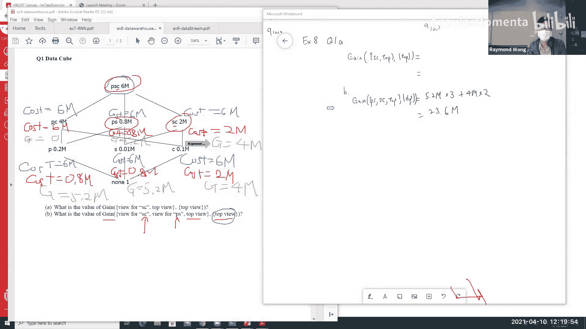

