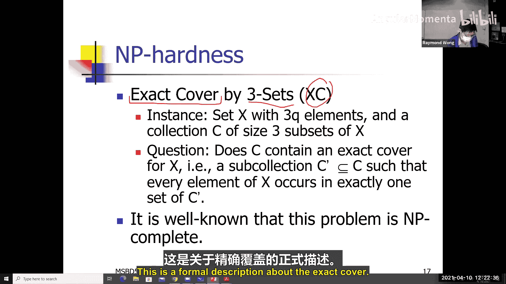
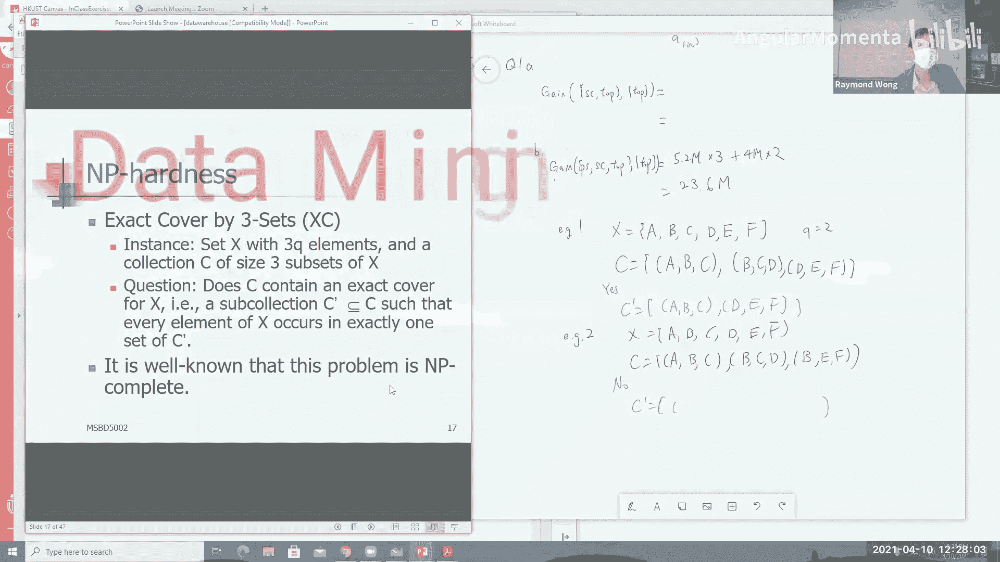
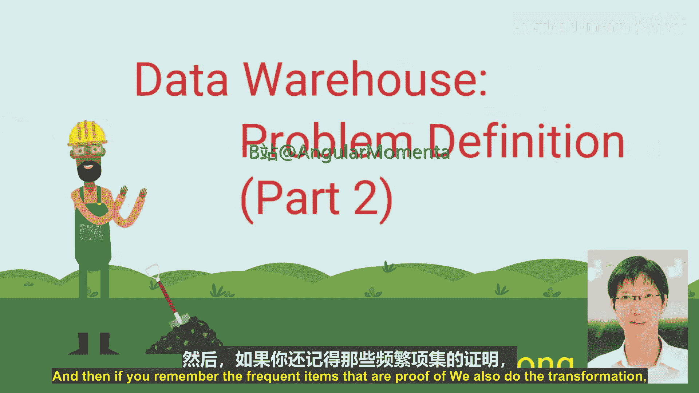
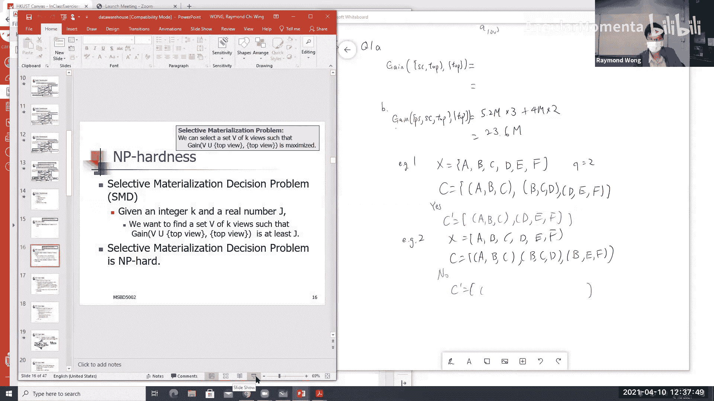
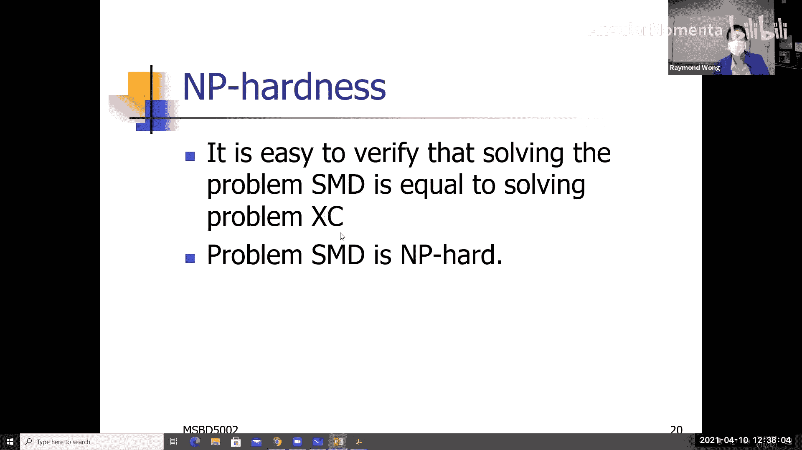
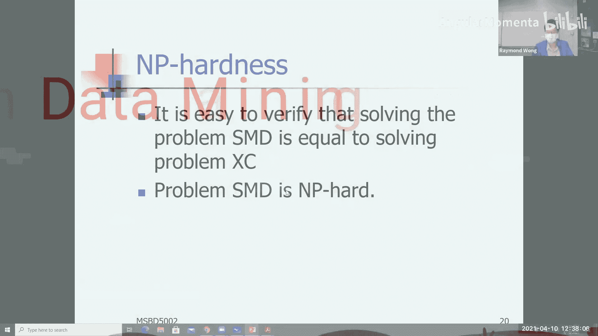
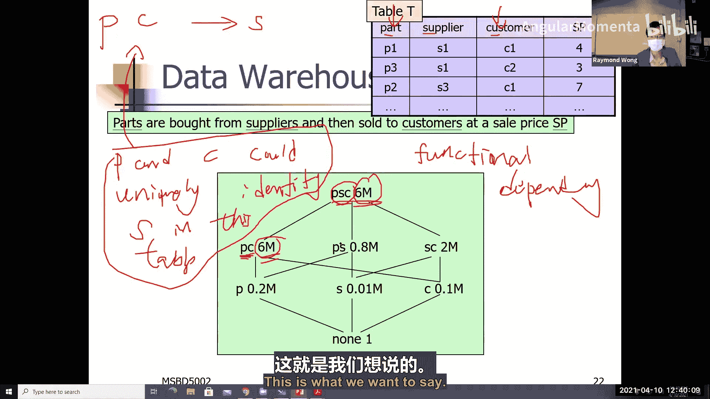

# 【香港科技大学】数据挖掘与知识发现-｜-Data-Mining-and-Knowledge-Discovery-p18-08-03-02-1._问题定义_第一部分--BV1gEFDzVEU3_p18-

mining and noish discovery。🎼Be my image， no N discoveries。After we know the game。

 after we know the again， we know that we want to select a set view of views such that the game is maximized。

 This is our problem。 Okay， this is our problem。

Now， since we are computer scientists。We want to know whether this problem is very difficult。

 like association room mining， we also want to show that this problem is MP hard if you remember what we have learned last time。

 this time we have a different problem we use different existing MP complete problem to show it。

We want to show this problem is MP hard。 In fact， we want to show this is MP hard。 Now。

 let's transform this maximization problem to a decision problem in MP hard is proof。

 they usually use decision problem。 Okay， selective materialization decision problem decision problem means that the answer is yes or no。

 what is the meaning given an inj K， exactly what we have seen before。

 But this time we have a real number J， this also given We want to find a V or K rules such that the information gain。

He originally is maximize is at least this given number， J。

Is there any possible solution for this we okay such that the game is at least something。

I want to tell you that this decision problem is MP hard。Now let me give the proof。

 let me give the proof。The proof is also similar to what we had learned in the association room mining。

We use an existing MP complete problem。 We use exact cover by free set。In short the by Excel。

 what's that。S x。With three Q elements and a collection C or size 3 subset of x。

But C contain an exact cover for X。That is a sub correlation C pipe， which is a subset of C。

 such that heavy element of eggs occurs in exactly one set of C pipe。

 Maybe it's difficult for you to understand this statement。

 This is a formal description about the exact cover。

 Let me give an example of this one so that you understand what is this。

 Let me give the example on the right hand side so that you know it what I'm talking about。

Let's see。Example  one。Example on that we试啊。Let's see。

 X is eager to you can focus on the right hand side。 Okay， x is equal to A， B，C， D， E， and F。

And then the collection is this one， AB C， Okay， I just use our lecture example to explain it with that slide。

Let's go back to this slide so that you know what I'm talking about。Not this one， this one。

Now let's use the song and notation。Different eggs we use square color。

It is something like this one with free Q elements。 So this is a multiple of three。😊。

Here we have six elements。 So Q is equal to 2。 Q is equal to 2 with six element。

And a collection C here is a collection C of size3 subset。

Which means that each element in this collection， everything is containing three element。

 one element， second element， the third element。And these element within it。

 we have some number of some elements from X， A， B，C， B，C， D， and D， E， F。

I think you understand this point， now go to here。The C， okay。

 which is this one contain an exact cover。 Okay， this is a definition。

 Ex cover for what is the exact cover means if you learn a computer science Well。

 this word is a fundamental word， Ex cover， What is this sub collection C file of C， Okay。

 which is this sub collection。 Let me write that。C point。视频。In C， okay， which is some subset of C。

 such that heavy element of X， which is A， B， C， D， and E is exactly one set in C5。

 Let me give an example。 Let will answer that example one the answer yes yes。

We can find us call an exact cover a C pi which is a subset set of C。

 such that heavy element or x occurs in exactly one set of x pie Okay。

 the answer is this one AB C and then D E F let me explain it is very E explanation A。

Or C pie one time， exactly one， one time， B， exactly once， C， exactly once here， D。

 exactly once here， E， exactly once here。 F， exactly once here in C pie， So we can find this one。

Understand。Now give you another example， too。😊，Also， the same x is equal to a B。C， D， E and F。

 And then this time the collection may be a little bit different， ABC。And then PC c d。And then。A 啊 e。

F。You can see that okay， by your eyes， I think you are also intelligence。😊，We could not。

 We could not。We could not find any subset of sea。そして。A。Can be find exactly here。

 B exactly fine here。 C， exactly fine in here。 We could not find any element。

 So the answer is no here。Any questions for this existing MP complete problem for except cover by freeset？

If no， okay， let me continue。Actually， this is a well known problem。

 This problem is has been proved by others as MP complete problem。黄听友。No， yes， Li Feng。

 you have question， right。Excuse me。 Why a sample 2， we can find no， because if the。

Subset of C like A E F and B C d。A e and b sorry诶 could you say what is the answer。

 Yes could you tell me yes。Yeah， help， B c D and AE F。The last two sorry thank you。

 Thank you for for your question。 Yes。 and let me give you coupon。 Yes you are right。

 I know I know what you mean。 Thank you。 yes， yes， the answer is also yes， thank you。 okay。

 maybe let me make thank you thank you for your correction。 Okay， maybe let me make it to this one B。

 okay originally I want to make this one。😊，And do you think that this one is no right。

 This one is no right。 thank you。 thank you。 yes， actually， my intention is not this one。 Yes。

 it the answer is no so we understand the rational now be now the exact cover by free set here is known as an MP complete problem。

😊。

🎼BeThe mining and noish discovery。😊，🎼It mining and noish discoveries。

And then if you remember the the frequent items that are approval， we also do the transformation。

 transform an existing empty complete problem to our new problem。

 This is the selective materialization problem。 This is the executive problem。

 and we do the following。Let me wait it first， maybe you don't understand I will I will explain it later create a woodn with size equal to 200 we call level one。

😊，Create a button note with size  one at level for the bottom level。For each element in this x。

Create a note N X with size 50 at level 3。 There's a magic number here。

 I want to say something major number。 This is also a magic number。

 C an edge between N X and the bottom note。And also for each element A in the collection。

 which is X Y， C， right， create a node NA with size magic number at level two。

 create an edge between NA and the rootn， create an edge between NA and N X NA， NA and N and Nz。

And then。In our problem， the selective materialization problem， we have K， right？

2 wheel of the number of wheel。 This is exactly equal to the Q。 Okay， we mentioned Q Q here。

 And then we in our decision problem， we need to be the benefit or the gain should be at least something。

 This something should be equal to our magic number multiplied by this Q。

Maybe you don't know what I'm doing。 Okay， maybe let us use an example for illustration。

 And then you know what I'm doing。 This is the original exact problem illd on the right hand side already。

And then let me go further。Q is equal to 2。Then we know that。In our new problem， in our new problem。

 K is equal to kill， as I mentioned here。 K is equal to kill。 So this is equal to2。 And also J。

 as I mentioned， we reset to 400 multiple by 2。400 multi point right800。 At this moment。

 you don't know why we have this number。 I will explain this number later。 Okay。

 now just follow the step first。Now with all many magic number and then continue。First of all。

 we create a good note。We also know that this rootn has some number 200 the size。

We also had the bottom no in level4， also have the science e to one。顶 lets see。Here。A，B，C， D， E， F。

 we will create A， B， C， D， E， F here。 and then the size is equal to 50。This is also magic number。

 magic number， I will tell you all the magic number explanation later。And then。ABC。

And then ABC connect。Connect in， and then also connect back here。And then the size is equal to 100。

 Also magic number。 Next one， B D， B D， and then go upwards and then 100， and then D， E， F， D， E， F。

 and then put it up upwards and 100。So we have already transformed the original exact cover to our decision problem。

 our decision problem。I want to say that。历史。I think you are very smart。 let's say。 suppose that。

 okay， now consider our problem， our problem。 Okay， our new problem。 We want to select two wheel。

We want to select two view， We want to select two view in addition to the top view。

 in addition to the top view。Which two will Okay by your eyes so we select who want to answer this question。

 My question is that in our definition， if we want to select two wheels here。

 which two will you want to select such that the gain is maximized。Who want to answer。

 or this is too difficult for your brain to process it。

W want to answer yes Caing again thank you Caing。hello ca  i we yourself hello hello做嘢。

First one and the last one。少谁。I think the first one and the last one。 first one and last one。

 What do you mean by first， What do you mean by last。 the first one is include the ABC， Yes。

 and then the last one include the D E F。 yes， Thank you。 this is the correct answer。 Thank you。 Now。

 since you this example is small。 And also you are very smart。 Of course you will select this two。

 will to be materialized such that the game is。 Why this student choices。

 the reason why I need you to do the in class exercise is is this one。

So we understand that the original heavy the game the cost is equal to 200 after we choose this one。

The game here， the the game here， Okay， I don't want to do it。 Okay。

 the game here here is equal to 100。100， the game here is also equal to 100 here， the game here。

 Okay， you can use the method I told you。 The game here is also 100。 The game here is also 100。

 The game here is 100。 The game here is also 100。 The game here is 100。 The game here is 100。

 So we understand that if we see like two wheels。This two。And then actually， this tool， right。

 for each wheel， we can see that this can affect。This kind of things 4，1，2，3，4， so。1，2，3，4。

 Each one is 100。 So the blue color， the whole thing is 400。And similarly。

 the name use are green colour。This one， we have 1，2，3，4， so we have 400。

So we have two materialization， issue materialization 400， two materialization。😊，400， so 800。

 So this is so you are following a passing a methodology。 we will choose this two。

 The game is equal to 800， which is at least this number。 So this magic number is， in fact。

 coming from this magic number。アです toアでス to。And then continue， continue， continue。Now， after that。

 okay， we understand that we choose these two will in our problem。

 So if you want to show that this is the MP heart problem， which means that this one and this one。

 which means this ABC。And also， this one， D， E， F。This one is correspond to the original solution or etca。

ABC and D F correspond to the regional exact cover solution。 So we have already done our proof。

 Any question。Any question？You cant that you have no question， no what on your hand。Okay。

 any question， if no question。 Okay， now let me explain the magic number。

I think after I do the explanation， you know that this 400 is， in fact。

 coming from some number from here。 and then we can know that this's 400。 So actually。

 this number can be anything。 suppose student don't like 200。 They can write down 500。

 It's also okay。 made the student don't like this one。 They can write 200。

 They can write 200 as well。 Okay， they can write any number。

But sometimes we need to change something， for example， since we change this number。

 Do you think what is this number， who want to tell me。Who want to answer， Okay， if I change this。

 Okay， maybe the question you clear， this 200 become 500。 These 100 become 200。 We have this number。

 If I want to say J is equal to something。What you pop by too。

 Do you think that this 400 should be change to what numberberg。what number go on条颜色。

Is this too difficult or too simple。Yes啊明后 how明 how。Ming howo， yeah， a will yourself。 yes。

 I believe the number should be 1 thousand and 200。

1 thousand and2 hundred the reason yes yes continue yes it is come from four plus three hundred。

For multiplly by 300。 Yes， let me write down。 Yes， actually， it this formula， right， yes。Thank you。

 Yes， you get the coupon。 Thank you。 Yes， so we understand that if we choose this and this。😊。

gain is exactly 500 minus-200，500 minus-200。 And then this one multily by 4。 Okay。

 so four multily that one。 So this answer is1 thousand and200。 So this is the answer。 Okay。

 understand。 So this magic number can be make up with any number。

Continue okay continue go back to this night。

Wait a moment。 Go back to the slide。 We have finished。 we have finished。

It's easy to verify that solving our problem is exactly equal to solving the original exact problem。

 So our problem is MP hard。

🎼To mining and noish discovery。🎼Be mining and no niche discoveries。

Okay， now go to here。Now， this is our example， right， This is our example。

Now you can see the original example。This is 4M。😡，And now suppose that I change this example。

Suppose the example is something like this。Could you guess what is the physical meaning here？😡。

The free meaning。 Maybe maybe make it concrete。 Oh， this is 6 million PSE。This a PC。

 We do not have one more attribute。 We have 6 m same number。

Could you guess what is the fiscal meaning here， Who want to answer it。

If you learn database in your undergraduate study， you should know it。 who want to answer。那我整。

In fact， okay， maybe in your database course undergraduate， you learn functional dependency， right。

So this means that let's see， PC， okay， maybe let's write down the word。放心咯。Dependency。

 functional dependency。 this related to this。 this means that now we have PC。 okay， in fact， PC。

 which is a。P with C。Can uniquely uniquely identify as， okay， in this table。 Okay。

 let me write down this word。P and C could。Uniquely。Identify， identify。As in this table。

In this table， if you your base is very， well， I think you know what I'm talking about。

P and S together could uniquely identify， as in this table。This is what we want to say。

