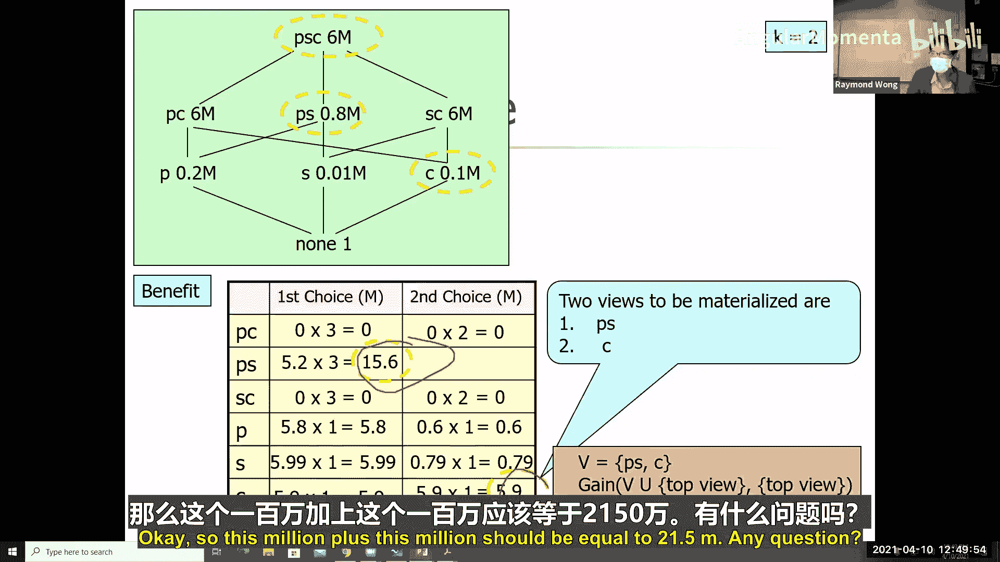
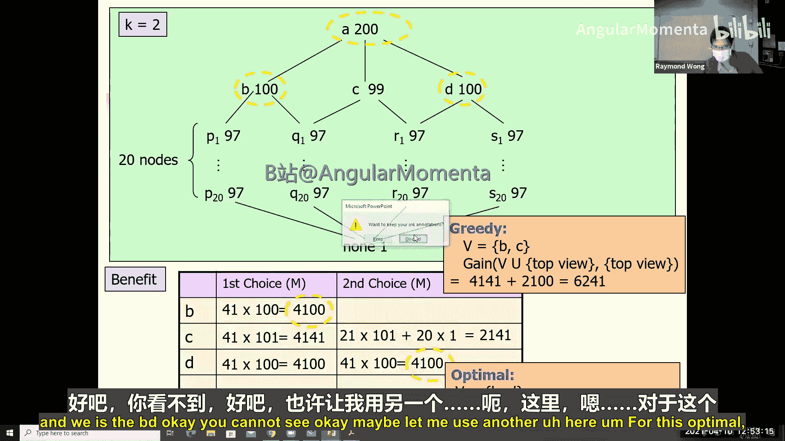
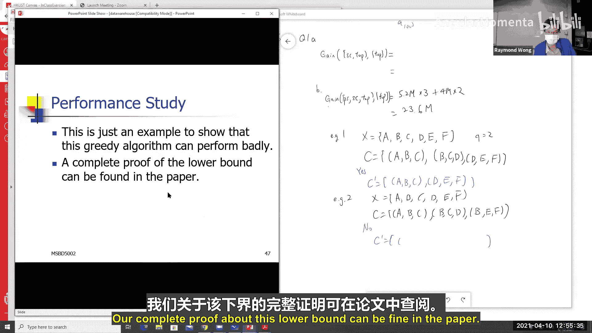

# 【香港科技大学】数据挖掘与知识发现-｜-Data-Mining-and-Knowledge-Discovery-p19-08-04-02-1._算法--BV1gEFDzVEU3_p19-

🎼The mining at noish discovery。🎼It mining and no N discovery。

Now， go to our algorithm。 The algorithm to solve this problem is very simple。Is the By algorithm。

 which the greedy algorithm， Very simple， This is given the number wheel to be materialized。Now。

 we need to define something called benefit。 Okay， the benefit is something like this。

 given we is a view。As is a set a will， which has been selected for materialization already。

 we define the benefit of selecting this will for materialization as follows。

The benefit of this will， given that we know the selection set is defined as this one。

 This is the game we learn before we use S。 Okay， after we have the S and one more view。😊。

🤧This is what we have learned before。 Okay， I don't want to go back to you again we have defined it。

 In fact， we is equal to this one。I will use an example for illustration。

Before I use the example for illustration， let me continue the greedy algorithm。

 The greedy algorithm is very simple。 Firstly， we have the selection set。 first of all。

 saw the top view only and then in this for loop， we will execute k times。 Okay。

 we will for each iteration， we select one view inside select the will not in this set as。😊。

Such that。B we as selecting this view， putting into the set as is maximize。

If this is a maximizeized one， put we into the selection set to is kence。

 Finally the resulting set is the greedy solution， maybe this is too S let me use an example for illustration。

This is the example。Suppose that K is equal to two， usually we draw a table。 We draw a table。

At the beginning， the top wheel has been materialized。This table， okay， correspond to the benefit。

To material this view， this view in the first iteration， the second iteration。

 the first iteration correspond to our first choice。

 The second iteration correspond to our second choice。 This M correspond to million million。 Okay。

 I don't write down in the million。 now continue。😊，Now， consider p。PC is here。

 We know that PC will affect P。 We are also affect C， right？

And then now let me consider this PC only， okay， we felt this one。The benefits from PC only okay。

 only this one， this this note only， Of course， before I do the materialization of this will， Okay。

 I need to answer it with this one。 this cost 6 m after we materialize this one。

 we need to use this cost 6 m minus-6 m， So which is equal to0。So D equal to 0，0。

 and this will affect itself and also this two node0 multiple by three。

C multi by three0 understand now next one， which is a different one PS， which is hereps。NowPS。

 we offer this too and then similarly。The benefit for this not only。一线。Here。

 before I materialize this one， before I do the materialization， I need to answer it with 6 M calls。

 right， after we materialize this P after we materialize this one， we need silicon on at N。

 So this number minus this number。Which is equal to 5 point2 m。 So here，5。

2 m multiple by the red color one， red color one and what color one，5。2 multi three。

 which is this one similarly for S。 Okay， this is also equal to 6 m symmetric case so very quickly。

6 m6 n equal to 0，0 multiple by 3 equal to0。 understand And for p。

 let me slow down this one here P okay only affect itself， as I mentioned。

 we don't care this one So we know that the benefit for this one is just this one before I do the materialization6 m after I do the materialization 0。

2 n6 m minus minus0。2 n。 So we have this number 5。 n5。 m multily by itself 1 equal to this one。

 So similarly S and C can be doing this way。 let me do it quickly S this two number。

6 m minus this one。 So which is 5。99 n5。99 and then see okay， I think is where easy this number 6 m0。

1 n and then we have 5。9 n So we have 5。9 n this one。 Now we are done here。

We have already compute all the benefits of all wheels in this iteration。

 If you remember the greedy approach， we want to find the will with the greatest benefit。😊。

Let's see which one is the greatest one， which is this one。😊，So PS will be materialized here。

So now at this moment， we will choose the greatest one for materialization， which is P S， okay。

 which is P S， right， So this is the materialization。 then go next。😊。

Now we also do the same thing to calculate the benefit to calculate the benefit。 okay。

 let's see how to do that similarly。PC。Now for PC， we are this one and also affect this one。

 However this time I want to say that， I want to say that this one is 6 m right？6M， however。

 this one has been materialized。 This one，0 point8 M，0 point8 M。

Now let's see P will be affected by PC and P S together。So even though I material this one。

 this one will not affect this will。 will not affect this will。

 since this will must be answer by this one since 0。8 M is smaller than 6 m。However。

 for this C C could not be fine here。 So we still need this one。 So this one will be affected。

 So what I want to say is the benefit for this load node is 6 m minus-6 m。

 which is equal to 0 and this0 multiplied by this two。 So0 multipl by two。

And then continued for this one， similarly， we also have the same illustration as see。😊。

And also originally， we thought that we affect this two note。 In fact。

 we also know that this S should be better answered by this materials note instead of this one。

 So even though I materialize this one， I will not affect this one。 So we close it。 So similarly。

 the benefit from S just minus this two and then0 and then zero multiple by two this two，0， continue。

 Okay， here， this one， be careful。 some student also make mistake here。😊，So for。

 I want to materialize this one。They's come。Do you guess what is the benefit， Who want to answer。

W such your hand， Whats the benefit。O啊加琪。揸钱啊 we yourself。Hello， I could not hear you。

Its0 point6 we again we just hear you yeah， it point60。6 why yes， yes correct。

 it0 point8 minus point2 yes， thank you。 yes， yeah， yes this0。8 minus0。

2 n but why didn't we6 m minus zero point2 n why。Yeah。

 how you are correct iss correct I just want to ask why didn't we why not at 6 m here， right？Yes。

 why not， why not， yeah。Because we have P S for0 points。6 is smaller than 6 m。Yes。

 since we are smart6， we can answer P with 6 n or 0 point8 n。 So we must choose 0 point8 n， right。

 Thank you。 Yes， So we understand that some Thank you。 Yeah， so this  point8 m0。2 n。 So 06 m。 So 6 n。

 So this is multiplied by itself。 Okay1。 So we have this answer similarly。

 I think you understand that as we also have the same scenario。 Okay。

 I don't ask student the benefits is eager to this number minus this one。 So we have this number。

0 point7，9 M。 And then final one， this one C。😊，And see could not be fine here。

 We need to answer by this one。 So 6 m。minus zero point one n。 so the benefit is equal to this one。

So five point nine m，5 point nine m multiply one。 So we have this answer。

Now we finish for the second column。 Similarlyly， we want to find the greatest benefit。 Okay。

 the greatest benefit is this one。 So we choose see for materialization。 So in this answer。😊。

Two ways to be materialized are P， S and C。The view is P， S and C。 The game is eager to。

This number plus this number。 I missed a medium。 Okay， we should have the medium here。

So this million plus this million should be equal to 21。5 m。Any question？

🎼BeThe mining and noish discovery。🎼It mining and no N discoveries。

Now let's continue the performance study。 What I mean by performance study。 Okay。

 we understand that this algorithm this problem is MP complete and using a heuristic algorithm called greedy algorithm to solve it。

 So this algorithm， in fact， is not perfect enough。 What I mean by not perfect is as follows。

Actually， this greedy algorithm we thought can perform badly。😊，But what I mean is as follows。

Now's suppose that we have this graph like this is the top view and some view like this。

 we have some view like this。 And after that here， okay， we have  20 notes，20 notes，20 notes。

20 notes so on。 Okay， we have some number like this。Suppose that we want to select two wheels。

 this is the top meal and if we calculate the benefit。The first choice and second choice。

 according to what we learn in the greedy of closure。 I don't go through the details。

 I you can read it by yourself at home。 You can read it by yourself at home here。

 if we calculate this are benefit。 This is 100。 and then this will affect 20 notes and 20 notes。

 So we know that this will affect 41 notes。41 notes and then you know that the benefits here is equal to 200 minus 100。

And then 100。 so we know that this is 100 multiply by 41。Similarly for C， okay。

 I I don't go with you。 You can read see we have something like this。And then be something like this。

 Okay we did by yourself。 And then according to also we have dot dot dot wins a P Q R S okay。

 we we don't go through with you out there we find that this one， the larger one C。

 okay will be materialized。 I will materialize C in the greedy approach。And then later。

 based on what we had learned。 okay， we also calculate the benefit。 I don't go through with you。

 Okay， I don't want to go with you。 You can read it by yourself。 And D， we can also do it。

 And here we find that here in this column， we have the largest one， we have two largest one。

 we just choose arbitrary one of them this one B。 So we choose B at the second choice。

 So in this case in our greedy， we just learn。The gradienty algorithm we just chose B and C。B and c。

And the top wheel。 and this is the top wheel and also the wheel。 and the game， as I mentioned。

 the sum of these two lumber， the sum of these two lumber。 So this is equal to 6，2，4，1。😊。

The game we have， I think is 6，2，4，1。 Now I want to say yes as follows。

Suppose we have a magic algorithm， have a very magic algorithm。 This magic algorithm。

 we call optimal Al， optimal， which find the best one。😊，So always said this we don't know the detail。

 but this magic algorithm can choose B。At the first time， although it's not the largest one here。

 chooseose this one for the second one， based on some calculation。

 you can check it at home and then choose D as the second choice。 So here this two will be chosen。

 And we is the B D。 Okay， you cannot see。 Okay， maybe let me use another here。😊。

嗯。For this optimal， we have B and D。 So the gain is equal to this two numbers to some of these two number。

 right， And now we know that this is 8000 more than 88200 more than this one。

 So we understand what you have just learned the gradient approach may perform practically practically means not as good at this optimal algorithm。

The number is smaller than the best one。 I can say， actually， this is the best one。

 but we don't know the details。 I just want to say thiss a magic algorithm， something like this。😊。

But I want to say that if Im。Divide this number， the greedy number， this number by this number。

 optimal， some number， we have 0。7， something like this。 This is a number。 Now。

 never ask you a question。 if this ratio is equal to one。

 I think that you understand that the greedy algorithm nearly to the optimal algorithm。

 So this will give the best solution。If the ratio is nearly equal to zero。

 which means that the greedy approach， return turn way more value compared with the optimal solution。

 the best solution， you will give a very best solution。So I want to see is this one。

And my question is， do you guess？These ratio have a lower part。

Maybe the answer is difficult for you to answer since this need approve。

Are there some people in the world show that actually， there's a lower bound。

 The lower bound is here。 The visuals must be at least。0。63。

 So this greedy approach must at least give the ratio 0。63。 So this will not return something like。

This will will not return something like fuel divided by something this ratio becomes this contracted with this one。

 So we understand that the greedy algorithm， although sometimes we cannot return the best solution。

 at least it will return0。63 ratio This is what I want to say here。

And then and then this is just an example to show that this greedy approach curve can perform badly。

 a complete proof about this lower line can be found in a paper。😊。

