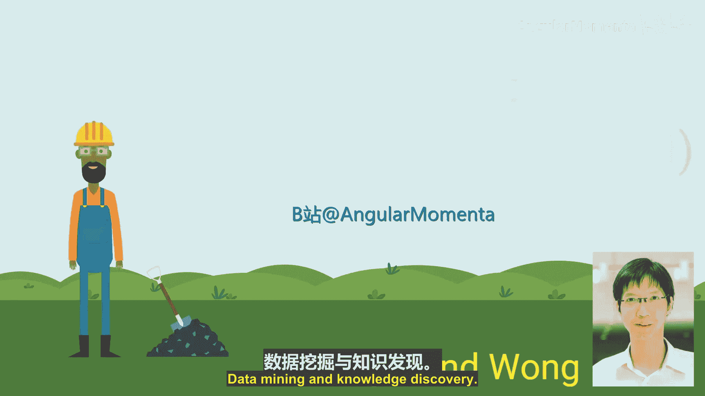
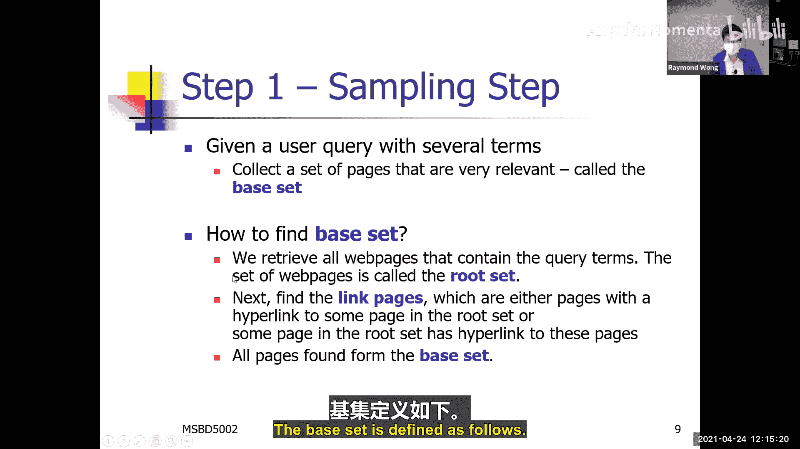
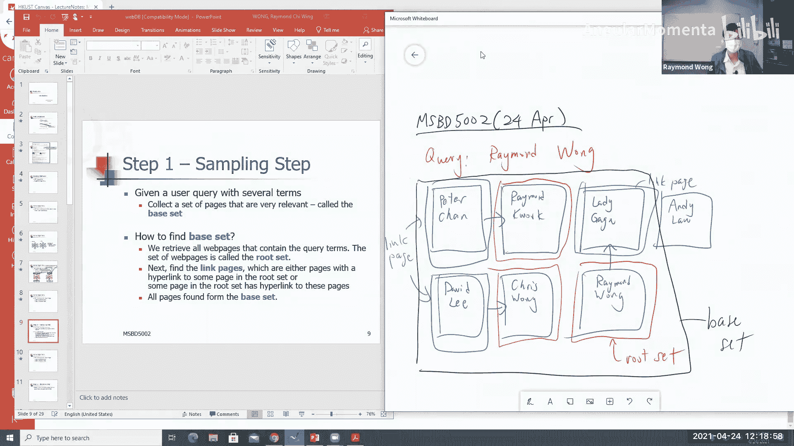
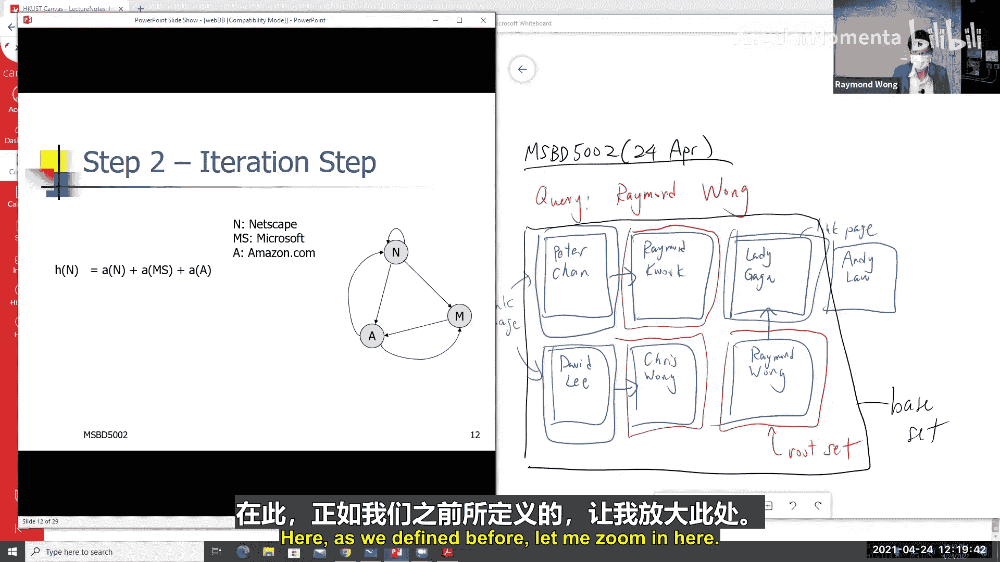
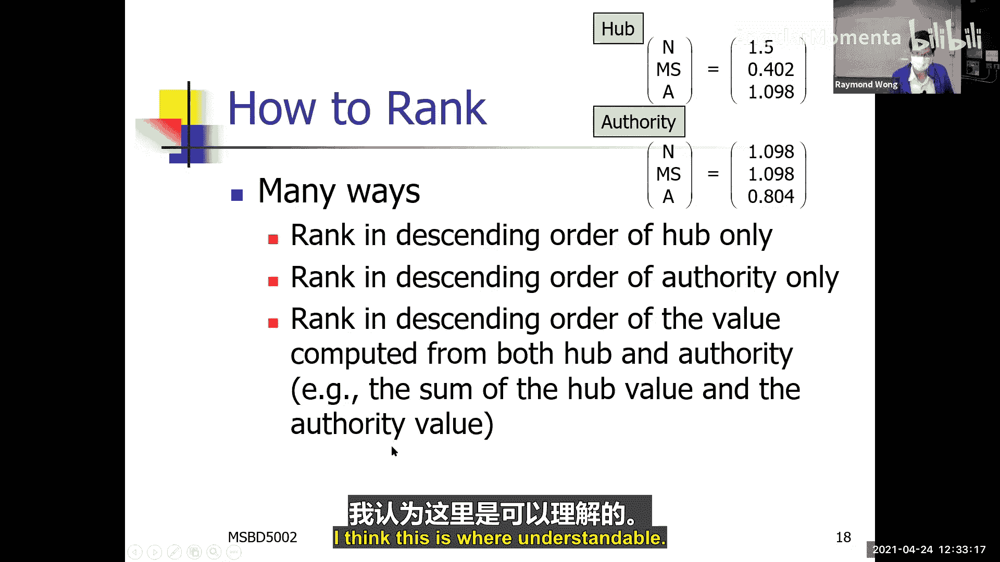

# 【香港科技大学】数据挖掘与知识发现-｜-Data-Mining-and-Knowledge-Discovery-p20-09-01-02-1._HITS算法_第一部分--BV1gEFDzVEU3_p20-

🎼mining a no discovery。🎼Iter my， no N discoveries。

Okay， web database， this can be done very quickly。 the concept is very simple。

Now this is Google and then if we type my name， Raymond one and then do a Google search。

 you can see there's a lot of web pages related to Raymond Wong。 Okay。

 one of them is the actor in Hong Kong Raymond Wong， Ho Ying and so on。 This is my web page。

 How Google when the web pages。You know their tricks。Then you don't need to pay any money to Google。

 and then your web page can be fine on the first web page。 So after your graduation。

 when you go to the small company or medium science company。 And maybe you have a startup。

 if you know this kind of trick in this lecture， you don't need to pay a lot of money to Google and also your web page can be fine in the first page。

 Let's see what is。Here we will talk about two ranking methods， one is the Hs algorithm。

 the other one is the page when algorithm being used by Google now now go to the Hs algorithm His is a rankingking algorithm which went hubs and authorities there's a two concept I will talk about this later。

Here。A good authority here。 We have a authority， which means that there's a lot of link linking to me。

Authority means there's many people thinking that I'm very good linking to me this linking each no correspond to a web page。

 this correspond to another web page， if this web page have hyperlink linking to another web page。

 so which means that there's a lot of webage linking to me and in a good authority。And H。

 which means that on the webage， I have many link linking outside to many other web pages。

 so this is a call hub。And each web page have two concept or two ways。 One is the authority weight。

 The other is hub weight。 How authority I am， how many link linking to be or how many link linking outside my web page is A V if authority weight and also H V hub weight。

Now each vers have two ways， authority weight and help weight as I mentioned。

 authority weight is related to how many edges linking to be there's a definition here we have many yellow color web page link to be。

And then a good authority has many edges from good hubs， if this yellow color are good hubs。

 then are linking to be there and also a good authority。The the formula is very simple， suppose that。

 okay， this one is called u1。It is called U 2， U 3， U 4， and then U 5， and also U 6。

So the authority is just the sum of something like the hub value。

 So the authority value is just the sum of you1。The hub value the hub value of you two and plus dot dot dot to the hub value for usage6 very simplesymmetrically。

The other thing the hub way is defined asymmetric way here we have a web page。

 we call a good hub or we hub means we have many edges going outside to many yellow color。

 This yellow color is a good authority。 So a good hub has many ongoinging edges to good authorities。

 This is our definition。So this is HV is equal to sumation V to E A U actually this is for example。

 this is U1 and also U2， U 3， U 4， U5 and U6， I think you can also understand this location。

 actually， which means that the hub value is exactly the authority U1。

 the authority of U2 and also dot dot dot dot dot to authority U6 summing up all this authority value。

 very simple。Now if you understand this。 now， let's see this one， in fact。

His algorithm involved two major step。 The first one is sampling step。

 The second one is the iteration step。Google also have discount of things that what's that？Let's see。

 given a user query， given a user query with several terms。

 collect a of web pagess that are relevant。 Call the base set。 Okay。

 maybe you don't understand this since we didn't define the base set。

 the base set is defined as follows。 before I go through all this detail。 Okay。

 let me use the whiteboard。

On the right hand side， to talk about this。Okay， suppose that。I want to do a search， for example。

 my query， the Google query is Raymond。1， so you understand that here we have two terms。

 the first term and the second term， several terms here， we have two term。

 one term and the second term。Now， if you understand， now， let's see。

 supposeuppose that I have the web page number one， web page number 2。

 web page number 3 and web page number 45 and 6。 supposeupp that here， we have the copy chain。

And here， we call Raymond。For example， clockrk。And then maybe this one is called lady。家家。

And then maybe this one is called and receive Chris。1， and maybe this one is really Whitman1。

 And maybe this is， for example， David。leave and so on。 So you can see something like this。

 you also know that。诶 there some link， okay， linking to something， for example， something like this。

😊，AndB something like this。And then then we add one more workage here， for example， this is Andy Lao。

And so on。 And now where this are 1，2，3，4，5，6，7 web pages。See what we mean by basic。

 we will retrieve all the web pages that's contain the pre returns。The terms means Raymond or wall。

 This is called looks that let me circle out。 Actually， we are talking about。This one。

 this one has Raymond one。This one also have Raymond。 And also here， we also have one。

So this what color thing we call root。Seack is the cul set。Next。Find the link pages。

 which are other pages with a hyperlink to some pages in the rootet or some pages in the rootet have hyperlink to these pages。

 So here you see that this web pages has some link linking to me。 Okay， let me use green color。

This is one kind of link pages， Okay， this is link。Paate。😡，And then let's see。

 this one also has something linking to you。So this is also called link page。

And this Raymond want webpage also linking tool here。So we also have this one is called link。P。

However， N La this web page do not have link to this kind of web color things。😊。

So this is not that one。 So in conclusion， okay， in conclusion。

All these green color and white color together。This one form the bay set， this is called bay set。

So all the web pages found in the above process is called the Bay set。 Now we have the base set。

 We have the base set。

🎼The mining and noish discovery。🎼Beer mining name no N discovery。

Now we finish the sampling step， which means we find the basic and then we go to the iteration step。

The goal here is to find the base pages that are good hubs and good authority。 So in the following。

 after we enter some pre， and then we just focus on this black colors without this one and do the following。

😊，Here， suppose that we have Nescap， Microsoft， Amazon denoted by N， Microsoft MS S and A。

 so on with some hyperlinklinking like this。Then let's see here as we define before let me shown yin here。

Let me soon in or I want to use the powerPo annotation。Then we do it。

Here now we are talking about the hub value， see the hub value next scale。😡。

Hope value means that I have many linking outside me。😊，Now， go to yeah outside。

 going outside and going outside。 So this one going outside to Nescape， going to outside Nescape。

 this one going outside to Amazon。This one is going outside to Microsoft。

 So we understand that the authority value should be sum up this with ego to this value。

 I think you understand similarly。For Microsoft， let we use blue color for illustration。 Microsoft。

 I'm talking about the hub value。 hub means I want to go out， go out。 Now。

 we know that we have one going out Amazon。 So we have Amazon here。

 The authority value is just ego to this one。 since we do not have any other outgoing edges。

Similarly， we had the hub value for Amazon。 you can check it by yourself。Now， by some equation。

 I think you know that this hub hub hub Nescape Microsoft and authority just create as a rent。

 and then this is 1，1，1，1，1，1，0，0，11，1，0， and actually this is Nescape， Microsoft and authority。

 Amazon。Now， let's see this is just a matrix representation of this free equation。

 Let me copy this a matrix。This is a called adjacency matrix。

This one has been defined in statistics or mathematics in this one， exactly this one。😊。

Exactly this one。 What I want to say is that even though you don't know hub concept。

 authority concept， you just understand that based on this graph。 Now。

 let's forget everything we have taught you。 just focus on this graph。

 If you learn mathematics before， you know that。let's see。 Nesscape， Let's see Nesscape。

 I know that we have out edge， outing edge， outgoing edge Nesscape， Amazon and Microsoft。

 So here we have Nesscape， Amazon and Microsoft， I think you understand。And similarly。

 if we have this one， Microsoft are going to Amazon。 So this one， the other thing is0。

 So you understand that actually， I want to highlight this one is the role wise matrix。

 world rise matrix。 Many student also forget this one。 role rise matrix。 After we have this adjacent。

 We have this one。 Let me continue。 Now， suppose that we have this one。 This better。😊。

And this is a vector。 And this is the adjacency matrix。

 So we can write this equation in this form very simple。 Similarlyly， okay。

 we can also do for the authority value。Let's see， nextscape， nextscape。

 Authority means that there's a many link linking to me。 Let's see。 nextscape。 This one。

 someone linking to me， this one， someone linking to me。linking for next。This is linking from Amazon。

 So we know that this value should be sum up similarly for the second one。

 we can also use the same illustration。 Microsoft， Microsoft， I'm talking about authority。 Okay。

 authority means many people linking to me。 Let me see oh， one something linking to me。

 something linking to me。 This one linking from Nast， Nasgt is here。 This one is linking from Amazon。

So just sum up the hub value similar for the first equation you can read it by yourself and then also we can also put this equation into the matrix form 11。

1001 and 110 with this form and we know that the adjacency matrix is on the top right corner。😊。

What is the relationship between the adjacency matrix defined in mathematics and this matrix。

 who want to tell you to get some coupon。 This may be your last time to get the coupon。 Yes。

 Chongchn is is transport。 and。 Yes， thank you。 Yes， good。 This is just a standard matrix operation。

 Just transport operation。Transport operation means that this is the road。 and this become a column。

 This is a row。 and this become a column。 This is a row， and this become a column。

 So just a transport。张正丽です。So here， a wetter， let me see。我 to冇嘅。H and A。

 and then we just have M transport。 this is a water。 and this is H water and transport。

 This answer by Cheng Shahan。 Go next。 Now we have this equation equation。 Okay。

 equation  one for hub equation 2 for authority。 And then we want to divide something。 Let's see。

 The deviation here is very simple。 Now I want to focus of hub value。 This a actually， we have a。

 Just use this one substitute to here。 So here we have M。And if this a is replaced by this equation。

 so M transfer it better， I think this is simple。Now go to the other way。 Let's go to the other way。

 Suppose that we focus on this authority， which is here。

 And then now you can see we also have any transfer。 This one is， in fact。

 replace with M A replace place with M A。 So you know that we have this equation H vector and also this a letter。

 Now， let me summarize。Where M matrix， we also have end transport we have discussed before and previouslyly。

 okay， in the previous line， we come， we know that we need M and transport。

By your some simple calculation， this one multiplied by this one， we have this one。

 and also and transport multiplied by n。 okay， we have this one。

 I think you know that the ordering of the matrix operation have different result。 Okay。

 this has been known in your university。 Okay， suppose that you know how to do that now let's see actually this involves iteration step Okay。

 like this。😊，How to do that。 Now， we know that this is M N transport， right， M N transport。

In this approach， first of all， we want to compute the hub value， hub value。

 This is the long normalized value。 Okay， I will have a normalized version data。 Okay。

 here we have some it number of each Nescape，scape， Microsoft and Amazon。

 this correspond hub value for Nescape， Microsoft and Amazon， we will do it by it， it 1，2。

3 up to something7， and then we also have the normalized one here and normalized means that all the value here。

 the value here， the value here， the value here， the sum of all this value must be equal to 3。 Okay。

 let's see how to do it at the beginning， everything have the equal importance of the hub value。

 So 1，1，1。And then at the beginning， seen everything is the sum is equal to three， just a copy one，1。

 one。 Now the next step， the next step。Let's get this thing out。 Okay， and then use this equation。

 Now I want to compute this hub value M N transfer， just copy this one。 We have 3，1，2，1，1，0，2，0，2。

 And then this hub value coming from here。So1，1，1 by your simple calculation， we obtain this value。

 So this is equal to 6，2，4， Q，4。And now I want to fill in the plan for this one。

 since the sum of these three number is not equal to 3， is' not equal to 3。

 I want to make it to become equal to free。 Okay， the some of these free number become equal to free。

 We can do a linear scaling。 Who want to guess what we should do for this one。

Is anyone anyone who want to answer this question？啊谭呢峰。Yes， taneng， yeah。You can unve yourself。 Yes。

 yeah， yeah， yeah。I'm here。 Maybe we should sum all of it and then normalize it sum all of the number。

 and then， okay， maybe can tell you what's this number。Make formula six divided six plus two and4。

 so is six and then also multiple by three since we want the sum is equal to three， right， yes。😊。

It's 0。5 plus 3， so it's 1。5。Yes， thank you。 So this is the number。 I think thank you， Li Fong。

 So we understand that actually，1。5 can be computed with this equation。0。5。

 I think you can also know that this is also very simple。 Just replace 6 by  two。

 So you understand it。 Now we understand that we know how to calculate this normalized value。

 And then the next step。 Now I want to compute this one。 In fact， we just copy this one here。😊，Here。

 just change this to one point five。Se point5 and then one do are whichs of computation。

And then we obtain this value。 This value is equal to 72 and5， Similarlyly。

 we also want to do the normalization。 This is also consistent with whatong mentioned1。5 is exactly1。

5 here is exactly 7 divided by 7 plus2 plus5 multily by three So we do this process I think you understand just use this vector put it here and then we compute something or think here Now we do it normalize and do it and normalize and do it and normalize on and then normalize until one stopping condition is met the stopping condition is that under the normalized value you can see that 1。

51。5 exactly the same0。4020。42 exactly the same1。091。9 exactly the same when the last iteration。

 the value are exactly equal。To the pures ittuation。They are the same thing we stop。

 We can see that it 6。Here， although they are the same， however， you can see that this is 4，02。

 this 4，0，4。 So they're different。 So we need to do it again Oh until they are the same Then we stop。

 So different kind of example have different number of iteration in this example，7 iteration。

 maybe be later we have 30 iteration。Don and then now let's see the hub value。 Okay。

 the normalized one is this one。 just copy this one。 Similarlyly for the authority value。

 we also do the same things。 M transfer n。 And then we have the long normalized one and normalized1。

 the sum of all these value must be equal to 3。 I think you can also understand that we use this equation。

 And firstly， we have 1，1，1。 and then 1，1，1。 And then now if you understand the concept is also where simple a water is equal to this things。

Which is 2，2，1，2，2，1， and 1，1，2。 And then a， which is copying from here。 normalize 1，1，1，1。

 And then by simple calculation， we obtain 5，5，4。 And then similarly， we also need to normalize。

 I think you know how to normalize it。 And then based on this， just copy this one。

 the whole red color things to here。And then we have something don't copy。

 And then after there we have do some computation。 This one will be here。And then do it again。

 normalize and again， again again again until also some stocking condition， which is okay。

 you can see that the last two iteration， they are exactly the same。 So we stop。 However for here。

 okay， you can see that。😊，8，0，5 is 8，0，4。 We cannot not stop。 So we stop here。 Now。

 let me conclude the authority value。 We have this better。And then we have this value。 Okay。

 let me summarize we have hub value of 40 value。 How to do the ranking。

 There are many ways to do the ranking。 supposeupp that I' the Google search engine。

 I want to weigh the web pages in descending order of the hub value only by example， in this case。

 I will first when Nasca first and then Amazon the second and Microsoft first。

 if I want to win the web pages in descending order of of 40 value only then here I have two value with the greatest number opportunity choose one of them。

 for example， Nasca first， Microsoft second。Amazon or the next and some maybe we went the web pages in descending order or the value compute from both the hub value and authority value。

 for example with the sum of this hub value and authority value。

 And then with the sum and do the sorting in descending order， I think this is where understandable。

