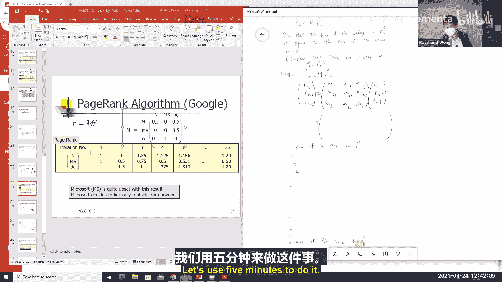
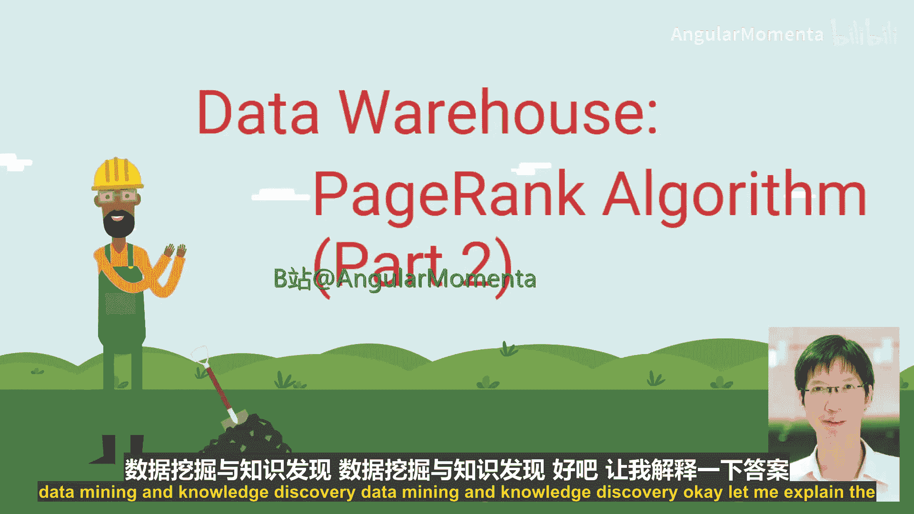
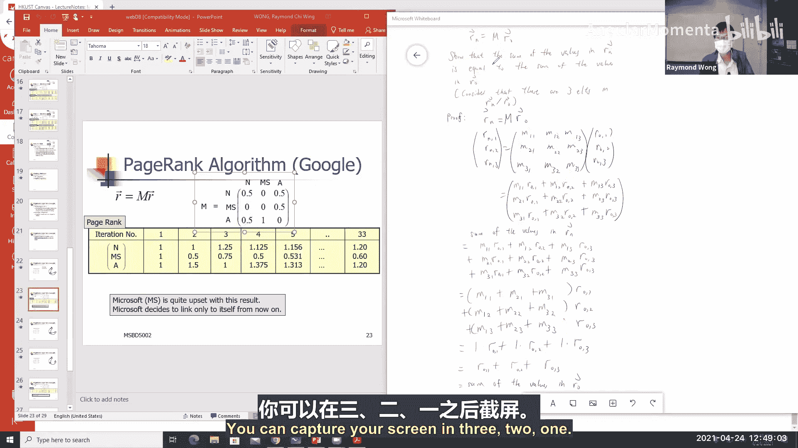
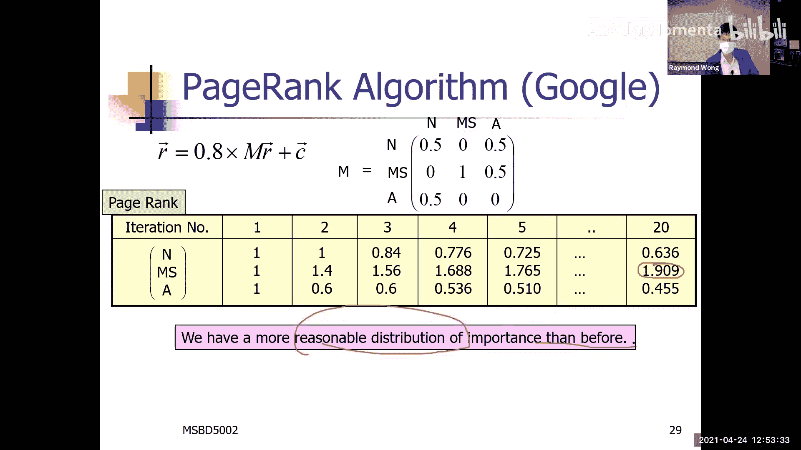

# 【香港科技大学】数据挖掘与知识发现-｜-Data-Mining-and-Knowledge-Discovery-p21-09-02-02-1._PageRank_算法_第一部分--BV1gEFDzVEU3_p21-

🎼To mining and noish discovery。🎼Beer mining age no N discoveries。Now go to the Google web page。

Page rank。Page1 algorithm is being used by Google。 There's some disadvantages of the previous algorithm call。

 since there are two concept。Hoks and authority。 We don't know which concept is more important than the other for ranking。

So in this page1 algorithm is involves on one concept for ranking， only one concept。

 no two concept for ranking， which is much simpler， much simpler。

Page1 algorithm make use of stochastic approach to when the web pages。 I think student。

 if you are good at mathematics， you know distance stochastic major stochastic process。

 stochastic approach。 But you have a lawyer。 It doesn't matter。 just like probability， probability。

Now let's see our example， Nacap， Amazon and Microsoft。 Okay， we have something like this。😊。

Now at this time， we need to define one matrix called stoastic matrix。This time。

 I want to emphasize this is not a rose wise。 This is a column wise matrix。

Many student also make mistake here。 So this is a reason why I need to emphasize column wise major。

 What's the meaning。The meaning is that I'm talking about column， not row this time。

 different from the adjacency matrix。 Now， take a look， Na cap。Here I have one outgoing edge。

 I have outgoing edges here we are two outgoing edges。

 So the probability that I can go out is one over two one over two here。

 these two correspond to the number of outgoing edges。

 So were have probability going here and half probability going here。 Let's get to next get。

 Let's get to next get 0。5。 Let's get to Amazon， Ne's get to Amazon 0。5。Now。

 maybe illustrate one more with blue color， Microsoft Microsoft。Microsoft is here。

 Microsoftsoft is here one outgoing edge。 So the probability is equal to one going to Amazon。

 Microsoft to Amazon probability is equal to one。 The other thing is zero。

 very clear and let me change this example analytical little so that you know this suppose that。

We have something like Amazon going to Na get， Amazon going to exc， Amazonaz going to Microsoft。

So you can see that Amazon， suppose that I change the example。 I I want change here。

 we are three outgoing edges。 So one divided by three，3 is a number of outgoing edges。1。 So here if。

 if I change the example， this is should be one over three one over three and one over three。

 So let's go back to our example。Now， this is our original example。In page1 algorithm。

 this very simple。 just using our equal to this matrix。

 the stochastic matrix equal to multily by our， exactly similar to what within hub and authority。

 Now， let's see page1。😊，Ittueration number one to 43 many iteration。

 We stop when are this vector and this the previous weather exactly the same。 here where this one。😊。

Currently， we don't say long long normalize or normal。 now。

 let's see this and then I will explain more Now let's see at the beginning we have one，1，1。

 also say that all the website have equal importance that Microsoft Amazon equalco important and then I also want to compute this one。

 this is r record copy the matrix05。Se，0 point5， and then 0 and sell1， and then05 and05 and sell。

 And then this are coming from here。 So this is 1，1，1。By by your calculator or your your computer。

 we know that this is equal to some number， which is one zero point five one point five。Now。

 let's see the sum of this value is equal to 3 here， the sum of this value is also equal to 3。一口就是有。

Now， let me continue。 Let me continue。For the next itation， free， I think you can get the point。 Now。

 I just put 10。 5，1。5。 And then by your calculator， this will become 1。25 and 0 75 and 1。 Oh。

 is the sum of this number is also equal to 3。 and then do it again， again， again， again。

 again again。 And then also the sum of this number is equal to 3。No。

I think I want to emphasize that before the hub value， we need to do oh， this one。

 the sum is not equal to free。 We need to do the normalization here so that the sum of this number is equal to three。

 However， for the page when， we don't need to do any normalization， automatically。

 the sum of this number is equal to three。Who want to tell me why this is the case。Worbally。

And get the maybe the coupon who want to answer just verbally。 I think it's difficult to say。 yes。

 Suhu。Because the matrix is already normalized。So the matrix is already longerized， yes。

 something like this since yes， we have， for example， we have。😊。

1 unit of equal importance at the beginning。 And then if we use this matrix， usually。

 we say that this one will be split into 0。5 and 0。5。 And then after this process。

 this one is still there。 So all the units is still there without multiplying more or decrease a more。

 right， C whole， right。😊，Yes， yes， yes， yes。 yes， thank you。 Now。

 let me write down this more clearly。 Now this is one possible exam question。

 supposeuppose that we have this matrix in this form。We want you to show that。的心。Of the values。微苏牛。

The sum of the value in our vector。Its eager to。嘅心。Of the values。然 out乐。

Now since I don't want you to use a lot of time。 So let's see， consider that。

There are only three elements。Only three elements in this are water。

And then let me do some step first。me use this one。Our water。Let me use some notation。

 Let's use the same not so that we can check the answer more easily。

Here we have something like this we and these are some real lumber and then we have the matrix。

We write down the matrix since we are considering three elements。 In fact。

 this can be generalized to 4，5，6 and so on。I just want you to understand the concept with this free element example。

And then our lot 1， our lock 2 and our lot 3。And then。

Some student may need to fill in the brain for this one。 And then in the following。

 I want to show this one。I want to show this one。Eal to something。Plus， something。 And then finally。

 also some deviation。 And finally。😊，And finally， finally。Shouldul be equal to the same miss soon oh。

Finally， I want you to show that the sum of the values。In in our N water， its equal to our lot water。

Let's see。 Let's use of five minutes to do it。

🎼The mining and noish discovery。🎼Eer mining image no N discoveries。

Can let me explain the answer。Let we explain the answer。 This is very simple。Now。

 we know that we have this matrix。 I just given this notation to you。

 I think are based on the matrix operation， You know that this will become these things。

This one multiply this weather will become this some of these three terms。 And then the second term。

 the first term， this can be just based on the definition of matrix multiplication。

 And then now we want to calculate some of the value in our and not So just some this this and this。

 we have these three things。 And then now。After we have this one。

 now what what we need to do is that just put our lock one， our lock one， our lock one here。

Our lot one， So we have M1，1， m21 and M3，1， the sum of this three lumber and also M our log2。

 our log2 and then we know that the sum of this lumber。The sum of this number maybe be here。

 The sum of this number， M1，1 M21， and31 is exactly equal to what a2 whole mention1。

 and the sum of this number is equal to one。 the sum of this number is also equal to one。

 some problem。 There's something here。 And then now we have our log  one， our two Okay。

 this our So this is two And also our log 3。 And then this is the sum of the values is our log。

 So we complete our sum of the values in our n is equal to the sum of the values in our log。

 So this is very simple。Under， now let me continue。

 you can capture your screen three to one now continue。

Continue。 Now， we understand that。Since Microsoft may be。Ha the great has the smaller rank in Google。

 of course Nascar and Amazon will be went higher than Microsoft。 But Microsoft is a company。

 Hes quite upset with this result。😊，Microsoft decide to do something so that after he do something like this。

 he will be the top one。Let's see。 he will link only to itself and now on。At the beginning。

 Microsoft is something like this。 We have a link link to Amazon。

 But now this is the web page owned by Microsoft。 I just remove my link in my company and then。

I will create a link linking to me。😡，And then the stochastic matrix is something like this。

 You can check it by yourself。 And then also， we have this stochastic matrix and then use the page1 algorithm。

 You can check it by saying and do it again again again until the last it and the previous it are exactly the same。

 which is this one。 Now you can see that Microsoft this time。 Have the greatest important。 and also。

 Microsoft at the the most important one。 So Microsoft is very happy。

 is the most important in the word now。😊，But others is not happy。 so you understand that actually。

 if you know page1 algorithm， you can use some tricks like this to boost your web page ranking。

So if you have your company now， you can also use this kind of trick。 My personal web page。

 I also have this kind of trick so that my web page originally appear in the second page or first page。

 Now I appear in the first page。 since there's many people in the world calling Raymond Wong。 Okay。

 now and in the first page。And we're happy。 and we're happy， like micro。Howeverever。See that okay。

 we just remove this link and linking to myself only。 Microsoft actually become a spider trap。

 What is the meaning of spider trap。 Let me see， Let me circle this one。Actually。

 this kind of thing is called spider track。 There's a definition。

 a spider track is a group of one or more web pages here。

 we have only one web pages that have no links out of the group So you can see that there's a link linking inside There's no link linking outside of the group and then this web page will eventually accumulate all the importance of the web。

 okay， you can see that originally here I' also have one equal importance and then it will like a random walk I have half importance going to the here and half importance going to the right side and then if I go to this Microsoft and then I will in a loop and then I could not go outside So all the original dis importance will be track inside here and also if we have some something here and then pass to here and also pass to here everything will be track in this spider track So this is why we have the spider track here like the Microsoft web page here。

Continue how to solve it。 Microsoft although he want to do that， Google also know that。 In fact。

 Google is just doing something like that originally， we know we have this kind of thing。

 they just add some waiting for example， zero point and this is0 point2 something like that。 In fact。

 okay， in Google is more complicated。 Okay， maybe this is zero point2 multiplied by this one multily。

 for example，0 point3 something multiplied by0 point5 something this one related to the network structure。

 which means how web pages linked to another web page。 this may be related to the number of keyword。

Matches to the query return， for example， Rayman Road。And maybe also。

 this one may be relate to whether this website is something like official web pages and so on。

 So there's a many trick page Google can also avoid this kind of things。 Now。

 I suppose that we are using only this simple equation。And then let's do it again， again， again。

 again。 Okay， you can check it by itself。 And now， although okay。

 you can see Microsoft also have the greatest important。 Now， this is not equal to3。

 which is better than before we have more reasonable distribution than before。😊。

